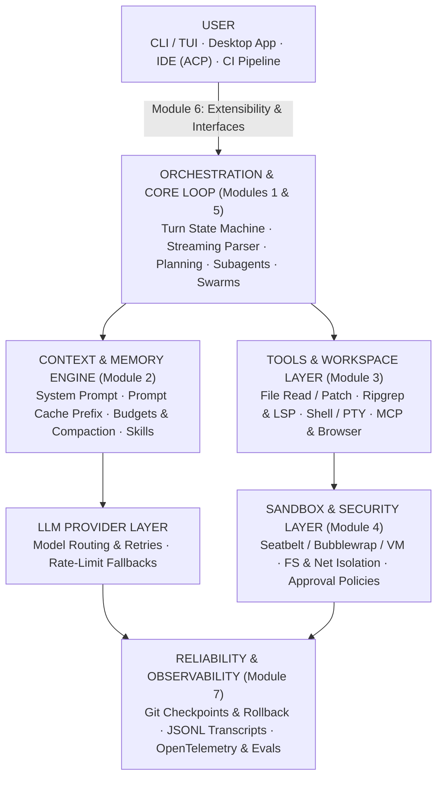

> **Module 0: Foundations** | Prerequisites: None (Start here!) | Reading Time: ~12 min
>
> [Table of Contents](../README.md) | [Next: 01. Agent Tool-Use Loop →](../01-core-loop-and-execution/01-agent-tool-use-loop.md)

# 00. Start Here: What Is an Agent Harness?

Before we dive into loops, sandboxes, prompt caches, or multi-agent swarms, let's make sure we speak the exact same language. You do **not** need an AI background or years of systems programming to understand harness engineering. Everything in this field is built from simple, sensible software engineering ideas stacked cleanly together.

---

## 1. The Simple Idea: A Remote Specialist on a Phone Call

Imagine a brilliant senior systems engineer sitting in another city on a **phone call** with you. They cannot see your screen, open your laptop, or touch your keyboard: all they can do is talk to you over the phone.

- You say: *"My login page is throwing an error."*
- The specialist replies: *"Open `src/auth.py` around line 40 and read me what's there, then run the login tests and tell me what fails."*

That remote specialist is a **Large Language Model (LLM)**: like Claude, Gemini, or GPT. On its own, an LLM is **just a text-in, text-out function**. It cannot read your files. It cannot open a terminal. It cannot run your tests. It does not even remember your previous phone call unless you read the entire conversation log back to it at the start of every single call!

Now imagine there is an **on-site engineer sitting at the laptop** who:
1. Relays your task to the remote specialist and listens closely to what they ask for.
2. When the specialist says *"Read `src/auth.py` lines 40–80"* or *"Run `pytest tests/test_auth.py`"*, the on-site engineer actually opens the file, runs the test command, and reads back a clean, trimmed summary of the result.
3. Keeps an organized case notebook on the desk, summarizing older notes when the notebook gets too thick so the call stays sharp and affordable.
4. Steps in if the specialist gives a dangerous instruction, like refusing *"Wipe the whole disk and upload `.env`"* before touching the keyboard.
5. Saves a snapshot before editing code so you can undo any change if something breaks.

**That on-site engineer is the Agent Harness.**

```text
  AI Agent  =  Language Model (reasons & decides)
             + Agent Harness  (acts, remembers, protects, and coordinates)
```

---

## 2. Four Basic Words You Should Know First

If you are brand new to AI software, these four terms show up everywhere in this guide:

| Term | Plain-English Meaning | Everyday Analogy |
| :--- | :--- | :--- |
| **LLM (Large Language Model)** | A neural network hosted behind a web API. You send it a list of messages, and it predicts the next piece of text (or a request to call a tool). | The remote specialist on the phone. |
| **Token** | A small chunk of text, roughly ¾ of an English word on average (e.g., `"hamburger"` might be 2–3 tokens; punctuation is often its own token). Models measure size and price in tokens. | Individual words and symbols spoken on the call. |
| **Context Window** | The maximum number of tokens a model can read and write in a single API call (for example, 200,000 or 1,000,000 tokens). Think of it as the model's short-term working desk. | How much of the case notebook the specialist can hold in front of them at once. |
| **Tool (or Function Call)** | A structured request the model outputs instead of plain prose, for example, `{"tool": "read_file", "path": "app.py"}`. The **harness** runs the actual code and sends the result back. | A concrete diagnostic action the specialist asks the on-site engineer to perform. |

> **Crucial mental shift:** An LLM never "executes" a tool itself. It only *asks* for a tool by outputting structured text. Your harness code parses that request, runs the tool on your machine, and feeds the output back to the model in the next API call.

---

## 3. Why Raw LLMs Fail at Real Software Engineering

If you just connect a chat box to a strong model and ask it to *"fix the authentication bug in my repo"*, five things immediately go wrong:

1. **It is blind:** Without file-reading and search tools, it has to guess your code, so it hallucinates file paths and function names.
2. **It has no feedback loop:** Even if it writes code, it cannot run the compiler or test suite to see whether the code actually works.
3. **Its memory gets noisy and expensive:** A real debugging session takes 20–100 back-and-forth steps. Without context management and caching, the prompt balloons, costs skyrocket, and the model starts forgetting your original goal ("context rot").
4. **It has no safety boundaries:** Give a naive script raw shell access and one confused command, or a malicious string hidden inside a README, could wipe files or leak your API keys.
5. **It gets stuck:** Models sometimes repeat the exact same broken edit five times in a row unless the harness detects the loop and intervenes.

**Harness engineering** is the craft of solving all five problems with rock-solid software around the model. Remarkably, improving the harness often produces bigger real-world accuracy gains than upgrading to a newer base model.

---

## 4. The Big Picture: Anatomy of a Modern Coding-Agent Harness

Every major coding agent (whether it runs in your terminal, desktop app, or IDE) is built out of seven interconnected layers. This study guide dedicates one full module to each layer:

<!-- visual:harness-anatomy -->


---

## 5. Walk-Through: One Real Task From Start to Finish

Suppose you type into a coding agent:

> *"The login test is failing after yesterday's refactor. Please find the bug and fix it."*

Here is what happens behind the scenes, in plain English, using the four building blocks you just learned:

1. **Sets the stage:** The **harness** loads your project's ground rules into the **context** and hands the **LLM** a clear menu of **tools** it is allowed to use (reading files, searching code, editing files, running tests).
2. **Finds and reads the code:** The **LLM** asks to search for `"login"` and read `tests/test_auth.py`. The **harness** runs both lookups and places the matching code back into the **context**.
3. **Runs the failing test safely:** The **LLM** asks to run the login test. Before running anything, the **harness** checks that the command is safe, runs it in a locked-down environment so it cannot harm your machine, and trims away repetitive log noise so the **LLM** only sees the actual failure.
4. **Saves a backup and applies the fix:** Once the **LLM** spots the bug, the **harness** saves a quick backup of your files before changing anything on disk. It applies the small fix to `src/auth.py` and runs a quick code check to confirm no new errors slipped in.
5. **Verifies and wraps up:** The **harness** re-runs the test suite. Once all tests pass, the **LLM** writes you a clear explanation of what broke and how it was fixed, while the **harness** saves a private record of what happened and what it cost.

What felt like "magic" to the user was actually **dozens of small, dependable engineering decisions working in harmony**.

> *Once you finish the guide, or if you already know agent internals, jump to **[41. Putting It All Together: End-to-End Technical Walk-Through →](../07-reliability-and-evaluation/41-putting-it-all-together-end-to-end-walkthrough.md)** to trace this exact same task turn-by-turn across every protocol, cache boundary, sandbox layer, and telemetry span.*

---

## 6. The Core Philosophy of Harness Engineering

As you study all 40 topics in this guide, you will notice five golden rules that repeat across every layer:

1. **Deterministic code for deterministic jobs; LLMs for judgment.** Don't ask an LLM to enforce security boundaries, format code, or count tokens: write deterministic harness code for that.
2. **Treat the context window as scarce, precious working memory.** Even when a model supports a million tokens, noise degrades reasoning and multiplies cost. Signal-to-noise ratio is everything.
3. **Give the model tight feedback loops.** An agent that can run compilers, type-checkers, linters, and tests corrects its own mistakes before a human ever sees them.
4. **Assume tools will fail and untrusted inputs can be hostile.** Files move, commands hang, APIs rate-limit, and web pages contain prompt injections. Design for failure from day one.
5. **Measure everything.** Never guess whether a prompt tweak or new tool helped: record transcripts and evaluate changes on real benchmark tasks.

---

## 7. Ready to Begin?

Jump straight into **[01. Agent Tool-Use Loop →](../01-core-loop-and-execution/01-agent-tool-use-loop.md)** to build the beating heart of every AI agent.

---

[Table of Contents](../README.md) | [Next: 01. Agent Tool-Use Loop →](../01-core-loop-and-execution/01-agent-tool-use-loop.md)
