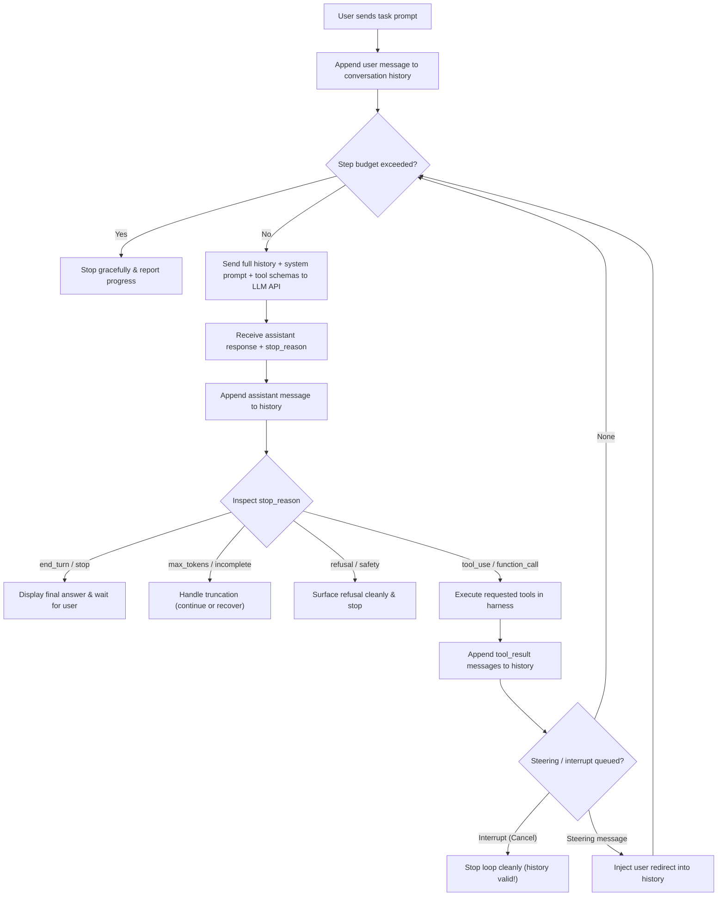

> **Module 1: Core Loop & Execution** | Prerequisites: Chapter 00 | Reading Time: ~18 min
>
> [← 00. Start Here](../00-foundations/00-start-here-what-is-an-agent-harness.md) | [Table of Contents](../README.md) | [02. Streaming & Event Parsing →](./02-streaming-and-event-parsing.md)

# 01. Agent Tool-Use Loop

If Chapter 00 gave you the big-picture map of an agent harness, this chapter builds its beating heart. Underneath every polished coding agent—whether it is Claude Code, OpenAI Codex CLI, Gemini CLI, or a custom agent you build tonight—sits one surprisingly small idea: **a `while` loop that hands messages back and forth between a stateless language model and real tools until the job is done.**

Getting the *basic* loop working takes twenty lines of code. Getting a *production* loop that terminates reliably, respects user interruptions, never burns \$50 on an infinite spin, and handles every weird edge case an API can throw at it—that is where harness engineering begins.

---

## 1. The Simple Idea: Playing Chess by Mail With a Forgetful Grandmaster

Imagine you are playing a game of chess by postal mail against a brilliant grandmaster who has **total amnesia between letters**.

Every time the grandmaster finishes thinking about a move, they forget the entire game—every previous move, the current board layout, even who they are playing. So if you just mail them a postcard that says *"Knight to F3"*, they will stare at it blankly and have no idea what board you are talking about.

To actually play a full game, **you** (the harness) have to do four things on every single turn:

1. **Keep the official game log** on your own desk—every move made from Move 1 up to right now.
2. **Mail the entire log** to the grandmaster whenever it is their turn.
3. **Read their reply** and check what kind of reply it is:
   - If they wrote a move (*"Move Bishop to C4"*), you physically move the piece on your board, check whether it is legal, write down what happened, and mail the updated log back.
   - If they wrote *"Checkmate—good game!"*, you **stop mailing letters**.
4. **Watch the clock.** If the game drags past 100 moves with both sides shuffling pieces back and forth, you call a draw instead of paying postage forever.

**What breaks if you don't have a real tool-use loop?**
Without a loop, an LLM is a one-shot answering machine. You ask *"Why is `test_login` failing?"*, it guesses from thin air because it cannot read the file, run `pytest`, inspect the traceback, edit the bug, and re-run `pytest` to confirm the fix. The loop is what transforms a text generator into an **agent** that can investigate, act, observe the real world, and self-correct.

---

## 2. Why This Matters in a Real Agent Harness

In toy demos, the agent loop is an afterthought. In production coding agents, the loop directly controls four critical properties:

- **Reliability (Task Completion):** Real software bugs rarely yield on the first try. A typical bug fix takes 6 to 25 loop iterations—searching files, reading code, running tests, discovering a surprise, adjusting the patch, and re-testing.
- **Cost Control:** Because you resend the conversation history on every turn, a runaway loop does not grow linearly in cost—it grows **quadratically** ($1 + 2 + 3 + \dots + N \approx N^2/2$ tokens read if prompt caching misses). A missing stop check can burn through an entire API budget in two minutes.
- **Responsiveness & Human Control:** Humans change their minds mid-task (*"Wait—don't touch the database migration yet, check the tests first!"*). If your loop locks out the user until the model finishes 15 steps, the harness feels sluggish and frustrating.
- **Conversation Integrity:** Model APIs enforce strict grammar rules on message histories (for instance, every tool request must be paired with a matching tool result). A sloppy loop that breaks out early on `max_tokens` or a `Ctrl+C` leaves corrupted history that causes every subsequent API call to fail with `400 Bad Request`.

---

## 3. The Big Picture

Here is the complete lifecycle of a single user request passing through a modern agent tool-use loop:



Notice the crucial symmetry: **the harness owns the loop, owns the history array, and owns the exit door.** The LLM never loops on its own—it only produces one assistant turn at a time.

---

## 4. Deep Dive: Subtopic by Subtopic

### 4.1 Stateless API Calls vs. Stateful Conversation Arrays

When you call an LLM over HTTP—whether Anthropic's Messages API (`POST /v1/messages`), OpenAI's Chat Completions API (`POST /v1/chat/completions`), or Gemini's `generateContent` endpoint—the server is fundamentally **stateless**.

> **Plain-English definition:** **Stateless** means the server does not remember your previous API call. Each request must contain all the context the model needs to produce the next response.

Because the API is stateless, your harness maintains a **stateful conversation array** (often called `messages` or `history`) in memory and on disk. On turn 1, the array has 1 message. On turn 2, it has 3 messages. By turn 10, you send all 20+ messages again.

Here is what that conversation array actually looks like in Anthropic's Messages API format after one tool call:

```json
[
  {
    "role": "user",
    "content": "Why is test_login failing?"
  },
  {
    "role": "assistant",
    "content": [
      {
        "type": "text",
        "text": "Let me run the login test first to see the exact failure."
      },
      {
        "type": "tool_use",
        "id": "toolu_01A09q90qw90lq917835lq9",
        "name": "run_shell",
        "input": { "command": "pytest tests/test_login.py" }
      }
    ]
  },
  {
    "role": "user",
    "content": [
      {
        "type": "tool_result",
        "tool_use_id": "toolu_01A09q90qw90lq917835lq9",
        "content": "FAILED tests/test_login.py::test_expired_token - AssertionError: expected 401, got 200"
      }
    ]
  }
]
```

Look closely at the third message: its `"role"` is `"user"`, even though a human did not type it! In Anthropic's format, tool outputs are sent back inside a `"user"` message containing `tool_result` blocks. In OpenAI's Responses API, tool outputs are sent as standalone `function_call_output` items matched by `call_id`. In Gemini's API, they are sent as `functionResponse` parts under a `"user"` (or `"function"`) role.

**Wait—what about "stateful" APIs like OpenAI's Responses API (`previous_response_id`)?**
Modern APIs like OpenAI's `/v1/responses` let you optionally pass `previous_response_id` so OpenAI stores the prior conversation server-side and you only send the new `function_call_output` items. That reduces network bandwidth, **but the underlying model still reads the full accumulated history on every turn**, and you still pay for those input tokens (discounted by prompt caching, which we cover in Chapter 08).

| Approach | How History Is Managed | Pros | Cons |
| :--- | :--- | :--- | :--- |
| **Client-managed array** (Anthropic Messages, OpenAI stateless, Gemini) | Harness stores the full `messages` array locally and sends it on every call. | Full control over compaction, rollback, redaction, model switching, and offline transcripts. | Slightly larger HTTP request payloads over the wire. |
| **Server-managed chain** (OpenAI `previous_response_id`) | Server stores prior turns; client sends only the delta + previous ID. | Smaller HTTP uploads; simpler client code for short sessions. | Harder to edit/compact old tool outputs, switch providers mid-session, or rewind cleanly. |

Most serious coding-agent harnesses (including Claude Code, OpenCode, Gemini CLI, and OpenAI's own Codex CLI) keep a **client-side canonical transcript** even when talking to Responses-style APIs, because features like context compaction (Ch. 10), rollback (Ch. 36), and local replay (Ch. 37) require the harness to own the source of truth.

---

### 4.2 The ReAct Cycle: Reason → Act → Observe → Repeat

In 2022, researchers formalized a pattern called **ReAct**—short for **Reasoning and Acting**. Every modern tool-using agent loop is a direct descendant of ReAct.

Instead of asking a model to solve a problem in one giant leap of imagination, the harness lets the model alternate between two distinct modes:

1. **Reason (Think):** Look at the goal and everything observed so far. Decide what information is missing or what action to try next. (Modern reasoning models like Claude with Extended Thinking, OpenAI o-series/GPT-5 reasoning, and Gemini Thinking models even have a dedicated private thinking channel for this step.)
2. **Act (Tool Call):** Emit one or more structured tool calls (`read_file`, `grep`, `edit_file`, `run_shell`) instead of guessing.
3. **Observe (Tool Result):** The harness runs the tool against the real environment and appends the raw output—file lines, compiler errors, exit codes, HTTP responses—back into the conversation.
4. **Repeat:** Feed the observation back into the model so it can update its hypothesis based on **ground truth**, not imagination.

Here is a concrete trace of how ReAct solves a real bug across four loop iterations:

```text
Iteration 1:
  Reason: "User says login accepts expired tokens. Let me locate the token check."
  Act:    grep(pattern="exp", path="src/auth")
  Observe: src/auth/jwt.py:42: if payload["exp"] > time.time(): return True

Iteration 2:
  Reason: "Let me read lines 30-60 of src/auth/jwt.py to see the full function."
  Act:    read_file(path="src/auth/jwt.py", start_line=30, end_line=60)
  Observe: Line 42 checks `>` correctly, but line 40 has `verify_exp=False`!

Iteration 3:
  Reason: "Found it! jwt.decode was called with options={'verify_exp': False}. Let me patch it."
  Act:    edit_file(path="src/auth/jwt.py", old="verify_exp: False", new="verify_exp: True")
  Observe: Edit applied cleanly.

Iteration 4:
  Reason: "Now let me run pytest to verify the fix."
  Act:    run_shell(command="pytest tests/test_login.py")
  Observe: 4 passed in 0.31s.

Iteration 5:
  Reason: "All tests pass. No more tools needed."
  Final text (stop_reason = "end_turn"):
    "Fixed the bug in src/auth/jwt.py:40 where `verify_exp` was disabled..."
```

**Why ReAct works so well:** Every observation anchors the model back to reality. Even if the model makes a wrong guess on Iteration 2, the compiler or test output on Iteration 3 immediately corrects it.

---

### 4.3 Stop Reasons and Loop Termination

How does your harness know whether to keep looping or stop? **Never guess by checking whether the text looks "finished"!** Always inspect the API's explicit **stop reason** (also called `finish_reason`, `finishReason`, or `status`).

Every major LLM provider returns a structured machine-readable reason explaining *why* the model stopped emitting tokens. Here is how they map across the three major APIs in 2025–2026:

| Semantic Meaning | Anthropic Messages API (`stop_reason`) | OpenAI Responses API (`status` / output items) | Gemini API (`finishReason`) | What Your Harness Must Do |
| :--- | :--- | :--- | :--- | :--- |
| **Finished normally** | `"end_turn"` | `status: "completed"` (no `function_call` items) | `"STOP"` (no `functionCall` parts) | Exit loop; show final assistant message to the user. |
| **Wants to run tools** | `"tool_use"` | `status: "completed"` + `function_call` item(s) in `output` | `"STOP"` + `functionCall` part(s) in `parts` | Execute tools, append results, continue loop. |
| **Hit output token limit** | `"max_tokens"` | `status: "incomplete"`, `incomplete_details.reason: "max_output_tokens"` | `"MAX_TOKENS"` | **Do not execute truncated tool calls!** Recover or ask model to continue/split work. |
| **Hit custom stop string** | `"stop_sequence"` | N/A (deprecated in Responses; `stop` in Chat Completions) | `"STOP"` (matching `stopSequences`) | Treat as deliberate halt; inspect `stop_sequence` value. |
| **Safety / policy refusal** | `"refusal"` | `refusal` content block or `incomplete_details.reason: "content_filter"` | `"SAFETY"` / `"RECITATION"` / `"PROHIBITED_CONTENT"` | Stop loop immediately; explain refusal cleanly to user. |
| **Server-side tool pause** | `"pause_turn"` | Background/async response status | N/A | Pass the assistant turn right back to the API so the server-side loop can continue (with a cap). |
| **Broken tool JSON** | N/A (rare with `strict: true`) | Malformed args if truncated | `"MALFORMED_FUNCTION_CALL"` | Do not crash; retry with backoff or inject a gentle formatting reminder. |

Let's unpack the trickiest stop reasons—because these are where bugs hide in real harnesses:

#### 1. `tool_use` vs. Checking for Tool Calls
Notice in the table above that Anthropic gives you an explicit `stop_reason == "tool_use"`, whereas OpenAI's Responses API and Gemini return `status == "completed"` / `finishReason == "STOP"` *even when the model called a tool*.
- **Best practice:** Normalize every provider's response inside your provider adapter into an internal `NormalizedTurn` object with both `stop_reason` and `tool_calls: list[ToolCall]`. Loop whenever `tool_calls` is non-empty **and** the response was not truncated or refused.

#### 2. `max_tokens` / `incomplete` (The Silent Killer)
Suppose you set `max_tokens: 4096` and the model tries to write a huge 5,000-token file inside an `edit_file` tool call. At token 4,096, the API cuts off the stream mid-JSON!
- If your harness blindly tries to parse and execute that half-written tool call, it crashes with `JSONDecodeError`—or worse, writes half a file!
- **What to do instead:**
  - If the truncated response contains **only text** (no partial tool call), you can either display it with a truncation warning or append a user message (`"Your previous response was cut off at the token limit. Please continue right where you left off."`) up to a small continuation cap (e.g., 2 retries).
  - If the truncated response cut off a **tool call**, discard the broken partial call (never leave an unexecuted/broken `tool_use` block in history without a `tool_result`!) and send a feedback message telling the model: *"Your tool call hit the output token limit and was truncated. Please break the edit into smaller pieces."*

#### 3. `refusal` (Safety Stop)
When a model refuses a request (`stop_reason == "refusal"` on Anthropic, or `SAFETY` on Gemini), **do not auto-retry in a loop**. Retrying the exact same prompt usually wastes tokens and hits the exact same guardrail. Surface the refusal cleanly to the user and reset the turn to idle.

#### 4. `stop_sequence`
When you pass `stop_sequences: ["</patch>"]`, the model stops the instant it generates that exact string (and usually strips the sequence itself from the output). Harnesses use this for custom structured delimiters or text-based tool protocols, though native JSON tool calling has largely replaced it.

#### 5. `pause_turn` (Anthropic Server-Side Tools)
In 2025–2026, APIs introduced **server-side tools** (like built-in web search or code execution that runs on the provider's servers). If a server-side loop runs long, Anthropic returns `stop_reason == "pause_turn"`. Your harness should send the conversation straight back to `/v1/messages` with the assistant's paused response intact so the provider can resume—while counting it against your step budget so it cannot pause forever.

---

### 4.4 Steering, User Interruption, and Injecting Mid-Loop Messages

Early AI agents were **modal black boxes**: once you hit Enter, the agent vanished for 90 seconds, running 12 tool calls while you watched helplessly as it edited the wrong file.

Modern harnesses solve this with **two distinct human-in-the-loop controls**:

1. **Hard Interrupt (Cancel / `Escape` or `Ctrl+C`):**
   Immediately stops the current LLM stream (via an `AbortController` / cancellation token) or kills the active tool subprocess.
   - **Critical rule:** Never corrupt the message array when cancelling! If the model already emitted a `tool_use` block and the user cancels *before* the tool finishes, your harness must either (a) append a synthetic `tool_result` saying `"Tool execution was cancelled by the user."` or (b) roll back the assistant message containing the unexecuted `tool_use` block. Otherwise, the very next API call will fail because of an orphaned `tool_use` ID. (We dive even deeper into turn state machines in Chapter 06.)

2. **Mid-Loop Steering (Course Correction Without Restarting):**
   While the agent is running tools on Turn 4, the user types: *"Actually, keep backwards compatibility with v1 clients."*
   Instead of aborting all the agent's work, the harness places that message in an **asynchronous steering queue** (`steering_queue`).
   - At the end of the current tool-execution batch (right after appending the `tool_result` blocks, before the next LLM call), the harness drains the steering queue and appends the user's message to the conversation!
   - On Turn 5, the model sees both the tool results *and* the user's new guidance, smoothly adjusting its plan without throwing away everything it already learned.

```text
Turn 4: Model calls [read_file("api.py"), run_shell("pytest")]
  ├─ Harness executes tools...
  ├─ Meanwhile, user types: "Keep v1 route working too!" -> pushed to steering_queue
  ├─ Tools finish -> Harness appends tool_results to messages
  ├─ Harness checks steering_queue -> non-empty!
  └─ Harness appends: {"role": "user", "content": "[User steering] Keep v1 route working too!"}
Turn 5: Model reads tool outputs + user steering and adjusts plan immediately.
```

> **Design nuance — Steering vs. Follow-Up Queues:** Some harnesses (like Codex CLI and Claude Code) distinguish between **immediate steering** (inject between tool steps *inside* the current turn) and **queued follow-up** (wait until the current turn hits `end_turn`, then automatically start the next turn with the queued message). Giving users both—or letting them press `Enter` to queue and a hotkey to steer immediately—makes an agent feel remarkably collaborative.

---

### 4.5 Turn Caps, Step Budgets, and Knowing When to Stop

Without guardrails, an autonomous loop can run all night. Imagine an agent trying to fix a flaky test: it edits file A, test fails, edits file B, test fails, reverts file A, test fails—200 iterations and \$40 later, the code is worse than when it started.

Production harnesses protect against runaway loops using **layered budgets**, not just a single hardcoded counter:

| Budget Dimension | What It Caps | Typical Default | Why You Need It |
| :--- | :--- | :--- | :--- |
| **Step / Turn Cap** (`max_turns`) | Maximum LLM round-trips per user request or session. | 20–50 per task (or unlimited interactively, strict cap like 10–30 in CI/headless mode). | Prevents infinite loops when the model loses the plot. |
| **Wall-Clock Timeout** | Total elapsed time for a single turn or autonomous run. | 5–15 minutes for CI jobs; per-tool timeouts (e.g., 30–120s) for commands. | Catches hanging builds, stalled networks, and slow retries. |
| **Cost / Token Budget** (`max_budget_usd`) | Total dollars or tokens spent in the session. | \$1–\$10 for automated jobs; configurable alerts for interactive sessions. | A single turn with huge files can cost 20x more than a tiny turn; step counts alone don't bound spend! |
| **Consecutive Error Cap** | Identical failing tool calls in a row. | 3–5 consecutive identical failures. | Stops "doom loops" early instead of waiting for turn 50 (covered deeply in Ch. 05). |

**The "Graceful Wind-Down" Trick:**
If your step cap is `20`, don't just slam the brakes with a cold `"Error: max_turns reached"` on step 20! Instead:
- At step 18 (e.g., 90% of budget), inject a brief system reminder into the user/tool feedback:
  `"Notice: You have 2 steps remaining before the turn budget ends. Avoid starting new explorations; wrap up your current verification and prepare a concise status report."`
- At step 20, make **one final call with `tools=[]`** (no tools offered) asking the model to summarize what it completed, what failed, and what remains for the human. That way the user always gets a helpful handoff instead of an abrupt crash.

---

## 5. How Real Harnesses Do It

Let's look at how five widely used open-source and documented harnesses implement the tool-use loop in practice:

- **Claude Code (Anthropic):** Runs an event-driven agentic loop around Anthropic's Messages API (`stop_reason` driving `"tool_use"` vs. `"end_turn"` vs. `"max_tokens"`). In interactive terminal mode, users can press `Escape` to interrupt mid-stream or type messages that queue or steer the next step; in headless/CI mode (`claude -p`), operators explicitly pass `--max-turns` and `--max-budget-usd` to enforce hard stop limits.
- **OpenAI Codex CLI (`openai/codex`):** Structures execution into **Threads** (persistent sessions) and **Turns** (discrete user-triggered loops) powered by the OpenAI Responses API (`/v1/responses`). It maintains an explicit **steering input queue** so directives typed while a tool is running are injected cleanly before the next model inference step, and pairs local tool execution (`shell`, `apply_patch`) with strict approval and sandbox gates inside the loop.
- **Gemini CLI (`google-gemini/gemini-cli`):** Separates the terminal UI (`packages/cli`) from the core ReAct loop engine (`packages/core`). Every loop iteration passes through deterministic lifecycle hooks (`BeforeAgent`, `BeforeModel`, `BeforeTool`, `AfterTool`) and checks `model.maxSessionTurns` (default `-1` for interactive unlimited, set to concrete values like `10`–`50` in CI/GitHub Actions) plus automatic loop-detection heuristics when tool calls repeat without progress.
- **OpenCode:** Uses a clean provider-agnostic loop where each provider adapter normalizes stop reasons and tool calls into a uniform event stream. It tracks per-step token usage and enforces step limits while preserving valid `tool_use` / `tool_result` pairing even when a user aborts mid-turn.
- **Aider:** Historically used a lean, focused edit loop (prompt → diff/search-replace output → deterministic apply → optional auto-lint/auto-test feedback → repeat up to a small reflection cap, typically 3 reflection retries). This shows that even a lightweight harness gets huge accuracy gains simply by feeding compiler/test observations back into a bounded loop.

---

## 6. Common Pitfalls & Failure Modes

| Pitfall | What Goes Wrong | How to Prevent It |
| :--- | :--- | :--- |
| **1. Orphaned `tool_use` blocks** | You break out of the loop on cancel, timeout, or exception *after* appending the assistant's `tool_use` message, but *before* appending its `tool_result`. Next API call fails with `400 Bad Request`. | Make appending `(assistant tool_use) + (all tool_results)` an atomic invariant; on cancel, always write a synthetic `"Cancelled by user"` `tool_result` for every pending ID. |
| **2. Executing truncated tool calls** | Model hits `max_tokens` mid-tool-call; harness tries to run half-parsed JSON or crashes the whole session. | Always check `stop_reason` / `status` *before* dispatching tools. On `max_tokens` / `incomplete`, discard partial tool calls and nudge the model to break the action into smaller chunks. |
| **3. Forgetting to append the assistant message** | Beginners execute the tool and append `tool_result`, forgetting to append the assistant's `tool_use` turn first—or stripping out thinking/text blocks from it. | Append the complete assistant message (preserving text, thinking blocks + signatures, and tool calls) immediately upon receiving the response. |
| **4. Using prose heuristics to detect completion** | Checking `if "DONE" in response.text:` breaks whenever the model says *"I am not DONE yet"* or finishes silently without saying the magic word. | Rely strictly on the API's structured `stop_reason` and presence/absence of tool calls. |
| **5. Unbounded loops in headless automation** | Interactive defaults (`max_turns = unlimited`) get copied into a CI bot, which spins for 300 turns on a broken dependency. | Require explicit `max_turns`, `max_budget_usd`, and wall-clock timeouts for all non-interactive runs. |
| **6. Mutating history in place without care** | Deleting or reordering earlier messages on every turn silently destroys prompt caching (10x higher cost and latency!). | Keep the conversation array **append-only** during normal turns; only compact deliberately at scheduled thresholds (Ch. 08 & Ch. 10). |

---

## 7. Build It Yourself: Mini-Lab

Below is a complete, clean Python blueprint for a production-aware agent tool-use loop. It uses zero magic frameworks so you can see every moving part: stateless calls backed by a stateful array, normalized stop-reason handling, a thread-safe steering/cancel signal, step budgets with a graceful wind-down, and atomic `tool_use` / `tool_result` pairing.

```python
from __future__ import annotations

import json
import threading
from dataclasses import dataclass, field
from queue import Empty, Queue
from typing import Any, Callable


@dataclass
class ToolCall:
    id: str
    name: str
    arguments: dict[str, Any]


@dataclass
class NormalizedResponse:
    stop_reason: str  # "end_turn" | "tool_use" | "max_tokens" | "refusal" | "pause_turn"
    text: str
    tool_calls: list[ToolCall]
    raw_assistant_message: dict[str, Any]  # Provider-exact message to append verbatim
    input_tokens: int = 0
    output_tokens: int = 0


@dataclass
class LoopBudget:
    max_steps: int = 20
    wind_down_steps_left: int = 2
    max_total_tokens: int = 200_000


@dataclass
class AgentLoopResult:
    status: str  # "completed" | "cancelled" | "refused" | "budget_exhausted"
    final_text: str
    steps_taken: int
    total_tokens: int


class AgentHarnessLoop:
    """Minimal, production-structured ReAct tool-use loop."""

    def __init__(
        self,
        call_llm: Callable[[list[dict[str, Any]], bool], NormalizedResponse],
        tools: dict[str, Callable[[dict[str, Any]], str]],
        budget: LoopBudget | None = None,
    ) -> None:
        self.call_llm = call_llm
        self.tools = tools
        self.budget = budget or LoopBudget()
        self.history: list[dict[str, Any]] = []
        self.steering_queue: Queue[str] = Queue()
        self.cancel_event = threading.Event()

    def steer(self, message: str) -> None:
        """Called from UI thread while the agent is busy."""
        self.steering_queue.put(message)

    def cancel(self) -> None:
        """Hard-interrupt the active turn cleanly."""
        self.cancel_event.set()

    def _drain_steering(self) -> list[str]:
        notes: list[str] = []
        while True:
            try:
                notes.append(self.steering_queue.get_nowait())
            except Empty:
                return notes

    def _execute_tool_safely(self, call: ToolCall) -> str:
        """Never crash the loop on a tool error; return actionable feedback instead."""
        fn = self.tools.get(call.name)
        if fn is None:
            available = ", ".join(sorted(self.tools.keys()))
            return f"Error: Unknown tool '{call.name}'. Available tools: {available}"
        try:
            return fn(call.arguments)
        except Exception as exc:
            return f"Error executing '{call.name}': {type(exc).__name__}: {exc}"

    def run_turn(self, user_prompt: str) -> AgentLoopResult:
        self.cancel_event.clear()
        self.history.append({"role": "user", "content": user_prompt})

        total_tokens = 0
        truncation_retries = 0

        for step in range(1, self.budget.max_steps + 1):
            if self.cancel_event.is_set():
                return AgentLoopResult("cancelled", "Stopped by user.", step - 1, total_tokens)

            # 1. Call the stateless LLM API with the full stateful conversation array.
            response = self.call_llm(self.history, True)
            total_tokens += response.input_tokens + response.output_tokens

            # 2. Handle refusal immediately (do not auto-retry).
            if response.stop_reason == "refusal":
                self.history.append(response.raw_assistant_message)
                return AgentLoopResult("refused", response.text or "Request refused.", step, total_tokens)

            # 3. Handle output truncation BEFORE trusting any tool calls.
            if response.stop_reason == "max_tokens":
                truncation_retries += 1
                if truncation_retries > 2:
                    return AgentLoopResult(
                        "budget_exhausted",
                        "Model repeatedly hit output token limits.",
                        step,
                        total_tokens,
                    )
                if response.tool_calls:
                    # Do NOT append a broken partial tool_use without a matching result.
                    self.history.append({
                        "role": "user",
                        "content": (
                            "[Harness notice] Your previous tool call was cut off by max_tokens. "
                            "Please split your action into smaller, targeted steps."
                        ),
                    })
                else:
                    self.history.append(response.raw_assistant_message)
                    self.history.append({
                        "role": "user",
                        "content": "Your response was cut off at the token limit. Please continue.",
                    })
                continue

            # Safe to record the complete assistant message verbatim.
            self.history.append(response.raw_assistant_message)

            # 4. Handle server-side pause_turn (pass right back to continue).
            if response.stop_reason == "pause_turn":
                continue

            # 5. Normal completion: no tool calls requested.
            if response.stop_reason == "end_turn" or not response.tool_calls:
                return AgentLoopResult("completed", response.text, step, total_tokens)

            # 6. Execute tools and ALWAYS produce a matching tool_result for every tool_use_id.
            tool_result_blocks: list[dict[str, Any]] = []
            for call in response.tool_calls:
                if self.cancel_event.is_set():
                    output = "Tool execution cancelled by user before running."
                else:
                    output = self._execute_tool_safely(call)
                tool_result_blocks.append({
                    "type": "tool_result",
                    "tool_use_id": call.id,
                    "content": output,
                })

            # Build the next user turn: tool results + optional steering + budget warnings.
            next_user_content: list[dict[str, Any]] = list(tool_result_blocks)

            for note in self._drain_steering():
                next_user_content.append({
                    "type": "text",
                    "text": f"[User steering mid-turn]: {note}",
                })

            steps_left = self.budget.max_steps - step
            if steps_left == self.budget.wind_down_steps_left:
                next_user_content.append({
                    "type": "text",
                    "text": (
                        f"[Harness notice] {steps_left} steps remaining in this turn budget. "
                        "Finish verification and summarize your results."
                    ),
                })

            self.history.append({"role": "user", "content": next_user_content})

            if self.cancel_event.is_set():
                return AgentLoopResult("cancelled", "Stopped by user (history preserved).", step, total_tokens)

            if total_tokens >= self.budget.max_total_tokens:
                break

        # 7. Graceful wind-down: one final tool-free call so the user gets a clean handoff.
        self.history.append({
            "role": "user",
            "content": "[Harness notice] Budget reached. Summarize progress and remaining work without calling tools.",
        })
        final_resp = self.call_llm(self.history, False)
        self.history.append(final_resp.raw_assistant_message)
        return AgentLoopResult("budget_exhausted", final_resp.text, self.budget.max_steps, total_tokens)
```

Try tracing what happens in `run_turn` under three scenarios:
1. **Happy path:** Turn 1 returns `tool_use` → tool runs → Turn 2 returns `end_turn` → exits cleanly.
2. **Mid-tool cancel:** User presses `Ctrl+C` while tool 1 of 2 is running → tool 2 gets a synthetic `"Tool execution cancelled by user before running."` result → history stays 100% valid for the next prompt!
3. **Budget hit:** At step 18, the model gets a gentle heads-up; if it still isn't finished at step 20, the harness disables tools and requests a clean progress summary.

---

## 8. Key Takeaways & Quick Self-Check

- **LLMs are stateless; harnesses create state.** The conversation array is the agent's working memory, resent (and prompt-cached) on every step.
- **ReAct grounds reasoning in reality.** Alternating Reason → Act → Observe lets the model test hypotheses against real files, compilers, and test suites.
- **Always drive loop control from structured stop reasons.** Handle `end_turn`, `tool_use`, `max_tokens`/`incomplete`, `refusal`, and `pause_turn` explicitly—never execute truncated tool calls.
- **Protect history invariants on every exit path.** Every `tool_use` ID in the conversation array must have a corresponding `tool_result`, even after cancellation or errors.
- **Layer your budgets and support mid-loop steering.** Combine step caps, token/cost caps, and graceful wind-down prompts with a steering queue so humans stay firmly in charge.

### Quick Self-Check

**1. Why does an agent loop resend previous messages on every API call instead of only sending the newest tool output?**
<details>
<summary>Show Answer</summary>
Because standard LLM inference APIs are stateless—the model keeps no memory between HTTP requests. Sending the full conversation array gives the model the context of the original goal, prior observations, and actions already attempted. (Even with server-side chained APIs like OpenAI's <code>previous_response_id</code>, the server reconstructs and feeds the full prior history into the model on every turn.)
</details>

**2. Your agent runs a tool-use loop and the user hits `Ctrl+C` right after the LLM emitted two `tool_use` blocks, before the second tool executes. What happens on the *next* user prompt if you just `break` out of the loop?**
<details>
<summary>Show Answer</summary>
The conversation history now contains an assistant message with a <code>tool_use</code> ID that has no matching <code>tool_result</code> in the following user message. Most LLM APIs strictly reject this with a <code>400 Bad Request</code> error. To prevent corruption, you must either append a synthetic <code>tool_result</code> (e.g., <code>"Cancelled by user"</code>) for every unexecuted tool ID or roll back that incomplete assistant turn cleanly.
</details>

**3. Suppose the model returns `stop_reason = "max_tokens"` while generating a `write_file` tool call. Why is it dangerous to attempt partial JSON repair and run the tool anyway?**
<details>
<summary>Show Answer</summary>
Because the output was arbitrarily chopped off at the token limit—the file content is incomplete! Running a repaired partial call would overwrite the user's file with half-written, broken code. Instead, you should detect truncation via <code>stop_reason</code> / <code>incomplete</code>, skip executing the truncated call, keep history valid, and ask the model to split the change into smaller steps.
</details>

**4. Why is a simple `max_steps = 30` cap alone not enough to bound API spend in production?**
<details>
<summary>Show Answer</summary>
Because not all steps cost the same! If a tool dumps huge files into context, 10 steps can easily consume 10x more tokens (and dollars) than 30 small steps. Production harnesses combine step caps with token/dollar budgets (<code>max_budget_usd</code>), wall-clock timeouts, and consecutive-failure detection.
</details>

---

[← 00. Start Here](../00-foundations/00-start-here-what-is-an-agent-harness.md) | [Table of Contents](../README.md) | [02. Streaming & Event Parsing →](./02-streaming-and-event-parsing.md)
