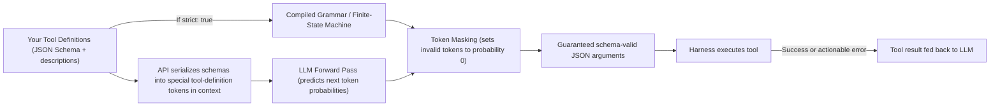

> **Module 1: Core Loop & Execution** | Prerequisites: Chapters 01–02 | Reading Time: ~20 min
>
> [← 02. Streaming & Event Parsing](./02-streaming-and-event-parsing.md) | [Table of Contents](../README.md) | [04. Parallel Tool Calling →](./04-parallel-tool-calling.md)

# 03. Tool Schema Design & Structured Outputs

In Chapters 01 and 02, we built the loop and parsed live streams. Now we face the question that separates an agent that *barely works* from an agent that feels uncannily sharp: **how do you design the tools the model calls?**

Most engineers treat tool definitions like boring boilerplate: auto-generating them straight from a database ORM or REST API and writing one-line descriptions like `"Reads a file"`. Then they wonder why the model passes relative paths instead of absolute ones, picks the wrong tool out of 40 lookalikes, or passes `"10"` (a string) when the function expects `10` (an integer).

Here is the single most important mindset shift in this chapter: **a tool schema is a user interface, and your user is a language model.**

---

## 1. The Simple Idea: Designing a Control Panel for a Brilliant Pilot Wearing Thick Gloves

Imagine you are designing the cockpit controls for a world-class pilot who has never flown your specific airplane before, and who is wearing thick winter gloves.

- If you give the pilot **85 tiny unlabeled toggle switches** (`fuel_valve_a`, `fuel_pump_v2`, `fuel_check_aux`, `fuel_check_main`), they will hesitate, flip the wrong switch, and waste precious seconds hunting for the right one.
- If you give them **10 big, clearly labeled switches** with unmistakable engravings (*"LANDING GEAR (pull DOWN only below 200 knots; do NOT use for braking"*), physical detents so a switch can only click into valid positions (`UP` / `DOWN`), and a bright indicator that explains *why* an action didn't fire (*"Cannot lower gear above 200 knots) reduce airspeed first"*), the pilot flies effortlessly on their very first flight.

**What breaks if you design sloppy tool schemas?**
1. **Format crashes:** Without strict schemas, models occasionally drop required fields, invent parameter names (`file_path` vs. `path`), or send wrong types.
2. **Tool confusion:** Overlapping tools (`search_files`, `find_files`, `grep_code`, `query_repo`) force the model to guess which one you meant.
3. **Token bloat:** Every single tool definition sits inside the model's context window on **every turn**. Loading 80 bloated tools can burn 15,000+ input tokens before the user even says `"hello"`.
4. **Silent loops:** Cryptic tool errors (`Error: EINVAL`) leave the model guessing blindly instead of fixing its mistake on the very next turn.

---

## 2. Why This Matters in a Real Agent Harness

When Anthropic, OpenAI, and leading coding-agent teams evaluate what improves real benchmark scores the most, **tool design consistently rivals, and often beats, prompt tuning or model upgrades**:

- **Accuracy:** A clear 4-sentence tool description with explicit "when to use / when NOT to use" guidance can slash wrong-tool selection errors in half without changing a single line of backend code.
- **Zero-Retry Type Safety:** Enabling **constrained decoding (`strict: true`)** eliminates syntax errors and type mismatches at the token-generation level, cutting wasted retry turns to zero.
- **Context Efficiency & Cost:** Consolidating 25 granular CRUD tools into 6 workflow-aligned tools saves thousands of tokens on *every* turn and keeps the model's attention focused on the user's code instead of giant schema walls.
- **Self-Healing Execution:** Well-crafted tool error messages turn dead ends into instant one-turn recoveries.

---

## 3. The Big Picture

Here is what actually happens under the hood when you pass a `tools` array to an LLM API, both at the **prompt level** (how the model reads your descriptions) and at the **decoding level** (how `strict: true` constrains the output tokens):



Notice the two completely different levers working together:
- **Descriptions, names, and examples** guide *semantics* (whether the model picks the right tool and passes sensible values).
- **Constrained decoding (`strict: true`)** guarantees *syntax and types* (that the JSON parses cleanly and obeys your schema structure).

You need **both**. Constrained decoding can guarantee that `path` is a `string`, but only a good description tells the model it must be an *absolute* path inside the workspace.

---

## 4. Deep Dive: Subtopic by Subtopic

### 4.1 How LLMs "See" Tools (JSON Schema Serialized Into Context)

It is easy to forget this, so let's make it crystal clear: **an LLM does not execute JSON Schema objects natively; it only reads tokens!**

When you pass a `tools` list to Anthropic, OpenAI, or Gemini, the provider's server serializes your tool names, descriptions, and **JSON Schema** (a standard JSON format for describing the shape, types, and rules of data objects) into a special block of text injected near the very top of the prompt, wrapped in provider-specific control tokens.

That has three immediate consequences:
1. **Tool schemas consume real input tokens.** A single complex tool can cost 150–400 tokens; 50 tools can easily eat 10,000–20,000 tokens on every turn.
2. **Parameter names and descriptions are prompt text.** The model reads `"description": "1-based inclusive starting line number"` the exact same way it reads your system prompt.
3. **Key ordering affects prompt caching!** If your harness builds its `tools` list from an unsorted hash map and the order changes between turns, you bust the prompt cache (Chapter 08). Always sort tools deterministically.

Here is how the exact same `read_file` tool looks across the three major APIs:

| Field | Anthropic Messages API | OpenAI Responses API | Gemini API (`functionDeclarations`) |
| :--- | :--- | :--- | :--- |
| **Wrapper type** | Object in `tools[]` | `{ "type": "function", ... }` in `tools[]` | Object in `tools[0].functionDeclarations[]` |
| **Schema key** | `input_schema` | `parameters` | `parameters` (or `parametersJsonSchema`) |
| **Strict mode flag** | `strict: true` | `strict: true` | Native schema enforcement / `responseSchema` |

Example (Anthropic Messages API format):

```json
{
  "name": "read_file",
  "strict": true,
  "description": "Read a slice of a text file with 1-based line numbers. Use this before editing any file or when inspecting specific functions. Do NOT use this to search across multiple files (use grep_search instead) or to read binary files.",
  "input_schema": {
    "type": "object",
    "properties": {
      "path": {
        "type": "string",
        "description": "Absolute path to the file inside the workspace, e.g. '/repo/src/auth.py'."
      },
      "start_line": {
        "type": "integer",
        "description": "1-based inclusive first line to read. Use 1 to start from the top."
      },
      "end_line": {
        "type": "integer",
        "description": "1-based inclusive last line to read. Keep slices <= 400 lines per call."
      }
    },
    "required": ["path", "start_line", "end_line"],
    "additionalProperties": false
  }
}
```

---

### 4.2 Writing Tool Descriptions as Micro-Prompts

In Anthropic's engineering guidance *"Writing tools for agents"*, one finding stands out above all others: **treat every tool description as a crisp micro-prompt written for a smart new teammate on their first day.**

Compare a lazy description vs. an engineered micro-prompt:

**Bad (ambiguous, invites misuse):**
```json
{
  "name": "search",
  "description": "Searches the project.",
  "input_schema": {
    "type": "object",
    "properties": {
      "q": { "type": "string" },
      "dir": { "type": "string" }
    },
    "required": ["q"]
  }
}
```
Look at all the unanswered questions the model has to guess: Does `search` match filenames or file contents? Is `q` a regex or literal text? Is it case-sensitive? Is `dir` relative or absolute? Does it skip `node_modules`?

**Good (clear, bounded, self-explanatory):**
```json
{
  "name": "grep_code",
  "description": "Search file CONTENTS across the repository using ripgrep. Use this to locate function definitions, error messages, or symbol usages. Do NOT use this to find files by filename (use find_files instead). Automatically ignores .git, node_modules, and build artifacts. Returns at most 50 matching lines with file paths and line numbers.",
  "input_schema": {
    "type": "object",
    "properties": {
      "pattern": {
        "type": "string",
        "description": "Search pattern. Treated as a regular expression unless fixed_strings is true. Example: 'def verify_token\\('."
      },
      "directory": {
        "type": "string",
        "description": "Workspace-relative directory to scope the search (e.g. 'src/auth'). Pass '.' for the entire repo."
      },
      "fixed_strings": {
        "type": "boolean",
        "description": "Set true to match pattern literally without regex escaping (recommended for error messages containing brackets or dots)."
      }
    },
    "required": ["pattern", "directory", "fixed_strings"],
    "additionalProperties": false
  }
}
```

#### The 5-Point Tool Description Checklist
1. **Unambiguous `verb_noun` name:** `grep_code` and `find_files` beat `search` and `lookup`.
2. **State what it does *and* what it returns:** Mention limits (e.g., `"Returns at most 50 matches"`) so the model knows when to narrow its query.
3. **Include explicit "When NOT to use" cross-pointers:** Pointing to the right sibling tool (*"Do NOT use for filenames; use `find_files` instead"*) is the fastest way to eliminate tool-selection confusion.
4. **Name parameters clearly & specify units/formats:** `timeout_seconds` beats `timeout`; `start_line` (1-based) beats `offset`; `iso_date` (`YYYY-MM-DD`) beats `date`.
5. **Give one tiny concrete example** whenever syntax is tricky (globs, regex, date formats, patch headers).

---

### 4.3 Constrained Decoding & Grammar-Guided Structured Outputs (`strict: true`)

For years, getting reliable JSON out of an LLM felt like herding cats: you begged in the system prompt (*"PLEASE output ONLY valid JSON, NO markdown fences, I beg you!"*) and still wrote regex cleanup code for the 2% of runs where the model returned ```` ```json ```` or passed `"true"` instead of `true`.

Modern APIs solve this at the math layer using **constrained decoding** (also called **grammar-guided generation** or **structured outputs**).

#### How Constrained Decoding Works (Zero-Math Intuition)
Normally, at every token step, an LLM computes a probability score for every token in its vocabulary (say, 100,000 possible tokens) and samples from the top candidates.

When you turn on **`strict: true`** (for tool calls) or **`json_schema` output format** (for structured text responses like Anthropic's `output_config.format` or OpenAI's `text.format`):
1. Before generation starts, the provider compiles your JSON Schema into a **Context-Free Grammar / Finite-State Machine** (often cached so repeat requests add almost zero latency).
2. At **every single token step**, the engine asks the grammar: *"Which tokens are legally allowed next?"*
   - Right after `{"line": `, only digit tokens (`0`–`9`, `-`) are allowed. Quote tokens (`"`), letters, and markdown backticks have their probability masked to **zero** (`-infinity` logit).
3. Therefore, the model **mathematically cannot** emit invalid JSON, unknown keys, wrong types, or missing required fields!

#### The Practical Rules of `strict: true` (Anthropic & OpenAI)
Because the schema must compile cleanly into a deterministic grammar, strict mode imposes a few strict JSON Schema rules you must follow:

| Strict Mode Rule | What You Must Write | Common Mistake |
| :--- | :--- | :--- |
| **Close every object** | `"additionalProperties": false` on *every* object (root and nested). | Forgetting `additionalProperties: false` on a nested sub-object → API `400` error. |
| **List all properties in `required`** (OpenAI strict mode) | Put every property in `required`, and make optional fields nullable: `"type": ["string", "null"]` (or `anyOf` with `null`). | Leaving optional fields out of `required` under OpenAI `strict: true` → API rejects schema. |
| **Avoid unsupported regex/numeric constraints** | Prefer simple types, `enum`, and clear descriptions; check provider support for `minimum`/`pattern`/`minLength` (or validate in harness code). | Throwing complex lookahead regexes into `pattern` and hitting grammar-compilation errors. |
| **First-request compilation latency** | Keep schemas stable! Providers cache compiled grammars for ~24 hours. | Dynamically mutating schema structure on every request triggers slow grammar recompilation. |

> **What `strict: true` does NOT guarantee:**
> 1. **Semantic correctness:** It guarantees `start_line` and `end_line` are integers, *not* that `start_line <= end_line` or that the file exists!
> 2. **Protection from `max_tokens` truncation:** If the response hits your output token limit halfway through generating the arguments, the JSON will still be cut off mid-string. Always check `stop_reason` (Chapters 01 & 02).

---

### 4.4 Designing Ergonomic Tool APIs

Good human APIs and good LLM tool APIs share some DNA, but they are **not identical**. Humans can read a 20-page docs site and chain 6 REST endpoints in their heads. LLMs pay a full round-trip latency and token tax on every extra call.

#### 1. Atomic vs. Composite (Workflow-Aligned) Tools
Suppose a user asks the agent to investigate a GitHub pull request.
- **Too granular (raw REST mirroring):** `get_pr_metadata`, `list_pr_files`, `get_pr_diff`, `list_pr_comments`, `get_pr_ci_status`. That forces 5 separate LLM turns just to read one PR!
- **Too bloated (mega-god tool):** One giant `github(action, repo, pr_num, issue_num, branch, body, labels, reviewers, ...)` with 35 optional parameters; confusing and error-prone.
- **Just right (workflow-aligned):** `get_pull_request_details(pr_number, include_diff, include_comments)` for reading, paired with focused write tools like `post_pr_comment` and `merge_pr`.

| Granularity | Example | When It Shines | Watch Out For |
| :--- | :--- | :--- | :--- |
| **Atomic primitives** | `read_file`, `edit_file`, `grep_code`, `run_shell` | Core coding primitives where the model needs maximum flexibility and composability. | Don't over-fragment simple variants (e.g., don't split `read_top_of_file` and `read_bottom_of_file`). |
| **Workflow-aligned composites** | `get_issue_with_comments`, `run_and_summarize_tests` | Multi-step read patterns the agent performs identically every time. | Keep parameter lists tight (≤ 6–8 parameters) and return formats bounded. |

#### 2. Use Enums, Bounded Paginators, and Sensible Defaults
- **Enums eliminate spelling guesses:** Instead of `"format": {"type": "string", "description": "output format"}`, use `"enum": ["summary", "detailed", "paths_only"]`. Combined with `strict: true`, the model can never pass `"concise"` or `"brief"`.
- **Return token-efficient shapes:** Give read/search tools a `detail_level` or `limit` parameter so the model doesn't flood its context window with 5,000 lines of raw JSON when it only needed file paths.
- **Handle paths forgivingly when safe:** If the model passes `"src/auth.py"` when your tool prefers `"/repo/src/auth.py"`, resolving workspace-relative paths deterministically (while rejecting `..` escapes outside the workspace; Ch. 22) prevents needless error turns.

#### 3. Design Error Messages as Recovery Guidance
In traditional backend software, an error message is written for a human reading a log file (`ERR_INVALID_RANGE`). In an agent harness, **every tool error is injected straight back into the LLM as its next prompt!**

Compare these two tool error outputs when `edit_file` fails:

- **Unhelpful error (causes blind thrashing):**
  `Error: Patch failed (code 422).`
- **Actionable, self-healing error (fixes itself in 1 turn):**
  `Error: Could not find target snippet in src/auth.py (0 matches). Hint: Line 40 currently reads 'payload = jwt.decode(token, SECRET, options={"verify_exp": False})'. Call read_file on lines 30-55 to verify exact whitespace before retrying.`

Notice the formula for a great agent error message:
1. **What failed** (plain English).
2. **Why it failed** (exact mismatch, constraint violated, or current state).
3. **How to recover** (the exact parameter or tool to try next).

---

### 4.5 Avoiding Schema Bloat and Overlapping Tool Confusion

One of the fastest ways to make a smart frontier model act dumb is to hand it **60 overlapping tools** (a very common trap once teams plug in 4 or 5 MCP servers!).

Here is what happens as your tool count climbs:

```text
  5-15 crisp, distinct tools   -> High accuracy, low prompt overhead (~1.5k-3k tokens)
 20-40 tools (some overlap)    -> Noticeable wrong-tool picks, ~6k-12k tokens per turn
 60+ uncurated tools           -> Severe selection confusion, 15k-30k+ tokens burned EVERY turn
```

Four proven techniques keep your tool surface sharp:

1. **Consolidate overlapping tools:** Merge `list_users`, `find_user_by_email`, and `get_user_by_id` into one clean `find_users(query, filter_by)`.
2. **Namespace by service or domain:** When integrating external systems (MCP servers, internal APIs), prefix names consistently: `github_search_issues` vs. `linear_search_issues` vs. `slack_search_messages`. Never expose three tools all named `search`.
3. **Scope tools to the current phase or subagent:** In Plan Mode (Ch. 30) or a read-only researcher subagent (Ch. 26), omit write and destructive tools completely! Smaller tool sets mean both higher safety and sharper selection.
4. **Use Progressive Disclosure / Tool Search for huge catalogs:** When a harness *must* connect to 100+ external tools (e.g., enterprise MCP integrations), don't load all 100 full JSON schemas upfront. Load a tiny index or a `search_tools` meta-tool and fetch full schemas only on demand. (We build this pattern in full in Chapter 12.)

---

## 5. How Real Harnesses Do It

- **Claude Code:** Deliberately keeps its built-in core toolset remarkably small and orthogonal; around a dozen sharply distinct primitives (`Read`, `Edit`, `Write`, `Glob`, `Grep`, `Bash`, `WebFetch`, `Task`/subagent, `TodoWrite`). Every built-in tool description is a richly detailed micro-prompt explaining exact constraints, edge cases, and explicit pointers to sibling tools (for instance, telling the model to prefer `Glob`/`Grep`/`Read` over raw `Bash` `find`/`cat` commands). When large MCP tool suites are connected, Claude Code supports deferred tool loading / tool search so dozens of external schemas don't bloat every turn.
- **OpenAI Codex CLI:** Uses a deliberately compact, high-leverage tool surface centered on `shell` (sandboxed command execution) and `apply_patch` (a dedicated structured diff tool built directly into OpenAI's Responses API). Rather than giving the model 15 separate file-manipulation endpoints, `apply_patch` handles file creation, surgical multi-hunk updates, and deletions in one crisp protocol, and returns structured mismatch diagnostics (`apply_patch_call_output`) so the model self-corrects immediately when context lines drift.
- **Gemini CLI:** Organizes built-in tools (`read_file`, `replace`, `write_file`, `glob`, `grep_search`, `run_shell_command`, `web_fetch`) with explicit JSON Schema typing, validation hooks (`BeforeTool`), and strongly typed error payloads. When MCP servers register additional tools, Gemini CLI namespaces them and lets users filter allowed tools per project to prevent tool bloat.
- **Aider:** Showed early on that matching the edit tool's format to how models naturally write code (e.g., Search/Replace blocks vs. unified diffs depending on the model family) dramatically improves edit success rates: proving that tool ergonomics matter as much as model intelligence.
- **OpenCode:** Defines every tool with a typed Zod schema (automatically compiled to JSON Schema for the provider), crisp per-parameter descriptions, and structured metadata (like permission categories), ensuring validation errors are converted into helpful LLM-readable feedback strings rather than unhandled exceptions.

---

## 6. Common Pitfalls & Failure Modes

| Pitfall | What Goes Wrong | How to Prevent It |
| :--- | :--- | :--- |
| **1. Auto-exposing every backend REST endpoint** | Agent gets 70 fragmented CRUD tools, burns 20k tokens per turn, and constantly picks the wrong endpoint. | Curate a small, workflow-aligned toolset (typically 5–15 core tools) and consolidate redundant reads. |
| **2. Assuming `strict: true` replaces runtime validation** | Model passes valid types (`start_line: 500, end_line: 10` or `path: "/etc/passwd"`) and triggers bugs or security holes. | Treat `strict: true` as syntax/type enforcement only; always validate semantics, ranges, and workspace boundaries in deterministic harness code. |
| **3. Vague parameter names (`id`, `data`, `query`, `flag`)** | Model guesses formats (Unix timestamp vs. ISO string, 0-based vs. 1-based line numbers, regex vs. glob). | Use self-documenting names (`start_line_1_based`, `timeout_seconds`, `glob_pattern`) and add format examples in descriptions. |
| **4. Returning raw stack traces or terse error codes** | Model receives `KeyError: 'foo'` or `Exit 1` with no guidance and repeats the exact same failing call 3 times. | Return concise, actionable error messages explaining *why* it failed and *what to pass instead*. |
| **5. Unstable tool list ordering or dynamic descriptions** | Injecting current timestamps or randomizing tool order invalidates the LLM's KV prompt cache on every single turn! | Keep tool names, order, and descriptions 100% static across a session (see Chapter 08). |
| **6. Missing `additionalProperties: false` in nested objects** | Enabling `strict: true` throws a `400 Bad Request` schema validation error on startup or first turn. | Write a tiny schema helper/validator (or use Pydantic/Zod strict converters) that recursively enforces `additionalProperties: false` and required nullable fields. |

---

## 7. Build It Yourself: Mini-Lab

Let's take a messy, error-prone toolset and refactor it into a **strict, ergonomic, self-healing tool module** in Python using Pydantic + JSON Schema strict compilation. Pay special attention to three things:
1. How `to_strict_schema()` recursively enforces `additionalProperties: false` and required fields so the schema works cleanly with `strict: true`.
2. How the descriptions tell the model both *when to use* and *when NOT to use* the tool.
3. How semantic validation errors become clear recovery instructions instead of crashes.

```python
from __future__ import annotations

import re
from pathlib import Path
from typing import Any, Literal
from pydantic import BaseModel, Field, ValidationError


# --- Step 1: Define ergonomic, strongly typed tool arguments ---

class SearchCodeArgs(BaseModel):
    pattern: str = Field(
        description=(
            "Pattern to search inside file contents. Treated as regex when mode='regex' "
            "or literal text when mode='literal'. Example: 'verify_exp'."
        )
    )
    directory: str = Field(
        description="Workspace-relative subdirectory to search (e.g. 'src/auth'), or '.' for repo root."
    )
    mode: Literal["literal", "regex"] = Field(
        description="Use 'literal' for exact error strings/symbols; use 'regex' for flexible patterns."
    )
    max_results: int = Field(
        description="Maximum number of matching lines to return (between 1 and 100; prefer 30)."
    )


# --- Step 2: Compile a Pydantic model into a strict-mode-compliant JSON Schema ---

def _enforce_strict_object(node: dict[str, Any]) -> None:
    """Recursively enforce strict JSON Schema constraints for OpenAI & Anthropic strict: true."""
    if node.get("type") == "object" or "properties" in node:
        node["additionalProperties"] = False
        props = node.get("properties", {})
        # OpenAI strict mode requires every property key to appear in 'required'.
        node["required"] = sorted(props.keys())
        for prop_schema in props.values():
            if isinstance(prop_schema, dict):
                _enforce_strict_object(prop_schema)

    if "items" in node and isinstance(node["items"], dict):
        _enforce_strict_object(node["items"])

    for composite in ("anyOf", "oneOf", "allOf"):
        if composite in node and isinstance(node[composite], list):
            for sub in node[composite]:
                if isinstance(sub, dict):
                    _enforce_strict_object(sub)

    for defs_key in ("$defs", "definitions"):
        if defs_key in node and isinstance(node[defs_key], dict):
            for def_schema in node[defs_key].values():
                if isinstance(def_schema, dict):
                    _enforce_strict_object(def_schema)


def build_strict_tool_definition(
    name: str,
    description: str,
    args_model: type[BaseModel],
) -> dict[str, Any]:
    """Produces a cache-stable, strict: true tool definition."""
    schema = args_model.model_json_schema()
    schema.pop("title", None)
    _enforce_strict_object(schema)

    return {
        "name": name,
        "strict": True,
        "description": description,
        "input_schema": schema,  # Rename to "parameters" for OpenAI Responses API
    }


# --- Step 3: Semantic validation + self-healing error guidance ---

def execute_search_code(raw_args: dict[str, Any], workspace_root: Path) -> str:
    # A. Validate structure (guards against non-strict providers or truncated payloads)
    try:
        args = SearchCodeArgs.model_validate(raw_args)
    except ValidationError as exc:
        return (
            f"Error: Invalid arguments for search_code: {exc.errors()[0]['msg']}. "
            "Ensure pattern (string), directory (string), mode ('literal'|'regex'), "
            "and max_results (1..100) are provided."
        )

    # B. Semantic bounds checks (strict: true cannot guarantee business/safety rules!)
    if not (1 <= args.max_results <= 100):
        return (
            f"Error: max_results={args.max_results} is out of range. "
            "Please pass an integer between 1 and 100 (recommended: 30)."
        )

    if not args.pattern.strip():
        return "Error: pattern cannot be empty. Provide a symbol, string, or regex to search for."

    # C. Security boundary check (keep paths strictly inside workspace_root)
    root = workspace_root.resolve()
    target_dir = (root / args.directory).resolve()
    if root not in (target_dir, *target_dir.parents):
        return (
            f"Error: directory '{args.directory}' resolves outside the workspace. "
            "Pass a workspace-relative path such as '.' or 'src'."
        )
    if not target_dir.exists() or not target_dir.is_dir():
        top_dirs = sorted(p.name for p in root.iterdir() if p.is_dir() and not p.name.startswith("."))
        return (
            f"Error: directory '{args.directory}' does not exist. "
            f"Available top-level directories: {', '.join(top_dirs[:15])}. "
            "Use '.' to search the whole repository."
        )

    # D. Validate regex syntax up front so malformed regexes become recovery hints
    compiled_regex: re.Pattern[str] | None = None
    if args.mode == "regex":
        try:
            compiled_regex = re.compile(args.pattern)
        except re.error as exc:
            return (
                f"Error: Invalid regular expression '{args.pattern}': {exc}. "
                "Escape special characters or set mode='literal' for plain text searches."
            )

    # E. Run deterministic search (simplified scan for this mini-lab; Ch. 15 uses ripgrep)
    matches: list[str] = []
    for file_path in sorted(target_dir.rglob("*.py")):
        try:
            lines = file_path.read_text(encoding="utf-8").splitlines()
        except OSError:
            continue
        for line_no, line in enumerate(lines, start=1):
            hit = (
                args.pattern in line
                if args.mode == "literal"
                else bool(compiled_regex and compiled_regex.search(line))
            )
            if hit:
                rel = file_path.relative_to(root)
                matches.append(f"{rel}:{line_no}: {line.strip()}")
                if len(matches) >= args.max_results:
                    break
        if len(matches) >= args.max_results:
            break

    if not matches:
        return (
            f"No matches found for '{args.pattern}' in '{args.directory}' (mode={args.mode}). "
            "Try broadening directory to '.', switching to a shorter literal substring, "
            "or using find_files if you are looking for a filename."
        )

    footer = ""
    if len(matches) == args.max_results:
        footer = f"\n[Truncated at {args.max_results} matches — narrow 'directory' or 'pattern' to see more.]"
    return "\n".join(matches) + footer


# Inspect the generated strict tool schema
SEARCH_CODE_TOOL = build_strict_tool_definition(
    name="search_code",
    description=(
        "Search text contents of Python files inside the workspace. "
        "Use this to locate function definitions, error strings, or variable references. "
        "Do NOT use this to search by filename (use find_files instead). "
        "Returns 'path:line: content' lines capped at max_results."
    ),
    args_model=SearchCodeArgs,
)
```

Look closely at what happens when the model makes a mistake: say, passing `directory="backend"` in a repo whose folder is actually named `server`:
- Instead of returning `FileNotFoundError`, the tool tells the model **the exact available top-level directories**. On the very next turn, the model immediately calls `search_code(directory="server", ...)` and succeeds!

---

## 8. Key Takeaways & Quick Self-Check

- **Tool schemas are prompts.** LLMs read serialized JSON Schema text and pay real input tokens for every tool on every turn.
- **Write micro-prompt descriptions.** Explain *what* the tool does, *when to use it*, *when NOT to use it* (pointing to sibling tools), exact parameter formats, and output limits.
- **Use `strict: true` for syntax and types, never as your only validator.** Constrained decoding masks invalid tokens at generation time so JSON always matches your schema, but your harness must still validate semantics, ranges, and security boundaries.
- **Design for workflows, not raw database tables.** Prefer 5–15 cohesive, well-namespaced tools with enums and bounded outputs over 60 overlapping CRUD endpoints.
- **Turn errors into recovery instructions.** Every tool failure message should tell the model what went wrong and what concrete adjustment to make next.

### Quick Self-Check

**1. You enable `strict: true` on an `edit_file(path, start_line, end_line, new_text)` tool. Which of these bugs does `strict: true` prevent, and which ones must your harness code still catch?**
- A) Passing `"start_line": "ten"` instead of an integer
- B) Passing `"start_line": 120, "end_line": 50` (inverted range)
- C) Passing `"path": "../../.ssh/id_rsa"`
- D) Dropping the required `"new_text"` field
<details>
<summary>Show Answer</summary>
<code>strict: true</code> prevents <strong>A</strong> (wrong type) and <strong>D</strong> (missing required field) at the token-decoding layer. Your deterministic harness code must still catch <strong>B</strong> (semantic range violation) and <strong>C</strong> (path traversal outside workspace security boundary).
</details>

**2. Why does adding explicit *"Do NOT use this tool for X: use tool Y instead"* lines to tool descriptions improve agent accuracy so noticeably?**
<details>
<summary>Show Answer</summary>
Models often see multiple plausible tools for a task (e.g., <code>grep_code</code>, <code>find_files</code>, and <code>run_shell</code>). Negative guidance creates crisp decision boundaries right where the model weighs tool selection, preventing trial-and-error calls and routing the model straight to the optimal tool on the first try.
</details>

**3. What happens to prompt caching and token costs if you attach 80 uncurated MCP tools to every turn of a 25-turn coding session?**
<details>
<summary>Show Answer</summary>
Even with prompt caching, 80 schemas can occupy 15,000–30,000 tokens of context window space: reducing attention quality (increasing wrong-tool selection), accelerating context-window limits, and multiplying input costs whenever cache misses or TTL expirations occur. Consolidating tools, scoping them per subagent/mode, or using progressive disclosure (Chapter 12) keeps the active tool surface lean.
</details>

**4. Why is `"Error: directory 'app' does not exist. Available top-level directories: src, tests, scripts."` vastly better than `"Error: ENOENT"` for an agent tool?**
<details>
<summary>Show Answer</summary>
Because the tool output feeds directly back into the LLM's next reasoning step. A cryptic <code>ENOENT</code> forces the model to spend an extra turn listing the directory (or guessing blindly), whereas an actionable error with recovery hints lets the model self-correct immediately in one turn.
</details>

---

[← 02. Streaming & Event Parsing](./02-streaming-and-event-parsing.md) | [Table of Contents](../README.md) | [04. Parallel Tool Calling →](./04-parallel-tool-calling.md)
