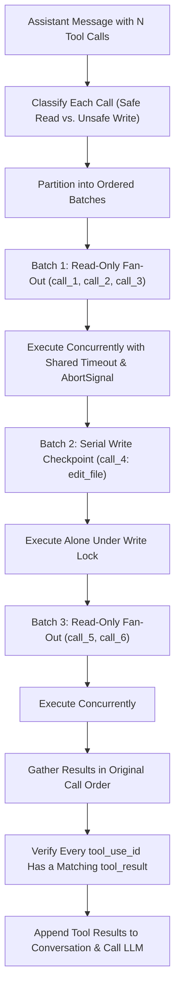

> **Module 1: Core Loop & Execution** | Prerequisites: Chapters 01–03 | Reading Time: ~18 min
>
> [← 03. Tool Schema Design & Structured Outputs](./03-tool-schema-design-and-structured-outputs.md) | [Table of Contents](../README.md) | [05. Error Recovery, Retries & Infinite-Loop Detection →](./05-error-recovery-retries-and-infinite-loop-detection.md)

# 04. Parallel Tool Calling

In Chapters 01–03, you learned how to run a basic agent loop, stream the model's response as it arrives, and design crisp tool schemas. So far, we have imagined the model asking for **one** tool at a time: read a file, wait for the result, think again, read another file, wait again.

Now imagine asking your coding agent to investigate a bug spread across six files. If the agent asks for one file per round trip to the Large Language Model (LLM), you wait through six separate network requests, six model inference passes, and six times the input token cost: just to read six files that were sitting quietly on your hard drive the whole time.

Modern LLMs can request **multiple tool calls in a single turn**, and a well-engineered harness can execute safe ones **at the same time** (in parallel). Done well, parallel tool calling cuts latency in half and makes an agent feel snappy and decisive. Done carelessly, it corrupts files, scrambles conversation history, and leaves orphaned subprocesses running in the background.

---

## 1. The Simple Idea

Imagine a busy restaurant kitchen with one head chef and a small kitchen crew.

Suppose the head chef hands over a single order ticket with five items on it:
1. Check how many eggs are in the fridge.
2. Check whether we have fresh basil.
3. Check the oven temperature.
4. Dice the onions on the cutting board.
5. Toss the diced onions into the hot pan.

If the kitchen assistant handles this order **one item at a time**, walking back to the chef after every single check, dinner will take an hour.

Instead, a sharp kitchen crew notices two completely different kinds of work on that ticket:
- **Checks (Read-only work):** Items 1, 2, and 3 only *look* at things; they don't change the kitchen. Three helpers can check the fridge, the basil, and the oven **all at once** and report back together.
- **Changes (Write / mutating work):** Item 5 (*toss the diced onions into the pan*) **depends on** Item 4 (*dice the onions*). You cannot run those simultaneously, or you will throw whole unpeeled onions into a cold pan while someone is still swinging a knife!

**Parallel tool calling** in an agent harness is simply teaching your kitchen crew two rules:
1. Accept a **single ticket with multiple requests** from the model (fan-out).
2. Run **safe, read-only requests at the same time**, while running **state-changing requests in careful order**: and make sure every single request on the ticket gets a clearly labeled answer back.

### What breaks if you don't handle this properly?
- **No parallel execution at all:** Every multi-file search or read becomes a sluggish chain of sequential LLM calls; slow for the user and wasteful on prompt tokens.
- **Blindly running everything in parallel:** Two `edit_file` calls targeting the same file overwrite each other's changes; `create_file` races with `run_tests` and fails randomly; `rm` deletes a file another tool is reading.
- **Sloppy result matching:** If one concurrent tool throws an exception and you forget to send back its error result, the LLM API rejects the entire next request with a protocol error, crashing the whole session.

---

## 2. Why This Matters in a Real Agent Harness

Parallel tool calling is not a micro-optimization: it directly shapes the four pillars of an agent's user experience:

| Dimension | Sequential (1 Tool per Turn) | Parallel Fan-Out (Multi-Tool Turn) | Real-World Impact |
| :--- | :--- | :--- | :--- |
| **Wall-Clock Latency** | 5 file reads = 5 LLM round trips (~15–25s total) | 5 file reads = 1 LLM round trip + concurrent disk I/O (~3–4s total) | **3x–6x faster** codebase exploration and verification. |
| **Input Token Cost** | Full conversation prefix resent 5 times | Full conversation prefix resent **once** for all 5 reads | Huge reduction in redundant input tokens (even with prompt caching). |
| **Data Integrity** | Safe by accident (everything is serialized) | Requires explicit read/write safety classification and locking | Prevents race conditions, lost edits, and flaky test runs. |
| **Failure Blast Radius** | 1 tool fails → immediately stops | 1 of 5 tools fails or times out → must isolate or cancel siblings cleanly | Keeps partial progress intact without hanging or corrupting history. |

In real coding tasks, **60–80% of an agent's early tool calls are pure exploration** (`read_file`, `grep`, `glob`, `git status`, `git diff`, `list_dir`). Running those in parallel is one of the highest-leverage speedups in harness engineering.

---

## 3. The Big Picture

When the LLM returns an assistant message containing several tool calls, the harness does **not** blindly toss them all into `Promise.all()` or `asyncio.gather()`. Instead, it runs them through a **partition-and-dispatch pipeline** that preserves order, enforces safety, propagates timeouts/cancellations, and guarantees a 1-to-1 match on every tool call ID.



Notice how **Batch 2 acts as a barrier**: all reads in Batch 1 finish before `edit_file` mutates disk, and `edit_file` finishes completely before Batch 3 reads the updated file or runs tests.

---

## 4. Deep Dive: Subtopic by Subtopic

### 4.1 Single-Turn Fan-Out: Multiple Tool Calls in One Assistant Message

When an LLM supports parallel tool calling (all major 2025–2026 frontier models (Claude, GPT, Gemini) do by default), a single assistant response can contain **an array of tool requests** instead of just one.

Here is what that looks like in the two most common API shapes:

#### Anthropic Messages API (`tool_use` content blocks)
```json
{
  "role": "assistant",
  "content": [
    {
      "type": "text",
      "text": "Let me inspect the auth service, its tests, and recent git changes in parallel."
    },
    {
      "type": "tool_use",
      "id": "toolu_01A",
      "name": "read_file",
      "input": { "path": "src/auth.ts" }
    },
    {
      "type": "tool_use",
      "id": "toolu_01B",
      "name": "read_file",
      "input": { "path": "tests/auth.test.ts" }
    },
    {
      "type": "tool_use",
      "id": "toolu_01C",
      "name": "run_shell",
      "input": { "command": "git log -n 5 --oneline" }
    }
  ],
  "stop_reason": "tool_use"
}
```

#### OpenAI Chat Completions API (`tool_calls` array)
```json
{
  "role": "assistant",
  "content": null,
  "tool_calls": [
    {
      "id": "call_abc1",
      "type": "function",
      "function": { "name": "read_file", "arguments": "{\"path\":\"src/auth.ts\"}" }
    },
    {
      "id": "call_abc2",
      "type": "function",
      "function": { "name": "read_file", "arguments": "{\"path\":\"tests/auth.test.ts\"}" }
    },
    {
      "id": "call_abc3",
      "type": "function",
      "function": { "name": "run_shell", "arguments": "{\"command\":\"git log -n 5 --oneline\"}" }
    }
  ]
}
```
*(Note: OpenAI's newer **Responses API** represents parallel calls as separate top-level `function_call` output items matched by `call_id` rather than a nested `tool_calls` array; see [Chapter 01](./01-agent-tool-use-loop.md).)*

> **Plain-English check: What is "fan-out" and "fan-in"?**
> **Fan-out** means taking one turn and splitting it into multiple concurrent worker tasks (like spreading out a hand of cards). **Fan-in** means waiting for all of those workers to finish and collecting their outputs back into a single ordered list before the next LLM call.

#### Can you control whether the model emits parallel calls?
Yes, and sometimes you *should* nudge or constrain it:
- **System prompt guidance:** Tell the model explicitly: *"When you need to read multiple independent files or run independent searches, emit those tool calls in parallel in a single turn."* Frontier models respond well to this and dramatically cut wasted turns.
- **Provider flags:** Some APIs expose parameters like `parallel_tool_calls: false` (OpenAI) or `disable_parallel_tool_use: true` (Anthropic) if you have a specialized workflow (such as strict step-by-step approval mode) where you want the model to emit only one tool call per turn.

---

### 4.2 Read-Only Concurrency vs. Write/Mutation Ordering Hazards

The #1 mistake beginners make with parallel tool calling is assuming that if the LLM emitted four tool calls in one turn, it is safe to run all four simultaneously. **Never trust the model to guarantee concurrency safety.** Models routinely emit hazardous combinations in a single turn, such as:

1. **Read-After-Write Hazard:**
   - Call 1: `edit_file("src/config.ts", ...)`
   - Call 2: `run_shell("npm test")`
   - *What happens if run in parallel:* `npm test` starts 5 milliseconds before `edit_file` flushes to disk, testing the *old* code and falsely reporting failure!
2. **Write-Write Collision (Lost Update):**
   - Call 1: `edit_file("src/app.ts", old="foo", new="bar")`
   - Call 2: `edit_file("src/app.ts", old="baz", new="qux")`
   - *What happens if run in parallel:* Both read the original file into memory, each patches its own copy, and the second write silently erases the first write.
3. **Shared Resource Contention:**
   - Call 1: `run_shell("npm install lodash")`
   - Call 2: `run_shell("npm install zod")`
   - *What happens if run in parallel:* Both race on `package.json`, `package-lock.json`, and `node_modules/`, corrupting the lockfile or crashing with `EBUSY`.
4. **Interactive Approval Deadlock:**
   - Call 1: `run_shell("rm -rf dist")` (needs human confirmation in the terminal)
   - Call 2: `run_shell("git push")` (also needs human confirmation)
   - *What happens if run in parallel:* Two prompts fight over standard input (`stdin`) in the terminal at the exact same time, mangling the UI.

#### Per-Tool vs. Per-Call Safety Classification
It is tempting to label each tool statically as `read_only = True/False`. That gets you 80% of the way there (`read_file`, `glob`, `grep` are always read-only; `write_file`, `edit_file` are always mutating).

But what about `run_shell` or a generic `database_query` tool?
- `run_shell("git status")` is **read-only and safe to parallelize**.
- `run_shell("git checkout -b fix")` **mutates repository state** and must run serially.
- `run_shell("pytest")` reads files, *might* write cache files (`.pytest_cache`), and consumes heavy CPU, usually safest to treat as **serial/mutating** unless proven otherwise.

Therefore, production harnesses evaluate concurrency safety **per call** using a method like `isConcurrencySafe(toolInput)`:

```python
def is_concurrency_safe(tool_name: str, tool_input: dict) -> bool:
    """Decide per-call whether a tool invocation is safe to run in parallel.
    Default to False (safe/serial) whenever uncertain!
    """
    ALWAYS_SAFE_READS = {"read_file", "glob", "grep", "list_dir", "web_search"}
    if tool_name in ALWAYS_SAFE_READS:
        return True

    if tool_name == "run_shell":
        cmd = str(tool_input.get("command", "")).strip()
        # Only allow provably read-only commands without pipes/redirects/chaining
        if any(tok in cmd for tok in (">", ">>", "|", "&&", "||", ";", "$(", "`")):
            return False
        SAFE_PREFIXES = ("git status", "git log", "git diff", "ls ", "pwd", "which ")
        return cmd in ("ls", "pwd", "git status") or cmd.startswith(SAFE_PREFIXES)

    # Unknown tools, MCP tools, edits, writes, and malformed inputs -> serialize
    return False
```

> **Golden Rule of Concurrency Classification:** Always **fail closed** (default to `False` / sequential). Running two safe calls sequentially costs 50 milliseconds; running two unsafe calls in parallel can destroy a user's working tree.

---

### 4.3 Dependency Graphs, Locks, and Batching Policies

Once each tool call is classified, how should the harness schedule them? There are three main scheduling policies used in real systems, ordered from simplest to most sophisticated:

| Policy | How It Works | Pros | Cons | Best For |
| :--- | :--- | :--- | :--- | :--- |
| **1. Partition-Then-Gather (Contiguous Batching)** | Scan tool calls left-to-right. Group adjacent `safe` calls into a parallel batch; run each `unsafe` call alone as a serial barrier. | Dead-simple (~20 lines of code); preserves exact model order; zero deadlock risk. | A read after a write waits for the write even if they touch different files. | Most CLI/IDE agents (e.g., Claude Code). |
| **2. Reader-Writer Lock (`RwLock`)** | Safe calls acquire a **shared read lock** (many can hold it at once); unsafe calls acquire an **exclusive write lock** (waits for readers, blocks new readers). | Clean fit for async/streaming dispatch where calls arrive incrementally before the stream finishes. | Must ensure fairness so writers don't starve or reorder unexpectedly. | Rust/Tokio async engines (e.g., OpenAI Codex CLI). |
| **3. Resource-Keyed Lock / DAG Scheduler** | Extract target resource keys (e.g., canonical file paths) or explicit dependency edges. Run writes to *different* files in parallel; serialize writes to the *same* file. | Maximum throughput when editing 10 independent files in one turn. | Harder to reason about hidden dependencies (e.g., a shell command touching any file). | High-throughput automated refactoring pipelines. |

#### Visualizing Partition-Then-Gather
Suppose the model emits 5 calls in one turn:
1. `read_file("a.py")` → safe
2. `grep("UserAuth")` → safe
3. `edit_file("a.py")` → **unsafe**
4. `read_file("b.py")` → safe
5. `read_file("c.py")` → safe

Partition-Then-Gather slices this into **3 ordered batches**:
- **Batch 1 (Parallel, up to concurrency cap):** `[call_1, call_2]`
- **Batch 2 (Serial barrier):** `[call_3]`
- **Batch 3 (Parallel, up to concurrency cap):** `[call_4, call_5]`

#### Don't Forget a Concurrency Cap (Semaphore)!
What if the model gets enthusiastic and emits **40 `read_file` or `web_fetch` calls** in a single turn? Launching 40 simultaneous network connections or `ripgrep` subprocesses can exhaust file descriptors (`EMFILE`), hit rate limits, or peg the user's CPU at 100%.

Always bound parallel batches with a **semaphore** (a counter that limits how many tasks run at the exact same moment, typically **4 to 10 concurrent tools** for local workspace tools, or **3 to 5** for external HTTP/MCP calls).

---

### 4.4 Matching `tool_use_id` to `tool_result` Accurately & Handling Partial Failures

Every LLM provider enforces a **strict structural contract** on tool calls:

> **The 1-to-1 Contract:** If an assistant message contains $N$ tool calls with IDs `[id_1, id_2, ..., id_N]`, the immediately following tool-response turn **must** contain **exactly $N$ results** matching those exact IDs; no missing IDs, no duplicate IDs, and no extra unknown IDs.

If you violate this contract (for example, call #2 throws an uncaught exception so you only send back results for call #1 and call #3) the API will reject your next request with an HTTP `400 Bad Request` error such as:
- Anthropic: `messages.3: tool_use ids were found without tool_result blocks immediately after: toolu_01B`
- OpenAI: `An assistant message with 'tool_calls' must be followed by tool messages responding to each 'tool_call_id'.`

#### Ordering Matters Too
Even though concurrent tasks finish in **non-deterministic wall-clock order** (call #3 might finish in 10ms while call #1 takes 400ms), you should assemble the final `tool_result` list in the **exact original order** the model requested them (`id_1`, `id_2`, `id_3`). Why?
1. Deterministic ordering keeps your conversation logs reproducible and easier to debug.
2. Some provider adapters and prompt caches behave more consistently when result ordering mirrors call ordering.

#### Handling Partial Failures Cleanly
Suppose 3 parallel tool calls run:
- `toolu_01A` (`read_file("src/auth.ts")`) → **Succeeds**
- `toolu_01B` (`read_file("src/missing.ts")`) → **Fails** (`FileNotFoundError`)
- `toolu_01C` (`grep("login")`) → **Succeeds**

**Do NOT abort the whole batch just because one read failed!** Use `asyncio.gather(..., return_exceptions=True)` in Python or `Promise.allSettled()` in TypeScript (never bare `Promise.all()`, which rejects on the first failure and drops the other resolved values).

Then convert each outcome into a properly tagged `tool_result`:

```json
{
  "role": "user",
  "content": [
    {
      "type": "tool_result",
      "tool_use_id": "toolu_01A",
      "content": "export function verifyToken(jwt: string) { ... }"
    },
    {
      "type": "tool_result",
      "tool_use_id": "toolu_01B",
      "is_error": true,
      "content": "Error: File not found: src/missing.ts. Tip: Use glob to verify the exact path."
    },
    {
      "type": "tool_result",
      "tool_use_id": "toolu_01C",
      "content": "src/routes.ts:42: router.post('/login', handleLogin)"
    }
  ]
}
```

The model receives all three answers at once: it uses the two successful results and immediately sees why the third failed so it can self-correct on the next turn.

#### What if a *serial* mutation fails mid-turn?
Suppose the model requested:
1. `edit_file("src/auth.ts", ...)` → **Fails** (search string not found)
2. `run_shell("pytest")` → queued next in the same turn

Here, running `pytest` after the edit failed is usually pointless (and sometimes dangerous if step 2 assumed step 1 succeeded, like `mkdir build` followed by `cp`). Many harnesses adopt a **sibling-skip policy on write failure**: when a mutating tool fails, skip the remaining queued mutating calls in that same turn and return synthetic error results for them:

```json
{
  "type": "tool_result",
  "tool_use_id": "toolu_02B",
  "is_error": true,
  "content": "Skipped because an earlier mutating tool call (toolu_02A: edit_file) failed in this turn."
}
```

Notice that even skipped calls still get a matching `tool_result`! The 1-to-1 contract is never broken.

---

### 4.5 Cancellation and Timeout Propagation Across Concurrent Tool Calls

Now think about what happens when things take too long, or the user hits **Ctrl+C** while four tools are running in parallel.

There are **two distinct clocks** you must manage:
1. **Per-tool timeout:** Each tool has its own sensible ceiling (e.g., `read_file`: 5 seconds; `grep`: 15 seconds; `run_shell`: 120 seconds). If one slow tool hangs, it times out with an error result while its fast siblings still succeed.
2. **Turn / user cancellation (`AbortSignal` / `asyncio.CancelledError`):** If the user presses `Ctrl+C` (or hits the UI "Stop" button), the harness must immediately signal **every** in-flight tool in the batch to stop, kill any spawned child processes (like `ripgrep` or `pytest`), and still emit synthetic cancelled `tool_result` blocks (or roll back the dangling assistant turn cleanly; more on this in Chapter 06!).

#### Cooperative Cancellation Pattern (TypeScript `AbortSignal`)
In Node.js / TypeScript, `AbortController` and `AbortSignal.any()` let you combine a **user-level abort signal** with a **per-tool timeout signal** cleanly:

```typescript
// Combine user cancellation with a per-tool deadline
function createToolSignal(
  userSignal: AbortSignal,
  timeoutMs: number
): AbortSignal {
  const timeoutSignal = AbortSignal.timeout(timeoutMs);
  // Fires as soon as EITHER the user cancels OR this single tool times out
  return AbortSignal.any([userSignal, timeoutSignal]);
}

async function runToolWithDeadline(
  call: ToolCall,
  userSignal: AbortSignal,
  timeoutMs: number
): Promise<ToolResult> {
  // Fast path: already cancelled before starting
  if (userSignal.aborted) {
    return {
      toolUseId: call.id,
      isError: true,
      content: "Cancelled by user before execution started.",
    };
  }

  const combinedSignal = createToolSignal(userSignal, timeoutMs);

  try {
    const output = await executeTool(call.name, call.input, {
      signal: combinedSignal, // Pass into fetch(), spawn(), fs calls, etc.
    });
    return { toolUseId: call.id, isError: false, content: output };
  } catch (err: unknown) {
    if (userSignal.aborted) {
      return {
        toolUseId: call.id,
        isError: true,
        content: "Tool execution cancelled by user.",
      };
    }
    if (combinedSignal.aborted) {
      return {
        toolUseId: call.id,
        isError: true,
        content: `Tool timed out after ${timeoutMs}ms.`,
      };
    }
    const msg = err instanceof Error ? err.message : String(err);
    return { toolUseId: call.id, isError: true, content: `Error: ${msg}` };
  }
}
```

> **Subprocess trap:** Cancelling an async Promise in JavaScript or an `asyncio.Task` in Python does **not** automatically kill an OS subprocess (`grep`, `npm test`, `python`) unless your tool runner hooks the abort event to send `SIGTERM` (and after a short grace period, `SIGKILL`) to the child process group! We cover process-group cleanup in full detail in Chapter 17.

---

## 5. How Real Harnesses Do It

Open-source and publicly documented coding agents have converged on remarkably clean, disciplined concurrency designs:

- **Claude Code (Anthropic):** Evaluates concurrency safety **per call** via an `isConcurrencySafe(input)` check on each tool rather than assuming all invocations of a tool are equal (for example, read-only shell inspections vs. mutating shell commands; malformed inputs fall back to `false`). It partitions the turn's tool calls left-to-right into contiguous batches: consecutive safe calls run in parallel, while unsafe calls run one at a time as serial barriers. Every `tool_use` ID is strictly matched to a `tool_result` block, with `is_error: true` returned for failures, timeouts, or skipped siblings.
- **OpenAI Codex CLI (`codex-rs`):** Uses Rust's Tokio async runtime with a **Reader-Writer Lock (`tokio::sync::RwLock`)** paired with `FuturesOrdered`. Tools marked parallel-safe acquire a shared read lock and execute concurrently; mutating or approval-gated tools acquire an exclusive write lock, waiting for in-flight reads to drain before mutating the workspace. `FuturesOrdered` guarantees that even when tasks complete out of order, their results are emitted in the exact order the model requested them.
- **Gemini CLI (`google-gemini/gemini-cli`):** Routes all function calls returned by a turn through `CoreToolScheduler`, which tracks an explicit `toolCallStatus` per call (`validating`, `awaiting_approval`, `scheduled`, `executing`, `success`, `error`, `cancelled`). This allows the terminal UI to render live per-tool status rows and spinners side-by-side while coordinating confirmation prompts cleanly without scrambling terminal input.
- **Aider:** Historically chose a different trade-off for edits, applying structured search/replace blocks from a single text response sequentially in deterministic file order, showing that you only need true async concurrency when executing external I/O-bound tools (file reads, searches, web fetches, MCP servers).

---

## 6. Common Pitfalls & Failure Modes

1. **Using `Promise.all()` instead of `Promise.allSettled()` (or bare `asyncio.gather()` without `return_exceptions=True`):**
   - *Symptom:* One missing file crashes the entire batch, leaving 4 other tools unresolved and producing missing `tool_use_id` errors on the next API call.
   - *Fix:* Always catch errors *inside* each tool wrapper so every call resolves to a structured `ToolResult` (never throws out of the batch runner).

2. **Streaming partial `tool_use` blocks before JSON arguments finish:**
   - *Symptom:* Trying to kick off a parallel tool the instant you see its name in a stream, before all its JSON argument deltas arrive, causes JSON parse failures or truncated paths.
   - *Fix:* Wait until a tool block receives its `content_block_stop` (complete, validated JSON arguments) before dispatching it, or wait for the full turn to finish before partitioning batches. (Dispatching safe read tools as soon as each individual block finishes streaming is an advanced optimization, but only safe if you strictly use an `RwLock` so a later write block cannot overtake an earlier read!)

3. **Unbounded fan-out starving the machine:**
   - *Symptom:* Model requests 50 `grep` or MCP calls at once; the OS runs out of file descriptors or the remote API bans you with HTTP `429`.
   - *Fix:* Enforce a semaphore limit (e.g., `max_concurrency = 6`) on every parallel batch.

4. **Interleaved terminal output and approval prompts:**
   - *Symptom:* Three parallel tools print streaming logs or `[y/N]` prompts to `stdout` at the same time, turning the user's terminal into unreadable soup.
   - *Fix:* Never let tools write directly to `stdout`; capture their output into per-`tool_use_id` buffers and serialize all interactive approval prompts through a single UI queue.

5. **Forgetting to sanitize/canonicalize paths in resource-keyed locks:**
   - *Symptom:* Call 1 edits `./src/app.ts` and Call 2 edits `src/../src/app.ts`. String comparison thinks they are different files and runs both writes concurrently!
   - *Fix:* Resolve canonical paths (`os.path.realpath()` / `fs.realpathSync()`) if building per-file locks, or stick to simple partition-then-gather serialization for all writes.

---

## 7. Build It Yourself: Mini-Lab

Below is a complete, runnable, self-contained **Python (`asyncio`) Parallel Tool Dispatcher** implementing every concept in this chapter:
- Per-call concurrency safety classification (`is_concurrency_safe`)
- Left-to-right **Partition-Then-Gather** batching
- Bounded concurrency via `asyncio.Semaphore`
- Per-tool timeouts + shared `asyncio.Event` user cancellation
- Sibling-skip on serial write failure
- Strict 1-to-1 `tool_use_id` preservation in original order

```python
import asyncio
from dataclasses import dataclass
from typing import Any, Callable, Awaitable


@dataclass(frozen=True)
class ToolCall:
    id: str
    name: str
    arguments: dict[str, Any]


@dataclass(frozen=True)
class ToolResult:
    tool_use_id: str
    content: str
    is_error: bool = False


def is_concurrency_safe(call: ToolCall) -> bool:
    """Classify each call individually; default to False (serial) when unsure."""
    if call.name in {"read_file", "grep", "glob", "list_dir"}:
        return True
    if call.name == "run_shell":
        cmd = str(call.arguments.get("command", "")).strip()
        if any(op in cmd for op in (">", "|", "&&", "||", ";", "$(", "`")):
            return False
        return cmd in {"git status", "pwd", "ls"} or cmd.startswith(("git log ", "git diff "))
    return False


def partition_batches(calls: list[ToolCall]) -> list[tuple[bool, list[ToolCall]]]:
    """Group consecutive safe calls into parallel batches; isolate unsafe calls alone.
    Returns list of (is_parallel, batch_calls).
    """
    batches: list[tuple[bool, list[ToolCall]]] = []
    for call in calls:
        safe = is_concurrency_safe(call)
        if safe and batches and batches[-1][0]:
            batches[-1][1].append(call)  # Append to current parallel read batch
        else:
            batches.append((safe, [call]))  # Start a new batch (parallel or single serial)
    return batches


async def execute_single_call(
    call: ToolCall,
    executor: Callable[[ToolCall], Awaitable[str]],
    timeout_sec: float,
    cancel_event: asyncio.Event,
) -> ToolResult:
    """Run one tool with timeout & cancellation; NEVER raises an unhandled exception."""
    if cancel_event.is_set():
        return ToolResult(call.id, "Cancelled before start.", is_error=True)

    tool_task = asyncio.create_task(executor(call))
    cancel_task = asyncio.create_task(cancel_event.wait())

    try:
        done, pending = await asyncio.wait(
            {tool_task, cancel_task},
            timeout=timeout_sec,
            return_when=asyncio.FIRST_COMPLETED,
        )
        for task in pending:
            task.cancel()

        if not done:
            return ToolResult(call.id, f"Error: Tool '{call.name}' timed out after {timeout_sec}s.", is_error=True)
        if cancel_task in done and cancel_event.is_set():
            return ToolResult(call.id, "Error: Cancelled by user.", is_error=True)

        output = tool_task.result()
        return ToolResult(call.id, output, is_error=False)
    except Exception as exc:
        return ToolResult(call.id, f"Error executing '{call.name}': {exc}", is_error=True)


async def dispatch_tool_calls(
    calls: list[ToolCall],
    executor: Callable[[ToolCall], Awaitable[str]],
    max_concurrency: int = 5,
    timeout_sec: float = 10.0,
    cancel_event: asyncio.Event | None = None,
) -> list[ToolResult]:
    """Execute a turn's tool calls safely and return results in exact original order."""
    cancel = cancel_event or asyncio.Event()
    semaphore = asyncio.Semaphore(max_concurrency)
    results_by_id: dict[str, ToolResult] = {}
    serial_write_failed: str | None = None

    async def bounded_run(call: ToolCall) -> ToolResult:
        async with semaphore:
            return await execute_single_call(call, executor, timeout_sec, cancel)

    for is_parallel, batch in partition_batches(calls):
        if is_parallel:
            # Even if a prior write failed, you may choose to skip all remaining calls:
            if serial_write_failed:
                for c in batch:
                    results_by_id[c.id] = ToolResult(
                        c.id, f"Skipped due to earlier write failure ({serial_write_failed}).", is_error=True
                    )
                continue

            batch_results = await asyncio.gather(*(bounded_run(c) for c in batch))
            for res in batch_results:
                results_by_id[res.tool_use_id] = res
        else:
            call = batch[0]  # Serial barrier always has length 1
            if serial_write_failed:
                results_by_id[call.id] = ToolResult(
                    call.id, f"Skipped due to earlier write failure ({serial_write_failed}).", is_error=True
                )
                continue
            res = await execute_single_call(call, executor, timeout_sec, cancel)
            results_by_id[call.id] = res
            if res.is_error:
                serial_write_failed = f"{call.id}:{call.name}"

    # Guarantee exact 1-to-1 ordering matching the original assistant message
    return [results_by_id[c.id] for c in calls]


# --- Quick Demonstration ---
async def fake_executor(call: ToolCall) -> str:
    await asyncio.sleep(0.15)  # Simulate I/O
    if call.arguments.get("path") == "missing.py":
        raise FileNotFoundError("missing.py does not exist")
    return f"OK({call.name} {call.arguments})"


async def main() -> None:
    calls = [
        ToolCall("toolu_1", "read_file", {"path": "a.py"}),
        ToolCall("toolu_2", "read_file", {"path": "missing.py"}),
        ToolCall("toolu_3", "grep", {"pattern": "login"}),
        ToolCall("toolu_4", "edit_file", {"path": "a.py", "diff": "+pass"}),
        ToolCall("toolu_5", "read_file", {"path": "b.py"}),
    ]
    results = await dispatch_tool_calls(calls, fake_executor)
    for r in results:
        print(f"{r.tool_use_id} | error={r.is_error} | {r.content}")


if __name__ == "__main__":
    asyncio.run(main())
```

**Try extending this mini-lab:**
1. Trigger `cancel_event.set()` after `0.05s` and verify that all 5 `tool_use_id`s still return cleanly formatted `is_error=True` results instead of hanging or dropping IDs.
2. Add a simulated `edit_file` failure on `toolu_4` and observe how `toolu_5` is cleanly skipped while `toolu_1`–`toolu_3` keep their results.

---

## 8. Key Takeaways & Quick Self-Check

- **Parallel tool calling is a latency and token multiplier:** Batching independent read-only calls into one turn avoids repeated LLM round trips and redundant prompt reads.
- **Classify safety per call, and fail closed:** Tools like `read_file` are always safe; tools like `run_shell` depend on the exact arguments. When in doubt, serialize.
- **Partition reads vs. writes:** Use contiguous Partition-Then-Gather batching or a Reader-Writer lock (`RwLock`) so writes act as strict barriers and never race with reads or other writes.
- **Respect the 1-to-1 ID contract religiously:** Every `tool_use_id` / `tool_call_id` from the assistant message **must** have a matching `tool_result` (even on exceptions, timeouts, cancellations, or skipped siblings) assembled in original call order.
- **Bound concurrency and propagate cancellation:** Always put a semaphore cap on fan-out and wire `AbortSignal` / cancellation events all the way down to child subprocesses.

### Quick Self-Check

**1. An LLM emits three tool calls in one turn: `[read_file("a.py"), edit_file("a.py"), read_file("a.py")]`. Why is it a bug to run the two `read_file` calls together in one parallel batch and then run `edit_file`?**
<details>
<summary>Show Answer</summary>

Reordering the third call ahead of the second violates **causal order** (Read-After-Write). The model intentionally requested the second `read_file("a.py")` *after* `edit_file("a.py")` to verify its edit! Partition-Then-Gather preserves exact order by slicing this into 3 batches: `[read_file]` → `[edit_file]` → `[read_file]`.
</details>

**2. Why is `Promise.all()` dangerous for running parallel tool calls in a TypeScript harness?**
<details>
<summary>Show Answer</summary>

`Promise.all()` short-circuits and rejects as soon as *any single* tool throws an error, discarding the resolved outputs of the sibling tools and making it easy to accidentally omit `tool_result` blocks for the remaining `tool_use_id`s. Use `Promise.allSettled()` (or wrap every tool execution in a `try/catch` that always returns a `ToolResult`).
</details>

**3. Why should a harness evaluate concurrency safety per call (`isConcurrencySafe(name, input)`) instead of only per tool name?**
<details>
<summary>Show Answer</summary>

General-purpose tools like `run_shell` or `sql_query` can perform either harmless read-only inspections (`git status`, `SELECT ...`) or destructive mutations (`rm -rf`, `DROP TABLE`, `npm install`). Per-call inspection lets safe commands parallelize while automatically serializing anything potentially mutating or ambiguous.
</details>

**4. Suppose a user presses Ctrl+C while 4 parallel read tools are running. What two things must your harness do before the next turn?**
<details>
<summary>Show Answer</summary>

First, propagate cancellation to every in-flight task **and kill any spawned OS child processes** so nothing hangs in the background. Second, preserve conversation validity by either emitting matching cancelled `tool_result` blocks for all 4 `tool_use_id`s or cleanly removing the incomplete assistant turn before persisting history.
</details>

---

[← 03. Tool Schema Design & Structured Outputs](./03-tool-schema-design-and-structured-outputs.md) | [Table of Contents](../README.md) | [05. Error Recovery, Retries & Infinite-Loop Detection →](./05-error-recovery-retries-and-infinite-loop-detection.md)
