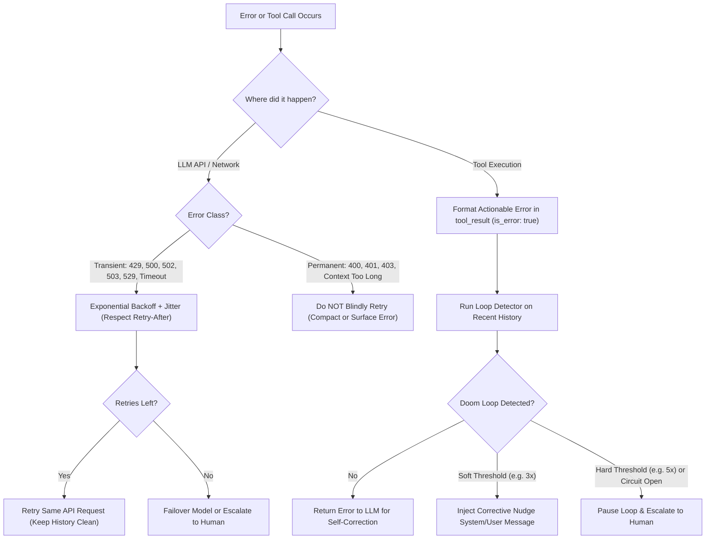

> **Module 1: Core Loop & Execution** | Prerequisites: Chapters 01–04 | Reading Time: ~20 min
>
> [← 04. Parallel Tool Calling](./04-parallel-tool-calling.md) | [Table of Contents](../README.md) | [06. Session & Turn State Machines →](./06-session-and-turn-state-machines.md)

# 05. Error Recovery, Retries & Infinite-Loop Detection

Every demo AI agent looks brilliant on the happy path: the API responds in two seconds, the file exists at the expected path, the patch applies cleanly, and the tests turn green on the first try.

Real software engineering is almost **never** the happy path. Networks drop mid-stream. LLM providers return `429 Too Many Requests` or `529 Overloaded`. The model misremembers a filename, writes a syntax error, or gets stubbornly obsessed with running the exact same broken command 25 times in a row while burning through your API budget.

This chapter teaches you how to build a harness that bends without breaking—recovering automatically from transient infrastructure blips, turning tool failures into learning moments for the LLM, and slamming the brakes the moment an agent enters a **doom loop**.

---

## 1. The Simple Idea (Zero-Jargon Intuition)

Imagine you are driving to a friend's house using a GPS navigation app. Along the way, **three totally different kinds of problems** can happen:

1. **The cell tower drops out for 5 seconds (Infrastructure Error):** Nothing is wrong with your route—the phone just lost signal. You don't turn the car around and go home; you calmly wait a few seconds and reconnect.
2. **A street is closed for construction (Tool Execution Error):** Reconnecting won't fix a brick wall in the road! Instead, the GPS needs to *know* that Main Street is blocked so it can **recalculate a new route** around the block.
3. **The GPS keeps telling you "Turn left on Main Street" even though you already told it Main Street is closed—three times in a row (Doom Loop):** If you blindly obey, you will circle the same city block until you run out of gas. A sensible driver notices the repetition, stops following the broken loop, and asks a human for directions or picks a completely different strategy.

**Error recovery in an agent harness** is simply refusing to treat all three problems the same way:
- **Retry** transient infrastructure hiccups silently with smart backoff.
- **Feed back** tool errors clearly to the LLM so it can rethink its plan.
- **Intercept** repetitive doom loops with deterministic detectors, corrective nudges, and hard circuit breakers.

### What breaks if you don't handle this properly?
- **Crashing on the first error:** One `FileNotFoundError` or temporary `503` kills a 30-minute debugging session and throws away all progress.
- **Retrying everything blindly:** Retrying a `400 Bad Request` or a failing unit test wastes time and money without ever changing the outcome.
- **No loop detection:** An unattended agent gets trapped in an edit-test-revert-edit cycle, burning \$15–\$50 in API tokens overnight while accomplishing zero work.

---

## 2. Why This Matters in a Real Agent Harness

In production coding harnesses, failure handling is often the single biggest difference between a "cool prototype" and a tool developers actually trust:

- **Reliability over long horizons:** A 40-turn coding task makes 40+ LLM API calls and 60+ tool calls. Even if each call has a 98% success rate, the chance of *zero* errors across 100 calls is only $0.98^{100} \approx 13\%$. Without graceful recovery, 87% of long tasks would crash!
- **Self-healing accuracy:** Models frequently miss on the first try (wrong import path, slight indentation mismatch in a diff, missing test flag). Converting that error into an informative `tool_result` lets the model self-correct within 1–2 turns—raising task completion rates dramatically.
- **Cost protection:** Every extra turn in a doom loop re-sends the growing conversation history. A stuck agent on a 100,000-token context window can burn millions of tokens in minutes unless a deterministic circuit breaker stops it.

---

## 3. The Big Picture

Every error in your harness should be routed through a clear decision tree—separating **provider/network errors** (handled *outside* the conversation) from **tool/logic errors** (fed *into* the conversation) and **behavioral loops** (caught by the loop detector):



---

## 4. Deep Dive: Subtopic by Subtopic

### 4.1 Two Distinct Error Classes: Infrastructure vs. Tool Execution

Never lump all exceptions into one `except Exception:` block. Your harness faces two fundamentally different worlds of failure:

| Property | Class 1: Infrastructure Errors | Class 2: Tool Execution Errors |
| :--- | :--- | :--- |
| **Examples** | HTTP `429` (rate limit), `500/502/503` (server error), `529` (provider overloaded), DNS failure, TCP reset, mid-stream idle timeout. | `FileNotFoundError`, search-replace block didn't match, `pytest` exit code 1, compiler syntax error, invalid JSON argument, permission denied. |
| **Who is at fault?** | The network, cloud provider, or temporary traffic spike—*not* the LLM's reasoning. | The LLM's hypothesis, parameters, or the current state of the workspace. |
| **Should it enter chat history?** | **NO.** Never pollute the LLM's context window with `"HTTP 503 Service Unavailable"`. | **YES.** Put it in a `tool_result` block (`is_error: true`) so the model can see what happened and adapt. |
| **Correct Harness Action** | Retry the exact same request with exponential backoff + jitter (or fail over to a backup model). | Do **not** blindly retry the exact same tool call; return a structured, helpful error message to the LLM. |

#### What about non-retryable API errors (`400`, `401`, `403`, `413`)?
Not every LLM API error should be retried:
- **`401 Unauthorized` / `403 Forbidden`:** Bad API key or missing permissions. Retrying 5 times just wastes time—fail fast and tell the user clearly how to fix credentials.
- **`400 Bad Request` (Context Length Exceeded):** Your prompt is too big for the context window. Don't retry the same payload—trigger **context compaction** (Chapter 10) and then try again with the smaller prompt!
- **`400 Bad Request` (Schema / Orphan `tool_use` error):** A harness bug in your message array. Surface loudly and fix state (Chapter 06).

---

### 4.2 Exponential Backoff with Jitter and `Retry-After` Headers

When an LLM provider returns `429 Too Many Requests` or `529 Overloaded`, thousands of other clients are hitting the same overloaded server at the exact same moment.

If every client retries immediately in a tight `while` loop, you create a **retry storm** that keeps the provider crushed. Even if every client waits an exact fixed schedule (`1s`, `2s`, `4s`, `8s`), everyone wakes up in synchronized waves—a classic systems failure called the **Thundering Herd problem**.

The industry-standard fix has three ingredients:
1. **Exponential Backoff:** Double the base delay on every failed attempt (`1s → 2s → 4s → 8s → 16s`), capped at a ceiling (`max_delay`, e.g., `60s`) so the user doesn't wait 20 minutes.
2. **Full Jitter:** Pick a random sleep duration uniformly between `0` and the computed exponential cap (or add ±25–50% randomness). This spreads out retrying clients smoothly over time.
3. **Honor `Retry-After`:** HTTP `429` and `503` responses often include a `Retry-After` header (either seconds like `Retry-After: 12` or an HTTP date, or vendor headers like `retry-after-ms`). **Always respect it** if it is larger than your computed backoff (still bounded by a sensible max cap so a buggy `Retry-After: 86400` doesn't freeze your CLI for 24 hours).

```python
import asyncio
import random
from email.utils import parsedate_to_datetime
from datetime import datetime, timezone


def parse_retry_after(header_value: str | None) -> float | None:
    """Parse HTTP Retry-After header (seconds or RFC 7231 date) into float seconds."""
    if not header_value:
        return None
    header_value = header_value.strip()
    try:
        return max(0.0, float(header_value))
    except ValueError:
        pass
    try:
        dt = parsedate_to_datetime(header_value)
        if dt.tzinfo is None:
            dt = dt.replace(tzinfo=timezone.utc)
        return max(0.0, (dt - datetime.now(timezone.utc)).total_seconds())
    except (TypeError, ValueError):
        return None


def compute_backoff_seconds(
    attempt: int,
    base_delay: float = 1.0,
    max_delay: float = 60.0,
    retry_after_header: str | None = None,
) -> float:
    """Full-jitter exponential backoff that respects server Retry-After hints."""
    # Exponential ceiling: 1s, 2s, 4s, 8s, 16s... capped at max_delay
    exp_ceiling = min(max_delay, base_delay * (2 ** attempt))
    # Full jitter: uniform random in [0, exp_ceiling] prevents thundering herds
    jittered = random.uniform(0.0, exp_ceiling)

    server_hint = parse_retry_after(retry_after_header)
    if server_hint is not None:
        # Honor the server's minimum wait, plus tiny jitter, capped at max_delay
        return min(max_delay, max(jittered, server_hint + random.uniform(0.0, 0.5)))
    return jittered
```

#### Mid-Stream Disconnects Need Special Care
What if an HTTP `200 OK` SSE stream starts arriving, yields 100 tokens, and then dies with a `StreamIdleTimeoutError` or `ConnectionResetError`?
- **Before any tool executed:** Discard the partial assistant message (never commit half-formed JSON to conversation history!) and retry the API call cleanly with backoff.
- **Check your idle timeout:** Models with extended reasoning ("thinking") can pause for 15–30 seconds between chunks. Set your per-chunk **stream idle timeout** conservatively (e.g., 60–90 seconds) so you don't kill healthy deep-thinking requests and accidentally trigger retries!

---

### 4.3 Turning Tool Errors into Actionable Feedback for the LLM

When a tool fails, think of the error message not as a stack trace for a human programmer, but as a **micro-prompt** guiding the LLM's very next decision.

Compare a **bad** tool error with a **great** tool error:

| Scenario | Bad Error (Causes Confusion or Retries) | Great Actionable Error (Enables 1-Turn Recovery) |
| :--- | :--- | :--- |
| **Missing file** | `ENOENT: no such file or directory` | `Error: File 'src/auth.py' does not exist. Nearby files in 'src/': ['auth_service.py', 'oauth.py']. Use read_file with one of these paths or run glob.` |
| **Failed search-and-replace edit** | `Error: old_string not found` | `Error: Target block not found in src/app.ts. Nearest match is around lines 42–50 (note: file uses 2-space indentation). Re-read lines 35–60 before retrying edit_file.` |
| **Schema validation failure** | `ValidationError` | `Error: Invalid arguments for grep: 'path' must be a string, got array. Example: {"pattern": "login", "path": "src/"}` |
| **Shell command timeout** | `Process killed` | `Error: Command 'pytest' timed out after 60s. Partial last 20 lines of output: [...]. Tip: Run a narrower test file (e.g. pytest tests/test_auth.py) or check for a hanging interactive prompt.` |
| **Empty/truncated JSON payload** | `KeyError: 'content'` | `Error: write_file received empty arguments (likely truncated output). Break the write into smaller edits or re-emit with required fields: 'path' and 'content'.` |

Notice the recipe for an actionable tool error:
1. **State clearly what failed** (exact file, parameter, or exit code).
2. **Preserve the highest-signal evidence** (compiler error line, exit code, tail of stderr—truncated so it doesn't blow up context).
3. **Suggest the concrete next action** (re-read the line range, run `glob`, narrow the test command).

---

### 4.4 Detecting Doom Loops (Identical Calls, Oscillating Edits, Thrashing)

A **doom loop** happens when the agent is technically making valid API calls and valid tool calls—nothing is crashing!—yet it is making **zero forward progress**.

Why do LLMs fall into doom loops?
- **Tunnel vision:** Once a wrong hypothesis fills the last 10 turns of the context window, the model's attention locks onto its own failed pattern and repeats it.
- **State-reflection traps:** A tool returns a huge wall of state (like an entire todo list or directory tree) after every call, tricking the model into thinking it still needs to update or inspect it again.
- **Silent truncation / empty inputs:** A stream stalls mid-tool-call, the harness returns an error for `{}` arguments, and the model tries the exact same giant write again—hitting the exact same stream limit forever.

Because doom loops come in **four distinct shapes**, a single naive check ("did the last two calls have the same string?") is not enough:

| Loop Pattern | What It Looks Like | How to Detect It Deterministically |
| :--- | :--- | :--- |
| **1. Identical Repeat** | `edit_file(X)` → fail → `edit_file(X)` → fail → `edit_file(X)` | Hash `(tool_name, canonical_json(arguments))` (ignoring whitespace/key order and ignoring `tool_use_id`!). Trigger after **3 consecutive** identical hashes (or 3 of the last 4). |
| **2. Alternating / Oscillating Cycle (A → B → A → B)** | Edit A to fix test 1 → breaks test 2 → Edit B to fix test 2 → breaks test 1 → Edit A again… | Maintain a sliding window of the last $W$ (e.g., 10–12) call signatures or file content hashes. Detect **period-2 or period-3 cycles** (`[A, B, A, B]` or reverting a file to an exact SHA-256 hash seen 2 turns ago!). |
| **3. Identical Error Thrashing** | Different slight tweaks to a command, but the **exact same error output** repeats 4+ times (`ModuleNotFoundError: No module named 'foo'`). | Normalize and hash the error line / exit code from `tool_result` (strip timestamps, PIDs, line noise). Trigger when the same error signature appears 4+ times without progress. |
| **4. Degenerate Text / Reasoning Loop** | The model repeats the exact same sentence or paragraph over and over in its text/thinking stream. | Track a sliding n-gram / chunk hash (e.g., 50-character windows) during streaming; abort the stream if an identical chunk repeats 10+ times. |

> **Subtle bug to watch out for:** Never compare raw `tool_use_id`s when checking for duplicates! Every retry gets a **brand-new** `tool_use_id` (`toolu_01`, `toolu_02`, `toolu_03`), so comparing IDs will *never* catch a loop. Always hash `(tool_name, normalized_arguments)`!

---

### 4.5 Circuit Breakers, Nudge Injections & Graceful Escalation

Detecting a loop is only half the battle. What should the harness *do* when a detector fires?

Jumping straight to `sys.exit(1)` on the first hiccup is harsh—sometimes a gentle tap on the shoulder snaps the model right out of its rut! Production harnesses use a **three-tier escalation ladder**:

#### Tier 1: Soft Intervention — The Corrective Nudge (e.g., at 3 repeats)
When the detector trips its **warning threshold**, keep the loop alive for one more try, but **inject a crisp meta-instruction** right after the tool result to break the model's tunnel vision:

```text
[HARNESS INTERVENTION]
You have called `edit_file` on `src/auth.ts` with the same failing pattern 3 times in a row.
Stop repeating this exact approach. Before making another edit:
1. Re-read lines 1–80 of `src/auth.ts` to verify the actual file contents.
2. Explain in 2 sentences why the previous attempts failed.
3. Try a fundamentally different approach—or ask the user for clarification if you are blocked.
```

Surprisingly often, this single deterministic nudge breaks the model's attention lock and gets it unstuck immediately.

#### Tier 2: Circuit Breaker — Blocking the Tool (e.g., at 5 repeats or repeated identical error)
Borrowing from distributed systems engineering, a **circuit breaker** temporarily refuses to execute a repeatedly failing operation. Instead of actually running the tool a 5th time (wasting time, hitting a flaky external MCP server, or mutating disk again), the harness short-circuits the call and returns a hard refusal `tool_result`, forcing the model to either pick a different tool or stop.

You should also enforce **global session safety rails** (hard circuit breakers that never rely on heuristics):
- `max_turns` / `max_steps` per user prompt (e.g., 30–100 turns)
- `max_consecutive_tool_errors` (e.g., 8 errors in a row across any tools)
- `max_session_cost_usd` (a hard dollar ceiling for unattended/CI runs)

#### Tier 3: Graceful Escalation to the Human
When nudges fail or a circuit breaker trips, **stop cleanly and hand control back to the user** with a concise diagnostic summary:
- What the agent was trying to do
- The exact loop or repeated error that triggered the stop
- The current workspace state (which files were modified so far)
- Clear options: *"Type a hint to steer me, approve continuing, or undo changes."*

Never silently fail, and never burn infinite money trying to "heroically" guess past a brick wall.

---

## 5. How Real Harnesses Do It

- **Gemini CLI (`google-gemini/gemini-cli`):** Ships a dedicated **`LoopDetectionService`** inside `packages/core` that runs layered defenses: (1) consecutive identical tool-call detection (hashing tool name + arguments), (2) streaming content-repetition detection (catching degenerate repeated text chunks), and (3) a higher-level cognitive loop check that inspects recent turns when the agent keeps spinning without making progress. When triggered, it halts the loop cleanly and alerts the user instead of draining quota.
- **OpenCode:** Treats **`doom_loop` as a first-class permission category** right alongside `bash` and `edit` in `opencode.json`. When the agent calls the exact same tool with identical inputs 3 times in a row, OpenCode pauses execution and invokes the `"doom_loop"` permission policy (default `"ask"`), prompting the human to either intervene or explicitly allow the agent to keep going.
- **SWE-agent:** Runs autonomously on coding benchmarks where no human is sitting at the keyboard. It combines **actionable parser/linter error messages** (teaching the model exact edit syntax when a patch fails) with **hard execution limits** (`per_instance_cost_limit`, `per_instance_call_limit`, consecutive format-error caps) so a stuck trajectory terminates predictably and preserves evaluation budgets.
- **Claude Code & OpenAI Codex CLI:** Separate HTTP/SDK transport retries (exponential backoff with jitter respecting `Retry-After` on `429`/`500`/`529` and stream reconnects) cleanly below the agent turn layer, so transient provider hiccups never pollute the model's conversation messages. On tool errors (like failed `Edit` matches or non-zero shell exit codes), both feed structured diagnostics back into the tool result while capping turns and giving users instant interruption controls.

---

## 6. Common Pitfalls & Failure Modes

1. **Ignoring `tool_use_id` normalization (or hashing the wrong thing):**
   - *Symptom:* Your loop detector never triggers because every call includes a unique `tool_use_id` or timestamp, or triggers *falsely* on legitimate repeated `read_file` pagination calls with different `start_line` offsets.
   - *Fix:* Hash `(tool_name, canonical_sorted_json(arguments))`—include the arguments (`start_line`, `end_line`), exclude metadata (`tool_use_id`, timestamps).

2. **Cross-message filtering bugs in loop detection:**
   - *Symptom:* Your detector only checks "are the last 3 items in `messages` identical tool calls?" Because the model emits a short text thought (`"Let me try that again..."`) between tool calls, the tool calls are never adjacent in raw content blocks, so the detector is completely blind!
   - *Fix:* Maintain a dedicated **tool-call history ring buffer** containing *only* tool invocations and their normalized error outcomes, independent of interleaved assistant prose.

3. **Counting `429` retries against tool error limits (or appending `429` into chat history):**
   - *Symptom:* A 15-second API rate-limit spike trips the agent's error circuit breaker and aborts a perfectly healthy coding task—or fills the chat history with `"API Error 429"` messages that confuse the LLM.
   - *Fix:* Keep infrastructure retry counters completely isolated inside the LLM client transport layer.

4. **Retrying non-idempotent side effects on timeout:**
   - *Symptom:* A tool that sends a Slack message or creates a Jira ticket times out waiting for the HTTP response; the harness retries it automatically and posts 4 duplicate tickets.
   - *Fix:* Never auto-retry mutating/external tool calls inside the harness without an idempotency key; surface the timeout to the LLM or human so they can check state first.

5. **Too-strict loop thresholds breaking legitimate workflows:**
   - *Symptom:* An agent runs `pytest` → fixes bug 1 → runs `pytest` → fixes bug 2 → runs `pytest` → fixes bug 3. A naive detector sees `run_shell("pytest")` 3 times and kills the session!
   - *Fix:* Only flag identical calls when **consecutive without intervening state-changing tools**, or when the **error signature is also identical** (zero progress between runs). Running `pytest` after *different* `edit_file` calls with *different* test outputs is progress, not a loop!

---

## 7. Build It Yourself: Mini-Lab

Below is a clean, production-shaped **Python `LoopDetector` + `RetryableLLMClient` wrapper** that handles:
1. Full-jitter exponential backoff + `Retry-After` for transient infrastructure errors (`429`, `500`, `502`, `503`, `529`, timeouts).
2. Canonical tool signature hashing (immune to JSON key-ordering differences and fresh `tool_use_id`s).
3. Three loop detectors in one: **consecutive repeats**, **A→B→A→B oscillation**, and **same-error thrashing**.
4. Tiered actions: `ALLOW`, `NUDGE` (soft warning), and `BREAK` (hard circuit breaker).

```python
import asyncio
import hashlib
import json
import random
from collections import deque
from dataclasses import dataclass
from enum import Enum
from typing import Any, Awaitable, Callable


# --- Part 1: Infrastructure Retry Policy ---

RETRYABLE_STATUS_CODES = {408, 429, 500, 502, 503, 504, 529}


class ProviderError(Exception):
    def __init__(self, status_code: int, message: str, retry_after: str | None = None):
        super().__init__(message)
        self.status_code = status_code
        self.retry_after = retry_after


async def call_llm_with_retry(
    request_fn: Callable[[], Awaitable[Any]],
    max_attempts: int = 5,
    base_delay: float = 1.0,
    max_delay: float = 30.0,
) -> Any:
    """Retry transient LLM infrastructure errors with full-jitter backoff."""
    for attempt in range(max_attempts):
        try:
            return await request_fn()
        except ProviderError as err:
            is_retryable = err.status_code in RETRYABLE_STATUS_CODES
            is_last_attempt = attempt == max_attempts - 1
            if not is_retryable or is_last_attempt:
                raise

            exp_cap = min(max_delay, base_delay * (2 ** attempt))
            delay = random.uniform(0.0, exp_cap)
            if err.retry_after:
                try:
                    delay = min(max_delay, max(delay, float(err.retry_after)))
                except ValueError:
                    pass
            await asyncio.sleep(delay)
        except (asyncio.TimeoutError, ConnectionError):
            if attempt == max_attempts - 1:
                raise
            exp_cap = min(max_delay, base_delay * (2 ** attempt))
            await asyncio.sleep(random.uniform(0.0, exp_cap))


# --- Part 2: Doom-Loop Detector & Circuit Breaker ---

class LoopAction(str, Enum):
    ALLOW = "allow"
    NUDGE = "nudge"   # Inject corrective guidance into the conversation
    BREAK = "break"   # Trip circuit breaker & escalate to human


@dataclass(frozen=True)
class LoopVerdict:
    action: LoopAction
    reason: str = ""
    nudge_message: str = ""


class LoopDetector:
    """Detects identical repeats, A-B-A-B oscillations, and identical error thrashing."""

    def __init__(
        self,
        window_size: int = 12,
        nudge_threshold: int = 3,
        break_threshold: int = 5,
    ) -> None:
        self.nudge_threshold = nudge_threshold
        self.break_threshold = break_threshold
        self._call_history: deque[tuple[str, str]] = deque(maxlen=window_size)
        self._error_history: deque[str] = deque(maxlen=window_size)

    @staticmethod
    def _fingerprint_call(tool_name: str, arguments: dict[str, Any]) -> str:
        # Sort keys & strip whitespace differences; ignore tool_use_id completely
        canonical = json.dumps({"tool": tool_name, "args": arguments}, sort_keys=True, separators=(",", ":"))
        return hashlib.sha256(canonical.encode("utf-8")).hexdigest()[:16]

    @staticmethod
    def _fingerprint_error(error_text: str) -> str:
        # Focus on first 200 normalized chars to catch identical errors despite minor line/time noise
        normalized = " ".join(error_text.strip().lower().split())[:200]
        return hashlib.sha256(normalized.encode("utf-8")).hexdigest()[:16]

    def record_call(self, tool_name: str, arguments: dict[str, Any]) -> LoopVerdict:
        sig = self._fingerprint_call(tool_name, arguments)
        self._call_history.append((tool_name, sig))

        # 1. Check consecutive identical calls
        streak = 0
        for _, prev_sig in reversed(self._call_history):
            if prev_sig == sig:
                streak += 1
            else:
                break

        if streak >= self.break_threshold:
            return LoopVerdict(
                LoopAction.BREAK,
                reason=f"Tool '{tool_name}' called identically {streak} consecutive times.",
            )
        if streak == self.nudge_threshold:
            return LoopVerdict(
                LoopAction.NUDGE,
                reason=f"Consecutive repeat ({streak}x) of '{tool_name}'.",
                nudge_message=(
                    f"[HARNESS WARNING] You have invoked `{tool_name}` with identical arguments "
                    f"{streak} times in a row. Stop repeating this call, re-inspect the workspace "
                    f"state, and try a different approach or ask the user for help."
                ),
            )

        # 2. Check period-2 oscillation: A -> B -> A -> B -> A -> B
        sigs = [s for _, s in self._call_history]
        if len(sigs) >= 6 and sigs[-1] != sigs[-2]:
            if sigs[-6:] == [sigs[-2], sigs[-1]] * 3:
                return LoopVerdict(
                    LoopAction.BREAK,
                    reason="Detected repeating A -> B -> A -> B oscillation across 6 turns.",
                )
        if len(sigs) >= 4 and sigs[-1] != sigs[-2]:
            if sigs[-4:] == [sigs[-2], sigs[-1]] * 2:
                return LoopVerdict(
                    LoopAction.NUDGE,
                    reason="Detected potential A -> B -> A -> B cycle.",
                    nudge_message=(
                        "[HARNESS WARNING] You appear to be oscillating between the same two "
                        "tool calls. Pause, diagnose the root cause, and choose a new strategy."
                    ),
                )

        return LoopVerdict(LoopAction.ALLOW)

    def record_tool_result(self, is_error: bool, content: str) -> LoopVerdict:
        """Track repeated identical errors even if the model tweaks arguments slightly."""
        if not is_error:
            self._error_history.clear()  # Progress resets the error-thrash streak!
            return LoopVerdict(LoopAction.ALLOW)

        err_sig = self._fingerprint_error(content)
        self._error_history.append(err_sig)

        same_err_streak = 0
        for prev in reversed(self._error_history):
            if prev == err_sig:
                same_err_streak += 1
            else:
                break

        if same_err_streak >= self.break_threshold:
            return LoopVerdict(
                LoopAction.BREAK,
                reason=f"Identical tool error repeated {same_err_streak} times without progress.",
            )
        if same_err_streak == self.nudge_threshold:
            return LoopVerdict(
                LoopAction.NUDGE,
                reason=f"Same error repeated {same_err_streak} times.",
                nudge_message=(
                    "[HARNESS WARNING] The last 3 tool calls all failed with the exact same "
                    "error. Step back and question your underlying assumption before trying again."
                ),
            )
        return LoopVerdict(LoopAction.ALLOW)


# --- Quick Demonstration ---
if __name__ == "__main__":
    detector = LoopDetector(nudge_threshold=3, break_threshold=5)
    for i in range(1, 6):
        verdict = detector.record_call("edit_file", {"path": "app.py", "old": "x=1", "new": "x=2"})
        print(f"Call {i}: {verdict.action.value.upper()} | {verdict.reason}")
```

**Try extending this mini-lab:**
1. Add a **file-state oscillation detector** that hashes the contents of any file after `edit_file` and warns if a file returns to an exact hash it already had two edits ago (catching subtle A→B→A code flip-flopping even when the diff arguments look slightly different!).
2. Wire `LoopAction.BREAK` into a human-confirmation prompt modeled after OpenCode's `doom_loop: "ask"` policy.

---

## 8. Key Takeaways & Quick Self-Check

- **Separate infrastructure errors from tool errors:** Retry transient network/provider failures (`429`, `500`, `503`, `529`, timeouts) silently outside the chat history; feed tool errors back into `tool_result` so the LLM can adapt.
- **Always use exponential backoff + jitter + `Retry-After`:** Jitter prevents thundering herds, caps prevent infinite hangs, and `Retry-After` keeps you in the provider's good graces.
- **Write tool errors as mini-prompts:** Include what failed, the highest-signal snippet of evidence, and a concrete hint for recovery.
- **Detect multiple loop shapes:** Hash normalized `(tool_name, arguments)` (never `tool_use_id`!) to catch consecutive repeats, `A → B → A → B` oscillations, and identical-error thrashing.
- **Escalate in tiers:** Nudge softly first to break tunnel vision, then trip a deterministic circuit breaker and hand control cleanly back to the human.

### Quick Self-Check

**1. Your agent hits an HTTP `429 Too Many Requests` from the LLM API. Should you append `"Error 429: Rate limit hit"` as a message in the conversation history so the model knows what happened?**
<details>
<summary>Show Answer</summary>

**No!** HTTP `429` is a transient infrastructure error—the model cannot "fix" a provider rate limit, and injecting transport noise into the conversation wastes tokens, breaks prompt-cache prefixes, and confuses the model. Retry silently in the transport layer using exponential backoff with jitter and the `Retry-After` header.
</details>

**2. Why does adding random "jitter" to exponential backoff matter when retrying LLM APIs?**
<details>
<summary>Show Answer</summary>

Without jitter, all clients that failed during a brief outage sleep for the exact same intervals (`1s`, `2s`, `4s`) and slam the recovering API in synchronized waves (the **Thundering Herd** problem), causing cascading `429`/`529` failures. Full jitter spreads retries smoothly across time.
</details>

**3. Why does a loop detector that simply checks "were the last 3 tool calls identical?" fail on real coding agents—and what are two ways it fails?**
<details>
<summary>Show Answer</summary>

It fails in two directions:
- **False negatives:** It misses `A → B → A → B` oscillating cycles (edit → test → revert → test) and misses error thrashing where the model tweaks one argument slightly while hitting the exact same error over and over.
- **False positives:** If it ignores intervening mutating calls or error changes, it might falsely flag an agent running `pytest` three times while legitimately fixing three different bugs one by one.
</details>

**4. Why is a soft "nudge injection" before a hard circuit breaker so effective?**
<details>
<summary>Show Answer</summary>

LLMs suffer from in-context tunnel vision: seeing their own repeated failed attempts in recent turns biases them to repeat the pattern. A clear, explicit harness warning injected into the conversation breaks that pattern and prompts the model to step back, inspect reality, and try a genuinely different strategy—often recovering without needing human intervention.
</details>

---

[← 04. Parallel Tool Calling](./04-parallel-tool-calling.md) | [Table of Contents](../README.md) | [06. Session & Turn State Machines →](./06-session-and-turn-state-machines.md)
