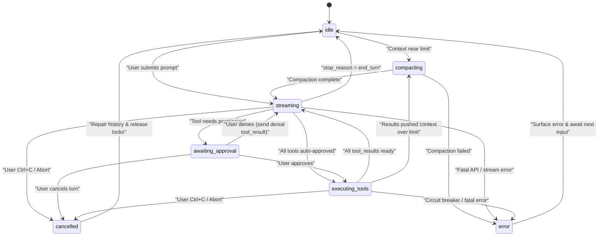

> **Module 1: Core Loop & Execution** | Prerequisites: Chapters 01–05 | Reading Time: ~20 min
>
> [← 05. Error Recovery, Retries & Infinite-Loop Detection](./05-error-recovery-retries-and-infinite-loop-detection.md) | [Table of Contents](../README.md) | [07. System Prompt Assembly & Instruction Hierarchy →](../02-context-and-memory/07-system-prompt-assembly-and-instruction-hierarchy.md)

# 06. Session & Turn State Machines

Look back at the simple `while True:` agent loop from Chapter 01. It fits in 20 lines of code and feels wonderfully clean, until real humans start using your app.

Suddenly, a user hits **Ctrl+C** halfway through a streaming response. Another user walks away for ten minutes while an approval prompt (`Allow rm -rf build? [y/N]`) is waiting on screen. A laptop battery dies in the middle of tool execution, and the user runs `--resume` the next morning expecting to pick up right where they left off. Or the user types a follow-up message *while* the agent is compacting its context window.

An ad-hoc `while` loop wrapped in a pile of boolean flags (`isRunning`, `isWaitingForApproval`, `isCancelling`, `didCompact`) collapses under these real-world events. The cure is one of the oldest, cleanest tools in software engineering: an **explicit Finite State Machine (FSM)** backed by an **atomic, append-only session log**.

---

## 1. The Simple Idea

Think of an **automatic washing machine**.

A washing machine doesn't just run a messy checklist with random booleans like `isSpinning = true` and `doorOpen = true` at the same time, because if both were true simultaneously, your laundry room would flood! Instead, the machine can only be in **one clear, named state at any moment**:
- `IDLE` (door unlocked, waiting for you to press Start)
- `FILLING` (door locked, water flowing in)
- `WASHING` (agitating clothes)
- `SPINNING` (draining water at high speed)
- `PAUSED` (motor stopped safely; waiting for Resume or Cancel)
- `ERROR` (drain clogged; refuses to spin until fixed)

Every transition follows **strict rules**: you can go from `WASHING` → `PAUSED` when the user presses Pause, or from `WASHING` → `ERROR` if a sensor trips, but you can **never** jump straight from `SPINNING` → `IDLE` with the door unlocked while the drum is still at 1,200 RPM.

A **Session & Turn State Machine** gives your AI agent harness the exact same discipline:
1. At every millisecond, the session is in **exactly one well-defined state**.
2. Only **explicitly allowed transitions** can happen.
3. Every interruption (Ctrl+C, timeout, crash, approval denial) follows a **clean shutdown path** that leaves the conversation history 100% valid before returning to `idle`.

### What breaks if you don't have an explicit state machine?
- **Double-submit race conditions:** The user hits Enter twice while the model is streaming, launching two overlapping loops that scramble the shared `messages` array.
- **Corrupted history after Ctrl+C:** Pressing Ctrl+C leaves an assistant `tool_use` message saved to disk with **no matching `tool_result`**, permanently poisoning the session so every future `--resume` crashes with HTTP `400 Bad Request`!
- **Zombie UI states:** The terminal spinner keeps spinning forever after a network error, or an approval dialog stays stuck on screen after the user already cancelled.

---

## 2. Why This Matters in a Real Agent Harness

You have now built the core execution pieces of Module 1: the ReAct loop, streaming, tool schemas, parallel execution, and error recovery. The **Session & Turn State Machine** is the skeleton that holds all of them together safely:

- **Decouples Engine from UI:** Whether your harness renders in a terminal (TUI), an IDE sidebar, a desktop app, or a headless CI runner, the UI simply subscribes to state transitions (`idle → streaming → awaiting_approval → executing_tools → idle`) instead of guessing what the agent is doing.
- **Guarantees Protocol Invariants:** LLM APIs enforce strict structural rules on message history (valid role alternation, paired `tool_use`/`tool_result` blocks). A state machine ensures a turn is **committed atomically** or **repaired cleanly** on cancellation, never left half-written.
- **Makes Crash Recovery & `--resume` Trivial:** When every completed turn and state event is written durably to disk, closing your terminal, upgrading the CLI, or losing power never destroys an hour of agent context.

---

## 3. The Big Picture

Notice how there are **two nested lifecycles** in every harness:
1. A **Session** (the whole conversation, persisted on disk, spanning many user prompts over hours or days).
2. A **Turn** (one user prompt triggering one or more LLM-and-tool cycles until the agent finishes and returns to `idle`).

Here is the complete Turn State Machine showing every legal transition:



Look closely at the bottom two arrows: **`cancelled → idle`** and **`error → idle`**. Neither `cancelled` nor `error` is a dead-end brick wall! Both run a cleanup/repair step so the user can immediately type their next message in the exact same session.

---

## 4. Deep Dive: Subtopic by Subtopic

### 4.1 Why Ad-Hoc `while` Loops Break in Real Apps

Consider the innocent-looking prototype loop almost every developer writes on day one:

```typescript
// ANTI-PATTERN: Fragile boolean soup inside a raw while loop
let isStreaming = false;
let isWaitingApproval = false;
let aborted = false;

async function handleUserMessage(text: string) {
  messages.push({ role: "user", content: text });
  while (true) {
    isStreaming = true;
    const response = await llm.stream(messages);
    isStreaming = false;
    messages.push(response); // DANGER: What if aborted mid-stream or before tool_results?

    if (!response.toolCalls.length) break;
    for (const call of response.toolCalls) {
      if (needsApproval(call)) {
        isWaitingApproval = true;
        const ok = await askUser(call);
        isWaitingApproval = false;
        if (!ok) return; // BUG! Exited without appending tool_result!
      }
      const out = await runTool(call);
      messages.push(out);
    }
  }
}
```

Count the bugs hiding in just 20 lines:
1. **Orphan `tool_use` on denial:** When `if (!ok) return;` runs, `response` (containing `tool_use`) is already inside `messages`, with zero `tool_result`s after it. The very next user message will trigger an HTTP `400` crash.
2. **Re-entrancy bug:** Nothing stops `handleUserMessage()` from being called a second time while `askUser()` is waiting!
3. **Impossible states:** If `runTool()` throws an exception while `isStreaming` or `isWaitingApproval` was mutated elsewhere, flags drift out of sync with reality.
4. **No hook for compaction or crash persistence:** Where do you safely save to disk or trigger context compaction without duplicating logic in five places?

Replacing booleans with a **single state enum + explicit transition table** eliminates this entire class of bugs by construction.

---

### 4.2 Modeling Explicit States and Legal Transitions

Here are the 7 core states every real coding-agent harness needs, what happens inside each state, and what inputs are legal while there:

| State | What Is Happening Right Now? | User Input Allowed? | Cleanup Required on Abort? |
| :--- | :--- | :--- | :--- |
| **`idle`** | Resting between turns; waiting for the user. | Yes: submit new prompt, `/compact`, `/resume`, or exit. | None. |
| **`streaming`** | Waiting on LLM HTTP/SSE response; accumulating text, thinking, and tool-call JSON deltas. | Cancel (`Ctrl+C`) or queue a "steer" message for after this turn. | Abort HTTP stream; **discard** incomplete assistant message (do not commit partial tool calls). |
| **`awaiting_approval`** | Model requested a sensitive tool (e.g., shell command or write); paused for human `[Allow / Deny]`. | Approve, Deny, or Cancel (`Ctrl+C`). | Emit synthetic `"Denied/Cancelled by user"` `tool_result` for every pending `tool_use_id`. |
| **`executing_tools`** | Running approved tools (in parallel/serial batches per Ch. 04). | Cancel (`Ctrl+C`) or queue follow-up message. | Fire `AbortSignal`, kill child process groups, and emit synthetic `"Cancelled"` `tool_result`s for unfinished calls. |
| **`compacting`** | Context window crossed threshold; summarizing old turns to free space (Ch. 10). | Cancel (`Ctrl+C`). | Abort compaction call; keep original pre-compaction history intact (never leave half-compacted history!). |
| **`cancelled`** | Transitional cleanup state after `Ctrl+C` or stop button. | Wait (~milliseconds) until cleanup finishes. | Repair history invariants, flush log, release locks → transition immediately to `idle`. |
| **`error`** | Unrecoverable failure (bad API key, exhausted retries, loop circuit breaker tripped). | Read error summary; submit new prompt or retry. | Ensure history is valid, display actionable diagnostic → transition to `idle`. |

#### Make Transitions Explicit and Auditable
Instead of mutating `this.state = "streaming"` randomly across 12 files, funnel **every** state change through a single `transition(nextState, reason)` method that validates the edge against an allowed-transitions map and emits a typed UI/log event:

```typescript
export type SessionState =
  | "idle"
  | "compacting"
  | "streaming"
  | "awaiting_approval"
  | "executing_tools"
  | "cancelled"
  | "error";

const ALLOWED_TRANSITIONS: Record<SessionState, readonly SessionState[]> = {
  idle: ["compacting", "streaming"],
  compacting: ["streaming", "idle", "cancelled", "error"],
  streaming: ["idle", "awaiting_approval", "executing_tools", "cancelled", "error"],
  awaiting_approval: ["executing_tools", "streaming", "cancelled"],
  executing_tools: ["streaming", "compacting", "cancelled", "error"],
  cancelled: ["idle"],
  error: ["idle"],
};
```

If any code path tries an illegal jump (say, `executing_tools → idle` without emitting results, or `idle → awaiting_approval`) the state machine throws immediately during development rather than silently corrupting a user's session in production.

---

### 4.3 Handling `Ctrl+C` / `AbortController` Cleanly

In a terminal CLI, pressing `Ctrl+C` sends the **`SIGINT`** signal from the operating system to your process. In a web or IDE client, clicking "Stop" triggers an **`AbortController.abort()`** call.

Great coding agents (like Claude Code, Codex CLI, and Gemini CLI) implement **two-stage `Ctrl+C` handling**:
- **When busy (`streaming`, `awaiting_approval`, `executing_tools`, `compacting`):**
  The **first** `Ctrl+C` does **NOT** kill the process! It aborts only the **active turn** via the turn's `AbortController`, transitions cleanly through `cancelled → idle`, repairs history, and returns the prompt cursor to the user so they can steer the agent (*"Actually, don't touch `db.ts`, fix `auth.ts` instead"*).
- **When already `idle` (or pressing `Ctrl+C` twice rapidly within 1–2 seconds):**
  Gracefully flush the session file to disk, clean up any background child processes, and exit the CLI.

#### The Critical Rule of Cancellation: Atomic Turn Boundaries
Never push an assistant message containing `tool_use` blocks into your permanent `messages` array *until you are ready to guarantee that every single one of those `tool_use_id`s will receive a `tool_result`*.

Look at the three exact moments a user can hit `Ctrl+C`, and what the clean history should look like afterward:

| Moment of `Ctrl+C` | What Was In-Flight? | Clean History Repair Strategy |
| :--- | :--- | :--- |
| **1. Mid-stream (before any tool started)** | Partial text + half-finished `tool_use` JSON. | **Option A (Simplest):** Discard the partial assistant message entirely, or keep only the already-streamed *plain text* (stripping any incomplete `tool_use` blocks) + append a note `"[Interrupted by user]"`. |
| **2. During `awaiting_approval`** | Complete assistant message with `tool_use_1`, `tool_use_2`; user hadn't approved yet. | Commit the assistant message **paired with** synthetic `tool_result` blocks (`is_error: true`, `"Interrupted by user before approval"`) for *every* `tool_use_id`, **OR** roll back the uncommitted assistant message completely. |
| **3. Mid-`executing_tools` (1 of 3 tools already finished)** | `tool_use_1` already edited a file; `tool_use_2` is running; `tool_use_3` hasn't started. | **Do NOT erase `tool_use_1`!** The file on disk was already changed, so the model *needs* to know! Abort `tool_use_2`, kill its subprocess, and commit the assistant message paired with: real result for `tool_use_1` + synthetic `"Cancelled by user"` results for `tool_use_2` and `tool_use_3`. |

That third case is a classic senior-engineer insight: **never lie to the model about side effects that already happened on disk.** Keeping `tool_use_1`'s real result alongside cancelled results for `tool_use_2` and `tool_use_3` keeps both the conversation protocol *and* the model's mental model of the workspace 100% accurate.

---

### 4.4 Maintaining Valid Message Alternation & Zero Orphan `tool_use` Blocks

LLM providers enforce strict structural invariants on the `messages` array you send them. Breaking any one of these causes an immediate HTTP `400 Bad Request`:

1. **No orphan `tool_use`:** Every assistant message containing `tool_use` blocks (Anthropic) or `tool_calls` (OpenAI) **must** be immediately followed by the corresponding `tool_result` blocks / `role: "tool"` messages for **every** ID.
2. **No orphan `tool_result`:** Conversely, you can never have a `tool_result` whose `tool_use_id` does not appear in the immediately preceding assistant message (a common bug after naive message slicing or compaction!).
3. **Strict role alternation (especially Anthropic & Gemini):** Conversations must start with a `user` message and alternate `user → assistant → user → assistant`. Two `user` messages back-to-back (e.g., user cancels a turn and sends a second prompt right away) or two `assistant` messages back-to-back will be rejected by strict APIs unless merged or separated.
4. **No empty content blocks:** Sending `{"role": "assistant", "content": ""}` or `content: []` after stripping an aborted tool call causes validation errors on several providers.

#### Write a Defensive `repairConversationHistory()` Validator!
Every production harness should run a fast, deterministic **history sanitizer** right before:
- Persisting after a cancellation/error
- Resuming a session loaded from disk (`--resume`)
- Sending a payload to the LLM API

```python
def repair_conversation_history(messages: list[dict]) -> list[dict]:
    """Ensure strict provider invariants:
    1. Every assistant tool_use has a matching tool_result immediately after.
    2. No orphan tool_results exist without a preceding tool_use.
    3. Consecutive user messages are merged cleanly.
    """
    repaired: list[dict] = []
    i = 0

    while i < len(messages):
        msg = messages[i]
        role = msg["role"]
        blocks = msg["content"] if isinstance(msg["content"], list) else [{"type": "text", "text": msg["content"]}]

        if role == "assistant":
            tool_uses = [b for b in blocks if b.get("type") == "tool_use"]
            repaired.append({"role": "assistant", "content": blocks})

            if tool_uses:
                expected_ids = [b["id"] for b in tool_uses]
                # Inspect the next message to see which tool_results already exist
                next_msg = messages[i + 1] if i + 1 < len(messages) else None
                existing_results: dict[str, dict] = {}
                extra_user_blocks: list[dict] = []

                if next_msg and next_msg["role"] == "user":
                    next_blocks = (
                        next_msg["content"]
                        if isinstance(next_msg["content"], list)
                        else [{"type": "text", "text": next_msg["content"]}]
                    )
                    for b in next_blocks:
                        if b.get("type") == "tool_result" and b.get("tool_use_id") in expected_ids:
                            existing_results[b["tool_use_id"]] = b
                        elif b.get("type") != "tool_result":
                            extra_user_blocks.append(b)
                    i += 1  # Consumed next_msg

                # Fill in synthetic error results for ANY missing/orphaned tool_use_id
                ordered_results = []
                for tid in expected_ids:
                    if tid in existing_results:
                        ordered_results.append(existing_results[tid])
                    else:
                        ordered_results.append({
                            "type": "tool_result",
                            "tool_use_id": tid,
                            "is_error": True,
                            "content": "Tool execution did not complete (interrupted or crashed before result was recorded).",
                        })
                repaired.append({"role": "user", "content": ordered_results + extra_user_blocks})
        elif role == "user":
            # Drop any orphan tool_result blocks that have no matching preceding assistant tool_use
            clean_blocks = [b for b in blocks if b.get("type") != "tool_result"]
            if not clean_blocks:
                i += 1
                continue
            # Merge consecutive user messages to preserve strict user/assistant alternation
            if repaired and repaired[-1]["role"] == "user":
                repaired[-1]["content"].extend(clean_blocks)
            else:
                repaired.append({"role": "user", "content": clean_blocks})

        i += 1

    return repaired
```

Think of `repair_conversation_history()` as your session's **seatbelt**: even if the power cord was yanked out of the wall mid-tool-call, loading the session the next morning automatically patches the dangling `tool_use_id` so the user can resume seamlessly instead of staring at an unrecoverable crash!

---

### 4.5 Persisting Session State to Disk for Crash Recovery & Resume

If your entire conversation only lives in RAM, a single closed terminal tab, OS reboot, or out-of-memory crash wipes out the entire session.

How should a harness store sessions on disk? Let's compare the three dominant persistence formats:

| Format | How It Works | Pros | Cons | Used By |
| :--- | :--- | :--- | :--- | :--- |
| **Append-Only JSONL** (`.jsonl`: one JSON object per line) | Each event (session metadata, user prompt, assistant turn, tool result, compaction snapshot) is appended as a single line + flushed. | Crash-safe (a crash mid-write only truncates the last line, never the whole file); trivial to stream, grep, tail, and fork; human-readable. | Requires scanning the file on `--resume` (fast for <50 MB); updates are represented as new events. | **Claude Code**, **OpenAI Codex CLI** (`RolloutRecorder`), **Gemini CLI** |
| **SQLite Database** (`sessions.db` in WAL mode) | Relational tables for `sessions`, `messages`, `tool_calls`, `parts`. | Instant indexed queries across thousands of sessions; ACID transactions; easy full-text search across past chats. | Binary file (needs `sqlite3` CLI to inspect); schema migrations required as harness evolves. | **OpenCode** |
| **Single Monolithic JSON File** (`session.json`) | Rewrites the entire conversation JSON on every turn. | Simple for tiny toy scripts. | **Dangerous in production:** a crash mid-write corrupts the entire file unless you write-to-temp + atomic `rename()`, and rewriting megabytes every turn is slow. | Toy prototypes (avoid unless using atomic temp+rename) |

#### Anatomy of a Crash-Safe Append-Only JSONL Session File
Each line is a self-contained event with a schema version, timestamp, and unique ID (and optional `parent_id` if you want tree-branching / `/fork` support!):

```json
{"v":1,"type":"session_meta","session_id":"sess_01J9X","cwd":"/repo/app","model":"claude-sonnet-4-5","ts":"2026-03-14T10:00:00Z"}
{"v":1,"type":"message","id":"m1","role":"user","content":[{"type":"text","text":"Fix the failing auth test"}],"ts":"2026-03-14T10:00:01Z"}
{"v":1,"type":"message","id":"m2","role":"assistant","content":[{"type":"tool_use","id":"toolu_1","name":"run_shell","input":{"command":"pytest"}}],"ts":"2026-03-14T10:00:04Z"}
{"v":1,"type":"message","id":"m3","role":"user","content":[{"type":"tool_result","tool_use_id":"toolu_1","content":"1 failed in test_auth.py"}],"ts":"2026-03-14T10:00:07Z"}
{"v":1,"type":"state","state":"idle","ts":"2026-03-14T10:00:12Z"}
```

#### Three Essential Disk-Safety Habits
1. **Flush after every append (`file.flush()` + `os.fsync()` on critical commits):** Otherwise the OS page cache may hold your last 2 turns in RAM when the process crashes.
2. **Tolerate a torn final line on reload:** If power died halfway through writing line 42, `json.loads()` fails on that last line. Your loader should log a warning, discard only the incomplete final line, and then run `repair_conversation_history()` to close any dangling `tool_use`!
3. **Use atomic lockfiles or session leases (with PID + liveness check):** If two terminal windows accidentally `--resume` the same session simultaneously, they will interleave writes and corrupt history. Store a lock record with the owning PID, and check whether that PID is actually alive before refusing `--resume` (so stale locks left behind by a hard crash don't permanently lock the user out!).

---

## 5. How Real Harnesses Do It

- **OpenAI Codex CLI (`codex-rs`):** Models turns with an explicit per-turn `TurnContext` (capturing working directory, sandbox policy, model config, and approval mode) and persists every turn item, tool call, tool output, and state event through **`RolloutRecorder`** into append-only JSONL files. Because every event is logged sequentially, Codex supports `--resume`, thread forking, and deterministic replay straight from the rollout log.
- **Claude Code:** Persists per-project sessions as append-only JSONL files under `~/.claude/projects/<encoded-cwd>/<session-id>.jsonl`, where each record carries parent/child UUID links, allowing branching, compaction summaries, and `--resume` / `--continue`. Pressing `Escape` or `Ctrl+C` during generation or tool execution cancels the active turn cleanly and returns the prompt to `idle` rather than exiting the CLI.
- **Gemini CLI (`google-gemini/gemini-cli`):** Separates the interactive terminal UI (React/Ink) from the core turn/tool engine (`GeminiClient` + `CoreToolScheduler`). Every tool invocation moves through an explicit `toolCallStatus` state machine (`validating` → `awaiting_approval` → `scheduled` → `executing` → `success` / `error` / `cancelled`), making approval prompts, live cancellation, and UI rendering completely deterministic.
- **OpenCode:** Persists sessions, messages, and typed message parts (text, reasoning, tool invocations, tool states) into a structured local store so multiple UI clients (terminal TUI, desktop app, web UI) can attach to, pause, and resume the same session cleanly without losing state.

---

## 6. Common Pitfalls & Failure Modes

1. **Stale session locks after a hard crash (`kill -9` or power loss):**
   - *Symptom:* The user runs `agent --resume` after a crash and gets `"Error: Session ID already in use"`, permanently locked out of their own work.
   - *Fix:* Store `{pid, started_at, hostname}` inside the lock file, or use OS advisory locks (`flock` / `fcntl`), which the OS kernel automatically releases the instant a process dies!

2. **Forgetting to strip incomplete `tool_use` blocks on mid-stream abort:**
   - *Symptom:* User hits `Ctrl+C` while the model is streaming a giant `write_file` argument. The harness saves the half-parsed `tool_use` block, and the next API request fails because the arguments aren't valid JSON and there is no `tool_result`.
   - *Fix:* Keep streaming buffers ephemeral in memory; only commit the assistant message to the session log once the stream ends cleanly (or strip incomplete tool blocks during cancellation cleanup).

3. **Two `Ctrl+C` handlers fighting over the same process:**
   - *Symptom:* Pressing `Ctrl+C` once kills the entire terminal app immediately, losing unsaved state and leaving child shell processes orphaned.
   - *Fix:* Register a single top-level `SIGINT` handler that inspects `session.state`: if busy, call `activeTurnController.abort()`; if `idle` (or pressed twice within 1.5s), flush persistence, kill child process groups, and exit.

4. **Rebuilding state from disk without handling schema evolution:**
   - *Symptom:* You upgrade your harness to v2 and add a new `thinking` block type; now resuming any v1 session from yesterday crashes with `KeyError`.
   - *Fix:* Tag every JSONL line with a schema version (`"v": 1`) and ignore unknown/future event types gracefully on read.

5. **Allowing concurrent turns on the same session:**
   - *Symptom:* A user (or a background webhook/UI double-click) triggers a new prompt while `state !== "idle"`, interleaving two API calls into the same `messages` list.
   - *Fix:* Reject or **queue** incoming user prompts whenever `state !== "idle"`, draining the queue only once the current turn transitions back to `idle`.

---

## 7. Build It Yourself: Mini-Lab

Below is a compact, self-contained **TypeScript Session & Turn State Machine** with:
- Strict transition validation (`ALLOWED_TRANSITIONS`)
- Clean `AbortController` turn cancellation without corrupting history
- Automatic history repair (`repairHistory`) preventing orphan `tool_use` blocks
- Crash-safe **append-only JSONL** disk persistence with torn-line recovery on load

```typescript
import * as fs from "node:fs";
import * as path from "node:path";

export type SessionState =
  | "idle"
  | "compacting"
  | "streaming"
  | "awaiting_approval"
  | "executing_tools"
  | "cancelled"
  | "error";

export type ContentBlock =
  | { type: "text"; text: string }
  | { type: "tool_use"; id: string; name: string; input: Record<string, unknown> }
  | { type: "tool_result"; tool_use_id: string; content: string; is_error?: boolean };

export interface Message {
  role: "user" | "assistant";
  content: ContentBlock[];
}

const ALLOWED_TRANSITIONS: Record<SessionState, readonly SessionState[]> = {
  idle: ["compacting", "streaming"],
  compacting: ["streaming", "idle", "cancelled", "error"],
  streaming: ["idle", "awaiting_approval", "executing_tools", "cancelled", "error"],
  awaiting_approval: ["executing_tools", "streaming", "cancelled"],
  executing_tools: ["streaming", "compacting", "cancelled", "error"],
  cancelled: ["idle"],
  error: ["idle"],
};

export class JsonlSessionStore {
  constructor(private readonly filePath: string) {
    fs.mkdirSync(path.dirname(filePath), { recursive: true });
  }

  appendMessage(msg: Message): void {
    const line = JSON.stringify({ v: 1, type: "message", ts: Date.now(), msg }) + "\n";
    // Append atomically per line; OS flushes sequentially
    fs.appendFileSync(this.filePath, line, { encoding: "utf8" });
  }

  loadAndRepair(): Message[] {
    if (!fs.existsSync(this.filePath)) return [];
    const rawLines = fs.readFileSync(this.filePath, "utf8").split("\n").filter(Boolean);
    const loaded: Message[] = [];

    for (let idx = 0; idx < rawLines.length; idx++) {
      try {
        const record = JSON.parse(rawLines[idx]);
        if (record.type === "message" && record.msg) {
          loaded.push(record.msg as Message);
        }
      } catch {
        // Tolerate a torn final line if the process crashed mid-write
        if (idx === rawLines.length - 1) {
          console.warn("[session] Discarded truncated final JSONL line during recovery.");
        }
      }
    }
    return repairHistory(loaded);
  }
}

export function repairHistory(messages: Message[]): Message[] {
  const clean: Message[] = [];
  for (let i = 0; i < messages.length; i++) {
    const msg = messages[i];
    if (msg.role === "assistant") {
      clean.push(msg);
      const toolUses = msg.content.filter(
        (b): b is Extract<ContentBlock, { type: "tool_use" }> => b.type === "tool_use"
      );
      if (toolUses.length > 0) {
        const next = messages[i + 1];
        const found = new Map<string, ContentBlock>();
        const extras: ContentBlock[] = [];
        if (next && next.role === "user") {
          for (const b of next.content) {
            if (b.type === "tool_result") found.set(b.tool_use_id, b);
            else extras.push(b);
          }
          i++; // Consumed next message
        }
        const pairedResults: ContentBlock[] = toolUses.map((tu) =>
          found.get(tu.id) ?? {
            type: "tool_result",
            tool_use_id: tu.id,
            is_error: true,
            content: "Interrupted before tool result was recorded.",
          }
        );
        clean.push({ role: "user", content: [...pairedResults, ...extras] });
      }
    } else {
      // Strip orphan tool_results and merge consecutive user messages
      const nonResults = msg.content.filter((b) => b.type !== "tool_result");
      if (nonResults.length === 0) continue;
      const prev = clean[clean.length - 1];
      if (prev && prev.role === "user") {
        prev.content.push(...nonResults);
      } else {
        clean.push({ role: "user", content: nonResults });
      }
    }
  }
  return clean;
}

export class AgentSession {
  public state: SessionState = "idle";
  public messages: Message[];
  private activeAbort: AbortController | null = null;

  constructor(
    private readonly store: JsonlSessionStore,
    private readonly onStateChange?: (from: SessionState, to: SessionState, reason: string) => void
  ) {
    // Automatically recover and sanitize any crashed prior session on startup
    this.messages = this.store.loadAndRepair();
  }

  private transition(next: SessionState, reason: string): void {
    const allowed = ALLOWED_TRANSITIONS[this.state];
    if (!allowed.includes(next)) {
      throw new Error(`Illegal state transition: ${this.state} -> ${next} (${reason})`);
    }
    const prev = this.state;
    this.state = next;
    this.onStateChange?.(prev, next, reason);
  }

  private commitMessage(msg: Message): void {
    this.messages.push(msg);
    this.store.appendMessage(msg);
  }

  /** Called by SIGINT (Ctrl+C) or a UI Stop button. Returns true if an active turn was aborted. */
  public cancelActiveTurn(): boolean {
    if (this.state === "idle" || !this.activeAbort) return false;
    this.activeAbort.abort(new Error("User cancelled turn"));
    return true;
  }

  /** Run one complete user turn safely through the state machine. */
  public async runTurn(
    userText: string,
    callModel: (history: Message[], signal: AbortSignal) => Promise<Message>,
    approveTool: (name: string, signal: AbortSignal) => Promise<boolean>,
    runTool: (name: string, input: Record<string, unknown>, signal: AbortSignal) => Promise<string>
  ): Promise<void> {
    if (this.state !== "idle") {
      throw new Error(`Cannot start new turn while session is in '${this.state}' state.`);
    }

    this.activeAbort = new AbortController();
    const { signal } = this.activeAbort;
    this.commitMessage({ role: "user", content: [{ type: "text", text: userText }] });

    try {
      this.transition("streaming", "User submitted prompt");

      while (true) {
        const assistantMsg = await callModel(this.messages, signal);
        const toolUses = assistantMsg.content.filter(
          (b): b is Extract<ContentBlock, { type: "tool_use" }> => b.type === "tool_use"
        );

        // If no tools requested, commit final text answer and finish cleanly
        if (toolUses.length === 0) {
          this.commitMessage(assistantMsg);
          this.transition("idle", "stop_reason = end_turn");
          return;
        }

        // Ask approval if any tool requires it
        this.transition("awaiting_approval", `Requesting permission for ${toolUses.length} tool(s)`);
        const approvedMap = new Map<string, boolean>();
        for (const tu of toolUses) {
          approvedMap.set(tu.id, await approveTool(tu.name, signal));
        }

        const anyApproved = [...approvedMap.values()].some(Boolean);
        const results: ContentBlock[] = [];

        if (anyApproved) {
          this.transition("executing_tools", "Running approved tools");
          for (const tu of toolUses) {
            if (!approvedMap.get(tu.id)) {
              results.push({ type: "tool_result", tool_use_id: tu.id, is_error: true, content: "Denied by user." });
              continue;
            }
            if (signal.aborted) {
              results.push({ type: "tool_result", tool_use_id: tu.id, is_error: true, content: "Cancelled by user." });
              continue;
            }
            try {
              const out = await runTool(tu.name, tu.input, signal);
              results.push({ type: "tool_result", tool_use_id: tu.id, content: out });
            } catch (err) {
              const msg = err instanceof Error ? err.message : String(err);
              results.push({ type: "tool_result", tool_use_id: tu.id, is_error: true, content: `Error: ${msg}` });
            }
          }
        } else {
          // All tools denied: emit denial tool_results so the model can respond politely
          for (const tu of toolUses) {
            results.push({ type: "tool_result", tool_use_id: tu.id, is_error: true, content: "Denied by user." });
          }
        }

        // Atomic pair commit: assistant tool_use + matching user tool_results together!
        this.commitMessage(assistantMsg);
        this.commitMessage({ role: "user", content: results });

        if (signal.aborted) {
          this.transition("cancelled", "Turn cancelled during tool phase");
          this.transition("idle", "Cleanup complete");
          return;
        }
        this.transition("streaming", "Feeding tool results back to model");
      }
    } catch (err) {
      if (signal.aborted) {
        this.transition("cancelled", "Aborted via signal");
        this.messages = repairHistory(this.messages);
        this.transition("idle", "Ready for next user prompt");
      } else {
        this.transition("error", err instanceof Error ? err.message : String(err));
        this.messages = repairHistory(this.messages);
        this.transition("idle", "Recovered to idle after surfacing error");
      }
    } finally {
      this.activeAbort = null;
    }
  }
}
```

Notice the elegance of `commitMessage(assistantMsg)` immediately followed by `commitMessage({ role: "user", content: results })`, plus `repairHistory()` on every cancellation, error, and crash reload. Even if the process is killed with `SIGKILL` between those two disk appends, `loadAndRepair()` heals the orphan `tool_use` automatically on `--resume`!

---

## 8. Key Takeaways & Quick Self-Check

- **Replace boolean soup with a Finite State Machine:** Model explicit states (`idle`, `streaming`, `awaiting_approval`, `executing_tools`, `compacting`, `cancelled`, `error`) and enforce legal transitions in one place.
- **Make `Ctrl+C` cancel the turn, not the whole app:** Use an `AbortController` per turn to transition cleanly through `cancelled → idle`, preserving session continuity.
- **Guard message invariants religiously:** Never leave an orphan `tool_use`, an orphan `tool_result`, or broken role alternation, and always run a deterministic `repairHistory()` pass on load and after aborts.
- **Don't erase real side effects on cancellation:** If tool #1 already modified a file before the user cancelled tool #2, keep tool #1's real result and mark tool #2 as cancelled so the model's view matches reality.
- **Persist append-only JSONL (or WAL SQLite) to disk:** Flush per event, tolerate a torn final line on crash recovery, and use PID-checked or OS-advisory locks so crashes never lock users out of `--resume`.

### Quick Self-Check

**1. A user denies a tool call at the `awaiting_approval` prompt (`rm -rf build`). Why is simply returning early from the loop without appending a `tool_result` a critical bug?**
<details>
<summary>Show Answer</summary>

If the assistant message containing the `tool_use` block was already added to the conversation history, returning without a matching `tool_result` leaves an **orphan `tool_use`**. On the user's very next prompt, the LLM API will reject the request with a `400 Bad Request` protocol error. You must either append a `tool_result` with `"Denied by user"` (recommended, so the model knows what happened) or avoid committing the assistant message at all.
</details>

**2. Why is an append-only JSONL file safer for crash recovery than overwriting a single `session.json` file after every turn?**
<details>
<summary>Show Answer</summary>

If the machine loses power halfway through overwriting `session.json`, the entire file can be left truncated or empty, losing the whole conversation. With append-only JSONL, every previous turn is already safely on disk; a crash mid-write can only corrupt the single final line, which your loader can cleanly discard while keeping 99.9% of the session intact.
</details>

**3. Suppose a turn runs 3 tools sequentially. Tool 1 (`edit_file`) succeeds, and the user hits `Ctrl+C` while Tool 2 (`pytest`) is running. Should you roll back and delete the entire assistant message (including Tool 1) from history?**
<details>
<summary>Show Answer</summary>

**No!** Tool 1 already modified a file on disk. Deleting Tool 1 from conversation history makes the LLM unaware of its own edit on the next turn. Instead, keep the assistant message, record Tool 1's actual result, kill Tool 2's subprocess, and record synthetic `"Cancelled by user"` `tool_result`s for Tools 2 and 3.
</details>

**4. You now understand all of Module 1 (Core Loop & Execution). Before moving to Module 2 (Context & Memory), what happens if a user tries to submit a new prompt while the session state is `streaming`?**
<details>
<summary>Show Answer</summary>

Because the state machine explicitly rejects starting a second concurrent turn when `state !== "idle"`, the harness prevents race conditions on the `messages` array. Instead, it either politely queues the prompt as a **steering message** (injected at the next safe boundary) or waits until the active turn finishes and returns to `idle`.
</details>

---

[← 05. Error Recovery, Retries & Infinite-Loop Detection](./05-error-recovery-retries-and-infinite-loop-detection.md) | [Table of Contents](../README.md) | [07. System Prompt Assembly & Instruction Hierarchy →](../02-context-and-memory/07-system-prompt-assembly-and-instruction-hierarchy.md)
