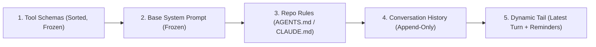

> **Module 2: Context & Memory** | Prerequisites: Chapter 07 | Reading Time: ~22 min
>
> [← 07. System Prompt Assembly & Instruction Hierarchy](./07-system-prompt-assembly-and-instruction-hierarchy.md) | [Table of Contents](../README.md) | [09. Context Window Budgeting →](./09-context-window-budgeting.md)

# 08. Prompt Caching & Prefix Stability

If there is a single engineering concept that separates an affordable, snappy production coding agent from one that feels sluggish and burns through a \$50 API balance in an afternoon, it is **Prompt Caching**.

In Chapter 00, you learned that LLMs are stateless: on every single turn of an agent loop, the harness has to resend the *entire* conversation from Turn 1 onward. Without prompt caching, an agent doing a 30-step bug fix ends up paying to re-read the exact same system prompt, tool definitions, and early file reads **thirty times over**.

This chapter explains how prompt caching works under the hood, how Anthropic, OpenAI, and Google implement it, and the strict design rules your harness must follow to keep cache hit rates above 90%.

---

## 1. The Simple Idea: Re-Reading a 500-Page Book Every Night

Imagine you are reading a 500-page detective novel, one page per night.

- **Without a bookmark or memory (No Prompt Cache):** On Night 1, you read Page 1. On Night 2, you have total amnesia, so you re-read Page 1 *and* Page 2. On Night 300, you re-read Pages 1 through 299 from scratch just to understand Page 300! By the time you finish the book, you haven't read 500 pages—you've read **125,250 pages**!
- **With Prompt Caching:** After Night 1, you save your mental notes for Page 1 in a locker. On Night 2, you pull those notes straight out of the locker and *only* read Page 2. On Night 300, you load your saved notes for Pages 1–299 instantly and only read Page 300.

Now here is the catch that makes **Prefix Stability** so crucial: **the locker only works if Pages 1 through 299 are word-for-word identical to yesterday.** If someone sneaks in and changes a single word on Page 1 (say, changing the timestamp in the header), your notes for Pages 1 through 299 become invalid, and you are forced to re-read the entire book from Page 1 all over again!

---

## 2. Why This Matters in a Real Agent Harness

Because an agent loop grows linearly on every turn, the total number of input tokens sent across $N$ turns grows **quadratically** ($O(N^2)$). Let's do the real math on a typical 30-turn coding session!

Suppose your harness starts with **15,000 tokens** of base context (system prompt + tool schemas + `AGENTS.md`) and adds **2,000 new tokens per turn** (tool calls + file snippets + test outputs).

- **Turn 1:** 17,000 input tokens
- **Turn 15:** 45,000 input tokens
- **Turn 30:** 75,000 input tokens
- **Total input tokens across all 30 turns:** **1,380,000 input tokens**—even though the conversation only contains 75,000 unique tokens!

Now compare the bill at a representative frontier model input price of **\$3.00 per million tokens** (with 90% cache read discount and 1.25x cache write):

| Scenario | Uncached Input Tokens | Cached Read Tokens | Approximate Input Cost | Typical Time-To-First-Token (Turn 30) |
| :--- | :---: | :---: | :---: | :---: |
| **No Caching (or Cache-Busted Every Turn)** | 1,380,000 | 0 | **\$4.14** | ~6–12 seconds (full 75k prefill) |
| **Cache-Stable Harness (~94% Hit Rate)** | ~75,000 (writes across turns) | ~1,305,000 (at 0.1x price) | **\$0.67** | ~0.8–1.5 seconds (only 2k new tokens!) |

That is an **84% cost reduction** and up to an **80% reduction in latency**—from the *exact same model*, producing the *exact same answers*, purely because of disciplined harness engineering.

> **Industry Reality Check:** The team behind Manus (one of the most widely studied production agent systems of 2025) publicly called **KV-cache hit rate the single most important metric for a production AI agent**—often mattering more to unit economics and responsiveness than model selection itself.

---

## 3. The Big Picture

Look at what happens across three turns of an agent loop—and how a single tiny change near the top destroys the entire cache:

```text
TURN 1 (Cold Start -> Cache Write)
[ Tools ][ System Prompt ][ AGENTS.md ][ User Msg 1 ]
|================= COMPUTE & CACHE (1.25x or 1.0x) =================|

TURN 2 (Cache-Stable Append -> 90%+ Cache Hit!)
[ Tools ][ System Prompt ][ AGENTS.md ][ User Msg 1 ][ Asst 1 ][ Tool Res 1 ]
|=============== INSTANT CACHE READ (0.1x) =========|== COMPUTE NEW ==|

TURN 3 (CACHE BUST! Someone changed a live timestamp inside System Prompt)
[ Tools ][ System Prompt* ][ AGENTS.md ][ User Msg 1 ][ Asst 1 ][ Tool Res 1 ][ Asst 2 ]
| HIT   ||===================== FULL CACHE MISS! RECOMPUTE EVERYTHING ==================|
         ^
         One single changed token invalidates EVERYTHING to its right!
```

And here is the exact structural rule every cache-aware harness follows—**The Golden Rule of Prefix Stability**—ordered strictly from *least frequently changing* to *most frequently changing*:



---

## 4. Deep Dive

### 4.1 How KV Caching Works Intuitively (No PhD Required)

When you send a prompt to a Transformer-based LLM, the server runs two distinct phases:

1. **Prefill Phase (Reading):** The model reads all of your input tokens in parallel and computes two mathematical matrices—called **Keys ($K$)** and **Values ($V$)**—for every token at every layer of the neural network. These **KV states** represent the model's internal "understanding" of the prompt so far. Prefill is heavy GPU compute, which is why long uncached prompts have slow Time-To-First-Token (TTFT).
2. **Decode Phase (Writing):** Now the model generates its reply one token at a time, looking back at the stored KV states of all previous tokens.

Here is the mathematical superpower of decoder-only Transformers: **causal attention** means Token #50 only ever looks backward at Tokens #1 through #49—it *never* looks forward at Token #51.

Because of this one-way dependency:
- If Request B starts with the **exact same 20,000 tokens** as Request A, the KV states for Tokens #1 through #20,000 are **mathematically identical**. The provider can skip the entire Prefill computation for those 20,000 tokens and pull the pre-computed KV tensors directly from fast GPU memory (HBM) or host RAM!
- Conversely, if even **one single token** changes at position #100 (for example, changing `"14:01"` to `"14:02"`), then Token #100's KV state changes. Because Token #101 attends to Token #100, Token #101 changes too—setting off a domino chain that invalidates **every single token from #100 to #20,000**.

That one-way domino effect is the entire reason **prefix stability** is non-negotiable.

---

### 4.2 Provider Prompt Caching Mechanics (2025–2026)

All three major frontier providers offer prompt caching, but their APIs, pricing models, and knobs work quite differently. A production harness needs to understand each provider's contract:

| Feature | Anthropic (Claude) | OpenAI (GPT / Codex) | Google (Gemini API) |
| :--- | :--- | :--- | :--- |
| **Activation Mode** | Opt-in via `cache_control` (up to **4 explicit breakpoints**, OR single top-level automatic breakpoint moving along the tail) | **Automatic** on all eligible requests (no content markers needed) | **Implicit (Automatic)** on by default on Gemini 2.5+; **Explicit** `cachedContents` API also available on supported models |
| **Minimum Prefix Size** | Model-dependent (typically **1,024** or **2,048** tokens; newer small-threshold tiers down to 512–1,024) | **1,024 tokens**, cached in **128-token** increments | Typically **1,024–4,096 tokens** for implicit caching (model-dependent); higher floors for legacy explicit cache objects |
| **Cache Read Discount** | **90% off** (0.1x base input price; select tiers even lower) | **50% to 90% off** depending on model family | **75% to 90%+ off** depending on model generation (90% on Gemini 2.5+) |
| **Cache Write / Storage Cost** | **1.25x** base input (5m TTL) or **2.0x** base input (1h TTL); zero separate storage fee | **No write premium** (1.0x base input) and zero storage fee | Implicit: **no write premium**, no storage fee. Explicit: hourly storage fee per million cached tokens |
| **Time-To-Live (TTL)** | **5 minutes** (default) or **1 hour** (`"ttl": "1h"`); **free refresh** on every cache hit! | Typically **5–10 minutes** of inactivity (up to ~1h off-peak); optional `prompt_cache_retention` for extended retention (up to 24h on supported tiers) | Implicit: best-effort server-managed. Explicit: configurable TTL (default 1 hour) |
| **Routing / Evaluation Order** | Evaluated strictly in order: `tools` → `system` → `messages` | Sticky routing improved dramatically via `prompt_cache_key` | Implicit cache is best-effort across serving replicas; explicit cache pins a named resource |

#### Concrete Payload 1: Anthropic Explicit Breakpoints + Extended TTL

On Anthropic's Messages API, you mark the end of each stable zone with `"cache_control": {"type": "ephemeral"}` (optionally adding `"ttl": "1h"` for workflows where humans pause >5 minutes between turns):

```json
{
  "model": "claude-sonnet-4-5",
  "max_tokens": 8192,
  "tools": [
    { "name": "edit_file", "description": "...", "input_schema": { "...": "..." } },
    {
      "name": "read_file",
      "description": "...",
      "input_schema": { "...": "..." },
      "cache_control": { "type": "ephemeral" }
    }
  ],
  "system": [
    {
      "type": "text",
      "text": "<identity>...</identity>\n<project_instructions>...</project_instructions>",
      "cache_control": { "type": "ephemeral" }
    }
  ],
  "messages": [
    { "role": "user", "content": "Fix the race condition in worker.py" },
    { "role": "assistant", "content": [ "..." ] },
    {
      "role": "user",
      "content": [
        {
          "type": "tool_result",
          "tool_use_id": "toolu_01",
          "content": "...file contents...",
          "cache_control": { "type": "ephemeral" }
        }
      ]
    }
  ]
}
```

**Why place 3 breakpoints instead of 1?**
1. **Breakpoint 1 (end of `tools`) & Breakpoint 2 (end of `system`):** Anchors your static harness prefix so even when you compact or reset the conversation history, you still get a cache hit on all your tool definitions and system prompt!
2. **Breakpoint 3 (rolling tail of `messages`):** Moves forward to the latest message on every turn so that Turn $N+1$ reads the *entire* prior conversation from cache at 0.1x cost. (Remember to remove the old rolling breakpoint from Turn $N-1$ so you stay within Anthropic's 4-breakpoint limit—or use Anthropic's top-level automatic `cache_control` field, which moves the tail breakpoint for you automatically.)

**Quick Break-Even Math for Anthropic's 5m vs. 1h TTL:**
- With **5m TTL** (1.25x write, 0.1x read): On Turn 1 you pay `+0.25x` extra; on Turn 2 you save `0.90x`. You break even on the **very first cache hit (Turn 2)**!
- With **1h TTL** (2.0x write, 0.1x read): On Turn 1 you pay `+1.00x` extra; each hit saves `0.90x`. You break even after **2 cache hits**—which makes `1h` a massive win whenever a human pauses 10–30 minutes to review a diff before replying.

#### Concrete Payload 2: OpenAI Automatic Caching + `prompt_cache_key`

On OpenAI's API, caching happens automatically—no `cache_control` markers required—**but** there is a crucial production detail: KV caches live in memory on specific GPU machines. If your harness sends Turn 1 to Machine A and Turn 2 gets load-balanced to Machine B, you get a cache miss even with an identical prefix!

Passing a deterministic **`prompt_cache_key`** (typically a hash of your `session_id` or `org_id + repo_id`) tells OpenAI's router to send all turns of that session to the same serving pool:

```json
{
  "model": "gpt-5",
  "prompt_cache_key": "session_8f3a2c91b4e0",
  "prompt_cache_retention": "24h",
  "input": [
    { "role": "developer", "content": "<identity>...</identity>" },
    { "role": "user", "content": "Fix the race condition in worker.py" }
  ],
  "tools": [
    { "type": "function", "name": "edit_file", "parameters": { "...": "..." } },
    { "type": "function", "name": "read_file", "parameters": { "...": "..." } }
  ]
}
```

---

### 4.3 The Golden Rule of Prefix Stability

Commit this single sentence to memory:

> **Everything static goes at the beginning and never mutates. Everything dynamic goes at the very end.**

In practice, that means your prompt assembly order must follow five strict zones:

1. **Zone 1 — Canonical Tool Definitions:** Sorted alphabetically by tool name, with deterministic JSON key ordering (`sort_keys=True`). Never add, remove, or reorder tools mid-session.
2. **Zone 2 — Static System / Developer Prompt:** Base identity, behavioral rules, OS/shell metadata, and calendar date (`YYYY-MM-DD`). Frozen once the session starts.
3. **Zone 3 — Project Rules (`AGENTS.md` / `CLAUDE.md`):** Discovered at startup in deterministic root-to-leaf order and frozen in the prefix.
4. **Zone 4 — Append-Only Conversation History:** Past user messages, assistant responses, tool calls, and tool results. Once a message is added to Zone 4, **you never edit it in place** (until a deliberate, infrequent compaction event).
5. **Zone 5 — Volatile Tail:** The brand-new user message or tool output, plus any ephemeral `<system-reminder>` updates (mode switches, newly discovered subdirectory rules, current git branch, active todo checklist).

---

### 4.4 The 7 Most Common Cache-Busters (And How to Fix Each One)

Most developers think their prompt cache is working—until they inspect their API logs and discover a 12% hit rate! Almost every surprise cache miss comes from one of these seven culprits:

| # | Cache-Buster | Why It Breaks the Cache | The Fix |
| :--- | :--- | :--- | :--- |
| **1** | **Live Timestamps in System Prompt** (`Current time: 14:32:07`) | Changes every single second, invalidating 100% of the prompt after it. | Put only `date: YYYY-MM-DD` in the system prompt. Put exact timestamps only on new tail messages if needed. |
| **2** | **Non-Deterministic Tool Ordering** | Iterating over a Go `map`, JavaScript object built from async MCP startups, or unordered Python `set` shuffles the `tools` array between turns. Remember: `tools` sit at the *very front* of the prompt! | Sort tool definitions alphabetically by `name` and serialize JSON schemas with sorted keys (`sort_keys=True`). |
| **3** | **Adding/Removing Tools Mid-Session** (e.g., hiding write tools in "Plan Mode") | Mutating the `tools` array at position #0 busts the cache for the *entire* system prompt and 50,000-token conversation history! | Keep the `tools` array **identical**. Enforce Plan Mode via a `<system-reminder>` at the tail plus a deterministic tool-execution gate in your harness (or constrained decoding masks). |
| **4** | **Mutating Earlier Messages in Place** | Re-formatting older tool outputs, stripping thinking blocks retroactively, or rewriting Turn 3's file read when the file changes on Turn 12. | Treat history as an **append-only ledger**. If a file changed on Turn 12, append the new read on Turn 12; never go back and edit Turn 3. |
| **5** | **Per-Turn Sliding Window Trimming** | Dropping the oldest 1 message on *every single turn* once you hit 50 messages shifts the entire prefix left by one message—causing a **0% cache hit rate on every turn forever**! | Never use a per-turn sliding window! Batch-compact infrequently (Chapter 09 & 10)—say, dropping from 85% full down to 35% full once every 20 turns so the other 19 turns enjoy 95% cache hits. |
| **6** | **Dynamic State in the System Prompt** | Injecting live `git status`, open editor tabs, or a ticking token counter into `system`. | Inject live state updates as small `<system-reminder>` blocks appended to the latest `user` message at the tail. |
| **7** | **Random IDs or Unsorted Metadata** | Embedding a fresh `request_id: uuid4()` or unsorted dictionary keys inside system XML blocks. | Keep request IDs in HTTP headers (`X-Request-Id`), never inside the prompt text. |

> **Let that #5 point sink in!** A naive "keep the last 20 messages" sliding window is one of the most expensive bugs in agent engineering. On Turn 21 you drop Message 1 (cache miss!), on Turn 22 you drop Message 2 (cache miss!), on Turn 23 you drop Message 3 (cache miss!). Batch compaction is *dramatically* cheaper than sliding-window eviction specifically because of prefix caching.

---

### 4.5 Designing Cache-Aware Harnesses

To guarantee high cache hit rates in production, build three habits directly into your harness architecture:

#### 1. Separate "Logical Session State" from "Frozen Wire Prefix"
Your harness UI can show live `git status`, a live checklist, and elapsed time—just don't rebuild the `system` string from live state on every API call! Snapshot the `system` string and sorted `tools` array when the session starts, and store them immutably on the session object.

#### 2. Monitor Cache Hit Ratio Like an SLA
Every major provider returns exact cache accounting in the response's `usage` object:
- **Anthropic:** `usage.cache_read_input_tokens`, `usage.cache_creation_input_tokens`, `usage.input_tokens` (note: Anthropic's `input_tokens` counts *only* uncached tokens after the last cache breakpoint! Total input = all three summed).
- **OpenAI:** `usage.prompt_tokens_details.cached_tokens` (included *inside* `usage.prompt_tokens`, or `input_tokens_details.cached_tokens` on the Responses API).
- **Gemini:** `usageMetadata.cachedContentTokenCount` (included *inside* `usageMetadata.promptTokenCount`).

Track this metric on every turn after Turn 1:

$$\text{Cache Hit Ratio} = \frac{\text{cached\_read\_tokens}}{\text{total\_input\_tokens}}$$

In a healthy multi-turn coding agent, Turns 2 through $N$ should consistently show an **85%–97% cache hit ratio**. If it suddenly drops to **0%** on a turn where you didn't run compaction, your harness has a cache-busting bug—log a diagnostic warning immediately!

#### 3. Guard Prefix Stability in Unit Tests
You can catch 99% of accidental cache-busters *before* they ever ship to users with a 10-line unit test: assemble Turn 1's serialized request payload and Turn 2's serialized request payload, and assert that `turn2_serialized.startswith(turn1_prefix)`!

---

## 5. How Real Harnesses Do It

- **Claude Code:** Treats prompt caching as a first-class architectural constraint. Its system prompt and tool definitions stay strictly frozen across turns; when anything changes mid-session (switching into Plan Mode, loading a new subdirectory `CLAUDE.md`, updating the todo list, or notifying the agent of a file edited externally by the user), Claude Code injects a `<system-reminder>` block at the **tail** of the conversation rather than touching the prefix. It also uses explicit `cache_control` breakpoints and tracks cache creation vs. cache read tokens in its cost accounting (`/cost`).
- **OpenAI Codex CLI:** Attaches a stable `prompt_cache_key` derived from the conversation/session ID to every request so multi-turn coding sessions route consistently to warm KV-cache replicas, keeps tool schemas canonically ordered, and appends turn deltas cleanly rather than rewriting older messages.
- **Manus:** Publicly documented how keeping the KV-cache prefix stable drove their architecture—for example, instead of dynamically removing unavailable tools from the prompt (which would bust the cache), they keep the full tool definitions static and control availability via response/logit constraints or deterministic tool-call validation, and they avoid injecting non-deterministic timestamps into the system prompt.
- **Aider:** Explicitly supports Anthropic prompt caching (`--cache-prompts`) with strategic breakpoints placed after the stable repo-map and read-only files, plus an optional keepalive ping (`--cache-keepalive-pings`) for users who pause longer than 5 minutes while reviewing diffs.

---

## 6. Common Pitfalls & Failure Modes

| Pitfall | Symptom in Logs / Billing | Root Cause & Fix |
| :--- | :--- | :--- |
| **Caching Below the Minimum Token Floor** | `cache_creation_input_tokens: 0` on Anthropic or `cached_tokens: 0` on OpenAI even with identical prefixes. | Your prefix is shorter than the provider's minimum (e.g., <1,024 tokens). Wait until the prefix crosses the threshold—or don't expect hits on tiny 200-token prompts. |
| **Double-Paying Write Tax on One-Shot Calls** | Input bills are *25% higher* than uncached pricing! | Putting `cache_control` on single-turn classifier/summarizer calls that are never repeated within the TTL. Only enable explicit cache writes when a prefix will be reused at least once! |
| **Missing the 5-Minute TTL During Human Review** | Turn 1–10 hit 95% cache; then the user grabs coffee for 7 minutes, comes back, and Turn 11 pays full cold-write price on 80,000 tokens. | For interactive harnesses with frequent 5–30 minute human pauses, evaluate Anthropic's `"ttl": "1h"` on the stable prefix (or OpenAI's extended `prompt_cache_retention`)—it pays for itself after just 2 pauses. |
| **MCP Server Reconnection Shuffling Tools** | Cache hit ratio mysteriously drops to 0% whenever a background MCP server reconnects. | MCP tools were appended in arrival order instead of sorted order. Always sort all tools (built-in + MCP) deterministically by fully-qualified name, and avoid unregistering tools mid-session unless necessary. |
| **Misreading Anthropic's `input_tokens` Field** | Your telemetry shows 100% cache hit rate or wildly wrong cost estimates. | On Anthropic, `input_tokens` excludes cached tokens! Total input tokens = `input_tokens + cache_creation_input_tokens + cache_read_input_tokens`. |

---

## 7. Build It Yourself: Mini-Lab

Below is a compact, ready-to-use Python module that enforces **canonical prefix stability**, detects accidental cache-busters using a SHA-256 prefix fingerprint, builds provider-ready payloads (for both Anthropic breakpoints and OpenAI `prompt_cache_key`), and calculates real cache hit rates and dollar savings.

```python
from __future__ import annotations

import copy
import hashlib
import json
from dataclasses import dataclass, field
from typing import Any


@dataclass
class CacheStats:
    total_input_tokens: int = 0
    cached_read_tokens: int = 0
    cache_write_tokens: int = 0
    uncached_input_tokens: int = 0
    unexpected_prefix_busts: int = 0

    @property
    def hit_ratio(self) -> float:
        if self.total_input_tokens == 0:
            return 0.0
        return self.cached_read_tokens / self.total_input_tokens

    def estimated_savings_usd(self, base_price_per_million: float = 3.00) -> float:
        """Estimate dollars saved versus paying full base input price on every token."""
        uncached_cost = (self.total_input_tokens / 1_000_000) * base_price_per_million
        actual_cost = (
            (self.uncached_input_tokens / 1_000_000) * base_price_per_million
            + (self.cache_write_tokens / 1_000_000) * base_price_per_million * 1.25
            + (self.cached_read_tokens / 1_000_000) * base_price_per_million * 0.10
        )
        return max(0.0, uncached_cost - actual_cost)


class CacheStableHarnessSession:
    """
    Maintains a frozen, canonically ordered prefix (tools + system prompt)
    and an append-only message history to maximize KV-cache hit rates.
    """

    def __init__(
        self,
        session_id: str,
        system_prompt: str,
        tools: list[dict[str, Any]],
        anthropic_ttl: str | None = None,  # None = default 5m, or "1h"
    ) -> None:
        self.session_id = session_id
        self.anthropic_ttl = anthropic_ttl

        # 1. Freeze and canonically sort tools by name (with deterministic key order)
        sorted_tools = sorted(tools, key=lambda t: t["name"])
        self._frozen_tools: list[dict[str, Any]] = [
            json.loads(json.dumps(t, sort_keys=True)) for t in sorted_tools
        ]
        # 2. Freeze system prompt at session creation
        self._frozen_system: str = system_prompt

        # 3. Append-only conversation ledger
        self._messages: list[dict[str, Any]] = []

        # Prefix integrity tracking
        self._static_prefix_hash: str = self._hash_payload(
            {"tools": self._frozen_tools, "system": self._frozen_system}
        )
        self._last_history_len: int = 0
        self._last_history_hash: str | None = None
        self.stats = CacheStats()

    @staticmethod
    def _hash_payload(obj: Any) -> str:
        canonical = json.dumps(obj, sort_keys=True, separators=(",", ":"))
        return hashlib.sha256(canonical.encode("utf-8")).hexdigest()

    def append_message(self, role: str, content: str, reminder: str | None = None) -> None:
        """Append a new turn at the tail. Dynamic reminders attach here—never to system!"""
        final_content = content
        if reminder:
            final_content = f"{content}\n\n<system-reminder>\n{reminder}\n</system-reminder>"
        self._messages.append({"role": role, "content": final_content})

    def _cache_marker(self) -> dict[str, str]:
        marker: dict[str, str] = {"type": "ephemeral"}
        if self.anthropic_ttl:
            marker["ttl"] = self.anthropic_ttl
        return marker

    def build_anthropic_request(self, model: str, max_tokens: int = 8192) -> dict[str, Any]:
        """Build an Anthropic Messages payload with 3 strategic cache breakpoints."""
        tools = copy.deepcopy(self._frozen_tools)
        if tools:
            # Breakpoint 1: End of canonical tool definitions
            tools[-1]["cache_control"] = self._cache_marker()

        system_blocks = [
            {
                "type": "text",
                "text": self._frozen_system,
                # Breakpoint 2: End of frozen system prompt
                "cache_control": self._cache_marker(),
            }
        ]

        messages = copy.deepcopy(self._messages)
        if messages:
            # Breakpoint 3: Rolling breakpoint at the tail of conversation history
            last = messages[-1]
            if isinstance(last["content"], str):
                last["content"] = [
                    {
                        "type": "text",
                        "text": last["content"],
                        "cache_control": self._cache_marker(),
                    }
                ]

        self._verify_prefix_stability()
        return {
            "model": model,
            "max_tokens": max_tokens,
            "tools": tools,
            "system": system_blocks,
            "messages": messages,
        }

    def build_openai_request(self, model: str) -> dict[str, Any]:
        """Build an OpenAI payload with deterministic prompt_cache_key routing."""
        self._verify_prefix_stability()
        return {
            "model": model,
            "prompt_cache_key": f"harness_{self.session_id}",
            "tools": copy.deepcopy(self._frozen_tools),
            "input": [
                {"role": "developer", "content": self._frozen_system},
                *copy.deepcopy(self._messages),
            ],
        }

    def _verify_prefix_stability(self) -> None:
        """Sanity check: ensure the static prefix and prior history have not mutated."""
        current_static = self._hash_payload(
            {"tools": self._frozen_tools, "system": self._frozen_system}
        )
        if current_static != self._static_prefix_hash:
            self.stats.unexpected_prefix_busts += 1
            self._static_prefix_hash = current_static

        # Check that all messages sent in the previous request still hash identically
        if self._last_history_hash is not None:
            if len(self._messages) < self._last_history_len:
                self.stats.unexpected_prefix_busts += 1
            else:
                prior_hash = self._hash_payload(self._messages[: self._last_history_len])
                if prior_hash != self._last_history_hash:
                    self.stats.unexpected_prefix_busts += 1

        self._last_history_len = len(self._messages)
        self._last_history_hash = self._hash_payload(self._messages)

    def record_anthropic_usage(self, usage: dict[str, int]) -> None:
        """Record usage from an Anthropic response (summing cached + uncached properly)."""
        uncached = usage.get("input_tokens", 0)
        cache_write = usage.get("cache_creation_input_tokens", 0)
        cache_read = usage.get("cache_read_input_tokens", 0)

        self.stats.uncached_input_tokens += uncached
        self.stats.cache_write_tokens += cache_write
        self.stats.cached_read_tokens += cache_read
        self.stats.total_input_tokens += uncached + cache_write + cache_read


if __name__ == "__main__":
    session = CacheStableHarnessSession(
        session_id="sess_42",
        system_prompt="<identity>You are a coding agent.</identity>",
        tools=[
            {"name": "write_file", "input_schema": {"type": "object"}},
            {"name": "read_file", "input_schema": {"type": "object"}},
        ],
    )
    session.append_message("user", "Inspect auth.py")
    req1 = session.build_anthropic_request("claude-sonnet-4-5")
    session.record_anthropic_usage(
        {"input_tokens": 50, "cache_creation_input_tokens": 18_000, "cache_read_input_tokens": 0}
    )

    session.append_message("assistant", "I will read auth.py now.")
    session.append_message("user", "Here is auth.py...", reminder="Active branch: fix/oauth")
    req2 = session.build_anthropic_request("claude-sonnet-4-5")
    session.record_anthropic_usage(
        {"input_tokens": 20, "cache_creation_input_tokens": 1_500, "cache_read_input_tokens": 18_050}
    )

    print(f"Tool order (canonical): {[t['name'] for t in req1['tools']]}")
    print(f"Cache hit ratio: {session.stats.hit_ratio:.1%}")
    print(f"Estimated savings: ${session.stats.estimated_savings_usd():.4f}")
    print(f"Unexpected prefix busts: {session.stats.unexpected_prefix_busts}")
```

---

## 8. Key Takeaways & Quick Self-Check

### Key Takeaways
- **Multi-turn agents have quadratic ($O(N^2)$) uncached token costs.** Prompt caching turns that back into near-linear cost and cuts Time-To-First-Token by up to 80%.
- **Causal attention demands exact prefix matches.** Changing even one token near the top of your prompt invalidates the cached KV states for every single token after it.
- **Follow the Golden Rule of Prefix Stability:** Put sorted, frozen tool schemas first, then the frozen system prompt, then repo rules, then append-only conversation history, and finally dynamic updates/reminders at the tail.
- **Match your caching strategy to the provider:** Use explicit breakpoints (and 5m vs. 1h TTLs) on Anthropic, pass a stable `prompt_cache_key` on OpenAI, and keep prefixes stable for Gemini's implicit caching.
- **Never trim history one message per turn.** Batch-compact infrequently (Chapters 09–10), and monitor `cache_read / total_input` on every turn so regressions never go unnoticed.

### Quick Self-Check

1. **Your coding agent runs a 25-turn session. Everything looks fast until you add a "Plan Mode" toggle that removes `write_file` and `run_shell` from the `tools` array when Plan Mode is turned on mid-session. Suddenly, the turn right after toggling Plan Mode is 6x slower and 10x more expensive. Why?**
   <details>
   <summary>Show Answer</summary>
   Tool definitions sit at the <strong>very beginning</strong> of the prompt prefix (evaluated before <code>system</code> and <code>messages</code>). Removing tools mutates position #0, invalidating the cached KV states for the entire system prompt and all 25 turns of conversation history! Instead, keep the <code>tools</code> array completely unchanged, append a <code>&lt;system-reminder&gt;</code> at the tail telling the model it is in Plan Mode, and enforce the read-only restriction deterministically in your harness's tool executor.
   </details>

2. **Why does a simple "keep the last 20 messages" sliding window destroy prompt caching?**
   <details>
   <summary>Show Answer</summary>
   Every time Turn 21, 22, 23, ... arrives, dropping the oldest message shifts the entire conversation history left by one message. Because the prefix starting at the first message is now different from the previous turn, the provider gets a cache miss on the entire conversation history on <em>every single turn</em>. Batch compaction—compressing history only occasionally (e.g., from 85% down to 35%)—preserves 90%+ cache hits on all the turns in between.
   </details>

3. **On Anthropic's API, your agent normally interacts with a human who takes 10–15 minutes between turns to review pull requests. Should you use the default 5-minute TTL (1.25x write) or the 1-hour TTL (2.0x write)?**
   <details>
   <summary>Show Answer</summary>
   Use the <strong>1-hour TTL</strong>! With 10–15 minute gaps, a 5-minute cache expires before every single reply—meaning you pay 1.25x write on Turn 1, then expire and pay 1.25x write <em>again</em> on Turn 2, Turn 3, Turn 4 (0% hit rate!). With a 1-hour TTL, you pay 2.0x once on Turn 1, and every subsequent reply hits the cache at 0.1x and refreshes the 1-hour timer for free—breaking even by Turn 3 and saving dramatically across the session.
   </details>

4. **Why does OpenAI provide a `prompt_cache_key` parameter even though OpenAI's prompt caching is automatic?**
   <details>
   <summary>Show Answer</summary>
   Because KV-cache tensors are stored in memory on specific serving machines. Without a routing hint, high-traffic or concurrent turns from the same session can be load-balanced across different machines and miss warm caches. Passing a consistent <code>prompt_cache_key</code> (such as a session ID) routes sequential turns of the same conversation to the same machine pool, significantly boosting cache hit rates.
   </details>

---

[← 07. System Prompt Assembly & Instruction Hierarchy](./07-system-prompt-assembly-and-instruction-hierarchy.md) | [Table of Contents](../README.md) | [09. Context Window Budgeting →](./09-context-window-budgeting.md)
