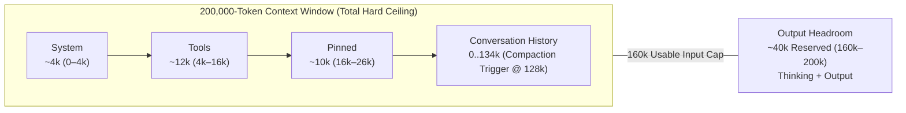
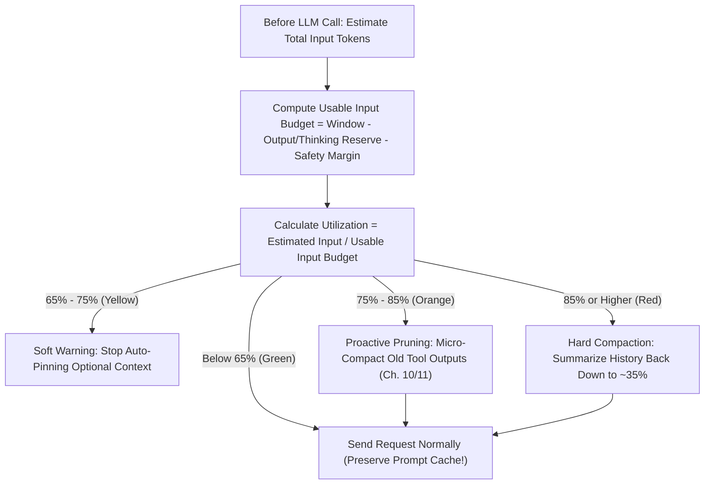

> **Module 2: Context & Memory** | Prerequisites: Chapters 07–08 | Reading Time: ~20 min
>
> [← 08. Prompt Caching & Prefix Stability](./08-prompt-caching-and-prefix-stability.md) | [Table of Contents](../README.md) | [10. Context Compaction & Summarization →](./10-context-compaction-and-summarization.md)

# 09. Context Window Budgeting

Suppose a model advertises a **200,000-token** or **1,000,000-token** context window. That sounds huge, like an infinite whiteboard! Surely you can just dump your codebase, tool logs, and chat history in and let the model sort it out?

Not quite. In real agent harnesses, treating the context window as a bottomless landfill causes two disasters: **silent intelligence decay** (the model gets measurably dumber long before the window is full) and **hard runtime crashes** (the API rejects your turn with `400 Bad Request: prompt is too long`, or cuts off the agent's JSON tool call right in the middle of an edit).

This chapter teaches you how to measure, partition, and police your context window like a seasoned systems engineer manages RAM.

---

## 1. The Simple Idea: A Hardware Engineer's Workbench

Picture an engineer debugging a circuit board on a physical workbench that is **10 feet wide**.

- You would **never** cover all 10 feet of the bench with binders, spare cables, and old printouts. Why? Two reasons:
  1. **You need open workspace to build.** If 100% of the bench is covered with reference manuals, there is zero room left to lay down the active circuit board and solder a fix! (In an LLM, that empty space is **output & thinking headroom**.)
  2. **Clutter causes mistakes.** Even when only 7 feet of the bench is piled with outdated schematics from three projects ago, the engineer slows down, grabs the wrong datasheet, and wires the wrong pin. (In an LLM, that clutter-induced error rate is called **context rot**.)

**Context Window Budgeting** is the discipline of dividing that 10-foot workbench into dedicated zones (permanent tools, project guidelines, active debugging notes, and guaranteed empty workspace) and clearing clutter *before* the bench overflows.

### What Breaks Without It?

- **Hard API failures:** One big `git diff` or `pytest` log pushes your prompt past the model's hard limit, crashing a 45-minute coding session with a `400 context_length_exceeded` error.
- **Truncated tool calls:** If you fill 199,500 tokens of a 200,000-token window, the model only has 500 tokens left to think and write a file patch, so the API hits `stop_reason: "max_tokens"` halfway through a JSON object!
- **Silent quality collapse:** Even without crashing, cramming 150k tokens of noisy logs into a 200k window degrades reasoning, causes hallucinated file paths, and makes the agent forget your original goal.

---

## 2. Why This Matters in a Real Agent Harness

Every token you leave in the context window has a **triple tax**:

1. **Accuracy Tax (Context Rot):** Irrelevant files, old stack traces, and dead-end explorations dilute the Transformer's attention away from the code that actually matters right now.
2. **Latency Tax:** Even with prompt caching, larger KV caches require more GPU memory bandwidth to scan on every generated token, making streaming noticeably slower.
3. **Cost Tax:** Even at a 90% cache discount, dragging 150,000 tokens of stale logs across 40 turns still costs real money, and if a cache TTL expires or compaction fails, you pay full price on all 150k tokens.

Good budgeting gives your harness **predictable ceilings**: it knows *before* calling the API whether the request will fit with healthy headroom, and it triggers cleanup smoothly before quality degrades.

---

## 3. The Big Picture

Think of a **200,000-token** context window not as one flat bucket, but as a partitioned memory map with strict reservations and graduated pressure thresholds:

<!-- visual:context-budget-bar -->


Before every LLM call, your harness runs a **Pre-Turn Budget Gate** to decide whether to send as-is, warn, prune stale tool outputs, or trigger full compaction (Chapter 10):



---

## 4. Deep Dive

### 4.1 Tokens vs. Characters vs. Words

Beginners often assume *"1 word = 1 token"* or *"4 characters = 1 token"*. That rule of thumb works reasonably well for plain English prose, and fails **spectacularly** on the exact kinds of text coding agents deal with every day!

#### How Tokenizers Actually Work (BPE in Plain English)
Modern LLMs use **subword tokenizers**, most commonly **Byte-Pair Encoding (BPE)**. During training, the tokenizer scans billions of pages of text and merges the most frequent byte pairs into a fixed vocabulary (typically 100,000 to 256,000 tokens).

- Common English words like `"function"` or `" the"` become **1 single token**.
- Rare words like `"antigravity"` split into **2–3 subword tokens** (`"anti"`, `"grav"`, `"ity"`).
- Structural punctuation, weird indentation, hex hashes, UUIDs, minified JavaScript, and non-Latin scripts often split into **1–2 characters per token** (or even multiple tokens per character for some emojis and rare Unicode!).

#### Why Token Counts Vary Dramatically by Content Type & Model

| Content Type | Example | Approximate Chars per Token | Why It Matters to Your Harness |
| :--- | :--- | :---: | :--- |
| **English Prose** | `"Fix the login timeout bug."` | ~4.0 chars / token | The textbook "rule of thumb" case. |
| **Clean Source Code** | `def verify_jwt(token: str) -> dict:` | ~3.0 – 3.5 chars / token | Symbols (`->`, `():`, `_`) and indentation add tokens. |
| **JSON / Stack Traces / Logs** | `{"id":"9f8a2b","ok":true,"err":null}` | ~2.2 – 2.8 chars / token | Quotes, colons, braces, and random hex IDs explode token counts! |
| **CJK / Non-Latin Text** | `"エージェントのコンテキスト管理"` | ~1.0 – 2.0 chars / token | Multi-byte UTF-8 characters can use 2x–3x more tokens per character than English. |
| **Base64 / Minified Bundles** | `eyJhbGciOiJIUzI1NiIsInR5cCI6...` | ~1.2 – 1.8 chars / token | Random character sequences rarely match vocabulary merges: one tiny minified JS file can eat 40,000 tokens! |

#### Cross-Provider Tokenizer Mismatch
Every model family ships its own vocabulary:
- **OpenAI:** `cl100k_base` (GPT-4), `o200k_base` (GPT-4o / o-series / newer GPT models) via the open-source `tiktoken` library.
- **Anthropic Claude:** Proprietary BPE tokenizer (accessible via the free `POST /v1/messages/count_tokens` API).
- **Google Gemini:** SentencePiece-based tokenizer (accessible via `countTokens` API and local SDK tokenizers).

Because vocabularies differ, running OpenAI's `tiktoken` on text destined for Claude or Gemini can easily **under-count or over-count by 15%–25%**: and it completely misses hidden framing tokens (message role delimiters, tool schema serialization overhead, and image/PDF token grids).

---

### 4.2 Context Rot & "Lost in the Middle"

One of the most important discoveries in modern agent engineering is the gap between a model's **advertised context window** and its **effective context window**:

- **Advertised (Nominal) Context Window:** The technical maximum number of tokens the API will accept before returning an error (e.g., 200,000 or 1,000,000 tokens).
- **Effective Context Window:** The token range where the model actually maintains peak reasoning, accurate code synthesis, and faithful instruction-following.

Two landmark bodies of research explain why these numbers are not the same:

#### 1. "Lost in the Middle" (Liu et al., Stanford, 2023)
Researchers discovered that LLMs exhibit a pronounced **U-shaped attention curve**:
- Information at the **very beginning** of the prompt (system prompt, first messages) is recalled reliably (**primacy bias**).
- Information at the **very end** of the prompt (most recent tool results, latest user request) is recalled reliably (**recency bias**).
- Information buried in the **middle** of a long prompt suffers dramatic drops in recall and reasoning accuracy, even when the exact answer sits right there in plain text!

#### 2. Context Rot (Chroma Research, July 2025)
In their widely cited technical report *"Context Rot: How Increasing Input Tokens Impacts LLM Performance"*, researchers at Chroma evaluated 18 frontier models (across Claude, GPT, Gemini, and Qwen families) on controlled tasks that went far beyond simple word-matching "Needle-in-a-Haystack" tests.

Their findings reshaped how engineers design agent harnesses:
- **Every single frontier model degrades as input length grows**: even on identical, simple tasks, and long before approaching the advertised token ceiling.
- **Distractors hurt more than raw length:** Semantically similar but outdated text (like three earlier failed attempts at fixing a bug, or an older version of `auth.py` read 15 turns ago) actively confuses the model's attention!
- **Performance degrades non-uniformly:** A model that passes 99% of simple exact-string lookups at 500k tokens can still stumble on multi-step logical reasoning or constraint tracking at 80k–120k tokens when surrounded by noisy tool logs.

> **Practical Takeaway for Harness Engineers:** Never design a harness that calmly cruises at 95% of the context window just because the API allows it. Keeping your active working context lean, clean, and well below the ceiling makes your agent **smarter**, **faster**, and **cheaper** all at once.

---

### 4.3 Partitioning the Context Budget

Rather than letting one component quietly swallow the whole context window (a classic bug when a user connects 12 MCP servers with 150 tool schemas!), divide your budget into explicit, monitored buckets.

Here is a battle-tested reference budget for a **200,000-token** frontier model with extended thinking enabled:

| Budget Bucket | Target Allocation | Hard Cap | What Lives Here | If It Exceeds Cap... |
| :--- | :---: | :---: | :--- | :--- |
| **1. Output & Thinking Headroom** | **32,000 – 40,000** | Reserved (Fixed) | Model's chain-of-thought reasoning (`thinking` / `reasoning` tokens) + visible text + large file-patch tool calls. | **Never touched by input.** Subtracted from total window first! |
| **2. Safety Margin** | **8,000 – 10,000** | Reserved (Fixed) | Cushion for tokenizer estimation drift, hidden framing tokens, and sudden large tool outputs. | Prevents accidental `400 context_length_exceeded` crashes. |
| **3. System Prompt + Env** | **2,000 – 5,000** | 8,000 | Base identity, behavioral rules, OS/shell metadata (Chapter 07). | Audit and trim redundant prose. |
| **4. Tool & MCP Schemas** | **4,000 – 15,000** | 25,000 | Built-in tools + connected MCP tool definitions. | Switch to deferred/dynamic tool discovery (Chapter 12 & 19). |
| **5. Repo Rules & Pinned Context** | **2,000 – 10,000** | 16,000 | `AGENTS.md` / `CLAUDE.md`, active task plan, explicitly `@`-pinned files. | Truncate with notice; stop auto-pinning extra files. |
| **6. Rolling Conversation History** | **Remainder (~100k–130k)** | **Triggers compaction at ~80–85% of usable input** | User messages, assistant responses, tool calls, and tool outputs. | Micro-compact stale outputs, then full LLM summarization (Chapter 10). |

#### Don't Forget Thinking / Reasoning Tokens!
This catches almost everyone building their first harness in 2025–2026: **reasoning models (like Claude with Extended Thinking, OpenAI o-series / reasoning effort, or Gemini Thinking models) spend their internal thinking tokens out of the `max_tokens` output budget!**

If you reserve only 4,096 tokens for output on a hard refactoring task, the model can burn 4,000 tokens *thinking* about the architecture, and hit `max_tokens` after writing just 96 tokens of the actual patch! Reserve generous headroom (typically **16,384 to 32,768+ tokens**) for thinking + output on coding tasks, and subtract that full reserve from your usable input budget before calculating utilization.

---

### 4.4 Counting Tokens Locally vs. API Usage Metadata

How should your harness actually *know* how many tokens are currently in the context window? You have three tools, each with a clear trade-off:

| Method | Accuracy | Latency | Cost | Best Used When... |
| :--- | :--- | :---: | :---: | :--- |
| **1. Previous Turn's API `usage` Metadata** | **100% Exact** (ground truth from provider!) | **0 ms** (already returned in last response!) | Free | **Primary baseline** for everything sent up through the last completed turn. |
| **2. Local Estimator (`tiktoken` or conservative char heuristic)** | **~80–95%** (exact for OpenAI plain text; approximate for Claude/Gemini/JSON) | **< 1 ms** (offline) | Free | **Estimating the newly added delta** since the last API response (e.g., the tool output you just received). |
| **3. Provider Token-Counting Endpoint** (`POST /v1/messages/count_tokens`, Gemini `countTokens`, OpenAI `/v1/responses/input_tokens`) | **100% Exact** (includes tools, images, PDFs, framing!) | **100–400 ms** (network round-trip) | Free (subject to RPM rate limits) | **Exact preflight check** only when your fast estimate crosses a high watermark (e.g., >75%) or when attaching images/PDFs. |

#### The Winning Production Strategy: Hybrid Anchoring
Don't call `count_tokens` over HTTP on every single turn (that adds 200ms of latency per step), and don't rely solely on naive `len(text) / 4` across 50 turns (errors accumulate!). Combine all three:

1. **Anchor on Ground Truth:** After every API response, read the provider's exact `usage` numbers. Now you know the *exact* token count of the entire conversation up to Turn $N$!
2. **Estimate Only the Delta Locally:** Between Turn $N$ and Turn $N+1$, you only added a few tool results or one user message. Estimate *just those new bytes* locally using a conservative ratio (e.g., `chars / 3.0` for code/JSON, or `tiktoken` × `1.15` safety multiplier for non-OpenAI models).
3. **Verify at the Boundary:** Only when `anchor_tokens + estimated_delta` crosses your high-pressure threshold (say, 80% of usable input), or when multimodal images/PDFs are attached, optionally call the provider's exact `count_tokens` endpoint before deciding whether to trigger compaction.

#### Watch Out for Provider-Specific `usage` Formulas!
This is one of the most frequent real-world bugs in multi-provider harnesses. Each provider reports total input tokens differently:

```python
# ANTHROPIC: input_tokens is ONLY the uncached portion! You MUST sum all three.
anthropic_total_input = (
    usage["input_tokens"]
    + usage.get("cache_creation_input_tokens", 0)
    + usage.get("cache_read_input_tokens", 0)
)

# OPENAI (Chat Completions / Responses): cached tokens are ALREADY included in the total.
openai_total_input = usage.get("input_tokens") or usage["prompt_tokens"]

# GEMINI: cachedContentTokenCount is ALREADY included in promptTokenCount.
gemini_total_input = usage_metadata["promptTokenCount"]
```

If you forget to add `cache_read_input_tokens` on Anthropic, your harness will think a 180,000-token session is only using 400 tokens: right up until it slams head-first into a `400 prompt is too long` crash!

---

### 4.5 Trigger Thresholds & Hysteresis (Playing Nice With Prompt Caching)

Once you know your exact utilization percentage (`estimated_input / usable_input_budget`), how should your harness react?

Use a **four-tier graduated response** with built-in **hysteresis** (meaning once you trigger compaction at a high watermark, you compress all the way down to a much lower target so you don't re-trigger on the very next turn):

| Zone | Utilization of Usable Input Budget | Harness Action | Impact on Prompt Cache (Ch. 08) |
| :--- | :---: | :--- | :--- |
| **Green (Healthy)** | **0% – 64%** | Append-only normal operation. Full tool outputs (within per-tool truncation caps from Ch. 11). | **100% preserved** (maximum cache hits). |
| **Yellow (Soft Warning)** | **65% – 74%** | Show subtle UI meter; stop auto-injecting optional extras (like verbose git diffs or suggested files); tighten per-tool output caps. | **100% preserved** (still append-only!). |
| **Orange (Proactive Pruning)** | **75% – 84%** | Prefer lightweight **micro-compaction** or warn user; prepare for compaction if growth continues. *(Note: editing old tool outputs busts the cache from that point forward, so batch-clear many old outputs at once rather than one per turn!)* | **One deliberate batch reset** (not per-turn). |
| **Red (Hard Compaction)** | **>= 85%** | Pause normal generation and run **full LLM compaction/summarization** (Chapter 10), compressing history from 85% down to **~25%–35%**. | **One deliberate reset**, followed by 15–30 fresh high-hit turns! |

#### Why Hysteresis Saves a Fortune
Suppose your usable input budget is 150,000 tokens and your Red threshold is 85% (127,500 tokens).
- **Bad design (no hysteresis):** Compact just enough to get down to 125,000 tokens. Two turns later you're back at 128,000 tokens → compact again → cache-bust again → endless thrashing!
- **Good design (strong hysteresis):** When you cross 127,500 tokens, compact aggressively down to ~45,000 tokens (keeping your system prompt, tool schemas, a crisp structured summary, and the last few recent turns verbatim). Now you have **82,500 tokens of clean runway** with 90%+ cache hits before you ever compact again!

---

## 5. How Real Harnesses Do It

- **Claude Code:** Continuously tracks authoritative input token usage by summing `input_tokens + cache_creation_input_tokens + cache_read_input_tokens` from Anthropic's response metadata. It reserves dedicated output/thinking headroom, exposes a `/context` breakdown showing exactly how many tokens are spent on system prompt, tools, MCP servers, `CLAUDE.md`, and conversation messages, and automatically triggers compaction well before hitting the model's hard ceiling (preserving a clean safety buffer).
- **OpenAI Codex CLI:** Configures model-specific context window ceilings and auto-compaction thresholds (using `usage` telemetry from the Responses API), reserving space for reasoning and output generation while keeping tool schemas and project instructions (`AGENTS.md`) capped at predictable byte limits.
- **Aider:** Takes an explicit, transparent partitioning approach: users can inspect `/tokens` to see the exact split between system prompt, **repo-map** (bounded by `--map-tokens`, typically 1k–4k tokens), explicitly added editable files, and chat history (bounded by `max_chat_history_tokens`, triggering background summarization when exceeded).
- **Gemini CLI:** Even though Gemini models offer massive 1,000,000-token windows, production Gemini harnesses still apply sensible budget warnings and optional history compression; recognizing that *cost, latency, and context rot* make running lean far superior to dumping 800k tokens of unpruned terminal logs.

---

## 6. Common Pitfalls & Failure Modes

| Pitfall | How It Fails in Production | How to Fix It |
| :--- | :--- | :--- |
| **Forgetting Anthropic's Split Usage Fields** | Harness reads only `usage.input_tokens` (say, 120 tokens), thinks context is empty, and crashes at 200k tokens. | Always normalize provider usage through one helper that sums `input_tokens + cache_creation_input_tokens + cache_read_input_tokens` for Anthropic. |
| **Ignoring Output & Thinking Headroom** | Sending 195k input tokens to a 200k model with `max_tokens=16384`. Either the API immediately rejects with `400`, or the model runs out of tokens mid-patch! | Define `usable_input_budget = context_window - reserved_output_and_thinking - safety_margin` and measure utilization against `usable_input_budget`, never the raw window! |
| **Unbounded MCP Tool Schema Bloat** | User enables 8 MCP servers with 180 tools. Before the user types a single word, 65,000 tokens (40% of usable input!) are already gone. | Measure and budget tool schemas explicitly; warn the user when tool schemas exceed ~15–20% of usable input, and use deferred tool loading (Chapter 12 & 19). |
| **Using `len(text) / 4` Without Margin on Code/JSON** | A massive minified JSON API response is 80,000 characters. `80000 / 4 = 20k` estimated tokens: actual count is **38,000 tokens**, blowing past the limit! | Use a conservative divisor (`chars / 2.5` or `chars / 3.0`) for code/JSON deltas, cap individual tool outputs (Chapter 11), and keep an explicit safety margin. |
| **Treating a 1M Window as Rot-Free** | Harness sets compaction trigger at 900,000 tokens on a 1M model. By 250,000 tokens, the agent is slow, expensive, and hallucinating variable names. | Set an **effective working ceiling** (for example, 150k–250k tokens for routine coding loops) even on 1M-token models, reserving the upper range only for deliberate massive-read tasks. |

---

## 7. Build It Yourself: Mini-Lab

Here is a clean, dependency-free Python `ContextBudgetManager` you can drop straight into an agent harness. It implements:
1. Normalized usage accounting across Anthropic, OpenAI, and Gemini (so you never fall for the Anthropic split-field trap).
2. Explicit budget partitioning (output/thinking reserve, safety margin, effective working ceiling).
3. Hybrid token tracking (exact API anchor + conservative local delta estimator).
4. Graduated four-tier watermark decisions (`NORMAL`, `SOFT_WARN`, `PROACTIVE_PRUNE`, `HARD_COMPACT`) with clear diagnostics.

```python
from __future__ import annotations

import math
from dataclasses import dataclass
from enum import Enum
from typing import Any


class BudgetAction(str, Enum):
    NORMAL = "normal"                   # < 65%: append-only, max cache hits
    SOFT_WARN = "soft_warn"             # 65% - 75%: stop adding optional context
    PROACTIVE_PRUNE = "proactive_prune" # 75% - 85%: batch-clear old tool outputs
    HARD_COMPACT = "hard_compact"       # >= 85%: run full LLM compaction (Ch. 10)


@dataclass(frozen=True)
class ModelBudgetConfig:
    model_name: str
    provider: str                         # "anthropic" | "openai" | "gemini"
    nominal_context_window: int           # Hard API ceiling (e.g., 200_000)
    effective_context_ceiling: int        # Cap below nominal to avoid context rot
    reserved_output_tokens: int = 16_384  # Visible response + tool call JSON
    reserved_thinking_tokens: int = 16_384
    safety_margin_tokens: int = 8_000     # Cushion for estimation drift & framing
    soft_warn_ratio: float = 0.65
    prune_ratio: float = 0.75
    compact_ratio: float = 0.85

    @property
    def usable_input_budget(self) -> int:
        active_ceiling = min(self.nominal_context_window, self.effective_context_ceiling)
        reserved = (
            self.reserved_output_tokens
            + self.reserved_thinking_tokens
            + self.safety_margin_tokens
        )
        return max(1, active_ceiling - reserved)


@dataclass(frozen=True)
class BudgetReport:
    estimated_input_tokens: int
    usable_input_budget: int
    utilization_ratio: float
    remaining_input_tokens: int
    action: BudgetAction
    reason: str


def extract_authoritative_input_tokens(provider: str, usage: dict[str, Any]) -> int:
    """
    Normalize exact input token counts from provider API usage payloads.
    Handles Anthropic's split cache fields safely!
    """
    if provider == "anthropic":
        return (
            int(usage.get("input_tokens", 0))
            + int(usage.get("cache_creation_input_tokens", 0))
            + int(usage.get("cache_read_input_tokens", 0))
        )
    if provider == "openai":
        return int(usage.get("input_tokens") or usage.get("prompt_tokens", 0))
    if provider == "gemini":
        return int(usage.get("promptTokenCount", 0))
    raise ValueError(f"Unsupported provider: {provider}")


def estimate_delta_tokens_conservative(text: str, content_kind: str = "code") -> int:
    """
    Fast, offline, conservative token estimator for newly appended deltas.
    Uses tighter chars-per-token ratios for JSON/code/non-ASCII to avoid undercounting.
    """
    if not text:
        return 0

    # Non-ASCII characters (CJK, emoji, etc.) often consume 1-2+ tokens each
    ascii_chars = sum(1 for ch in text if ord(ch) < 128)
    non_ascii_chars = len(text) - ascii_chars

    chars_per_token = {
        "prose": 3.8,
        "code": 3.0,
        "json": 2.4,
    }.get(content_kind, 3.0)

    ascii_est = ascii_chars / chars_per_token
    non_ascii_est = non_ascii_chars * 1.2
    framing_overhead = 12  # Message role headers / JSON envelope tokens
    return math.ceil(ascii_est + non_ascii_est) + framing_overhead


class ContextBudgetManager:
    """
    Hybrid token budget tracker:
      - Anchors to exact provider API usage after every completed turn.
      - Tracks conservative local estimates for pending messages appended since then.
      - Evaluates graduated pressure thresholds before each LLM call.
    """

    def __init__(self, config: ModelBudgetConfig, initial_static_tokens: int = 0) -> None:
        self.config = config
        self._anchored_input_tokens: int = initial_static_tokens
        self._pending_delta_tokens: int = 0

    def record_turn_usage(self, api_usage: dict[str, Any], assistant_output_tokens: int = 0) -> None:
        """
        Call right after an LLM response finishes.
        Resets pending deltas and anchors to exact ground truth + the assistant's reply
        (which becomes part of input on the next turn!).
        """
        prompt_tokens = extract_authoritative_input_tokens(self.config.provider, api_usage)
        self._anchored_input_tokens = prompt_tokens + assistant_output_tokens
        self._pending_delta_tokens = 0

    def record_pending_delta(self, text: str, content_kind: str = "code") -> int:
        """Call whenever you append a new user message or tool output before the next LLM call."""
        delta = estimate_delta_tokens_conservative(text, content_kind=content_kind)
        self._pending_delta_tokens += delta
        return delta

    def reset_after_compaction(self, new_estimated_tokens: int) -> None:
        """Reset anchor after history compaction replaces old messages with a fresh summary."""
        self._anchored_input_tokens = new_estimated_tokens
        self._pending_delta_tokens = 0

    def evaluate(self) -> BudgetReport:
        estimated = self._anchored_input_tokens + self._pending_delta_tokens
        usable = self.config.usable_input_budget
        ratio = estimated / usable
        remaining = usable - estimated

        if ratio >= self.config.compact_ratio:
            action = BudgetAction.HARD_COMPACT
            reason = (
                f"Input ({estimated:,} tok) reached {ratio:.1%} of usable budget ({usable:,} tok). "
                "Trigger full history compaction back down to ~35%."
            )
        elif ratio >= self.config.prune_ratio:
            action = BudgetAction.PROACTIVE_PRUNE
            reason = (
                f"Input ({estimated:,} tok) at {ratio:.1%}. "
                "Batch-clear stale tool outputs to reclaim headroom."
            )
        elif ratio >= self.config.soft_warn_ratio:
            action = BudgetAction.SOFT_WARN
            reason = (
                f"Input ({estimated:,} tok) at {ratio:.1%}. "
                "Pause auto-pinning optional files and tighten tool output caps."
            )
        else:
            action = BudgetAction.NORMAL
            reason = f"Healthy budget ({estimated:,} / {usable:,} tok, {ratio:.1%})."

        return BudgetReport(
            estimated_input_tokens=estimated,
            usable_input_budget=usable,
            utilization_ratio=ratio,
            remaining_input_tokens=remaining,
            action=action,
            reason=reason,
        )


if __name__ == "__main__":
    cfg = ModelBudgetConfig(
        model_name="claude-sonnet-4-5",
        provider="anthropic",
        nominal_context_window=200_000,
        effective_context_ceiling=200_000,
        reserved_output_tokens=16_384,
        reserved_thinking_tokens=16_384,
        safety_margin_tokens=8_000,
    )
    mgr = ContextBudgetManager(cfg)

    # Simulate Turn 18 finishing with 115,000 cached + 2,500 new input tokens
    mgr.record_turn_usage(
        api_usage={
            "input_tokens": 200,
            "cache_creation_input_tokens": 2_300,
            "cache_read_input_tokens": 115_000,
        },
        assistant_output_tokens=1_800,
    )
    print("After Turn 18:", mgr.evaluate())

    # Simulate a huge JSON tool output arriving before Turn 19
    mgr.record_pending_delta('{"event": "test_failure", "trace": "..."}' * 1_200, content_kind="json")
    print("Before Turn 19:", mgr.evaluate())
```

---

## 8. Key Takeaways & Quick Self-Check

### Key Takeaways
- **Never trust `chars / 4` blindly.** Code, JSON, stack traces, minified bundles, and non-Latin scripts consume far more tokens per character than English prose, and tokenizers vary by 15%–25% across providers.
- **Advertised window ≠ effective window.** Because of *Lost in the Middle* positional bias and *Context Rot* (demonstrated across frontier models), accuracy degrades long before you hit 100% capacity.
- **Reserve output & thinking headroom first.** Always subtract `reserved_output + reserved_thinking + safety_margin` from your ceiling before computing how much input space is actually available.
- **Use hybrid token tracking:** Anchor to the exact provider `usage` metadata after each turn (remembering to sum Anthropic's cached + uncached input fields!), estimate only the small new delta locally, and use `count_tokens` APIs selectively at boundaries.
- **Use graduated thresholds with hysteresis:** Stay strictly append-only in Green/Yellow for maximum cache hits, then batch-prune or hard-compact cleanly back down to ~35% so you never thrash the prompt cache.

### Quick Self-Check

1. **Your agent uses a 200,000-token Claude model. After Turn 22, Anthropic returns `usage = {"input_tokens": 150, "cache_creation_input_tokens": 4200, "cache_read_input_tokens": 148000, "output_tokens": 2100}`. How many input tokens will Turn 23 start with (before adding Turn 23's new user/tool message)?**
   <details>
   <summary>Show Answer</summary>
   Turn 22's total input was <code>150 + 4,200 + 148,000 = 152,350</code> tokens. Adding Turn 22's assistant reply (<code>2,100</code> tokens, which becomes part of the conversation history sent on Turn 23) means Turn 23 starts at <strong>154,450 tokens</strong>: well into the high-pressure zone once you account for output/thinking headroom!
   </details>

2. **Why does a model with a 1,000,000-token advertised context window still benefit from Context Window Budgeting and compaction around 150k–250k tokens during coding loops?**
   <details>
   <summary>Show Answer</summary>
   Three reasons: (1) <strong>Context Rot & Lost in the Middle</strong> (reasoning accuracy and instruction-following measurably decline as irrelevant logs and outdated file reads pile up; (2) <strong>Latency</strong>) scanning a huge KV cache slows token generation; and (3) <strong>Cost</strong>, even with a 90% cache discount, carrying 600k tokens across dozens of turns multiplies API spend unnecessarily.
   </details>

3. **You build an agent with extended thinking enabled (`thinking_budget = 16,384` and `max_output = 16,384`) on a 200,000-token model, and you set your compaction trigger to 190,000 input tokens. What goes wrong?**
   <details>
   <summary>Show Answer</summary>
   The model needs up to 32,768 tokens of output/thinking headroom, so <code>190,000 + 32,768 = 222,768</code> exceeds the 200,000 hard limit! The API will reject the call with a <code>400</code> error, or if you clamp <code>max_tokens</code> down to 10,000, the model will spend all 10,000 tokens thinking and truncate its actual code edit mid-JSON. Always subtract output + thinking + safety reserves <em>first</em> to find your usable input budget (~159,000 tokens), and trigger compaction at ~85% of <em>that</em> (~135,000 tokens).
   </details>

4. **Why is "anchoring on last turn's API `usage` + local delta estimation" usually better than calling `POST /v1/messages/count_tokens` on every single turn?**
   <details>
   <summary>Show Answer</summary>
   Calling <code>count_tokens</code> on every turn adds an extra network round-trip (100–400 ms latency) and burns API rate limits on every single step. Anchoring on the previous turn's exact <code>usage</code> response is 100% accurate and completely free (0 ms), leaving only the tiny new delta to estimate offline, and you can still invoke <code>count_tokens</code> selectively when crossing a high threshold or attaching images/PDFs.
   </details>

---

[← 08. Prompt Caching & Prefix Stability](./08-prompt-caching-and-prefix-stability.md) | [Table of Contents](../README.md) | [10. Context Compaction & Summarization →](./10-context-compaction-and-summarization.md)
