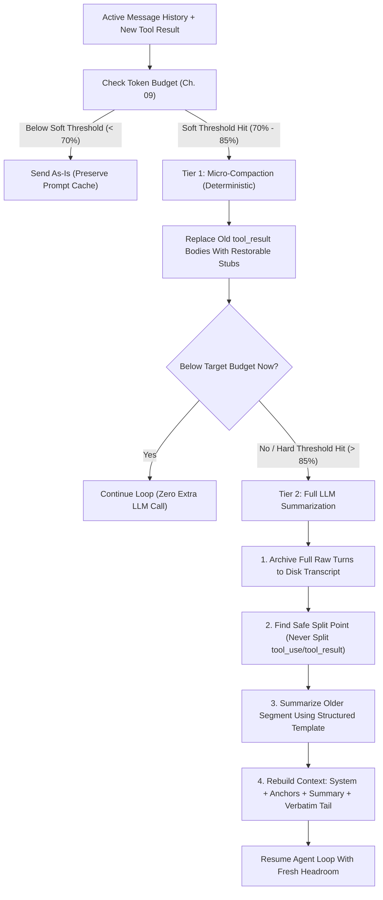

> **Module 2: Context & Memory** | Prerequisites: Chapters 07–09 | Reading Time: ~22 min
>
> [← 09. Context Window Budgeting](./09-context-window-budgeting.md) | [Table of Contents](../README.md) | [11. Tool Output Truncation & Artifact Offloading →](./11-tool-output-truncation-and-artifact-offloading.md)

# 10. Context Compaction & Summarization

In Chapter 09, you learned how to measure your context window, reserve headroom for output, and set soft and hard budget thresholds. Now comes the moment every long-running agent inevitably hits: **the alarm goes off.** Your agent is 45 tool calls deep into a tricky refactor, the context window is at 80% capacity, and the task is only halfway done.

You cannot just stop the session, and you cannot keep appending forever: soon the provider's API will reject the request with a hard `context_length_exceeded` error, and long before that, **context rot** will quietly wreck the model's reasoning. You need a way to shrink the conversation history while keeping the agent smart, coherent, and focused on the finish line. That craft is called **context compaction**.

---

## 1. The Simple Idea (Zero-Jargon Intuition)

Imagine a surgeon performing a six-hour operation, or a head chef working through a twelve-course banquet.

Early in the shift, the chef's desk starts out clean. By hour three, it is buried under 80 old ingredient lists, scratched-out sauce experiments, grocery receipts from dishes that were already served, and sticky notes from two hours ago. Even though the desk is huge, the chef keeps misplacing the recipe for the *current* course under piles of stale paper.

If the assistant walks in and tries to tidy up, there are three ways to do it:

1. **The Bad Way (Shred the Oldest Half of the Desk):** Grab the bottom half of the pile and throw it straight into the trash. Oops: the very first note at the bottom was the customer's peanut allergy warning!
2. **The Light Tidy (Micro-Compaction):** Leave the chef's notes alone, but pull out the 30 bulky grocery receipts from courses that are already finished and replace each one with a tiny index card: *"Checked pantry at 2:10 PM; full list filed in Binder #4."*
3. **The Shift Handoff (Full Summarization):** When even the index cards fill the desk, pause for 10 seconds and write a crisp **one-page shift handoff memo**: listing the allergy warnings, which courses are already plated, which pans are on the stove right now, what went wrong with the soufflé, and the exact next two steps. File the old stack in a cabinet, put the handoff memo on the desk alongside the last 10 minutes of active notes, and keep cooking.

**What breaks if you skip compaction?**

- **Hard crashes mid-task:** The next API call blows past the model's context limit and fails completely.
- **Silent quality collapse:** Even with a 200k- or 1M-token window, drowning the model in 40 stale file dumps causes it to miss instructions, hallucinate variable names, and loop on solved bugs.
- **Runaway cost and latency:** Remember that LLMs are stateless; every turn re-reads the *entire* conversation array. Letting history grow unchecked makes turn 60 ten times more expensive and noticeably slower than turn 6.

### Key Terms Defined Gently

| Term | Plain-English Meaning |
| :--- | :--- |
| **Compaction** | Any process that shrinks the active conversation history sent to the LLM so the session can continue smoothly within its token budget. |
| **FIFO (First-In, First-Out)** | A naive "sliding window" strategy that simply deletes the oldest messages first, like a conveyor belt pushing early messages off the edge. |
| **Micro-Compaction** | A fast, deterministic cleanup pass (no extra LLM call) that strips bulky old tool outputs (or old file-write inputs) and replaces them with short placeholder notes. |
| **Full Summarization** | Asking an LLM to condense a large stretch of older conversation turns into a dense, structured handoff summary, then replacing those turns with the summary. |
| **Invariant** | A structural rule that must *never* be broken, for example, never leaving an assistant's `tool_use` request without its matching `tool_result` reply. |
| **Transcript** | The permanent, append-only record of everything that actually happened in the session (saved on disk), separate from the compacted *view* sent to the LLM. |

---

## 2. Why This Matters in a Real Agent Harness

Real coding tasks routinely run for 30 to 150 tool calls: exploring a repository, reproducing a bug, editing five files, running tests, fixing type errors, and updating docs. Each file read or test run adds 1,000 to 15,000 tokens. Without compaction, an agent hits 150,000+ tokens in under 20 minutes.

Well-engineered compaction impacts all four pillars of a production harness:

1. **Reliability (Surviving Long Horizons):** Good compaction turns a 200k-token model into an agent that can work coherently across *millions* of cumulative tokens over hours without crashing or losing the thread.
2. **Reasoning Quality (Fighting Context Rot):** Stripping obsolete stack traces, failed dead-end experiments, and out-of-date copies of files you have already edited raises the **signal-to-noise ratio** of the working memory.
3. **Cost & Prompt Cache Economics (The Hidden Trade-Off):** Recall from Chapter 08 that prompt caching gives you up to an 80–90% discount when the beginning (prefix) of your prompt stays byte-for-byte identical across turns.
   - If you compact **on every single turn**, you mutate the prefix every turn and **destroy your cache hit rate**: often making the agent *more* expensive!
   - If you compact **infrequently at deliberate thresholds** (say, when context reaches 75–85% of budget, collapsing it back down to ~25–35%), you pay a single cache-write cost once, then enjoy 20–40 cheap cache-hit turns on a much smaller prompt.
4. **Latency (Faster Time-To-First-Token):** Processing 180k input tokens takes noticeably longer than processing 25k tokens, even with warm KV caches. Compacting brings turn-by-turn snappiness back to life.

---

## 3. The Big Picture

Modern harnesses do **not** jump straight to lossy LLM summarization the moment context gets warm. Instead, they use a **two-tier compaction pipeline** backed by an immutable transcript on disk:



Notice the core design principle: **prefer reversible, deterministic cleanup first; invoke lossy LLM summarization only when you truly need the space; and never erase the permanent transcript on disk.**

---

## 4. Deep Dive

### 4.1 Why Naive FIFO Message Dropping Destroys Agent Coherence

When engineers build their first agent loop and hit a context-limit error, the most tempting five-line fix is a **FIFO sliding window**:

```python
# ANTI-PATTERN: Never do this in a real agent harness!
while estimate_tokens(messages) > MAX_TOKENS:
    messages.pop(1)  # Drop the oldest message after the system prompt
```

This looks harmless in a casual chat app, and it is **catastrophic** in an agent harness for four distinct reasons:

1. **Loss of Original Goal & Constraints ("First-Turn Amnesia"):** The user's opening prompt is almost always the richest message in the session. It holds the goal, acceptance criteria, and negative constraints (*"Fix the retry bug, but do NOT change the public function signature and do NOT add new packages"*). FIFO deletes it first! Twenty turns later, the agent happily rewrites the public API because the constraint slid off the cliff.
2. **Broken Protocol Pairs (Instant HTTP 400 Errors):** In Anthropic, OpenAI, and Gemini APIs, an assistant message containing a `tool_use` call (say `id="call_42"`) **must** be followed immediately by a message containing the matching `tool_result` (`tool_use_id="call_42"`). Popping one message at a time inevitably deletes the `tool_use` while leaving an orphaned `tool_result` behind, causing the API to reject the next call with a `400 Bad Request`.
3. **Architectural Amnesia & Oscillating Bugs:** Suppose in turns 4–8 the agent tried Approach A, discovered it broke an edge case in `payments.py`, reverted it, and switched to Approach B. FIFO drops turns 4–8. On turn 35, the agent sees the remaining code, thinks *"Hey, Approach A would be much cleaner!"*, and re-introduces the exact bug it already ruled out.
4. **Total Prompt-Cache Destruction:** Because `messages.pop(1)` changes index 1 of the conversation on *every single turn* once the window is full, the prompt prefix changes on every call. Your cache hit rate plummets from ~90% to **0%**, multiplying your API bill by 5x–10x.

> **Rule of thumb:** Never treat an agent's working memory like a rolling chat log. An agent's history is a **stateful execution trace**, not small talk.

---

### 4.2 Micro-Compaction vs. Full LLM Summarization

Because naive dropping fails, production harnesses split compaction into two distinct tiers: **Micro-Compaction** (surgical, deterministic pruning) and **Full Summarization** (semantic compression via an LLM).

#### Tier 1: Micro-Compaction (Clearing Old Tool Outputs)

In a typical coding session, **70% to 90% of all tokens in the context window are raw tool outputs** (file contents, `grep` listings, test logs, directory trees) and large tool inputs (full file bodies passed into `write_file`). The model's own reasoning and the user's messages usually make up less than 15% of the prompt.

Micro-compaction exploits this imbalance:

- It walks through **older** turns (leaving the most recent turns untouched).
- It keeps the `assistant` message intact (so the model still remembers *what* it decided to look for and *why*).
- It replaces the bulky `tool_result` payload with a tiny, informative placeholder stub.
- Optionally, it also compacts huge old `write_file` / `edit_file` tool inputs into a file path pointer, because the file already lives on disk!

Here is what a single tool turn looks like **before** and **after** micro-compaction:

```json
// BEFORE micro-compaction (~3,800 tokens)
{
  "role": "user",
  "content": [
    {
      "type": "tool_result",
      "tool_use_id": "toolu_01XyZ9",
      "content": "   1 | import os\n   2 | import hashlib\n   ... (420 lines of src/auth.py) ..."
    }
  ]
}

// AFTER micro-compaction (~28 tokens — 99.3% reduction!)
{
  "role": "user",
  "content": [
    {
      "type": "tool_result",
      "tool_use_id": "toolu_01XyZ9",
      "content": "[Cleared old tool result: read_file('src/auth.py', lines 1-420). Re-read the file if you need its exact current contents.]"
    }
  ]
}
```

Notice something magical about this stub: it is **restorable (reversible) compression**. As the Manus AI team famously framed it, if the raw data still lives on disk (a source file, a URL, or an offloaded scratch file from Chapter 11), clearing its body from context destroys *zero* permanent information. The model still knows it read `src/auth.py`, still has the conclusions it wrote in its subsequent assistant message, and can re-read `src/auth.py` if it ever needs exact line numbers again.

#### Tier 2: Full LLM Summarization

Eventually (after 60, 80, or 120 turns) even the assistant thoughts, user messages, and placeholder stubs accumulate enough tokens to cross your hard threshold. At that point, micro-compaction alone cannot reclaim enough space.

Now the harness runs **Full Summarization**:

1. It partitions the conversation into an **older segment** (to be compressed) and a **recent tail** (kept verbatim so active work is not disrupted).
2. It sends the older segment to an LLM with a strict **structured handoff prompt**.
3. It replaces the entire older segment with a single compact summary block (plus a pointer to the archived raw transcript on disk).
4. It resumes the loop with `[System Prompt] + [Pinned Anchors] + [Structured Summary] + [Recent Verbatim Tail]`.

#### Comparing All Four Strategies

| Strategy | Extra LLM Call? | Preserves Constraints? | Reversible? | Prompt Cache Impact | Best Used When |
| :--- | :--- | :--- | :--- | :--- | :--- |
| **Naive FIFO Drop** | No | No (drops early turns) | No | Terrible (0% hits once full) | **Never** in an agent harness |
| **Micro-Compaction** | No (pure code) | Yes (user/assistant text kept) | Yes (if backed by files) | Good if batched at thresholds | First line of defense (70–85% full) |
| **Full LLM Summarization** | Yes (1 call) | Yes, *if* structured template is used | Partially (lossy, unless raw transcript is searchable) | Good (single reset, then many hits) | Second line of defense (>85% full) or manual `/compact` |
| **Provider Server-Side Compaction** | Managed by API | Provider-managed | Opaque (OpenAI) or typed block (Anthropic) | Optimized by provider | When using Anthropic/OpenAI native compaction APIs |

---

### 4.3 Structured Summary Templates (What Must Survive Compaction)

If you ask an LLM: *"Summarize our conversation so far"*, you will get four paragraphs of pleasant, high-level prose:

> *"We investigated an authentication bug in the repository, reviewed several files, ran the test suite, made some updates to the token validation logic, and are currently troubleshooting a remaining edge case."*

**That summary is nearly useless to a coding agent.** Which files? Which function? What failed? What did we already rule out? What are we forbidden from changing?

A great compaction summary is **not a book report: it is a flight recorder and shift handoff checklist.** Every production harness enforces an explicit, structured template so critical engineering facts cannot slip through the cracks:

```markdown
You are compacting an ongoing engineering session so the agent can continue
seamlessly without repeating work or violating user constraints.

Produce a concise, factual handoff using EXACTLY these XML sections.
Preserve exact file paths, symbol names, commands, exit codes, and constraints.
Do NOT invent facts that are not present in the transcript.

<goal_and_constraints>
- Primary user objective (verbatim intent).
- Explicit constraints, non-goals, and "do NOT" rules from the user.
</goal_and_constraints>

<completed_work>
- Bullet list of verified completed milestones (include test/command proof).
</completed_work>

<modified_files>
- Exact relative path -> brief description of changes made and current status.
</modified_files>

<decisions_and_rejected_paths>
- Key design choices made and WHY.
- Approaches tried and ruled out (so the agent does not repeat dead ends).
</decisions_and_rejected_paths>

<open_errors_and_blockers>
- Exact failing command, error message, file:line, and current hypothesis.
- Write "None" if all checks currently pass.
</open_errors_and_blockers>

<next_steps>
- Ordered, concrete next actions the agent should execute immediately.
</next_steps>
```

Look at the difference between vague prose and a structured handoff:

```xml
<goal_and_constraints>
- Fix intermittent 401 errors during JWT refresh in `src/auth/refresh.ts`.
- Constraints: Do NOT add new npm dependencies; keep the public `refreshSession(token)` return type unchanged; all changes must pass `npm test -- auth`.
</goal_and_constraints>

<completed_work>
- Reproduced race condition with `npm test -- auth/refresh.test.ts` (2 concurrent refresh calls invalidate each other).
- Added in-flight promise deduplication map (`pendingRefreshes`) in `src/auth/refresh.ts`.
- Verified concurrent refresh test now passes (exit code 0).
</completed_work>

<modified_files>
- `src/auth/refresh.ts`: Added `pendingRefreshes: Map<string, Promise<Session>>` with `.finally()` cleanup (lines 42-88).
- `tests/auth/refresh.test.ts`: Added `handles concurrent refresh calls` test case.
</modified_files>

<decisions_and_rejected_paths>
- Rejected Redis distributed lock because the service runs single-node in-memory and user disallowed new dependencies.
- Rejected mutating `Session` return type to include `deduplicated: boolean` (violates public API constraint).
</decisions_and_rejected_paths>

<open_errors_and_blockers>
- `npm run typecheck` fails at `src/auth/refresh.ts:67`: `TS2322: Type 'Promise<Session | null>' is not assignable to type 'Promise<Session>'`.
</open_errors_and_blockers>

<next_steps>
1. Inspect lines 55-75 of `src/auth/refresh.ts` and narrow the null check before storing the promise.
2. Re-run `npm run typecheck` and `npm test -- auth`.
3. Provide a concise final summary to the user.
</next_steps>
```

An agent waking up to *that* handoff can immediately pick up line 67 of `src/auth/refresh.ts` without wasting a single turn re-exploring the codebase.

> **Pro tip: Ground the summary with deterministic harness facts.** Don't rely purely on the LLM's memory to list modified files! Before or after calling the summarizer, your harness can run `git status --short` (or read its own tracked edit ledger) and inject the verified list of modified files directly into the compaction block.

---

### 4.4 Preserving Invariants (The Structural Laws of Safe Compaction)

Compaction rewrites the message array you send to the LLM API. If you violate the provider's structural rules, or break the agent's working state, your harness will either crash with HTTP 400 or lobotomize the agent mid-thought.

Every production compactor enforces **five strict invariants**:

#### Invariant 1: Never Split `tool_use` / `tool_result` Pairs

In modern tool-calling APIs, an assistant message requesting one or more tools and the immediately following user/tool message(s) supplying their results form an **atomic unit** (often called a *tool-call group*):

```text
  [Assistant: tool_use(id="call_1"), tool_use(id="call_2")]   <-- NEVER cut between these!
  [User:      tool_result(id="call_1"), tool_result(id="call_2")]
```

If your split index falls *between* the assistant message and its `tool_result` message, two bad things happen:
- The older half ends with an unanswered `tool_use` (summarizer sees an incomplete action).
- The kept recent tail starts with an **orphaned `tool_result`** whose `tool_use_id` no longer exists in the message array, causing Anthropic, OpenAI, and Gemini APIs to throw an immediate validation error.

**The rule:** Only place a compaction split boundary *before* a regular `user` message (one that contains human text, not a `tool_result`) or cleanly *between* completed assistant/tool-result exchanges, and ensure the kept tail begins with a valid non-orphan turn.

#### Invariant 2: Keep a Verbatim Recent Tail ("Working Set")

Never summarize up to the very last message. If the agent *just* read lines 50–100 of `server.py` and saw a compiler error two seconds ago, turning that into a summary forces it to re-read `server.py` on the very next turn.

Always keep a **protected recent tail** verbatim, for example, the most recent **15,000–25,000 tokens** (or the last 4–6 complete turns), snapped to a safe tool-pair boundary.

#### Invariant 3: Pin Non-Negotiable Anchors

Some items should *never* be compacted away:
- The **system prompt** and repository rule files (`AGENTS.md` / `CLAUDE.md`, Ch. 07).
- The **active task checklist / plan** (if your harness tracks one, Ch. 30).
- Optionally, a compact copy of the **initial user request** (or explicit user constraints pinned in the summary header).

#### Invariant 4: Preserve Valid Role Alternation & Reasoning Blocks

- Some APIs require strict `user` → `assistant` → `user` alternation (you cannot put two `user` messages back-to-back without merging them, nor start the post-summary history with an `assistant` message if the API expects `user` first).
- Reasoning models (like Claude with extended thinking or OpenAI reasoning models) attach cryptographic signatures or reasoning items to assistant turns. When compacting older turns, strip old hidden thinking blocks cleanly rather than leaving malformed or half-stripped reasoning blocks attached to an assistant turn.

#### Invariant 5: Never Mutate the Permanent Transcript

Your on-disk session log (Ch. 37) is the **source of truth** for debugging, undo/rollback, billing audits, and replay. Treat compaction as creating a new **active prompt view**: or appending a `compaction_checkpoint` event to the JSONL log that says *"for future LLM calls, start reading from this summary block onward."* That way, the full uncompacted history is always preserved on disk (and can even be searched by the agent if needed!).

Here is the core safe-split logic that enforces Invariants 1 and 2 (you will wire it into a full two-tier compactor in Section 7):

```python
def find_safe_split_index(
    messages: list[dict[str, Any]],
    keep_recent_tokens: int,
    token_counter,
) -> int:
    """Return split_idx so messages[split_idx:] holds recent tokens
    and NEVER orphans a tool_result or leaves an unanswered tool_use."""
    if len(messages) <= 2:
        return 0

    tail_tokens, candidate = 0, len(messages)
    for idx in range(len(messages) - 1, -1, -1):
        msg_tokens = token_counter(messages[idx])
        if tail_tokens + msg_tokens > keep_recent_tokens and candidate < len(messages):
            break
        tail_tokens += msg_tokens
        candidate = idx

    # Snap backward past any tool_result or preceding tool_use boundary
    while candidate > 0 and (
        is_tool_result_message(messages[candidate])
        or has_tool_use(messages[candidate - 1])
    ):
        candidate -= 1
    return candidate
```

Walk through what that `while` loop guarantees: if `candidate` lands on a `tool_result`, it steps back onto the `assistant` message with the matching `tool_use`, keeping the whole pair intact in the verbatim tail! And if `candidate - 1` had a `tool_use`, it won't chop right after it either.

---

### 4.5 Compaction Failure Modes (And How to Prevent Them)

Even with structured templates and safe boundaries, compaction introduces subtle failure modes that bite teams in production. Knowing all five upfront will save you weeks of mysterious debugging:

#### 1. Hallucinated Summaries & "Telephone Game" Drift
When an agent compacts **three or four times** in a marathon session, compaction #4 is summarizing compaction #3, which summarized compaction #2, which summarized compaction #1. Like a photocopier copying a photocopy, subtle errors creep in: a file that was *inspected* gets summarized as *edited*; a test that was *skipped* gets summarized as *passing*; a tentative hypothesis becomes stated as a confirmed fact.
- **Prevention:**
  - Instruct the summarizer to distinguish **Verified Facts** (with command/test proof) from **Hypotheses**.
  - Deterministically inject ground-truth harness state (`git diff --stat`, tracked edited file list, active task checklist) *outside* the prose summary so ground truth resets cleanly on every compaction.
  - Archive the raw transcript to disk and include its path in the summary so the agent can verify exact details if uncertain.

#### 2. Repeated Re-Reading Loops ("Amnesia Tax")
Micro-compaction clears `src/config.py` because it was read 12 turns ago. On turn 13, the agent needs one field name from `src/config.py`, so it calls `read_file("src/config.py")` again: burning another 3,000 tokens. On turn 18, it happens again!
- **Prevention:**
  - Never micro-compact tool results from the most recent $N$ turns (e.g., last 6–10 turns) or recently edited files.
  - Make your placeholder stub **smart**: instead of `[cleared]`, include lightweight metadata extracted deterministically when the tool ran; e.g., `[Cleared read_file('src/config.py', 310 lines, exports: loadConfig, AuthConfig). Re-read only specific line ranges if needed.]`.
  - Track a **re-read counter** in telemetry (Ch. 38); if the same file is read 3+ times in one session, your micro-compaction window is too aggressive.

#### 3. Silent Loss of User Constraints
In turn 1, the user writes: *"Migrate the endpoints to async, keep Python 3.10 compatibility, and don't touch `legacy_v1.py`."* After two compactions, *"keep Python 3.10 compatibility"* gets dropped as "minor detail." The agent happily uses a Python 3.12 syntax feature and breaks CI.
- **Prevention:** Dedicate an explicit `<goal_and_constraints>` section at the top of the summary template, and keep a pinned copy of user-declared rules/constraints that gets re-injected verbatim into every compaction prompt.

#### 4. The Compaction Overflow Deadlock
Think about this edge case: your context limit is 200,000 tokens. A huge tool output pushes your history to 198,000 tokens. Your harness triggers Full Summarization, which sends the 198,000-token history *plus* a 1,500-token summarization prompt *plus* a 4,000-token output reservation = **203,500 tokens**. **The compaction call itself fails with `context_length_exceeded`!** Now your session is permanently deadlocked.
- **Prevention:**
  1. Combine Chapter 11's **front-door output caps** with Chapter 09's **headroom thresholds** (trigger compaction around 75–85%, leaving at least 20k–30k tokens of safety margin).
  2. Always run **emergency deterministic micro-compaction** (clearing *all* older tool results aggressively) *before* sending the payload to the summarizer if the summarization input itself would exceed the model's window.
  3. Have a **chunked (map-reduce) fallback**: if history is still too large to summarize in one call, split it in half, summarize each half, and merge.

#### 5. Cache-Thrashing Compaction
Suppose your threshold is 100k tokens, and once you hit 100k you prune *just* 2,000 tokens so you sit at 98k. Next turn, you add 3,000 tokens, cross 100k again, and prune again! You now mutate the prefix on **every single turn**, permanently breaking prompt caching.
- **Prevention:** Use **hysteresis** (a wide gap between trigger and target). For example: trigger compaction at **80%**, and compact all the way down to **25–35%**. That guarantees dozens of uninterrupted cache-hit turns before the next compaction.

---

## 5. How Real Harnesses Do It

Compaction has evolved so rapidly between 2025 and 2026 that both **agent harnesses** and **model providers themselves** now build first-class compaction primitives:

- **Anthropic Context Editing & Server-Side Compaction API:** Anthropic introduced dedicated `context_management` strategies directly in the Messages API. Its `clear_tool_uses_20250919` strategy performs **server-side micro-compaction**, automatically clearing older `tool_result` blocks chronologically and replacing them with lightweight placeholders while keeping the rest of the narrative intact. For deeper sessions, Anthropic's server-side compaction (`compact_20260112` and on-demand compaction betas) triggers automatically once input tokens cross a configurable threshold (minimum 50k tokens), generating a typed compaction content block so subsequent calls drop everything prior to it.
- **Claude Code (`auto-compact` & `/compact`):** Claude Code uses a two-tier strategy out of the box. As a session approaches its context threshold, it first clears bulky old tool outputs, and when more headroom is needed, summarizes older turns into a structured continuation handoff. Users can inspect live window usage with `/context`, configure thresholds with `/autocompact`, or trigger targeted manual compaction like `/compact Focus on the auth refactor and keep the failing test errors`, which often beats generic auto-compaction because the human tells the summarizer what matters next.
- **OpenAI Responses API Compaction:** OpenAI exposes two complementary primitives in the Responses API:
  1. **Explicit endpoint (`POST /v1/responses/compact`):** You send your conversation history, and OpenAI returns a shortened, **encrypted opaque compaction item** that stands in for all prior turns (including stripping obsolete historical reasoning items while preserving continuity).
  2. **Automatic server-side compaction (`context_management`):** By adding `{"type": "compaction", "compact_threshold": 100000}` to a standard `/v1/responses` request, the server automatically compacts once input tokens cross the threshold. OpenAI explicitly recommends compacting *rarely and structurally* rather than every turn so you retain automatic prefix-cache discounts.
- **Manus AI (Restorable Compression):** Manus designs tools with **dual representations**: a *full form* stored on the virtual machine's filesystem and a *compact form* kept in the message history. Older tool calls collapse to compact path references (`path="/workspace/report.md"`), making micro-compaction completely reversible without lossy summarization.
- **Cursor (Searchable Compacted History):** When Cursor compacts a long chat session, it does not throw the original transcript away; it writes the complete history into a local referenceable file. If the agent realizes post-compaction that a nuance or earlier decision was summarized away, it can run `grep` or targeted file reads on its own history file to recover the exact quote.
- **LangChain Deep Agents (`deepagents`) & OpenCode:** Both implement explicit multi-tier compression pipelines: first spilling oversized tool outputs to scratch files (Chapter 11), then pruning old tool inputs/outputs with placeholders like `[Old tool result content cleared]` while protecting recent tail turns and key tools, and only falling back to structured LLM summarization when deterministic pruning no longer frees enough budget.

---

## 6. Common Pitfalls & Failure Modes

- **Summarizing with a weak model on a hard debugging task:** It is tempting to route compaction to the cheapest tiny model to save pennies. For simple tasks that works fine, but on complex multi-file debugging, a weak summarizer often misunderstands *why* a bug happened and drops subtle invariants. Test summarizer quality on real long-horizon trajectories (Ch. 40).
- **Forgetting to re-emit tool-call state when compacting mid-turn:** Never run full summarization *between* issuing a `tool_use` and receiving its `tool_result`. Wait until the current tool batch finishes, append all `tool_result`s, and compact at a clean turn boundary.
- **Triggering compaction too late (e.g., at 97% of the window):** You leave no room for the summarization prompt itself or the summary output, causing the Compaction Overflow Deadlock.
- **Mutating the raw session array in place without saving a snapshot:** Once you overwrite `messages`, you lose the ability to inspect what the model actually saw, replay bugs, or let the user hit Undo/Rewind (Ch. 36–37).
- **Forgetting hysteresis:** Trimming just enough tokens to slip 1% below the threshold triggers compaction on *every* subsequent turn and destroys prompt caching. Always compact down to a comfortable floor (e.g., 25–35% of budget).

---

## 7. Build It Yourself: Mini-Lab

Let's build a clean, self-contained **Two-Tier Safe Context Compactor** in Python. It combines:
1. **Tier 1 (Micro-Compaction):** Deterministic clearing of old `tool_result` blocks outside a protected recent tail, leaving restorable stubs.
2. **Safe Split-Point Detection:** Enforcing the `tool_use` / `tool_result` pairing invariant.
3. **Tier 2 (Structured Summarization):** Archiving raw turns to a JSONL scratch file, injecting deterministic `modified_files` grounding, and folding older history into our 6-section XML handoff template.

```python
"""
mini_lab_compactor.py — Two-Tier Safe Context Compactor
Demonstrates:
  - Tier 1: Deterministic micro-compaction of old tool outputs
  - Invariant preservation: Never splitting tool_use / tool_result pairs
  - Tier 2: Structured LLM summarization + disk archival + deterministic grounding
"""

from __future__ import annotations

import copy
import json
from pathlib import Path
from typing import Any, Callable


STRUCTURED_SUMMARY_PROMPT = """Compact the older conversation history below into a factual
engineering handoff so the agent can continue seamlessly.

Use EXACTLY these XML sections (preserve exact paths, symbols, commands, and constraints):
<goal_and_constraints>...</goal_and_constraints>
<completed_work>...</completed_work>
<modified_files>...</modified_files>
<decisions_and_rejected_paths>...</decisions_and_rejected_paths>
<open_errors_and_blockers>...</open_errors_and_blockers>
<next_steps>...</next_steps>
"""


def estimate_tokens(obj: Any) -> int:
    """Fast heuristic (~4 chars/token) for budgeting demos.
    In production, use your provider's tokenizer or usage metadata (Ch. 09)."""
    return max(1, len(json.dumps(obj, ensure_ascii=False)) // 4)


def is_tool_result_msg(msg: dict[str, Any]) -> bool:
    if msg.get("role") == "tool":
        return True
    content = msg.get("content")
    return isinstance(content, list) and any(
        isinstance(b, dict) and b.get("type") == "tool_result" for b in content
    )


def has_tool_use(msg: dict[str, Any]) -> bool:
    if msg.get("role") != "assistant":
        return False
    content = msg.get("content")
    return isinstance(content, list) and any(
        isinstance(b, dict) and b.get("type") == "tool_use" for b in content
    )


def micro_compact(
    messages: list[dict[str, Any]],
    protect_last_n_messages: int = 6,
    min_chars_to_clear: int = 400,
) -> tuple[list[dict[str, Any]], int]:
    """
    Tier 1: Deterministically replace large, older tool_result bodies with compact stubs.
    Returns (new_messages, tokens_saved). Never mutates the input list in place.
    """
    result = copy.deepcopy(messages)
    cutoff = max(0, len(result) - protect_last_n_messages)
    tokens_before = estimate_tokens(result)

    # Map tool_use_id -> tool name + brief input hint so stubs stay informative
    tool_lookup: dict[str, str] = {}
    for msg in result:
        if msg.get("role") == "assistant" and isinstance(msg.get("content"), list):
            for block in msg["content"]:
                if isinstance(block, dict) and block.get("type") == "tool_use":
                    tid = block["id"]
                    name = block.get("name", "tool")
                    inp = block.get("input", {})
                    hint = inp.get("path") or inp.get("command") or ""
                    tool_lookup[tid] = f"{name}({hint!r})" if hint else name

    # Clear bulky tool_result bodies older than the protected tail
    for msg in result[:cutoff]:
        if not isinstance(msg.get("content"), list):
            continue
        for block in msg["content"]:
            if isinstance(block, dict) and block.get("type") == "tool_result":
                raw = str(block.get("content", ""))
                if len(raw) >= min_chars_to_clear and not raw.startswith("[Cleared"):
                    tid = block.get("tool_use_id", "")
                    label = tool_lookup.get(tid, "tool_call")
                    line_count = raw.count("\n") + 1
                    block["content"] = (
                        f"[Cleared old tool result for {label}: "
                        f"{line_count} lines / {len(raw)} chars. "
                        f"Re-run or inspect disk if exact contents are needed.]"
                    )

    tokens_saved = tokens_before - estimate_tokens(result)
    return result, tokens_saved


def find_safe_split_index(
    messages: list[dict[str, Any]],
    keep_recent_tokens: int,
) -> int:
    """Choose a split index that preserves recent tokens and never splits tool pairs."""
    if len(messages) <= 2:
        return 0

    tail_tokens = 0
    split_idx = len(messages)
    for i in range(len(messages) - 1, -1, -1):
        t = estimate_tokens(messages[i])
        if tail_tokens + t > keep_recent_tokens and split_idx < len(messages):
            break
        tail_tokens += t
        split_idx = i

    # Snap backward so we never orphan a tool_result or leave a dangling tool_use
    while split_idx > 0 and (
        is_tool_result_msg(messages[split_idx]) or has_tool_use(messages[split_idx - 1])
    ):
        split_idx -= 1

    return split_idx


def compact_if_needed(
    messages: list[dict[str, Any]],
    *,
    soft_limit: int,
    hard_limit: int,
    keep_recent_tokens: int,
    archive_path: Path,
    verified_modified_files: list[str],
    call_summarizer: Callable[[str, str], str],
) -> tuple[list[dict[str, Any]], str]:
    """
    Two-tier compaction controller.
    Returns (next_active_messages, action_taken).
    """
    current_tokens = estimate_tokens(messages)
    if current_tokens < soft_limit:
        return messages, "noop"

    # --- Tier 1: Deterministic Micro-Compaction ---
    pruned, saved = micro_compact(messages)
    if estimate_tokens(pruned) < hard_limit:
        return pruned, f"micro_compact (saved ~{saved} tokens)"

    # --- Tier 2: Full Structured LLM Summarization ---
    split_idx = find_safe_split_index(pruned, keep_recent_tokens=keep_recent_tokens)
    if split_idx == 0:
        return pruned, "micro_compact_only (tail too large to split safely)"

    older_segment = pruned[:split_idx]
    recent_tail = pruned[split_idx:]

    # 1. Persist uncompacted older turns to disk (Invariant 5: never lose raw history)
    archive_path.parent.mkdir(parents=True, exist_ok=True)
    with archive_path.open("a", encoding="utf-8") as f:
        for msg in messages[:split_idx]:
            f.write(json.dumps(msg, ensure_ascii=False) + "\n")

    # 2. Ask the LLM to summarize the older segment using our structured template
    serialized_older = json.dumps(older_segment, indent=2, ensure_ascii=False)
    summary_xml = call_summarizer(STRUCTURED_SUMMARY_PROMPT, serialized_older)

    # 3. Ground the handoff with deterministic harness facts + archive pointer
    files_note = ", ".join(verified_modified_files) if verified_modified_files else "None"
    handoff_text = (
        f"[COMPACTED SESSION HANDOFF — {len(older_segment)} earlier messages archived]\n"
        f"Raw transcript archive (searchable via grep/read_file): {archive_path}\n"
        f"Harness-verified modified files on disk: {files_note}\n\n"
        f"{summary_xml}"
    )

    # 4. Rebuild valid alternating message list (insert ack only if tail starts with user)
    compacted_messages: list[dict[str, Any]] = [
        {"role": "user", "content": handoff_text}
    ]
    if recent_tail and recent_tail[0].get("role") == "user":
        compacted_messages.append(
            {
                "role": "assistant",
                "content": "Understood. I have the compacted handoff and will continue from the recent turns below.",
            }
        )
    compacted_messages.extend(recent_tail)
    return compacted_messages, f"full_compaction (folded {len(older_segment)} messages)"
```

Notice how every piece reinforces the invariants:
- `micro_compact` never mutates the caller's list and preserves `tool_use_id`.
- `find_safe_split_index` guarantees `recent_tail` never starts on an orphaned `tool_result`.
- The raw turns are appended to `archive_path` *before* replacing them, so the full record is never lost.
- Role alternation stays strictly valid whether `recent_tail[0]` is a `user` turn or an `assistant` turn.

---

## 8. Key Takeaways & Quick Self-Check

### Key Takeaways
- **Never use naive FIFO message dropping** in an agent harness: it erases initial constraints, breaks `tool_use`/`tool_result` pairs, and destroys prompt caching on every single turn.
- **Compact in two tiers:** run deterministic **micro-compaction** first (clearing bulky old tool outputs into restorable stubs), and only invoke **full LLM summarization** when you hit your hard threshold.
- **Always use a structured handoff template** (goal & constraints, completed work, modified files, rejected paths, open errors, next steps) grounded with deterministic harness facts like `git status`.
- **Enforce structural invariants:** never split `tool_use`/`tool_result` pairs, preserve a verbatim recent tail, maintain hysteresis for prompt caching, and never overwrite your raw transcript on disk.
- **Preserve headroom for compaction itself** so the summarization call can never deadlock on a full context window.

### Quick Self-Check

1. **Why can running micro-compaction on *every single turn* actually increase your LLM API bill?**
   <details>
   <summary>Show Answer</summary>
   Prompt caching relies on the prefix (beginning) of your message array staying byte-for-byte identical across turns. If you modify an earlier message's `tool_result` on every turn, you invalidate the cached prefix every turn, forcing the provider to re-process all input tokens at full uncached price instead of the ~80–90% cached discount. Batching micro-compaction at a threshold (with hysteresis) gives you both smaller prompts and high cache hit rates.
   </details>

2. **What happens if a compaction split boundary lands right between an assistant `tool_use` message and the user `tool_result` message that answers it?**
   <details>
   <summary>Show Answer</summary>
   The kept recent tail begins with an orphaned `tool_result` referencing a `tool_use_id` that no longer exists in the active conversation array. Provider APIs (Anthropic, OpenAI, Gemini) strictly validate tool-call pairing and will reject the very next request with an HTTP 400 error. Always snap split points so `tool_use` and its matching `tool_result`(s) stay together as an atomic unit.
   </details>

3. **What makes Manus-style micro-compaction "restorable (reversible) compression" compared to full LLM summarization?**
   <details>
   <summary>Show Answer</summary>
   Full LLM summarization is lossy: nuances, exact line numbers, or subtle constraints can vanish forever if omitted from the prose. Restorable compression removes bulky payloads (like file reads or offloaded search outputs) from the active context window while keeping a lightweight pointer (such as the file path on disk). Because the full source data still exists on disk, the agent can retrieve any omitted detail on demand with zero permanent information loss.
   </details>

4. **Why is "repeated compaction" (compacting 4+ times in a long session) vulnerable to drift, and how do you defend against it?**
   <details>
   <summary>Show Answer</summary>
   Each summarization pass compresses the *previous* summary, creating a "telephone game" where hypotheses turn into stated facts, constraints fade, and file statuses drift out of sync with disk. Defend against it by (a) using a strict structured template with a dedicated `<goal_and_constraints>` section, (b) injecting deterministic harness ground truth (like `git diff --stat` and tracked edited files) on every compaction, and (c) archiving the raw transcript on disk so the agent can `grep` exact history when uncertain.
   </details>

---

[← 09. Context Window Budgeting](./09-context-window-budgeting.md) | [Table of Contents](../README.md) | [11. Tool Output Truncation & Artifact Offloading →](./11-tool-output-truncation-and-artifact-offloading.md)
