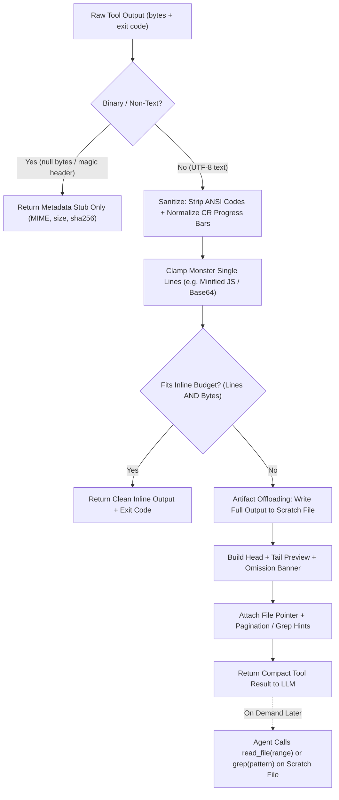

> **Module 2: Context & Memory** | Prerequisites: Chapters 09–10 | Reading Time: ~22 min
>
> [← 10. Context Compaction & Summarization](./10-context-compaction-and-summarization.md) | [Table of Contents](../README.md) | [12. Progressive Disclosure & On-Demand Skills →](./12-progressive-disclosure-and-on-demand-skills.md)

# 11. Tool Output Truncation & Artifact Offloading

In Chapter 10, you built a cleanup crew—context compaction—to tidy up a long session after dozens of turns. But what if **a single tool call** drops 350,000 tokens onto the model's desk in half a second?

It happens constantly in real software engineering. An agent runs `npm test` and hits an infinite logging loop. It runs `cat package-lock.json`. It greps for `"token"` across a repo and accidentally matches a 4 MB minified JavaScript bundle on a single line. Before compaction even has a chance to run, **one unfiltered tool result can blow past a 200k-token context window**, crash the session, waste dollars on a single API call, or bury a 3-line stack trace under 10,000 lines of noise.

If compaction is the cleanup crew inside the room, **tool output truncation and artifact offloading are the floodgate at the front door.**

---

## 1. The Simple Idea (Zero-Jargon Intuition)

Go back to our **Remote Specialist on a Phone Call** from Chapter 00.

Suppose the specialist asks the on-site engineer: *"Run the test suite and tell me why checkout failed."*

Now imagine the test runner spits out a **600-page log** listing 18,000 passing tests, noisy terminal color codes, and 200 pages of webpack output—and the on-site engineer tries to read all 600 pages out loud over the phone.

The call grinds to a halt. The specialist's notepad fills up, and the single line that actually matters—`FAIL tests/checkout.py: AssertionError: expected 200, got 500` on page 598—gets buried in noise.

What does a *great* on-site engineer do instead?

1. **Filters out garbage first:** Strips terminal color codes and decorative noise.
2. **Saves the full log to a labeled file on disk:** Writes the complete 600-page output to `logs/run-14.txt` so **nothing is ever thrown away**.
3. **Reads back a crisp one-page preview over the phone:**
   - The summary header: *"600 pages total (18,400 lines). Full log saved to `logs/run-14.txt`."*
   - The **top** lines (command header & initial setup) and the **bottom** lines (final stack trace & exit code).
   - A note: *"If you want to inspect any lines in the middle, just ask me to search or read specific line ranges from `logs/run-14.txt`."*

That three-step habit is **content-aware filtering + head/tail truncation + artifact offloading**.

### Key Terms Defined Gently

| Term | Plain-English Meaning |
| :--- | :--- |
| **Truncation** | Deliberately cutting a long piece of text down to a safe maximum size before inserting it into the LLM's context window. |
| **Head + Tail Truncation** | Keeping the beginning (*head*) and the end (*tail*) of a long output while omitting the repetitive middle—because headers start at the top and final errors/summaries appear at the bottom. |
| **Artifact Offloading** | Saving the complete, uncut output of a tool to a temporary **scratch file** on disk, then handing the LLM a small preview plus the file path so it can inspect the rest on demand. |
| **ANSI Escape Codes** | Invisible character sequences like `\x1b[31m` that terminals use to draw colors, bold text, and moving progress bars. Humans see red text; LLMs see noisy token soup. |
| **Minified File** | Code (like `bundle.min.js`) compressed onto a **single gigantic line** with all spaces and newlines removed—a classic trap for line-based truncators. |
| **Pagination** | Reading a large file in small, numbered slices (e.g., lines 1–200, then 201–400) instead of all at once. |

---

## 2. Why This Matters in a Real Agent Harness

You might wonder: *"Models have 200k- to 1M-token windows now—why bother truncating a 40k-token test log?"* Four hard realities of production harnesses answer that question:

1. **Preventing Instant Single-Turn Crashes:** One runaway command can easily produce 2–10 MB of stdout (~500k–2.5M tokens), exceeding even the largest model's context limit and killing the turn before the agent can react.
2. **Stopping Silent Truncation Hallucinations:** If a harness silently slices off output without telling the model *that* text was cut (or *where* to find the rest), the LLM assumes it saw the whole output. It will confidently declare *"All tests passed!"* when 14 failures were sitting past the cutoff.
3. **Protecting Signal-to-Noise Ratio:** Remember Chapter 09: every 50,000 tokens of Webpack build chatter dilutes the model's attention on the 15 lines of actual TypeScript error you care about.
4. **Dramatic Cost & Latency Savings:** A single unfiltered 100k-token tool dump stays in your conversation history for *every subsequent turn* until compaction clears it. Even with prompt caching, paying cache-write + repeated cache-read fees on 100k tokens of progress bars and lockfiles burns real money for zero value.

---

## 3. The Big Picture

Every tool output—from shell commands, file reads, code searches, HTTP calls, or MCP servers—should pass through a single deterministic **Output Guard** before it is ever appended to the conversation array:



Notice the elegance of this pipeline: **the LLM never loses access to data, and the context window never gets flooded.**

---

## 4. Deep Dive

### 4.1 Why a Single `npm test` or `cat` Can Blow Up a 200k-Token Window

In normal English prose, 1 token is roughly 4 characters. In code, JSON, minified JS, stack traces, and terminal escape codes, tokenization is *much denser*—often **1.5 to 3 characters per token** because punctuation, symbols, and random hashes split into individual tokens.

Look at how quickly ordinary developer commands explode a 200,000-token context window:

| Innocent Command | Typical Raw Size | Approximate Tokens | % of 200k Window |
| :--- | :--- | :--- | :--- |
| `cat package-lock.json` (medium web app) | 1.1 MB | ~350,000 tokens | **175% (Instant Crash)** |
| `npm test` (Jest with 40 failed snapshot diffs + debug logs) | 650 KB | ~210,000 tokens | **105% (Instant Crash)** |
| `rg "apiKey"` (forgetting to ignore `dist/bundle.min.js`) | 2.4 MB (on 1 line!) | ~750,000 tokens | **375% (Instant Crash)** |
| `git log -p` (forgot `-n 5` flag) | 4.8 MB | ~1,400,000 tokens | **700% (Instant Crash)** |
| `docker build .` (raw progress bar `\r` frames + ANSI colors) | 420 KB | ~155,000 tokens | **78% (Severe Context Rot)** |
| `curl https://api.example.com/users` (unpaginated JSON) | 380 KB | ~125,000 tokens | **63% (Severe Context Rot)** |

Even worse: the agent didn't do anything "crazy." Running `npm test` or `rg` is what coding agents do every 60 seconds! Without a deterministic guard at the tool boundary, **normal engineering workflows will routinely brick your agent.**

---

### 4.2 Head+Tail Truncation vs. Line/Byte Caps (and Preserving Stack Traces & Exit Codes)

Once an output exceeds your inline budget (for example, **200 lines or 16 KB**, whichever comes first), *how* should you slice it? Different truncation shapes have wildly different failure modes:

#### Why Naive Cuts Fail
- **Head-Only Truncation (`text[:16000]`):** Keeps the first 200 lines and drops the rest. Great for reading the top of a source file, **terrible for shell commands**. In `pytest`, `cargo test`, or `npm run build`, the first 200 lines are setup banners and passing tests—the actual failure summary and stack trace sit at the *very bottom* and get chopped off!
- **Tail-Only Truncation (`text[-16000:]`):** Keeps the last 200 lines. Much better for shell summaries, **but fails on cascading compiler errors**. In TypeScript, C++, or Rust, a single missing bracket or import at line 12 often triggers 150 bogus cascading errors afterward. Tail-only shows errors #120–#150 while hiding Error #1—the only real bug!
- **Line-Only Caps (`lines[:200]`):** Catastrophic on minified files. A 5 MB `bundle.min.js` has **1 line**. It sails right past a 200-line cap and dumps 1.5 million tokens into your prompt.
- **Byte-Only Caps (Raw Byte Slicing `raw_bytes[:16000]`):** Can slice straight through the middle of a multi-byte UTF-8 character (like an emoji or CJK character), producing broken Unicode (`UnicodeDecodeError`) or corrupting a JSON payload. Always decode safely and slice on **character or UTF-8 codepoint boundaries** (and preferably newline boundaries).

#### The Sweet Spot: Asymmetric Head+Tail Truncation + Pinned Metadata

For shell commands and logs, **asymmetric head+tail truncation** beats both head-only and tail-only:
- Keep **~25–30% from the Head** (captures command startup, environment info, and the *first* root-cause error).
- Insert a loud, unambiguous **omission banner** showing exactly how many lines and bytes were skipped.
- Keep **~70–75% from the Tail** (captures the final failing stack trace, assertion diff, and test summary).
- **Always pin structured metadata outside the truncated text:** exit code, execution duration, timeout/signal status, and total raw size. Never let truncation erase `exit_code: 1`!

| Strategy | Preserves First Error? | Preserves Final Summary & Stack Trace? | Handles Minified 1-Line Files? | Best Use Case |
| :--- | :--- | :--- | :--- | :--- |
| **Head-Only** | Yes | No | Only with byte/line-width cap | Paginated `read_file` starting at line 1 |
| **Tail-Only** | No | Yes | Only with byte/line-width cap | Streaming tail of a live daemon log |
| **Head + Tail (e.g., 30% / 70%)** | Yes | Yes | Only with byte/line-width cap | Default for shell commands, builds, test suites |
| **Offload + Head/Tail Preview** | Yes | Yes (plus 100% recoverable!) | Yes (with per-line clamp) | **Gold standard** for all oversized tool outputs |

---

### 4.3 Artifact Offloading: Scratch Files, Pointers, and Previews

Truncation alone is **lossy**: if the one failing assertion happened to sit in the middle of a 3,000-line test log (line 1,450), head+tail truncation hides it, and the agent has to re-run the entire 2-minute test suite with `| grep FAIL` just to see it.

**Artifact offloading** solves this cleanly:
1. When any tool output crosses your inline threshold (say, `> 16 KB` or `> 200 lines`), the harness writes the **complete, uncut output** to a dedicated scratch file on disk.
2. Instead of stuffing 300 KB into the conversation history, the harness returns a compact **receipt** (~1–3 KB) containing:
   - Execution metadata (`exit_code`, duration, total lines/bytes)
   - The **exact path** to the offloaded scratch file
   - A clean **head + tail preview**
   - A one-line hint reminding the model how to inspect the rest (`read_file` with line ranges or `grep`).

Here is what an agent sees when `npm test` produces 4,812 lines (318 KB) of output:

```text
[Command exited with code 1 in 14.2s]
[Output truncated: showing 20 head lines + 50 tail lines out of 4,812 total lines (318.4 KB)]
[Full uncut output saved to: /tmp/agent-scratch/sess_8f2a/call_019_npm_test.log]
[Tip: Use grep(pattern, path) or read_file(path, start_line, end_line) to inspect omitted lines.]

--- HEAD (lines 1-20) ---
> app@2.4.0 test
> jest --verbose

RUNS tests/auth/session.test.ts
  PASS tests/auth/session.test.ts (1.82s)
...

... [4,742 lines / 311.2 KB omitted — saved in /tmp/agent-scratch/sess_8f2a/call_019_npm_test.log] ...

--- TAIL (lines 4763-4812) ---
  FAIL tests/billing/invoice.test.ts
    ● calculateTax › rounds half-up for EUR invoices

      expect(received).toBe(expected)
      Expected: 1245
      Received: 1244

      at Object.<anonymous> (tests/billing/invoice.test.ts:88:23)

Test Suites: 1 failed, 42 passed, 43 total
Tests:       1 failed, 319 passed, 320 total
```

Look at what just happened:
- **98.5% of the tokens vanished** before touching the context window.
- In 9 out of 10 cases, the tail preview *already* contains the exact failing test (`invoice.test.ts:88`), so the agent fixes the bug immediately without even opening the scratch file!
- In the 1 out of 10 cases where the root cause was in the omitted middle, the agent simply runs `grep("FAIL|Error:", "/tmp/agent-scratch/sess_8f2a/call_019_npm_test.log")` in 5 milliseconds—without re-running a 14-second test suite!

#### Four Hygiene Rules for Scratch Artifacts

1. **Keep scratch files OUT of the user's Git working tree.** Store them in an OS temp directory or a dedicated session directory (e.g., `~/.my-agent/sessions/<id>/artifacts/` or `/tmp/agent-scratch/<id>/`). If you drop scratch files into the repo root, `git status` gets polluted, `git add .` accidentally commits megabytes of logs, and codebase `ripgrep` searches match old debug output!
2. **Use deterministic, collision-free filenames:** Include the tool call ID and sanitized tool name—e.g., `019_call_9a3f_run_command.log`. That keeps artifacts traceable from your JSONL transcript (Ch. 37).
3. **Redact secrets *before* writing to disk (Ch. 25):** If a failing command printed an API token in its traceback, run your secret redactor before saving the artifact so you don't persist raw credentials in `/tmp`.
4. **Enforce disk quotas and cleanup:** Cap individual artifact sizes (e.g., 50 MB max—stop reading stdout from an infinite `yes` loop!) and clean up scratch directories when old sessions expire.

---

### 4.4 Content-Aware Filtering (Binary, ANSI Codes, and Minified Monster Lines)

Before you even count lines or bytes for truncation, you must **normalize raw output**. Raw bytes from shells and files contain four notorious traps that silently wreck tokenizers and context windows:

#### 1. Binary & Non-UTF-8 Files
If an agent accidentally runs `cat logo.png` or `read_file("dist/app.wasm")`, raw binary bytes decoded with `errors="replace"` turn into tens of thousands of `` replacement characters—each burning a full token and conveying zero information.
- **Detection heuristic:** Inspect the first 8 KB of raw bytes. If it contains a null byte (`b"\x00"`), matches known binary magic bytes (`\x89PNG`, `%PDF-`, `PK\x03\x04`, `\x7fELF`), or has more than ~30% non-printable control bytes (excluding `\t`, `\n`, `\r`), classify it as **binary**.
- **Action:** Do *not* send the bytes to the LLM. Return a clean metadata card: `[Binary output detected: 412,830 bytes, detected type: PNG image. Saved to /tmp/agent-scratch/.../out.bin]`.

#### 2. ANSI Escape Codes & Carriage-Return (`\r`) Progress Bars
Modern CLI tools (`jest`, `vitest`, `cargo`, `pip`, `docker`, `npm`) love vibrant colors and animated spinners.
- A single colored word like `\x1b[1;31mFAIL\x1b[0m` burns **8–12 tokens** instead of 1.
- Worse: a download progress bar prints `Downloading 1%...\rDownloading 2%...\r...Downloading 100%\n`. On a human terminal, `\r` (carriage return) moves the cursor back to column 0 and overwrites the same line so you only see 1 line. In raw captured stdout, **all 100 frames are preserved sequentially**, turning 1 line into 5,000 characters of garbage!
- **Fix:**
  1. Strip ANSI CSI/OSC escape sequences with a standard regex (`\x1b\[[0-?]*[ -/]*[@-~]` and `\x1b\][^\x07\x1b]*(?:\x07|\x1b\\)`).
  2. Simulate `\r` overwrites on each line: for any line containing `\r` (after converting `\r\n` to `\n`), keep only the text after the *last* `\r` (the final visible frame)! That single line of code can shrink a `docker build` or `curl` log by **90%**.

#### 3. Huge Single-Line / Minified Files & Base64 Blobs
Suppose `ripgrep` searches for `"authToken"` and hits `public/assets/app.min.js` on line 1—a single line that is 1.8 megabytes long. Even if you cap `ripgrep` at 50 matching lines, **one line is 1.8 MB!**
Similarly, HTML/JSON tool outputs frequently embed inline base64 images (`data:image/png;base64,iVBORw0KGgoAAA...` — 80,000 random-looking characters = ~40,000 tokens of pure noise).
- **Fix:**
  - Enforce a **per-line character cap** (e.g., 500–2,000 characters per line): keep the first part (or match-centered window for `grep`), and append `... [line truncated: 1,842,100 chars total]`.
  - Collapse inline base64 data URIs above ~200 chars into `data:image/png;base64,<omitted 64,210 chars>`.

#### 4. Repetitive Line Spam
A runaway retry loop or noisy unit test can emit `[WARN] Retrying connection...` 4,000 times in a row. A simple consecutive-line deduplicator collapses runs of identical lines into:
```text
[WARN] Retrying connection...
  ... (previous line repeated 3,999 more times)
```

Here is a compact, battle-tested Python sanitization helper covering all four filters:

```python
import re

# Matches standard ANSI CSI color/cursor codes and OSC hyperlinks/titles
ANSI_ESCAPE_RE = re.compile(
    r"\x1b(?:\[[0-?]*[ -/]*[@-~]|\][^\x07\x1b]*(?:\x07|\x1b\\))"
)
# Matches large inline base64 data URIs (e.g., embedded PNGs/SVGs in HTML/JSON)
BASE64_URI_RE = re.compile(
    r"(data:[a-zA-Z0-9.+/-]+;base64,)[A-Za-z0-9+/=]{200,}"
)


def is_binary_bytes(data: bytes, sample_size: int = 8192) -> bool:
    """Fast heuristic to detect binary payloads before UTF-8 decoding."""
    sample = data[:sample_size]
    if not sample:
        return False
    if b"\x00" in sample:
        return True
    # Count non-printable control bytes (excluding tab, LF, CR, ESC)
    control_bytes = sum(
        1 for b in sample if b < 32 and b not in (9, 10, 13, 27)
    )
    return (control_bytes / len(sample)) > 0.30


def clean_terminal_text(text: str) -> str:
    """Strip ANSI codes, collapse CR progress bars, and shrink base64 blobs."""
    # 1. Normalize Windows CRLF first so real newlines are preserved
    text = text.replace("\r\n", "\n")
    # 2. Remove ANSI color/cursor escape sequences
    text = ANSI_ESCAPE_RE.sub("", text)
    # 3. Collapse base64 data blobs
    text = BASE64_URI_RE.sub(
        lambda m: f"{m.group(1)}<omitted {len(m.group(0)) - len(m.group(1))} base64 chars>",
        text,
    )
    # 4. Simulate terminal carriage-return (\r) overwrites for progress bars
    cleaned_lines = []
    for line in text.split("\n"):
        if "\r" in line:
            # Keep the last non-empty frame drawn on this line
            frames = [part for part in line.split("\r") if part]
            line = frames[-1] if frames else ""
        cleaned_lines.append(line)
    return "\n".join(cleaned_lines)


def clamp_and_dedupe_lines(
    lines: list[str],
    max_line_chars: int = 1000,
) -> list[str]:
    """Clamp monster single lines (minified JS) and collapse consecutive duplicates."""
    out: list[str] = []
    prev_line: str | None = None
    repeat_count = 0

    def flush_repeats() -> None:
        nonlocal repeat_count
        if repeat_count > 0:
            out.append(f"  ... [previous line repeated {repeat_count} more times]")
            repeat_count = 0

    for raw_line in lines:
        if len(raw_line) > max_line_chars:
            line = (
                raw_line[:max_line_chars]
                + f" ... [line truncated: {len(raw_line)} chars total]"
            )
        else:
            line = raw_line

        if line == prev_line:
            repeat_count += 1
        else:
            flush_repeats()
            out.append(line)
            prev_line = line

    flush_repeats()
    return out
```

---

### 4.5 Letting the Model Paginate & Search Offloaded Artifacts on Demand

Offloading an output to `/tmp/agent-scratch/call_019_npm_test.log` only works if the model can **comfortably navigate that file** without causing a second blowup!

Design three ergonomics into your inspection tools:

1. **Line-Numbered Range Reads (`read_file(path, start_line, end_line)`):**
   When the model wants lines 1,400–1,500 of an offloaded log, it should be able to request that exact window—with a hard per-call budget (e.g., max 400–800 lines or 32–48 KB per read) and clear pagination feedback:
   ```text
   Showing lines 1400-1500 of 4812 (use start_line=1501 to continue).
   ```
2. **Targeted Pattern Search (`grep(pattern, path, context_lines=5)`):**
   For a 50,000-line build log, linear pagination is too slow. Giving the model `grep` (or `ripgrep`) over the offloaded artifact lets it jump straight to `FAIL`, `Traceback`, `ERROR`, or a specific test name in one tiny tool call.
3. **Sandbox Read Access + Re-Offload Protection:**
   - Make sure your OS sandbox (Ch. 21–22) explicitly grants **read access** to the session's scratch artifact directory, even if the sandbox restricts writes outside the workspace.
   - **Prevent the `cat` boomerang:** What if the model ignores your hint and runs `run_command("cat /tmp/agent-scratch/call_019_npm_test.log")`? If your Output Guard offloads *that* output into `call_020_cat.log`, the agent can get trapped in a hilarious loop offloading the same file over and over! Guard against this by detecting when a command dumps an existing scratch file (or returning a crisp tool hint: *"This file is already an offloaded artifact; use `read_file` with `start_line`/`end_line` or `grep` instead of `cat`."*).

---

## 5. How Real Harnesses Do It

Across modern 2025–2026 coding agents, **truncation + scratch-file offloading** has converged into a universal standard pattern:

- **Manus AI (Filesystem as Extended Context):** Manus routes heavy web crawls, search results, and dataset dumps straight to files in its sandbox VM (e.g., `search_results_001.txt`), returning only a lightweight receipt to the LLM (`"243 results saved to search_results_001.txt"`). The agent then uses shell tools, Python scripts, or targeted reads to extract just the rows it needs.
- **Cursor (Dynamic Context Discovery):** Cursor turns long shell/tool responses *and* integrated terminal sessions directly into disk files rather than stuffing kilobytes of raw output into the prompt. When debugging a failed build, the agent inspects the terminal log file dynamically with `tail`, `grep`, or range reads—preventing both context rot and lossy silent truncation.
- **LangChain Deep Agents (`deepagents`):** Ships built-in spill-to-file middleware that intercepts any tool result exceeding a configurable threshold (commonly ~20,000 tokens), writes the full content into its virtual filesystem, and replaces the message payload with a file path plus a short preview (such as the first 10 lines). The agent can then query the offloaded file using standard `read_file` and `grep` tools.
- **Claude Code & MCP Hosts:** Enforces strict result size bounds (including host-level controls like `maxResultSizeChars` for MCP tools), automatically persists oversized tool outputs to temporary files on disk with explicit path pointers, truncates overly long individual lines, and pairs this with a line-numbered, paginated `Read` tool (`offset` + `limit`).
- **OpenAI Codex CLI, Gemini CLI, and OpenCode:** All enforce dual byte and line caps (commonly in the 10–50 KB range) on shell and file tool outputs, combining head/tail slicing with clear omission markers so the model knows *how much* output was skipped rather than hallucinating over silently truncated text.

---

## 6. Common Pitfalls & Failure Modes

- **Silent Truncation (The Hallucination Factory):** Cutting output at 10,000 characters with `output[:10000]` and returning no omission notice tricks the LLM into believing it saw the entire file or log. **Always** include an explicit banner with total lines, total bytes, and the artifact path.
- **Forgetting Single-Line Minified Files:** Enforcing `max_lines=200` without `max_bytes` and `max_line_chars` leaves a giant hole open for `bundle.min.js`, minified JSON, and inline SVGs.
- **Dumping Scratch Artifacts Inside the Git Repo:** Saving logs to `./.tmp_output.log` causes `git status` clutter, accidental commits, and recursive self-matching during codebase `ripgrep` searches. Always store artifacts outside the repo (or in an excluded session data directory).
- **Dropping Exit Codes & Stderr:** If you merge stdout and stderr and only keep the head, or forget to report non-zero exit codes, an agent can mistake a failing command (that happened to print mostly normal logs) for a successful one. Always pin `exit_code` and `timed_out` at the top of the tool result.
- **Unbounded Memory Buffering Before Truncation:** What if a buggy command runs `yes` or `while true; do echo hi; done` and writes 4 GB to stdout? Don't wait for the process to exit and load 4 GB into RAM before truncating! Stream stdout/stderr into a bounded spool file on disk (capped at e.g. 50 MB) with a ring buffer or head+tail collector, and kill runaway emitters on timeout (Ch. 17).
- **Raw Byte Slicing Breaking UTF-8:** Cutting `raw_bytes[:16000]` can split a 4-byte UTF-8 character in half. Always slice decoded strings (or step back to a UTF-8 character boundary) before serializing tool results to JSON.

---

## 7. Build It Yourself: Mini-Lab

Let's assemble a complete, runnable Python module (`output_guard.py`) that wraps *any* tool's raw output bytes with:
1. Binary detection
2. ANSI + `\r` progress-bar + base64 sanitization
3. Per-line clamping & consecutive duplicate collapsing
4. Dual line+byte inline budgeting
5. Automatic **artifact offloading** + asymmetric **head+tail preview** with exit code and inspection hints.

```python
"""
mini_lab_output_guard.py — Content-Aware Tool Output Guard & Artifact Offloader
Run directly (`python3 mini_lab_output_guard.py`) to see a 5,000-line failing
test log cleanly offloaded and summarized into a high-signal ~40-line receipt.
"""

from __future__ import annotations

import hashlib
import re
from dataclasses import dataclass
from pathlib import Path


ANSI_ESCAPE_RE = re.compile(
    r"\x1b(?:\[[0-?]*[ -/]*[@-~]|\][^\x07\x1b]*(?:\x07|\x1b\\))"
)
BASE64_URI_RE = re.compile(
    r"(data:[a-zA-Z0-9.+/-]+;base64,)[A-Za-z0-9+/=]{200,}"
)


@dataclass(frozen=True)
class GuardConfig:
    max_inline_lines: int = 120
    max_inline_bytes: int = 16_000
    max_line_chars: int = 800
    head_lines: int = 20          # ~25% head (captures startup + first error)
    tail_lines: int = 50          # ~75% tail (captures final stack trace + summary)
    max_artifact_bytes: int = 20 * 1024 * 1024  # 20 MB disk safety cap


def is_binary_bytes(data: bytes, sample_size: int = 8192) -> bool:
    sample = data[:sample_size]
    if not sample:
        return False
    if b"\x00" in sample:
        return True
    control = sum(1 for b in sample if b < 32 and b not in (9, 10, 13, 27))
    return (control / len(sample)) > 0.30


def sanitize_text(text: str) -> str:
    text = text.replace("\r\n", "\n")
    text = ANSI_ESCAPE_RE.sub("", text)
    text = BASE64_URI_RE.sub(
        lambda m: f"{m.group(1)}<omitted {len(m.group(0)) - len(m.group(1))} base64 chars>",
        text,
    )
    cleaned: list[str] = []
    for line in text.split("\n"):
        if "\r" in line:
            frames = [f for f in line.split("\r") if f]
            line = frames[-1] if frames else ""
        cleaned.append(line)
    return "\n".join(cleaned)


def clamp_line(line: str, max_chars: int) -> str:
    if len(line) <= max_chars:
        return line
    return f"{line[:max_chars]} ... [line truncated: {len(line)} chars total]"


def guard_tool_output(
    raw_bytes: bytes,
    *,
    tool_name: str,
    call_id: str,
    scratch_dir: Path,
    exit_code: int | None = None,
    duration_sec: float | None = None,
    config: GuardConfig = GuardConfig(),
) -> str:
    """
    Transform raw tool bytes into a context-safe string for the LLM.
    Offloads oversized output to scratch_dir and returns a head+tail preview.
    """
    scratch_dir.mkdir(parents=True, exist_ok=True)
    safe_tool = re.sub(r"[^a-zA-Z0-9_-]+", "_", tool_name)[:32]
    status_parts = []
    if exit_code is not None:
        status_parts.append(f"exit_code={exit_code}")
    if duration_sec is not None:
        status_parts.append(f"duration={duration_sec:.2f}s")
    status_header = f"[{', '.join(status_parts)}]\n" if status_parts else ""

    # 1. Binary guard — never feed raw binary bytes to an LLM tokenizer
    if is_binary_bytes(raw_bytes):
        digest = hashlib.sha256(raw_bytes).hexdigest()[:12]
        bin_path = scratch_dir / f"{call_id}_{safe_tool}.bin"
        bin_path.write_bytes(raw_bytes[: config.max_artifact_bytes])
        return (
            f"{status_header}"
            f"[Binary output detected: {len(raw_bytes):,} bytes, sha256={digest}...]\n"
            f"[Saved to: {bin_path}]"
        )

    # 2. Decode & sanitize ANSI / progress-bar noise
    decoded = raw_bytes[: config.max_artifact_bytes].decode("utf-8", errors="replace")
    cleaned = sanitize_text(decoded)
    lines = cleaned.splitlines()
    total_lines = len(lines)
    total_bytes = len(cleaned.encode("utf-8"))

    # 3. Fast path: fits comfortably inside inline budget (both lines AND bytes!)
    clamped_lines = [clamp_line(ln, config.max_line_chars) for ln in lines]
    clamped_text = "\n".join(clamped_lines)
    if (
        total_lines <= config.max_inline_lines
        and len(clamped_text.encode("utf-8")) <= config.max_inline_bytes
    ):
        return f"{status_header}{clamped_text}"

    # 4. Slow path: Offload full cleaned output to disk & build head+tail preview
    artifact_path = scratch_dir / f"{call_id}_{safe_tool}.log"
    artifact_path.write_text(cleaned, encoding="utf-8")

    head_count = min(config.head_lines, total_lines)
    tail_count = min(config.tail_lines, max(0, total_lines - head_count))
    omitted = total_lines - head_count - tail_count

    head_block = "\n".join(
        f"{i + 1:>6} | {clamp_line(lines[i], config.max_line_chars)}"
        for i in range(head_count)
    )
    tail_start = total_lines - tail_count
    tail_block = "\n".join(
        f"{i + 1:>6} | {clamp_line(lines[i], config.max_line_chars)}"
        for i in range(tail_start, total_lines)
    )

    preview = (
        f"{status_header}"
        f"[Output truncated: showing {head_count} head + {tail_count} tail lines "
        f"of {total_lines:,} total lines ({total_bytes / 1024:.1f} KB)]\n"
        f"[Full output saved to: {artifact_path}]\n"
        f"[Tip: Inspect omitted lines with grep(pattern, '{artifact_path}') "
        f"or read_file('{artifact_path}', start_line, end_line)]\n\n"
        f"--- HEAD ---\n{head_block}\n\n"
        f"... [{omitted:,} lines omitted — see {artifact_path}] ...\n\n"
        f"--- TAIL ---\n{tail_block}"
    )

    # Final hard UTF-8-safe byte cap in case even head+tail exceeded max_inline_bytes
    preview_bytes = preview.encode("utf-8")
    if len(preview_bytes) > config.max_inline_bytes:
        suffix = f"\n... [hard-capped; full output at {artifact_path}]"
        budget = max(0, config.max_inline_bytes - len(suffix.encode("utf-8")))
        preview = preview_bytes[:budget].decode("utf-8", errors="ignore") + suffix
    return preview


if __name__ == "__main__":
    # Simulate a noisy 5,000-line test run with ANSI colors and a progress bar
    fake_log_lines = [
        "\x1b[36m> app@2.4.0 test\x1b[0m",
        "Downloading fixtures 10%\rDownloading fixtures 50%\rDownloading fixtures 100%",
    ]
    fake_log_lines += [f"\x1b[32mPASS\x1b[0m tests/unit/case_{i}.test.ts" for i in range(4990)]
    fake_log_lines += [
        "\x1b[31mFAIL\x1b[0m tests/billing/invoice.test.ts",
        "  Expected: 1245",
        "  Received: 1244",
        "  at invoice.test.ts:88:23",
        "Tests: 1 failed, 4990 passed, 4991 total",
    ]
    raw = "\n".join(fake_log_lines).encode("utf-8")

    result = guard_tool_output(
        raw,
        tool_name="run_command",
        call_id="call_019",
        scratch_dir=Path("/tmp/mini-lab-scratch"),
        exit_code=1,
        duration_sec=14.23,
    )
    print(result)
```

Notice how cleanly that works:
- Line numbers (`1 | ...`, `4946 | ...`) are pre-rendered in the head and tail blocks, so the agent immediately knows which line range to pass to `read_file` if it wants to inspect lines right above the tail!
- Both `total_lines` and `max_inline_bytes` are enforced, plus a per-line character clamp, so neither a 5,000-line log nor a 1-line 5 MB minified file can slip past the guard.
- Even the `Downloading fixtures 10%...50%...100%` carriage-return progress bar collapses cleanly into `Downloading fixtures 100%`.

---

## 8. Key Takeaways & Quick Self-Check

### Key Takeaways
- **Guard the front door:** A single unfiltered `cat`, `rg`, or `npm test` can overflow a 200k-token context window in one turn—before compaction ever runs.
- **Use asymmetric Head+Tail truncation and enforce BOTH line and byte/character caps:** Head captures startup context and the first root-cause error; tail captures final stack traces and test summaries; per-line and byte caps defeat minified single-line files.
- **Offload instead of deleting:** Write full oversized outputs to a scratch file outside the Git working tree, and give the model a crisp preview, pinned exit code, file path, and `grep`/`read_file` instructions.
- **Sanitize before measuring:** Detect binary files early, strip ANSI escape sequences, collapse `\r` progress-bar frames, and shrink embedded base64 blobs before counting tokens.
- **Never truncate silently:** Always tell the model *that* output was cut, *how much* was omitted, and *where* to inspect the rest.

### Quick Self-Check

1. **Why is a line-count cap alone (e.g., `max_lines = 200`) unsafe for a coding-agent harness?**
   <details>
   <summary>Show Answer</summary>
   Minified files (such as `bundle.min.js`, single-line JSON dumps, or inline SVGs) can pack several megabytes of text onto a **single line**. A 200-line cap lets that 1-line file pass straight through, blowing up the context window with hundreds of thousands of tokens. Always combine line caps with a byte/character cap AND a per-line character clamp.
   </details>

2. **Why does asymmetric Head+Tail truncation (e.g., 25% head / 75% tail) beat both Head-Only and Tail-Only for shell commands?**
   <details>
   <summary>Show Answer</summary>
   Head-Only keeps startup banners and passing tests while chopping off the failing assertion and test summary at the bottom. Tail-Only keeps the final summary while hiding the *first* root-cause error at the top (which matters hugely in compilers like TypeScript, Rust, or C++ where one early error spawns 100 cascading errors). Asymmetric Head+Tail preserves both ends—and always pin the exit code outside the truncated body.
   </details>

3. **Why should offloaded scratch artifacts be stored outside the repository's Git working directory?**
   <details>
   <summary>Show Answer</summary>
   If scratch files are saved inside the repo, they pollute `git status`, risk being accidentally committed by `git add .`, and show up as false matches whenever the agent runs `ripgrep` or `glob` across the codebase. Store them in an OS temp directory or a dedicated session-data folder outside the workspace (while granting read access inside the sandbox).
   </details>

4. **How do carriage-return (`\r`) progress bars waste thousands of tokens in raw captured stdout, and how do you fix them deterministically?**
   <details>
   <summary>Show Answer</summary>
   On an interactive terminal, `\r` moves the cursor back to column 0 so each percentage update overwrites the previous one visually. When captured into a plain string, every intermediate frame (`1%\r2%\r3%...100%`) is stored sequentially. After normalizing `\r\n` to `\n`, split each line on `\r` and keep only the final non-empty frame—collapsing hundreds of progress frames into one clean line.
   </details>

---

[← 10. Context Compaction & Summarization](./10-context-compaction-and-summarization.md) | [Table of Contents](../README.md) | [12. Progressive Disclosure & On-Demand Skills →](./12-progressive-disclosure-and-on-demand-skills.md)
