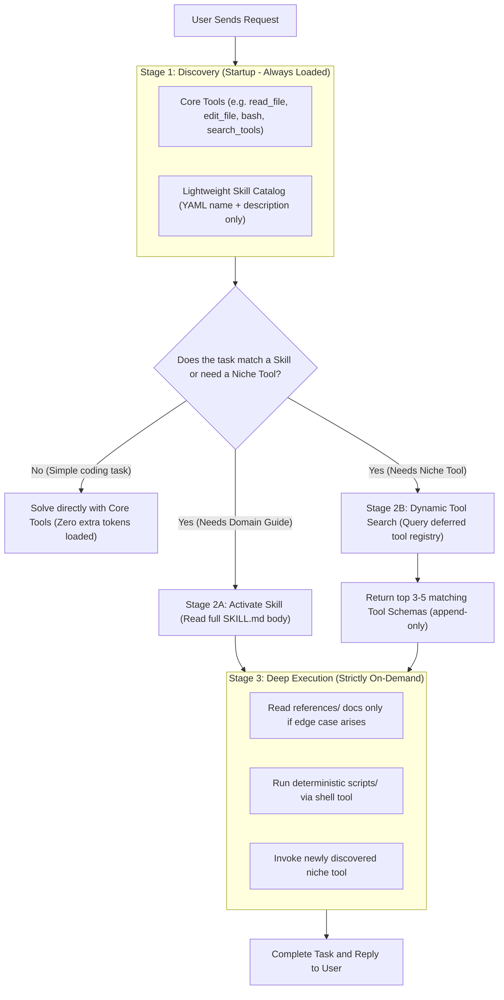

> **Module 2: Context & Memory** | Prerequisites: Chapters 07–11 | Reading Time: ~18 min
>
> [← 11. Tool Output Truncation & Artifact Offloading](./11-tool-output-truncation-and-artifact-offloading.md) | [Table of Contents](../README.md) | [13. Short-Term vs. Long-Term Memory →](./13-short-term-vs-long-term-memory.md)

# 12. Progressive Disclosure & On-Demand Skills

In Chapters 07 through 11, you learned how to assemble a crisp system prompt, keep its prefix cache-friendly, budget your token window, compact old turns, and keep giant tool outputs from flooding the room.

Now imagine your coding agent grows up. Your team connects it to GitHub, Jira, Slack, Postgres, AWS, and Sentry. On top of that, you write 40 internal playbooks covering everything from database migrations and React performance audits to Kubernetes rollbacks and PDF invoice parsing.

If you hand the language model all 150 tool definitions and all 40 playbooks on Turn 1, **your agent immediately gets slower, more expensive, and noticeably dumber.** This chapter teaches the antidote: **progressive disclosure**: showing the agent a lightweight menu upfront and loading full instructions, reference docs, scripts, and niche tools *only when the current task actually calls for them*.

---

## 1. The Simple Idea (Zero-Jargon Intuition)

### The Master Mechanic's Workshop

Picture a master auto mechanic standing in a busy repair shop. Around the shop are 300 specialized tools (bearing pullers, oscilloscope probes, torque angle gauges) and a whole shelf of 60 thick service manuals for every car model ever built.

Does the mechanic strap all 300 tools and all 60 binders onto their back before greeting the first customer?

Of course not. They would barely be able to walk! Instead, the mechanic uses a simple three-layer system:

1. **Always on their belt (Core Tools):** A flashlight, a socket wrench, a screwdriver, and a pocket notebook. They use these on almost every job.
2. **A clean wall index (Lightweight Catalog):** Labeled drawers (*"Brakes"*, *"Transmission"*, *"Electrical"*) and manual spines with one-line titles. Reading the labels takes two seconds and weighs nothing.
3. **Pull on demand (Deep Capabilities):** Only when a customer rolls in with a slipping transmission does the mechanic walk over, open the *Transmission* drawer, pull down the *Transmission Service Manual*, and grab the specialized clutch alignment tool.

```text
  BAD (Eager Loading):
  "Carry 300 tools + 60 manuals on your back just to check tire pressure."

  GOOD (Progressive Disclosure):
  "Carry 4 everyday tools + a 1-page index. Fetch the exact manual and
   specialized tool ONLY when that specific job walks through the door."
```

### What Breaks Without Progressive Disclosure?

If your harness stuffs every guide and every tool schema into the initial prompt:

- **You pay a massive "hello tax":** Thousands of tokens are billed on every single request before the user even finishes their first sentence.
- **The model picks the wrong tool:** Just like a human staring at a 120-item restaurant menu, an LLM loses precision when forced to choose among dozens of similar-looking tools (`search_issues`, `list_tickets`, `query_bugs`, `find_jira_tasks`).
- **Unrelated instructions collide:** Your "Strict Python Type-Checking Guide" and your "Quick Bash Prototype Guide" sit side by side in the same prompt and subtly contradict each other, even when the user is editing a CSS file.

---

## 2. Why This Matters in a Real Agent Harness

Let's put real numbers on the problem. Suppose a production coding agent connects to six common **MCP (Model Context Protocol)** servers (we cover MCP deeply in Chapter 19; for now, think of an MCP server as a plug-in tool pack for services like GitHub or Slack) and loads 25 company workflow guides:

| What Gets Loaded Upfront | Typical Size | Total Tokens Burned Before Turn 1 |
| :--- | :--- | :--- |
| 6 MCP servers × 18 tools each = 108 tools | ~400 tokens per JSON schema | **~43,200 tokens** |
| 25 team workflow guides / playbooks | ~1,400 tokens per guide | **~35,000 tokens** |
| Base system prompt + repo rules + core tools | ~4,800 tokens | **~4,800 tokens** |
| **Total Eager-Loaded Overhead** | | **~83,000 tokens** |

Look closely at what that number means for a 200,000-token context window:

1. **Over 40% of the context window is gone before the user says a word.** Remember Chapter 09's lesson on *context rot* (quality degrades well before a window hits 100% full). Starting at 40%+ utilization shrinks your effective working space dramatically.
2. **Tool-selection accuracy drops past ~30–50 tools.** Both benchmarks and production harness telemetry show a consistent pattern: when you pass 100+ tool schemas into a single call, models confuse parameter names, pick overlapping tools, or forget required arguments far more often than when shown 5–15 relevant tools.
3. **Latency and cost multiply across every turn.** Even with prompt caching (Chapter 08), writing an 83,000-token cache entry on cold starts adds noticeable **Time-To-First-Token (TTFT)** latency and extra cache-write cost, and if any single tool server reconnects with a slightly different list, the entire cache prefix invalidates.

Now compare that with progressive disclosure:

- **Core tools (6 tools):** ~2,400 tokens
- **Lightweight catalog of 25 skills (name + 1-sentence description):** ~1,500 tokens
- **1 Tool Search meta-tool (covering all 108 deferred tools):** ~350 tokens
- **Total Startup Overhead:** **~4,250 tokens**: a **~95% reduction** in upfront tokens!

When the user asks *"Open a GitHub pull request using our team's PR checklist"*, the agent loads *only* the `pr-checklist` skill (~900 tokens) and the `github_create_pull_request` schema (~400 tokens). The other 24 guides and 107 tools cost **zero tokens**.

---

## 3. The Big Picture (Visual Diagram)

Progressive disclosure unfolds across **three distinct stages**, moving from cheap awareness to full execution only when needed:



Notice the crucial architectural detail in Stage 2: newly loaded skills and discovered tool schemas are **appended to the conversation as tool outputs (or inline tool references)**: they do *not* rewrite the system prompt at the top of the message array. That preserves the immutable prefix you engineered in Chapter 08 so your prompt cache stays hot!

---

## 4. Deep Dive: Subtopic by Subtopic

### 4.1 The Tool & Instruction Bloat Problem

Why does "just throw it in the system prompt" fail so reliably as a harness scales? It hurts four separate mechanics of an LLM:

1. **Attention Dilution:** Inside a transformer model, every output token computes attention weights across all input tokens. Adding 50,000 tokens of irrelevant deployment runbooks and Jira schemas acts like static noise on a radio: it dilutes the model's attention away from the actual user prompt and the specific bug on line 84.
2. **Schema Ambiguity & Near-Duplicates:** Enterprise toolsets are full of overlapping names (`slack_search_messages`, `slack_list_channel_history`, `slack_get_thread_replies`, plus `discord_*`, `teams_*`). Presenting all of them simultaneously invites wrong-tool errors and hallucinated parameter fields.
3. **Instruction Contradiction:** Specialized workflows often override defaults. A "Database Migration Skill" might say *"Never run DDL statements automatically; always generate a SQL file for review"*, while a "Local Dev Seeding Skill" says *"Run schema reset scripts immediately."* Loaded together on Turn 1, they confuse the model about which rule governs the current task.
4. **Hard Context Ceilings & Slower Cold Starts:** On smaller/faster models (which often have tighter context windows or stricter latency budgets), a 60k-token preamble makes fast routing or subagent delegation completely impractical.

| Dimension | Eager Loading (Everything Upfront) | Progressive Disclosure (Load On Demand) |
| :--- | :--- | :--- |
| **Startup Token Cost** | Very high (30k–100k+ tokens) | Tiny (2k–6k tokens) |
| **Tool Selection Accuracy** | Degrades sharply past 30–50 tools | Stays high even with 1,000+ registered tools |
| **Cross-Domain Conflicts** | Frequent (unrelated guides collide) | Rare (only the active domain's guide enters context) |
| **Extra Turn Latency** | 0 extra discovery turns | +1 fast turn when activating a skill or searching tools |
| **Prompt Cache Stability** | Fragile if tool list changes dynamically | High (static core prefix + append-only discoveries) |

---

### 4.2 The Progressive Disclosure Pattern

**Progressive disclosure** is an old user-interface design principle: *show people only the summary they need to make their next decision, and reveal the deep details only when they click in.* Think of a website navigation bar; you see five clean headings instead of every paragraph on every page.

In an agent harness, progressive disclosure operates in **three strict tiers**:

1. **Tier 0: The Index (Loaded at Session Start, ~30–100 tokens per item):**
   The harness scans installed skill folders and injects *only* each skill's name, one-line trigger description, and file path into the system prompt (or a dedicated `<available_skills>` section). For tools, only the 3–6 everyday core tools plus a tool-search capability are loaded.
2. **Tier 1: Activation (Loaded When Relevant, ~500–3,000 tokens):**
   When the model recognizes that the user's request matches a skill's description (for example, *"migrate our Postgres users table"* matches `postgres-migrations`), it reads the full `SKILL.md` file (or invokes a `load_skill` tool). Similarly, if it needs an external tool, it queries the tool search tool and receives the full JSON schemas for only the top 3–5 matches.
3. **Tier 2: Deep Resources & Executable Scripts (Loaded Only If Needed, 0 to ∞ tokens):**
   A well-written skill does not dump a 40-page API reference inside `SKILL.md`. Instead, `SKILL.md` says: *"For rollback procedures on partitioned tables, read `references/partitioned-rollbacks.md`. To validate migration safety deterministically, run `scripts/lint_migration.py`."* If the user's migration doesn't touch partitioned tables, that reference file is **never read at all**. Even better: when the agent runs `scripts/lint_migration.py`, the script's *code* never even needs to enter the context window; only its short pass/fail output does!

> **Cache-Preservation Rule:** Always deliver Tier 1 and Tier 2 content as normal `tool_result` messages appended to the end of the conversation history. Never splice newly activated skills back into message #0 (the system prompt), or you will bust your prompt cache for the entire conversation so far.

---

### 4.3 Anatomy of a Skill (`SKILL.md` Open Standard)

Early coding agents invented incompatible ways to package custom instructions (hidden dot-folders, JSON blobs, proprietary plugin schemas). In 2025–2026, the ecosystem converged around the **Agent Skills open standard** (`agentskills.io`, originally pioneered by Anthropic and adopted across Claude Code, OpenAI Codex CLI, Gemini CLI, Cursor, and many open-source harnesses).

At its core, a **Skill** is wonderfully simple: it is just a **folder containing a `SKILL.md` file** plus optional supporting folders:

```text
postgres-migrations/
├── SKILL.md                    # Required: YAML frontmatter (Tier 0) + Markdown guide (Tier 1)
├── scripts/                    # Optional (Tier 2): Deterministic helper code (Python, Bash, Node)
│   └── check_unsafe_locks.py
├── references/                 # Optional (Tier 2): Deep docs loaded only for specific edge cases
│   ├── zero-downtime-patterns.md
│   └── partitioned-rollbacks.md
└── assets/                     # Optional (Tier 2): Templates, SQL boilerplates, config files
    └── migration_template.sql
```

#### The YAML Frontmatter Specification

**YAML frontmatter** is a tiny block of structured key-value metadata wrapped between `---` lines at the very top of a Markdown file. The `agentskills.io` specification defines six standard fields (two required, four optional):

| Field | Required? | Constraints & Purpose |
| :--- | :--- | :--- |
| `name` | **Yes** | Max 64 chars; lowercase letters (`a-z`), digits (`0-9`), and single hyphens (`-`) only; no leading/trailing hyphens or `--`. Must match the parent directory name. |
| `description` | **Yes** | Non-empty, max 1,024 chars. Explains **what** the skill does and **when** to trigger it. This is the single most important text for discovery! |
| `license` | No | License identifier or file reference (e.g., `MIT`, `Apache-2.0`). |
| `compatibility` | No | Max 500 chars. Environment prerequisites (e.g., `Requires Python 3.10+ and psql CLI`). |
| `metadata` | No | Arbitrary string-to-string key-value map (e.g., `author`, `version`, `team`). |
| `allowed-tools` | No *(Experimental)* | Space-separated list of pre-approved tools this skill may use (e.g., `Read Bash Grep`). |

#### A Complete, Well-Engineered `SKILL.md` Example

```markdown
---
name: postgres-migrations
description: Create, review, and validate zero-downtime PostgreSQL schema migrations. Use whenever adding columns, indexes, constraints, or altering tables in SQL or Alembic/Prisma migrations. Do NOT use for read-only SQL queries.
license: Apache-2.0
compatibility: Requires Python 3.10+
metadata:
  owner: platform-data-team
  version: "1.2"
allowed-tools: Read Edit Bash
---

# Zero-Downtime PostgreSQL Migrations

Follow these rules whenever modifying production database schemas.

## Step 1: Check for Table-Locking Operations
Before finalizing any SQL migration, run the deterministic lock-linter script:
`python3 scripts/check_unsafe_locks.py <path-to-migration.sql>`

## Step 2: Mandatory Safe Patterns
- **Adding indexes:** Always use `CREATE INDEX CONCURRENTLY` outside a transaction block.
- **Adding columns with defaults:** Safe in Postgres 11+ for constant defaults, but NEVER add a `NOT NULL` column with a volatile default in one step.
- **Dropping columns:** Remove application code references in PR #1; drop the column in PR #2.

## Deep References (Read Only If Needed)
- Backfilling tables > 10M rows: read `references/zero-downtime-patterns.md`
- Partitioned table rollbacks: read `references/partitioned-rollbacks.md`
- Boilerplate header format: copy from `assets/migration_template.sql`
```

Look how clean that is:
- **Tier 0 (startup):** The agent only sees `name` + `description` (~50 tokens).
- **Tier 1 (activation):** When the user asks to add an index to `orders`, the agent reads `SKILL.md` (~250 tokens).
- **Tier 2 (execution):** The agent runs `scripts/check_unsafe_locks.py` to catch subtle SQL locking bugs with **100% deterministic reliability** (no relying on the LLM's memory of Postgres lock tables!) and ignores `references/partitioned-rollbacks.md` unless the table is actually partitioned.

---

### 4.4 Dynamic Tool Search & Deferred Tool Loading

Skills solve **instruction bloat**. What about **tool schema bloat**: when your agent is connected to 10 MCP servers exposing 150 tools?

The answer is **deferred tool loading** paired with a **tool search meta-tool**. Instead of sending all 150 tool definitions in the prompt, you mark niche tools as *deferred* (invisible to the model initially) and give the model a single search tool to discover them on demand.

There are two ways harnesses implement this: **provider-native** and **harness-side (provider-agnostic)**.

#### Pattern A: Provider-Native Deferred Tool Loading (Anthropic Tool Search)

Starting in late 2025, Anthropic introduced native support for deferred tools directly in the Messages API (also available via Vertex AI, Amazon Bedrock, and Azure). Here is how it works:

1. **Core tools stay eager:** You leave `defer_loading` unset (or `false`) on your 3–6 everyday tools.
2. **Niche tools (or whole MCP servers) are deferred:** You set `"defer_loading": true`. Deferred tools consume **zero tokens** in the model's initial prompt.
3. **Add a server-side Tool Search Tool:** Anthropic provides two built-in search engines:
   - **Regex variant (`tool_search_tool_regex_20251119`):** The model writes a Python-style regex (`re.search`, up to 200 chars) such as `(?i)github.*pull_request` to match tool names, descriptions, and arguments. Great when tool names follow predictable prefixes.
   - **BM25 variant (`tool_search_tool_bm25_20251119`):** The model writes a natural-language query such as `"create pull request review comment"`. **BM25 (Best Matching 25)** is a classic, super-fast keyword relevance ranking algorithm (the same family used in search engines like Elasticsearch). Great when tool catalogs are large or inconsistently named.
4. **On-demand expansion via `tool_reference` blocks:** When Claude calls the tool search tool, the API returns a small batch (typically 3–5) of `tool_reference` blocks, which the API automatically expands into full callable tool definitions for subsequent turns, *without* breaking the cached system prefix!

Here is a concrete API request payload using both individual deferred tools and an `mcp_toolset`:

```json
{
  "model": "claude-sonnet-4-5",
  "max_tokens": 2048,
  "tools": [
    {
      "type": "tool_search_tool_bm25_20251119",
      "name": "tool_search_tool_bm25"
    },
    {
      "name": "read_file",
      "description": "Read a file from the local workspace with line numbers.",
      "input_schema": {
        "type": "object",
        "properties": { "path": { "type": "string" } },
        "required": ["path"]
      },
      "defer_loading": false
    },
    {
      "name": "sentry_list_unresolved_issues",
      "description": "List unresolved error groups from a Sentry project by environment and time range.",
      "input_schema": {
        "type": "object",
        "properties": {
          "project_slug": { "type": "string" },
          "environment": { "type": "string" }
        },
        "required": ["project_slug"]
      },
      "defer_loading": true
    },
    {
      "type": "mcp_toolset",
      "mcp_server_name": "google-drive",
      "default_config": { "defer_loading": true },
      "configs": {
        "search_files": { "defer_loading": false }
      }
    }
  ],
  "messages": [
    { "role": "user", "content": "Check Sentry for new production crashes in checkout-api." }
  ]
}
```

Notice the clever carve-out inside `mcp_toolset`: all Google Drive tools default to deferred, *except* `search_files`, which stays eager because users invoke it constantly.

#### Pattern B: Harness-Side Tool Search (Works With *Any* LLM Provider)

What if your harness supports OpenAI, Gemini, Anthropic, and local models through one unified loop? You don't need to rely exclusively on a vendor-specific API feature. You can implement deferred loading right inside your harness in two ways:

1. **Meta-Tool Proxy (`search_tools` + `call_tool`):**
   - Upfront, expose your core tools plus two tiny meta-tools: `search_tools(query)` and `call_deferred_tool(tool_name, arguments)`.
   - `search_tools` runs a local BM25 + substring search over your 200 hidden tool schemas and returns the top 5 matching schemas as plain JSON text inside a `tool_result`.
   - The model reads the schema from the `tool_result` and invokes `call_deferred_tool(tool_name="sentry_list_unresolved_issues", arguments={...})`.
   - **Big bonus:** Because the top-level `tools` array sent to the LLM API *never changes*, **your prompt cache stays 100% valid on every provider!**
2. **Dynamic Tool-List Promotion:**
   - When `search_tools` matches a tool, your harness adds its schema into the active `tools` array on the next API call so the model gets native structured decoding (`strict: true`, Chapter 03) for that tool.
   - **Trade-off:** Mutating the top-level `tools` array invalidates the prompt cache prefix on providers that hash the tools array at the front of the prompt. Only use promotion when structured schema enforcement matters more than a single cache rebuild (or when the provider supports append-only tool references).

---

### 4.5 Balancing Discoverability vs. Token Efficiency

Every progressive disclosure system lives on a tightrope between two failure modes:

- **Too Eager (Bloat):** You show too much upfront → high cost, slow starts, confused tool selection.
- **Too Lazy (Invisibility):** You hide *so much* that the model doesn't even know a capability exists! If a user asks *"Can you check why the Friday deploy failed?"* and the model has no hint that a `datadog` MCP server or a `deploy-triage` skill is installed, the model may shrug and say *"I don't have access to your deployment logs"* instead of calling `search_tools`.

Here is how the four disclosure strategies trade off:

| Strategy | Upfront Tokens (100 tools / 30 skills) | Discoverability | Extra Turns to Activate | Best For |
| :--- | :--- | :--- | :--- | :--- |
| **1. Fully Eager** | ~55,000 | 100% (everything visible) | 0 | Small agents (< 15 tools, < 3 guides) |
| **2. Category / Domain Hints + Search** | ~2,000 | Medium-High (model sees namespaces like `github`, `sentry`, `jira`) | +1 | Massive enterprise toolkits (100–5,000 tools) |
| **3. Frontmatter Catalog (Skills)** | ~1,800–3,000 | High (model reads 1-sentence triggers for every skill) | +1 | 5–60 domain skills & playbooks |
| **4. Hybrid (Core Eager + Deferred Rest)** | ~3,500–5,000 | Very High | 0 for 80% of turns; +1 for niche tasks | **Production coding agents (Recommended)** |

#### Four Practical Rules for Getting the Balance Right

1. **Keep the "Everyday 5" Eager:** Tools used in nearly every coding session (`read_file`, `edit_file`, `grep`, `glob`, `bash`) should *never* be deferred. Adding a search turn before reading a file wastes time on every single request.
2. **Give the Model a "Map of Continents" for Hidden Tools:** Even when 150 MCP tools are deferred, include a tiny 3-line summary in the search tool's description listing the *connected namespaces* (e.g., *"Search deferred tools across connected integrations: github (24 tools), sentry (12 tools), postgres (8 tools), slack (15 tools)"*). That costs ~30 tokens and completely eliminates the "invisible capability" bug!
3. **Engineer `description` Fields Like Trigger Rules:** A skill's `description` is its entire advertisement. Always include **what it does**, **concrete trigger keywords/file types**, and **when NOT to use it**.
4. **Enforce a Hard Catalog Budget:** Cap your upfront skill + tool-index section at **~2% to 5% of the context window** (for example, 4,000–8,000 tokens on a 200k model). If a user installs 300 skills, switch the skill catalog itself from a flat list to a `search_skills` tool!

---

## 5. How Real Harnesses Do It

Progressive disclosure is no longer a research idea: it is standard architecture in modern coding agents:

- **Claude Code:**
  - Discovers `SKILL.md` directories across built-in, plugin, user (`~/.claude/skills/`), and project (`.claude/skills/`) scopes. At startup, only each skill's compact YAML frontmatter (`name` + `description`) is injected into the context; the full `SKILL.md` body loads only when Claude triggers the skill (or the user invokes `/skill-name`).
  - Automatically enables **MCP Tool Search** (`ENABLE_TOOL_SEARCH=auto`) once connected MCP tool descriptions exceed a context threshold (around 10% of the context window), swapping bulky upfront schemas for on-demand discovery via `defer_loading`.
- **OpenAI Codex CLI & Gemini CLI:**
  - Both support the open `agentskills.io` `SKILL.md` format (for example, scanning `.agents/skills/` and user skill folders). At session start, the harness renders a lightweight skill index; when a user's prompt matches a skill's description, the model reads that skill's `SKILL.md` on demand and executes bundled helper scripts when needed.
- **Cursor:**
  - Uses progressive disclosure for repository instructions via `.cursor/rules/*.mdc` files. Rules can be configured as *Always Apply*, *Auto-Attached* (loaded automatically only when the agent opens files matching a glob like `src/migrations/**/*.sql`), or *Agent Requested* (only the rule's short description is shown upfront, and the agent pulls the full rule file when relevant).
- **MCP Enterprise Harnesses & Gateways:**
  - Production MCP clients serving dozens of SaaS integrations routinely combine namespace summaries with BM25/regex tool search, reporting **85%–95% reductions** in initialization token overhead and measurable gains in first-try tool call accuracy.

---

## 6. Common Pitfalls & Failure Modes

### Pitfall 1: Vague Skill Descriptions Cause Silent Non-Triggering
- **Bad:** `description: Helps with deployment tasks.` (Too generic; the model ignores it when a user says *"My Helm chart is failing in staging."*).
- **Good:** `description: Debug, validate, and deploy Kubernetes manifests and Helm charts. Use when editing values.yaml, Chart.yaml, k8s deployments, or investigating staging/prod pod crash loops. Do NOT use for local Docker Compose.`
- **Fix:** Test your skill descriptions like search queries against 10 realistic user prompts (both positive triggers and negative non-triggers).

### Pitfall 2: Busting the Prompt Cache by Rewriting the System Prompt
- **Mistake:** When the user activates a skill or discovers a deferred tool, the harness regenerates the `system` prompt string to include the newly loaded text.
- **Result:** Every token from Turn 1 onward misses the provider's KV cache (Chapter 08), spiking latency and multiplying token cost by 5x–10x.
- **Fix:** Keep the system prompt **frozen for the entire session**. Deliver newly loaded `SKILL.md` bodies and tool schemas as appended `tool_result` messages (or native `tool_reference` blocks).

### Pitfall 3: Turning `SKILL.md` Into a 12,000-Token Monolith
- **Mistake:** Stuffing an entire SDK reference manual, 20 JSON examples, and a FAQ into `SKILL.md`. The moment the skill activates, it blows out the context budget.
- **Fix:** Keep `SKILL.md` concise (ideally **150–400 lines**); just the workflow steps, hard rules, and a short table of pointers to files under `references/` and deterministic helpers under `scripts/`.

### Pitfall 4: Deferring Core Everyday Tools
- **Mistake:** Marking *every* tool (including `read_file` and `grep`) with `defer_loading: true` to chase a vanity "0 upfront tokens" metric.
- **Result:** Every single user prompt starts with an extra wasted round-trip searching for `read_file`. Latency increases and users feel the sluggishness immediately.
- **Fix:** Always keep your top 3–6 highest-frequency tools eager.

### Pitfall 5: Blindly Trusting Skills From Untrusted Repositories
- **Mistake:** A developer clones a random GitHub repo containing `.agents/skills/helper/SKILL.md`, and the harness automatically loads its instructions and executes its `scripts/setup.sh` without user trust verification.
- **Result:** Instant **indirect prompt injection** or arbitrary code execution! (We cover these security boundaries deeply in Chapters 24 and 33.)
- **Fix:** Treat repository-level skills as untrusted until the user explicitly trusts the workspace, run bundled scripts inside the OS sandbox (Chapter 21), and honor permission approval policies (Chapter 23).

---

## 7. Build It Yourself: Mini-Lab — A Progressive Skill & Deferred Tool Registry

Below is a compact, zero-dependency Python blueprint implementing both halves of progressive disclosure:
1. A **`SKILL.md` parser & catalog builder** (Tier 0 index + Tier 1 on-demand loader).
2. A **BM25-ranked `ToolRegistry`** that keeps core tools eager and defers niche tools behind a `search_tools` meta-tool, without ever mutating the system prompt.

```python
from __future__ import annotations

import math
import re
from dataclasses import dataclass, field
from pathlib import Path
from typing import Any

# --- Part 1: Progressive Skill Discovery (agentskills.io pattern) ---

SKILL_NAME_RE = re.compile(r"^[a-z0-9]+(?:-[a-z0-9]+)*$")


@dataclass(frozen=True)
class SkillMeta:
    """Tier 0 metadata loaded at session startup (~40-80 tokens each)."""
    name: str
    description: str
    skill_md_path: Path
    skill_dir: Path


def parse_skill_frontmatter(skill_md: Path) -> SkillMeta:
    """Parse minimal YAML frontmatter from SKILL.md without external deps."""
    text = skill_md.read_text(encoding="utf-8")
    if not text.startswith("---\n"):
        raise ValueError(f"{skill_md}: missing opening YAML frontmatter '---'")

    end_idx = text.find("\n---", 4)
    if end_idx == -1:
        raise ValueError(f"{skill_md}: missing closing YAML frontmatter '---'")

    frontmatter_block = text[4:end_idx]
    fields: dict[str, str] = {}
    for line in frontmatter_block.splitlines():
        if ":" in line and not line.startswith((" ", "\t", "#")):
            key, val = line.split(":", 1)
            fields[key.strip()] = val.strip().strip('"').strip("'")

    name = fields.get("name", "")
    description = fields.get("description", "")

    # Enforce agentskills.io naming rules
    if not (1 <= len(name) <= 64) or not SKILL_NAME_RE.match(name):
        raise ValueError(f"Invalid skill name '{name}' in {skill_md}")
    if name != skill_md.parent.name:
        raise ValueError(f"Skill name '{name}' must match folder '{skill_md.parent.name}'")
    if not (1 <= len(description) <= 1024):
        raise ValueError(f"Invalid description length in {skill_md}")

    return SkillMeta(
        name=name,
        description=description,
        skill_md_path=skill_md,
        skill_dir=skill_md.parent,
    )


def render_skill_catalog(skills: list[SkillMeta]) -> str:
    """Render the Tier 0 index injected into the frozen system prompt."""
    if not skills:
        return ""
    lines = [
        "<available_skills>",
        "Read a skill's SKILL.md ONLY when the user's task matches its description.",
    ]
    for s in sorted(skills, key=lambda x: x.name):  # Deterministic sort = cache-friendly!
        lines.append(f"- {s.name} ({s.skill_md_path}): {s.description}")
    lines.append("</available_skills>")
    return "\n".join(lines)


# --- Part 2: Deferred Tool Registry with Lightweight BM25 Search ---

def tokenize(text: str) -> list[str]:
    """Split snake_case, camelCase, and prose into lowercase search terms."""
    expanded = re.sub(r"([a-z])([A-Z])", r"\1 \2", text)
    return re.findall(r"[a-z0-9]+", expanded.lower())


@dataclass
class ToolDef:
    name: str
    namespace: str
    description: str
    input_schema: dict[str, Any]
    defer_loading: bool = True
    _tokens: list[str] = field(init=False, repr=False)

    def __post_init__(self) -> None:
        param_names = " ".join(self.input_schema.get("properties", {}).keys())
        self._tokens = tokenize(f"{self.name} {self.namespace} {self.description} {param_names}")


class ToolRegistry:
    """Separates eager core tools from deferred tools searchable via BM25."""

    def __init__(self) -> None:
        self._tools: dict[str, ToolDef] = {}

    def register(self, tool: ToolDef) -> None:
        self._tools[tool.name] = tool

    def eager_tools_payload(self) -> list[dict[str, Any]]:
        """Return ONLY core tools + the search_tools meta-tool (sent on Turn 1)."""
        eager = [
            {
                "name": t.name,
                "description": t.description,
                "input_schema": t.input_schema,
            }
            for t in sorted(self._tools.values(), key=lambda x: x.name)
            if not t.defer_loading
        ]

        # Build a compact "map of continents" so the model knows what namespaces exist
        ns_counts: dict[str, int] = {}
        for t in self._tools.values():
            if t.defer_loading:
                ns_counts[t.namespace] = ns_counts.get(t.namespace, 0) + 1

        if ns_counts:
            summary = ", ".join(f"{ns} ({cnt})" for ns, cnt in sorted(ns_counts.items()))
            eager.append({
                "name": "search_tools",
                "description": (
                    f"Discover deferred tools on demand. Connected namespaces: {summary}. "
                    "Pass keywords describing the action you need."
                ),
                "input_schema": {
                    "type": "object",
                    "properties": {
                        "query": {"type": "string"},
                        "limit": {"type": "integer", "default": 5},
                    },
                    "required": ["query"],
                },
            })
        return eager

    def search_deferred(self, query: str, limit: int = 5) -> list[dict[str, Any]]:
        """BM25 search across deferred tools; result is returned as a tool_result."""
        deferred = [t for t in self._tools.values() if t.defer_loading]
        q_terms = tokenize(query)
        if not deferred or not q_terms:
            return []

        n_docs = len(deferred)
        avg_dl = sum(len(t._tokens) for t in deferred) / n_docs
        k1, b = 1.5, 0.75

        # Document frequency for each query term
        df = {term: sum(1 for t in deferred if term in t._tokens) for term in set(q_terms)}

        scored: list[tuple[float, ToolDef]] = []
        for tool in deferred:
            dl = len(tool._tokens)
            score = 0.0
            for term in q_terms:
                tf = tool._tokens.count(term)
                if tf == 0:
                    continue
                idf = math.log((n_docs - df[term] + 0.5) / (df[term] + 0.5) + 1.0)
                score += idf * (tf * (k1 + 1)) / (tf + k1 * (1 - b + b * dl / avg_dl))
            if score > 0:
                scored.append((score, tool))

        scored.sort(key=lambda pair: (-pair[0], pair[1].name))
        return [
            {
                "name": t.name,
                "description": t.description,
                "input_schema": t.input_schema,
            }
            for _, t in scored[:limit]
        ]
```

**Why this mini-lab works so well in production:**
- **Deterministic sorting** (`sorted(..., key=...)`) ensures your startup `<available_skills>` block and eager `tools` array produce byte-identical prefixes across sessions: maximizing prompt cache hits.
- **Namespace summaries** inside `search_tools` cost ~30 tokens yet tell the model *what worlds exist* behind the search bar.
- **Zero prefix mutation:** Every discovered skill or tool enters the conversation cleanly as a normal `tool_result`.

---

## 8. Key Takeaways & Quick Self-Check

### Key Takeaways
- **Upfront loading does not scale:** Preloading 100+ tool schemas and dozens of playbooks wastes tens of thousands of tokens per turn, dilutes attention, and degrades tool-selection accuracy.
- **Progressive disclosure works in three tiers:** (0) Tiny always-loaded index + core tools → (1) Full `SKILL.md` or matched tool schemas loaded on demand → (2) Deep `references/` and deterministic `scripts/` invoked only when needed.
- **Skills (`SKILL.md`) are an open, portable standard:** A folder with validated YAML frontmatter (`name`, `description`) plus concise Markdown instructions and optional `scripts/`, `references/`, and `assets/`.
- **Deferred tool loading shrinks tool overhead by 85%–95%:** Use provider-native `defer_loading: true` + BM25/Regex Tool Search (or a harness-side `search_tools` proxy) while keeping your 3–6 everyday core tools eager.
- **Never mutate the frozen prefix:** Append activated skills and discovered tools as `tool_result` or `tool_reference` blocks so your prompt cache stays warm.

### Quick Self-Check

1. **Why should an activated `SKILL.md` file be delivered as a `tool_result` in the conversation instead of being spliced into the system prompt?**
   <details>
   <summary>Show Answer</summary>

   Because modern LLM providers cache prompts from the beginning of the message list forward (prefix caching, Chapter 08). Editing the system prompt at the top invalidates the entire cached prefix for the conversation, causing a full re-read, higher latency, and 5x–10x higher input token costs. Appending the skill body as a `tool_result` leaves the entire earlier prefix untouched and cached.

   </details>

2. **Why is bundling a Python script inside a skill's `scripts/` folder often better than writing the same logic as step-by-step prose in `SKILL.md`?**
   <details>
   <summary>Show Answer</summary>

   Two reasons: **reliability and token efficiency.** LLMs are probabilistic and can make subtle mistakes on deterministic tasks like linting SQL lock patterns, parsing PDFs, or validating schemas. Running a local script executes with 100% deterministic accuracy, and the script's source code never even needs to enter the context window: only its compact stdout/stderr output does.

   </details>

3. **Your team deferred all 90 MCP tools behind `search_tools`, and suddenly the agent tells users "I don't have access to Jira" even though 14 Jira tools are registered. What went wrong and what is the cheapest fix?**
   <details>
   <summary>Show Answer</summary>

   You hit the **invisible capability** failure mode: the model had no clue Jira tools were hidden behind `search_tools`. The cheapest fix (~20–40 tokens) is to include a compact list of connected namespaces and counts (e.g., `jira (14), github (22), sentry (10)`) directly in the `search_tools` description or system prompt so the model knows *when* to search.

   </details>

4. **When should you keep a tool eager (`defer_loading: false`) instead of deferred (`defer_loading: true`)?**
   <details>
   <summary>Show Answer</summary>

   Keep the small set of high-frequency core tools (typically 3–6 tools such as `read_file`, `edit_file`, `grep`, `glob`, and `bash`, plus any single MCP search tool used in almost every session) eager. Deferring everyday tools forces an unnecessary extra discovery turn on nearly every user prompt, hurting latency far more than the few hundred tokens saved.

   </details>

---

[← 11. Tool Output Truncation & Artifact Offloading](./11-tool-output-truncation-and-artifact-offloading.md) | [Table of Contents](../README.md) | [13. Short-Term vs. Long-Term Memory →](./13-short-term-vs-long-term-memory.md)
