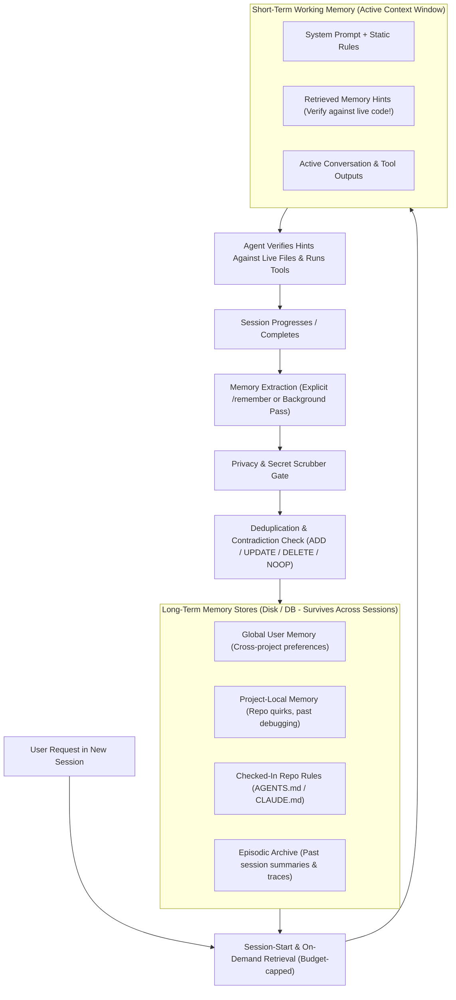

> **Module 2: Context & Memory** | Prerequisites: Chapters 09–12 | Reading Time: ~19 min
>
> [← 12. Progressive Disclosure & On-Demand Skills](./12-progressive-disclosure-and-on-demand-skills.md) | [Table of Contents](../README.md) | [14. File Reading, Patching & Diff Application →](../03-tools-and-workspace-interaction/14-file-reading-patching-and-diff-application.md)

# 13. Short-Term vs. Long-Term Memory

Close your terminal, open a brand-new coding session tomorrow morning, and ask your agent to run the test suite. Without long-term memory, the agent forgets everything you taught it yesterday: that this repository uses `pnpm` instead of `npm`, that integration tests require a local Docker container on port `5433`, and that you hate verbose comments. You end up repeating the exact same corrections week after week.

Yet adding long-term memory naively can be *worse* than having no memory at all. If an agent blindly trusts a stale note from two months ago saying *"Auth uses cookie sessions in `auth.js`"*, after your team migrated to JWTs in `src/auth/jwt.ts`, that "helpful" memory will actively derail the agent!

This chapter shows you how to design long-term memory for a real harness: separating short-term working memory from durable episodic and semantic memory, choosing between transparent Markdown files and vector databases, keeping memories clean and non-contradictory, protecting privacy, and knowing when memory helps versus when it misleads.

---

## 1. The Simple Idea

### The Brilliant Plumber With Morning Amnesia

Imagine hiring the smartest plumber in the city to maintain your house. There is just one catch: every night at midnight, their memory resets completely.

- On **Monday**, you tell them: *"The main water shutoff is behind the laundry dryer, and please don't park in the neighbor's driveway."* They do a fantastic job.
- On **Tuesday**, they arrive smiling, park in the neighbor's driveway, and spend 20 minutes tearing apart the kitchen looking for the shutoff valve.

That is a stateless coding agent with **short-term working memory only**. Everything inside today's conversation (the active context window) works great, until the session ends and the desk gets wiped clean.

Now suppose the plumber carries a tidy **field notebook** with one tab per house:
- **Sticky note on the workbench (Working Memory):** Measurements for the sink pipe they are cutting *right now*. Thrown away once the job is done.
- **Dated job log (Episodic Memory):** *"March 14; tried brass compression fitting under kitchen sink; slow drip persisted; replaced with braided steel line."*
- **House fact sheet (Semantic Memory):** *"Main shutoff: behind laundry dryer. Pipes: copper. Parking: street only."*

Here is the catch that separates a *great* plumber from a *reckless* one: before turning a wrench, a great plumber checks the notebook **and still looks at the actual pipes in front of them**. If you remodeled the laundry room last month, the pipes on the wall win over the ink in the notebook, and the plumber crosses out the old line and updates the note.

---

## 2. Why This Matters in a Real Agent Harness

Real software engineering does not happen in one 10-minute chat. Developers work on the same codebase for months, opening dozens of fresh sessions a week. Good long-term memory improves a harness along four concrete dimensions:

1. **Eliminating "Groundhog Day" Corrections:** When a user corrects an agent once (*"Never mock the database in integration tests; use our testcontainers helper"*), persisting that preference means the user never has to repeat themselves across future sessions.
2. **Capturing Non-Obvious Tribal Knowledge:** Some critical facts are *not* written in the source code, like *"Staging deploys freeze every Friday after 2 PM"*, *"The legacy billing service lives in a separate repo"*, or *"Our CI runs on Linux ARM64 so don't use x86-only wheels."*
3. **Lower Cost & Faster Starts:** Recalling 4–6 crisp facts (~200 tokens) saves the agent from spending 8 turns and 30,000 tokens rediscovering how to run tests or hitting the same environment snag it already debugged last week.
4. **Trust Through Predictability:** When memory is scoped cleanly, kept fresh, and easy for the developer to inspect or edit, the agent starts feeling like a real teammate who actually learns how you work.

---

## 3. The Big Picture

A production memory system separates **short-term working memory** (what is inside the LLM's context window right now) from **long-term persistent memory** (what survives across sessions), with strict hygiene gates on both reads and writes:



Notice the two most important arrows in the whole diagram:
1. **Before writing:** Every candidate memory passes through a **secret scrubber** and a **reconciliation step** (`ADD` / `UPDATE` / `DELETE` / `NOOP`) so duplicates, secrets, and contradictions don't pile up.
2. **After reading:** Memories enter the context window explicitly framed as **hints to verify against live code**, never as infallible gospel.

---

## 4. Deep Dive: Subtopic by Subtopic

### 4.1 Working Memory vs. Episodic Memory vs. Semantic Memory

Borrowing from cognitive science (popularized for AI agents by the **CoALA (Cognitive Architectures for Language Agents)** framework) harness engineers split memory into four clean buckets:

| Memory Type | Plain-English Question | Coding-Agent Example | Where It Lives | Lifespan |
| :--- | :--- | :--- | :--- | :--- |
| **Working Memory** | *"What am I holding in my head right now?"* | Current chat turns, open file excerpts, failing test stack trace, active todo list | Active LLM Context Window (RAM) | Single session (trimmed by compaction, Ch. 10) |
| **Episodic Memory** | *"What happened in past sessions?"* | *"On Oct 12 we tried migrating to Redis streams, hit OOM errors under 10k msg/s, and reverted to Postgres LISTEN/NOTIFY."* | Session summaries, dated logs, searchable transcript store | Weeks to months (time-stamped) |
| **Semantic Memory** | *"What durable facts and preferences are true?"* | *"User prefers terse replies and `pytest`; API endpoints validate inputs with Zod; run `make db-up` before tests."* | `MEMORY.md`, structured notes, or semantic fact DB | Months to permanent (until superseded) |
| **Procedural Memory** | *"How do I execute a recurring workflow?"* | Zero-downtime DB migration checklist + lock-linter script | `SKILL.md` folders (covered in Chapter 12!) | Versioned & reusable |

#### Why the Distinction Matters

If you lump episodic and semantic memory into one messy pile, two problems appear immediately:
- **Episodic memories age fast**: they are tied to a *when* and a *why*. They are gold when someone asks *"Why didn't we use Redis streams?"*, but useless noise when fixing a CSS typo.
- **Semantic memories should stay compact and current**: if a user says *"Actually, we switched from Jest to Vitest today"*, you should **overwrite** the old semantic fact rather than keeping both *"Uses Jest"* and *"Uses Vitest"* sitting side by side.

---

### 4.2 File-Based Memory (`MEMORY.md`) vs. Vector / Database Memory

When building long-term memory into a coding harness, your biggest architectural fork in the road is **how you store and retrieve memories**.

#### Approach 1: File-Based Memory (`MEMORY.md` + Structured Topic Notes)

In this design, long-term memory is simply **plain Markdown files sitting on disk** in a dedicated memory directory:

```text
~/.my-agent/projects/acme-payments-a1b2c3/memory/
├── MEMORY.md                 # Concise index (capped at e.g. 200 lines / 25 KB)
├── user_preferences.md       # Communication & coding style preferences
├── build_and_testing.md      # Local setup quirks, env flags, slow test workarounds
└── debugging_lessons.md      # Past tricky bugs and verified root causes
```

At session startup, the harness injects **only `MEMORY.md`** (the compact index: just like progressive disclosure in Chapter 12!). Each bullet in `MEMORY.md` holds a one-line summary and a pointer to the topic file:

```markdown
# Project Memory Index

- [user_preferences.md](./user_preferences.md) — Terse responses; prefer `pnpm`; never auto-commit without asking.
- [build_and_testing.md](./build_and_testing.md) — Integration tests require `DOCKER_HOST` and port 5433; run `pnpm test:unit` for fast loop.
- [debugging_lessons.md](./debugging_lessons.md) — Webhook signature failures usually come from raw-body middleware ordering in Express.
```

If the user is debugging a webhook failure, the agent reads `debugging_lessons.md` using its normal `read_file` tool. Otherwise, those extra lines cost **zero tokens**.

#### Approach 2: Vector / Database Memory (Embeddings + Semantic Retrieval)

What is a **vector embedding** in plain English? An embedding model turns a sentence (like *"Integration tests need Postgres on port 5433"*) into a list of numbers (say, 1,536 decimals) representing its *meaning*. Sentences with similar meanings land near each other mathematically. When a user asks *"Why is my database test refusing connections?"*, the harness converts the user's question into numbers, searches a vector database (like Qdrant, pgvector, or local `sqlite-vec`, often combined with BM25 keyword search or a knowledge graph), and retrieves the top $k$ closest memories.

Systems like **Mem0** and **Zep** provide this as a dedicated memory layer, sometimes pairing vector search with entity-relationship graphs (*"User → prefers → Vitest"*, *"CheckoutService → depends_on → StripeWebhook"*).

#### Trade-Off Comparison: Files vs. Vector Databases

| Dimension | File-Based (`MEMORY.md` + Notes) | Vector / Graph Database (e.g., Mem0, `sqlite-vec`) |
| :--- | :--- | :--- |
| **Setup & Infra** | Zero (plain text files on disk) | Medium–High (embedding API/model + vector DB) |
| **Human Inspectability** | **Excellent**: open in any editor, delete a bad line in 2 seconds | **Low**: requires a UI/CLI query tool to see what's stored |
| **Scalability** | Great up to ~50–200 notes; degrades if index overflows | Scales to 10,000+ memories across many projects |
| **Cross-Repo Recall** | Weak (scoped to local folder unless manually searched) | Strong (semantic search spans months and multiple repos) |
| **Failure Transparency** | Obvious: you can literally read what was loaded | Opaque: silent embedding mismatches can miss key facts or pull noisy false positives |
| **Prompt Cache Impact** | **Cache-friendly** (`MEMORY.md` index is stable across turns) | **Risky if re-queried every turn** (mutating top-of-prompt chunks breaks prefix cache; inject per-turn recalls near the bottom!) |
| **Best Fit** | Local coding agents (90% of single-repo dev workflows) | Multi-repo org assistants, long-lived personal/enterprise agents |

> **Practical Rule of Thumb:** Start with **file-based memory (`MEMORY.md` + topic files)** first! It takes an afternoon to build, gives developers 100% visibility and trust, needs zero cloud dependencies, and pairs effortlessly with `read_file` and `ripgrep`. Add hybrid BM25/vector retrieval only when your users genuinely accumulate hundreds of sessions or need cross-repository episodic search.

---

### 4.3 Memory Extraction, Deduplication, Staleness & Contradiction Resolution

Storing text is trivial. **Keeping memory accurate over six months is the real engineering challenge.** Every healthy memory pipeline solves four sub-problems:

#### 1. Extraction: Explicit vs. Implicit
- **Explicit extraction:** The user directly says *"Remember that we always run `ruff check` before committing"* or runs `/remember`. High precision, zero guesswork: always honor this immediately.
- **Implicit (auto) extraction:** At the end of a turn or session, a lightweight background LLM pass inspects the conversation transcript and asks: *"Did the user correct a mistake, state a durable preference, or reveal a non-obvious environment constraint that will still matter next week?"*
  - **Crucial filter:** Explicitly instruct the extractor to **ignore ephemeral task details** (*"Working on PR #412"*, *"Line 88 of `app.py` had a typo"*).

#### 2. Deduplication & Contradiction Resolution (`ADD` / `UPDATE` / `DELETE` / `NOOP`)
Never blindly append extracted facts to a log! If a user mentions `pnpm` three times across a month and later switches the repo to `bun`, blind appending leaves you with three duplicate `pnpm` lines contradicting one `bun` line.

Instead, use the **4-Action Reconciliation Pattern** (popularized by production memory layers like Mem0):
1. Extract candidate facts from the recent interaction.
2. Fetch the top 3–5 most similar *existing* memories (via keyword overlap or vector similarity).
3. Ask a fast, cheap model (or deterministic matcher) to output a structured reconciliation plan:

```json
{
  "existing_memories": [
    { "id": "mem_04", "text": "Use pnpm for all package installs and scripts in this repo." }
  ],
  "candidate_fact": "We migrated the repo from pnpm to bun today; always run bun test.",
  "decision": {
    "action": "UPDATE",
    "target_id": "mem_04",
    "new_text": "Use bun (migrated from pnpm) for package installs and running tests (bun test).",
    "reason": "Direct contradiction; user confirmed migration to bun."
  }
}
```

The four possible actions keep the store razor-sharp:
- **`ADD`:** Brand-new durable fact not yet recorded.
- **`UPDATE`:** Refines, merges, or supersedes an existing memory (solving contradictions cleanly!).
- **`DELETE`:** User explicitly revoked a rule or a fact was proven completely false.
- **`NOOP`:** Already captured accurately; do nothing.

#### 3. Staleness & Provenance Metadata
Every stored memory should carry tiny metadata (for example, YAML frontmatter in a Markdown note or columns in SQLite):

```yaml
---
id: mem_postgres_port
type: semantic
created_at: 2026-03-10
updated_at: 2026-04-02
evidence_paths:
  - docker-compose.yml
  - Makefile
evidence_hash: 9f8a21c4
---
Local integration tests connect to PostgreSQL on port 5433 (defined in docker-compose.yml), not the default 5432.
```

Look at the superpower unlocked by `evidence_paths` and `evidence_hash`:
- Before injecting a memory tied to specific files, your harness can hash `docker-compose.yml` in 1 millisecond.
- If the file changed since the memory was recorded, the harness tags the memory as **`[STALE — verify against docker-compose.yml]`** (or triggers a quick verification check) instead of presenting it as fresh truth!

---

### 4.4 Privacy, Scoping (Project vs. Global User Memory) & User Inspectability

Memory touches sensitive developer workflows. Get scoping or privacy wrong, and you will break user trust permanently.

#### The Four Memory Scopes

| Scope | What Belongs Here | Storage Location Example | Shared With Team? |
| :--- | :--- | :--- | :--- |
| **1. Session Scope** | Scratchpad notes, current debugging hypotheses, active checklist | In-memory / `.session/<id>/` | No (deleted or archived when session ends) |
| **2. Project-Local Scope** | Personal repo notes, local DB ports, machine-specific workarounds | `~/.agent/projects/<repo-id>/memory/` | No (stays strictly on this user's machine) |
| **3. Shared Team Repo Scope** | Official coding standards, architecture rules, team build commands | `./AGENTS.md` or `./CLAUDE.md` (in Git) | **Yes**: edited deliberately by humans via PR review |
| **4. Global User Scope** | Cross-project personal preferences (*"Always explain regexes"*, *"Prefer concise diffs"*) | `~/.agent/memory/` | No (follows the user across all repos) |

> **Never auto-write personal memories into Git-tracked files like `AGENTS.md`!** Developers get furious when an agent silently dirties their `git status` with personal preferences or commits private local machine paths into a shared repository. Keep machine-maintained auto-memory strictly outside the working tree (for example under `~/.agent/projects/<repo-hash>/memory/`).

#### Privacy & Cross-Project Isolation Rules
1. **Strict Project Partitioning:** A memory recorded while working on `client-alpha-banking/` must **never** leak into `open-source-blog/`. Only explicitly generic user preferences belong in Global scope.
2. **Secret & PII Scrubbing Before Write:** Run deterministic regex/entropy scrubbers (matching AWS keys, JWTs, GitHub PATs, `.env` passwords, private emails) on every candidate memory *before* writing it to disk or sending it to an external memory API. Even better: reject any memory extracted from sensitive files like `.env` or `~/.ssh`.
3. **Radical User Inspectability:** A developer should always be able to:
   - See *what* the agent remembers (e.g., `/memory` command or opening a plain folder of `.md` files).
   - Edit or delete any memory in one click or keystroke.
   - Turn auto-memory off completely for sensitive repositories (`--no-memory` or project setting).
   - See a subtle, non-intrusive notice whenever the agent saves a new memory (*"Saved memory: prefer `bun test`"*).

---

### 4.5 When Memory Helps vs. When Stale Memory Misleads an Agent

This is the single most under-appreciated lesson in harness engineering: **the repository itself is already the world's best, most up-to-date memory of the codebase!**

Duplicating code facts into long-term memory is an anti-pattern. Consider what happens if an agent saves:
> *"User authentication is handled by `verifyCookie()` in `src/middleware/auth.ts` lines 12–48."*

Two weeks later, a teammate refactors authentication to OAuth tokens in `src/auth/oauth.ts`. Now the agent opens a fresh session, reads that stale memory, and confidently tries to patch a deleted file or insists the app still uses cookies: wasting turns and confusing the user.

#### Decision Guide: Should the Harness Persist This?

| Category | Example | Persist in Long-Term Memory? | Why? |
| :--- | :--- | :--- | :--- |
| **User Feedback & Corrections** | *"Don't add docstrings to unchanged functions; keep diffs minimal."* | **YES (High Value)** | Cannot be inferred from reading the codebase. |
| **Environment & Tooling Quirks** | *"Run `direnv allow` and use `AWS_PROFILE=staging` for CLI commands."* | **YES (High Value)** | Saves repeated trial-and-error across sessions. |
| **External / Organizational Context** | *"Never alter the `legacy_billing` schema; tracked in Jira project PAY."* | **YES (High Value)** | Invisible in source code alone. |
| **Recurring Non-Obvious Pitfalls** | *"Tests hang unless Redis is cleared first due to sticky test locks."* | **YES (With Evidence Path)** | Prevents re-debugging the same trap. |
| **Current Code Structure / Line Numbers** | *"`UserService` is in `src/user.ts` with 4 methods."* | **NO (Harmful!)** | Goes stale instantly; `grep` and `read_file` give live ground truth in milliseconds. |
| **Git History / Recent Changes** | *"Yesterday we fixed the typo in `header.tsx`."* | **NO (Redundant)** | `git log` already stores exact, authoritative history. |
| **Ephemeral Debugging State** | *"Currently investigating 500 error on `/checkout`."* | **NO (Session Only)** | Clutters tomorrow's completely unrelated session. |

**The Golden Verification Rule:** Inject a brief instruction alongside every recalled memory block:
> *Long-term memories come from past sessions and may be outdated. If a memory mentions a file path, function name, or flag, verify it against the current workspace before acting. Live files and current user instructions always take precedence.*

---

## 5. How Real Harnesses Do It

Different production agents sit at different points on the simplicity-vs-autonomy spectrum:

- **Claude Code (File-First Index + Auto-Memory):**
  - Strictly separates **human-authored project rules** (`CLAUDE.md`, checked into Git) from **machine-maintained Auto-Memory**, stored locally per repository under `~/.claude/projects/<project>/memory/`.
  - Uses `MEMORY.md` as a concise startup index (capped at roughly the first **200 lines or 25 KB**) pointing to individual topic Markdown files loaded on demand.
  - Explicitly distinguishes durable user feedback/project context from code facts, instructing the model to verify memory claims against live files rather than trusting them blindly. Users can inspect or edit everything directly via `/memory`.
- **Letta / Letta Code (Stateful OS-Style Memory):**
  - Evolved from the **MemGPT** research architecture, treating the LLM context window like computer **RAM** and external storage like **disk**.
  - Gives the agent explicit self-editing tools over three tiers: always-in-context **Memory Blocks** (persona, active project understanding), searchable **Recall Memory** (past conversation episodes), and **Archival Memory** (long-term indexed storage). Supports explicit reflection loops (`/remember`, `/init`) so long-lived coding agents refine their own memory over weeks.
- **Mem0 (Dedicated Semantic & Graph Memory Layer):**
  - Plugs into coding agents (via SDK or MCP server) when teams outgrow flat local files and need **cross-repo, cross-tool semantic search**.
  - Runs an automatic extraction and `ADD`/`UPDATE`/`DELETE`/`NOOP` conflict-resolution pipeline backed by vector embeddings (and optional graph relations) so thousands of historical facts stay deduplicated and searchable without blowing up startup token limits.
- **Cursor & OpenAI Codex CLI (Explicit Human-Curated Context First):**
  - Emphasize transparent, version-controlled Markdown instructions (`AGENTS.md`, `.cursor/rules/`) paired with lightweight local user settings and resumable session histories, favoring predictability and developer inspectability over opaque background memorization.

---

## 6. Common Pitfalls & Failure Modes

### Pitfall 1: Treating Memory as Infallible Ground Truth
- **Symptom:** The agent refuses to believe a new API exists or edits the wrong file because an old memory said otherwise.
- **Fix:** Always tag recalled memories with timestamps and a clear precedence rule: *Live code > Current user message > Stored memory.* Never store volatile code layouts or line numbers.

### Pitfall 2: "Digital Hoarding" (Unbounded Memory Bloat)
- **Symptom:** Every session appends 10 new bullets to `MEMORY.md`. Three months later, `MEMORY.md` is 2,500 lines (35,000 tokens!) and degrades every single session via context rot.
- **Fix:** Enforce hard caps on startup injection (e.g., max 150–200 lines or ~4,000 tokens), store details in separate topic files loaded on demand, and run periodic pruning/consolidation.

### Pitfall 3: Cross-Project Contamination
- **Symptom:** A developer works on a Python repo at work and a Go side project at home; work-specific internal URLs or coding rules leak into Global memory and pollute the Go project.
- **Fix:** Default all extracted memories to **Project-Local scope** unless the fact is unmistakably tool-agnostic and personal (e.g., *"Always answer concisely"*). Key project directories by canonical repo path or git remote hash.

### Pitfall 4: Silently Persisting Secrets or PII
- **Symptom:** During debugging, the user pastes a staging API key or customer email; the background memory extractor helpfully saves *"Staging API key is `sk-live-...`"* to plaintext disk!
- **Fix:** Enforce a deterministic secret-pattern scrubber before *any* memory write, and explicitly forbid the extractor from storing credentials, tokens, passwords, or personal customer data.

### Pitfall 5: Breaking Prompt Caching With Per-Turn Vector Injection
- **Symptom:** A harness runs a vector search on *every* user turn and splices fresh top-5 memories into the system prompt at index 0.
- **Result:** Cache hit rate collapses to 0%, increasing latency and API bills dramatically.
- **Fix:** Inject stable startup memory (`MEMORY.md`) once at session initialization (or deliver on-demand vector search results as appended `tool_result` blocks at the end of the conversation, never rewrite the top prefix!).

---

## 7. Build It Yourself: Mini-Lab — A Scoped, Freshness-Aware File Memory Manager

Here is a clean, self-contained Python implementation of a **file-based memory manager** combining the best engineering practices from this chapter:
- **Scoped storage** (`global` vs. `project`-local, strictly outside Git).
- **Deterministic secret scrubber gate** before any write.
- **Keyword-overlap reconciliation** (`ADD` / `UPDATE` / `NOOP`) to stop duplicates and resolve contradictions.
- **File-hash staleness detection** so changed code files automatically flag old memories for verification.
- **Hard-budgeted `MEMORY.md` startup index** with clear verification framing.

```python
from __future__ import annotations

import hashlib
import json
import re
from dataclasses import asdict, dataclass, field
from datetime import datetime, timezone
from pathlib import Path
from typing import Literal

# Deterministic patterns that must NEVER enter long-term memory
SECRET_PATTERNS = [
    re.compile(r"sk-[A-Za-z0-9_-]{16,}"),            # API keys (OpenAI/Anthropic style)
    re.compile(r"gh[pousr]_[A-Za-z0-9]{20,}"),       # GitHub personal access tokens
    re.compile(r"AKIA[0-9A-Z]{16}"),                 # AWS access key IDs
    re.compile(r"(?i)(password|secret|token)\s*[:=]\s*\S+"),
]


def contains_secret(text: str) -> bool:
    return any(pat.search(text) for pat in SECRET_PATTERNS)


def hash_files(workspace: Path, rel_paths: list[str]) -> str:
    """Compute a fast combined SHA-256 hash of referenced workspace files."""
    h = hashlib.sha256()
    for rel in sorted(rel_paths):
        full = workspace / rel
        h.update(rel.encode("utf-8"))
        if full.is_file():
            h.update(full.read_bytes())
        else:
            h.update(b"<MISSING>")
    return h.hexdigest()[:12]


@dataclass
class MemoryEntry:
    id: str
    scope: Literal["project", "global"]
    kind: Literal["semantic", "episodic"]
    title: str
    content: str
    updated_at: str
    evidence_paths: list[str] = field(default_factory=list)
    evidence_hash: str = ""


class ScopedMemoryManager:
    """Transparent, file-backed memory store with secret scrubbing & staleness checks."""

    def __init__(self, store_root: Path, workspace: Path) -> None:
        self.workspace = workspace.resolve()
        repo_id = hashlib.sha256(str(self.workspace).encode()).hexdigest()[:12]

        self.global_dir = store_root / "global"
        self.project_dir = store_root / "projects" / repo_id
        self.global_dir.mkdir(parents=True, exist_ok=True)
        self.project_dir.mkdir(parents=True, exist_ok=True)

    def _db_path(self, scope: Literal["project", "global"]) -> Path:
        base = self.project_dir if scope == "project" else self.global_dir
        return base / "memories.json"

    def _load(self, scope: Literal["project", "global"]) -> list[MemoryEntry]:
        path = self._db_path(scope)
        if not path.exists():
            return []
        raw = json.loads(path.read_text(encoding="utf-8"))
        return [MemoryEntry(**item) for item in raw]

    def _save(self, scope: Literal["project", "global"], entries: list[MemoryEntry]) -> None:
        path = self._db_path(scope)
        path.write_text(
            json.dumps([asdict(e) for e in entries], indent=2),
            encoding="utf-8",
        )
        self._write_markdown_index(scope, entries)

    def _write_markdown_index(
        self, scope: Literal["project", "global"], entries: list[MemoryEntry]
    ) -> None:
        """Maintain a human-readable MEMORY.md mirror for transparency & easy editing."""
        base = self.project_dir if scope == "project" else self.global_dir
        lines = [f"# {scope.title()} Memory Index\n"]
        for e in entries:
            lines.append(f"- **{e.title}** (`{e.kind}`, updated {e.updated_at}): {e.content}")
        (base / "MEMORY.md").write_text("\n".join(lines) + "\n", encoding="utf-8")

    def upsert_memory(
        self,
        *,
        scope: Literal["project", "global"],
        kind: Literal["semantic", "episodic"],
        title: str,
        content: str,
        evidence_paths: list[str] | None = None,
    ) -> str:
        """Scrub secrets, reconcile duplicates/updates, and persist safely."""
        if contains_secret(title) or contains_secret(content):
            return "REJECTED: candidate memory appears to contain a secret or credential."

        entries = self._load(scope)
        now = datetime.now(timezone.utc).strftime("%Y-%m-%d")
        ev_paths = evidence_paths or []
        ev_hash = hash_files(self.workspace, ev_paths) if ev_paths else ""

        # Simple deterministic reconciliation by normalized title (in production,
        # pair this with an LLM ADD/UPDATE/DELETE/NOOP judge on top-k candidates).
        norm_title = title.strip().lower()
        for existing in entries:
            if existing.title.strip().lower() == norm_title:
                if existing.content.strip() == content.strip() and existing.evidence_hash == ev_hash:
                    return f"NOOP: '{title}' is already up to date."
                existing.content = content.strip()
                existing.updated_at = now
                existing.evidence_paths = ev_paths
                existing.evidence_hash = ev_hash
                self._save(scope, entries)
                return f"UPDATED: '{title}' ({existing.id})."

        new_id = f"mem_{hashlib.sha256(norm_title.encode()).hexdigest()[:8]}"
        entries.append(
            MemoryEntry(
                id=new_id,
                scope=scope,
                kind=kind,
                title=title.strip(),
                content=content.strip(),
                updated_at=now,
                evidence_paths=ev_paths,
                evidence_hash=ev_hash,
            )
        )
        self._save(scope, entries)
        return f"ADDED: '{title}' ({new_id})."

    def render_startup_prompt_block(self, max_chars: int = 8000) -> str:
        """Build a budget-capped, freshness-checked memory block for session start."""
        all_entries = self._load("global") + self._load("project")
        if not all_entries:
            return ""

        lines = [
            "<long_term_memory>",
            "Note: These memories come from previous sessions and may be outdated.",
            "Always verify file paths, flags, or code behavior against the live workspace.",
            "",
        ]
        used = sum(len(line) + 1 for line in lines)

        for entry in sorted(all_entries, key=lambda e: (e.scope, e.updated_at), reverse=True):
            stale_tag = ""
            if entry.evidence_paths:
                current_hash = hash_files(self.workspace, entry.evidence_paths)
                if current_hash != entry.evidence_hash:
                    stale_tag = " [STALE - referenced files changed, verify before using]"

            bullet = (
                f"- [{entry.scope}/{entry.kind}] {entry.title} "
                f"(updated {entry.updated_at}){stale_tag}: {entry.content}"
            )
            if used + len(bullet) + 1 > max_chars:
                lines.append("... (memory budget reached; query archive for older notes)")
                break
            lines.append(bullet)
            used += len(bullet) + 1

        lines.append("</long_term_memory>")
        return "\n".join(lines)
```

Notice how every safeguard works together in under 150 lines:
- `contains_secret()` blocks credential leaks before they ever touch disk.
- `hash_files()` catches stale repository assumptions in ~1 ms without a single LLM call.
- `max_chars` guarantees long-term memory can **never** silently blow up your context budget.
- `MEMORY.md` keeps the store transparent and human-inspectable.

---

## 8. Key Takeaways & Quick Self-Check

### Key Takeaways
- **Memory has distinct jobs:** *Working memory* is the active context window (short-term RAM); *episodic memory* records past events; *semantic memory* holds durable facts and preferences; *procedural memory* lives in Skills (Ch. 12).
- **Start with transparent file-based memory (`MEMORY.md` + topic notes):** It requires zero infrastructure, stays cache-friendly, and gives developers full inspectability. Add vector/graph memory (like Mem0 or Letta archival storage) only when you genuinely need large-scale cross-repo semantic recall.
- **Write hygiene beats raw storage:** Every memory pipeline needs extraction filtering, `ADD`/`UPDATE`/`DELETE`/`NOOP` reconciliation to eliminate contradictions, and provenance/freshness tracking.
- **Scope and scrub strictly:** Separate personal project-local notes (outside Git), team repo rules (`AGENTS.md` in Git), and global user preferences, and scrub secrets before saving anything.
- **Live code always beats stored memory:** Don't persist volatile code layouts or line numbers. Treat every recalled memory as a helpful hint to verify against the live workspace.

### Quick Self-Check

1. **What is the difference between episodic memory and semantic memory in a coding agent, and why shouldn't you dump both into one undifferentiated list?**
   <details>
   <summary>Show Answer</summary>

   **Episodic memory** records *what happened* at a specific time (e.g., *"Last Tuesday we tried Redis streams, hit OOM errors, and rolled back"*), whereas **semantic memory** stores *what is currently true* (e.g., *"Use `pnpm`, not `npm`"*). Mixing them without structure causes time-bound historical episodes to clutter everyday turns and makes it harder to cleanly overwrite outdated semantic facts when preferences change.

   </details>

2. **Why is saving "The `AuthController` class is in `src/auth.ts` lines 40–110" into long-term memory usually harmful?**
   <details>
   <summary>Show Answer</summary>

   Because code changes constantly! The moment anyone refactors `src/auth.ts`, that memory becomes **stale and misleading**, causing the agent to look in the wrong place or assume outdated architecture. The live workspace (queried via `grep` and `read_file`) is already the authoritative, real-time source of truth for code structure. Long-term memory should store things *not* easily derived from reading the code, like user preferences, environment quirks, and organizational rules.

   </details>

3. **Your team wants to auto-save every user preference discovered during sessions directly into the repository's `AGENTS.md` file. Why is this a bad idea?**
   <details>
   <summary>Show Answer</summary>

   `AGENTS.md` is a **shared, Git-tracked team file**. Auto-writing into it dirties the developer's `git status`, mixes personal quirks (like *"use terse bullet points"*) or local machine details into team-wide instructions, and risks accidentally committing private information. Machine-maintained auto-memory belongs in a **project-local directory outside the repository** (e.g., `~/.agent/projects/<repo-id>/memory/`).

   </details>

4. **How does the `ADD` / `UPDATE` / `DELETE` / `NOOP` reconciliation loop protect a memory store over months of daily use?**
   <details>
   <summary>Show Answer</summary>

   Instead of blindly appending every new observation (which causes duplicate bloat and contradictory rules like *"use Jest"* alongside *"use Vitest"*), the reconciliation loop retrieves similar existing memories first and updates or deletes superseded entries while skipping duplicates (`NOOP`). That keeps the memory store compact, consistent, and trustworthy over time.

   </details>

---

[← 12. Progressive Disclosure & On-Demand Skills](./12-progressive-disclosure-and-on-demand-skills.md) | [Table of Contents](../README.md) | [14. File Reading, Patching & Diff Application →](../03-tools-and-workspace-interaction/14-file-reading-patching-and-diff-application.md)
