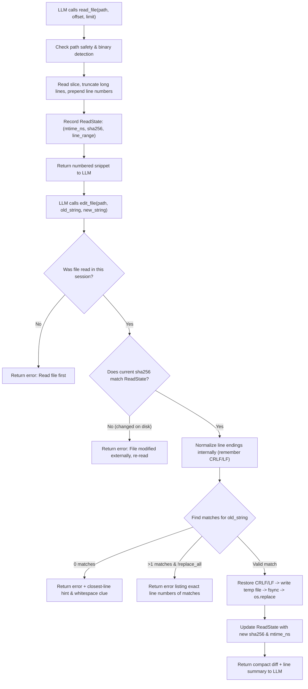

> **Module 3: Tools & Workspace Interaction** | Prerequisites: Modules 1–2 | Reading Time: ~20 min
>
> [← 13. Short-Term vs. Long-Term Memory](../02-context-and-memory/13-short-term-vs-long-term-memory.md) | [Table of Contents](../README.md) | [15. Codebase Search (Ripgrep, Glob, Semantic Indexing) →](./15-codebase-search-ripgrep-glob-semantic-indexing.md)

# 14. File Reading, Patching & Diff Application

Reading and editing files sounds like the easiest part of a coding agent. Every programming language has `read_file` and `write_file` in its standard library: how hard could it be?

In practice, **file reading and patching are where more coding agents quietly break than almost anywhere else**. A clumsy read tool blows up your context window in two turns. A sloppy edit tool silently corrupts line endings, overwrites a human's unsaved work, triggers "lazy" LLM placeholders (`// ... rest of file ...`), or traps the model in a five-turn retry spiral because of a single missing space.

This chapter breaks down how production harnesses read files cleanly, choose the right edit format, defend against whitespace and staleness bugs, write safely to disk, and craft error messages that help the model self-correct on the very next try.

---

## 1. The Simple Idea: Sticky Notes vs. Retyping the Whole Book

Imagine you are an author collaborating with an editor locked in another room (our LLM from [Chapter 00](../00-foundations/00-start-here-what-is-an-agent-harness.md)). You have a 400-page manuscript sitting on your desk, and there is a typo on page 214.

Think about three ways you could handle this:

1. **The Whole-Book Rewrite:** Slide all 400 pages under the door. Wait three hours while the editor retypes all 400 pages by hand with the typo fixed. Halfway through page 250, the editor gets tired and writes *"(keep the rest of chapter 12 the same)"*. You accidentally replace your real manuscript with their truncated copy. Disaster!
2. **The Blind Line-Number Note:** Slide page 214 under the door without line numbers. The editor guesses: *"Delete line 17 and insert this."* They miscounted by two lines and accidentally deleted the punchline of the story.
3. **The Numbered Page + Exact Sticky Note:** Slide *only* pages 213–215 under the door, with every line clearly numbered (`214:1`, `214:2`, ...). The editor replies with a surgical sticky note: *"On page 214, find the exact sentence `The butler ran to the kitchen.` and replace it with `The butler walked calmly to the kitchen.`"* Before you touch the manuscript, you verify that sentence appears **exactly once** and that nobody else scribbled on page 214 while the editor was thinking.

**What breaks if you don't build this carefully?**
- Dumping huge files floods the model's working memory and burns money on irrelevant lines.
- Asking the model to rewrite whole files wastes slow, expensive output tokens and invites accidental deletions.
- Unchecked writes corrupt files when crashes happen mid-save or when external tools (like a linter or the user) change the file between read and write.
- Vague error messages (`"Edit failed"`) leave the model guessing blindly instead of fixing its mistake in one turn.

---

## 2. Why This Matters in a Real Agent Harness

File I/O sits on the hottest path of every coding session. Getting it right directly moves four engineering needles:

1. **Output Token Cost & Latency:** With modern LLM APIs, **output tokens typically cost 3–5× more than input tokens** and stream at 40–120 tokens per second. Rewriting a 600-line file to fix a 3-line bug takes ~45 seconds and costs thousands of output tokens. A surgical patch takes ~2 seconds and ~80 output tokens.
2. **Edit Success Rate & Model "Laziness":** Research and benchmarks (notably Aider's refactoring benchmarks) proved that the *exact same model* can double or triple its coding accuracy simply by changing the edit format it is asked to emit. Bad formats invite models to skip code with `// ... existing code ...` comments or miscount diff line numbers.
3. **Data Integrity:** A coding agent operates on a developer's real workspace, often containing uncommitted work. A single non-atomic write interrupted by `Ctrl+C`, or a stale edit overwriting a file the user just saved, permanently destroys trust in your harness.
4. **First-Try Self-Correction:** Even frontier models occasionally miss a tab or supply an ambiguous snippet. When a harness returns a structured, informative error message, models recover on the very next turn >90% of the time instead of spiraling into a doom loop ([Chapter 05](../01-core-loop-and-execution/05-error-recovery-retries-and-infinite-loop-detection.md)).

---

## 3. The Big Picture

Here is the complete lifecycle of a safe read-and-patch cycle inside a production coding harness:



Notice that almost every box in this diagram is **deterministic harness code**: zero extra LLM calls required.

---

## 4. Deep Dive: Subtopic by Subtopic

### 4.1 Why Line-Numbered Paginated Reads Beat Dumping Whole Files

Suppose an agent wants to inspect `src/server.ts`, which happens to be 2,400 lines long (or worse, a 3-megabyte bundled JSON fixture). If your `read_file` tool naively returns the entire file:

- You immediately burn ~30,000+ tokens: most of them unrelated to the bug.
- Even if the file fits, **context rot** ([Chapter 09](../02-context-and-memory/09-context-window-budgeting.md)) degrades the model's attention across thousands of irrelevant lines.
- If the file is a single minified 400,000-character line, a line-count cap alone fails unless you *also* cap characters per line!

Production harnesses design `read_file` with **four protective guardrails**:

1. **Pagination (`offset` and `limit`):** Default to a sensible window; commonly **200 to 2,000 lines** (e.g., 1-based `start_line` and `end_line`, or `offset` + `limit`), along with a hard byte ceiling (e.g., 30–50 KB per call). Always tell the model the total line count and how to read the next page.
2. **Line Numbers on Every Line (`cat -n` style):** Prefix every line with its 1-based line number and a consistent delimiter (like `   42 | ` or `   42\t`). Line numbers let the model cite exact locations to the user, request the next paginated slice cleanly, and orient itself inside large files.
3. **Per-Line Character Cap:** Truncate single lines exceeding ~1,000–2,000 characters (appending `... [truncated 48,210 chars]`) so minified JS, SVGs, or embedded base64 blobs cannot blow up the context window.
4. **Binary & Special File Detection:** Before decoding text, inspect the first 8 KB for null bytes (`\x00`) or invalid UTF-8 ratio. If it's a PNG, PDF, SQLite database, or compiled binary, return metadata (file type, byte size) instead of gibberish replacement characters (`\ufffd`).

**Concrete Tool Call & Response Example:**

```json
// Tool Call (from LLM)
{
  "name": "read_file",
  "arguments": {
    "path": "src/auth/tokens.py",
    "start_line": 40,
    "end_line": 55
  }
}
```

```text
File: src/auth/tokens.py (showing lines 40-55 of 312)
  40 | def verify_token(raw_token: str, secret: str) -> dict:
  41 |     if not raw_token:
  42 |         raise ValueError("Missing token")
  43 |     parts = raw_token.split(".")
  44 |     if len(parts) != 3:
  45 |         raise ValueError("Malformed token")
  46 |     return decode_payload(parts[1], secret)
... [257 more lines; call read_file with start_line=56 to continue]
```

> **Subtle warning:** Because the model *sees* `40 | ` in the read output, weaker models occasionally accidentally copy the line-number prefix into `old_string` or `new_string` when editing! Your tool description should explicitly warn *"Never include line-number prefixes in edit arguments"*, and your error handler can detect when a failed `old_string` looks like it still has line-number prefixes attached.

---

### 4.2 Edit Formats Compared: Whole-File vs. Search-and-Replace vs. Unified Diffs

How should the LLM express a change to a file? Over the past few years, the industry converged around **three main families of edit formats**, each with distinct trade-offs.

#### Format A: Whole-File Rewrite
The model outputs the entire new content of the file via a `write_file(path, content)` tool.
- **Pros:** Zero patch-parsing complexity; impossible to have a context-match failure; works reliably even on small local open-weights models.
- **Cons:** Terrible for files over ~150 lines. Burns massive output tokens, adds tens of seconds of latency, hits `max_tokens` cutoffs, and risks subtle accidental deletions or lazy `// ... unchanged ...` placeholders.
- **Best use:** Creating brand-new files or rewriting tiny config files (<100 lines).

#### Format B: Search-and-Replace Blocks (`str_replace` / Aider `SEARCH/REPLACE`)
The model specifies the exact old snippet to locate and the exact new snippet to replace it with. No line numbers required!

**Variant 1: Structured JSON Tool (Anthropic `str_replace_based_edit_tool` / Claude Code `Edit`):**
```json
{
  "name": "edit_file",
  "arguments": {
    "path": "src/auth/tokens.py",
    "old_string": "    if len(parts) != 3:\n        raise ValueError(\"Malformed token\")",
    "new_string": "    if len(parts) != 3:\n        raise AuthError(\"Malformed JWT structure\")"
  }
}
```

**Variant 2: Text Fenced Blocks (Aider `diff` format):**
```text
src/auth/tokens.py
<<<<<<< SEARCH
    if len(parts) != 3:
        raise ValueError("Malformed token")
=======
    if len(parts) != 3:
        raise AuthError("Malformed JWT structure")
>>>>>>> REPLACE
```

- **Pros:** Extremely intuitive for LLMs because models excel at copying verbatim spans from their context window and modifying them. Completely immune to line-number counting mistakes. Easy to validate strictly (exact match + uniqueness).
- **Cons:** Must repeat unchanged context lines inside `old_string` *and* `new_string` (small extra output tokens for multi-hunk edits). JSON-escaped strings (`\n`, `\"`) can occasionally cause escaping friction compared to raw text formats, though modern structured-output models handle JSON cleanly.

#### Format C: Context-Anchored Unified Diffs (`udiff` & OpenAI `apply_patch` V4A)
Standard `git diff` unified diffs have headers like `@@ -42,7 +42,9 @@`. **LLMs are notoriously terrible at arithmetic inside hunk headers**: they routinely write `-42,7` when there are actually 8 lines, causing GNU `patch` to reject the diff.

Modern agent diff formats solve this by **dropping exact line-number math** and keeping only context anchors (`@@`), space-prefixed unchanged lines, `-` deletions, and `+` additions.

**OpenAI Codex `apply_patch` (V4A Diff Format):**
```text
*** Begin Patch
*** Update File: src/auth/tokens.py
@@ def verify_token(raw_token: str, secret: str) -> dict:
     parts = raw_token.split(".")
     if len(parts) != 3:
-        raise ValueError("Malformed token")
+        raise AuthError("Malformed JWT structure")
     return decode_payload(parts[1], secret)
*** Add File: src/auth/errors.py
+class AuthError(Exception):
+    """Raised when token validation fails."""
*** End Patch
```

- **Pros:** Most token-efficient format for multi-hunk and multi-file edits (context lines are only emitted *once*, not repeated in both `old` and `new`). Can atomically express creations (`Add`), updates (`Update`), renames, and deletions (`Delete`) across multiple files in a single tool call. Its strict, machine-oriented syntax dramatically reduces model "laziness" on large refactors.
- **Cons:** Harder to parse and apply reliably than `str_replace` (requires a dedicated V4A parser + context-hunk matcher). Smaller or non-fine-tuned models frequently forget the leading single space (` `) on unchanged context lines or emit broken hunk boundaries.

#### Side-by-Side Comparison Table

| Dimension | Whole-File Rewrite | Search-and-Replace (`str_replace`) | Context-Anchored Diff (`udiff` / V4A `apply_patch`) |
| :--- | :--- | :--- | :--- |
| **Output Token Efficiency** | Poor (scales with whole file size) | Good (scales with changed block × 2) | Best (scales with changed lines + 1× context) |
| **Needs Accurate Line Math?** | No | No | No (context-anchored; standard `git diff` does!) |
| **Multi-File Atomic Edits** | One file per call | One file per call (or batch array) | Native multi-file envelope |
| **Parser Complexity** | Trivial | Low | Medium–High |
| **Model Compatibility** | Works on all models (even tiny local ones) | Great across almost all frontier models | Best on models trained/tuned for it (e.g., Codex/GPT-4.1+, frontier models) |
| **Failure Mode** | Truncation, lazy placeholders, slow | Ambiguous match, whitespace mismatch | Missing leading space on context lines, hunk anchor miss |

> **Practical Rule of Thumb:** If you are building a general-purpose harness that supports multiple LLM providers, **`str_replace` (for edits) + `write_file` (for new/small files)** is the safest, highest-ROI default. Add V4A `apply_patch` if you specifically target OpenAI Codex models trained heavily on it.

---

### 4.3 Whitespace, Indentation, Line-Ending (`CRLF`/`LF`), and Ambiguity Bugs

Why do seemingly simple string replacements fail in real repositories? Four invisible gremlins cause 80% of edit failures:

#### 1. Line Endings (`CRLF` vs. `LF`)
Windows repositories (and mixed-OS teams) often use `\r\n` (`CRLF`: Carriage Return + Line Feed), while macOS/Linux use `\n` (`LF`). LLMs *always* emit `\n` in JSON tool calls.
- If your harness searches raw file bytes containing `\r\n` for an `old_string` containing `\n`, **every multi-line edit fails!**
- Conversely, if you normalize the file to `\n` and write `\n` back to disk, you just rewrote every single line of a Windows file, creating a massive 2,000-line fake diff in `git status`.
- **The Fix:** Detect the file's dominant line ending (`\r\n` vs. `\n`) on read, normalize *in memory* to `\n` for matching and replacement, and convert back to the file's original line ending right before writing to disk!

#### 2. Tabs vs. Spaces & Trailing Whitespace
Go files and Makefiles use literal tabs (`\t`). Python and TypeScript usually use 2 or 4 spaces. If a model reads a tab-indented file and accidentally outputs 4 spaces in `old_string`, an exact byte match fails.
- Similarly, some editors leave stray trailing spaces at the end of lines that the model unconsciously omits when copying the snippet.

#### 3. Exact Matching vs. Fuzzy Fallback Chains (A Subtle Trap!)
Should your edit tool fall back to "fuzzy matching" (ignoring whitespace differences or using Levenshtein edit distance) when an exact match fails?
- **Exact-only approach (Claude Code's philosophy):** Never guess. If `old_string` does not match verbatim, fail loudly and tell the model why. This eliminates silent mis-edits, at the cost of occasional extra retry turns.
- **Cascading fuzzy replacer approach (OpenCode's pattern):** Try exact match first; if that fails, try safe normalizations in strict order:
  1. Exact match
  2. Trailing-whitespace-trimmed line match
  3. Common-indentation-shifted match (preserving relative indent)
  4. Fuzzy similarity match (e.g., Levenshtein block anchor)

**Danger zone:** Steps 1–2 are generally safe *if* uniqueness is still strictly enforced (must match exactly 1 location). Step 4 (loose similarity matching, like 65%–80% Levenshtein similarity) is dangerous! In real production bugs (documented in OpenCode issues), a loose fuzzy matcher can match an *already-edited* block using a stale `old_string` and **silently revert the agent's own previous fix**! If you use fallback matching, keep it strictly deterministic (line-ending and trailing-space normalization only) and reject anything ambiguous.

#### 4. The Ambiguity Bug (Multiple Matches)
Imagine the model calls:
```json
{
  "path": "src/api.ts",
  "old_string": "return null;",
  "new_string": "return undefined;"
}
```
If `return null;` appears 7 times in `src/api.ts`, silently replacing the first occurrence is a **guaranteed bug**.
- **The Golden Rule:** Unless the model explicitly passes `"replace_all": true`, an edit **must match strictly 1 occurrence**. If `count == 0`, fail. If `count > 1`, fail and tell the model the exact line numbers of every match so it can include 2–3 surrounding lines of context to disambiguate.

---

### 4.4 Atomic Writes, Stale-Read Detection (`mtime`/Hash Guards), and Encoding Safety

Once your harness has computed the new file text in memory, how do you put it on disk without risking corruption or race conditions?

#### 1. Mandatory Read-Before-Edit & Stale-Read Detection
Never let an agent blindly edit a file it has never read, or edit a file that changed underneath it since it last read it (for instance, because the human user edited the file in their IDE, a file watcher ran Prettier/Black, or another parallel tool modified it).

Maintain a per-session `ReadStateTracker` mapping canonical file paths (`os.path.realpath`) to a snapshot:
```python
@dataclass
class FileSnapshot:
    mtime_ns: int     # High-resolution modification timestamp
    sha256: str       # Cryptographic hash of file bytes
    size_bytes: int
```
Why store **both** `mtime_ns` and `sha256`?
- Checking `mtime_ns` + `size_bytes` is instant (no disk read needed when unchanged).
- Some filesystems have coarse timestamp granularity (or `git checkout` / build tools reset `mtime`), so checking `sha256` guarantees you catch same-millisecond modifications *and* avoid false alarms when a file was `touch`ed without changing its content!

#### 2. Atomic Writes (`temp file` + `fsync` + `os.replace`)
If you write a file using standard `open(path, "w").write(new_content)`:
1. `open(..., "w")` immediately **truncates the existing file to 0 bytes**.
2. If the process crashes, runs out of disk space, or receives `SIGINT` (`Ctrl+C`) before `.write()` finishes, the developer's file is now empty or half-written!

Instead, perform an **atomic write**:
1. Create a temporary file **in the same directory** as the target file (critical! `os.replace` is only atomic on POSIX when source and destination are on the same filesystem/mount point).
2. Copy the original file's permission bits (`st_mode`, e.g., keeping executable scripts `0o755`).
3. Write the new bytes, call `f.flush()`, and call `os.fsync(f.fileno())` so the OS flushes data to storage.
4. Atomically swap the temporary file into place with `os.replace(tmp_path, target_path)`.
5. Clean up the temp file in an `except` block if anything fails before step 4.

#### 3. Encoding & BOM Safety
Most source code is UTF-8 without a Byte Order Mark (BOM), but legacy C#, PowerShell, or CSV files sometimes start with a UTF-8 BOM (`\xef\xbb\xbf`) or use UTF-16.
- Read raw bytes (`"rb"`), check for a UTF-8 BOM (`b"\xef\xbb\xbf"`), remember whether it was present, decode with strict UTF-8 (refusing to silently corrupt binary/Latin-1 files unless handled explicitly), and re-attach the BOM on write if the original file had one.

---

### 4.5 Designing Helpful Edit Error Messages So the Model Self-Corrects

Remember one of the core principles from [Chapter 05](../01-core-loop-and-execution/05-error-recovery-retries-and-infinite-loop-detection.md): **tool errors are not crashes; they are prompts for the next turn.**

Compare what happens when an edit fails with a lazy error vs. a thoughtfully engineered error:

**Bad Error Message:**
```text
Error: Could not apply edit to src/auth/tokens.py
```
*Result:* The model has no idea *why* it failed. Did the file not exist? Did it match twice? Was a space wrong? It wastes 2–3 turns guessing or resorts to rewriting the whole file.

**Great Diagnostic Error Messages:**

| Failure Cause | Actionable Error Message Returned to the LLM |
| :--- | :--- |
| **Unread file** | `Error: Cannot edit 'src/auth/tokens.py' before reading it. Call read_file on this path first.` |
| **Stale read** | `Error: 'src/auth/tokens.py' was modified on disk since your last read (checksum changed). Call read_file to inspect the latest contents before retrying.` |
| **Ambiguous match** | `Error: old_string matched 3 times in 'src/auth/tokens.py' (at lines 44, 118, 203). Include 2-3 surrounding lines in old_string to uniquely identify the target, or set replace_all=true.` |
| **Not found (with hint)** | `Error: old_string not found in 'src/auth/tokens.py'. Closest match (89% similar) is at lines 43-46:` + numbered snippet of lines 42-47 + `(Note: file uses 4 spaces; your old_string started with a tab.)` |
| **No-op edit** | `Error: old_string and new_string are identical. No changes were made.` |

Notice how showing the **closest matching lines right inside the error message** often lets the model fix its `old_string` immediately *without even spending an extra turn calling `read_file`*.

---

## 5. How Real Harnesses Do It

- **Anthropic Claude Code (`Read` + `Edit` / `str_replace_based_edit_tool`):**
  Claude Code separates reading (`Read`, returning 1-based line-numbered slices with character/line truncation) from surgical editing (`Edit`, taking `file_path`, `old_string`, `new_string`, and optional `replace_all`). It strictly enforces **read-before-edit tracking** (refusing to edit files not read in the session), checks file modification timestamps to prevent stale overwrites, and uses **exact-match uniqueness** (zero fuzzy guessing) so edits never land in the wrong spot.
- **OpenAI Codex CLI (`apply_patch` V4A Format):**
  Codex models are post-trained directly on OpenAI's V4A patch grammar (`*** Begin Patch` / `*** Update File:` / `*** Add File:` / `*** Delete File:` / `@@` context anchors). A single `apply_patch` call can create, update, and delete multiple files in one turn without fragile hunk line counts. The local harness parses the envelope, validates paths against directory traversal (`..`), locates context hunks, and reports structured `completed`/`failed` statuses back to the model.
- **Aider (Multi-Format Benchmarking & Adaptive Selection):**
  Aider pioneered systematic benchmarking of LLM edit formats. In Aider's famous refactoring benchmark measuring LLM "laziness," switching GPT-4 Turbo from `SEARCH/REPLACE` blocks to unified diffs (`udiff`) jumped its pass rate from **20% to 61%** and cut lazy placeholder comments threefold. Aider dynamically picks the best edit format per model family: using `diff` (`SEARCH/REPLACE`) for Claude models, `udiff` where models excel at diffs, `diff-fenced` for Gemini quirks, and `whole` for smaller local models that struggle with patch syntax.
- **OpenCode (Cascading Fuzzy Replacer Chain):**
  OpenCode's `edit` tool runs a cascading chain of matchers (`Exact` → `LineTrimmed` → `WhitespaceNormalized` → `IndentationFlexible` → `BlockAnchor` with Levenshtein similarity). While this recovers from minor whitespace slips without a retry turn, OpenCode's real-world issue tracker also highlighted an important cautionary tale: overly permissive similarity thresholds can match a previously edited block with a stale `old_string` and silently revert earlier work, and error messages must accurately reflect what the matcher actually tried.

---

## 6. Common Pitfalls & Failure Modes

1. **Line-Number Prefix Contamination:** The model copies `  42 | def foo():` straight out of `read_file` into `old_string`.
   - *Prevention:* Document clearly in the tool schema not to include line prefixes, and detect regex `^\s*\d+\s*\|\s?` in failed `old_string` calls so your error message calls it out specifically.
2. **Silent `CRLF` → `LF` Rewriting:** Editing one line of a Windows file turns all 1,500 lines red in `git diff`.
   - *Prevention:* Detect dominant line ending before normalizing, and restore it before writing.
3. **Sequential Edit Staleness Inside Parallel Tool Calls:** In a single turn, the model emits *two* parallel `edit_file` calls targeting the same file ([Chapter 04](../01-core-loop-and-execution/04-parallel-tool-calling.md)). If both run concurrently, the second overwrites the first!
   - *Prevention:* Serialize all write/edit calls targeting the same canonical file path (or support a single `multi_edit` array applied sequentially in memory before one atomic write).
4. **Over-Permissive Fuzzy Matching:** Matching at 70% similarity silently edits the wrong overload or reverts a recent change.
   - *Prevention:* Keep matching exact (plus line-ending normalization), and instead invest in great closest-match *error messages* so the model explicitly approves the corrected snippet.
5. **Non-Atomic Truncating Writes:** Using `Path(p).write_text(...)` directly leaves empty files on `Ctrl+C` or disk-full errors.
   - *Prevention:* Always write to a sibling temp file, `fsync`, and `os.replace`.
6. **Symlink Escape During Atomic Write:** Replacing a symlink with `os.replace` destroys the symlink and replaces it with a regular file (or writes outside the workspace!).
   - *Prevention:* Resolve the target with `os.path.realpath`, verify it stays inside the allowed workspace root ([Chapter 22](../04-sandboxing-and-security/22-filesystem-and-network-isolation.md)), and write to the resolved path.

---

## 7. Build It Yourself: Mini-Lab

Below is a compact, production-style Python implementation of a **safe paginated file reader + atomic `str_replace` editor** with read-before-edit tracking, SHA-256 stale-read guards, `CRLF`/`LF` preservation, closest-match error hints, and atomic temp-file writes. You can run it directly with Python 3.10+.

```python
"""safe_editor.py — Production-grade Read & Patch primitives for an agent harness."""

from __future__ import annotations

import difflib
import hashlib
import os
import tempfile
from dataclasses import dataclass
from pathlib import Path


@dataclass
class FileSnapshot:
    mtime_ns: int
    sha256: str
    line_ending: str  # "\r\n" or "\n"
    has_bom: bool


class EditError(Exception):
    """Actionable error meant to be returned verbatim to the LLM."""


class SafeWorkspaceEditor:
    def __init__(self, workspace_root: str | Path) -> None:
        self.root = Path(workspace_root).resolve()
        self._read_snapshots: dict[Path, FileSnapshot] = {}

    def _resolve_safe_path(self, rel_or_abs: str) -> Path:
        candidate = (self.root / rel_or_abs).resolve()
        if not candidate.is_relative_to(self.root):
            raise EditError(f"Path '{rel_or_abs}' escapes workspace root.")
        return candidate

    @staticmethod
    def _inspect_bytes(raw: bytes) -> tuple[str, str, bool]:
        if b"\x00" in raw[:8192]:
            raise EditError("Target appears to be a binary file and cannot be edited as text.")
        has_bom = raw.startswith(b"\xef\xbb\xbf")
        payload = raw[3:] if has_bom else raw
        try:
            text = payload.decode("utf-8")
        except UnicodeDecodeError as exc:
            raise EditError(f"File is not valid UTF-8: {exc}") from exc
        crlf_count = text.count("\r\n")
        lf_only_count = text.count("\n") - crlf_count
        line_ending = "\r\n" if crlf_count > lf_only_count else "\n"
        return text.replace("\r\n", "\n"), line_ending, has_bom

    def read_file(
        self, path: str, start_line: int = 1, limit: int = 200, max_line_chars: int = 1000
    ) -> str:
        target = self._resolve_safe_path(path)
        if not target.is_file():
            raise EditError(f"File not found: '{path}'.")

        raw = target.read_bytes()
        stat = target.stat()
        normalized, line_ending, has_bom = self._inspect_bytes(raw)

        # Record snapshot so subsequent edits can detect external modifications
        self._read_snapshots[target] = FileSnapshot(
            mtime_ns=stat.st_mtime_ns,
            sha256=hashlib.sha256(raw).hexdigest(),
            line_ending=line_ending,
            has_bom=has_bom,
        )

        lines = normalized.splitlines()
        total = len(lines)
        start_idx = max(0, start_line - 1)
        end_idx = min(total, start_idx + limit)

        formatted: list[str] = [
            f"File: {target.relative_to(self.root)} (showing lines {start_idx + 1}-{end_idx} of {total})"
        ]
        for idx in range(start_idx, end_idx):
            line = lines[idx]
            if len(line) > max_line_chars:
                omitted = len(line) - max_line_chars
                line = f"{line[:max_line_chars]} ... [truncated {omitted} chars]"
            formatted.append(f"{idx + 1:>5} | {line}")

        if end_idx < total:
            formatted.append(
                f"... [{total - end_idx} more lines; call read_file(start_line={end_idx + 1})]"
            )
        return "\n".join(formatted)

    def _closest_match_hint(self, text: str, old_string: str) -> str:
        file_lines = text.splitlines()
        needle_lines = old_string.splitlines()
        if not file_lines or not needle_lines:
            return ""
        window = len(needle_lines)
        best_ratio, best_start = 0.0, 0
        for i in range(max(1, len(file_lines) - window + 1)):
            candidate = "\n".join(file_lines[i : i + window])
            ratio = difflib.SequenceMatcher(None, candidate, old_string).ratio()
            if ratio > best_ratio:
                best_ratio, best_start = ratio, i
        if best_ratio < 0.45:
            return ""
        ctx_start = max(0, best_start - 1)
        ctx_end = min(len(file_lines), best_start + window + 1)
        snippet = "\n".join(f"{j + 1:>5} | {file_lines[j]}" for j in range(ctx_start, ctx_end))
        return (
            f"\nClosest match ({best_ratio:.0%} similar) around lines "
            f"{best_start + 1}-{best_start + window}:\n{snippet}"
        )

    def edit_file(
        self, path: str, old_string: str, new_string: str, replace_all: bool = False
    ) -> str:
        target = self._resolve_safe_path(path)

        # 1. Enforce read-before-edit
        if target not in self._read_snapshots:
            raise EditError(
                f"Cannot edit '{path}' before reading it. Call read_file('{path}') first."
            )
        if old_string == new_string:
            raise EditError("old_string and new_string are identical; no edit needed.")

        # 2. Stale-read check via SHA-256
        raw = target.read_bytes()
        current_hash = hashlib.sha256(raw).hexdigest()
        prev = self._read_snapshots[target]
        if current_hash != prev.sha256:
            raise EditError(
                f"Stale read detected: '{path}' changed on disk since your last read. "
                "Call read_file again before retrying your edit."
            )

        # 3. Normalize line endings in memory
        normalized, line_ending, has_bom = self._inspect_bytes(raw)
        old_norm = old_string.replace("\r\n", "\n")
        new_norm = new_string.replace("\r\n", "\n")

        # 4. Exact match & uniqueness check
        count = normalized.count(old_norm)
        if count == 0:
            hint = self._closest_match_hint(normalized, old_norm)
            raise EditError(
                f"old_string not found in '{path}'. Verify exact indentation and text.{hint}"
            )
        if count > 1 and not replace_all:
            # Find exact 1-based line numbers of every occurrence
            line_nums: list[int] = []
            pos = 0
            while (idx := normalized.find(old_norm, pos)) != -1:
                line_nums.append(normalized.count("\n", 0, idx) + 1)
                pos = idx + len(old_norm)
            raise EditError(
                f"Ambiguous edit: old_string matched {count} times in '{path}' at lines "
                f"{line_nums}. Add 2-3 surrounding context lines or set replace_all=True."
            )

        updated_norm = (
            normalized.replace(old_norm, new_norm)
            if replace_all
            else normalized.replace(old_norm, new_norm, 1)
        )

        # 5. Restore original line endings & BOM, then write atomically
        restored = updated_norm.replace("\n", line_ending)
        out_bytes = (b"\xef\xbb\xbf" if has_bom else b"") + restored.encode("utf-8")
        orig_mode = target.stat().st_mode

        fd, tmp_name = tempfile.mkstemp(dir=target.parent, prefix=".edit_tmp_")
        try:
            with os.fdopen(fd, "wb") as tmp_file:
                tmp_file.write(out_bytes)
                tmp_file.flush()
                os.fsync(tmp_file.fileno())
            os.chmod(tmp_name, orig_mode)
            os.replace(tmp_name, target)
        except Exception:
            if os.path.exists(tmp_name):
                os.unlink(tmp_name)
            raise

        # 6. Refresh snapshot so chained edits in later turns succeed
        new_stat = target.stat()
        self._read_snapshots[target] = FileSnapshot(
            mtime_ns=new_stat.st_mtime_ns,
            sha256=hashlib.sha256(out_bytes).hexdigest(),
            line_ending=line_ending,
            has_bom=has_bom,
        )

        # 7. Return a compact unified diff confirming what changed
        diff = "".join(
            difflib.unified_diff(
                normalized.splitlines(keepends=True),
                updated_norm.splitlines(keepends=True),
                fromfile=f"a/{path}",
                tofile=f"b/{path}",
                n=2,
            )
        )
        return f"Applied {count if replace_all else 1} edit(s) to {path}.\n{diff}"


if __name__ == "__main__":
    with tempfile.TemporaryDirectory() as tmp:
        sample = Path(tmp) / "app.py"
        # Simulate a Windows CRLF file
        sample.write_bytes(b"def greet(name):\r\n    return f'Hi {name}'\r\n")

        editor = SafeWorkspaceEditor(tmp)
        print(editor.read_file("app.py"))
        print(editor.edit_file("app.py", "    return f'Hi {name}'", "    return f'Hello, {name}!'"))
        assert b"\r\n" in sample.read_bytes(), "CRLF line endings were lost!"
        print("Verified: CRLF preserved and atomic edit succeeded.")
```

Notice how clean every responsibility is: `read_file` handles pagination, line truncation, binary safety, and snapshot tracking; `edit_file` enforces read-before-edit, stale-read SHA-256 verification, exact uniqueness, `CRLF` preservation, closest-match error hints, and atomic replacement.

---

## 8. Key Takeaways & Quick Self-Check

- **Paginate and number reads:** Always cap lines, bytes, and per-line character length, detect binary files, and show 1-based line numbers so the model stays oriented without blowing up context.
- **Prefer surgical edits over whole-file rewrites:** `str_replace` (universal, simple, deterministic) and context-anchored V4A diffs (`apply_patch`, great for multi-file batches on Codex models) save huge output tokens and cut latency by an order of magnitude.
- **Preserve invisible file metadata:** Normalize `CRLF`/`LF` in memory for matching, then restore original line endings, UTF-8 BOM, and POSIX permission bits before writing.
- **Guard disk integrity deterministically:** Enforce read-before-edit, check `(mtime_ns, sha256)` for stale reads, require unique matches unless `replace_all=true`, and commit via `mkstemp` (same directory) + `fsync` + `os.replace`.
- **Treat edit errors as self-correction prompts:** Return match line numbers for ambiguity and closest-match snippets for misses so the LLM fixes its mistake in one turn.

### Quick Self-Check

1. **Why is calling `open(path, "w")` directly dangerous inside an agent harness, and why must the temporary file in an atomic write live in the *same directory* as the target file?**
   <details>
   <summary>Show Answer</summary>
   `open(path, "w")` truncates the existing file to 0 bytes immediately before new bytes are written; if the process crashes or is cancelled mid-write, the user's file is destroyed. Writing to a temporary file and calling `os.replace` swaps the directory entry atomically, but POSIX `rename`/`os.replace` only works atomically on the same filesystem/mount point, creating the temp file in `/tmp` can fail with `EXDEV` (cross-device link) if the workspace is on a different disk or volume.
   </details>

2. **Why do modern agent diff formats like OpenAI's V4A `apply_patch` omit standard unified-diff hunk line numbers like `@@ -42,7 +42,9 @@`?**
   <details>
   <summary>Show Answer</summary>
   LLMs are great at copying surrounding code context verbatim, but notoriously bad at exact line arithmetic across edits. When asked to generate standard `git diff` hunk headers, models frequently miscount line totals or offsets, causing strict `patch` tools to reject otherwise valid changes. Context-anchored diffs locate the edit using unchanged surrounding lines instead.
   </details>

3. **What subtle failure mode can happen if you add a loose Levenshtein fuzzy matcher (e.g., 65% similarity) as a fallback inside `edit_file`?**
   <details>
   <summary>Show Answer</summary>
   A stale or slightly outdated `old_string` can accidentally exceed the similarity threshold against a block of code that was *already modified* in an earlier turn (or against a similar sibling function), silently overwriting or reverting previous work without raising an error.
   </details>

4. **A file on disk uses Windows `CRLF` (`\r\n`) endings. What two bugs occur if your harness doesn't handle line endings explicitly?**
   <details>
   <summary>Show Answer</summary>
   First, multi-line `old_string` values from the LLM contain `\n`, so exact matching against raw `\r\n` bytes fails on every edit. Second, if you normalize the file to `\n` and forget to convert back to `\r\n` on save, you silently rewrite every line in the file and create a massive noisy `git diff`.
   </details>

---

[← 13. Short-Term vs. Long-Term Memory](../02-context-and-memory/13-short-term-vs-long-term-memory.md) | [Table of Contents](../README.md) | [15. Codebase Search (Ripgrep, Glob, Semantic Indexing) →](./15-codebase-search-ripgrep-glob-semantic-indexing.md)
