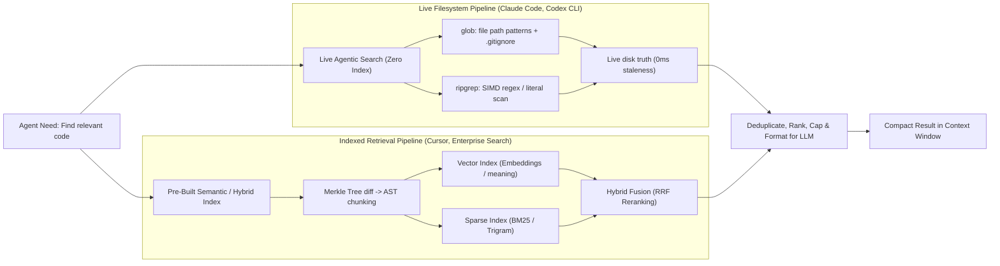

> **Module 3: Tools & Workspace Interaction** | Prerequisites: Chapter 14 | Reading Time: ~20 min
>
> [← 14. File Reading, Patching & Diff Application](./14-file-reading-patching-and-diff-application.md) | [Table of Contents](../README.md) | [16. AST & Language Server Protocol (LSP) Integration →](./16-ast-and-language-server-protocol-lsp-integration.md)

# 15. Codebase Search (Ripgrep, Glob, Semantic Indexing)

Before an agent can read or patch a single line of code, it faces a much bigger question: **Out of 12,000 files in this repository, which three files actually matter right now?**

If search is slow, noisy, or incomplete, even the smartest LLM on Earth will wander in circles—missing callers during a refactor, duplicating utility functions that already exist, or drowning its context window in third-party `node_modules` junk. This chapter explains the three pillars of codebase search (`glob`, `ripgrep`, and semantic vector indexing), why many top harnesses deliberately favor fast live search over heavy vector databases, and how to rank and format search hits so an LLM reads them effortlessly.

---

## 1. The Simple Idea: Three Ways to Navigate a Giant Library

Imagine walking into a massive university library with 50,000 books and trying to find every mention of *"sourdough starter"* or *"how fermentation works"*. You have three very different tools:

1. **The Floor Map & Call-Number Catalog (`glob`):** Lets you ask *"Show me every book in the `Baking/Bread/` aisle whose title ends in `.recipe`."* You never open a single book—you just scan filenames and directory paths.
2. **A Superhuman Ctrl+F Machine (`ripgrep`):** Scans the actual printed words of thousands of books in 40 milliseconds and hands you every page containing the exact phrase `StarterTempError` or regex `ferment\w+`. It never guesses and never forgets a brand-new book that was shelved two seconds ago.
3. **A Conceptual Research Librarian (Semantic / Vector Search):** You don't know the exact words the author used, so you ask: *"Where do we explain what to do when bread dough won't rise in cold kitchens?"* Even if the book says *"ambient temperature sluggish yeast recovery"* and never uses the words *"cold"* or *"rise"*, the librarian understands the **meaning** and points you to the right chapter.

**What breaks if you don't build search well?**
- Without `.gitignore`-aware filtering, your agent searches inside `node_modules/` and `.git/`, returning 40,000 irrelevant matches.
- Without line caps and minified-file guards, a single match in `dist/bundle.min.js` injects 150,000 tokens of unreadable JavaScript into the prompt.
- Without truncation notices, an agent that only sees the first 50 of 300 matches thinks it updated *every* caller and ships a broken build.

---

## 2. Why This Matters in a Real Agent Harness

In real software engineering, **navigation accounts for 40%–60% of all tool calls** in a coding session. Great search tools directly improve:

- **Turn Count & Speed:** Finding the exact file in 2 fast parallel calls (`glob` + `grep`, <100ms total) instead of 12 sequential directory listings saves minutes of LLM round-trip latency.
- **Recall During Refactors:** Missing one caller of a renamed function breaks production. Deterministic lexical search guarantees 100% recall for literal names—provided your harness clearly reports when results are capped.
- **Context Budget Efficiency:** Raw search output is notoriously verbose. Grouping hits by file, supporting `"files_with_matches"` scout mode, and truncating huge lines routinely cuts search token consumption by 70%–90%.
- **Freshness & Simplicity:** Code changes every few seconds during an agent session. A search layer that stays accurate *immediately* after an edit prevents the agent from reasoning over yesterday's code.

---

## 3. The Big Picture

Modern coding harnesses choose between (or combine) two distinct search pipelines: **Live Agentic Search** and **Pre-Built Hybrid Semantic Indexing**.



---

## 4. Deep Dive: Subtopic by Subtopic

### 4.1 File Discovery (`glob`)

A **glob** is a lightweight wildcard pattern for matching file paths—much simpler and safer for models to write than full regular expressions:

| Pattern | Plain-English Meaning | Example Match |
| :--- | :--- | :--- |
| `*.py` | Any Python file in the root directory | `setup.py` |
| `src/**/*.ts` | Any TypeScript file at any depth inside `src/` | `src/auth/jwt/verify.ts` |
| `**/*test*.{js,ts}` | Any JS or TS test file anywhere in the repo | `packages/api/user_test.ts` |
| `docs/chapter-??.md` | `?` matches exactly one character | `docs/chapter-14.md` |

#### What Makes a Production `glob` Tool Good?
1. **Automatic Ignore Rules:** Respect `.gitignore`, `.ignore`, and global git excludes *by default*. Even in a directory that isn't a git repo yet, maintain a built-in safety ignore list: `.git/`, `node_modules/`, `dist/`, `build/`, `.next/`, `target/`, `__pycache__/`, `.venv/`, `vendor/`.
2. **Smart Sorting (Not Just Alphabetical!):** When a repo has 5,000 files and you cap `glob` at 100 results, alphabetical sorting shows `a_legacy_module/...` every time. Sorting by **most recently modified (`mtime` descending)**—or shortest path depth first—surfaces the files the team is actively working on!
3. **Directory Scoping:** Allow an optional `path` parameter (e.g., `path="packages/billing"`) so the model can narrow down a huge monorepo without crafting complex patterns.
4. **Clear Result Caps:** Cap at ~100–200 paths per call and explicitly report `"Showing 100 of 1,420 matching files. Pass a narrower path or pattern."`

---

### 4.2 Lexical Search with `ripgrep` (`rg`)

When you need to search *inside* files, do **not** write a naive recursive `os.walk` + Python `re.search` loop. In a medium repo, pure Python/Node loops take 5–30 seconds and chew through binary blobs and ignored build directories.

Almost every top coding harness shells out to **`ripgrep` (`rg`)** (or embeds Rust's `ignore` + `grep` crates directly). Why is `ripgrep` so fast?
- Uses **SIMD** (Single Instruction, Multiple Data) CPU instructions to scan multiple bytes per clock cycle.
- Walks directory trees in parallel across CPU cores.
- Automatically respects `.gitignore` hierarchies (including nested `.gitignore` files!) and skips hidden files and binary files out of the box.

#### Essential `ripgrep` Controls to Expose in Your Tool Schema

| Capability | `rg` Flag | Why the Agent Needs It |
| :--- | :--- | :--- |
| **Regex vs. Fixed String** | *(default)* vs. `-F` | Models often search for `user.get_id()` or `arr[0]` intending literal text; `-F` (`fixed_strings=true`) prevents regex syntax errors or unintended `.` wildcard matches. |
| **Output Mode (Scout vs. Read)** | `-l` (`files_with_matches`), `-c` (`count`), or content | Scouting with `files_with_matches` first costs 10× fewer tokens than dumping 500 matching lines across 80 files! |
| **Context Lines** | `-C 2` (or `-A` / `-B`) | Showing 2 lines before and after each match lets the model recognize whether a hit is a function definition, an import, or a comment without calling `read_file` on 20 false positives. |
| **File & Glob Filters** | `-g '*.ts'`, `-g '!*.test.ts'` | Lets the model focus on source code and skip tests, lockfiles, or generated snapshots. |
| **Case Sensitivity** | `-i` (ignore case) or `-S` (smart case) | Smart case (`-S`) is case-insensitive when the query is all lowercase (`auth_token`) and case-sensitive as soon as an uppercase letter appears (`AuthToken`). |
| **Minified-Line Armor** | `--max-columns 300 --max-columns-preview` | Prevents a single match in a 500 KB minified JavaScript line from blowing up stdout! |
| **Structured Parsing** | `--json` | Outputs clean newline-delimited JSON events (`begin`, `match`, `context`, `end`) so your harness never breaks on filenames containing colons (`:`) or weird Unicode. |

**Concrete `grep` Tool Call Example:**
```json
{
  "name": "grep_search",
  "arguments": {
    "pattern": "verify_token",
    "path": "src/",
    "glob": "*.py",
    "output_mode": "content",
    "context_lines": 1,
    "max_results": 30
  }
}
```

---

### 4.3 Semantic / Vector Code Search (Chunking, Embeddings & Hybrid Retrieval)

Lexical search (`ripgrep`) is unbeatable when you know *what string* to look for. But what if a developer opens an unfamiliar 80,000-file repository and asks:

> *"Where do we retry failed credit card charges with exponential backoff?"*

Maybe the codebase calls them `MerchantSettlementJob`, `backoff_jitter_ms`, and `reattempt_capture`—zero overlap with the words `"retry"`, `"credit card"`, or `"charge"`. That is where **semantic code search** enters.

#### How Semantic Code Search Works in Plain English

1. **Chunking (Splitting Code into Meaningful Pieces):**
   You cannot embed a 2,000-line file as one vector—its meaning gets smeared into mush. And you shouldn't chop files blindly every 500 characters, because that slices functions right in half! Modern indexers use **AST chunking** (powered by Tree-sitter—covered deeply in [Chapter 16](./16-ast-and-language-server-protocol-lsp-integration.md)) to split files cleanly along function, method, and class boundaries (~200–500 tokens per chunk), prepending file path + enclosing class context to each chunk.
2. **Embeddings (Turning Meaning into Coordinates):**
   An **embedding model** converts each code chunk into a list of numbers—a **vector** (for example, 1,024 or 1,536 floats). Chunks with similar *meaning* land close together in this high-dimensional space, measured by **cosine similarity**. When the agent asks *"retry failed credit card charges"*, the harness embeds the query and finds the nearest code vectors in a vector database (like Turbopuffer, Qdrant, pgvector, or a local HNSW index).
3. **Incremental Sync via Merkle Trees:**
   Re-embedding 50,000 files every time you save one line would be impossibly slow. Smart harnesses build a **Merkle tree**—a cryptographic hash tree where every file is hashed into a leaf node, and every folder's hash is computed from the hashes of its children. When one file changes, only the hashes along the single branch from that file to the root change. Comparing the local root hash to the server's root hash pinpoints the exact changed files in milliseconds!
4. **Hybrid Search (BM25 + Vector + Reciprocal Rank Fusion):**
   Pure vector search is famously weak at exact identifiers—ask it for `ERR_4091` or `x_csrf_v2` and it might return `ERR_4092` because the vectors look similar! Pure keyword search (**BM25**, a statistical ranking formula that rewards rare, specific matching terms over common words like `return` or `const`) nails exact identifiers but misses synonyms.
   **Hybrid search** runs *both* BM25 and vector search in parallel, then merges the two ranked lists using **Reciprocal Rank Fusion (RRF)**:

   $$\text{RRF\_score}(d) = \sum_{r \in \{\text{BM25}, \text{Vector}\}} \frac{1}{k + \text{rank}_r(d)}$$

   where $k$ is a smoothing constant (typically `60`) and $\text{rank}_r(d)$ is the 1-based position of chunk $d$ in list $r$. Notice the beauty of RRF: you never have to calibrate incompatible raw scores (BM25 scores like `14.3` vs. cosine similarities like `0.81`)—only ranks matter, and chunks that score well in *both* lists rocket to the top!

---

### 4.4 Why Modern Harnesses Often Prefer Fast Agentic `ripgrep` + `glob` Over Heavy Vector Indexes

In 2023–2024, almost everyone assumed every coding agent *needed* a vector database (RAG). By 2025–2026, a surprising consensus emerged across CLI coding agents like Claude Code, Codex CLI, and OpenCode: **for most repositories, fast agentic `ripgrep` + `glob` beats a pre-built vector index.**

Why? Because an LLM inside a multi-turn loop is *not* a single-shot search bar! If its first `grep` for `"credit_card"` returns zero hits, an agent immediately adapts:
- Turn 1: `glob("**/*pay*")` → spots `src/billing/settlement.py` and `src/billing/retry_policy.py`.
- Turn 2: `grep("backoff", path="src/billing/")` → lands directly on `reattempt_capture` in <100ms!

Let's compare both architectures honestly:

| Dimension | Agentic `ripgrep` + `glob` (Just-in-Time) | Pre-Built Semantic / Hybrid Vector Index |
| :--- | :--- | :--- |
| **Freshness** | **100% live.** Sees edits, new files, and `git checkout` the instant they happen. | **Eventual consistency.** Index lags behind edits or branch switches until re-sync completes. |
| **Exactness & Recall** | **Exact.** Never confuses `v1_auth` with `v2_auth`; 100% deterministic. | **Approximate.** Can miss exact symbol references or rank look-alike files higher. |
| **Setup & Infra Cost** | **Zero.** No embedding API costs, no background CPU spike, no remote vector DB. | **Significant.** Background file watchers, Merkle sync, embedding bills, vector DB storage. |
| **Privacy & Security** | **Local-only.** Code never leaves the machine except snippets explicitly read into the turn. | **Requires care.** Code chunks must be uploaded to embedding/vector providers (unless running local embeddings). |
| **Conceptual Queries** | Takes 2–4 exploratory agent turns to bridge vocabulary gaps. | **Instant (1 call).** Great for *"Where do we handle X?"* in huge unfamiliar repos. |
| **Huge Monorepos (100k+ files)** | Live disk scans can slow down to 2–10s without scoped paths (or trigram index like Zoekt). | **Sub-second** regardless of repo size once indexed. |

> **The Pragmatic Architecture Decision:** Start every new harness with rock-solid `glob` + `ripgrep` (plus AST/LSP from Chapter 16). Only layer on semantic vector indexing when your users regularly work in massive, unfamiliar monorepos (50k+ files) where exploratory grep takes too many turns or hits disk I/O bottlenecks.

---

### 4.5 Ranking, Deduplication, and Formatting Search Results for LLM Readability

Raw `grep` output was designed for Unix pipes, not LLM token budgets. Look at the difference formatting makes:

**Raw `rg` output (wasteful & repetitive):**
```text
packages/payments/src/providers/stripe/webhooks/invoice_handler.ts:42:  const sig = verifySignature(rawBody);
packages/payments/src/providers/stripe/webhooks/invoice_handler.ts:48:  if (!verifySignature(fallbackBody)) {
packages/payments/src/providers/stripe/webhooks/invoice_handler.ts:91:  logger.info("verifySignature succeeded");
```

**Grouped, Ranked, LLM-Optimized output (~40% fewer tokens, easier to scan):**
```text
Search: "verifySignature" (3 matches in 1 file; showing all)

## packages/payments/src/providers/stripe/webhooks/invoice_handler.ts (3 matches)
  42:   const sig = verifySignature(rawBody);
  48:   if (!verifySignature(fallbackBody)) {
  91:   logger.info("verifySignature succeeded");
```

#### Five Formatting & Ranking Rules That Pay Off Immediately
1. **Group by file path:** Print the relative path once as a header, then indented `line_num: text` entries beneath it.
2. **Rank files thoughtfully:** Sort matched files so the highest-signal files appear first:
   - Source code ahead of tests, snapshots, fixtures, and lockfiles (unless the user asked for tests!).
   - Recently modified files (`mtime` descending) ahead of stale archived directories.
   - Files with definitions (`def `, `class `, `function `, `export `) ahead of plain call sites.
3. **Cap per file AND globally:** If one generated file has 400 matches, don't let it consume the entire global budget of 50 results! Cap at e.g. **10 matches per file** and **50–100 matches total**, summarizing overflow per file (`... (+390 more matches in this file)`).
4. **Deduplicate overlapping context windows:** When matches occur on lines 42 and 44 with `context_lines=2`, merge them into one contiguous block (lines 40–46) instead of repeating lines 42–44 twice.
5. **Always emit an explicit truncation footer:** Never silently drop results. End capped outputs with:
   `[Truncated: showing 50 of 284 matches across 37 files. Narrow with 'path', 'glob', or use output_mode='files_with_matches'.]`

---

## 5. How Real Harnesses Do It

- **Claude Code (Anthropic):**
  Deliberately avoids maintaining a vector database. Instead, it equips Claude with dedicated `Glob` (sorted by file modification time) and `Grep` (powered by `ripgrep`) tools. `Grep` defaults to `files_with_matches` so the agent scouts which files are relevant for minimal tokens before requesting `content` with context lines. Because it queries the live filesystem, there is zero indexing lag and zero stale-index hallucinations.
- **Cursor:**
  Runs a sophisticated **hybrid indexed architecture** designed for instant conceptual lookup across large codebases. Cursor parses files into AST-aligned chunks (~500 tokens), syncs them incrementally to remote vector infrastructure (Turbopuffer) using a **Merkle tree** (checking diffs periodically so only changed branches upload, and even bootstrapping teammates from shared repo hashes), and pairs semantic search with exact/lexical lookup.
- **OpenAI Codex CLI & OpenCode:**
  Bundle fast `ripgrep`-backed search and glob tools with strict `.gitignore` compliance, binary skipping, hard line-length truncation, and per-call output caps so the model navigates rapidly while keeping context clean.
- **Enterprise Monorepo Harnesses (e.g., Sourcegraph Cody / Google-scale setups):**
  When repositories hit millions of files, even `ripgrep` scanning raw disk becomes too slow. These harnesses pair a pre-built **trigram inverted index** (like **Zoekt**, which answers exact regex queries across gigabytes of code in milliseconds) with semantic embeddings and code-graph ranking.

---

## 6. Common Pitfalls & Failure Modes

1. **The Minified Bundle Landmine:** A `grep` for `"token"` matches line 1 of `public/vendor/app.min.js`—a 1.2-megabyte single line! Without `--max-columns` or per-line truncation, that single match overflows the tool buffer or burns 300,000 tokens.
   - *Fix:* Enforce `--max-columns 300` (or truncate every output line at 300 chars in your wrapper) and skip `*.min.js`, `*.min.css`, and lockfiles (`package-lock.json`, `yarn.lock`, `pnpm-lock.yaml`) by default unless explicitly targeted.
2. **Unescaped Regex Metacharacters:** The model searches for `config["db.host"]` using regex mode; `[` fails to compile or `.` matches every character.
   - *Fix:* Offer a `fixed_strings: true` parameter, and if regex compilation fails (`rg` exit code 2), either return a helpful error suggesting `fixed_strings=true` or automatically fall back to literal matching and note that you did so.
3. **Silent Truncation During Refactors:** Your tool cuts off at 50 matches without saying `50 of 138`. The agent updates 50 call sites, thinks it is done, and leaves 88 broken callers.
   - *Fix:* Always count total matches (or detect that `rg` had more output) and print an unmissable truncation banner.
4. **Searching `.git/` or `node_modules/`:** Running `grep` with `--hidden` carelessly includes `.git/objects` or `.git/logs`, returning deleted code from three months ago!
   - *Fix:* Even when searching dotfiles (`.env.example`, `.github/workflows`), explicitly exclude `.git/` with `-g '!.git/'`.
5. **Stale Vector Index Right After an Edit:** An agent renames `oldHelper` to `newHelper`, then queries semantic search which hasn't re-indexed yet—pulling back obsolete code snippets and confusing the model.
   - *Fix:* Always verify semantic search hits against live disk reads (`read_file`) before citing or editing, and overlay live `ripgrep` for exact symbol verification.

---

## 7. Build It Yourself: Mini-Lab

Below is a self-contained, runnable Python mini-lab (`code_search_engine.py`) implementing three real harness building blocks:
1. **`glob_files`:** `.gitignore`-style directory pruning + `mtime`-descending sorting + clear truncation notices.
2. **`grep_workspace`:** Calls `rg --json` when available (with a clean pure-Python fallback), groups matches by file, caps per-file and total hits, truncates long lines, and reports exact overflow counts.
3. **`rrf_fuse`:** Reciprocal Rank Fusion combining a lexical (BM25-style) ranking and a semantic (vector) ranking into one hybrid list.

```python
"""code_search_engine.py — Glob, grouped Ripgrep, and Hybrid RRF fusion for a harness."""

from __future__ import annotations

import fnmatch
import json
import os
import re
import shutil
import subprocess
import tempfile
from collections import defaultdict
from dataclasses import dataclass
from pathlib import Path

DEFAULT_IGNORES = {
    ".git", "node_modules", "dist", "build", "__pycache__", ".venv", "venv", "target", ".next"
}


def glob_files(
    workspace: Path, pattern: str = "**/*", max_results: int = 100
) -> str:
    """Discover files matching a glob pattern, ignoring build/vendor dirs, newest first."""
    matches: list[tuple[float, str]] = []
    for root, dirs, files in os.walk(workspace):
        # Prune ignored directories in-place so os.walk never descends into them
        dirs[:] = [d for d in dirs if d not in DEFAULT_IGNORES]
        for fname in files:
            full = Path(root) / fname
            rel = full.relative_to(workspace).as_posix()
            # Match either full relative path or basename for ergonomics.
            # Note: Python's stdlib fnmatch treats `*` as matching across `/`;
            # production harnesses use gitignore-aware matchers (e.g., pathspec,
            # Rust `globset`, or `rg --files -g`).
            if fnmatch.fnmatch(rel, pattern) or (
                pattern.startswith("**/") and fnmatch.fnmatch(rel, pattern[3:])
            ):
                try:
                    mtime = full.stat().st_mtime
                except OSError:
                    continue
                matches.append((mtime, rel))

    # Sort newest-modified first so actively edited files appear at the top
    matches.sort(key=lambda item: (-item[0], item[1]))
    total = len(matches)
    shown = [rel for _, rel in matches[:max_results]]
    header = f"Glob '{pattern}': showing {len(shown)} of {total} files (newest first)"
    body = "\n".join(shown) if shown else "(no files matched)"
    footer = (
        f"\n[Truncated: {total - max_results} more files. Narrow with a subdirectory or pattern.]"
        if total > max_results
        else ""
    )
    return f"{header}\n{body}{footer}"


@dataclass
class GrepHit:
    file: str
    line_num: int
    text: str


def _run_search_hits(
    workspace: Path, pattern: str, fixed_strings: bool = False
) -> list[GrepHit]:
    """Use ripgrep --json if installed; otherwise fall back to pure Python."""
    rg_bin = shutil.which("rg")
    if rg_bin:
        cmd = [rg_bin, "--json", "--max-columns", "300", "-g", "!.git/"]
        if fixed_strings:
            cmd.append("-F")
        cmd.extend([pattern, str(workspace)])
        proc = subprocess.run(cmd, capture_output=True, text=True, check=False)
        hits: list[GrepHit] = []
        for raw_line in proc.stdout.splitlines():
            event = json.loads(raw_line)
            if event.get("type") == "match":
                data = event["data"]
                rel = Path(data["path"]["text"]).resolve().relative_to(workspace.resolve()).as_posix()
                hits.append(
                    GrepHit(
                        file=rel,
                        line_num=data["line_number"],
                        text=data["lines"]["text"].rstrip("\r\n"),
                    )
                )
        return hits

    # Pure-Python fallback when rg is unavailable
    regex = re.compile(re.escape(pattern) if fixed_strings else pattern)
    hits = []
    for root, dirs, files in os.walk(workspace):
        dirs[:] = [d for d in dirs if d not in DEFAULT_IGNORES]
        for fname in files:
            full = Path(root) / fname
            try:
                raw = full.read_bytes()
                if b"\x00" in raw[:4096]:
                    continue
                text = raw.decode("utf-8", errors="strict")
            except (OSError, UnicodeDecodeError):
                continue
            rel = full.relative_to(workspace).as_posix()
            for idx, line in enumerate(text.splitlines(), start=1):
                if regex.search(line):
                    hits.append(GrepHit(file=rel, line_num=idx, text=line))
    return hits


def grep_workspace(
    workspace: Path,
    pattern: str,
    fixed_strings: bool = False,
    max_per_file: int = 5,
    max_total: int = 30,
    max_line_chars: int = 240,
) -> str:
    """Search workspace and format results grouped by file with explicit truncation notices."""
    hits = _run_search_hits(workspace, pattern, fixed_strings=fixed_strings)
    if not hits:
        return f"Search '{pattern}': 0 matches."

    grouped: dict[str, list[GrepHit]] = defaultdict(list)
    for h in hits:
        grouped[h.file].append(h)

    # Rank non-test files ahead of test files, then by most recent mtime
    def file_rank(rel_path: str) -> tuple[int, float, str]:
        is_test = 1 if ("test" in rel_path.lower() or "spec" in rel_path.lower()) else 0
        mtime = (workspace / rel_path).stat().st_mtime
        return (is_test, -mtime, rel_path)

    ranked_files = sorted(grouped.keys(), key=file_rank)

    out: list[str] = [f"Search '{pattern}': {len(hits)} total match(es) across {len(ranked_files)} file(s)"]
    shown_total = 0
    for rel in ranked_files:
        if shown_total >= max_total:
            break
        file_hits = grouped[rel]
        out.append(f"\n## {rel} ({len(file_hits)} match(es))")
        for hit in file_hits[:max_per_file]:
            if shown_total >= max_total:
                break
            line_text = hit.text
            if len(line_text) > max_line_chars:
                line_text = f"{line_text[:max_line_chars]} ... [truncated]"
            out.append(f"  {hit.line_num:>4}: {line_text}")
            shown_total += 1
        omitted_in_file = len(file_hits) - min(len(file_hits), max_per_file)
        if omitted_in_file > 0:
            out.append(f"  ... (+{omitted_in_file} more matches in {rel})")

    if shown_total < len(hits):
        out.append(
            f"\n[Truncated: showing {shown_total} of {len(hits)} matches. "
            "Narrow by path, glob, or switch to files_with_matches mode.]"
        )
    return "\n".join(out)


def rrf_fuse(ranked_lists: list[list[str]], k: int = 60) -> list[tuple[str, float]]:
    """Combine multiple ranked result lists (e.g., BM25 + Vector) via Reciprocal Rank Fusion."""
    scores: dict[str, float] = defaultdict(float)
    for results in ranked_lists:
        for rank, doc_id in enumerate(results, start=1):
            scores[doc_id] += 1.0 / (k + rank)
    return sorted(scores.items(), key=lambda item: -item[1])


if __name__ == "__main__":
    with tempfile.TemporaryDirectory() as tmp:
        ws = Path(tmp)
        (ws / "src").mkdir()
        (ws / "tests").mkdir()
        (ws / "node_modules").mkdir()
        (ws / "src/auth.py").write_text("def verify_token(tok):\n    return tok.startswith('jwt_')\n")
        (ws / "tests/test_auth.py").write_text("assert verify_token('jwt_123')\n")
        (ws / "node_modules/junk.js").write_text("function verify_token() {}\n")

        print(glob_files(ws, "**/*.py"))
        print("---")
        print(grep_workspace(ws, "verify_token"))
        print("---")
        # Hybrid RRF demo: BM25 found exact symbol; Vector found conceptual match; auth.py wins both!
        bm25_ranks = ["src/auth.py", "tests/test_auth.py", "src/legacy.py"]
        vector_ranks = ["src/billing/retry.py", "src/auth.py", "src/session.py"]
        print("Hybrid RRF top results:", rrf_fuse([bm25_ranks, vector_ranks])[:3])
```

Look closely at the hybrid RRF output: even though `src/auth.py` was #1 in BM25 and #2 in Vector search, combining both lists pushes it cleanly to #1 overall without ever needing to normalize raw BM25 and cosine-similarity numbers!

---

## 8. Key Takeaways & Quick Self-Check

- **Discovery (`glob`) and lexical search (`ripgrep`) are the bedrock:** Respect `.gitignore`, skip `node_modules`/`.git`/build outputs by default, sort newest-first, and expose fixed-string (`-F`) and `files_with_matches` modes.
- **Protect the context window ruthlessly:** Enforce per-line character caps (blocking minified bundle explosions), group matches by file, cap per-file and total hits, and *always* print an explicit truncation notice.
- **Understand semantic & hybrid search:** AST-aware chunking + embeddings handle conceptual vocabulary gaps, Merkle trees enable millisecond incremental sync, and Reciprocal Rank Fusion (RRF) cleanly blends BM25 exactness with vector meaning.
- **Prefer live agentic search until scale demands an index:** Zero staleness, zero infra cost, local privacy, and 100% lexical exactness make `glob` + `ripgrep` the winning default for most coding agents.

### Quick Self-Check

1. **Why is returning a `files_with_matches` mode (like `rg -l`) so valuable as the default or first-step search option for an agent?**
   <details>
   <summary>Show Answer</summary>
   Dumping every matching line across dozens of files can instantly consume thousands of context tokens. Returning just the matching file paths (or match counts per file) lets the agent see the blast radius for a tiny fraction of the tokens, then target only the 2–3 relevant files for full line matches or paginated reads.
   </details>

2. **How does a Merkle tree help a semantic code indexer like Cursor stay fast when a developer edits one file in a 50,000-file repo?**
   <details>
   <summary>Show Answer</summary>
   Each file is hashed as a leaf node, and each parent directory hashes the hashes of its children up to a single root hash. When one file changes, only the hashes along the direct path from that file to the root change. Comparing trees lets the client identify and re-upload/re-embed only that single modified file in milliseconds instead of scanning or re-indexing all 50,000 files.
   </details>

3. **Why does Reciprocal Rank Fusion (RRF) work better than simply adding a BM25 score and a vector cosine similarity score together?**
   <details>
   <summary>Show Answer</summary>
   BM25 scores are unbounded positive numbers (e.g., 0 to 40+) that vary wildly by query length, while cosine similarity sits between -1 and 1. Adding them directly lets BM25 dominate unless you carefully tune normalization weights. RRF only uses each document's 1-based rank (`1 / (k + rank)`), making fusion scale-free, simple, and robust across domains.
   </details>

4. **What goes wrong if your `grep` tool silently truncates output at 50 matches without adding a footer explaining how many matches were omitted?**
   <details>
   <summary>Show Answer</summary>
   The LLM assumes the 50 matches it saw are the *complete* set of occurrences in the repository. During a rename or API refactor, it will update those 50 sites and miss the remaining occurrences, silently introducing compilation or runtime bugs.
   </details>

---

[← 14. File Reading, Patching & Diff Application](./14-file-reading-patching-and-diff-application.md) | [Table of Contents](../README.md) | [16. AST & Language Server Protocol (LSP) Integration →](./16-ast-and-language-server-protocol-lsp-integration.md)
