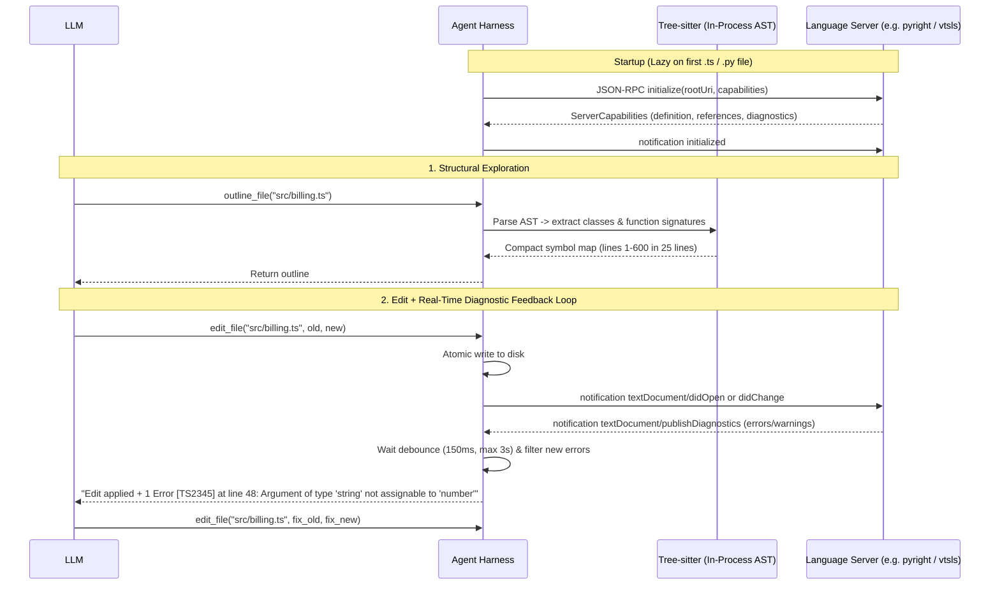
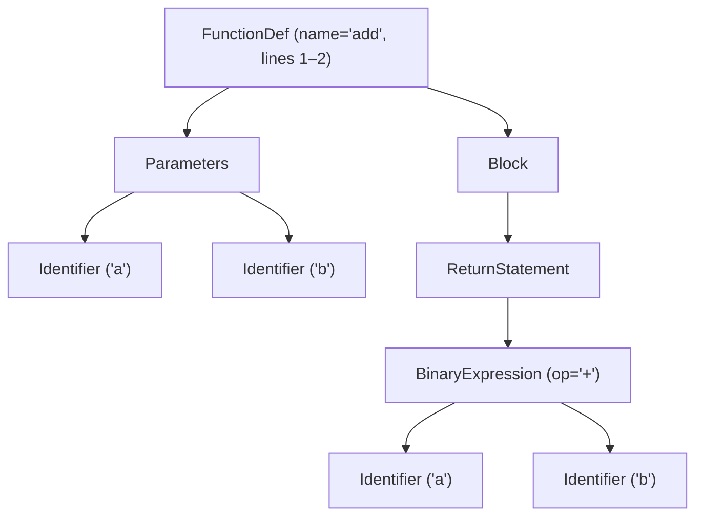

> **Module 3: Tools & Workspace Interaction** | Prerequisites: Chapters 14–15 | Reading Time: ~22 min
>
> [← 15. Codebase Search (Ripgrep, Glob, Semantic Indexing)](./15-codebase-search-ripgrep-glob-semantic-indexing.md) | [Table of Contents](../README.md) | [17. Shell & PTY Session Management →](./17-shell-and-pty-session-management.md)

# 16. AST & Language Server Protocol (LSP) Integration

In Chapters 14 and 15, we gave our agent sharp eyes (`read_file`, `glob`, `ripgrep`) and steady hands (`edit_file`). Yet right now, our agent still sees code the way Notepad sees a grocery list: **as flat lines of plain text**.

Human engineers don't navigate code with `Ctrl+F` alone. When you click *"Go to Definition"* in VS Code, see a red squiggly line appear 150 milliseconds after mistyping a field name, or safely rename `User.save()` without touching `Invoice.save()`, you are relying on **structural code intelligence**: specifically **Abstract Syntax Trees (ASTs)** and the **Language Server Protocol (LSP)**. This chapter shows how harnesses unlock that exact same superpower for AI agents.

---

## 1. The Simple Idea: Ctrl+F vs. Blueprint X-Ray vs. Senior Lawyer

Imagine editing a 500-page set of legal contracts spread across 30 binders:

1. **Plain Text Search (`ripgrep`):** Like running `Ctrl+F` for the word `"Party"`. It finds every time the word appears, in definitions, in footnotes, in *"birthday party"*, and in completely unrelated contracts.
2. **An Abstract Syntax Tree (`AST` / Tree-sitter):** Like putting the contract through an **X-ray grammar scanner**. Instantly you see the exact hierarchy: *Section 4 → Clause 4.2 → Defined Term "Client"*. You can extract a clean Table of Contents of all 30 binders in milliseconds, or immediately notice that someone forgot to close a parenthesis on page 88.
3. **A Language Server (`LSP`):** Like having a **senior lawyer who has already read all 30 binders sitting right beside you**. Point to *any* phrase on page 212 and ask:
   - *"Where is this exact term defined?"* (`goToDefinition`)
   - *"Which clauses across all 30 binders legally depend on THIS specific definition, and NOT the identically named one in Binder 12?"* (`findReferences`)
   - *"Wait: I just changed Clause 4.2. Did I accidentally contradict anything else?"* (`diagnostics`)

**What breaks if you don't have AST or LSP support?**
- Text search returns 400 false-positive hits for common method names like `render`, `init`, `save`, or `config`.
- Agents only discover silly type errors, missing imports, or broken return types *after* waiting 20–60 seconds for a full shell build (`tsc`, `cargo check`, `mypy`), if they remember to run it at all!
- Large files can't be summarized structurally; the agent has to read 800 lines just to discover what functions exist in a module.

---

## 2. Why This Matters in a Real Agent Harness

Adding AST and LSP capabilities transforms a coding agent's reliability in three measurable ways:

1. **Sub-Second Compiler Feedback Loops:** A warm TypeScript, Go, Python, or Rust language server keeps the project's type graph **in memory**. When the agent edits a file, the LSP computes updated type errors in **100–500 milliseconds**: compared to 10–60 seconds for a cold CLI build. Catching a type error inside the `edit_file` response itself lets the agent self-correct immediately before moving on to the next file!
2. **Surgical Symbol Navigation:** Instead of grepping `"process"` and wading through 300 lines of noise, `findReferences` returns *only* the 7 real call sites of `PaymentEngine.process()`, even across aliased imports (`import { process as runPayment }`).
3. **High-Signal Code Compression:** Using Tree-sitter ASTs to show a file's **outline** (class signatures, function headers, and line ranges with bodies hidden) shrinks a 1,000-line file down to ~40 lines, giving the agent a map of the whole repository inside a tiny token budget.

---

## 3. The Big Picture

Notice how **Tree-sitter** runs fast and stateless *inside* the harness process, while a **Language Server** runs as a persistent background child process talking **JSON-RPC 2.0** over standard input/output (`stdio`):



Look at that final turn: **the agent spotted and fixed its own type bug without ever running a slow shell command!**

---

## 4. Deep Dive: Subtopic by Subtopic

### 4.1 Why Text Search Isn't Enough

Consider this tiny TypeScript example:

```ts
// src/db.ts
export class Connection {
  close(force: boolean): void { /* ... */ }
}

// src/modal.ts
export class ModalDialog {
  close(): void { /* ... */ }
}

// src/app.ts
import { Connection as DbConn } from "./db";
const conn = new DbConn();
conn.close(true);          // <-- Real caller of Connection.close
dialog.close();            // <-- Unrelated ModalDialog.close
// Remember to close() it  // <-- Plain comment!
```

Now ask: *"Rename `Connection.close` to `Connection.disconnect` and change `force` from `boolean` to an options object."*
- **`ripgrep` for `close`** returns `ModalDialog.close`, `dialog.close()`, comments, string literals, and 90 other unrelated hits, while *still* failing to tell you whether `conn` in `src/app.ts` is a `Connection` or a `ModalDialog` without tracing the aliased import `Connection as DbConn` and type inference!
- **LSP `findReferences`** uses the language's actual type checker and scope resolver. It returns **only** `src/db.ts:3` and `src/app.ts:14`, with 100% precision.

---

### 4.2 Abstract Syntax Trees (ASTs) and Tree-sitter

An **Abstract Syntax Tree (AST)** is the tree-shaped grammatical representation of source code. For example, `def add(a, b): return a + b` is not 28 characters to a parser: it is a structured tree:



#### Why Tree-sitter Is the Standard in Agent Harnesses
Traditionally, getting an AST meant running each language's own compiler (Python's `ast`, Babel for JS, `go/parser` for Go). **Tree-sitter** changed everything by providing a single, blazingly fast C/Rust parsing engine with community grammars for 100+ programming languages. Three properties make it ideal for harnesses:
1. **Error-Tolerant:** Even if the agent leaves a half-edited file with a missing `}` on line 40, Tree-sitter *still* produces a valid AST for the rest of the file (marking only the broken node as `ERROR`).
2. **Incremental & Fast:** Re-parses a modified file in sub-milliseconds.
3. **Declarative Queries (`.scm`):** You can write short S-expression queries to extract every function/class definition and identifier reference across languages uniformly.

#### Three Killer Uses of ASTs Inside a Harness
1. **File Outlines & Repository Maps:** Parse a file and print only top-level declarations (classes, methods, function signatures, types, and line ranges) while hiding implementation bodies. **Aider's Repo Map** takes this even further: it extracts all symbol definitions and references across the repo using Tree-sitter, builds a directed dependency graph, runs **personalized PageRank** to find the most structurally central symbols for the current conversation, and packs the highest-ranked signatures into a compact token-budgeted overview!
2. **Structural AST Code Chunking:** Instead of chopping files every 500 characters for semantic search ([Chapter 15](./15-codebase-search-ripgrep-glob-semantic-indexing.md)), walk the AST so every chunk is a complete function or class.
3. **Instant Pre-Save Syntax Validation:** Before committing a patch (or right after applying it), parse the updated buffer with Tree-sitter. If the tree contains new `ERROR` or `MISSING` syntax nodes (like an unclosed bracket or indentation syntax error), report the exact line to the LLM immediately, even when no full LSP server is installed!

---

### 4.3 How LSP Works Under the Hood

Before Microsoft introduced the **Language Server Protocol (LSP)** for VS Code in 2016, every editor ($M$ editors) had to re-implement code intelligence for every language ($N$ languages): an $M \times N$ nightmare. LSP turns that into $M + N$: language teams write *one* language server (`pyright`, `typescript-language-server` / `vtsls`, `gopls`, `rust-analyzer`, `clangd`), and any editor, or **AI agent harness**: can act as an **LSP Client**.

#### Wire Framing: JSON-RPC 2.0 Over `stdio`
Your harness spawns the language server as a child process (e.g., `pyright-langserver --stdio`) and exchanges **JSON-RPC 2.0** messages framed with an HTTP-like `Content-Length` header:

```text
Content-Length: 142\r\n
\r\n
{"jsonrpc":"2.0","id":1,"method":"textDocument/definition","params":{"textDocument":{"uri":"file:///repo/src/app.ts"},"position":{"line":13,"character":5}}}
```

There are three message types:
- **Request** (has `"id"`, expects a matching response): e.g., `initialize`, `textDocument/definition`, `textDocument/references`, `textDocument/hover`, `textDocument/documentSymbol`.
- **Response** (matches `"id"`, contains `"result"` or `"error"`).
- **Notification** (no `"id"`, one-way, no reply expected): e.g., `initialized`, `textDocument/didOpen`, `textDocument/didChange`, `textDocument/didSave`, and server-to-client `textDocument/publishDiagnostics`.

#### Core LSP Operations to Expose to an Agent

| Agent Tool / Capability | LSP Method | What It Gives the LLM |
| :--- | :--- | :--- |
| **Go to Definition** | `textDocument/definition` | Exact file + line/col where a function, class, or type is defined. |
| **Find References** | `textDocument/references` | Every real semantic usage of a symbol across the entire workspace. |
| **Hover / Type Info** | `textDocument/hover` | Inferred type signature + docstring of any expression or variable. |
| **File Outline** | `textDocument/documentSymbol` | Hierarchical list of classes, methods, and symbols in a file. |
| **Workspace Symbol Search** | `workspace/symbol` | Fuzzy lookup of symbol definitions by name across the whole repo. |
| **Real-Time Diagnostics** | `textDocument/publishDiagnostics` (push) or `textDocument/diagnostic` (pull, LSP 3.17) | Compiler/type-checker errors and warnings with exact line ranges and error codes (e.g., `TS2322`). |

> **Crucial Indexing Gotcha (0-Based Lines + UTF-16 Columns!):**
> Your `read_file` tool shows humans and LLMs **1-based** line numbers (line 1 is the first line). **LSP is 0-based** (`line: 0` is line 1), and its `character` offset counts **UTF-16 code units** (not UTF-8 bytes or Python characters, so an emoji like `🚀` has length 2 in UTF-16!). Always translate cleanly between 1-based tool arguments and 0-based UTF-16 LSP positions inside your harness so the LLM never has to do off-by-one arithmetic.

---

### 4.4 Closing the Feedback Loop: Real-Time Post-Edit Diagnostics

Exposing `goToDefinition` and `findReferences` as on-demand tools is useful, **but the single highest-leverage LSP feature in a coding harness is automatic post-edit diagnostics.**

Here is why: models often forget to call a separate `get_diagnostics` tool after every small edit. Instead, your harness should wire LSP notifications directly into the end of `edit_file` / `write_file`:

1. **Sync the Modified File (`touchFile`):**
   - If the language server hasn't seen this file yet, send `textDocument/didOpen` with `version: 1` and the full file text.
   - If it *is* already open, increment the monotonic document `version` and send `textDocument/didChange` (plus `textDocument/didSave`, since some servers like `gopls` or `rust-analyzer` trigger full cross-file checks on save).
2. **Wait Smartly (Debounce + Hard Timeout):**
   Because `publishDiagnostics` arrives *asynchronously*, reading your diagnostic cache immediately after `didChange` is a race condition: you will read the *old* diagnostics!
   - Wait for a fresh `publishDiagnostics` notification for that URI (or issue a pull `textDocument/diagnostic` request if the server supports LSP 3.17).
   - Use a short **debounce** (e.g., **150ms** after a diagnostic packet arrives, because servers like TypeScript sometimes emit syntax diagnostics first and type diagnostics 80ms later!).
   - Enforce a strict **hard timeout** (e.g., **2.5–3.0 seconds**) so a slow or warming-up server never stalls the agent turn.
3. **Filter & Format Ruthlessly:**
   A messy legacy file might already have 45 ESLint warnings and 12 deprecation notices. Dumping all 57 into the `edit_file` response creates massive noise!
   - **Severity filter:** Prioritize `Severity = 1 (Error)`. Include `Warning (2)` only if errors are zero or specifically configured; drop `Info (3)` and `Hint (4)`.
   - **Diff-aware / New-error filtering:** Snapshot diagnostics *before* the edit (or note which diagnostics sit near edited lines) so you highlight **newly introduced errors** first.
   - **Cap count:** Show at most ~10–20 errors per file (`... (+14 more errors)`).

**What the LLM Sees Back From `edit_file`:**
```text
Applied 1 edit to src/billing.ts.

LSP Diagnostics (src/billing.ts — 1 error introduced):
  Line 48:12 [error TS2345] Argument of type 'string' is not assignable to parameter of type 'number'.
    48 |   const total = computeTax(subtotalStr, rate);
```
The model sees the exact error code, line, column, and offending code in the very same turn, and immediately repairs it!

---

### 4.5 Managing Language Server Warm-Up, Multi-Language Workspaces, and Memory Overhead

Running language servers inside a CLI or daemon harness introduces real systems-engineering challenges that IDE users rarely think about:

| Challenge | What Happens Naively | Production Harness Solution |
| :--- | :--- | :--- |
| **Cold-Start Warm-Up** | `rust-analyzer` or `jdtls` takes 10–45s to index dependencies; early `findReferences` returns empty `[]`! | Track LSP `$/progress` tokens (`workDoneProgress`). If the server is still indexing, tell the LLM `"LSP server is warming up (45% indexed); falling back to grep or retry shortly"` instead of returning a misleading empty list. |
| **Polyglot Monorepos** | A repo has Python, TypeScript, Go, and Rust. Spawning 4 servers at session start burns 4–8 GB RAM even if the user only edits `README.md`. | **Lazy spawning:** Only start a language server the *first time* the agent opens or edits a file with a matching extension (`.ts`, `.py`, `.go`, `.rs`). |
| **Monorepo Sub-Roots** | Starting one `tsserver` at `/` fails to resolve `packages/web/tsconfig.json`. | Walk upward from the target file to find the nearest **project root marker** (`tsconfig.json`, `pyproject.toml`, `go.mod`, `Cargo.toml`) and key server instances by `(language_id, project_root)`. |
| **Memory Bloat & Zombie Processes** | Long sessions leave 3 idle servers eating 6 GB RAM, or orphaned processes keep running after harness exit. | Implement an **idle eviction timer** (shut down servers untouched for 10–15 minutes), send `shutdown` + `exit` on session close, and bind children to a process group killed on exit ([Chapter 17](./17-shell-and-pty-session-management.md)). |
| **Crashes & Missing Binaries** | User doesn't have `gopls` installed, or `pyright` crashes on a corrupted config. | Degrade gracefully! Never crash the harness. Auto-restart crashed servers with exponential backoff (max 2–3 retries), and if no binary exists, quietly skip LSP diagnostics while keeping AST/Tree-sitter + `ripgrep` working. |

---

## 5. How Real Harnesses Do It

- **Aider (Tree-sitter + PageRank Repository Map):**
  Aider doesn't require installing heavy language servers. Instead, it embeds **Tree-sitter** across dozens of languages, extracts definitions and references using `.scm` tag queries (caching parsed tags in SQLite so only modified files re-parse), builds a directed symbol graph, and runs **personalized PageRank** weighted toward the files currently in chat. It then binary-searches the optimal number of top-ranked signatures to fit cleanly inside a strict token budget (e.g., 1,024 tokens).
- **OpenCode (Built-In LSP Manager with Debounced Diagnostics):**
  OpenCode's LSP module (`touchFile` + `waitForDiagnostics`) automatically spawns configured language servers (such as `typescript-language-server`/`tsgo`, `pyright`, `gopls`, `rust-analyzer`) lazily when files are touched. After edits, it waits with a **150ms debounce and 3-second maximum timeout**, aggregates diagnostics per normalized path, and injects type errors directly into the tool result so the agent self-corrects immediately.
- **Claude Code (Code Intelligence LSP Plugins):**
  Claude Code connects to local language servers via official code-intelligence plugins (`typescript-lsp`, `pyright-lsp`, `gopls-lsp`, `rust-analyzer-lsp`). Once installed alongside the local server binary, Claude gains semantic navigation (`goToDefinition`, `findReferences`, `hover`) plus live type-error diagnostics after edits, while cleanly falling back to `ripgrep`/`glob` in cloud sandboxes where local LSP binaries aren't present.
- **IDE-Native Agents (Cursor, Windsurf, GitHub Copilot):**
  Because they live *inside* VS Code / JetBrains, they don't spawn duplicate language servers: they query the editor's already-warm LSP host directly via IDE extension APIs (`vscode.languages.getDiagnostics`, `vscode.executeReferenceProvider`). This gives zero cold-start latency and shared RAM, though standalone terminal/CI agents must manage LSP lifecycles themselves.

---

## 6. Common Pitfalls & Failure Modes

1. **0-Based vs. 1-Based & UTF-16 Offset Bugs:** Passing line `42` from `read_file` straight to LSP `position.line = 42` queries line **43**! And indexing columns by UTF-8 bytes breaks on lines containing emojis or non-ASCII characters.
   - *Prevention:* Write dedicated `to_lsp_position(line_1based, col_1based, line_text)` and `from_lsp_position(...)` helpers with UTF-16 unit tests.
2. **Returning Empty Results During Cold Start:** A newly spawned `rust-analyzer` responds `[]` to `findReferences` during its first 8 seconds of indexing. The agent concludes *"Nobody calls this function, safe to delete!"* and deletes a critical API!
   - *Prevention:* Track indexing readiness via `$/progress` and explicitly warn the LLM when a server is still warming up.
3. **Diagnostic Flood From Legacy Warnings:** Attaching 80 pre-existing lint warnings to every `edit_file` response wastes thousands of tokens and distracts the model into refactoring unrelated code.
   - *Prevention:* Filter to `Error` severity by default, compute the diff against pre-edit diagnostics when possible, and cap output cleanly.
4. **Forgetting Document Version Synchronization:** Sending `didChange` with a stale or repeated `version` number, or forgetting to send `didOpen` before `didChange`, causes strict language servers to silently ignore your edits and keep reporting errors from the old file!
   - *Prevention:* Maintain a strict per-URI document state machine (`closed` → `open(version=1)` → `open(version=N+1)`).
5. **Wrong Python Virtualenv / Node Resolution:** Launching `pyright` outside the repo's `.venv` produces 50 fake `"Import 'fastapi' could not be resolved"` errors, tricking the agent into trying to reinstall packages or rewrite valid imports.
   - *Prevention:* Detect `.venv`/`node_modules` and pass the workspace interpreter path in LSP `initializationOptions` or `workspace/didChangeConfiguration`.

---

## 7. Build It Yourself: Mini-Lab

Below is a clean, zero-dependency, runnable Python mini-lab (`ast_and_lsp_lab.py`) demonstrating the two core harness mechanisms from this chapter:
1. **AST Outline & Instant Syntax Validation** (using Python's built-in `ast` module: illustrating the exact same outline & syntax-guard pattern Tree-sitter generalizes across 100+ languages).
2. **LSP JSON-RPC Wire Framing, UTF-16 Position Conversion, and Filtered Post-Edit Diagnostic Formatting**: including a runnable round-trip simulation!

```python
"""ast_and_lsp_lab.py — AST outline/validator + LSP JSON-RPC framing & diagnostics loop."""

from __future__ import annotations

import ast
import io
import json
from dataclasses import dataclass


# --- Part 1: AST Outline & Syntax Validation (same pattern as Tree-sitter) ---

def ast_outline_python(source: str) -> str:
    """Return a compact structural outline of classes & functions, or instant syntax error."""
    try:
        tree = ast.parse(source)
    except SyntaxError as exc:
        return f"SyntaxError at line {exc.lineno}, col {exc.offset}: {exc.msg}"

    lines: list[str] = []
    for node in tree.body:
        if isinstance(node, ast.ClassDef):
            lines.append(f"class {node.name}  [lines {node.lineno}-{node.end_lineno}]")
            for item in node.body:
                if isinstance(item, (ast.FunctionDef, ast.AsyncFunctionDef)):
                    args = [a.arg for a in item.args.args]
                    prefix = "async def" if isinstance(item, ast.AsyncFunctionDef) else "def"
                    lines.append(
                        f"  {prefix} {item.name}({', '.join(args)})  "
                        f"[lines {item.lineno}-{item.end_lineno}]"
                    )
        elif isinstance(node, (ast.FunctionDef, ast.AsyncFunctionDef)):
            args = [a.arg for a in node.args.args]
            prefix = "async def" if isinstance(node, ast.AsyncFunctionDef) else "def"
            lines.append(
                f"{prefix} {node.name}({', '.join(args)})  "
                f"[lines {node.lineno}-{node.end_lineno}]"
            )
    return "\n".join(lines) if lines else "(no top-level classes or functions)"


# --- Part 2: LSP JSON-RPC Framing & UTF-16 Coordinate Translation ---

def encode_lsp_message(payload: dict) -> bytes:
    """Frame a JSON-RPC payload with LSP Content-Length headers."""
    body = json.dumps(payload, separators=(",", ":")).encode("utf-8")
    header = f"Content-Length: {len(body)}\r\n\r\n".encode("ascii")
    return header + body


def read_lsp_message(stream: io.BufferedIOBase) -> dict | None:
    """Read one Content-Length framed JSON-RPC message from a binary stream."""
    content_length: int | None = None
    while True:
        header_line = stream.readline()
        if not header_line:
            return None  # EOF
        if header_line in (b"\r\n", b"\n"):
            break
        key, _, value = header_line.decode("ascii").partition(":")
        if key.strip().lower() == "content-length":
            content_length = int(value.strip())
    if content_length is None:
        raise ValueError("Missing Content-Length header in LSP frame")
    raw_body = stream.read(content_length)
    return json.loads(raw_body.decode("utf-8"))


def to_lsp_position(line_1based: int, col_1based: int, line_text: str) -> dict[str, int]:
    """Convert 1-based human/LLM position to 0-based LSP line + UTF-16 code-unit offset."""
    prefix = line_text[: max(0, col_1based - 1)]
    utf16_col = len(prefix.encode("utf-16-le")) // 2
    return {"line": max(0, line_1based - 1), "character": utf16_col}


# --- Part 3: Filtering & Formatting LSP Diagnostics for Post-Edit Feedback ---

@dataclass(frozen=True)
class Diagnostic:
    line_1based: int
    col_1based: int
    severity: int  # 1=Error, 2=Warning, 3=Info, 4=Hint
    code: str
    message: str


def parse_publish_diagnostics(notification: dict) -> list[Diagnostic]:
    """Convert raw LSP textDocument/publishDiagnostics payload into Diagnostic objects."""
    out: list[Diagnostic] = []
    for d in notification.get("params", {}).get("diagnostics", []):
        start = d["range"]["start"]
        out.append(
            Diagnostic(
                line_1based=start["line"] + 1,
                col_1based=start["character"] + 1,
                severity=int(d.get("severity", 1)),
                code=str(d.get("code", "")),
                message=d.get("message", "").strip(),
            )
        )
    return out


def format_diagnostics_for_llm(
    file_path: str,
    before: list[Diagnostic],
    after: list[Diagnostic],
    max_errors: int = 10,
) -> str:
    """Surface errors cleanly, prioritizing newly introduced errors over pre-existing noise."""
    errors_after = [d for d in after if d.severity == 1]
    if not errors_after:
        return f"LSP Diagnostics ({file_path}): 0 errors."

    before_set = {(d.code, d.message) for d in before if d.severity == 1}
    new_errors = [d for d in errors_after if (d.code, d.message) not in before_set]
    prioritized = new_errors + [d for d in errors_after if d not in new_errors]

    lines = [
        f"LSP Diagnostics ({file_path} — {len(errors_after)} error(s), {len(new_errors)} new):"
    ]
    for diag in prioritized[:max_errors]:
        tag = f" {diag.code}" if diag.code else ""
        marker = " [NEW]" if diag in new_errors else ""
        lines.append(
            f"  Line {diag.line_1based}:{diag.col_1based} [error{tag}]{marker} {diag.message}"
        )
    if len(prioritized) > max_errors:
        lines.append(f"  ... (+{len(prioritized) - max_errors} more errors omitted)")
    return "\n".join(lines)


if __name__ == "__main__":
    sample_code = (
        "class PaymentEngine:\n"
        "    def charge(self, amount_cents: int) -> bool:\n"
        "        return amount_cents > 0\n\n"
        "def format_receipt(total: int) -> str:\n"
        "    return f'${total / 100:.2f}'\n"
    )
    print("=== AST Outline ===")
    print(ast_outline_python(sample_code))

    # Verify UTF-16 offset handling when an emoji precedes a symbol
    emoji_line = "msg = '🚀' + user_name"
    pos = to_lsp_position(line_1based=1, col_1based=13, line_text=emoji_line)
    assert pos == {"line": 0, "character": 13}, f"Unexpected UTF-16 offset: {pos}"

    # Verify JSON-RPC LSP framing round-trip + post-edit diagnostic filtering
    lsp_notification = {
        "jsonrpc": "2.0",
        "method": "textDocument/publishDiagnostics",
        "params": {
            "uri": "file:///repo/src/billing.ts",
            "diagnostics": [
                {
                    "range": {"start": {"line": 10, "character": 2}, "end": {"line": 10, "character": 8}},
                    "severity": 2,
                    "code": "TS6133",
                    "message": "'unusedVar' is declared but its value is never read.",
                },
                {
                    "range": {"start": {"line": 47, "character": 11}, "end": {"line": 47, "character": 22}},
                    "severity": 1,
                    "code": "TS2345",
                    "message": "Argument of type 'string' is not assignable to parameter of type 'number'.",
                },
            ],
        },
    }
    wire = encode_lsp_message(lsp_notification)
    decoded = read_lsp_message(io.BytesIO(wire))
    assert decoded == lsp_notification

    print("\n=== Post-Edit Filtered LSP Diagnostics ===")
    parsed = parse_publish_diagnostics(decoded)
    print(format_diagnostics_for_llm("src/billing.ts", before=[], after=parsed))
```

Notice how `to_lsp_position` handles the rocket emoji `🚀`: Python counts it as 1 character, so index 12 (`col_1based=13`) becomes UTF-16 character **13** (`11 ASCII chars + 2 UTF-16 code units`). Catching that detail prevents bizarre column drift in real repositories!

---

## 8. Key Takeaways & Quick Self-Check

- **Text search cannot understand scope or types:** Method collisions, aliased imports, and type mismatches require AST and LSP intelligence.
- **Tree-sitter gives fast, zero-setup structural power:** Use it in-process for compact file outlines, PageRank repo maps, AST-aligned code chunking, and instant syntax checks, even on half-written code.
- **LSP connects your harness to real compilers:** Speak JSON-RPC 2.0 (`Content-Length` framing) over `stdio` for `goToDefinition`, `findReferences`, `hover`, and live `diagnostics`; translating carefully between 1-based human coordinates and 0-based UTF-16 LSP coordinates.
- **Close the edit-diagnostic loop automatically:** Push `didOpen`/`didChange` after every file edit, wait with a smart debounce + hard timeout (e.g., 150ms / 3s), filter to errors (especially newly introduced ones), and attach them right inside the `edit_file` response.
- **Engineer for resource reality:** Spawn language servers lazily per `(language, project_root)`, surface warm-up progress honestly, evict idle servers to save RAM, and degrade gracefully when binaries are missing.

### Quick Self-Check

1. **What is the key difference between what Tree-sitter (AST) can tell an agent versus what a Language Server (LSP) can tell an agent?**
   <details>
   <summary>Show Answer</summary>
   Tree-sitter parses the *syntax* of individual files super fast (great for outlines, AST chunking, and syntax errors), but it does not resolve cross-file types, imports, or inheritance. An LSP runs the language's semantic analyzer and type checker across the whole project, answering cross-file questions like `goToDefinition`, `findReferences` for a specific class method, inferred `hover` types, and type-mismatch diagnostics.
   </details>

2. **Why does a harness like OpenCode use both a short debounce (e.g., 150ms) and a hard timeout (e.g., 3s) after sending `didChange` to a language server?**
   <details>
   <summary>Show Answer</summary>
   Language servers compute diagnostics asynchronously, and often emit fast syntax checks first, followed ~50–150ms later by full type-checker diagnostics. Reading immediately causes a race condition (stale or empty diagnostics), while waiting without a timeout could hang the agent turn if the server is busy indexing a huge workspace. A debounce + hard cap balances accuracy with responsiveness.
   </details>

3. **Why is it dangerous to return an empty `[]` from `findReferences` while a language server like `rust-analyzer` is still warming up?**
   <details>
   <summary>Show Answer</summary>
   An agent that sees `0 references` may believe a function or type is dead code and safely delete or change its signature, breaking dozens of real callers across the workspace. The harness should monitor LSP `$/progress` notifications and explicitly tell the model when the server is still indexing.
   </details>

4. **Why should a multi-language harness spawn language servers *lazily* per `(language, project_root)` instead of launching all installed servers at startup?**
   <details>
   <summary>Show Answer</summary>
   Language servers (especially for Rust, Java, C++, and large TypeScript monorepos) can consume 1–4 GB of RAM each and spike CPU during startup indexing. Lazy spawning avoids wasting memory and startup latency on languages the user never touches in that session, while keying by project root ensures monorepo sub-packages load their own `tsconfig.json` / `pyproject.toml` properly.
   </details>

---

[← 15. Codebase Search (Ripgrep, Glob, Semantic Indexing)](./15-codebase-search-ripgrep-glob-semantic-indexing.md) | [Table of Contents](../README.md) | [17. Shell & PTY Session Management →](./17-shell-and-pty-session-management.md)
