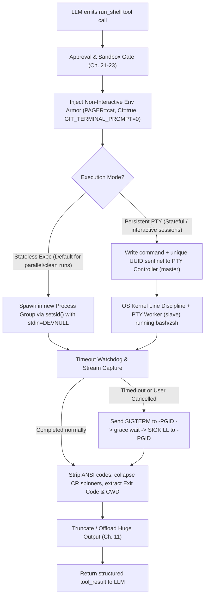

> **Module 3: Tools & Workspace Interaction** | Prerequisites: Module 1 & Chapter 14 | Reading Time: ~20 min
>
> [← 16. AST & Language Server Protocol (LSP) Integration](./16-ast-and-language-server-protocol-lsp-integration.md) | [Table of Contents](../README.md) | [18. Background Processes & Async Notifications →](./18-background-processes-and-async-notifications.md)

# 17. Shell & PTY Session Management

Reading files and editing code only get an agent halfway to solving real software problems. To actually *know* whether a fix works, an agent needs to run compilers, execute test suites, inspect `git status`, install packages, and start local servers. That means giving the agent a **shell tool**—and suddenly, your neat, clean JSON-in/JSON-out harness is face-to-face with fifty years of quirky Unix and Windows terminal behavior.

Running a shell command looks deceptively simple: one call to `subprocess.run()` or `child_process.exec()`, right? In practice, naive shell execution is one of the fastest ways to freeze an agent, burn thousands of tokens on unreadable escape characters, or leave invisible orphan processes eating your laptop's RAM and ports long after the agent finishes.

---

## 1. The Simple Idea: Passing Notes Through a Slot vs. Sitting at a Live Workbench

Imagine two ways to ask a mechanic in a garage to inspect your car:

1. **Passing notes through a mail slot (Stateless `exec`):** Every time you slide a note under the door—*"Walk into the garage and open the hood"*—a brand-new mechanic spawns inside the garage, opens the hood, writes down what they saw, and vanishes. When you slide your next note—*"Now check the oil dipstick"*—another brand-new mechanic appears back at the front door with no memory of where the first mechanic was standing or which toolbox they opened.
2. **A live two-way intercom to one mechanic at the workbench (Persistent PTY):** You open a single live voice line. You say *"Step over to the `backend/` bay and activate the Python toolkit."* The mechanic stays right there, holding those tools, ready for your next instruction. They can even answer interactive questions—like *"Are you sure you want to overwrite this config? (y/n)"*—because the line stays open both ways.

Both models are useful, and both have sharp edges!

**What breaks if you don't engineer shell and terminal sessions carefully?**
- **Silent amnesia:** The agent runs `cd services/api`, then runs `pytest`, and wonders why `pytest` ran in the repo root and found zero tests.
- **Forever hangs:** The agent runs `git log` or `git fetch`. Behind the scenes, `git` opens `less` (waiting for you to press `q`) or asks for your GitHub password. There is no human at the keyboard—so the tool sits frozen until the timeout fires two minutes later.
- **Garbled context windows:** A colorful test runner outputs thousands of invisible ANSI color codes and `\r` progress-bar redraws, drowning out the actual error message and wasting tokens.
- **Zombie and orphan leaks:** A test runner times out. Your harness kills the outer `bash` process, but the `node` or `python` worker processes it spawned keep running in the background forever, locking port `3000` so the next test run fails with `EADDRINUSE`.

---

## 2. Why This Matters in a Real Agent Harness

In production coding agents, the shell tool is the ultimate escape hatch and verification engine. How you run it directly shapes four pillars of harness quality:

- **Reliability & Self-Correction:** Compilers and test suites are the strongest ground-truth signal an agent has. If `PATH` is missing `node` or `pytest`, or if `git` hangs on a pager, the agent loses its ability to verify its own work.
- **Latency:** Every accidental interactive hang costs 30 to 120 seconds of dead wall-clock time while the user stares at a frozen spinner. Designing commands to **fail fast instead of hang** turns a 2-minute freeze into a 50-millisecond error the model fixes immediately.
- **Token Efficiency:** Raw terminal output is built for human eyes, not LLM tokenizers. Stripping ANSI formatting, collapsing carriage-return progress spinners, and returning structured exit metadata keeps the context window clean and focused (working hand-in-hand with Chapter 11's truncation pipeline).
- **Host Hygiene & Safety:** Every spawned shell can spawn grandchildren and great-grandchildren. Without **process groups**, a cancelled or timed-out command leaks stray build processes, database locks, and bound TCP ports across the user's machine.

---

## 3. The Big Picture

Below is the complete architecture of a production shell execution layer, showing the two execution engines (**stateless subprocess** vs. **persistent PTY**) wrapped inside the same protective harness shell:



Notice the core design principle: **never give the LLM raw, unguarded OS process spawning.** Every command passes through environment armor, process-group isolation, timeout enforcement, output sanitization, and structured exit reporting.

---

## 4. Deep Dive: Subtopic by Subtopic

### 4.1 Stateless Subprocess (`exec`) vs. Persistent Interactive Pseudo-Terminal (`PTY`)

When your harness runs a command like `pytest tests/test_auth.py`, it must choose between two fundamentally different execution models:

1. **Stateless Subprocess (`exec` / `spawn`):** Each tool call launches a fresh OS process connected to your harness via standard pipes (`stdin`, `stdout`, `stderr`). When the command exits, the process dies. Any `cd`, `export FOO=bar`, or `source .venv/bin/activate` disappears with it.
2. **Persistent Interactive PTY:** Your harness spawns a single long-lived shell (`bash` or `zsh`) attached to a **Pseudo-Terminal** when the session begins. Each tool call writes text into that live shell and reads back everything printed until the command finishes. Working directories, shell variables, virtual environments, and shell functions persist from one call to the next.

| Dimension | Stateless Subprocess (`exec`) | Persistent Interactive PTY |
| :--- | :--- | :--- |
| **State persistence (`cd`, `export`, `venv`)** | None by default (must pass `cwd` / `env` explicitly or chain with `&&`). | Built-in—feels just like a human's terminal tab. |
| **Parallel tool calls (Ch. 04)** | **Safe & natural:** two calls run in two independent processes simultaneously. | **Serialized / tricky:** two commands writing into one shared PTY scramble each other's output. |
| **Command boundary & exit code detection** | **Exact:** the OS kernel tells you the exact moment the process exits and gives you its integer exit code. | **Heuristic/Sentinel-based:** the shell never exits, so you must inject a unique sentinel string (e.g., `echo "__DONE_<uuid>__:$?"`) and parse the stream. |
| **Interactive programs (`ssh`, REPLs, TUIs)** | Usually fail or refuse to run because `isatty()` is `false`. | Supported—programs see a real terminal and can receive follow-up keystrokes. |
| **Output buffering** | Many runtimes (Python, C `stdio`) switch to 4–8 KB block buffering over pipes, delaying live output. | Line-buffered by default—output flushes immediately line by line. |
| **Failure blast radius** | Self-contained: a wedged command only kills that one subprocess. | Shared: a syntax error (like an unclosed quote `echo "oops`) or hung foreground job can wedge the entire shell session until reset. |

**How do real harnesses choose?**
Many modern harnesses use a **hybrid strategy**:
- Use **stateless subprocesses** (with an explicit `cwd` parameter and cached startup environment snapshot) for ordinary one-shot commands so parallel execution is safe and exit codes are 100% exact.
- Spin up a **PTY session** (either as a dedicated interactive session manager or on demand) when the agent needs persistent terminal state, interactive prompts, or live terminal fidelity.

> **Why naive `cd` surprises agents:** If your shell tool is stateless, say so explicitly in the tool description (*"Each command runs in a fresh session; `cd` and `export` do not persist across calls"*), or accept an explicit `workdir` argument on every call. Otherwise, the model will burn turns running `cd backend` on turn 1 and `pytest` on turn 2!

---

### 4.2 What a PTY Is in Plain English

You will hear systems engineers throw around acronyms like **TTY**, **PTY**, **ANSI**, and **`isatty()`**. They sound intimidating, but the concept is delightfully simple.

Back in the 1960s, a **TTY** (**Teletypewriter**) was a physical keyboard-and-printer machine wired to a mainframe computer. Today, there is no physical teletype—just a terminal app (like iTerm2, Ghostty, VS Code's terminal, or your agent harness). To keep fifty years of Unix programs happy, the operating system provides a **PTY** (**Pseudo-Terminal**): a fake, software-only terminal made of two connected halves inside the kernel.

```text
+----------------------+          OS Kernel           +---------------------------+
|   Your Agent Harness |                              |  Shell / Child Command    |
|                      |   write() ->  +-----------+  |                           |
|   PTY Controller     |==============>|   Line    |==|  PTY Worker (slave)       |
|   (formerly "master")|<==============| Discipline|<=|  (/dev/pts/4 or /dev/ttys)|
|                      |   <- read()   +-----------+  |  stdin(0) stdout(1) err(2)|
+----------------------+                              +---------------------------+
```

Here are the four pieces every harness engineer should understand:

1. **The Three Standard Streams (`stdin`, `stdout`, `stderr`):**
   - **File Descriptor `0` (`stdin`):** Input fed *into* the program (keyboard typing or piped text).
   - **File Descriptor `1` (`stdout`):** Normal output printed by the program.
   - **File Descriptor `2` (`stderr`):** Error messages, warnings, and progress logs.
   - *Subtle PTY detail:* With plain pipes, `stdout` and `stderr` are completely separate streams. With a single PTY, both `stdout` and `stderr` are usually wired to the same PTY worker device, meaning they arrive **merged in chronological order**—just like on your screen—at the cost of losing strict `stdout`-vs.-`stderr` separation.

2. **`isatty()` and Output Buffering:**
   Programs frequently ask the OS: *"Am I talking to a real terminal (`isatty(1) == true`) or a plain pipe (`isatty(1) == false`)?"*
   - Over a **PTY** (`isatty == true`), programs assume a human is watching live. They flush output after every newline, print colored diffs, draw progress bars, and may open pagers or ask interactive questions.
   - Over a **pipe** (`isatty == false`), C's `stdio` and Python switch to **full block buffering** (holding back output in 4 KB–8 KB chunks until the buffer fills or the program exits). That is why a long Python script running over a pipe can appear totally silent for 30 seconds unless you pass `PYTHONUNBUFFERED=1` or use a PTY!

3. **TTY Modes and Window Size:**
   Inside the kernel sits the **line discipline**, which translates keystrokes (`Ctrl+C` becomes `SIGINT`; `Backspace` erases characters; `\n` turns into `\r\n`). In **canonical (cooked) mode**, it waits for Enter before handing a line to the program. In **raw mode** (used by `vim`, `fzf`, or interactive menus), every single keypress is delivered immediately. A PTY also has a virtual screen width and height (rows × columns, e.g., `24×120` set via `TIOCSWINSZ`). If you leave the width at `80` columns—or worse, `0`—tools like `pytest` and `rich` wrap tables awkwardly or crash.

4. **ANSI Escape Codes and Carriage Returns (`\r`):**
   Terminals render colors, bold text, and animated spinners using invisible control sequences starting with the Escape byte (`\x1b`, often printed as `^[[`).

   Look at what a real `pytest` or `npm` run actually sends over a PTY vs. what your LLM should see:

   ```text
   RAW PTY STREAM (noisy, wastes ~2.5x tokens, confuses regex/string matching):
   \x1b[?25l⠋ Installing packages...\r⠙ Installing packages...\r\x1b[2K\x1b[32m✓\x1b[0m \x1b[1mDone in 1.4s\x1b[0m\r\n
   \x1b[31mFAILED\x1b[0m tests/test_auth.py::\x1b[1mtest_token_expiry\x1b[0m\r\n

   CLEANED HARNESS OUTPUT (fed to the LLM):
   ✓ Done in 1.4s
   FAILED tests/test_auth.py::test_token_expiry
   ```

   > **Rule of thumb:** Keep raw ANSI bytes if you are rendering them to a human's TUI panel (Ch. 34), **but always strip ANSI escape sequences and normalize `\r` line overwrites before putting tool output into the LLM's context window.**

---

### 4.3 Working Directory, Environment Variables, Exit Codes, and `PATH` Inheritance

Have you ever seen a user say *"Works fine in my terminal, why does the agent say `command not found: node`?"* That classic bug comes from how Unix shells load startup files.

#### The `PATH` Inheritance Trap
When you open a terminal window on macOS or Linux, your terminal starts a **login** and/or **interactive** shell (`zsh -l -i` or `bash -l -i`). That shell reads `~/.zprofile`, `~/.zshrc`, or `~/.bashrc`, which run version managers like `nvm`, `pyenv`, `mise`, `asdf`, `rbenv`, and add `/opt/homebrew/bin` or `~/.cargo/bin` to `$PATH`.

When your harness naively runs `subprocess.run(["/bin/sh", "-c", "node -v"])`:
- `/bin/sh` is **non-login** and **non-interactive**.
- It skips `~/.zshrc` and `~/.bashrc` completely!
- Its `$PATH` is often just `/usr/bin:/bin`, so `node`, `pytest`, `cargo`, `go`, and `rg` all fail with exit code `127` (`command not found`).

**How production harnesses fix this cleanly:**
1. **Inherit the parent CLI's environment** when launched from the user's terminal—it already has their initialized `$PATH` and active virtual environment.
2. **One-time login shell snapshot** (for desktop apps, IDEs, or daemons launched outside a terminal): at session startup, run the user's login shell *once* (`zsh -l -i -c 'env -0'`), parse the null-delimited environment variables, filter out unsafe or noisy entries, and cache that snapshot for the rest of the session. Running `-l -i` on *every* tool call is painfully slow (often 300–800ms per command if the user has Oh My Zsh or `conda init`!), whereas snapshotting once amortizes that cost to zero.

#### Working Directory (`cwd`) Tracking & Workspace Guardrails
In a persistent PTY, the working directory can change silently after any command (`cd subdir && make`). Your harness should:
- **Report the current `cwd` back to the model** when it changes, or always show it in tool metadata, so the agent never loses track of where it is.
- **Guard against unintended CWD drift:** if the agent starts in `/workspace/my-app`, temporarily inspects `/tmp/logs`, and forgets to `cd` back, a later `git reset` or relative file path can hit the wrong directory. Many harnesses explicitly reset or validate `cwd` against the workspace root unless a command intentionally targets another path.

#### Exit Codes: Truth Serum for Agents
Every Unix command ends with an integer **exit code** from `0` to `255`:
- **`0`**: Success.
- **`1`–`125`**: Command-specific failure (failing test, compiler error, missing file).
- **`126`**: Command found, but not executable (permission denied).
- **`127`**: Command not found (usually a `$PATH` issue or missing binary).
- **`128 + N`**: Terminated by signal `N`—for example, `130` (`128 + 2`, `SIGINT` / Ctrl+C), `137` (`128 + 9`, `SIGKILL` / out-of-memory killer or hard timeout), `143` (`128 + 15`, `SIGTERM`).

Always return the **exact exit code** explicitly in your tool result (even when output is empty!). Consider `grep "DEPRECATED" src/`: when it finds zero matches, it prints nothing and returns exit code `1`. Without the exit code, the agent cannot tell the difference between "zero matches" and "silent crash."

#### Sentinel Framing in a Persistent PTY
Because a persistent bash shell never exits between commands, how do you know *when* a command finished and what its `$?` exit code and `$PWD` are? You wrap the command with a **unique per-command sentinel**:

```bash
# What the harness actually writes into the persistent PTY:
{ <user_command>; }
__rc=$?
printf '\n__HARNESS_END_9f3c2a1b__:%d:%s__\n' "$__rc" "$PWD"
```

When the harness reads `__HARNESS_END_9f3c2a1b__:0:/workspace/app__` from the PTY stream:
1. It knows the command is finished.
2. It extracts exit code `0` and updated working directory `/workspace/app`.
3. It strips the sentinel line before handing the captured output to the LLM.

Using a fresh random UUID/hex suffix per command guarantees that normal command output—or even a malicious file containing a hardcoded sentinel string—cannot spoof early command completion!

---

### 4.4 Handling Interactive Hang Traps

The single most common failure in homegrown coding agents is the **interactive hang**: the agent runs a completely normal developer command, and the command silently pauses waiting for a human to press a key.

Here are the classic hang traps and the exact environment variables and flags—your **Non-Interactive Armor Kit**—that neutralize them:

| Hang Trap | Why It Freezes | Harness Defense (Env Var / Config) |
| :--- | :--- | :--- |
| **Pagers (`git log`, `git diff`, `man`, `kubectl`)** | Spawns `less` or `more`, which waits forever for `SPACE` / `q`. | `PAGER=cat`, `GIT_PAGER=cat`, `MANPAGER=cat`, `LESS=-FRX` |
| **Git auth & commit editors (`git push`, `git commit`, `git rebase`)** | Prompts `Username for 'https://github.com':` or opens `vim`/`nano` for a commit message. | `GIT_TERMINAL_PROMPT=0`, `GIT_EDITOR=true`, `EDITOR=true`, `VISUAL=true` |
| **JS/Node CLIs (`npx`, `npm`, `vitest`, `jest`, `create-*`)** | Asks `Need to install the following packages: Ok to proceed? (y)` or enters watch mode (`vitest`). | `CI=true`, `NPM_CONFIG_YES=true`, `YARN_ENABLE_IMMUTABLE_INSTALLS=false` |
| **System package installers (`apt-get`, `pip`, `brew`)** | Prompts for timezone, service restarts, or PyPI credentials. | `DEBIAN_FRONTEND=noninteractive`, `PIP_NO_INPUT=1`, `HOMEBREW_NO_AUTO_UPDATE=1` |
| **SSH / `git clone ssh://`** | Prompts `Are you sure you want to continue connecting (yes/no)?` or passphrase. | `GIT_SSH_COMMAND="ssh -o BatchMode=yes"` |
| **`sudo` password prompts** | Waits for password input on `/dev/tty`. | Never allow blind `sudo`; if needed, check `sudo -n` (non-interactive, fails immediately if password required). |
| **ANSI color & fancy TUIs** | Prints cursor-repositioning escape codes that break log parsing. | `NO_COLOR=1`, `FORCE_COLOR=0`, `TERM=dumb` (when not needing TTY rendering). |

#### Closing `stdin` (`DEVNULL`) as a Second Safety Net
For non-interactive subprocess runs, always connect `stdin` to `/dev/null` (`subprocess.DEVNULL` in Python, `stdio: ['ignore', 'pipe', 'pipe']` in Node.js). When a CLI tries to read a `y/n` confirmation from `stdin`, it immediately receives `EOF` (End-of-File) instead of blocking until the timeout expires!

#### What About `CI=true` Side Effects?
Setting `CI=true` is magic for disabling watch modes (e.g., `vitest` and `react-scripts test` run once and exit instead of watching forever) and suppressing interactive prompts. Just be aware of one quirk: a few build tools (like Create React App or Next.js linters) treat ESLint warnings as fatal errors when `CI=true`. Documenting that behavior—or letting users override env vars per project—avoids head-scratching surprises.

---

### 4.5 Timeouts, Process Groups (`PGID`), and Cleanly Killing Child Process Trees

Suppose the agent runs `npm test`, which starts an infinite loop inside a test worker. Your 30-second timeout fires. You call `proc.kill()`. Problem solved, right?

**Wrong.** Look at the actual process tree that `sh -c "npm test"` created:

```text
Agent Harness (PID 500, PGID 500)
  └── /bin/bash -c "npm test" (PID 1000, PGID 1000)   <-- proc.kill() ONLY kills this!
        └── npm test          (PID 1001, PGID 1000)   <-- STILL ALIVE (orphaned -> PID 1)
              └── node vitest (PID 1002, PGID 1000)   <-- STILL ALIVE (holding port 5173!)
                    └── worker(PID 1003, PGID 1000)   <-- STILL ALIVE (burning 100% CPU!)
```

When you kill only PID `1000`, the operating system **reparents** PIDs `1001`, `1002`, and `1003` to PID `1` (`init`/`launchd`). They become **orphan processes**—invisible to your harness, still consuming CPU, still holding open file handles (which can even keep your `stdout` pipe open so your harness *still* hangs waiting for EOF!), and still binding localhost ports.

#### The Solution: Sessions (`setsid`) and Process Groups (`PGID`)
In Unix (macOS and Linux), every process belongs to a **Process Group**, identified by a **Process Group ID (`PGID`)**.
- When you spawn a command with **`setsid()`** (Python: `start_new_session=True`; Node.js: `detached: true`; Rust: `setsid()` in `pre_exec`), the child becomes the leader of a brand-new session and a brand-new process group whose `PGID` equals the child's `PID` (e.g., `PGID = 1000`).
- Every child, grandchild, and worker spawned by that command **inherits `PGID = 1000` automatically**.
- Crucially, `setsid()` also **detaches the command from your harness's controlling terminal**, so it cannot hijack your user's keyboard or send stray `SIGTSTP` stop signals to the harness UI.

Now, when a timeout or cancellation occurs, you kill the **entire process group at once** using the **negative PGID** (`os.killpg(pgid, sig)` or `kill(-pgid, sig)`):

1. **Step 1 — Graceful `SIGTERM` to `-PGID`:** Tells the entire tree *"please shut down cleanly"*—giving databases, lockfiles (`.git/index.lock`), and temporary files a chance to clean up.
2. **Step 2 — Short grace period (e.g., 2 to 5 seconds):** Wait for the process group to exit cleanly.
3. **Step 3 — Forced `SIGKILL` to `-PGID`:** If anything ignored `SIGTERM` (very common for wedged native code or signal-trapping scripts), `SIGKILL` cannot be caught or ignored by any process—the kernel terminates every member of the group instantly.
4. **Step 4 — Reap the child (`wait()`):** Always call `proc.wait()` after killing so the dead process entry doesn't linger in the kernel process table as a **zombie (`Z` state)**.

> **Cross-platform note (Windows):** Windows does not have Unix `PGID`s. On Windows, production harnesses assign each spawned subprocess to a **Windows Job Object** configured with `JOB_OBJECT_LIMIT_KILL_ON_JOB_CLOSE` (or fall back to `taskkill /PID <pid> /T /F` to terminate the full `/T` tree). Closing the Job Object handle cleanly kills the entire descendant tree—even if the harness itself crashes.

---

## 5. How Real Harnesses Do It

Real-world coding agents have converged on surprisingly clear, battle-tested shell architectures—each reflecting deliberate trade-offs:

- **OpenAI Codex CLI (`unified_exec`):**
  Codex CLI replaced split subprocess/shell paths with a dedicated PTY-based subsystem called `unified_exec`. It allocates interactive pseudo-terminals so shell commands behave like real developer terminals, wires execution directly through sandbox policies (Seatbelt on macOS, Landlock/seccomp on Linux) and approval gates, and tracks live background terminals via built-in controls like `/ps` and `/stop`.
- **Claude Code (Bash Tool):**
  Claude Code captures a shell environment snapshot (stored under `~/.claude/shell-snapshots/`) so the user's `PATH`, aliases, and functions are available without paying full interactive shell startup overhead on every command. At the same time, it enforces strict workspace-boundary CWD safety (preventing silent drift outside the project root across tool calls) and steers the agent toward explicit compound commands (`cd subdir && ...`) or direct virtualenv binaries (`.venv/bin/python`) rather than fragile implicit state.
- **SWE-agent & SWE-ReX (`LocalRuntime` / `RemoteRuntime`):**
  Built for autonomous benchmark and container workflows, SWE-ReX maintains a **persistent bash PTY session** using Python's `pexpect`. It injects sentinel prompt patterns to detect exact command completion, extracts `$?` exit codes into structured error types, and exposes the exact same `run_in_session()` interface whether running locally or across an HTTP boundary inside Docker/Modal/cloud sandboxes.
- **Gemini CLI (`run_shell_command`):**
  Gemini CLI uses `node-pty` by default (`tools.shell.enableInteractiveShell: true`) so interactive programs and ANSI terminal colors work natively in the CLI UI, while gracefully falling back to Node's standard `child_process` pipes on platforms where native `node-pty` bindings cannot load.

---

## 6. Common Pitfalls & Failure Modes

1. **Killing `proc.pid` instead of `-PGID`:**
   *Symptom:* A timed-out `npm run dev` or `pytest` stops returning, yet port `3000` stays occupied and CPU fan roars.
   *Fix:* Always spawn with `start_new_session=True` / `detached: true` and signal the entire process group (`SIGTERM` → grace period → `SIGKILL`).

2. **Leaking open `stdout`/`stderr` pipes from backgrounded grandchildren:**
   *Symptom:* The command ran `server &` and exited in 50ms, yet `subprocess.communicate()` hangs forever until timeout!
   *Why:* The grandchild inherited the open `stdout`/`stderr` pipe file descriptors, so your harness never sees `EOF`.
   *Fix:* Read streams asynchronously with an explicit process-exit check + short drain timeout rather than blocking forever on pipe EOF, and manage background servers explicitly (Chapter 18).

3. **Dumping raw ANSI codes and `\r` spinners into the LLM prompt:**
   *Symptom:* A 5-second `npm install` or `cargo build` consumes 12,000 tokens of `\x1b[1A\x1b[2K` cursor movements and `Downloading [====>   ]` frames.
   *Fix:* Strip ANSI CSI/OSC escape sequences and simulate `\r` line overwrites before returning output to the model.

4. **Parallel tool calls sharing a single persistent PTY:**
   *Symptom:* The LLM invokes `git status` and `pytest` in parallel (Ch. 04). Both write into the same bash PTY simultaneously; output interleaves into gibberish and the sentinel parser deadlocks.
   *Fix:* Either serialize access to a persistent PTY with a mutex lock, or use stateless `exec` subprocesses for parallel read-only/independent commands.

5. **Hardcoded sentinels in persistent PTYs:**
   *Symptom:* The harness uses a static marker like `===DONE===`. The agent runs `grep "===DONE===" harness.py`—the PTY sees `===DONE===` mid-output, thinks the command finished early, and desynchronizes every future command in the session!
   *Fix:* Generate a fresh cryptographic random token (`secrets.token_hex(8)`) for every single command invocation.

6. **Forgetting `TERM` or setting `TERM=dumb` blindly for PTY tools:**
   *Symptom:* Tools inside stripped-down Docker containers print `WARNING: terminal is not fully functional` or crash on `tput`, polluting parsed output.
   *Fix:* Set `TERM=xterm-256color` (and explicit `COLUMNS=120`, `LINES=40`) inside PTYs, paired with `NO_COLOR=1` and a clean ANSI stripper on the harness side.

---

## 7. Build It Yourself: Mini-Lab

Below is a compact, production-minded Python blueprint (`SafeShellRunner`) that puts all five concepts together: non-interactive environment armor, `setsid` process-group isolation, escalating `SIGTERM` → `SIGKILL` tree termination, ANSI/spinner cleanup, and structured exit reporting.

```python
import os
import re
import signal
import subprocess
import time
from dataclasses import dataclass

# Matches ANSI CSI (\x1b[...m), OSC (\x1b]...BEL/ST), and simple escape codes.
ANSI_RE = re.compile(r"\x1b(?:\[[0-?]*[ -/]*[@-~]|\][^\x07\x1b]*(?:\x07|\x1b\\)|[@-Z\\-_])")


def clean_terminal_output(raw: str) -> str:
    """Strip ANSI escape codes and collapse carriage-return (\r) progress spinners."""
    no_ansi = ANSI_RE.sub("", raw)
    cleaned_lines: list[str] = []
    for line in no_ansi.replace("\r\n", "\n").split("\n"):
        # If a progress bar overwrote the same line with '\r', keep only the final frame.
        if "\r" in line:
            line = line.rsplit("\r", 1)[-1]
        cleaned_lines.append(line)
    return "\n".join(cleaned_lines)


def build_non_interactive_env(base_env: dict[str, str] | None = None) -> dict[str, str]:
    """Build a hardened environment that forces CLI tools to fail fast instead of hang."""
    env = dict(base_env if base_env is not None else os.environ)
    env.update({
        "CI": "true",
        "PAGER": "cat",
        "GIT_PAGER": "cat",
        "MANPAGER": "cat",
        "GIT_TERMINAL_PROMPT": "0",
        "GIT_EDITOR": "true",
        "EDITOR": "true",
        "VISUAL": "true",
        "DEBIAN_FRONTEND": "noninteractive",
        "PIP_NO_INPUT": "1",
        "NPM_CONFIG_YES": "true",
        "NO_COLOR": "1",
        "TERM": "xterm-256color",
        "COLUMNS": "120",
    })
    return env


@dataclass
class ShellResult:
    exit_code: int
    output: str
    timed_out: bool
    duration_ms: int
    cwd: str


class SafeShellRunner:
    """Stateless shell runner with PGID tree killing and non-interactive armor."""

    def __init__(self, workspace_root: str, env_snapshot: dict[str, str] | None = None):
        self.workspace_root = os.path.realpath(workspace_root)
        self.env = build_non_interactive_env(env_snapshot)

    def _kill_process_group(self, pgid: int, grace_seconds: float = 3.0) -> None:
        """Escalating cleanup: SIGTERM -> wait grace window -> SIGKILL to -PGID."""
        try:
            os.killpg(pgid, signal.SIGTERM)
        except ProcessLookupError:
            return  # Already exited.

        deadline = time.monotonic() + grace_seconds
        while time.monotonic() < deadline:
            try:
                # Signal 0 checks whether any process in the group is still alive.
                os.killpg(pgid, 0)
            except ProcessLookupError:
                return
            time.sleep(0.05)

        try:
            os.killpg(pgid, signal.SIGKILL)
        except ProcessLookupError:
            pass

    def run(self, command: str, cwd: str | None = None, timeout_s: float = 30.0) -> ShellResult:
        workdir = os.path.realpath(cwd or self.workspace_root)
        start = time.monotonic()

        # start_new_session=True calls setsid(), making proc.pid the new PGID leader.
        proc = subprocess.Popen(
            ["/bin/bash", "-c", command],
            cwd=workdir,
            env=self.env,
            stdin=subprocess.DEVNULL,        # Immediate EOF if a tool tries to prompt stdin.
            stdout=subprocess.PIPE,
            stderr=subprocess.STDOUT,        # Merge stderr chronologically like a terminal.
            text=True,
            errors="replace",                # Never crash on stray non-UTF8 bytes.
            start_new_session=True,
        )

        timed_out = False
        try:
            raw_out, _ = proc.communicate(timeout=timeout_s)
        except subprocess.TimeoutExpired as exc:
            timed_out = True
            partial = exc.output.decode("utf-8", errors="replace") if isinstance(exc.output, bytes) else (exc.output or "")
            self._kill_process_group(proc.pid)
            # Drain any remaining buffered bytes and reap the zombie child.
            try:
                tail, _ = proc.communicate(timeout=2.0)
            except subprocess.TimeoutExpired:
                tail = ""
                proc.wait()
            raw_out = partial + (tail or "") + f"\n[Harness: command timed out after {timeout_s:.1f}s and process group was terminated]"

        duration_ms = int((time.monotonic() - start) * 1000)
        return ShellResult(
            exit_code=proc.returncode if proc.returncode is not None else -1,
            output=clean_terminal_output(raw_out),
            timed_out=timed_out,
            duration_ms=duration_ms,
            cwd=workdir,
        )
```

#### Bonus Pattern: Sentinel Framing for a Persistent PTY
If you *do* want a persistent PTY (for example, using Python's `pty.openpty()` or `pexpect` / Node's `node-pty`), wrap every command with a fresh per-call token so you reliably recover both `$?` and `$PWD`:

```python
import secrets

def frame_pty_command(command: str) -> tuple[str, str]:
    token = secrets.token_hex(8)
    # Run command, capture exit code immediately, then print a single parseable sentinel line.
    wrapped = f"{command}\n__hrc=$?; printf '\\n__DONE_{token}__:%d:%s__\\n' \"$__hrc\" \"$PWD\"\n"
    return wrapped, f"__DONE_{token}__:"
```

Try testing `SafeShellRunner` against three real-world nasties:
1. `git log` in a large repo → returns immediately instead of hanging in `less`.
2. `python3 -c "import subprocess, time; subprocess.Popen(['sleep', '300']); time.sleep(300)"` with `timeout_s=2.0` → both Python *and* `sleep 300` vanish cleanly from `ps aux`!
3. A command printing `\x1b[31mError\x1b[0m` → clean `Error` with zero escape-code clutter.

---

## 8. Key Takeaways & Quick Self-Check

- **Choose stateless `exec` vs. persistent PTY intentionally.** Stateless subprocesses give exact exit codes and safe parallel tool execution; persistent PTYs give stateful `cd`/`venv` continuity and interactive fidelity at the cost of sentinel framing and serialization.
- **A PTY is a two-sided kernel pipe with terminal smarts.** It makes `isatty()` return `true`, enables line-buffered output, and runs a line discipline—but also introduces merged `stdout`/`stderr`, ANSI escape codes, and interactive prompts you must sanitize.
- **Snapshot the user's environment once and make state explicit.** Inheriting or snapshotting the login `$PATH` fixes mysterious `command not found` failures; explicitly tracking `cwd` and exact exit codes prevents silent agent confusion.
- **Default to non-interactive armor so commands fail fast instead of hang.** Setting `PAGER=cat`, `GIT_TERMINAL_PROMPT=0`, `GIT_EDITOR=true`, `CI=true`, `DEBIAN_FRONTEND=noninteractive`, and closing `stdin` eliminates 90% of agent terminal freezes.
- **Always spawn in a new session (`setsid`) and kill by `-PGID`.** Escalate `SIGTERM` → grace wait → `SIGKILL` across the entire process group and reap the child so no timed-out command leaves port-hogging orphans behind.

### Quick Self-Check

**1. Your agent runs `git diff` via a persistent PTY and freezes for 2 minutes until timeout. Why did that happen, and what two environment variables prevent it?**
<details>
<summary>Show Answer</summary>
Because inside a PTY, <code>isatty(1)</code> is <code>true</code>, so Git automatically pipes long diffs into an interactive pager like <code>less</code>, which waits indefinitely for a human keystroke (<code>q</code>) to exit. Setting <code>PAGER=cat</code> and <code>GIT_PAGER=cat</code> forces Git to write the entire diff straight to stdout and exit immediately.
</details>

**2. A test suite launched with `subprocess.Popen(["bash", "-c", "npm test"])` times out after 30 seconds. Your harness calls `proc.kill()`, yet `ps aux` shows `node` worker processes still running and holding port `3000`. Why?**
<details>
<summary>Show Answer</summary>
<code>proc.kill()</code> only sends <code>SIGKILL</code> to the direct child PID (<code>bash</code>), not its descendants (<code>npm</code> and <code>node</code>). Those grandchildren get reparented to PID 1 and keep running as orphans. To kill the entire tree cleanly, launch the command in its own process group using <code>start_new_session=True</code> (<code>setsid()</code>) and signal the negative process group ID via <code>os.killpg(pgid, signal.SIGTERM)</code> followed by <code>SIGKILL</code>.
</details>

**3. Why does running a Python script over a plain pipe (`stdout=PIPE`) often appear completely silent until the script finishes, whereas running the exact same script in a terminal prints lines immediately?**
<details>
<summary>Show Answer</summary>
Standard I/O libraries check <code>isatty()</code>. When connected to a terminal/PTY, stdout is <strong>line-buffered</strong> (flushed on every newline). When connected to a pipe, stdout switches to <strong>block-buffered</strong> (accumulating 4–8 KB in memory before flushing). Passing <code>PYTHONUNBUFFERED=1</code> (or running inside a PTY) restores immediate line-by-line streaming.
</details>

**4. Why is it dangerous to use a fixed sentinel string like `===CMD_END===` to detect command completion in a persistent PTY?**
<details>
<summary>Show Answer</summary>
If any command output naturally contains <code>===CMD_END===</code> (for example, when searching source files, reading logs, or inspecting an untrusted repository), the harness will falsely assume the command finished early. The remaining output then leaks into the <em>next</em> tool call, permanently desynchronizing the session. Generating a fresh random token per command eliminates accidental and adversarial sentinel collisions.
</details>

---

[← 16. AST & Language Server Protocol (LSP) Integration](./16-ast-and-language-server-protocol-lsp-integration.md) | [Table of Contents](../README.md) | [18. Background Processes & Async Notifications →](./18-background-processes-and-async-notifications.md)
