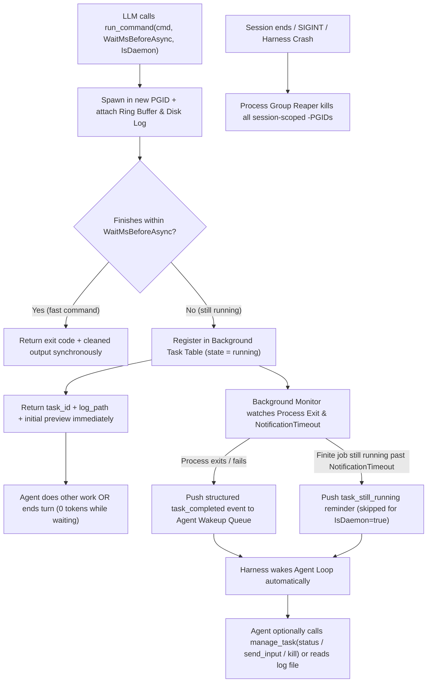
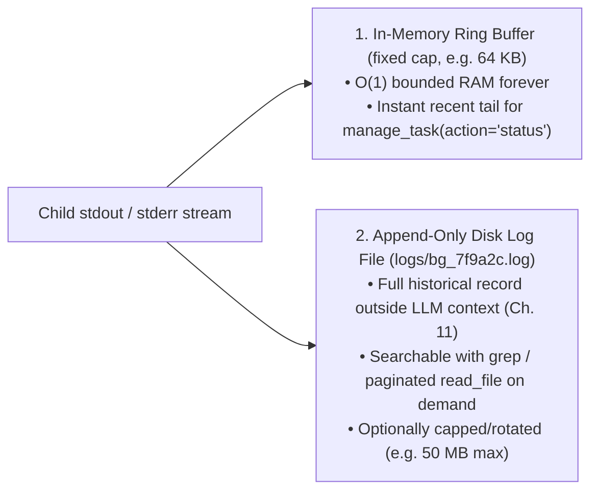

> **Module 3: Tools & Workspace Interaction** | Prerequisites: Chapter 17 | Reading Time: ~19 min
>
> [← 17. Shell & PTY Session Management](./17-shell-and-pty-session-management.md) | [Table of Contents](../README.md) | [19. Model Context Protocol (MCP) Client Architecture →](./19-model-context-protocol-mcp-client-architecture.md)

# 18. Background Processes & Async Notifications

In Chapter 17, we learned how to run shell commands cleanly and kill them when they time out. That works great for `git status` or a 3-second unit test. Now picture what happens when a user asks your coding agent:

> *"Start the Next.js dev server, open the checkout page, verify the payment button renders, and run the full Rust build while you're at it."*

If your shell tool only runs commands synchronously and kills anything that takes longer than 30 seconds, your agent is stuck in an impossible paradox: **a dev server is *supposed* to run forever**, and a full Rust or Docker build might legitimately take four minutes! If you wait synchronously, the agent freezes; if you kill on timeout, the server dies before the agent can even curl `localhost:3000`.

Solving this cleanly is the job of **background process management and asynchronous notifications**.

---

## 1. The Simple Idea: The Coffee Counter, the Pizza Buzzer, and the Espresso Machine

Walk into a busy café and watch how three different tasks are handled:

1. **Buying a drip coffee (Short-lived synchronous command):** You hand over \$4, wait 3 seconds while the barista pours it, take your cup, and walk away. Waiting at the counter makes complete sense.
2. **Ordering a brick-oven pizza (Long-running background job):** It takes 12 minutes to bake. Standing frozen at the register blocks the entire line. Instead, the cashier hands you a **plastic buzzer (`task_id`)**. You go sit down, read a book, or answer emails. The instant the pizza is ready, the buzzer vibrates (**async notification**): you never have to walk back to the counter every 15 seconds asking *"Is it done yet? Is it done yet?"*
3. **Turning on the café's espresso machine (Background daemon):** Nobody expects the espresso machine to "finish" and turn itself off after 12 minutes! Its entire job is to stay warm and running in the background all day so other orders can use it, and at closing time (when the session ends), the manager flips the main breaker so it doesn't stay on overnight.

**What breaks if your harness doesn't separate these three?**
- **Deadlocked dev servers:** Starting `npm run dev` blocks the tool call until timeout, killing the very server the agent needed to test.
- **The `sleep` polling tax:** Without push notifications, the LLM runs `sleep 10`, checks logs, runs `sleep 10` again, checks logs again; burning 10 full LLM turns, tens of thousands of tokens, and extra latency just watching a progress bar.
- **Out-of-memory crashes:** A verbose dev server or file watcher streams megabytes of hot-reload logs into an unbounded string in RAM until the harness crashes.
- **Port-hogging ghosts:** When the user closes the terminal or the harness crashes, forgotten dev servers keep running on ports `3000` and `5173`, breaking the user's next session with `EADDRINUSE`.

---

## 2. Why This Matters in a Real Agent Harness

Modern coding agents are no longer just "edit a file and run a tiny unit test." They build full-stack web apps, run multi-minute CI suites, watch TypeScript compilers, and inspect live pages with browser tools (Chapter 20). Background task architecture directly governs:

- **End-to-End Verification:** An agent can only verify UI changes or HTTP endpoints if it can launch a local backend/frontend daemon, interact with it, inspect its server logs when a 500 error happens, and shut it down cleanly afterward.
- **Cost & Token Efficiency:** Event-driven wakeups let the agent **sleep at zero token cost** while a 3-minute build runs, instead of burning \$0.50 on repetitive polling turns.
- **Concurrency & Responsiveness:** While a slow test suite runs in the background, the agent can keep reading files, drafting documentation, or inspecting another module, and the user stays unblocked.
- **Machine Stability:** Fixed-memory ring buffers and guaranteed process-group cleanup ensure that a 6-hour agent session leaves the developer's laptop just as clean as it found it.

---

## 3. The Big Picture

Here is how a command flows through a hybrid synchronous/background task manager with event-driven notifications:



Look closely at the two halves of that diagram: **short commands stay effortless and synchronous**, while **slow jobs and daemons smoothly promote to background tasks** without forcing the model to guess durations up front.

---

## 4. Deep Dive: Subtopic by Subtopic

### 4.1 Short-Lived Commands vs. Long-Running Jobs vs. Daemons

Treating every shell command the same is a design smell. Production harnesses recognize **three distinct command archetypes**:

| Archetype | Everyday Examples | Expected to Exit? | Sync Wait Budget | Notification Behavior | Cleanup on Session End |
| :--- | :--- | :--- | :--- | :--- | :--- |
| **1. Short-Lived Command** | `git status`, `ls`, `rg`, single unit test, `python -c ...` | Yes (< 5–10s) | High (5,000–10,000 ms) | Usually completes synchronously; no async event needed. | Already exited. |
| **2. Long-Running Finite Job** | `cargo build --release`, full `pytest` / Playwright suite, `docker build`, DB migration | Yes (30s – 15m) | Medium (5,000 ms) or immediate background | Notify automatically on **exit/failure**, plus optional **"still running" reminder** after `NotificationTimeoutSeconds`. | Kill `-PGID` on session end. |
| **3. Indefinite Daemon** | `npm run dev`, `vite`, `uvicorn --reload`, `tsc --watch`, local tunnel / proxy | **No** (runs until killed) | Tiny (500 ms) | Notify only on **unexpected crash/exit**: never nag with "still running!" alarms. | Kill `-PGID` on session end (unless explicitly detached by user). |

**Why the `IsDaemon` distinction matters so much:**
If you forget to flag a dev server as a daemon, two annoying bugs happen immediately:
1. The harness waits the full 10-second synchronous budget on every `npm run dev` launch even though you *know* it will never exit.
2. After 60 seconds, a stall watchdog fires *"Warning: `npm run dev` is still running!"*, tricking the LLM into thinking the server is hung and killing it!

Marking `IsDaemon: true` tells the harness: *"Wait just 500ms to catch instant syntax/port crashes, background it immediately, don't set a stall alarm, and keep its process group in the shutdown reaper list."*

---

### 4.2 Synchronous Wait Budgets (`WaitMsBeforeAsync`) and Automatic Backgrounding

Asking an LLM to predict whether `npm test` will take 2 seconds or 2 minutes is unreliable, even humans guess wrong. Instead of forcing a hard binary choice between "blocking sync tool" and "background-only tool," modern harnesses use a **synchronous wait budget** (often named `WaitMsBeforeAsync` or `yield_time_ms`).

Here is how it works:
1. The harness starts the command immediately in its own process group (`setsid`).
2. It races two futures: **(A) the process exits** vs. **(B) `WaitMsBeforeAsync` milliseconds elapse**.
3. **If the process finishes in time:** The harness returns a normal synchronous result; exit code, duration, and output. Zero background ceremony!
4. **If the timer fires first:** The harness does **not** kill the process. It promotes the process into the Background Task Registry and returns control to the LLM with a `task_id`, live status, and whatever output has appeared so far.

Look at the two JSON tool responses side by side:

```json
// Case A: Finished within WaitMsBeforeAsync (5000 ms) -> Synchronous result
{
  "status": "completed",
  "exit_code": 0,
  "duration_ms": 1420,
  "output": "14 passed in 1.18s"
}
```

```json
// Case B: Still running after WaitMsBeforeAsync (5000 ms) -> Auto-backgrounded
{
  "status": "running",
  "task_id": "bg_7f9a2c",
  "is_daemon": false,
  "pid": 48210,
  "log_path": "/tmp/harness-logs/session-42/bg_7f9a2c.log",
  "output_preview": "Compiling app v0.4.0\n   Compiling serde v1.0.210...",
  "hint": "Command is still running in the background. You will be notified automatically when it exits; do not poll with sleep."
}
```

#### Two Subtle Rules for Automatic Backgrounding
- **Short waits for intentional background tasks:** When launching a daemon (`IsDaemon: true`), use a tiny budget like `500 ms`. Why not `0 ms`? Because waiting half a second catches immediate startup failures (`command not found`, syntax error, `EADDRINUSE` on port 3000) synchronously on the spot!
- **Never auto-background bare `sleep` commands:** If a confused model tries to run `sleep 30`, auto-backgrounding it after 5 seconds confuses the model even further (it thinks its wait finished early and immediately runs `sleep 30` again!). Either reject `sleep` polling or keep explicit short pauses honest.
- **Human escape hatch (`Ctrl+B`):** Even when the model expected a quick command, users appreciate a manual shortcut (like `Ctrl+B` in Claude Code) to push a slow foreground build into the background on the fly without killing it.

---

### 4.3 Ring-Buffered Log Capture and On-Demand Status Inspection

A Webpack or Vite dev server left running during a 2-hour coding session can easily emit **50 MB of hot-reload logs**. If your harness naively appends every stdout chunk to an in-memory Python string or JS array (`task.output += chunk`), memory usage grows without bound until the harness OOM-crashes, and if the agent asks for `status`, dumping 50 MB into the context window blows up the LLM API call immediately.

The standard systems-engineering solution is **Dual-Sink Log Capture**:



> **Plain-English definition:** A **Ring Buffer** (or **Circular Buffer**) is a fixed-size memory slot that wraps around like a whiteboard with 50 lines. Once line 50 is full, line 51 erases line 1, line 52 erases line 2, and so on. You always have the *most recent* output in memory, and RAM usage **never** exceeds your cap.

#### Designing the Background Task Inspection Surface
Once commands can run in the background, the agent needs a small, clean management tool, typically a single unified tool like `manage_task` (to avoid tool-schema bloat from Chapter 03) with four actions:

| Action | Arguments | What It Does |
| :--- | :--- | :--- |
| **`list`** | *(none)* | Lists all active (and recently finished) background tasks with `task_id`, command summary, state (`running` / `exited`), elapsed time, and `is_daemon`. |
| **`status`** | `task_id`, optional `tail_lines` / `byte_offset` | Returns current state, exit code (if finished), and the cleaned recent tail from the ring buffer, or only **new bytes since last read** (cursor tracking) so repeated checks don't repeat old logs! |
| **`send_input`** | `task_id`, `input` | Writes keystrokes or text to a live interactive background task's `stdin` / PTY (e.g., pressing `r` to reload a dev server or answering a prompt). |
| **`kill`** | `task_id` | Terminates the entire `-PGID` process group cleanly (`SIGTERM` → grace wait → `SIGKILL`) and returns final captured output. |

#### Handling Daemon Readiness (Avoiding the `ECONNREFUSED` Race)
Here is a classic failure: the agent starts `uvicorn app:app --port 8000` with `IsDaemon: true`, gets `task_id` back in 500ms, and immediately runs `curl http://localhost:8000/health`, which fails with `Connection refused` because Python took 1.8 seconds to import FastAPI and bind the socket!

Clean ways harnesses solve startup readiness:
1. **Log-pattern readiness probe (best for dev servers):** Let the command optionally wait up to a short budget for a ready marker (or let the agent inspect `status` once after a brief readiness check like `curl --retry 5 --retry-connrefused --retry-delay 1 http://localhost:8000/health`).
2. **Return the initial 500ms output preview:** Often the first lines already show either `"Uvicorn running on http://127.0.0.1:8000"` (ready!) or `"ModuleNotFoundError"` (crashed immediately!).

---

### 4.4 Event-Driven Notifications vs. Wasteful LLM Polling Loops (`sleep` Anti-Pattern)

Without event-driven notifications, here is what an LLM naturally does when you background a 45-second build:

```text
Turn 1: LLM calls run_command("cargo test")           -> backgrounded as bg_01
Turn 2: LLM calls run_command("sleep 10")             -> wastes 10s + full context resend
Turn 3: LLM calls manage_task("status", "bg_01")      -> "still compiling..."
Turn 4: LLM calls run_command("sleep 15")             -> wastes 15s + full context resend
Turn 5: LLM calls manage_task("status", "bg_01")      -> "still compiling..."
Turn 6: LLM calls run_command("sleep 20")             -> wastes 20s + full context resend
Turn 7: LLM calls manage_task("status", "bg_01")      -> "finished 12 seconds ago!"
```

Look how painful that is: **five completely useless LLM API calls**, thousands of extra tokens (and wasted prompt-cache churn), plus 12 seconds of lag after the build actually finished!

#### The Event-Driven Wakeup Architecture
Instead of making the LLM ask *"Are we there yet?"*, invert the control flow:

1. **The agent goes idle (zero tokens, zero API calls):** After launching a background job and finishing any parallel work, the agent simply ends its turn (`stop_reason = "end_turn"` with a short message to the user like *"The build is running in the background; I'll review the results as soon as it finishes."*).
2. **The harness keeps watching:** A lightweight OS/async waiter inside the harness monitors the background child's exit handle (consuming essentially 0% CPU; no busy-wait loops!).
3. **Completion triggers a Reactive Wakeup:** The exact millisecond `cargo test` exits, the harness builds a compact structured notification envelope, appends it to the session's message queue, and automatically starts a new agent turn!

Here is what that structured notification looks like when injected into the agent's context:

```xml
<task_notification>
  <task_id>bg_7f9a2c</task_id>
  <command>cargo test --workspace</command>
  <event>completed</event>
  <exit_code>101</exit_code>
  <duration_seconds>42.8</duration_seconds>
  <log_path>/tmp/harness-logs/session-42/bg_7f9a2c.log</log_path>
  <tail_output>
test auth::test_refresh_token ... FAILED
failures:
    auth::test_refresh_token
test result: FAILED. 38 passed; 1 failed; 0 ignored
  </tail_output>
</task_notification>
```

#### Handling Stall Reminders (`NotificationTimeoutSeconds`)
What if a finite job (`IsDaemon: false`) doesn't crash, doesn't exit, and just silently hangs for 20 minutes?
- Set a **progress/stall reminder timer** (`NotificationTimeoutSeconds`, e.g., 60 or 120 seconds) on finite jobs.
- If the job is still alive when that timer fires, the harness pushes a `task_still_running` notification containing the latest 15 lines of output and how long output has been silent (`idle_seconds: 58`).
- Now the agent can make an *informed* judgment: *"Oh, it's actively compiling crate 142/200, I'll let it keep going"* OR *"It's been silent for 60 seconds right after `Waiting for DB lock`, something is deadlocked, let me kill it and investigate!"*

#### Coalescing Notification Storms
Suppose the agent kicked off 6 parallel background test shards and 4 of them finish within 200ms of each other. Don't wake the LLM 4 separate times in 200ms! **Debounce/coalesce** queued notifications arriving while a turn is already running (or within a tiny ~250ms batch window) and deliver them together in one clean turn.

---

### 4.5 Cleanup Guarantees When a Session Ends or Crashes

Every engineer who builds a background process manager learns this lesson the hard way: **starting a background server is easy; guaranteeing it dies when your harness dies is where real systems engineering lives.**

There are **three** ways an agent session ends, and your cleanup design must survive all three:

| Exit Scenario | Example | Does `finally` / `atexit` Run? | Required Defense |
| :--- | :--- | :--- | :--- |
| **1. Graceful Exit** | User types `/exit` or closes app normally | Yes | Iterate Task Registry → `SIGTERM` to `-PGID` → grace wait → `SIGKILL` to `-PGID`. |
| **2. Signal Interruption** | User presses `Ctrl+C` (`SIGINT`) or system sends `SIGTERM` | Only if you install signal handlers! | Trap `SIGINT`/`SIGTERM`, run the same `-PGID` reaper, then re-raise/exit with proper code. |
| **3. Hard Crash** | Harness gets `SIGKILL` (`kill -9`), segfaults, or OOM-killed | **NEVER!** No Python/JS/Rust cleanup code runs! | **OS-level parent-death binding** + startup lockfile sweeping. |

#### Surviving Scenario 3: Hard Crash Cleanup Across Operating Systems
Because user-space code cannot run after `SIGKILL`, you must enlist the **operating system kernel**:

- **On Linux: `PR_SET_PDEATHSIG` (or cgroups):**
  In the child process (between `fork()` and `exec()`), call `prctl(PR_SET_PDEATHSIG, SIGTERM)` (or `SIGKILL`). The Linux kernel guarantees that the instant the parent thread/process dies, even via `kill -9`, the kernel delivers that signal to the child automatically. *(Caveat: if you spawn from a short-lived worker thread, bind it to the main process or use a dedicated subreaper / cgroup!)*
- **On Windows: Job Objects:**
  Create a Job Object with `JOB_OBJECT_LIMIT_KILL_ON_JOB_CLOSE` and assign every background subprocess to it. When the harness dies for *any* reason, Windows closes all its open handles, and the kernel immediately terminates every process inside the Job Object.
- **On macOS (which lacks `PR_SET_PDEATHSIG`): The Sentinel Pipe Pattern:**
  Because macOS does not have `PR_SET_PDEATHSIG`, production harnesses use a clever Unix trick:
  1. The harness creates an OS pipe (`read_fd`, `write_fd`) and keeps `write_fd` open (never writing to it).
  2. Each background command is launched via a tiny watchdog wrapper holding `read_fd`, blocking on `read(read_fd)`.
  3. If the harness dies, even from `kill -9`, the macOS kernel **automatically closes `write_fd`**, immediately delivering `EOF` to `read_fd`!
  4. The watchdog wakes up on `EOF`, sends `SIGTERM` → `SIGKILL` to `-PGID`, and exits cleanly.
- **Belt-and-Suspenders Fallback: Session PID/PGID Ledger:**
  Record every active `(pgid, start_time, command)` in a tiny JSON ledger file on disk. If a machine reboots or a daemon somehow slips through, the next startup can inspect the ledger (verifying both `pgid` *and* process creation timestamp so you never kill an unrelated process that reused the same PID!) and offer to clean up stragglers.

> **Important exception:** Some harnesses intentionally support **standing/persistent daemons** (e.g., a cross-session daemon or a user-approved dev server meant to outlive a quick CLI command). Only exempt processes from the reaper when the user or architecture *explicitly* opts them in: session-scoped background jobs should **always** default to automatic cleanup.

---

## 5. How Real Harnesses Do It

Let's look at how leading 2025–2026 coding-agent harnesses solve background execution and async notifications in practice:

- **Claude Code:**
  Claude Code supports three smooth ways to background a Bash command: the model explicitly passes `"run_in_background": true`, a slow foreground command automatically shifts to the background after exceeding its wait threshold, or the user presses **`Ctrl+B`** mid-command. Users inspect active jobs with `/tasks` and cancel them with `TaskStop`. Crucially, Claude Code **evolved away from polling**: its earlier blocking/polling `TaskOutput` tool was removed in favor of automatic structured completion notifications carrying a summary and output file path, letting the agent read full logs on demand with its standard `Read` tool.
- **OpenAI Codex CLI:**
  Codex CLI's `unified_exec` engine manages persistent background terminals for dev servers and file watchers, exposing interactive `/ps` and `/stop` controls so both the agent and developer can inspect or stop runaway processes. Later releases also introduced an optional shared background daemon architecture for cross-session tasks: paired with explicit opt-out flags (`--no-daemon` and `daemon_auto_start = false`) so developers stay in strict control of what persists after closing a terminal.
- **Gemini CLI:**
  Gemini CLI's `run_shell_command` supports background execution that immediately returns `Background PIDs` and lets operators configure completion behavior explicitly via `tools.shell.backgroundCompletionBehavior` (`"silent"`, `"notify"`, or `"inject"`), letting teams tune whether finished background jobs stay quiet or proactively wake the agent.
- **Modern Multi-Task Harnesses (e.g., Antigravity):**
  Combines a configurable synchronous wait budget (`WaitMsBeforeAsync`), an explicit `IsDaemon` flag (distinguishing infinite dev servers from finite builds), `NotificationTimeoutSeconds` stall reminders for finite jobs, a single `manage_task` inspection tool (`list`, `status`, `send_input`, `kill`), and a reactive wakeup queue: explicitly instructing the model *never* to poll with shell `sleep`.

---

## 6. Common Pitfalls & Failure Modes

1. **The `sleep` Polling Loop Anti-Pattern:**
   *Symptom:* The agent backgrounds `npm run build`, then spends 6 turns running `sleep 10` and checking `status`, burning tokens and adding artificial delay.
   *Fix:* Push automatic completion notifications into the agent's wakeup queue, include an explicit reminder in the background tool's return payload (*"You will be notified automatically when this finishes; do not poll with `sleep`"*), and allow the agent to end its turn cleanly while waiting.

2. **Unbounded Log Buffering Causing Harness OOM:**
   *Symptom:* An agent runs a verbose `DEBUG=* npm run dev` server. Twenty minutes later, the harness itself crashes with `MemoryError` or `FATAL ERROR: JavaScript heap out of memory`.
   *Fix:* Capture live output into a fixed-byte **ring buffer** in RAM and tee full history to a capped disk log file.

3. **Setting Stall Timeouts on Daemons:**
   *Symptom:* The agent launches `vite` on port `5173`. Sixty seconds later, the harness fires a `"Command still running!"` warning; the agent panics, assumes `vite` froze, and kills its own dev server right before running browser tests.
   *Fix:* Separate finite jobs (`IsDaemon: false`, stall alerts enabled) from daemons (`IsDaemon: true`, notify only on unexpected exit).

4. **The `ECONNREFUSED` Startup Race:**
   *Symptom:* The agent starts a backend server in the background and immediately calls `curl localhost:8000` 100ms later; failing because the server needs 1.5 seconds to boot.
   *Fix:* Use a brief `500ms` initial wait to catch instant crashes, and instruct the agent (or build a lightweight port/log readiness helper) to verify readiness with bounded retries (`curl --retry-connrefused`) rather than assuming instant boot.

5. **Notification Floods From Parallel Background Jobs:**
   *Symptom:* Ten background jobs finish within 1 second; the harness triggers ten back-to-back LLM turns, each seeing only one new result and making redundant edits.
   *Fix:* Drain and coalesce all pending task notifications in the wakeup queue into a single batch message before starting the next LLM turn.

6. **Blindly Killing Reused PIDs From Stale Lockfiles:**
   *Symptom:* After a reboot, a startup cleanup script reads PID `4120` from yesterday's crash ledger and accidentally kills the user's web browser or database that happened to get PID `4120` today!
   *Fix:* Always record the process **creation timestamp** (or executable name) alongside the PID/PGID, and verify it matches before ever signaling a PID recovered from disk.

---

## 7. Build It Yourself: Mini-Lab

Below is a clean, self-contained Python `asyncio` `BackgroundTaskManager` (~125 lines). It implements **bounded ring-buffered logging + disk tee**, **automatic backgrounding via `WaitMsBeforeAsync`**, **`IsDaemon` vs. finite job handling**, **event-driven async notifications (zero polling)**, and **guaranteed `-PGID` cleanup on shutdown**.

```python
import asyncio
import os
import secrets
import signal
import tempfile
import time
from collections import deque
from dataclasses import dataclass, field


class ByteRingBuffer:
    """Fixed-capacity in-memory ring buffer bounded strictly by byte length."""

    def __init__(self, max_bytes: int = 64 * 1024):
        self.max_bytes = max_bytes
        self._chunks: deque[bytes] = deque()
        self._size = 0

    def append(self, data: bytes) -> None:
        if not data:
            return
        if len(data) >= self.max_bytes:
            self._chunks.clear()
            self._chunks.append(data[-self.max_bytes:])
            self._size = self.max_bytes
            return
        self._chunks.append(data)
        self._size += len(data)
        while self._size > self.max_bytes and self._chunks:
            dropped = self._chunks.popleft()
            self._size -= len(dropped)

    def read_text(self, tail_chars: int = 4000) -> str:
        text = b"".join(self._chunks).decode("utf-8", errors="replace")
        return text[-tail_chars:]


@dataclass
class ManagedTask:
    task_id: str
    command: str
    is_daemon: bool
    proc: asyncio.subprocess.Process
    log_path: str
    ring: ByteRingBuffer = field(default_factory=ByteRingBuffer)
    started_at: float = field(default_factory=time.monotonic)
    last_output_at: float = field(default_factory=time.monotonic)
    state: str = "running"  # "running" | "completed" | "failed" | "killed"
    backgrounded: bool = False
    exit_code: int | None = None
    _watcher: asyncio.Task | None = None
    _alarm: asyncio.Task | None = None


class BackgroundTaskManager:
    """Hybrid sync/async command runner with ring buffers and event-driven wakeups."""

    def __init__(self, wakeup_queue: asyncio.Queue[dict]):
        self.wakeup_queue = wakeup_queue
        self.tasks: dict[str, ManagedTask] = {}
        self.log_dir = tempfile.mkdtemp(prefix="harness-bg-")

    async def run_command(
        self,
        command: str,
        wait_ms: int = 5000,
        is_daemon: bool = False,
        notify_timeout_s: float | None = 60.0,
    ) -> dict:
        task_id = f"bg_{secrets.token_hex(4)}"
        log_path = os.path.join(self.log_dir, f"{task_id}.log")

        # Launch in a new session (PGID == proc.pid) with stdin closed unless interactive.
        proc = await asyncio.create_subprocess_shell(
            command,
            stdin=asyncio.subprocess.DEVNULL,
            stdout=asyncio.subprocess.PIPE,
            stderr=asyncio.subprocess.STDOUT,
            start_new_session=True,
        )

        task = ManagedTask(task_id=task_id, command=command, is_daemon=is_daemon, proc=proc, log_path=log_path)
        self.tasks[task_id] = task
        done_event = asyncio.Event()

        # Stream stdout/stderr concurrently into BOTH the ring buffer and disk log.
        task._watcher = asyncio.create_task(self._pump_and_wait(task, done_event))

        # Race process exit against the synchronous wait budget.
        effective_wait_s = (min(wait_ms, 500) if is_daemon else wait_ms) / 1000.0
        try:
            await asyncio.wait_for(done_event.wait(), timeout=effective_wait_s)
            # Finished within budget -> return synchronously, no async noise!
            return {
                "status": task.state,
                "exit_code": task.exit_code,
                "duration_ms": int((time.monotonic() - task.started_at) * 1000),
                "output": task.ring.read_text(),
            }
        except asyncio.TimeoutError:
            # Still running -> promote to background and arm stall reminder (finite jobs only).
            task.backgrounded = True
            if not is_daemon and notify_timeout_s:
                task._alarm = asyncio.create_task(self._stall_alarm(task, notify_timeout_s))
            return {
                "status": "running",
                "task_id": task.task_id,
                "is_daemon": is_daemon,
                "log_path": task.log_path,
                "output_preview": task.ring.read_text(tail_chars=1500),
                "hint": "Running in background. Wait for the automatic notification; do not poll with sleep.",
            }

    async def _pump_and_wait(self, task: ManagedTask, done_event: asyncio.Event) -> None:
        assert task.proc.stdout is not None
        with open(task.log_path, "wb") as log_file:
            while chunk := await task.proc.stdout.read(4096):
                task.ring.append(chunk)
                log_file.write(chunk)
                log_file.flush()
                task.last_output_at = time.monotonic()

        code = await task.proc.wait()
        task.exit_code = code
        if task.state == "running":
            task.state = "completed" if code == 0 else "failed"

        if task._alarm and not task._alarm.done():
            task._alarm.cancel()

        done_event.set()

        # Push an async wakeup event ONLY if this task had already been backgrounded.
        if task.backgrounded and task.state != "killed":
            await self.wakeup_queue.put({
                "event": "task_exited",
                "task_id": task.task_id,
                "command": task.command,
                "is_daemon": task.is_daemon,
                "state": task.state,
                "exit_code": code,
                "duration_s": round(time.monotonic() - task.started_at, 2),
                "log_path": task.log_path,
                "tail_output": task.ring.read_text(tail_chars=2000),
            })

    async def _stall_alarm(self, task: ManagedTask, timeout_s: float) -> None:
        await asyncio.sleep(timeout_s)
        if task.state == "running":
            await self.wakeup_queue.put({
                "event": "task_still_running",
                "task_id": task.task_id,
                "command": task.command,
                "elapsed_s": round(time.monotonic() - task.started_at, 1),
                "idle_s": round(time.monotonic() - task.last_output_at, 1),
                "tail_output": task.ring.read_text(tail_chars=1500),
            })

    def get_status(self, task_id: str) -> dict:
        task = self.tasks[task_id]
        return {
            "task_id": task.task_id,
            "state": task.state,
            "is_daemon": task.is_daemon,
            "exit_code": task.exit_code,
            "elapsed_s": round(time.monotonic() - task.started_at, 1),
            "log_path": task.log_path,
            "recent_output": task.ring.read_text(tail_chars=3000),
        }

    async def kill_task(self, task_id: str, grace_s: float = 3.0) -> None:
        task = self.tasks[task_id]
        if task.state != "running":
            return
        task.state = "killed"
        if task._alarm and not task._alarm.done():
            task._alarm.cancel()
        pgid = task.proc.pid
        try:
            os.killpg(pgid, signal.SIGTERM)
        except ProcessLookupError:
            return
        try:
            await asyncio.wait_for(task.proc.wait(), timeout=grace_s)
        except asyncio.TimeoutError:
            try:
                os.killpg(pgid, signal.SIGKILL)
            except ProcessLookupError:
                pass
            await task.proc.wait()

    async def shutdown_all(self) -> None:
        """Guaranteed cleanup hook called on normal exit or SIGINT/SIGTERM."""
        running_ids = [tid for tid, t in self.tasks.items() if t.state == "running"]
        await asyncio.gather(*(self.kill_task(tid) for tid in running_ids))
```

Notice how cleanly everything composes:
1. Run `echo hello` (`wait_ms=5000`) → finishes in 10ms, returns synchronously with zero notification clutter.
2. Run `pytest` taking 25 seconds (`wait_ms=5000`) → returns `bg_...` at 5s; agent stays free or yields its turn; at 25s, `wakeup_queue` delivers the exact exit code and tail output automatically.
3. Run `python3 -m http.server 8000` (`is_daemon=True`) → returns in 500ms, never fires stall alarms, keeps RAM bounded to 64 KB no matter how many requests hit it, and dies cleanly when `shutdown_all()` runs.

---

## 8. Key Takeaways & Quick Self-Check

- **Distinguish three command classes: short commands, finite jobs, and indefinite daemons.** Finite jobs expect completion and benefit from stall reminders; daemons are meant to stay alive and should only notify on unexpected crashes.
- **Use a synchronous wait budget (`WaitMsBeforeAsync`) for automatic backgrounding.** Fast commands return naturally in one turn, slow commands promote seamlessly to background tasks, and daemons use a brief ~500ms wait to catch instant startup failures.
- **Pair an in-memory ring buffer with an append-only disk log.** The ring buffer guarantees $O(1)$ RAM usage and instant recent tails for `status` checks; the disk log preserves complete searchable history without bloating the LLM context window.
- **Replace `sleep` polling loops with event-driven reactive wakeups.** Let the agent finish its turn at zero token cost while background jobs run, then push structured completion (or stall) notifications into the wakeup queue and coalesce bursts cleanly.
- **Engineer cleanup for all three exit paths, including hard crashes.** Signal `-PGID` on graceful exit and `SIGINT`/`SIGTERM`, and back it with kernel parent-death guarantees (`PR_SET_PDEATHSIG` on Linux, Job Objects on Windows, sentinel pipes on macOS) so no orphan dev servers ever survive a crash.

### Quick Self-Check

**1. Why does a well-designed harness wait ~500ms before backgrounding a daemon (`IsDaemon: true`) instead of backgrounding it at 0ms, or waiting 10,000ms?**
<details>
<summary>Show Answer</summary>
Waiting ~500ms catches immediate startup crashes (like <code>command not found</code>, syntax errors, or <code>EADDRINUSE</code> port conflicts) synchronously in the same turn, while avoiding a wasteful 10-second freeze on a healthy dev server that is never going to exit on its own.
</details>

**2. Why is storing background command output in both a 64 KB ring buffer and a disk log file strictly better than either one alone?**
<details>
<summary>Show Answer</summary>
A ring buffer alone loses earlier lines (such as startup stack traces from 10 minutes ago), while unbounded in-memory strings risk OOM-crashing the harness on chatty dev servers. Pairing an in-memory ring buffer with a disk log gives you constant-memory instant tails for quick <code>status</code> checks <em>and</em> full, searchable historical logs on disk via standard file-reading tools.
</details>

**3. Suppose your agent launches a 3-minute Docker build in the background and then calls `run_command("sleep 30")` five times in a row to check progress. What architectural feature is missing, and why is this pattern so costly?**
<details>
<summary>Show Answer</summary>
The harness is missing <strong>event-driven reactive wakeups</strong> (or clear guidance/enforcement to stop polling). Every <code>sleep</code> turn forces a full LLM API call resending the entire conversation history just to learn nothing has changed, burning extra tokens, latency, and wall-clock lag after the build finishes. With event-driven wakeups, the agent ends its turn at zero token cost and wakes the instant the build exits.
</details>

**4. Your harness installs `atexit` and `SIGINT`/`SIGTERM` handlers to kill all background `-PGID`s, yet users still find orphaned dev servers running after the harness gets OOM-killed (`SIGKILL`). Why, and how do you fix it on macOS vs. Linux?**
<details>
<summary>Show Answer</summary>
<code>SIGKILL</code> terminates a process immediately inside the kernel: no user-space <code>atexit</code>, <code>finally</code>, or signal handler can ever run. To survive hard crashes, rely on kernel-enforced parent-death detection: <code>PR_SET_PDEATHSIG</code> (or cgroups) on Linux, Job Objects with <code>JOB_OBJECT_LIMIT_KILL_ON_JOB_CLOSE</code> on Windows, and an inherited <strong>sentinel pipe</strong> on macOS (where kernel closure of the parent's write-end sends immediate EOF to a tiny watchdog that kills <code>-PGID</code>).
</details>

---

[← 17. Shell & PTY Session Management](./17-shell-and-pty-session-management.md) | [Table of Contents](../README.md) | [19. Model Context Protocol (MCP) Client Architecture →](./19-model-context-protocol-mcp-client-architecture.md)
