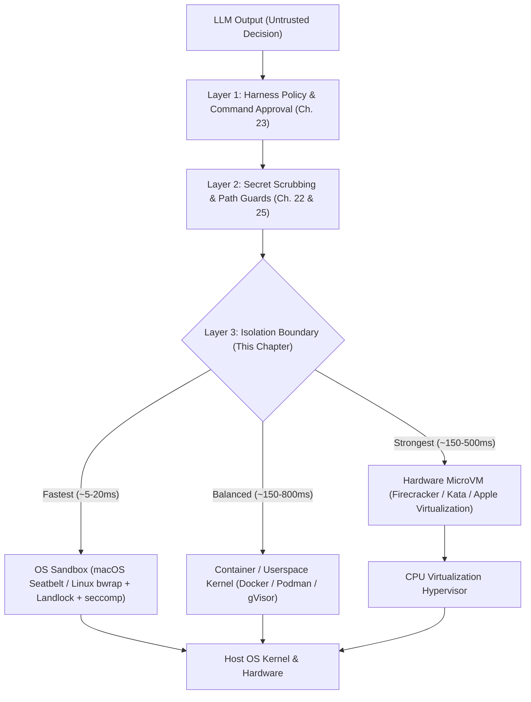

> **Module 4: Sandboxing & Security** | Prerequisites: Chapter 17 | Reading Time: ~22 min
>
> [← 20. Browser Automation Integration](../03-tools-and-workspace-interaction/20-browser-automation-integration.md) | [Table of Contents](../README.md) | [22. Filesystem & Network Isolation →](./22-filesystem-and-network-isolation.md)

# 21. OS-Level Sandboxing (macOS Seatbelt, Linux Bubblewrap/Landlock, Containers)

In Module 3, we gave our coding agent hands: it can read files, patch code, run a shell, manage background processes, call MCP servers, and drive a browser. The moment you give a probabilistic model a shell tool, a sobering question arrives: **what stops a confused model, or a malicious string hidden in a repository, from wiping your home folder or silently uploading your private keys?**

This chapter introduces the foundation of agent security: **OS-level sandboxing**. You will learn why prompt instructions are never a real security boundary, how operating systems actually enforce isolation, and how modern coding agents choose between macOS Seatbelt, Linux Bubblewrap/Landlock, containers, and microVMs.

---

## 1. The Simple Idea (Zero-Jargon Intuition)

Imagine lending a bright intern the keys to your workshop so they can repair a wooden chair.

- **Prompt-only safety** is handing them the master key to the entire building (including the payroll office, the server room, and the fire-alarm panel) and taping a sticky note to their clipboard that says: *"Please only touch the wooden chair."*
- **OS-level sandboxing** is putting the chair inside a locked glass-walled workbench room. Inside that room, the intern has every hammer, saw, and sander they need. Outside that room, the doors simply do not open: no matter how persuasive a prank note someone slips under the door, and no matter how badly the intern misunderstands an instruction.

Notice the difference: **the sticky note relies on obedience; the locked room relies on physics.**

In software, the "physics" of your computer is enforced by the **operating system kernel**: the privileged core program (like the macOS XNU kernel or the Linux kernel) that mediates every single interaction between an application and your hardware. A program cannot read a file, delete a directory, or open a network connection directly. It must ask the kernel via a **system call (syscall)**: a formal request like `open()`, `unlink()`, or `connect()`.

**OS-level sandboxing** tells the kernel, *before* the agent's command even starts: *"For this child process and every child process it spawns, deny any syscall that tries to write outside the project folder or talk to the internet."* Once the kernel locks that door, the agent can be 100% confused, hallucinating, or tricked, and the kernel still answers every out-of-bounds request with a blunt `EPERM` ("Operation not permitted").

### What Breaks Without OS-Level Sandboxing?

Without a real sandbox around tool execution:
1. **Honest mistakes become disasters:** An agent trying to clean a build directory generates `rm -rf $BUILD_DIR/*` when `$BUILD_DIR` is empty, or runs a cleanup script from the wrong working directory.
2. **Hostile dependencies run unchecked:** Running `npm test` or `pytest` executes arbitrary third-party code in your repo and its packages; all running with *your* user account's full privileges.
3. **Indirect prompt injection becomes remote code execution:** A malicious comment in a GitHub issue, a poisoned `README.md`, or a hostile web page tricks the LLM into running an exfiltration command. (We dive deeply into prompt injection in Chapter 24.)
4. **Users suffer approval fatigue:** Without a safe cage, the harness has to nag the human before *every* command (`ls`, `pytest`, `git diff`, `npm run build`), pushing frustrated developers toward disabling safety checks altogether (`--yolo`).

---

## 2. Why This Matters in a Real Agent Harness

There is a counterintuitive truth in harness engineering: **stronger sandboxing does not just make an agent safer; it makes the agent dramatically faster and more autonomous.**

Think about the daily loop of a real coding agent:
- Run the test suite (`pytest` / `vitest`).
- Edit three files.
- Run the linter and type-checker.
- Run a one-off Python script to reproduce a bug.
- Re-run tests.

If every shell command runs unsandboxed directly on the host machine, the harness *must* treat almost every command as potentially catastrophic and pause for human confirmation. A 20-step debugging session turns into 20 interruptions.

When commands execute inside a tight OS sandbox (writable only inside the workspace and `/tmp`, sensitive host directories hidden or unreadable, outbound network blocked by default), the **blast radius** of a mistake shrinks to a single git-tracked folder that you can revert in one second (`git checkout -- .`). That lets the harness **auto-run normal build, test, and lint commands safely without nagging the user**, reserving approval prompts only for actions that genuinely cross the boundary (like pushing to Git, calling external APIs, or installing new dependencies).

---

## 3. The Big Picture (Defense-in-Depth Architecture)

No single security layer is invincible. Great agent harnesses stack **defense in depth**: multiple independent barriers so that if one layer fails, the next layer still holds.



Notice the rule of thumb in that diagram: **everything above the Sandbox node is software trying to make smart decisions; the Sandbox node and below are enforcement mechanisms enforced by the OS kernel or CPU hardware.**

---

## 4. Deep Dive: Subtopic by Subtopic

### 4.1 Why "Asking the LLM Politely" Is Not Security

Every beginner building an agent eventually tries this in their system prompt:

```text
CRITICAL SECURITY RULES:
- NEVER delete files outside the current workspace.
- NEVER read ~/.ssh, ~/.aws, or .env files.
- NEVER run curl or send data to external servers.
```

Why does this fail as a security boundary?

1. **LLMs do not have a hard wall between instructions and data.** At the neural-network level, your system prompt, the user's message, and a README file read from disk are all just tokens in the same sequence. A cleverly phrased instruction inside untrusted data can override polite reminders.
2. **LLMs make mundane mistakes.** Even with zero attackers involved, a model can miscalculate a relative path (`../../../`), forget what directory a shell session is in, or invoke a build tool (`make clean`, `npm install`) whose *internal scripts* do things the LLM never anticipated.
3. **Security must be deterministic, not probabilistic.** Even if a model obeys your safety prompt 99.9% of the time, an active engineering team runs tens of thousands of tool calls per week. A 0.1% failure rate guarantees multiple breaches per week.

> **Golden Rule of Harness Security:** System prompts are useful for *guidance and ergonomics* (so the agent doesn't waste turns attempting forbidden actions). **Only deterministic code outside the model, and kernel/hardware enforcement beneath the process, counts as security.**

---

### 4.2 The Isolation Spectrum: Process → OS Sandbox → Container → MicroVM

Before looking at specific tools, let's build a clear mental map of the four main isolation levels available to harness engineers.

| Isolation Layer | Plain-English Mechanism | Shared Kernel? | Typical Startup Latency | Best Fit in Coding Harnesses |
| :--- | :--- | :--- | :--- | :--- |
| **Plain Subprocess (`exec` / `PTY`)** | Runs with your exact user permissions. Only working directory and env vars differ. | Yes (same host OS, no wall) | ~1–5 ms | **Never sufficient alone** for untrusted commands. Only safe inside an already-isolated VM. |
| **OS-Level Sandbox (Seatbelt, Bubblewrap, Landlock + seccomp)** | Kernel restricts syscalls, filesystem paths, and network sockets for a specific child process tree. | Yes (same host kernel) | ~5–30 ms | **Local CLI agents** (Claude Code, Codex CLI) where instant speed and host toolchain access (local `node`, `python`, `cargo`) matter. |
| **Standard Containers (Docker / Podman)** | Packages a separate root filesystem (Linux image) with Linux **namespaces** (isolated views of files, processes, network) and **cgroups** (CPU/RAM limits). | Yes (Linux host kernel; on macOS runs inside a Linux VM) | ~150–800 ms (warm image) | **Reproducible dev environments & CI**; stronger packaging than raw host tools, though a kernel bug can still escape a shared-kernel container. |
| **Userspace Kernel (gVisor)** | Intercepts syscalls in a user-space Go kernel (`sentry`) before anything reaches the real host Linux kernel, shrinking kernel attack surface dramatically. | Intercepted (virtualized syscall layer) | ~150–400 ms | **Multi-tenant cloud sandboxes** and serverless code interpreters needing high density + strong syscall filtering. |
| **Hardware MicroVMs (Firecracker, Kata, Apple Virtualization)** | Uses CPU hardware virtualization (KVM on Linux, Hypervisor/Virtualization framework on Apple Silicon) to run a **dedicated guest OS kernel** per sandbox. | **No** (dedicated guest kernel) | ~125–500 ms | **Cloud coding agents** (E2B, Modal, Fly.io Sprites), **untrusted repos**, and modern **local macOS Linux sandboxes** (Apple Containerization). |

Let's define three key words from this table gently so there's zero fog:
- **Namespace (Linux):** A kernel feature that gives a process its own private view of a system resource. A *mount namespace* gives it its own view of the filesystem tree; a *network namespace* gives it its own private network interfaces (often just `lo`, with no internet card at all); a *PID namespace* makes the process think it is Process #1 so it cannot see or kill your other running apps.
- **cgroup (Control Group):** A Linux kernel feature that caps how much CPU, RAM, or number of processes (`pids.max`) a group of processes can consume; stopping accidental fork bombs or runaway memory leaks from freezing your laptop.
- **Hypervisor / MicroVM:** A hypervisor uses special isolation hardware built into modern CPUs (Intel VT-x, AMD-V, Apple Silicon Virtualization extensions) to run an entire tiny guest operating system inside a hardware fence. A **microVM** strips away unnecessary desktop hardware emulation (no virtual USB ports, no virtual sound cards, no BIOS) so it boots in a fraction of a second instead of 30 seconds.

---

### 4.3 macOS Seatbelt (`sandbox-exec` and SBPL Profiles)

If you build a local coding agent for developers, a huge share of your users are on macOS. You cannot use Linux namespaces natively on macOS without booting a Linux VM. Instead, macOS includes a built-in kernel sandboxing subsystem historically called **Seatbelt** (officially part of Apple's Mandatory Access Control / TrustedBSD framework).

#### How It Works

A harness launches a child command through `/usr/bin/sandbox-exec`, passing a tiny policy script written in **SBPL (Sandbox Profile Language)**: a Scheme/Lisp-like list of `allow` and `deny` rules evaluated directly inside the macOS kernel on every syscall:

```bash
sandbox-exec -f /tmp/agent-profile.sb -- pytest tests/
```

Here is a readable, annotated example of a defensive **workspace-write, offline-by-default** SBPL profile:

```scheme
(version 1)

;; 1. Start from a strict baseline: deny everything unless explicitly allowed.
(deny default)

;; 2. Allow basic process execution, signals within the same process group,
;;    and reading OS metadata needed by dynamic linkers & compilers.
(allow process-exec)
(allow process-fork)
(allow signal (target self))
(allow sysctl-read)
(allow mach-lookup) ; Needed by many macOS system libraries (can be narrowed further)

;; 3. Allow reading system binaries/libraries and the active workspace,
;;    while explicitly blocking sensitive user credential folders.
(allow file-read*)
(deny file-read*
    (subpath "/Users/alice/.ssh")
    (subpath "/Users/alice/.aws")
    (subpath "/Users/alice/.gnupg")
    (subpath "/Users/alice/Library/Keychains"))

;; 4. Allow writing ONLY inside the project workspace and a dedicated temp dir.
(allow file-write*
    (subpath "/Users/alice/projects/my-app")
    (subpath "/private/tmp/agent-scratch-9f2a")
    (literal "/dev/null"))

;; 5. Protect critical control files INSIDE the workspace from being modified!
;;    (Prevents the agent from planting malicious git hooks or editing its own policy.)
(deny file-write*
    (subpath "/Users/alice/projects/my-app/.git/hooks")
    (subpath "/Users/alice/projects/my-app/.agent"))

;; 6. Network isolation: because default is deny, leaving out (allow network*)
;;    blocks all outbound TCP/UDP connections automatically.
;;    (Optionally allow ONLY a local Unix socket or loopback proxy port.)
(allow network-outbound (remote ip "localhost:41920"))
```

#### Critical macOS Seatbelt Caveats Every Harness Engineer Must Know

Seatbelt is fast (adds only a few milliseconds per command) and ships pre-installed on every Mac, which is why Claude Code (`sandbox-runtime`), OpenAI Codex CLI, and Gemini CLI all use it. However, it has real quirks:

1. **Officially marked "deprecated" by Apple:** Running `man sandbox-exec` prints a deprecation warning, because Apple prefers App Sandbox entitlements compiled into signed `.app` bundles. In practice, macOS system daemons and major developer tools still rely on Seatbelt heavily (and there is no other built-in, zero-VM CLI sandbox API on macOS) so harnesses continue using it while monitoring Apple's newer Virtualization/Containerization APIs as a long-term path.
2. **Symlinks and `/tmp` vs. `/private/tmp`:** On macOS, `/tmp` is a symbolic link to `/private/tmp`, and `/var` is a link to `/private/var`. Seatbelt evaluates rules against **canonical (resolved) kernel paths**. If your profile allows `(subpath "/tmp/scratch")` without resolving symlinks first, writes to `/tmp/scratch/out.txt` will mysteriously fail with `EPERM`! Always run `realpath()` on every path before injecting it into an SBPL profile.
3. **Rule precedence ("last match wins" vs. specificity):** SBPL's rule evaluation can surprise newcomers; more specific rules or later rules can override earlier broad rules, and `(allow file-read*)` followed by `(deny file-read* (subpath ...))` must be carefully tested against edge cases like `file-read-metadata` (which `stat()` needs on parent directories like `/Users/alice` just to traverse down to `/Users/alice/projects/my-app`).
4. **No filesystem mount remapping:** Unlike Linux `bwrap`, Seatbelt cannot mount a fake empty directory over `~/.ssh` or give the process a fake PID namespace; it only filters syscalls against the real host tree.

---

### 4.4 Linux Bubblewrap (`bwrap`), Landlock LSM, and `seccomp-bpf`

Linux offers an extraordinary toolkit for unprivileged sandboxing, meaning **you do not need `root` or `sudo` privileges** to lock down an agent's child process. Modern Linux coding-agent harnesses typically combine up to three kernel primitives:

#### 1. Bubblewrap (`bwrap`) — Lightweight Unprivileged Namespaces

**Bubblewrap** (`bwrap`), originally created for the Flatpak desktop app sandbox, is a small C binary that creates unprivileged Linux **user, mount, PID, IPC, and network namespaces** around a single command.

Instead of merely denying syscalls on a shared view of the disk, `bwrap` builds a **brand-new virtual filesystem view** for the child process:

```bash
bwrap \
  --ro-bind /usr /usr \
  --ro-bind /lib /lib \
  --ro-bind /lib64 /lib64 \
  --ro-bind /bin /bin \
  --ro-bind /etc /etc \
  --dev /dev \
  --proc /proc \
  --tmpfs /tmp \
  --bind /home/alice/projects/my-app /workspace \
  --ro-bind /home/alice/projects/my-app/.git/hooks /workspace/.git/hooks \
  --chdir /workspace \
  --unshare-all \
  --die-with-parent \
  --new-session \
  -- pytest tests/
```

Look closely at what that 15-line invocation achieves in ~10 milliseconds:
- `--ro-bind /usr /usr` (and `/bin`, `/lib`, `/etc`): System tools are visible and executable, but **strictly read-only**.
- `--bind /home/alice/projects/my-app /workspace`: Only the project folder is writable, mounted cleanly at `/workspace`. Notice `/home/alice/.ssh` and `/home/alice/.aws` are **never mounted at all**: to the sandboxed process, they literally do not exist!
- `--ro-bind .../my-app/.git/hooks /workspace/.git/hooks`: Even *inside* the writable workspace, `.git/hooks` is overlaid as read-only.
- `--tmpfs /tmp`: A fresh, in-memory temporary folder that evaporates the instant the command finishes.
- `--unshare-all`: Unshares the user, PID, IPC, UTS, and **network** namespaces. Without `--share-net`, the process has no external network interfaces at all.
- `--die-with-parent`: If the harness crashes or the user hits Ctrl+C, the kernel guarantees the sandboxed process tree dies immediately; no orphaned background processes!
- `--new-session`: Creates a new terminal session so a hostile child process cannot inject fake keystrokes into the parent terminal using the infamous `TIOCSTI` ioctl trick.

#### 2. Landlock LSM — Kernel-Enforced Access Control Inside Any Process

What if `bwrap` is unavailable, or unprivileged user namespaces are disabled by a hardened enterprise Linux distribution (like Ubuntu's AppArmor userns restrictions)? Enter **Landlock**.

**Landlock** is a **Linux Security Module (LSM)** built directly into the mainline Linux kernel (since Linux 5.13). An **LSM** is a framework of hooks inside the kernel where security modules inspect operations before allowing them. Unlike older LSMs like SELinux or AppArmor (which require a system administrator with root privileges to load policies), **Landlock is designed so any ordinary unprivileged process can sandbox itself**: and once a process enables a Landlock ruleset (combined with `PR_SET_NO_NEW_PRIVS`), neither it nor any child it spawns can ever loosen or remove those rules.

Landlock has evolved rapidly across **ABI (Application Binary Interface) versions**:

| Landlock ABI | Min Linux Kernel | What Harnesses Can Restrict |
| :--- | :--- | :--- |
| **ABI v1** | Linux 5.13 | Core filesystem access (`read`, `write`, `execute`, directory listing/creation) via `LANDLOCK_RULE_PATH_BENEATH`. |
| **ABI v2** | Linux 5.19 | Cross-directory file referring/renaming (`LANDLOCK_ACCESS_FS_REFER`). |
| **ABI v3** | Linux 6.2 | File truncation (`LANDLOCK_ACCESS_FS_TRUNCATE`), stopping a process from zeroing out read-only files via `truncate()`. |
| **ABI v4** | Linux 6.7 | **TCP Network Rules:** Restricts `bind()` and outbound `connect()` by TCP port (`LANDLOCK_ACCESS_NET_BIND_TCP`, `LANDLOCK_ACCESS_NET_CONNECT_TCP`). |
| **ABI v5** | Linux 6.10 | Device `ioctl()` controls (`LANDLOCK_ACCESS_FS_IOCTL_DEV`). |
| **ABI v6** | Linux 6.12 | **IPC Scoping:** Prevents sandboxed processes from signaling outside processes or connecting to abstract Unix domain sockets (`LANDLOCK_SCOPE_SIGNAL`, `LANDLOCK_SCOPE_ABSTRACT_UNIX_SOCKET`). |

Because Linux servers and developer laptops run many different kernel versions, production harnesses query the kernel's Landlock ABI version at runtime and enable every protection the host kernel supports (best-effort feature negotiation).

#### 3. `seccomp-bpf` — Syscall Filtering

Even with namespaces and Landlock, the Linux kernel exposes over 400 system calls: some of which are exotic, rarely used by normal coding tools, and historically a source of kernel bugs (like `ptrace`, `kexec_load`, `mount`, `bpf`, or raw `socket` creation).

**`seccomp-bpf`** (Secure Computing Mode with Berkeley Packet Filter) attaches a tiny, kernel-verified filter program to a process that inspects every syscall number and its arguments before execution. For example, OpenAI's Codex CLI combines **Landlock** (for filesystem boundaries) with **`seccomp-bpf`** (for blocking network socket syscalls like `socket(AF_INET, ...)` when running offline on older kernels before Landlock ABI v4, or blocking `AF_PACKET` / raw sockets completely).

> **How Bubblewrap, Landlock, and seccomp fit together:**
> - **Bubblewrap (`bwrap`)** reshapes *what the process can see* (mount tree, PID tree, network interfaces).
> - **Landlock** enforces *path-hierarchy & TCP port permissions* without needing user namespaces.
> - **`seccomp-bpf`** blocks *dangerous kernel syscalls* altogether.
> Combining them gives layered protection where no single kernel misconfiguration opens a hole.

---

### 4.5 Containers, Userspace Kernels, and Hardware MicroVMs

OS-level sandboxes (Seatbelt, `bwrap`, Landlock) are unbeatable for **local developer speed** (~10 ms startup, instant access to the user's installed compilers, Python virtualenvs, and local caches). So why would anyone use heavier containers or VMs?

Three scenarios demand a stronger boundary:
1. **Cloud / Multi-tenant agents:** You are running coding agents for thousands of users on your own cloud servers. A single host kernel vulnerability in a shared-kernel sandbox could let one user escape into another customer's container.
2. **Autonomous / Unattended ("YOLO") execution on untrusted repos:** You want an agent to clone an unknown repository, run `npm install`, start servers, and run tests for 30 minutes with zero human prompts, while guaranteeing your host Mac/Linux machine is 100% untouchable.
3. **Reproducible environments:** The agent needs a specific version of Postgres, Go, and Rust that isn't installed on the developer's laptop.

Let's compare the four heavyweight sandbox architectures used in 2025–2026:

| Technology | How It Works | Startup Speed | Isolation Strength | Trade-offs & Sweet Spot |
| :--- | :--- | :--- | :--- | :--- |
| **Docker / Podman (Standard OCI Containers)** | Linux namespaces + cgroups + seccomp + AppArmor/SELinux on top of an OCI container image. | ~150–800 ms (warm image) | Medium (shared Linux kernel) | Huge ecosystem, easy local setup (`docker run --rm --network=none`), familiar `Dockerfile`s. Weakest against Linux kernel zero-days unless paired with gVisor/Kata. |
| **gVisor (`runsc`)** | Implements a clean-room Linux syscall interface in Go (the `sentry` user-space kernel). Container syscalls hit `sentry`, which issues only a tiny subset of syscalls to the real host kernel. | ~150–400 ms | High (drastically reduced host kernel exposure) | Drops right into Docker/Kubernetes (`--runtime=runsc`). Slightly slower on heavy filesystem I/O (like huge `npm install` trees), great for cloud code execution. |
| **Firecracker / Kata Containers** | Boots a stripped-down Linux kernel inside a KVM hardware microVM. Each sandbox has its own kernel, memory space, and virtual block device. | ~125–300 ms (or ~20 ms via memory snapshots!) | **Very High** (hardware CPU virtualization boundary) | Industry gold standard for cloud coding-agent platforms (E2B, Modal, Fly.io Sprites). Requires KVM (bare-metal or nested virtualization on Linux). |
| **Apple Containerization / Virtualization Framework** | On Apple Silicon Macs, spins up lightweight hardware-isolated Linux microVMs directly from standard OCI images via macOS's native Virtualization framework: no heavy monolithic Docker Desktop VM required. | ~300 ms–1 s | **Very High** (dedicated Linux guest kernel on Apple Silicon) | Game-changer for **local macOS coding agents**: run `npm install` and arbitrary Linux build scripts inside a disposable microVM while your host macOS files stay completely detached. |

#### The Snapshot Trick: Making MicroVMs Feel Instant

Wait: how do cloud platforms like E2B, Modal, or Fly.io boot a full Linux microVM in ~50–150 milliseconds?
Instead of cold-booting Linux and running `apt-get` every time an agent starts, they **boot once, install the toolchain, pause the microVM, and save its exact RAM + CPU register state to disk as a snapshot**. When an agent needs a fresh sandbox, the hypervisor memory-maps that snapshot (using copy-on-write pages) and resumes execution from the exact millisecond it paused. You get the isolation of a dedicated physical machine with the responsiveness of a subprocess.

---

## 5. How Real Harnesses Do It

Real-world coding agents have converged remarkably fast on **OS-native sandboxing locally** and **microVMs in the cloud**:

- **Claude Code & `@anthropic-ai/sandbox-runtime` (`srt`):** Anthropic open-sourced its lightweight sandboxing layer (`sandbox-runtime`), which powers Claude Code's `/sandbox` mode. On macOS it generates dynamic **Seatbelt (`sandbox-exec`)** profiles; on Linux and WSL2 it uses **Bubblewrap (`bwrap`)**. Writes are restricted to the current working directory and temp directories, reads of sensitive directories can be blocked, and all network traffic is forced to default-deny unless routed through a runtime-managed local HTTP/SOCKS5 domain-filtering proxy (which we examine in Chapter 22).
- **OpenAI Codex CLI:** Ships with built-in OS-native sandboxing toggled via `--sandbox` (`read-only`, `workspace-write`, or `danger-full-access`). On macOS it uses **Seatbelt (`sandbox-exec`)**; on Linux it combines **Landlock LSM**, **Bubblewrap**, and **`seccomp-bpf`**; on Windows it leverages native Windows container/token isolation. Crucially, even in `workspace-write` mode, Codex explicitly keeps `.git/hooks` and `.codex/` **read-only** so a compromised agent cannot plant a git hook that fires later when the user runs `git commit` outside the sandbox!
- **Gemini CLI:** Supports pluggable sandboxing backends selected via `-s` / `--sandbox` or `GEMINI_SANDBOX`: native **macOS Seatbelt** (with named profiles ranging from `permissive` to `restrictive` and `-open` vs. `-proxied` network modes), **Docker / Podman** containers mounting only the active workspace, and hardened runtimes like **`runsc` (gVisor)**.
- **Cloud Agent Platforms (E2B, Modal, Fly.io Sprites, GitHub Copilot Workspace / SWE-agent evals):** Because cloud agents run completely untrusted code on shared infrastructure, they default to **Firecracker microVMs** or **gVisor/Kata** isolation, often pairing disposable per-task VMs with filesystem snapshots so every agent session starts clean and leaves zero trace behind.
- **Local macOS MicroVM Tools (Apple Containerization, HakoVM):** A growing wave of local agent wrappers runs autonomous loops inside Apple Silicon microVMs backed by Apple's Virtualization framework, giving developers a safe way to run fully unattended agents locally without touching host macOS credentials.

---

## 6. Common Pitfalls & Failure Modes

Even experienced systems engineers hit subtle traps when sandboxing coding agents. Watch out for these six failure modes:

1. **Forgetting to protect `.git/` and harness config inside the writable workspace.**
   - *The trap:* You make the whole project directory writable. A prompt-injected agent writes a malicious script into `.git/hooks/pre-commit` or edits `.claude/settings.json` / `.codex/config.toml` to auto-approve future commands. Later, the *human* runs `git commit` outside the sandbox, and executes the payload!
   - *The fix:* Overlay `.git/hooks` (and `.git/config`, plus any `.claude/`, `.codex/`, `.gemini/`, `.vscode/tasks.json` folders) as **read-only** even inside a `workspace-write` sandbox.
2. **Breaking macOS Seatbelt with unresolved symlinks.**
   - *The trap:* Passing `/var/folders/...` or `/tmp/...` or a symlinked project directory directly into an SBPL profile. Seatbelt checks the canonical path (`/private/var/folders/...`), so every write silently fails with `EPERM`, causing the agent to thrash and ask to disable the sandbox.
   - *The fix:* Always canonicalize every allow/deny path with `os.path.realpath()` before generating SBPL rules.
3. **Leaving the sandbox silently disabled on unsupported platforms ("fail-open").**
   - *The trap:* Your code checks `if shutil.which("bwrap"): wrap(...) else: run_directly(...)`. On a fresh Linux machine without `bubblewrap` installed, the agent quietly runs completely unsandboxed!
   - *The fix:* **Always fail closed.** If sandboxing is enabled and the required OS primitive is missing or refuses to initialize, refuse to execute and tell the user clearly how to install `bubblewrap` or explicitly opt into unsandboxed execution.
4. **Mounting the Docker socket (`/var/run/docker.sock`) into a sandbox container.**
   - *The trap:* A user wants the agent to run `docker compose up`, so you mount `/var/run/docker.sock` inside the sandbox container.
   - *The fix:* Never do this casually; access to the host Docker socket is **equivalent to full root access on the host machine** (any process with socket access can spawn a privileged container mounting `/` from the host). Use rootless Docker-in-Docker inside a dedicated microVM instead.
5. **Forgetting resource limits (CPU, RAM, PIDs, Disk).**
   - *The trap:* A buggy test or infinite recursion spawns 10,000 processes or writes a 50 GB log file, hanging the developer's laptop even though the sandbox prevented unauthorized file access.
   - *The fix:* Enforce timeouts, `RLIMIT_AS` / `RLIMIT_NPROC` (or Linux cgroups `memory.max` / `pids.max`), and disk quotas alongside filesystem/network rules.
6. **Sandboxing the shell tool while leaving file-write or MCP tools unsandboxed.**
   - *The trap:* Your `run_shell` tool is wrapped in Seatbelt/bwrap, but your built-in `write_file` tool or a local stdio MCP server runs directly in the unsandboxed parent process without path validation.
   - *The fix:* Enforce the same workspace boundaries across **every** tool, either by wrapping the entire agent/MCP process tree (as `@anthropic-ai/sandbox-runtime` does) or by applying strict deterministic path guards to in-process tools (Chapter 22).

---

## 7. Build It Yourself: Mini-Lab — A Cross-Platform OS Sandbox Runner

Let's build a clean, working ~110-line Python sandbox runner that wraps any shell command in:
- **macOS:** A dynamically generated **Seatbelt (`.sb`)** profile passed to `/usr/bin/sandbox-exec`.
- **Linux:** An unprivileged **Bubblewrap (`bwrap`)** command with read-only system mounts, writable workspace, ephemeral `/tmp`, protected `.git/hooks`, and offline network isolation.

Read the comments carefully: notice how every path is canonicalized, sensitive workspace subpaths are locked read-only, and missing sandbox binaries **fail closed** instead of silently running naked.

```python
"""
sandbox_runner.py — Minimal cross-platform OS sandbox wrapper for a coding agent.
Supports macOS (Seatbelt / sandbox-exec) and Linux (Bubblewrap / bwrap).
Strictly fails closed if sandboxing cannot be enforced.
"""

from __future__ import annotations

import os
import platform
import shutil
import subprocess
import tempfile
from dataclasses import dataclass, field
from pathlib import Path


@dataclass(frozen=True)
class SandboxConfig:
    workspace: Path
    allow_network: bool = False
    timeout_seconds: int = 60
    # Subpaths inside the workspace that MUST stay read-only to prevent
    # git-hook planting or self-modification of agent configuration.
    readonly_workspace_subpaths: tuple[str, ...] = (
        ".git/hooks",
        ".git/config",
        ".agent",
    )
    # Sensitive home directories blocked from reading on macOS Seatbelt.
    # (On Linux bwrap, $HOME is never mounted at all, so these are absent by default.)
    denied_home_subpaths: tuple[str, ...] = (
        ".ssh",
        ".aws",
        ".gnupg",
        ".config/gcloud",
        "Library/Keychains",
    )
    env_allowlist: tuple[str, ...] = ("PATH", "LANG", "LC_ALL", "TERM", "HOME")


def _sbpl_escape(path_str: str) -> str:
    """Escape backslashes and quotes for safe inclusion in an SBPL string literal."""
    return path_str.replace("\\", "\\\\").replace('"', '\\"')


def build_macos_sbpl(cfg: SandboxConfig, scratch_dir: Path) -> str:
    """Generate a strict macOS Seatbelt (SBPL) profile with canonicalized paths."""
    ws = os.path.realpath(cfg.workspace)
    scratch = os.path.realpath(scratch_dir)
    home = os.path.realpath(Path.home())

    lines = [
        "(version 1)",
        "(deny default)",
        "(allow process-exec)",
        "(allow process-fork)",
        "(allow signal (target self))",
        "(allow sysctl-read)",
        "(allow mach-lookup)",
        # Allow reading system libraries/tools and workspace, then carve out secrets.
        "(allow file-read*)",
    ]

    for rel in cfg.denied_home_subpaths:
        target = os.path.realpath(os.path.join(home, rel))
        lines.append(f'(deny file-read* (subpath "{_sbpl_escape(target)}"))')

    # Permit writes ONLY to the canonical workspace, our scratch tmp dir, and /dev/null.
    lines.extend([
        f'(allow file-write* (subpath "{_sbpl_escape(ws)}"))',
        f'(allow file-write* (subpath "{_sbpl_escape(scratch)}"))',
        '(allow file-write* (literal "/dev/null"))',
    ])

    # Re-lock sensitive control paths inside the workspace as read-only.
    for rel in cfg.readonly_workspace_subpaths:
        protected = os.path.realpath(os.path.join(ws, rel))
        lines.append(f'(deny file-write* (subpath "{_sbpl_escape(protected)}"))')

    if cfg.allow_network:
        lines.append("(allow network*)")

    return "\n".join(lines) + "\n"


def build_linux_bwrap_cmd(cfg: SandboxConfig, command: list[str]) -> list[str]:
    """Construct a Bubblewrap command with isolated namespaces and minimal mounts."""
    bwrap = shutil.which("bwrap")
    if not bwrap:
        raise RuntimeError(
            "Fail-closed: 'bwrap' (bubblewrap) is required for Linux sandboxing."
        )

    ws = os.path.realpath(cfg.workspace)
    args = [
        bwrap,
        "--unshare-all",
        "--die-with-parent",
        "--new-session",
        "--proc", "/proc",
        "--dev", "/dev",
        "--tmpfs", "/tmp",
    ]

    if cfg.allow_network:
        args.append("--share-net")

    # Mount standard read-only OS directories only if they exist on this distro.
    for sys_dir in ("/usr", "/bin", "/lib", "/lib64", "/etc"):
        if os.path.exists(sys_dir):
            args.extend(["--ro-bind", sys_dir, sys_dir])

    # Bind the workspace writable at its real path (or /workspace) and chdir into it.
    args.extend(["--bind", ws, ws, "--chdir", ws])

    # Overlay sensitive workspace subdirectories as read-only if they exist.
    for rel in cfg.readonly_workspace_subpaths:
        protected = os.path.join(ws, rel)
        if os.path.exists(protected):
            args.extend(["--ro-bind", protected, protected])

    args.append("--")
    args.extend(command)
    return args


def run_sandboxed(cfg: SandboxConfig, command: list[str]) -> subprocess.CompletedProcess[str]:
    """Execute `command` inside an OS-native sandbox and return its result."""
    system = platform.system()
    clean_env = {k: os.environ[k] for k in cfg.env_allowlist if k in os.environ}
    clean_env["CI"] = "true"
    clean_env["PAGER"] = "cat"

    with tempfile.TemporaryDirectory(prefix="agent-scratch-") as scratch:
        clean_env["TMPDIR"] = scratch

        if system == "Darwin":
            if not os.path.exists("/usr/bin/sandbox-exec"):
                raise RuntimeError("Fail-closed: /usr/bin/sandbox-exec not found.")
            profile_text = build_macos_sbpl(cfg, Path(scratch))
            profile_path = Path(scratch) / "profile.sb"
            profile_path.write_text(profile_text, encoding="utf-8")
            wrapped = ["/usr/bin/sandbox-exec", "-f", str(profile_path), "--", *command]
            cwd = os.path.realpath(cfg.workspace)
        elif system == "Linux":
            wrapped = build_linux_bwrap_cmd(cfg, command)
            cwd = None  # bwrap handles --chdir inside the mount namespace
        else:
            raise RuntimeError(
                f"Fail-closed: No native OS sandbox configured for platform '{system}'. "
                "Use a container or microVM backend."
            )

        return subprocess.run(
            wrapped,
            cwd=cwd,
            env=clean_env,
            capture_output=True,
            text=True,
            timeout=cfg.timeout_seconds,
            check=False,
        )


if __name__ == "__main__":
    config = SandboxConfig(workspace=Path.cwd(), allow_network=False)
    # 1. Allowed: reading files inside workspace
    ok = run_sandboxed(config, ["ls", "-la"])
    print("ls exit:", ok.returncode)

    # 2. Blocked by kernel: attempting to write outside the workspace
    blocked = run_sandboxed(config, ["touch", str(Path.home() / ".agent_escape_test")])
    print("outside write exit:", blocked.returncode, "| stderr:", blocked.stderr.strip())
```

Try running this on macOS or Linux: `ls -la` succeeds instantaneously, while touching a file in your home directory immediately returns a non-zero exit code with `Operation not permitted` (macOS) or `Read-only file system` / `No such file or directory` (Linux).

---

## 8. Key Takeaways & Quick Self-Check

### Key Takeaways
- **Prompt rules are advice; kernel and hardware enforcement are security.** Never rely on telling an LLM "please don't run dangerous commands."
- **OS sandboxing unlocks speed and autonomy:** By shrinking the blast radius to a single git-tracked workspace, your harness can safely auto-run routine builds and tests without drowning the user in approval popups.
- **Pick the right boundary for the environment:** Use **Seatbelt (macOS)** and **Bubblewrap / Landlock + seccomp (Linux)** for instant local developer speed; use **gVisor**, **Firecracker microVMs**, or **Apple Virtualization microVMs** for multi-tenant cloud workloads or fully unattended runs on untrusted repos.
- **Always fail closed and protect workspace control files:** Lock `.git/hooks`, `.git/config`, and harness configuration folders read-only even inside a writable workspace, and canonicalize every path before building sandbox rules.

### Quick Self-Check

1. **Why is "Don't touch `~/.ssh`" in a system prompt insufficient even if you trust your user completely?**
   <details>
   <summary>Show Answer</summary>
   Two reasons: first, the agent processes untrusted external content (cloned repos, issue comments, web pages, third-party dependencies) that can contain indirect prompt injections or malicious build/test scripts (`npm test`, `pytest`). Second, even with zero malicious actors, LLMs make honest mistakes (wrong relative paths, unexpanded shell variables, buggy cleanup commands). Only kernel-enforced sandboxing deterministically prevents out-of-bounds operations.
   </details>

2. **Why do harnesses like Codex CLI explicitly mark `.git/hooks` read-only even when the rest of the workspace is writable?**
   <details>
   <summary>Show Answer</summary>
   Because `.git/hooks` contains executable scripts (like `pre-commit` or `post-checkout`) that Git runs automatically. If a sandboxed agent modifies `.git/hooks/pre-commit`, that script will later execute **outside** the sandbox with the user's full host privileges the next time the developer runs `git commit` in their normal terminal, turning a sandboxed write into a sandbox escape.
   </details>

3. **What is the practical difference between Bubblewrap (`bwrap`) and Landlock on Linux?**
   <details>
   <summary>Show Answer</summary>
   Bubblewrap uses unprivileged Linux **namespaces** (mount, PID, network, IPC) to construct an isolated virtual view of the machine: sensitive directories like `~/.ssh` are never even mounted into the sandbox. **Landlock** is an unprivileged **Linux Security Module (LSM)** that attaches immutable path-hierarchy and (since ABI v4 / Linux 6.7) TCP port rules directly inside the kernel without needing user namespaces. Combining Landlock + `seccomp-bpf` works even on Linux hosts where unprivileged user namespaces are restricted, and stacking them with `bwrap` provides strong defense in depth.
   </details>

4. **Why do cloud coding-agent platforms (like E2B or Modal) prefer Firecracker microVMs over standard Docker containers, and how do they keep startup fast?**
   <details>
   <summary>Show Answer</summary>
   Standard Docker containers share the host Linux kernel, meaning a single kernel vulnerability could allow an untrusted agent to break out and compromise other tenants on the same server. Firecracker microVMs use CPU hardware virtualization (KVM) to give every sandbox its own dedicated guest kernel. They keep startup fast (~50–150 ms) by stripping unneeded virtual hardware and restoring from pre-warmed **memory snapshots** instead of cold-booting from scratch.
   </details>

---

[← 20. Browser Automation Integration](../03-tools-and-workspace-interaction/20-browser-automation-integration.md) | [Table of Contents](../README.md) | [22. Filesystem & Network Isolation →](./22-filesystem-and-network-isolation.md)
