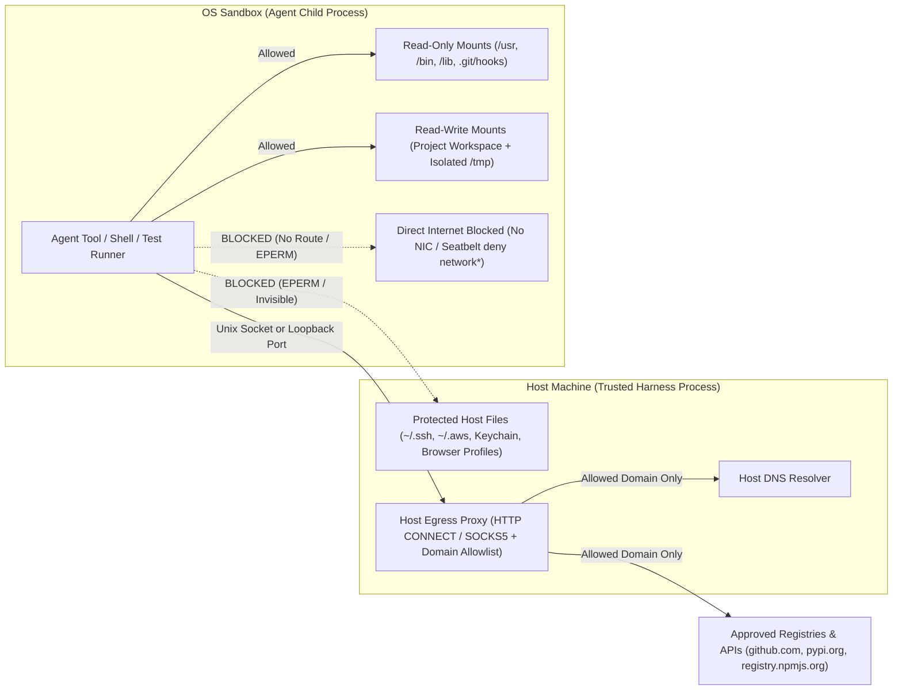

> **Module 4: Sandboxing & Security** | Prerequisites: Chapter 21 | Reading Time: ~22 min
>
> [← 21. OS-Level Sandboxing (macOS Seatbelt, Linux Bubblewrap/Landlock, Containers)](./21-os-level-sandboxing-seatbelt-bubblewrap-landlock-containers.md) | [Table of Contents](../README.md) | [23. Permission Models & Command Approval Policies →](./23-permission-models-and-command-approval-policies.md)

# 22. Filesystem & Network Isolation

In Chapter 21, you learned *which* walls an operating system can build around an agent (Seatbelt, Bubblewrap, Landlock, containers, and microVMs). Now comes the harder and more practical question: **where exactly should you place the walls, where should you put locked doors, and what subtle cracks do attackers—and careless scripts—slip through?**

This chapter covers the exact **filesystem** and **network** isolation rules that separate a leaky toy sandbox from a production coding-agent harness: scoping workspace mounts, shielding sensitive host paths, closing symlink traversal holes, building offline-by-default network cages with HTTP/CONNECT allowlist proxies, and shutting down quiet data-exfiltration channels like DNS and package-manager install hooks.

---

## 1. The Simple Idea (Zero-Jargon Intuition)

Think of a secure **cleanroom laboratory** where a chemist works on one specific sample:

1. **Filesystem Isolation (What is inside the room):**
   - The chemist gets **read-only manuals** on the shelf (system libraries like `/usr`, compilers, Python/Node runtimes). They can read them, never alter them.
   - They get **one workbench tray** they can freely write on (your project workspace) plus a **disposable waste tray** that gets incinerated at the end of the shift (an isolated `/tmp` scratch directory).
   - Every other filing cabinet in the building—tax records, master keys, personal bank statements (`~/.ssh`, `~/.aws`, browser cookies, `.env` secrets)—is **either not in the room at all or sealed behind a steel door**.
2. **Network Isolation (Who can pass notes out of the room):**
   - By default, **there are no windows and no phones in the room** (offline-by-default).
   - If the chemist genuinely needs a reagent from an approved supplier (say, `pypi.org` or `registry.npmjs.org`), they cannot call out directly. They pass a request slip to a **receptionist outside the room** (an **egress filtering proxy**). The receptionist checks the destination against an approved list and blocks everything else.

Two small pieces of vocabulary make the rest of this chapter effortless:
- **Symlink (Symbolic Link):** A special file that acts like a shortcut pointing to another file or folder elsewhere on the disk (for example, `docs/link` pointing to `/Users/alice/.ssh/id_ed25519`). If a naive check only looks at the *name* `docs/link`, it thinks the file is inside the workspace—even though opening it reads a private key outside!
- **Egress:** Any network traffic **leaving** your sandbox toward an external server (as opposed to *ingress*, traffic coming in). For coding agents, **egress control** is where data-theft prevention lives.

---

## 2. Why This Matters in a Real Agent Harness

You might wonder: *"If my agent can only write inside my repo, why do I care what it can read or where it sends network requests?"*

Because **confidentiality breaches only require two ingredients: read access + outbound network**.

Consider a realistic, everyday sequence in an engineering workflow:
1. A developer asks an agent to review a pull request or debug an open-source library.
2. Hidden inside a test fixture or dependency is an indirect prompt injection—or simply a malicious `postinstall` script inside a transitive `npm` package.
3. If the sandbox allows **broad reads** (so `~/.aws/credentials` or `~/.npmrc` is readable) AND allows **open internet access**, a single line of code can read those secrets and quietly send them to an attacker-controlled server—without ever modifying a single file outside the workspace!

Even worse, **integrity breaches** can happen entirely *inside* the workspace if you don't separate normal source code from executable control files (like `.git/hooks`, `.envrc`, or IDE task definitions).

Filesystem isolation protects **what the agent can see and touch**. Network isolation ensures that **even if the agent sees sensitive source code inside your private repo, that code cannot silently walk out the front door**.

---

## 3. The Big Picture (Filesystem + Proxy-Mediated Network Boundary)

Modern coding harnesses (such as Claude Code's `sandbox-runtime`, Codex CLI, and hardened container runners) place an **enforced boundary** around both disk and network, routing any permitted outbound traffic through a **host-side proxy** that lives *outside* the sandbox:



Look closely at why DNS is on the **Host** side of that diagram! When the sandbox has **zero direct network access** and can only talk to a local proxy over a Unix domain socket (or loopback port), the sandboxed process **cannot even send raw DNS packets** to the internet. Only the trusted host proxy resolves domain names—closing one of the sneakiest data-exfiltration loopholes in security engineering.

---

## 4. Deep Dive: Subtopic by Subtopic

### 4.1 Workspace-Scoped Mounts: Read-Only System, Read-Write Workspace, Scratch `/tmp`

A practical coding-agent filesystem policy divides the entire disk into **four clear zones**:

| Zone | Typical Paths | Access Mode | Why It Is Needed |
| :--- | :--- | :--- | :--- |
| **1. System & Toolchains** | `/usr`, `/bin`, `/lib`, `/lib64`, `/System`, `/Library`, Homebrew/nvm/pyenv binaries | **Read-Only** | Compilers, interpreters (`python3`, `node`, `cargo`), and shared libraries must be readable and executable, never tamperable. |
| **2. Active Project Workspace** | `/path/to/repo` (except protected control subpaths) | **Read-Write** | The agent must edit source files, generate build artifacts, and run test suites here. |
| **3. Ephemeral Scratch Space** | Dedicated per-run temp dir (`TMPDIR=/tmp/agent-xyz`, Linux `--tmpfs /tmp`) | **Read-Write (Isolated)** | Compilers (`gcc`, `rustc`), bundlers, and test runners write temporary files constantly. Sharing the host's `/tmp` risks colliding with or reading other users'/apps' temp files (like Unix sockets in `/tmp`). |
| **4. Everything Else on Host** | `~/.ssh`, `~/.aws`, `~/Documents`, browser profiles, other repos | **Hidden / Deny-Read & Deny-Write** | Least privilege: an agent fixing a bug in `repo-a` has zero reason to read `repo-b`, your SSH keys, or your Chrome cookies. |

#### The Subtle Catch with `/etc` and Language Caches

In practice, locking down reads too naively breaks real developer tools:
- Programs need `/etc/ssl/certs` (to verify TLS certificates), `/etc/passwd` (for UID lookups), and `/dev/null` / `/dev/urandom`.
- Package managers (`pip`, `npm`, `cargo`, `go`) love writing to `~/.cache` or `~/.npm`. If `$HOME` is read-only or unmounted, `npm test` might crash with `EACCES: permission denied, mkdir '/home/alice/.npm'`.

**The clean harness fix:** Redirect cache environment variables into your isolated scratch directory or a dedicated sandbox cache folder before launching the command:

```bash
HOME="/tmp/agent-scratch/home"
TMPDIR="/tmp/agent-scratch/tmp"
XDG_CACHE_HOME="/tmp/agent-scratch/cache"
NPM_CONFIG_CACHE="/tmp/agent-scratch/npm-cache"
PIP_CACHE_DIR="/tmp/agent-scratch/pip-cache"
```

Now `npm`, `pip`, and `pytest` run smoothly without ever needing write access to your real home directory!

---

### 4.2 Protecting Sensitive Host Paths (and Workspace Trapdoors)

When designing your deny-lists (on macOS Seatbelt or in-process file tools) or mount-lists (on Linux `bwrap` / containers), there are **two distinct categories of sensitive paths** you must guard:

#### Category A: Sensitive Host Paths (Outside the Workspace)
| Path Pattern | What Lives There | Risk if Exposed |
| :--- | :--- | :--- |
| `~/.ssh`, `~/.gnupg` | Private SSH and GPG signing keys | Immediate access to Git remotes, production servers, and commit forgery. |
| `~/.aws`, `~/.azure`, `~/.config/gcloud`, `~/.kube` | Cloud provider credentials & Kubernetes cluster tokens | Full cloud account takeover or infrastructure destruction. |
| `~/.npmrc`, `~/.pypirc`, `~/.netrc`, `~/.docker/config.json`, `~/.git-credentials` | Package registry and Git authentication tokens | Publishing malicious packages or pushing unauthorized code. |
| `~/Library/Keychains`, `~/.local/share/keyrings` | OS password vaults | Bulk credential theft. |
| Chrome/Firefox/Arc profile folders (`Cookies`, `Login Data`) | Active browser session cookies & saved passwords | Hijacking authenticated SaaS sessions (Gmail, GitHub, AWS Console). |
| `~/.bashrc`, `~/.zshrc`, `~/.profile`, `~/.gitconfig` | Shell startup & global Git config | **Persistence / sandbox escape:** writing a command into `~/.zshrc` runs it unsandboxed the next time the user opens a terminal! |

#### Category B: Sensitive Control Paths *Inside* the Writable Workspace
This is the blind spot that catches almost every first-time harness builder. Even if the workspace is writable, these paths inside it should be **read-only or approval-gated**:

- **`.git/hooks/` and `.git/config`**: Writing a `pre-commit` hook or setting `core.fsmonitor` / `core.sshCommand` in `.git/config` causes arbitrary code execution on the host the very next time the human runs `git status` or `git commit`.
- **Harness configuration files** (`.claude/`, `.codex/`, `.gemini/`, `.cursor/`, `.mcp.json`): If an agent can edit its own permission rules or register a rogue MCP server, it can grant itself full host access on the next turn.
- **Secret files in the repo** (`.env`, `.env.local`, `.env.production`, `*.pem`, `id_rsa`, `service-account*.json`): Many local projects keep live API keys in `.env`. Consider blocking direct reads of `.env*` by default (or injecting redacted placeholders—see Chapter 25).
- **Auto-executing workspace files** (`.envrc` for `direnv`, `.vscode/tasks.json` with auto-run): Flag edits to these in your approval policy.

> **Prefer Allowlist-by-Mount over Denylist-by-Path Whenever Possible:**
> On Linux (`bwrap` / containers / microVMs), you don't have to remember every single secret path in `$HOME`—because you simply **never mount `$HOME`**. Only on platforms like macOS Seatbelt (where broad reads are sometimes allowed for toolchain compatibility) do you need a carefully curated deny-read list—and even on macOS, stricter profiles deny all reads under `/Users/<you>` *except* the workspace and specific toolchain directories (like `~/.nvm` or `~/.cargo`).

---

### 4.3 Symlink Traversal & Path-Canonicalization Defenses

Even when your harness implements its own `read_file` or `write_file` tools in Python/TypeScript, naive path checks are notoriously easy to fool.

#### How Naive Path Checks Fail

Suppose your workspace is `/Users/alice/app`. Look at three classic mistakes:

1. **String prefix bug (`startswith` without a trailing separator):**
   - Check: `path.startswith("/Users/alice/app")`
   - Input: `/Users/alice/app-secrets/prod.env` → **Passes!** Because `"/Users/alice/app-secrets"` starts with `"/Users/alice/app"`.
2. **Relative traversal (`..`):**
   - Input: `/Users/alice/app/src/../../../.ssh/id_rsa` → Naive string check sees the prefix `/Users/alice/app/` and allows it!
3. **Symlink escape:**
   - Inside the repo, someone (or a cloned git commit!) includes a symlink: `ln -s /Users/alice/.ssh/id_ed25519 ./README_LINK`.
   - `os.path.abspath("/Users/alice/app/README_LINK")` returns `"/Users/alice/app/README_LINK"` — it does **not** follow symlinks!
   - When your tool opens that path, the OS quietly follows the symlink right out of the workspace and hands back the private SSH key.

#### The Defensive Pattern: Canonicalize + Boundary Check + Safe Open

To validate paths properly in harness code:
1. **Resolve every symlink along the path** using `os.path.realpath()` (Python) or `fs.realpathSync()` (Node.js). For a *new* file that doesn't exist yet, resolve its **nearest existing parent directory** with `realpath()` and verify no intermediate component is an escaping symlink.
2. **Use `Path.is_relative_to(workspace_real)`** (or `os.path.commonpath([workspace_real, target_real]) == workspace_real`)—never plain `startswith()`.
3. **Guard against TOCTOU (Time-of-Check to Time-of-Use) races:** What if a background process swaps a legitimate file for a symlink in the microsecond *between* your `realpath()` check and your `open()` call?
   - In high-security tools (and inside OS sandboxes), open directories step-by-step using `openat()` with the `O_NOFOLLOW` flag (or Linux's `openat2()` with `RESOLVE_BENEATH` / `RESOLVE_NO_SYMLINKS`), which instructs the kernel itself to refuse crossing outside the directory file descriptor.
   - And remember: **your OS sandbox (Seatbelt / bwrap / Landlock) is the ultimate backstop**, because the kernel enforces canonical paths atomically at the exact moment of the syscall!

---

### 4.4 Network Isolation: Offline-by-Default & HTTP/CONNECT Egress Proxies

Giving an AI coding agent unrestricted internet access is like letting an untrusted contractor carry uninspected backpacks out of your building.

#### Tier 1: Offline-by-Default (Best for 90% of Coding Tasks)

Most coding work—reading code, refactoring, running unit tests, linting, type-checking, compiling already-installed dependencies—requires **zero internet access**.
- On Linux `bwrap`: `--unshare-all` (without `--share-net`) gives the sandbox an empty network namespace containing only `lo` (loopback). Every outbound TCP, UDP, ICMP, or DNS packet immediately fails with `ENETUNREACH`.
- On Docker/Podman: `--network=none`.
- On macOS Seatbelt: omitting `(allow network*)` under `(deny default)` blocks all outbound sockets at the kernel layer.

#### Tier 2: Domain-Allowlisted Egress via a Local Filtering Proxy

What when the agent *genuinely* needs network access—for example, installing a package from `registry.npmjs.org` or `pypi.org`, fetching docs from `docs.python.org`, or querying `api.github.com`?

**Why IP-based firewalls fail here:** Modern developer registries sit behind global CDNs (Cloudflare, Fastly, CloudFront) whose IP addresses change constantly and are shared by thousands of unrelated (and potentially hostile) domains. Blocking or allowing by IP address alone is brittle and overly broad.

**The Solution — Proxy-Mediated Egress Filtering (used by Claude Code `sandbox-runtime`, enterprise proxies, and hardened cloud sandboxes):**

1. **Block all direct outbound network** from inside the sandbox (kernel enforced).
2. **Expose a single local bridge** from the sandbox to a proxy running *outside* the sandbox on the trusted host:
   - On Linux (`bwrap` with `--unshare-net`): Bridge traffic via a **Unix domain socket** bind-mounted into the sandbox (with a tiny local `socat`/bridge listener inside the sandbox forwarding `127.0.0.1:PORT` ↔ Unix socket), so the sandbox remains 100% detached from host network interfaces.
   - On macOS (Seatbelt): Allow `(allow network-outbound (remote ip "localhost:<proxy_port>"))` *only* for the proxy's ephemeral loopback port, denying all other network calls.
3. **Configure standard proxy environment variables** inside the sandbox:
   `HTTP_PROXY=http://127.0.0.1:<port>`, `HTTPS_PROXY=http://127.0.0.1:<port>`, `ALL_PROXY=socks5h://127.0.0.1:<port>`.
4. **Inspect every destination hostname at the proxy:**
   - For HTTPS traffic, clients send an explicit HTTP **`CONNECT registry.npmjs.org:443 HTTP/1.1`** request before TLS handshaking begins.
   - The proxy checks `registry.npmjs.org` (and port `443`) against a strict **domain allowlist** (and denies private/metadata IPs like `169.254.169.254` or `127.0.0.1` to prevent SSRF—Server-Side Request Forgery—against cloud metadata or local host services!).
   - If allowed, the host proxy resolves DNS, opens the upstream TCP connection, and tunnels the encrypted bytes. If denied, the proxy returns `403 Forbidden` and logs the blocked attempt.

| Egress Control Approach | Granularity | Stops Direct IP / Raw Socket Bypass? | Stops DNS Tunneling? | Complexity |
| :--- | :--- | :--- | :--- | :--- |
| **Offline-by-default (`--network=none`)** | All blocked | Yes | Yes | Low |
| **Proxy env vars *without* OS network block** | Domain name | **No!** Any script ignoring `HTTP_PROXY` connects directly. | **No!** | Low (Insecure!) |
| **OS network block + Local HTTP/CONNECT & SOCKS5 Proxy** | Exact domain + port | **Yes** (kernel blocks direct sockets) | **Yes** (sandbox cannot send DNS packets; proxy resolves DNS) | Medium |
| **TLS-Terminating Inspection Proxy** | Full URL path, HTTP method (`GET` vs `POST`), & body | Yes | Yes | High (requires custom CA cert inside sandbox) |

> **Critical Warning:** Setting `HTTP_PROXY` alone *without* kernel-enforcing a block on direct network sockets is **security theater**. Any script can run `curl --noproxy '*' https://example.com` or open a raw Python socket and sail right past the proxy. The OS sandbox and the proxy must work as a pair.

---

### 4.5 Preventing Sneaky Data Exfiltration Channels

Once you understand the basics, think like a defensive architect auditing every exit door out of your cleanroom:

1. **DNS Exfiltration (DNS Tunneling):**
   - *How it happens:* Even if outbound HTTP (ports 80/443) is blocked, if port 53 (UDP/TCP DNS) is left open, a compromised script can encode secret bytes into a subdomain lookup—e.g., looking up `<encoded-secret>.tracker.example`—and the authoritative DNS server for `tracker.example` records the query!
   - *Defense:* **Never allow direct DNS from inside the sandbox.** Block all direct outbound sockets (including UDP 53) and let the host-side proxy perform DNS resolution only for allowlisted domains (notice `socks5h://`—the `h` tells the client to pass the hostname to the proxy for resolution rather than resolving DNS locally!).

2. **Allowed-Domain Abuse ("Living off Trusted Sites"):**
   - *How it happens:* Suppose your allowlist permits `github.com` or `api.github.com` so the agent can pull code. If the agent can also `POST` or `git push` to an arbitrary *public* repository or Gist on `github.com`, an attacker can exfiltrate private source code *through an allowlisted domain*!
   - *Defense:* Separate **read-only package/git access** from **write/push access**. For high-security enterprise environments, use a **mirror registry** (like an internal Artifactory/Verdaccio) or a **method/path-aware proxy** that only allows `GET` requests to package registries and restricts `github.com` traffic to your organization's repositories.

3. **Package-Manager Lifecycle Scripts (`postinstall`, `setup.py`, `build.rs`):**
   - *How it happens:* Running `npm install`, `pip install`, or `cargo build` does not merely download archives—package managers execute arbitrary code shipped inside packages during installation! A typosquatted or compromised package executes immediately during install.
   - *Defense:*
     - Keep `npm install` / `pip install` inside the sandbox (never bypass the sandbox for installs!).
     - Prefer safe install flags when updating lockfiles isn't needed: `npm ci --ignore-scripts`, `pip install --only-binary=:all:` where feasible, and lockfile pinning.
     - **Two-phase installs** (for ultra-strict setups): Phase 1 fetches packages in an isolated network-allowlisted environment *with scripts disabled*; Phase 2 runs builds and tests **completely offline** (`--network=none`).

4. **Cloud Metadata Endpoints & Localhost Services (SSRF):**
   - *How it happens:* When your agent runs on a cloud VM (AWS EC2, GCP, Azure), `http://169.254.169.254` serves temporary IAM credentials for the entire VM! Or on a developer laptop, `http://127.0.0.1:8080` might be a local database admin panel or Ollama/Docker daemon.
   - *Defense:* Your egress proxy must resolve the target hostname to IP address(es) **before connecting** and strictly reject all private, loopback, link-local, and multicast ranges (`127.0.0.0/8`, `10.0.0.0/8`, `169.254.0.0/16`, `172.16.0.0/12`, `192.168.0.0/16`, `::1`, `fe80::/10`, `fc00::/7`)—preventing DNS-rebinding tricks as well!

---

## 5. How Real Harnesses Do It

- **Claude Code & `@anthropic-ai/sandbox-runtime` (`srt`):** Implements the exact **kernel-blocked direct network + host-side HTTP/SOCKS5 proxy** architecture. Inside the sandbox, direct network access is disabled via Seatbelt (macOS) or `bwrap --unshare-net` + Unix socket bridge (Linux). Outbound requests are routed through the runtime's local proxy, which enforces `allowedDomains` and `deniedDomains`, while filesystem config separates `denyRead`, `allowWrite`, and `denyWrite` paths.
- **OpenAI Codex CLI:** Defaults to **completely offline** inside `workspace-write` mode—if a command fails because it tried to reach `pypi.org` or `registry.npmjs.org`, the failure is visible and the user can approve a targeted networked command or configure an allowlisted proxy. Inside the writable workspace, `.git/hooks` and `.codex/` are forced read-only to prevent persistence escapes.
- **Gemini CLI:** Pairs workspace-scoped mounts with explicit Seatbelt profile variants: `-open` (network permitted) versus **`-proxied`** (all direct outbound network denied except the configured local proxy port). In Docker/Podman mode, only the active workspace is bind-mounted into the container, naturally isolating the rest of the developer's home directory.
- **GitHub Copilot Coding Agent / Cloud Eval Harnesses (SWE-bench):** Runs the setup phase (installing dependencies) with tightly allowlisted egress, then **cuts the network completely** or routes all traffic through an allowlist firewall before the autonomous coding loop begins—guaranteeing that unit tests and agent reasoning cannot leak repository contents or cheat by querying external websites.

---

## 6. Common Pitfalls & Failure Modes

1. **Allowing `HTTP_PROXY` without blocking direct outbound sockets.**
   - *Symptom:* Security audit shows `curl` obeys the proxy, so the team declares victory—until a Python script using `urllib` or a Go binary ignores proxy env vars and connects straight out.
   - *Fix:* Enforce direct network denial in the OS sandbox (`--unshare-net` on Linux, omitting `(allow network*)` on macOS Seatbelt).
2. **Allowing `CONNECT` to arbitrary ports or resolved private IPs.**
   - *Symptom:* Your proxy allows `*.example.com`, and an attacker points `internal.example.com` to `169.254.169.254` (cloud metadata) or `127.0.0.1` (your local Postgres/Redis/daemon).
   - *Fix:* Restrict `CONNECT` to safe ports (`443`, `80`), resolve DNS inside the proxy, verify **every** resolved IP is globally routable (`ip.is_global`), and connect directly to that verified IP (avoiding a second DNS lookup that could rebind!).
3. **Symlink check only at the leaf filename.**
   - *Symptom:* You check `not os.path.islink(target)`, missing the fact that a *parent* directory (`workspace/vendor`) is a symlink pointing outside the workspace.
   - *Fix:* Resolve the entire path with `os.path.realpath()` (or `openat2` with `RESOLVE_BENEATH`) and check containment with `Path.is_relative_to()`.
4. **Blocking reads of `/Users/alice` so harshly that `stat()` fails on workspace traversal.**
   - *Symptom:* On macOS Seatbelt, denying `file-read*` on `/Users/alice` breaks `getcwd()` or Node.js module resolution inside `/Users/alice/projects/app` because tools call `lstat()` on parent folders.
   - *Fix:* Distinguish `file-read-data` (reading directory listings and file contents) from `file-read-metadata` (checking that a parent directory exists) when crafting strict Seatbelt read-deny rules.
5. **Forgetting IPv6 when filtering IPs or loopback rules.**
   - *Symptom:* Your firewall blocks `127.0.0.1` and `169.254.169.254`, but leaves `::1` or IPv4-mapped IPv6 addresses (`::ffff:127.0.0.1`) wide open.
   - *Fix:* Use standard IP libraries (Python `ipaddress.ip_address`) and check `.ipv4_mapped` as well as `not ip.is_global`.

---

## 7. Build It Yourself: Mini-Lab — Canonical Path Guard + Egress Allowlist Proxy

Below are two compact, production-style defensive building blocks you can drop straight into a harness:
1. **`WorkspacePathGuard`**: Safely resolves symlinks (even for not-yet-created files), enforces workspace containment, and protects sensitive subpaths like `.git/hooks` and `.env`.
2. **`AllowlistConnectProxy`**: A minimal Python `asyncio` HTTP `CONNECT` proxy that checks domain allowlists, blocks non-443 ports, resolves DNS once on the host side, and rejects private/loopback/link-local IPs to stop SSRF and DNS rebinding.

```python
"""
isolation_guards.py — Two core defensive components for an agent harness:
  1. WorkspacePathGuard: symlink-safe filesystem boundary enforcement.
  2. AllowlistConnectProxy: host-side HTTP CONNECT egress proxy with SSRF protection.
"""

from __future__ import annotations

import asyncio
import fnmatch
import ipaddress
import os
import socket
from pathlib import Path


# ---------------------------------------------------------------------------
# Component 1: Symlink-Safe Workspace Path Guard
# ---------------------------------------------------------------------------

class PathViolationError(PermissionError):
    """Raised when a requested path escapes the workspace or hits a protected target."""


class WorkspacePathGuard:
    def __init__(
        self,
        workspace: Path,
        protected_write_prefixes: tuple[str, ...] = (".git/hooks", ".git/config", ".agent"),
        protected_read_globs: tuple[str, ...] = (".env", ".env.*", "*.pem", "*.key"),
    ) -> None:
        self.workspace_real = Path(os.path.realpath(workspace))
        self.protected_write_prefixes = protected_write_prefixes
        self.protected_read_globs = protected_read_globs

    def _canonicalize(self, requested: str | Path) -> Path:
        """
        Resolve symlinks safely, even when the target file does not exist yet
        (by resolving the deepest existing ancestor directory first).
        """
        candidate = Path(requested)
        if not candidate.is_absolute():
            candidate = self.workspace_real / candidate

        # Walk upward until we find an existing ancestor to canonicalize.
        missing_parts: list[str] = []
        cursor = candidate
        while not cursor.exists() and not cursor.is_symlink():
            if cursor.parent == cursor:
                break
            missing_parts.append(cursor.name)
            cursor = cursor.parent

        resolved_base = Path(os.path.realpath(cursor))
        for part in reversed(missing_parts):
            if part in ("", ".", ".."):
                raise PathViolationError(f"Suspicious path segment in {requested!r}")
            resolved_base = resolved_base / part
        return resolved_base

    def validate(self, requested: str | Path, mode: str = "read") -> Path:
        resolved = self._canonicalize(requested)

        # 1. Must stay strictly inside the canonical workspace root.
        if not resolved.is_relative_to(self.workspace_real):
            raise PathViolationError(
                f"Blocked {mode}: {requested!r} resolves outside workspace ({resolved})"
            )

        rel = resolved.relative_to(self.workspace_real).as_posix()

        # 2. Protect workspace control files from modification.
        if mode == "write":
            for prefix in self.protected_write_prefixes:
                if rel == prefix or rel.startswith(prefix + "/"):
                    raise PathViolationError(
                        f"Blocked write to protected control path: {rel}"
                    )

        # 3. Protect sensitive secret files inside the repo from casual reads.
        if mode == "read":
            name = resolved.name
            for pattern in self.protected_read_globs:
                if fnmatch.fnmatch(name, pattern):
                    raise PathViolationError(
                        f"Blocked read of sensitive secret file: {rel}"
                    )

        return resolved


# ---------------------------------------------------------------------------
# Component 2: Host-Side HTTP CONNECT Egress Allowlist Proxy
# ---------------------------------------------------------------------------

def is_safe_public_ip(ip_str: str) -> bool:
    """Reject loopback, RFC1918 private, link-local (169.254.169.254), and multicast IPs."""
    ip = ipaddress.ip_address(ip_str)
    if isinstance(ip, ipaddress.IPv6Address) and ip.ipv4_mapped:
        ip = ip.ipv4_mapped
    return ip.is_global and not (
        ip.is_private or ip.is_loopback or ip.is_link_local or ip.is_multicast or ip.is_reserved
    )


class AllowlistConnectProxy:
    def __init__(
        self,
        allowed_domains: set[str],
        allowed_ports: set[int] = frozenset({443}),
    ) -> None:
        self.allowed_domains = {d.lower().lstrip(".") for d in allowed_domains}
        self.allowed_ports = set(allowed_ports)

    def is_domain_allowed(self, host: str) -> bool:
        host = host.lower().rstrip(".")
        return any(
            host == d or host.endswith("." + d)
            for d in self.allowed_domains
        )

    async def handle_client(
        self, reader: asyncio.StreamReader, writer: asyncio.StreamWriter
    ) -> None:
        try:
            header_bytes = await asyncio.wait_for(reader.readuntil(b"\r\n\r\n"), timeout=10)
            request_line = header_bytes.split(b"\r\n", 1)[0].decode("ascii", errors="replace")
            parts = request_line.split()
            if len(parts) != 3 or parts[0].upper() != "CONNECT":
                writer.write(b"HTTP/1.1 405 Method Not Allowed\r\n\r\n")
                await writer.drain()
                return

            host, _, port_str = parts[1].rpartition(":")
            port = int(port_str)

            # 1. Enforce port & domain allowlist before doing any DNS or network I/O.
            if port not in self.allowed_ports or not self.is_domain_allowed(host):
                writer.write(b"HTTP/1.1 403 Forbidden\r\n\r\nBlocked by agent egress policy.\n")
                await writer.drain()
                return

            # 2. Resolve DNS on the trusted host and verify every IP is public (anti-SSRF).
            loop = asyncio.get_running_loop()
            infos = await loop.getaddrinfo(host, port, type=socket.SOCK_STREAM)
            safe_ips = [info[4][0] for info in infos if is_safe_public_ip(info[4][0])]
            if not safe_ips or len(safe_ips) != len(infos):
                writer.write(b"HTTP/1.1 403 Forbidden\r\n\r\nResolved to non-public IP.\n")
                await writer.drain()
                return

            # 3. Connect directly to the verified IP (prevents DNS rebinding!).
            up_reader, up_writer = await asyncio.wait_for(
                asyncio.open_connection(safe_ips[0], port), timeout=10
            )
            writer.write(b"HTTP/1.1 200 Connection Established\r\n\r\n")
            await writer.drain()

            # 4. Bidirectional tunnel until either side closes.
            async def pipe(src: asyncio.StreamReader, dst: asyncio.StreamWriter) -> None:
                try:
                    while chunk := await src.read(65536):
                        dst.write(chunk)
                        await dst.drain()
                finally:
                    dst.close()

            await asyncio.gather(pipe(reader, up_writer), pipe(up_reader, writer))
        except Exception:
            if not writer.is_closing():
                writer.write(b"HTTP/1.1 502 Bad Gateway\r\n\r\n")
                await writer.drain()
        finally:
            writer.close()


# Quick verification smoke test for WorkspacePathGuard
if __name__ == "__main__":
    guard = WorkspacePathGuard(Path.cwd())
    print("Valid file:", guard.validate("README.md", mode="read"))
    for bad_path, mode in [
        ("../.ssh/id_ed25519", "read"),
        (".git/hooks/pre-commit", "write"),
        (".env.local", "read"),
    ]:
        try:
            guard.validate(bad_path, mode=mode)
        except PathViolationError as exc:
            print("Caught expected violation:", exc)
```

Notice the two subtle security details baked into that proxy:
1. It checks `len(safe_ips) == len(infos)` so a domain returning a mix of public and private IPs is rejected outright.
2. It connects directly to `safe_ips[0]` rather than passing `host` to `open_connection()`, eliminating DNS-rebinding races between the check and the connection.

---

## 8. Key Takeaways & Quick Self-Check

### Key Takeaways
- **Split the disk into four clear zones:** Read-only system toolchains, read-write workspace (minus protected control files), ephemeral isolated `/tmp` & cache dirs, and hidden/denied host secrets.
- **Never trust raw path strings:** Always canonicalize with `realpath()` (walking up to the nearest existing ancestor for new files) and check containment with `Path.is_relative_to()`, backed up by kernel-level sandbox enforcement.
- **Default to offline; mediate required egress through a host-side proxy:** Setting `HTTP_PROXY` alone is bypassable unless the OS sandbox blocks direct outbound sockets.
- **Close indirect exfiltration doors:** Keep DNS resolution on the host proxy (blocking direct port 53), validate resolved IPs against private/metadata ranges (anti-SSRF), and run package-manager installs inside the sandbox with lifecycle scripts disabled when possible.

### Quick Self-Check

1. **Why is `os.path.abspath(user_path).startswith(workspace)` vulnerable in two separate ways?**
   <details>
   <summary>Show Answer</summary>
   First, `abspath()` normalizes `..` segments but does **not** follow symlinks, so a symlink inside the workspace pointing to `~/.ssh/id_rsa` passes the check. Second, `startswith("/Users/alice/app")` without a path-boundary check matches sibling directories like `/Users/alice/app-secrets/key.pem`. Use `os.path.realpath()` plus `Path.is_relative_to()`.
   </details>

2. **How can an attacker exfiltrate data even if your firewall blocks outbound HTTP/HTTPS on ports 80 and 443?**
   <details>
   <summary>Show Answer</summary>
   Via **DNS tunneling**: if the sandbox can send direct DNS queries (UDP/TCP port 53), a script can encode stolen data into subdomain labels (such as `<hex-data>.attacker.example`) and trigger a lookup. The fix is to block *all* direct outbound sockets (including DNS) inside the sandbox and perform DNS resolution exclusively inside the trusted host proxy for allowlisted domains only.
   </details>

3. **Why must an allowlist HTTP `CONNECT` proxy verify the resolved IP address *and* connect to that verified IP?**
   <details>
   <summary>Show Answer</summary>
   To prevent **SSRF (Server-Side Request Forgery)** and **DNS rebinding**. A domain might resolve to an internal address like `169.254.169.254` (cloud VM metadata) or `127.0.0.1` (local host services). Checking that the resolved IP is globally routable stops SSRF, and opening the socket directly to that verified IP prevents a malicious DNS server with a 0-second TTL from flipping the answer to `127.0.0.1` on a second lookup.
   </details>

4. **Why should your harness redirect `NPM_CONFIG_CACHE`, `PIP_CACHE_DIR`, and `TMPDIR` into an isolated scratch folder?**
   <details>
   <summary>Show Answer</summary>
   Two reasons: **reliability** (when `$HOME` is hidden or read-only inside the sandbox, package managers and compilers crash unless their cache and temp directories point somewhere writable) and **isolation** (avoiding sharing the host's `/tmp`, which can contain sensitive temporary files or Unix sockets belonging to other host processes).
   </details>

---

[← 21. OS-Level Sandboxing (macOS Seatbelt, Linux Bubblewrap/Landlock, Containers)](./21-os-level-sandboxing-seatbelt-bubblewrap-landlock-containers.md) | [Table of Contents](../README.md) | [23. Permission Models & Command Approval Policies →](./23-permission-models-and-command-approval-policies.md)
