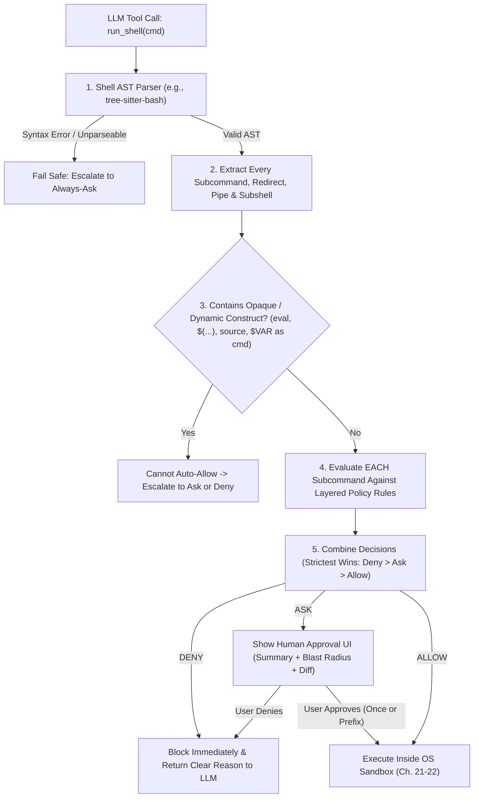
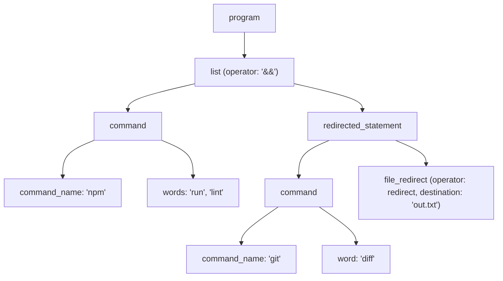
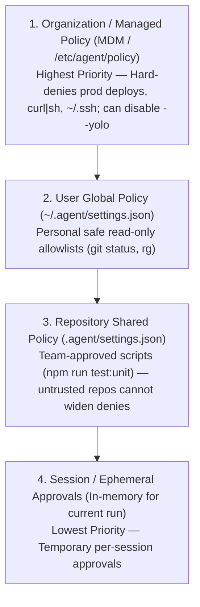

> **Module 4: Sandboxing & Security** | Prerequisites: Chapters 21–22 | Reading Time: ~22 min
>
> [← 22. Filesystem & Network Isolation](./22-filesystem-and-network-isolation.md) | [Table of Contents](../README.md) | [24. Prompt Injection Defenses & Trust Boundaries →](./24-prompt-injection-defenses-and-trust-boundaries.md)

# 23. Permission Models & Command Approval Policies

In Chapters 21 and 22, we built a locked cleanroom around the agent using OS sandboxes, filesystem boundaries, and egress proxies. That protects your machine from unauthorized escapes, but what about actions the agent **is** legitimately allowed to request, like `git push`, `rm -rf`, `npm install`, `terraform apply`, or editing production config?

You cannot lock every dangerous tool away forever, or the agent becomes useless. Yet you cannot silently auto-run every command either, or one bad turn wipes a database or force-pushes over `main`.

This chapter is about the **human-and-policy control plane**: how harnesses design permission tiers, parse shell commands safely using **Abstract Syntax Trees (ASTs)** instead of fragile regexes, craft approval prompts that prevent **approval fatigue**, and enforce **policy-as-code** across engineering teams.

---

## 1. The Simple Idea (Zero-Jargon Intuition)

Imagine hiring a capable personal assistant to manage your home office and business errands. You would never operate under either extreme:

- **Extreme 1 (Approve Everything):** The assistant knocks on your door every 90 seconds: *"May I open the filing cabinet? May I sharpen a pencil? May I check the calendar? May I staple two pages?"* Within 10 minutes, you are so exhausted that you stop listening and just yell *"YES TO EVERYTHING!"*: which is how they accidentally shred your passport at 10:15 AM.
- **Extreme 2 (Approve Nothing):** You give them your company credit card, house keys, and email password with zero guardrails. It feels smooth, until one misunderstanding wires \$50,000 to the wrong vendor.

Instead, every sane workplace uses **permission tiers**:
1. **Do freely (Auto-allow):** Reading reference books, checking inventory, running local checks in a sandbox.
2. **Ask once, then remember for this project (Ask-once / Prefix allowlist):** *"I'll be running the test suite a lot today; can I run `pytest` freely for this session?"*
3. **Always ask first (Always-ask):** Spending money, sending external emails, pushing code to shared branches, deleting data.
4. **Never allowed (Hard-deny):** Handing out the master safe combination, turning off the fire alarms, wiping the production database.

In an agent harness, **a permission model is the deterministic rule engine that classifies every proposed tool call into one of those four tiers before a single byte executes.**

---

## 2. Why This Matters in a Real Agent Harness

Permission design sits right on the fault line between **usability** and **security**: a tension every harness engineer must solve:

- **Approval Fatigue (Too Strict):** If your harness prompts the user 40 times during a 15-minute debugging task, humans shift from *careful reviewer* to *automatic Enter-key presser*. Security researchers have shown for decades that noisy warning dialogs **lower** real-world security because users stop reading them and reach for `--dangerously-skip-permissions` / `--yolo` flags.
- **Silent Danger (Too Loose):** If your harness auto-approves broad shell commands using sloppy string matching (for example, auto-allowing anything starting with `git ` or `npm `), an agent, or a prompt injection, can chain a destructive command right after a safe prefix (`git status && rm -rf .`) and execute silently with zero confirmation.

> **The UX-Safety Principle:** The goal of a great permission engine is **minimal prompts of maximum importance**. Push routine, reversible, sandboxed work into `Auto-allow` (backed by Chapters 21–22!), so that when an approval dialog *does* appear, the developer actually stops, reads it, and trusts that it matters.

---

## 3. The Big Picture (How a Command Flows Through a Policy Engine)

Before any shell command reaches the OS sandbox, a mature harness runs it through a **deterministic parsing and policy pipeline**:



Pay special attention to **Step 5: Strictest Wins (`Deny > Ask > Allow`)**. If a compound command contains three subcommands (two allowed (`git status`, `echo done`) and one denied (`curl ...`)) the entire command is **denied**. A chain is only as safe as its most dangerous link.

---

## 4. Deep Dive: Subtopic by Subtopic

### 4.1 The Four Permission Tiers

Every tool call in a harness (whether it is `read_file`, `edit_file`, `run_shell`, or an MCP tool like `jira_create_issue`) maps cleanly onto four tiers:

| Tier | Decision | Typical Examples | Why It Belongs Here |
| :--- | :--- | :--- | :--- |
| **Tier 1: Auto-Allow** | Run immediately, zero prompt | `read_file`, `grep`, `glob`, `git status`, `git diff`, `git log`, `ls`, sandboxed `pytest` / `npm test` | Read-only or strictly contained inside a git-revertible sandbox with zero external side effects. |
| **Tier 2: Ask-Once / Prefix Allowlist** | Prompt once, offer *"Always allow `pytest ...` in this repo"* | `pytest *`, `cargo test *`, `npm run lint`, `go test *`, writing to workspace source files | High-frequency developer workflows. Asking once establishes intent without nagging 30 times. |
| **Tier 3: Always-Ask** | Prompt every single time (cannot be lazily generalized) | `git push`, `gh pr create`, `npm install <pkg>`, `docker ...`, unsandboxed commands, writes to CI/deploy configs | High blast radius, external side effects, or irreversible actions (you can't `Ctrl+Z` a public GitHub comment or a sent email). |
| **Tier 4: Hard-Deny** | Blocked unconditionally; no prompt offered | `rm -rf /`, `sudo ...`, `chmod 777`, reading `~/.ssh`, modifying org policy files, `curl ... \| sh` | Catastrophic or policy-violating actions that should never run in an agent session, even if the user gets distracted. |

#### Read-Only vs. Mutating Subcommands (Why Binary Name Alone Isn't Enough)

A common rookie mistake is allowlisting an entire binary name like `git` or `kubectl` or `find`:
- `git status` and `git diff` are safe and read-only. `git push --force` and `git reset --hard` destroy work!
- `kubectl get pods` is read-only. `kubectl delete namespace prod` is a career-ending outage!
- Even `find` looks harmless, until someone passes `find . -exec rm {} \;` or `find . -delete`!
- Even `sed` looks read-only, until someone passes `sed -i` (in-place file edit)!

Therefore, Tier 1 & Tier 2 policies must evaluate **both the executable AND its subcommand/flags**: never blindly trusting a binary name without checking its arguments.

---

### 4.2 Parsing Shell Commands Safely: AST Parsing vs. Fragile Regex

Why is evaluating shell commands so famously tricky? Because **Bash/Zsh is a full programming language**, not a simple list of words.

Look at what happens when a harness tries to auto-approve commands using a naive string check like `cmd.startswith("git status")` or a regex like `^npm run (test|lint)`:

| Bypass Pattern | Example Command | What Naive Prefix/Regex Sees | What the Shell Actually Executes |
| :--- | :--- | :--- | :--- |
| **Command Chaining** | `git status && rm -rf src/` | Starts with `git status` → **Allow!** | Runs `git status`, then deletes `src/`. |
| **Pipes** | `git status \| sh` or `cat script \| bash` | Starts with `git status` → **Allow!** | Pipes output directly into a shell interpreter. |
| **Command Substitution (Subshells)** | `echo $(cat ~/.aws/credentials)` or `` echo `whoami` `` | Starts with `echo` → **Allow!** | Executes the inner command *before* `echo` even runs! |
| **Output Redirection** | `git diff > .git/hooks/pre-commit` | Starts with `git diff` → **Allow!** | Overwrites an executable Git hook on disk. |
| **Multiline / Newline Splitting** | `git status\nrm -rf .` | Regex `^git status` without `$` anchor matches line 1 → **Allow!** | Executes line 2 immediately after line 1. |
| **Variable Expansion / Indirection** | `X=rm; $X -rf .` or `eval "rm -rf ."` | Neither starts with `rm` → **Allow!** | Dynamically constructs and runs `rm -rf .`. |
| **Wrapper & Interpreter Escape** | `python3 -c "..."`, `env rm -rf .`, `xargs rm` | Doesn't match `rm` prefix → **Allow!** | Runs arbitrary code or invokes a denied binary via a wrapper. |

#### The Right Tool: Shell AST Parsing (`tree-sitter-bash` / `bashlex` / `shfmt`)

An **Abstract Syntax Tree (AST)** is a structured tree representation of code built by a real grammar parser (we first met ASTs in Chapter 16). Instead of guessing with regular expressions, a **shell AST parser** (such as **`tree-sitter-bash`** in Rust/TypeScript/Python, or Go's **`mvdan.cc/sh/v3/syntax`**) parses the shell command using the actual Bash grammar.

For example, when you feed `npm run lint && git diff > out.txt` into `tree-sitter-bash`, it produces an explicit, unambiguous tree:



With a real AST in hand, your policy engine can enforce **four ironclad rules**:

1. **Walk every node in the tree:** Inspect every `command` node inside lists (`&&`, `||`, `;`), pipelines (`|`), `if`/`for`/`while` blocks, and subshells.
2. **Treat redirects as writes:** A `file_redirect` (`>`, `>>`, `>|`) turns even a read-only command (`cat`, `git diff`, `echo`) into a **file-write operation**: check the destination path against your write policy (or escalate to `Ask`)!
3. **Never auto-allow dynamic/opaque constructs:** If the AST contains `command_substitution` (`$(...)` or backticks), `process_substitution` (`<(...)`), `expansion` (`$VAR`) inside a command name, `eval`, `source`/`.`, or syntax `ERROR` nodes, **refuse prefix auto-approval** and escalate to `Ask` (or `Deny`).
4. **Watch out for `shlex.split()` limits:** Python's built-in `shlex.split()` is great for splitting a *single simple command* into argv tokens while respecting quotes, but `shlex` does **not** understand Bash grammar (pipes, redirects, `$(...)`, `&&`). Use `shlex` only *after* verifying no shell metacharacters exist, or better yet, use a genuine shell AST parser (`tree-sitter-bash` or `mvdan/sh`), and for structured tools where shell features aren't needed, pass an explicit **`argv: list[str]`** with `shell=False` so no shell ever interprets the arguments!

> **Pro Tip: Prefer `argv` Arrays Over Shell Strings:** Whenever a tool only needs to run one program (like `git` or `pytest`), skipping `/bin/sh -c` and invoking `execve(["git", "diff", path])` eliminates command chaining, pipes, subshells, and quoting bugs in a single stroke. Reserve shell parsing for the general-purpose terminal tool.

---

### 4.3 Human-in-the-Loop Approval UX

Even a mathematically perfect policy engine fails if the approval dialog is a wall of unreadable text. Good approval UX turns a tired developer into an effective reviewer in **under 3 seconds**:

1. **Plain-English Summary + Exact Command:** Show *both* a one-line intent summary (e.g., *"Install npm dependency `zod` (requires network)"*) and the **exact, verbatim command** that will execute (never hide flags or collapse long commands behind `...` where a payload could hide!).
2. **Visual Blast-Radius Indicators:** Tag actions with clear risk badges:
   - `[Workspace Write]`: reversible via Git.
   - `[Network Egress: registry.npmjs.org]`: leaves the machine.
   - `[Unsandboxed / Host Access]`: runs outside the OS sandbox.
   - `[Irreversible / External]`: pushes code, modifies cloud infra, or sends messages.
3. **Clean Unified Diffs for File & Config Edits:** When asking to edit a sensitive file (like `.github/workflows/deploy.yml` or `package.json`), render a syntax-highlighted diff, not a 200-line file dump.
4. **Smart, Narrow "Always Allow" Choices:**
   - **Bad:** `[Allow once]  [Always allow Bash]` (far too broad!).
   - **Good:** `[Allow once]  [Always allow 'pytest *' in this workspace]  [Deny & explain why]`
   - Crucially, **"Deny & tell the agent why"** lets the user steer the agent (*"Don't install a new library, use the built-in `urllib` instead"*) rather than crashing the session.
5. **Never Generalize Compound or Dynamic Commands:** If the user approves `npm test && rm -rf tmp_out` once, do **not** offer a one-click *"Always allow `npm test ...`"* button unless the generalized prefix covers *only* the safe simple command.

---

### 4.4 Policy-as-Code for Teams and Enterprise Governance

On a solo side project, clicking "Allow once" works fine. Across a 500-engineer organization with SOC 2 compliance, production cloud credentials, and shared repositories, permissions must be **declarative, version-controlled, auditable, and tamper-resistant**.

Enterprise harnesses organize policies in a **strict precedence hierarchy**:

<!-- visual:policy-precedence -->


#### The Untrusted-Repository Trap (Crucial Security Invariant!)

Think carefully about Layer 3 (**Repository Shared Policy**): what happens when a developer clones a random GitHub repo that contains a `.agent/settings.json` file saying:
`"allow": ["Bash(*)"]`?

If your harness blindly honors `allow` rules from an untrusted repository, **cloning a repo grants that repo instant auto-approval for arbitrary code execution!**

Production harnesses solve this with **two rules**:
1. **Trusted Folders Gate:** Before loading project-level allowlists, hooks, or MCP servers from a directory, the harness checks whether the user has explicitly marked that workspace folder as **Trusted** (just like VS Code Workspace Trust).
2. **Monotonic Narrowing (Deny Always Wins):** A lower layer (user or repo config) may **tighten** restrictions (adding new `deny` or `ask` rules), but it can **never override an Organization `deny` rule** or re-enable a disabled `--yolo` mode.

---

## 5. How Real Harnesses Do It

- **Claude Code:** Uses a tiered rule system (`allow`, `ask`, `deny`) stored across managed enterprise policies, `~/.claude/settings.json`, and project `.claude/settings.json` / `.claude/settings.local.json`. Rules use structured matchers like `Bash(npm run test *)`, `Read(.env)`, or `Edit(src/**)`. Compound Bash commands are parsed structurally (using `tree-sitter-bash` / AST inspection) so every subcommand inside pipes or `&&` chains is checked individually, and `deny` rules always beat `allow` rules.
- **OpenAI Codex CLI:** Separates **sandbox mode** (what the OS allows) from **approval policy** (`--ask-for-approval`: `untrusted`, `on-failure`, `on-request`, `never`). On top of that, Codex provides **`execpolicy`**: a deterministic, Starlark-based rule engine (`default.rules`) where teams write explicit prefix rules (e.g., permitting `["git", "status"]` or `["kubectl", "get"]` while blocking destructive subcommands) that can be unit-tested in CI before shipping to developers!
- **Gemini CLI:** Ships a declarative **TOML Policy Engine** (`~/.gemini/policies/*.toml` plus enterprise admin policies). Each `[[rule]]` specifies `toolName`, `commandPrefix` (or regex), `decision` (`allow`, `deny`, `ask_user`), optional `modes`, and an explicit numerical **`priority`** (higher priority wins). Admins can lock down organizations with `security.disableYoloMode` and `admin.secureModeEnabled`, paired with a **Trusted Folders** gate for newly cloned projects.
- **IDE Agents & ACP (Agent Client Protocol):** Modern IDE harnesses route permission requests through structured JSON-RPC prompts (Chapter 35) showing inline code diffs, command summaries, and scoped allow-once / allow-for-session choices; separating the UI rendering from the core policy engine.

---

## 6. Common Pitfalls & Failure Modes

1. **Regex-only command allowlisting.**
   - *Failure:* Allowing `^git diff` permits `git diff && curl ...`, `git diff > .git/hooks/pre-commit`, and `git diff $(...)`.
   - *Fix:* Parse shell syntax with an AST parser (`tree-sitter-bash` or `mvdan/sh`), inspect every node and redirect, and refuse to auto-allow commands containing substitutions, `eval`, or syntax errors.
2. **Allowing "safe" binaries that have built-in execution escape hatches.**
   - *Failure:* Auto-allowing `find *`, `git *`, `awk *`, `sed *`, or `env *`. All five can execute arbitrary commands or overwrite files (`find -exec`, `git -c core.pager=...`, `awk 'BEGIN{system(...)}'`, `sed -i`, `env rm`).
   - *Fix:* Allowlist narrow **subcommand + safe-flag patterns** (e.g., `git status`, `git log --oneline`, `git diff --stat`), and explicitly deny or escalate dangerous flags (`-exec`, `-delete`, `-c`, `-i`, `--output`).
3. **Auto-loading repo-level `allow` rules from untrusted directories.**
   - *Failure:* A malicious repo includes a config file auto-approving `Bash(*)` or registering an auto-running pre-tool hook.
   - *Fix:* Enforce a **Trusted Workspace** check before honoring any repo-level allowlists, hooks, or MCP definitions.
4. **Prompting on every read-only tool call (Approval Fatigue).**
   - *Failure:* Developers get asked 50 times to approve `read_file`, `rg`, and `ls`, stop reading prompts, and either abandon the tool or flip on `--yolo` permanently.
   - *Fix:* Auto-allow safe read-only tools (guarded by Chapter 22's `WorkspacePathGuard`) and sandboxed test commands so prompts stay rare and meaningful.
5. **Forgetting to audit-log policy decisions.**
   - *Failure:* After an incident, nobody can tell whether a command ran because of an allow rule, a user click, or a sandbox bypass.
   - *Fix:* Log every policy evaluation (command, parsed subcommands, matched rule ID, final decision (`allow`/`ask`/`deny`), and whether the user approved it) to the session transcript (Chapter 37).

---

## 7. Build It Yourself: Mini-Lab — A Safe Shell Command Policy Engine

Let's build a clean, self-contained ~135-line Python **Command Policy Engine** that demonstrates the core engineering principles of this chapter:
- Detects opaque/dynamic shell constructs (`$(...)`, backticks, `eval`, variable-expanded command names, redirects, and wrapper binaries) and refuses to auto-allow them.
- Splits compound commands safely into discrete segments (and shows the exact hook point where you plug in `tree-sitter-bash` for full Bash grammar parsing in production).
- Evaluates **every** segment against layered `deny > ask > allow` rules, plus dangerous-flag guards (blocking `find -exec` or `git -c`), returning a structured `PolicyDecision` with the exact reason and risk badge for the Approval UI.

```python
"""
command_policy.py — Deterministic command approval engine for an AI coding harness.
Demonstrates:
  - Rejecting opaque/dynamic shell syntax from auto-approval
  - Inspecting every subcommand in pipelines & chains
  - Strictest-wins precedence (DENY > ASK > ALLOW)
  - Flag-level guards for binaries with execution escape hatches
"""

from __future__ import annotations

import re
import shlex
from dataclasses import dataclass
from enum import IntEnum


class Decision(IntEnum):
    """Numeric ordering makes 'strictest wins' a simple max()."""
    ALLOW = 1
    ASK = 2
    DENY = 3


@dataclass(frozen=True)
class PolicyRule:
    rule_id: str
    decision: Decision
    prefix: tuple[str, ...]          # Exact leading argv tokens, e.g. ("git", "status")
    reason: str
    forbidden_flags: tuple[str, ...] = ()


@dataclass(frozen=True)
class PolicyResult:
    decision: Decision
    matched_rules: tuple[str, ...]
    reasons: tuple[str, ...]
    blast_radius: str


# Dynamic or redirection syntax that naive splitting CANNOT safely auto-allow.
# In production, replace this regex pre-check + splitter with `tree-sitter-bash`!
OPAQUE_SHELL_PATTERNS: tuple[tuple[str, re.Pattern[str]], ...] = (
    ("command substitution $(...)", re.compile(r"\$\(")),
    ("backtick substitution", re.compile(r"`")),
    ("process substitution", re.compile(r"[<>]\(")),
    ("file redirection (> or >>)", re.compile(r"(?:^|[^0-9&])>>?")),
    ("multiline command", re.compile(r"[\r\n]")),
    ("subshell grouping (...)", re.compile(r"(?:^|[;&|]\s*)\(")),
)

# Wrapper commands that can invoke arbitrary hidden subcommands.
WRAPPER_BINARIES = frozenset({"eval", "exec", "source", ".", "env", "xargs", "sudo", "su", "sh", "bash", "zsh"})


def split_top_level_segments(command: str) -> list[str]:
    """
    Split a single-line command on unquoted &&, ||, ;, or |.
    Raises ValueError on unbalanced quotes (fail-safe -> ASK).
    """
    segments: list[str] = []
    buf: list[str] = []
    in_single = False
    in_double = False
    escaped = False
    i = 0

    while i < len(command):
        ch = command[i]
        if escaped:
            buf.append(ch)
            escaped = False
            i += 1
            continue
        if ch == "\\" and not in_single:
            buf.append(ch)
            escaped = True
            i += 1
            continue
        if ch == "'" and not in_double:
            in_single = not in_single
            buf.append(ch)
            i += 1
            continue
        if ch == '"' and not in_single:
            in_double = not in_double
            buf.append(ch)
            i += 1
            continue

        if not in_single and not in_double:
            two = command[i : i + 2]
            if two in ("&&", "||"):
                segments.append("".join(buf).strip())
                buf.clear()
                i += 2
                continue
            if ch in (";", "|"):
                segments.append("".join(buf).strip())
                buf.clear()
                i += 1
                continue

        buf.append(ch)
        i += 1

    if in_single or in_double or escaped:
        raise ValueError("Unbalanced quotes or trailing escape in command")

    tail = "".join(buf).strip()
    if tail:
        segments.append(tail)
    return [s for s in segments if s]


class CommandPolicyEngine:
    def __init__(self, rules: list[PolicyRule]) -> None:
        # Sort so DENY rules are checked first, then ASK, then ALLOW.
        self.rules = sorted(rules, key=lambda r: r.decision, reverse=True)

    def _evaluate_segment(self, segment: str) -> tuple[Decision, str, str]:
        try:
            argv = shlex.split(segment)
        except ValueError as exc:
            return Decision.ASK, "parse-error", f"Could not parse segment safely: {exc}"

        if not argv:
            return Decision.ASK, "empty-segment", "Empty command segment"

        binary = argv[0]

        # Reject variable-expanded command names (e.g., `$CMD -rf`) from auto-allow.
        if "$" in binary:
            return Decision.ASK, "dynamic-binary", f"Dynamic command name '{binary}' requires approval"

        # Wrapper / shell-invocation binaries cannot be auto-approved via prefix matching.
        if binary in WRAPPER_BINARIES:
            if binary == "sudo":
                return Decision.DENY, "deny-sudo", "Privilege escalation via sudo is blocked by policy"
            return Decision.ASK, "wrapper-binary", f"Wrapper/shell command '{binary}' requires approval"

        # Match against configured rules (strictest decision matching the prefix wins).
        for rule in self.rules:
            if tuple(argv[: len(rule.prefix)]) == rule.prefix:
                # Check if a dangerous flag cancels an otherwise safe ALLOW rule.
                # Match both `--flag value` and `--flag=value` forms!
                if rule.decision == Decision.ALLOW and rule.forbidden_flags:
                    hit_flags = [
                        tok
                        for tok in argv[len(rule.prefix) :]
                        if any(tok == f or tok.startswith(f + "=") for f in rule.forbidden_flags)
                    ]
                    if hit_flags:
                        return (
                            Decision.ASK,
                            f"{rule.rule_id}:flag-escalated",
                            f"Flag(s) {hit_flags} disable auto-allow for '{' '.join(rule.prefix)}'",
                        )
                return rule.decision, rule.rule_id, rule.reason

        return Decision.ASK, "default-ask", f"No allowlist rule matched '{binary}'"

    def evaluate(self, command: str) -> PolicyResult:
        # Step 1: Check for opaque syntax that defeats simple prefix analysis.
        opaque_hits = [label for label, pat in OPAQUE_SHELL_PATTERNS if pat.search(command)]

        # Step 2: Split compound chains/pipes and inspect EVERY segment.
        try:
            segments = split_top_level_segments(command)
        except ValueError as exc:
            return PolicyResult(
                decision=Decision.ASK,
                matched_rules=("syntax-unparseable",),
                reasons=(str(exc),),
                blast_radius="Unknown (Unparseable Shell Syntax)",
            )

        decisions: list[Decision] = []
        rule_ids: list[str] = []
        reasons: list[str] = []

        for seg in segments:
            dec, rid, reason = self._evaluate_segment(seg)
            decisions.append(dec)
            rule_ids.append(rid)
            reasons.append(f"[{seg}] -> {reason}")

        # Step 3: Strictest decision across all segments wins (DENY > ASK > ALLOW).
        final = max(decisions) if decisions else Decision.ASK

        # Never auto-allow if opaque shell syntax (redirects, $(...), etc.) was present.
        if opaque_hits and final == Decision.ALLOW:
            final = Decision.ASK
            rule_ids.append("opaque-shell-syntax")
            reasons.append(f"Escalated due to: {', '.join(opaque_hits)}")

        blast_map = {
            Decision.ALLOW: "Low (Read-Only / Approved Local Command)",
            Decision.ASK: "Medium/High (Requires Human Review)",
            Decision.DENY: "Blocked by Security Policy",
        }
        return PolicyResult(
            decision=final,
            matched_rules=tuple(rule_ids),
            reasons=tuple(reasons),
            blast_radius=blast_map[final],
        )


# Example Team Policy & Verification Tests
if __name__ == "__main__":
    team_rules = [
        PolicyRule("org-deny-rm-rf", Decision.DENY, ("rm", "-rf"), "Recursive force-delete is hard-denied"),
        PolicyRule("org-deny-curl", Decision.DENY, ("curl",), "Direct curl blocked; use approved tooling"),
        PolicyRule("team-ask-git-push", Decision.ASK, ("git", "push"), "Pushing to remote requires review"),
        PolicyRule("allow-git-status", Decision.ALLOW, ("git", "status"), "Read-only git status"),
        PolicyRule(
            "allow-git-diff",
            Decision.ALLOW,
            ("git", "diff"),
            "Read-only git diff",
            forbidden_flags=("--output", "-c"),
        ),
        PolicyRule(
            "allow-pytest",
            Decision.ALLOW,
            ("pytest",),
            "Run unit tests inside workspace sandbox",
        ),
    ]

    engine = CommandPolicyEngine(team_rules)
    samples = [
        "git status && pytest tests/test_auth.py",        # ALLOW (both safe)
        "git status && rm -rf src/",                      # DENY (chaining caught!)
        "git diff > .git/hooks/pre-commit",               # ASK (redirect caught!)
        "git status && echo $(cat ~/.ssh/id_ed25519)",    # ASK (subshell caught!)
        "git diff --output=/tmp/leak.txt",                # ASK (forbidden flag caught!)
        "sudo pytest tests/",                             # DENY (wrapper/sudo caught!)
    ]
    for cmd in samples:
        res = engine.evaluate(cmd)
        print(f"{res.decision.name:5s} | {cmd}\n       reasons={res.reasons}\n")
```

Run this script and watch how every classic shell bypass (command chaining, redirects, subshells, dangerous flags, and `sudo`) is deterministically caught while completely normal commands (`git status && pytest tests/test_auth.py`) glide straight through with zero user friction!

---

## 8. Key Takeaways & Quick Self-Check

### Key Takeaways
- **Good permission models minimize fatigue while maximizing safety:** Pair OS sandboxing (Chapters 21–22) with four clear tiers (**Auto-allow**, **Ask-once / Prefix allowlist**, **Always-ask**, and **Hard-deny**) so human attention is saved for actions that truly matter.
- **Never police shell commands with naive regexes:** Use a real shell **AST parser** (`tree-sitter-bash`, `mvdan/sh`), inspect every subcommand and redirect in the tree, apply **strictest-wins (`Deny > Ask > Allow`)**, and escalate opaque constructs (`$(...)`, `eval`, redirects, `$VAR` binaries).
- **Design approval UX for 3-second clarity:** Show a plain-English summary, the exact full command, a blast-radius badge, narrow prefix-approval options, and a *"Deny & tell the agent why"* path.
- **Enforce monotonic policy-as-code in teams:** Organization `deny` rules can never be weakened by user or repo configs, and untrusted cloned repositories must pass a **Trusted Folders** gate before their allowlists or hooks load.

### Quick Self-Check

1. **Why can asking for confirmation *too often* actually reduce real-world security?**
   <details>
   <summary>Show Answer</summary>
   It triggers **approval fatigue**: when a developer has to click "Approve" dozens of times for harmless read-only or sandboxed test commands, they stop reading the prompts carefully and begin pressing Enter automatically, or they turn off guardrails entirely (`--yolo`). Keeping routine safe commands in `Auto-allow` (protected by the OS sandbox) ensures users actually read the rare, high-risk prompts.
   </details>

2. **Why is `git diff > .git/hooks/pre-commit` dangerous even if `git diff` is on your read-only allowlist?**
   <details>
   <summary>Show Answer</summary>
   Because the shell **output redirection operator (`>`)** turns a read-only command into a file-write operation! A naive prefix check only sees `git diff` and auto-allows it. A proper shell AST parser detects the `file_redirect` node and escalates or blocks the command (and our Chapter 22 sandbox also keeps `.git/hooks` read-only as defense in depth).
   </details>

3. **Why shouldn't a harness blindly load `.agent/settings.json` allowlists from any Git repository a user clones?**
   <details>
   <summary>Show Answer</summary>
   Because an attacker could publish a repository containing `"allow": ["Bash(*)"]` (or malicious lifecycle hooks). The moment a developer clones the repo and starts the agent, the untrusted repo would grant itself silent auto-approval for arbitrary commands. Harnesses must gate repo-level allowlists and hooks behind an explicit **Trusted Folders** confirmation and never allow repo rules to override higher-level `deny` policies.
   </details>

4. **Suppose a compound command is `pytest tests/ && git push origin main`, where `pytest` is `ALLOW` and `git push` is `ASK`. What must the policy engine return, and why?**
   <details>
   <summary>Show Answer</summary>
   It must return **`ASK`** (and must *not* offer to generalize the whole compound command into an always-allow rule). Under the **strictest-wins (`Deny > Ask > Allow`)** rule, every subcommand in a chain or pipeline is evaluated independently and the most restrictive verdict governs the entire command.
   </details>

---

[← 22. Filesystem & Network Isolation](./22-filesystem-and-network-isolation.md) | [Table of Contents](../README.md) | [24. Prompt Injection Defenses & Trust Boundaries →](./24-prompt-injection-defenses-and-trust-boundaries.md)
