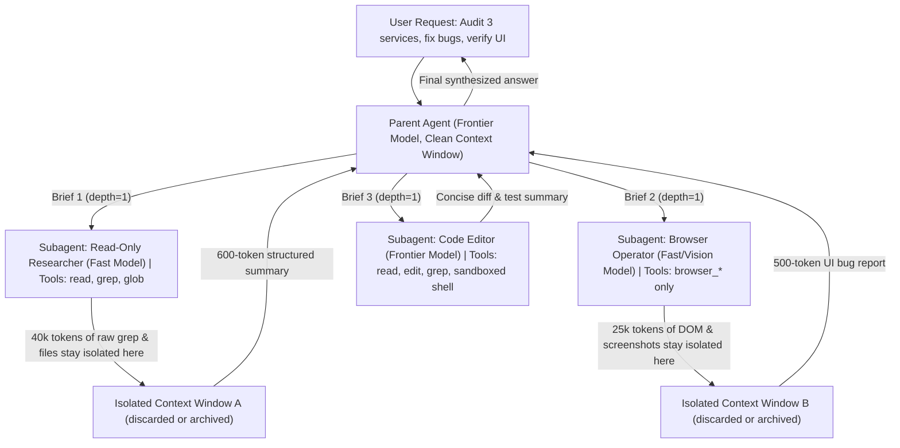
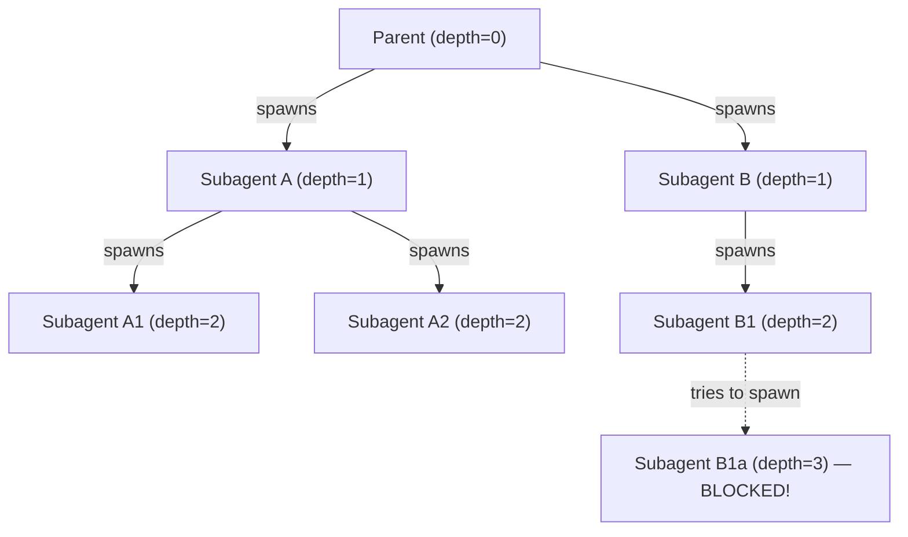

> **Module 5: Multi-Agent & Orchestration** | Prerequisites: Modules 1–2 | Reading Time: ~18 min
>
> [← 25. Secret & Credential Isolation](../04-sandboxing-and-security/25-secret-and-credential-isolation.md) | [Table of Contents](../README.md) | [27. Workspace Isolation (Git Worktrees / Ephemeral Clones) →](./27-workspace-isolation-git-worktrees-ephemeral-clones.md)

# 26. Subagent Spawning & Context Isolation

Up to this point in the book, we have built a single, rock-solid coding agent: it has a clean ReAct loop (Module 1), smart context budgeting and compaction (Module 2), rich codebase and browser tools (Module 3), and a battle-tested security sandbox (Module 4).

Now ask that single agent to tackle a real, messy engineering task:

> *"Audit our billing, auth, and webhook services for race conditions, check whether our React checkout page handles duplicate clicks, fix every issue you find, and verify the full test suite."*

Watch what happens inside a **single** context window. To investigate billing, the agent runs 15 `ripgrep` searches and reads 12 files: adding 45,000 tokens of raw code, dead-end grep hits, and stack traces. Then it investigates auth (+35,000 tokens). Then webhooks (+30,000 tokens). Then it inspects the browser DOM (+25,000 tokens). By the time it tries to write the actual fix, its working desk is buried under **135,000 tokens of exploratory clutter**, half of which turned out to be irrelevant. The model gets slower, pays for those 135,000 tokens on *every single turn*, triggers lossy compaction (Chapter 10), and forgets an edge case it noticed twenty minutes ago.

The architectural cure is **subagent spawning and context isolation**: splitting one overwhelmed generalist into a focused parent agent that delegates messy work to isolated child agents.

---

## 1. The Simple Idea: The Tech Lead and the Clean Whiteboards

Imagine a senior tech lead planning a major database migration in a small office.

- **Without delegation:** The tech lead personally walks through four different buildings, grabs 80 thick paper binders, drags every single binder back to their tiny desk, and piles them six feet high. Half of the binders turn out to be outdated billing spreadsheets from 2022. Now the tech lead cannot even find their original checklist, and every time they need to make a decision, they have to shuffle through 80 binders first.
- **With subagents:** The tech lead stays at a **clean desk** with the master plan. They send three specialists into separate rooms: each room has a **fresh, empty whiteboard**:
  - Specialist A inspects the billing service and comes back with a **one-page memo**: *"Found 2 race conditions at `billing/charge.py:114` and `billing/refund.py:88`. Here are the exact causes."*
  - Specialist B inspects the auth service and comes back with a **half-page memo**: *"No race conditions found; token refresh already uses a Redis lock at `auth/tokens.py:42`."*
  - Specialist C checks the browser checkout page and returns a **short bug report** with a screenshot.

When the specialists leave their rooms, all 80 binders and scratched-out whiteboard notes stay behind in those rooms: **they never touch the tech lead's desk**. The tech lead reads three crisp memos totaling two pages, sees the full picture clearly, and makes sharp decisions.

**What breaks if a harness has no subagents?**
- **Context pollution ("context rot"):** Dead-end searches, verbose logs, and giant files stay in the main conversation forever, drowning out the user's real instructions.
- **Quadratic token bills:** Because LLM APIs re-read the entire conversation history on every turn, carrying 100,000 tokens of stale exploration through 30 editing turns costs **3,000,000 input tokens**: even with prompt caching, you pay extra latency and hit context limits early.
- **Sequential bottlenecks:** A single agent loop reads one module after another in serial; subagents can explore three modules at the exact same time.
- **Over-privileged exploration:** A single agent doing read-only research still carries destructive tools (`run_command`, `edit_file`, `git push`) in its schema, widening the blast radius of prompt injection (Chapter 24).

---

## 2. Why This Matters in a Real Agent Harness

In modern coding harnesses, subagents are not a gimmick for "AI roleplay" ("pretend you are a 10x ninja architect"). They are a **systems-engineering primitive**: the agent equivalent of spawning a child process with its own virtual memory space.

Subagent isolation directly improves four concrete metrics:

1. **Reasoning Quality (Signal-to-Noise Ratio):** As we saw in Chapter 09, even models with 200k–1M token windows suffer accuracy drops as irrelevant tokens accumulate. Keeping the parent context lean preserves razor-sharp instruction following across multi-hour tasks.
2. **Parallelism & Wall-Clock Speed:** Exploring three subsystems, running four independent code reviews, or triaging five failing test suites concurrently turns a 10-minute serial search into a 2-minute parallel sweep.
3. **Cost Optimization via Model Tiering:** Not every step needs your most expensive frontier reasoning model. A fast, inexpensive model (e.g., Haiku-, Flash-, or Mini-class) can run 25 `grep` and `read_file` calls in an isolated subagent for pennies, handing a distilled 800-token summary back to the frontier parent model.
4. **Least-Privilege Security Boundaries:** A read-only researcher subagent literally does not receive `write_file` or `run_command` in its tool list, making accidental mutations or prompt-injected shell execution structurally impossible during exploration.

> **Reality check on token economics:** Anthropic's published research on multi-agent systems notes that spawning multiple parallel subagents can use significantly more *total* tokens than a single linear chat (often 3× to 15× depending on fan-out) because each subagent builds its own context. You use subagents when **task complexity, context hygiene, or wall-clock parallelism** justifies that spend, not for every trivial one-file edit.

---

## 3. The Big Picture

Here is how a parent agent delegates work to specialized, isolated subagents and receives compressed findings back:



Notice the key architectural invariant: **raw intermediate tool noise flows *into* the subagent's private context window, while only a high-signal summary flows *back* to the parent.**

---

## 4. Deep Dive: Subtopic by Subtopic

### 4.1 Why a Single Agent Context Gets Polluted

To feel why context isolation matters, let's do simple arithmetic on a realistic debugging session in a medium-sized repository.

Suppose your parent agent starts with **12,000 tokens** (system prompt + tool schemas + `AGENTS.md` + user request). Now it investigates a bug across three folders:

| Phase | Raw Tool Calls | Tokens Added to Context | Useful Signal Retained at End |
| :--- | :--- | :---: | :---: |
| Explore `billing/` | 8 `grep`s, 7 `read_file`s (4 dead ends) | +32,000 | ~400 tokens (2 file paths + root cause) |
| Explore `auth/` | 6 `grep`s, 5 `read_file`s (all clean) | +24,000 | ~80 tokens ("auth uses Redis lock, OK") |
| Explore `webhooks/` | 9 `grep`s, 6 `read_file`s, 1 huge test log | +38,000 | ~350 tokens (missing idempotency key) |
| **Total in Single Agent** | **42 tool calls** | **+94,000 tokens** | **~830 tokens of actual signal (0.9%!)** |

Over **99% of the tokens added during exploration are scaffolding and dead ends**. In a single-agent loop:
1. Your conversation now carries **106,000 tokens** before the agent has edited a single line of code.
2. If the agent takes 20 more turns to write code and iterate on tests, every turn re-processes that 106,000-token boulder (even with prompt caching, cache-read fees and prefill latency scale with prefix length).
3. Worse, the model's attention mechanism must filter past 93,000 tokens of obsolete search results, increasing the chance it edits the wrong copy of a helper function or forgets a subtle constraint from turn 1.
4. Eventually the harness hits its compaction threshold (Chapter 10) and summarizes the whole thread: potentially losing details from the user's original prompt.

Now compare the **subagent version**:
- Three read-only subagents absorb the 32k, 24k, and 38k tokens inside their own temporary contexts (using a cheaper, faster model).
- Each returns a structured ~300-token report.
- The parent context grows from **12,000 tokens to ~13,500 tokens**: a **98.5% reduction in parent context bloat**!

---

### 4.2 Parent-Child Delegation: Briefs, Isolation, and Return Contracts

A subagent starts with a **blank slate** (an empty conversation array containing only its role's system prompt and the parent's delegation brief). It does **not** automatically see the parent's 40 previous turns, the user's earlier offhand remarks, or files the parent read ten minutes ago.

> **Beginner trap:** Engineers often assume a subagent "knows what we were just talking about." Unless your harness explicitly supports **context forking** (cloning the parent's message history into the child, which is expensive and defeats isolation when you want a clean slate), the child knows **only what you put in the brief**.

#### Anatomy of a Crisp Delegation Brief

A high-performing harness teaches the parent agent (via the `invoke_subagent` tool description) to write self-contained briefs with five clear parts:

1. **Objective:** What concrete question to answer or artifact to produce.
2. **Relevant Context & Starting Pointers:** Known file paths, error messages, branch names, or design constraints from the user.
3. **Scope Boundaries:** What is in scope and what is explicitly *out* of scope (prevents the subagent from wandering across the whole monorepo).
4. **Verification / Done Condition:** How the child knows it is finished (e.g., *"run `pytest tests/test_billing.py` and confirm 0 failures"*).
5. **Output Contract:** The exact structure the parent wants back (file paths with line numbers, symbols, raw command exit codes, concise summary).

Here is what a concrete tool call from the parent LLM to spawn a subagent looks like:

```json
{
  "tool": "invoke_subagent",
  "arguments": {
    "profile": "researcher",
    "role": "Webhook Idempotency Auditor",
    "model": "fast",
    "prompt": "Investigate `services/webhooks/` for duplicate-delivery race conditions.\n\nContext: Users report double-charging when Stripe retries a `checkout.session.completed` webhook within 500ms.\n\nTasks:\n1. Trace the handler for `checkout.session.completed` from HTTP route to DB write.\n2. Check whether webhook event IDs are deduplicated atomically (e.g., unique DB constraint or Redis SETNX).\n3. Do NOT edit any files.\n\nReturn:\n- Exact file paths and line ranges of the handler and DB layer.\n- Whether deduplication exists and where the race window occurs.\n- Any existing tests covering webhook retries."
  }
}
```

#### Designing the Return Contract (Preventing "Lying by Omission")

Because the parent never saw the 15 files the child read, the child's final message is the parent's **only window into reality**. If the child returns vague prose like *"I checked the webhooks and there might be a race condition somewhere in the handler"*, the parent has to re-read the files itself: wasting the entire delegation.

Good subagent system prompts enforce **evidence-backed compression**:
- Always cite exact `path:line_start-line_end` references for every claim.
- Quote exact error messages, failing test names, and symbol names verbatim rather than paraphrasing them.
- Explicitly list **what was checked and ruled out** (so the parent doesn't repeat the same dead-end search).
- Flag **uncertainty or blockers** clearly instead of guessing.
- When producing large outputs (like a full diff or 200-line audit), write the full report to a scratch/artifact file (Chapter 11) and return a short summary plus the file path.

---

### 4.3 Specialized Subagent Profiles

Rather than giving every subagent the exact same generic prompt and full toolbelt, mature harnesses define **specialized subagent profiles** (sometimes called agent definitions or roles). Each profile bundles four things:
1. A focused **system prompt** tailored to its job.
2. A **tool allowlist / denylist** enforced by the harness.
3. A default **model tier** and **sandbox policy**.
4. A **turn / token budget** appropriate to the role.

| Profile | Primary Job | Allowed Tools | Explicitly Blocked Tools | Typical Model Tier | Sandbox Mode |
| :--- | :--- | :--- | :--- | :--- | :--- |
| **Read-Only Researcher (`Explore`)** | Map unfamiliar codebases, trace call graphs, gather exact line references | `read_file`, `grep`, `glob`, `lsp_references` | `edit_file`, `write_file`, `run_command` (or read-only shell only) | Fast / Cheap (Haiku, Flash, Mini) | Read-only, offline |
| **Code Editor / Implementer** | Implement a scoped feature or bug fix in a defined module | `read_file`, `edit_file`, `write_file`, `grep`, `glob`, `run_command` | `deploy`, `git_push`, destructive external MCP tools | Frontier (Sonnet, Opus, Pro, GPT-5) | Workspace-write, offline |
| **Verifier / Reviewer** | Run tests, check edge cases, audit diffs for bugs or security flaws with fresh eyes | `read_file`, `grep`, `git_diff`, `run_command` (test runner) | `edit_file`, `write_file` (cannot quietly "fix" tests to pass!) | Frontier or Medium | Read-only + test execution |
| **Browser Operator** | Navigate live web UIs, verify visual layouts, click flows, capture screenshots | `browser_navigate`, `browser_click`, `browser_screenshot`, `browser_console` | `run_command`, arbitrary host `read_file` / `write_file` | Fast Multimodal / Vision | Isolated browser sandbox |
| **Planner / Architect** | Read codebase and draft a step-by-step design plan before any edits begin | `read_file`, `grep`, `glob`, `write_plan_artifact` | Code mutation tools, shell execution | Frontier (high reasoning) | Read-only |

Notice the subtle brilliance of the **Verifier** profile: by blocking `edit_file` and `write_file`, a verifier subagent is structurally prevented from cheating (for instance, deleting a failing assertion to make `pytest` turn green). And because it has a **fresh context window**, it does not suffer from the author agent's confirmation bias ("I already checked that line, I'm sure it works").

Many harnesses let teams declare custom profiles declaratively using Markdown files with YAML frontmatter (for example, `.claude/agents/security-reviewer.md`):

```markdown
---
name: security-reviewer
description: Reviews code diffs for injection, auth bypass, and secret leaks.
model: sonnet
tools: [read_file, grep, glob]
disallowedTools: [edit_file, write_file, run_command]
maxTurns: 15
---

You are a read-only security auditor. Inspect only the files listed in the brief.
Never propose speculative issues without citing an exact `file:line` and concrete exploit path.
Return findings grouped by severity (Critical / High / Medium) or state "No issues found."
```

---

### 4.4 Tool Scoping, Model Tiering & Recursion Depth Limits

Three deterministic harness guardrails turn subagents from a chaotic experiment into a reliable production system.

#### 1. Tool Scoping (Enforcement Outside the LLM)

Never enforce role restrictions purely in prose (*"Please do not edit any files"*). Under prompt injection (Chapter 24) or simple model distraction, prose rules fail. Instead, your harness filters the tool registry **at two layers**:
- **Schema Layer:** Omit disallowed tools from the API's `tools` array completely. Bonus: fewer tool schemas shrink the subagent's system prompt and improve tool-selection accuracy (Chapter 03).
- **Execution Layer:** Even if a model hallucinates a call to `write_file`, the tool dispatcher checks `tool_name in subagent.allowed_tools` and rejects it deterministically.

#### 2. Model Tiering (Matching Intelligence to Difficulty)

Not every subtask deserves frontier pricing and latency:

| Subtask Type | Best Model Tier | Why |
| :--- | :--- | :--- |
| File discovery, `grep` fan-out, summarizing logs, locating symbols | **Fast / Economy** | High tool-call volume, low reasoning complexity; 3×–5× faster and 5×–15× cheaper per token. |
| Browser clicking, form filling, DOM scraping | **Fast Multimodal** | Vision-heavy, many tiny UI turns; frontier reasoning models add huge latency per click. |
| Subtle race-condition diagnosis, cross-file refactoring, architecture | **Frontier** | A cheap model making subtle logic bugs wastes far more tokens on retries than a frontier model getting it right once. |

Always expose an explicit `model` tier parameter (e.g., `"inherit"`, `"fast"`, `"frontier"`) with sensible defaults per profile, while letting the harness enforce policy caps so a runaway subagent can't silently upgrade itself to the most expensive model.

#### 3. Recursion Depth Limits, Concurrency Caps & Shared Budgets

What happens if a subagent is allowed to spawn its *own* subagents?



Without hard limits, a confused agent can create a **subagent fork bomb**: Parent spawns 3 helpers, each helper breaks the task down and spawns 3 more helpers, and within 30 seconds you have 121 concurrent LLM loops burning \$50/minute!

Production harnesses enforce **four hard invariants** in code:
1. **`max_depth` (usually `1` or `2`):** Track `depth = parent.depth + 1`. When `depth >= max_depth`, **remove `invoke_subagent` from the child's tool schema entirely**! In fact, most coding harnesses default to `max_depth = 1` (only the top-level orchestrator can spawn workers) unless nested delegation is explicitly enabled.
2. **`max_concurrent_subagents` (e.g., 4–20):** A semaphore in the harness caps how many subagents run at the exact same moment, preventing API 429 rate-limit storms and CPU/RAM exhaustion.
3. **Tree-Wide Cost & Token Budget:** Every child inherits a reference to the root session's shared `BudgetLedger` (e.g., max \$5.00 or 2,000,000 total tokens across the whole tree). If the tree hits its ceiling, the harness halts spawns and notifies the user cleanly.
4. **Cascading Cancellation:** If the user hits `Ctrl+C` or kills the parent session, the harness propagates cancellation (`AbortSignal` / `asyncio.Task.cancel`) down the entire descendant tree so no orphaned subagents keep burning API credits in the background.

---

### 4.5 When to Use a Subagent vs. Working Directly in the Parent

Spawning a subagent is **not free**. Every new subagent pays a **cold-start cost**:
- It has to send its own system prompt + tool schemas (a fresh prompt-cache write if that profile isn't already warm).
- It lacks the parent's implicit conversational memory, so the parent must spend tokens writing a thorough brief.
- Returning a summary introduces a tiny risk of **information loss** compared to reading a file firsthand.

Use this practical decision table to guide both your harness design and your orchestrator's system prompt:

| Scenario | Best Choice | Why |
| :--- | :--- | :--- |
| Reading 1–3 specific files you already know the path to | **Do directly in parent** | Faster (1 parallel tool turn), zero cold-start overhead, lossless context. |
| Broad search across an unfamiliar repo ("How does auth work across all services?") | **Spawn Read-Only Researcher** | Keeps 30k–80k tokens of dead-end searches out of the parent context; cheap fast model excels here. |
| Running a huge noisy test suite or triaging 5,000 lines of build logs | **Spawn Verifier / Triage subagent** | Absorbs verbose output in a throwaway context and returns exact failing tests + stack traces. |
| Independent work across 3+ unrelated modules at once | **Spawn parallel subagents** (with workspace isolation if editing: Ch. 27) | Cuts wall-clock time dramatically via parallel execution. |
| Tightly coupled 5-line edit in the file the parent just read | **Do directly in parent** | Writing the delegation brief would take more tokens than just applying the patch! |
| Independent code review / adversarial bug hunt on code the parent just wrote | **Spawn fresh Verifier subagent** | Fresh context removes confirmation bias; read-only toolset guarantees honest review. |
| Multi-step UI interaction in a live browser | **Spawn Browser Operator** | Keeps bulky DOM snapshots, accessibility trees, and screenshots isolated from coding context. |

---

## 5. How Real Harnesses Do It

Subagent delegation has rapidly converged into a standard pattern across every major 2025–2026 coding harness:

- **Anthropic's Multi-Agent Research System & Claude Code:** Anthropic popularized the modern **Orchestrator-Worker** subagent architecture. In Claude Code, the native `Agent` / `Task` tool forks an isolated context window for a subtask and returns a condensed summary. Claude Code ships built-in specialized profiles (such as **Explore** (a read-only researcher often routed to fast Haiku-class models for rapid `grep`/`glob` sweeps), **Plan** (context gathering for architectural planning), and **General-Purpose**) alongside user-defined custom agents in `.claude/agents/*.md` with YAML frontmatter controlling `model`, `tools`, and `disallowedTools`. It enforces concurrency and nesting caps via settings like `CLAUDE_CODE_MAX_CONCURRENT_SUBAGENTS` and `CLAUDE_CODE_MAX_SUBAGENT_SPAWN_DEPTH`. In Anthropic's published BrowseComp research, they also documented why multi-agent scaling works: total token budget, parallel tool calls, and model selection explain the vast majority of performance gains, and subagents unlock large token budgets without blowing past single-window context rot.
- **OpenAI Codex CLI & Agents SDK:** Codex supports specialized multi-agent delegation paired with strict sandbox tiers (`read-only` vs. `workspace-write`) so research or review subagents cannot modify files, while implementation subagents can be isolated into dedicated Git worktrees (which we cover in Chapter 27).
- **Gemini CLI & OpenCode:** Both ecosystems support role-based agent profiles with per-profile model routing and tool allowlists, allowing a frontier model to act as the main planner/editor while lightweight helper profiles handle repository exploration, documentation lookups, or scoped verification tasks.

---

## 6. Common Pitfalls & Failure Modes

1. **The Subagent Fork Bomb:** Allowing every subagent to spawn unlimited nested subagents. A single ambiguous prompt can multiply into dozens of runaway agents hitting rate limits and draining API budgets. **Fix:** Default `max_depth = 1`, strip the spawn tool at `depth == max_depth`, and enforce a tree-wide concurrency semaphore and token/dollar cap.
2. **The Lazy / Vague Brief ("Go fix the auth bug"):** Because the child starts with an empty context window, a vague prompt forces the child to re-discover everything the parent already knew, or worse, guess wrong and edit the wrong file. **Fix:** Require self-contained briefs with goal, known paths, constraints, and an explicit output contract.
3. **The Telephone Game (Lossy Summaries):** A researcher subagent reads 12 files and replies *"Looks like the database connection pool might be misconfigured."* The parent now has to re-read those exact same files to find *which* file and *which* setting! **Fix:** Instruct subagents to return verbatim `path:line` citations, symbol names, and raw error excerpts.
4. **Over-Delegating Trivial Work (The Cold-Start Tax):** Spawning a subagent just to read `package.json` adds a brand-new LLM call, a cold system-prompt prefill, and round-trip latency for something the parent could read in 10 milliseconds. **Fix:** Explicitly instruct the parent in its system prompt: *"Prefer direct tool calls for quick, targeted lookups; delegate only for broad exploration, noisy tasks, specialization, or parallelizable work."*
5. **Prompt-Only Restrictions Instead of Tool Scoping:** Telling a subagent *"You are a read-only reviewer, please do not modify files"* while leaving `edit_file` and `run_command` in its tool schema. One indirect prompt injection inside a repo README can trick the model into calling `run_command`. **Fix:** Enforce tool allowlists/denylists in harness code at both schema generation and tool dispatch.
6. **Parallel Editor Collisions:** Spawning two `code_editor` subagents simultaneously against the **same working directory**! Subagent A edits `utils.py` while Subagent B runs `git checkout` or overwrites `utils.py`, corrupting both tasks. **Fix:** Only read-only subagents should share a live working directory concurrently; parallel writers **must** get isolated workspaces, which is the exact topic of **Chapter 27**!

---

## 7. Build It Yourself: Mini-Lab

Below is a compact, production-minded Python blueprint for a `SubagentManager`. It enforces **context isolation**, **tool scoping**, **model tiering**, **recursion depth limits**, **concurrency caps**, and a **shared tree-wide token budget**.

```python
import asyncio
import uuid
from dataclasses import dataclass, field
from typing import Any, Callable, Awaitable


@dataclass(frozen=True)
class SubagentProfile:
    """Declarative blueprint for a specialized subagent role."""
    name: str
    system_prompt: str
    allowed_tools: frozenset[str]
    model_tier: str = "fast"        # "fast" | "frontier" | "inherit"
    max_turns: int = 15
    can_spawn_children: bool = False


class BudgetExceededError(RuntimeError):
    """Raised when the entire agent tree exceeds its shared token ceiling."""


class SharedBudgetLedger:
    """Thread/async-safe token ledger shared across parent and all descendants."""
    def __init__(self, max_total_tokens: int):
        self.max_total_tokens = max_total_tokens
        self.used_tokens = 0
        self._lock = asyncio.Lock()

    async def record(self, tokens: int) -> None:
        async with self._lock:
            self.used_tokens += tokens
            if self.used_tokens > self.max_total_tokens:
                raise BudgetExceededError(
                    f"Agent tree exceeded budget: {self.used_tokens}/{self.max_total_tokens} tokens"
                )


# Built-in role catalog
PROFILES: dict[str, SubagentProfile] = {
    "researcher": SubagentProfile(
        name="researcher",
        system_prompt=(
            "You are a read-only codebase researcher. Investigate the question thoroughly. "
            "Always cite exact file paths and line numbers. Never guess or fabricate symbols. "
            "Return a concise, structured summary of findings and ruled-out leads."
        ),
        allowed_tools=frozenset({"read_file", "grep", "glob"}),
        model_tier="fast",
        max_turns=12,
        can_spawn_children=False,
    ),
    "verifier": SubagentProfile(
        name="verifier",
        system_prompt=(
            "You are an independent test & code verifier. You cannot edit code. "
            "Run tests, inspect diffs, and report exact pass/fail evidence with raw error snippets."
        ),
        allowed_tools=frozenset({"read_file", "grep", "run_tests"}),
        model_tier="frontier",
        max_turns=10,
        can_spawn_children=False,
    ),
    "editor": SubagentProfile(
        name="editor",
        system_prompt=(
            "You are a focused implementation subagent. Complete only the scoped brief, "
            "run relevant tests, and return a concise summary of changed files and test results."
        ),
        allowed_tools=frozenset({"read_file", "edit_file", "grep", "glob", "run_tests"}),
        model_tier="frontier",
        max_turns=20,
        can_spawn_children=False,
    ),
}

MODEL_ROUTING = {
    "fast": "model-fast-mini",
    "frontier": "model-frontier-pro",
}


class SubagentManager:
    """Spawns context-isolated subagents with strict guardrails."""

    def __init__(
        self,
        all_tools: dict[str, Callable[..., Awaitable[str]]],
        llm_call: Callable[[str, list[dict], list[str]], Awaitable[dict[str, Any]]],
        budget: SharedBudgetLedger,
        max_depth: int = 1,
        max_concurrent: int = 4,
    ):
        self.all_tools = all_tools
        self.llm_call = llm_call
        self.budget = budget
        self.max_depth = max_depth
        self.semaphore = asyncio.Semaphore(max_concurrent)

    def _resolve_tools(self, profile: SubagentProfile, depth: int) -> dict[str, Callable]:
        """Deterministically intersect profile allowlist with registered tools."""
        scoped = {
            name: fn
            for name, fn in self.all_tools.items()
            if name in profile.allowed_tools
        }
        # Strip recursion capability once we reach max_depth
        if not profile.can_spawn_children or depth >= self.max_depth:
            scoped.pop("invoke_subagent", None)
        return scoped

    async def spawn(
        self,
        profile_name: str,
        brief: str,
        parent_model: str,
        parent_depth: int = 0,
    ) -> dict[str, Any]:
        """Run a child agent in a brand-new context window and return only its final summary."""
        depth = parent_depth + 1
        if depth > self.max_depth:
            return {"status": "error", "error": f"Max subagent depth ({self.max_depth}) reached."}

        profile = PROFILES.get(profile_name)
        if not profile:
            return {"status": "error", "error": f"Unknown subagent profile: {profile_name}"}

        subagent_id = f"sub_{profile_name}_{uuid.uuid4().hex[:8]}"
        model = parent_model if profile.model_tier == "inherit" else MODEL_ROUTING[profile.model_tier]
        scoped_tools = self._resolve_tools(profile, depth)

        # Fresh, isolated conversation history (parent history is NOT copied)
        messages: list[dict[str, Any]] = [
            {"role": "system", "content": profile.system_prompt},
            {"role": "user", "content": brief},
        ]

        async with self.semaphore:
            for turn in range(1, profile.max_turns + 1):
                response = await self.llm_call(model, messages, list(scoped_tools.keys()))
                await self.budget.record(response.get("usage_tokens", 0))

                if response["stop_reason"] == "end_turn":
                    # Only the compressed final text returns to the parent!
                    return {
                        "subagent_id": subagent_id,
                        "profile": profile_name,
                        "model": model,
                        "turns_used": turn,
                        "status": "completed",
                        "summary": response["text"],
                    }

                # Execute requested tool calls strictly against scoped_tools
                messages.append({"role": "assistant", "tool_calls": response["tool_calls"]})
                for call in response["tool_calls"]:
                    name = call["name"]
                    if name not in scoped_tools:
                        # Defense-in-depth: block hallucinated or unauthorized tool calls
                        result = f"ERROR: Tool '{name}' is not permitted for profile '{profile_name}'."
                    else:
                        result = await scoped_tools[name](**call["arguments"])
                    messages.append({
                        "role": "tool",
                        "tool_call_id": call["id"],
                        "content": result,
                    })

        return {
            "subagent_id": subagent_id,
            "status": "max_turns_reached",
            "summary": "Subagent reached its turn budget before concluding. Partial work may exist.",
        }
```

Look closely at what this 120-line manager guarantees:
- **Zero context leak:** `messages` is freshly initialized per spawn; all intermediate `tool` results vanish from RAM once `spawn()` returns `summary`.
- **Two-layer tool security:** Disallowed tools are absent from `list(scoped_tools.keys())` *and* rejected at execution time.
- **No fork bombs:** `depth > self.max_depth` blocks deep recursion, `asyncio.Semaphore` caps parallelism, and `SharedBudgetLedger` enforces a single global token ceiling.

---

## 8. Key Takeaways & Quick Self-Check

### Key Takeaways
- **Subagents are context-isolation boundaries**, not roleplay personas: they absorb messy exploratory tokens in private windows and return compact, evidence-backed summaries to keep the parent sharp.
- **Child contexts start blank by default**, so delegation briefs must be self-contained (objective, pointers, scope, verification criteria, and output format).
- **Specialized profiles pair tool scoping with model tiering**: read-only researchers run on fast/cheap models without write tools; verifiers run without edit tools to eliminate confirmation bias.
- **Always bound delegation deterministically**: enforce `max_depth`, concurrency semaphores, tree-wide token budgets, and cascading cancellation in harness code.
- **Do not over-delegate**: for 1–3 known file lookups or tiny local edits, direct tool calls in the parent beat the cold-start cost and summary loss of spawning a subagent.

### Quick Self-Check

**1. Why does running 30 exploratory `grep` and `read_file` calls directly in the parent hurt even if the model has a 1,000,000-token context window?**
<details>
<summary>Show Answer</summary>
Two reasons: <strong>quality</strong> and <strong>cost/latency</strong>. First, irrelevant dead-end search output dilutes model attention ("context rot"), making the model more likely to miss constraints or confuse symbols. Second, because LLMs re-read the entire history on every subsequent turn, carrying 90k tokens of obsolete exploration through 25 editing turns multiplies total token consumption and prefill latency across the whole session.
</details>

**2. You build a `security-reviewer` subagent whose system prompt says *"NEVER edit files or run shell commands."* Is that sufficient to make it read-only? Why or why not?**
<details>
<summary>Show Answer</summary>
No. Prose instructions inside a prompt can be overridden by indirect prompt injection hidden inside untrusted repository files or simply ignored during model confusion. True enforcement requires deterministic harness code that omits <code>edit_file</code>, <code>write_file</code>, and <code>run_command</code> from the subagent's tool schema <em>and</em> rejects them at the tool-execution dispatcher.
</details>

**3. When is it *better* to skip spawning a subagent and do the work directly inside the parent agent?**
<details>
<summary>Show Answer</summary>
When the work is small, targeted, and tightly coupled to the parent's current context, for example, reading 1–3 known files or making a quick edit in code the parent already loaded. Spawning a subagent incurs a cold-start prompt cost, latency overhead, and brief-writing/summarization overhead that outweigh any context savings on tiny tasks.
</details>

**4. Why should a harness remove `invoke_subagent` from a child's tool schema when `depth == max_depth`, rather than merely returning an error if the child calls it?**
<details>
<summary>Show Answer</summary>
Removing the tool from the schema saves prompt tokens, keeps the model focused on direct execution tools, and prevents wasted LLM turns where the child tries to delegate, receives an error, and has to rethink its approach. (Of course, keeping the runtime depth check as a second line of defense is still good practice!)
</details>

---

[← 25. Secret & Credential Isolation](../04-sandboxing-and-security/25-secret-and-credential-isolation.md) | [Table of Contents](../README.md) | [27. Workspace Isolation (Git Worktrees / Ephemeral Clones) →](./27-workspace-isolation-git-worktrees-ephemeral-clones.md)
