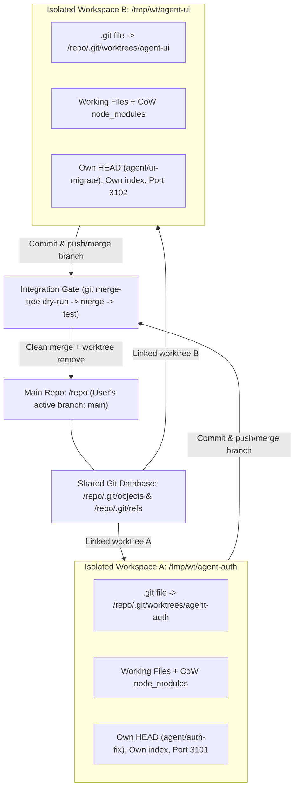

> **Module 5: Multi-Agent & Orchestration** | Prerequisites: Chapter 26 | Reading Time: ~19 min
>
> [← 26. Subagent Spawning & Context Isolation](./26-subagent-spawning-and-context-isolation.md) | [Table of Contents](../README.md) | [28. Inter-Agent Messaging & Reactive Wakeups →](./28-inter-agent-messaging-and-reactive-wakeups.md)

# 27. Workspace Isolation (Git Worktrees / Ephemeral Clones)

In Chapter 26, we solved **memory collisions** by giving every subagent its own isolated context window. That works seamlessly when three read-only researcher subagents inspect your repository at the same time—reading files concurrently is safe.

Now imagine you spawn **two coding subagents** in parallel:
- **Agent A** is asked to refactor the authentication middleware and run `pytest`.
- **Agent B** is asked to migrate the billing database schema and add a new npm package.

If both agents run inside `/Users/you/projects/my-app`, chaos erupts within ten seconds. Agent A edits `config.py`, Agent B overwrites `config.py` with an older version, Agent B runs `git checkout -b billing-v2` right underneath Agent A's feet, Agent A runs `git commit` and accidentally commits half of Agent B's broken migration, and both test suites crash fighting over port `3000` and `.git/index.lock`.

Context isolation separates **brains**. **Workspace isolation** separates **hands and workbenches**—giving each concurrent editing agent its own independent copy of the repository on disk so parallel writers can never corrupt each other or trample the human developer's active work.

---

## 1. The Simple Idea: Shared Pantry, Separate Prep Stations

Picture two line chefs preparing two different dishes during a dinner rush.

- **One shared cutting board (Shared Directory):** Chef A is slicing strawberries for dessert while Chef B is chopping raw garlic on the exact same board—and reaching for the exact same chef's knife. Within seconds, the strawberries taste like garlic, someone drops a bowl, and nobody knows whose ingredients belong to which plate.
- **Separate prep stations drawing from one pantry (Git Worktrees / Ephemeral Clones):** Both chefs pull ingredients from the **same central pantry** (the shared `.git/objects` commit history), so you don't need to buy two refrigerators or duplicate 5 gigabytes of pantry stock. Yet each chef stands at their **own clean steel counter** (an isolated working directory and branch). Chef A finishes dessert, Chef B finishes the entrée, and at the end of the rush the head chef inspects each plate cleanly before combining them for service—or tosses a ruined plate in the bin without contaminating the rest of the kitchen.

**What breaks without workspace isolation?**
- **Silent file clobbering:** Two agents editing overlapping or adjacent files overwrite each other's patches mid-turn.
- **Corrupted Git state:** Concurrent `git add`, `git commit`, or `git checkout` calls hit `Unable to create '.git/index.lock': File exists` or tangle unrelated diffs into one broken commit.
- **Trampling the human's work:** An autonomous background agent running in your primary checkout can accidentally revert or stage the uncommitted feature you were typing five minutes ago.
- **False test failures:** Agent A's half-written syntax error breaks Agent B's test runner, sending Agent B into a hallucinated debugging spiral trying to fix a bug it didn't even create!

---

## 2. Why This Matters in a Real Agent Harness

Workspace isolation is the single unlock that turns parallel coding agents from a toy demo into a daily engineering superpower:

- **True Write Parallelism:** You can run 3–5 implementation subagents simultaneously on independent features, migrations, or bug fixes—cutting a 40-minute sequential backlog down to 10 minutes.
- **Zero-Risk Experimentation ("Best-of-N" & Sandboxed Tries):** Want to try two competing architectural fixes and keep whichever passes benchmarks cleanest? Spin up two isolated workspaces, run both agents, compare diffs, merge the winner, and delete the loser in one second.
- **Clean Human Review:** Every subagent's output lands on its own branch with a crystal-clear `git diff main..agent/task-123`—never mixed with your local edits or another agent's experiments.
- **Safe Background Execution:** Developers can keep coding normally in their IDE while background agents work silently in hidden worktrees (`~/.codex/worktrees/`, `.claude/worktrees/`, etc.) without touching a single file in the main folder.

---

## 3. The Big Picture

Here is how a harness uses **Git worktrees** (optionally accelerated with Copy-on-Write dependency clones) to isolate two parallel editor subagents while sharing a single Git object store:



---

## 4. Deep Dive: Subtopic by Subtopic

### 4.1 The Parallel Editing Collision Problem

To design rock-solid isolation, it helps to see all **five collision surfaces** that break when two agents share one directory:

1. **Working-Tree Race (Lost Updates):** Agent A reads `routes.ts` at time `t=0`, thinks for 4 seconds, and patches lines 10–15. Meanwhile at `t=2`, Agent B inserted 20 lines at the top of `routes.ts`. Even with stale-read checks (Chapter 14), agents waste turns retrying—and without them, edits silently corrupt files.
2. **Git Index & Branch Contention:** Git protects its staging area with a single `.git/index.lock` file. Two parallel agents running `git status`, `git add`, or `git commit` race on that lockfile. Worse, if Agent B switches branches (`git checkout`), every file under Agent A's feet instantaneously changes!
3. **Cross-Contaminated Test Runs:** Agent A introduces a temporary TypeScript error while refactoring `auth.ts`. At the same instant, Agent B runs `npm test` to check `billing.ts`—the whole compiler fails on `auth.ts`! Agent B reads the error, gets confused, and tries to "fix" `auth.ts` too.
4. **Build Artifact & Package Manager Collisions:** Agent A runs `npm install zod` while Agent B runs `npm test`, or two Rust agents run `cargo test` writing to the same `target/` directory simultaneously.
5. **Runtime Environment Collisions:** Both agents launch a dev server on hardcoded port `3000`, write to `./test.sqlite`, or mutate `.env` in place.

Workspace isolation eliminates collisions #1, #2, and #3 immediately—and with smart workspace bootstrapping (Section 4.4), eliminates #4 and #5 too.

---

### 4.2 How `git worktree` Works Under the Hood

Most developers know `git clone`, which downloads or copies the entire repository history (`.git/objects`) into a brand-new folder. For a 4 GB monorepo, a full clone is slow and wastes gigabytes per agent.

**`git worktree`** is a built-in Git feature that solves this with an elegant architectural split: it separates **shared history** from **per-workspace mutable state**.

When a harness runs:

```bash
git worktree add -b agent/auth-fix /tmp/agent-wt/auth-fix main
```

Git does **not** copy `.git/objects/`. Instead, it creates a tiny bidirectional link on disk:

```text
/Users/dev/my-app/                          <-- Main repository
├── .git/
│   ├── objects/                            <-- SHARED commit/tree/blob database
│   ├── refs/                               <-- SHARED branches & tags
│   ├── config                              <-- SHARED repo config
│   ├── HEAD                                <-- Main checkout's current branch
│   ├── index                               <-- Main checkout's staging area
│   └── worktrees/
│       └── auth-fix/                       <-- ISOLATED metadata for Worktree A
│           ├── HEAD                        <-- "ref: refs/heads/agent/auth-fix"
│           ├── index                       <-- Worktree A's private staging area!
│           ├── logs/HEAD                   <-- Worktree A's private reflog
│           ├── commondir                   <-- Contains "../..": points to shared .git/
│           └── gitdir                      <-- Contains "/tmp/agent-wt/auth-fix/.git"
└── src/...

/tmp/agent-wt/auth-fix/                     <-- Linked worktree (Agent A's home)
├── .git                                    <-- Plain text FILE (NOT a folder!)
│                                               Contents: "gitdir: /Users/dev/my-app/.git/worktrees/auth-fix"
└── src/...                                 <-- Independent checked-out working files
```

Notice why this is so clever for parallel agents:

| Git Component | Shared Across Worktrees? | Location | Implication for Parallel Agents |
| :--- | :---: | :--- | :--- |
| **Object Database** (commits, blobs, trees) | **Yes** | Main `.git/objects/` | Zero history duplication; commits made by Agent A are instantly visible to the Parent! |
| **References** (branches, tags) | **Yes** | Main `.git/refs/` | Branches are global across all worktrees; every agent **must** get a unique branch name (e.g., `agent/<id>`) or detached `HEAD`. |
| **Working Files** | **No** (Isolated) | Linked worktree folder | Agents edit files freely without any file-level collision. |
| **`HEAD` (Active Branch)** | **No** (Isolated) | `.git/worktrees/<id>/HEAD` | Agent A can commit, reset, or rebase without moving Main's `HEAD`. |
| **Staging Area (`index` & `index.lock`)** | **No** (Isolated) | `.git/worktrees/<id>/index` | Agent A's `git add` / `git commit` never locks or pollutes Agent B's index! |
| **Hooks & Config** | **Yes** (by default) | Main `.git/hooks/`, `.git/config` | **Security warning:** A malicious agent that can write to `.git/hooks/` through `commondir` could poison hooks for the main repo! Sandboxes (Ch. 22) should protect `.git/hooks` and `.git/config`. |

> **Important Git invariant:** Git refuses to check out the *same* branch in two worktrees at the same time (`fatal: 'main' is already used by worktree at ...`), because committing in one would silently make the other's working tree out of sync with the branch pointer. Harnesses therefore always create either a **unique ephemeral branch** (`git worktree add -b agent/<task-id> <path> <base-sha>`) or a **detached HEAD** (`git worktree add --detach <path> <base-sha>`).

---

### 4.3 Copy-on-Write Clones vs. Full Clones vs. Git Worktrees

`git worktree add` is fast for source code, yet it has one major real-world snag: **it only checks out Git-tracked files**. It leaves behind everything in `.gitignore`—such as a 1.5 GB `node_modules/` folder, a Python `.venv/`, compiled Rust `target/` crates, or local `.env` files. Running `npm ci` from scratch inside every ephemeral agent worktree can waste 60–180 seconds and gigabytes of SSD space!

This is where **Copy-on-Write (CoW) filesystem clones** shine.

#### What Is Copy-on-Write (Plain English)?

Normally, copying a 2 GB directory reads 2 GB of bytes from your SSD and writes 2 GB of new bytes—taking several seconds and doubling your disk usage.

Modern filesystems support **block-level cloning (Copy-on-Write)**:
- Instead of copying actual file bytes, the operating system simply creates new directory entries pointing to the **exact same physical disk blocks**.
- Creating the clone takes **milliseconds ($O(1)$ per file for data)** and consumes **0 bytes of extra data storage**!
- The moment Agent A edits *one* file inside the clone, the filesystem quietly writes **only the modified disk blocks** to a new location while leaving the original untouched. Neither side ever sees the other's edits.

#### Platform Commands for CoW Cloning

- **macOS (APFS — Apple File System):** Uses the `-c` flag (`clonefile(2)` syscall):
  ```bash
  cp -cR /path/to/source /path/to/clone
  ```
  *Caveat:* Source and destination **must be on the same APFS volume** (e.g., both on your main drive, not copying from your home folder to an external USB drive or separate mounted disk image).
- **Linux (Btrfs, modern XFS with reflink, OpenZFS):** Uses `--reflink=auto` (backed by the `FICLONE` `ioctl`):
  ```bash
  cp --reflink=auto -R /path/to/source /path/to/clone
  ```
  *Nice ergonomics:* `--reflink=auto` uses instant zero-copy reflinks whenever the filesystem supports them, and gracefully falls back to a normal physical copy on `ext4` (whereas `--reflink=always` fails loudly if reflinks are unsupported).

#### Comparing All Four Workspace Isolation Strategies

| Strategy | Setup Time (Medium Repo) | Extra Disk Used Initially | Includes Untracked Deps (`node_modules`, `.venv`)? | `.git` Metadata Isolation | Best Use Case |
| :--- | :---: | :---: | :---: | :---: | :--- |
| **`git worktree add`** | ~0.2–2 sec | Tracked files only | **No** (must bootstrap deps) | Shared `.git/objects` & `.git/refs`; isolated `HEAD`/`index` | Default for most local harnesses; instant diff/merge back to main repo. |
| **Hybrid: `git worktree` + CoW-cloned deps** | ~0.5–3 sec | ~0 MB for deps (CoW!) | **Yes** (explicitly CoW-cloned) | Shared `.git/objects`; isolated `HEAD`/`index` | **Sweet spot** for JS/TS, Python, and Rust repos on macOS APFS or Linux Btrfs/XFS. |
| **Full CoW Directory Clone (`cp -cR` / `--reflink=auto`)** | ~0.3–3 sec | ~0 MB until written | **Yes** (everything, even dirty edits!) | **Completely isolated** `.git/` copy | When you want to snapshot the user's *uncommitted* working state, or isolate `.git/hooks` completely. |
| **Full `git clone` (local/remote)** | 5–120+ sec | Full repo + fresh deps | **No** | Completely isolated | Cross-machine / remote cloud sandboxes where no local filesystem is shared. |
| **Container / MicroVM + OverlayFS** | 0.5–5 sec (warm image) | ~0 MB (upper layer only) | **Yes** (baked into base image) | Completely isolated (kernel boundary) | Untrusted code, CI/cloud parallel fleets, strongest security isolation (Ch. 21). |

> **Hidden win of CoW directory clones:** `git worktree add` always checks out a **committed** Git revision (like `HEAD`), which means it does *not* include your uncommitted local edits unless you stash or create a temporary commit snapshot. A CoW clone of the workspace captures the *exact* byte-for-byte state of the directory—including uncommitted work and pre-warmed caches—in under a second!

---

### 4.4 Managing Build Caches, Lockfiles, Ports, and Untracked Files

Even with isolated directories, real repositories break in subtle ways unless your harness handles **four workspace side effects**:

#### 1. Bootstrapping Dependencies & Untracked Files
When creating a fresh `git worktree`, agents immediately fail `npm test` or `pytest` if `node_modules/`, `.venv/`, or `.env.local` are missing. Harnesses solve this via a **workspace setup hook** (for example, `.cursor/worktrees.json` or a harness bootstrapper):
- **CoW-clone heavy dependency folders** (`cp -cR main/node_modules wt/node_modules`) — instant and isolated so if Agent A runs `npm install foo`, it doesn't mutate Main's `node_modules`.
- **Use content-addressable package managers** (`pnpm`, `uv`, `yarn berry`) whose global store already hardlinks or reflinks packages in seconds.
- **Copy safe config templates** (e.g., `.env.test` or `.npmrc`), while respecting secret-isolation rules from Chapter 25 (never blindly copy production `.env` secrets into an untrusted sandbox!).
- **Beware Python `.venv` hardcoded shebangs!** A `.venv/bin/pytest` script often starts with `#!/Users/dev/main-repo/.venv/bin/python` (an absolute path!). If you CoW-clone `.venv` into a new path, invoking `.venv/bin/pytest` directly may secretly execute Main's interpreter or fail imports unless you run `uv sync --offline` or update `VIRTUAL_ENV`.

Here is an example of a declarative workspace-bootstrap manifest (patterned after Cursor's `.cursor/worktrees.json` and harness setup hooks) that teams commit to their repo so every newly created worktree is test-ready in seconds:

```json
{
  "setup-worktree": [
    "cp -cR \"$ROOT_WORKTREE_PATH/node_modules\" ./node_modules 2>/dev/null || pnpm install --offline --frozen-lockfile",
    "cp \"$ROOT_WORKTREE_PATH/.env.test.example\" ./.env.test",
    "mkdir -p .tmp-test-db"
  ]
}
```

Notice the graceful fallback pattern: try an instant macOS APFS CoW clone first; if running on another OS or filesystem, fall back cleanly to offline `pnpm install --frozen-lockfile` using the shared local package cache.

#### 2. Read-Only Shared Caches vs. Mutable Build Directories
- **Safe to share across agents:** Global read-through download caches (`UV_CACHE_DIR`, `PIP_CACHE_DIR`, `GOMODCACHE`, `npm_config_cache`, `sccache`). Package managers lock these properly.
- **DANGEROUS to symlink across agents:** Mutable per-project build directories like `.next/`, `dist/`, `build/`, or Rust's `target/`. If Agent A and Agent B share one `target/` via symlink, Agent A's compiler deletes or overwrites object files Agent B is linking! Give each worktree its own build output directory (or CoW-clone `target/` so each starts warm yet writes independently).

#### 3. Dynamic Port Allocation & Runtime Isolation
If Agent A and Agent B both run an integration test that starts an Express server on `localhost:3000`, the second agent immediately crashes with `EADDRINUSE: address already in use`.

Your harness should inject **per-workspace environment variables** when spawning commands inside an isolated workspace:

```bash
AGENT_WORKSPACE_ID="wt_a83f1c"
PORT="41207"                              # Dynamically leased ephemeral port
DATABASE_URL="sqlite:////tmp/wt_a83f1c/test.db"
TMPDIR="/tmp/wt_a83f1c/tmp"               # Isolated temp folder
```

Whenever a harness allocates a workspace, it can bind a TCP socket briefly to port `0` (`sock.bind(("127.0.0.1", 0))`) to reserve a free port range or assign deterministic non-overlapping port offsets per worker slot.

---

### 4.5 Merging, Conflict Resolution, and Cleanup of Ephemeral Workspaces

Isolating agents while they work is only half the story. Eventually, their changes must come home!

#### The 4-Step Integration Pipeline

1. **Commit on the Worker Branch:** Before reporting `done`, the subagent (or the harness automatically) stages and commits its verified changes onto its ephemeral branch `agent/<task-id>`.
2. **Zero-Touch Conflict Pre-Check (`git merge-tree`):** Modern Git (2.38+) includes `git merge-tree --write-tree <base> <branch>`, which computes an in-memory 3-way merge **without touching your main working directory or staging index**!
   - Exit code `0` → Clean merge! No conflicts.
   - Exit code `1` → Merge conflict detected, and Git prints the exact conflicting filenames cleanly.
3. **Integrate & Re-Verify:**
   - **Clean fast-forward / rebase:** Rebase `agent/<task-id>` onto the latest `main` (or squash-merge) and run the test suite **on the combined tree**. Why? Because two edits that don't *textually* conflict (Agent A renamed `getUser()` in `api.ts`; Agent B added a new caller to `getUser()` in `billing.ts`) can still cause a **semantic / compilation conflict**!
   - **Conflict resolution:** If `merge-tree` detects a conflict, you have three clean choices:
     1. Spawn a short, focused **Merge-Resolver subagent** with both diffs and the conflict markers.
     2. Rebase the second agent's worktree onto the first agent's merged commit and ask the second agent to resolve its own conflicts (it still has full context!).
     3. Escalate to the human as a clean Git branch / Pull Request when conflicts touch high-risk logic.
4. **Guaranteed Cleanup & Orphan Pruning:**
   - Remove the worktree cleanly (`git worktree remove --force <path>`), delete the temporary branch (`git branch -D agent/<task-id>`) once merged or discarded, and delete any temp dirs.
   - Because crashes happen (`SIGKILL`, laptop sleep, power loss), every harness should run a **startup garbage collector** (`git worktree prune` + removing stale directories under `~/.harness/worktrees/` whose owning session PID is dead and older than a safety grace window).

---

## 5. How Real Harnesses Do It

Workspace isolation via Git worktrees became a defining feature of 2025–2026 coding agents:

- **OpenAI Codex CLI:** Ships native first-class worktree support (`codex --worktree`, `codex exec --worktree`, and interactive `/worktree` switching). Managed worktrees are stored safely outside the primary repo (under `$CODEX_HOME/worktrees/`), and newer Codex versions even expose native worktree-management tools so the agent itself can spin up isolated branches from a chosen Git ref before making risky or parallel changes.
- **Claude Code:** Supports both top-level worktree sessions (`claude --worktree`) and subagent-level workspace isolation (`isolation: "worktree"` in agent definitions or tool calls). Each isolated subagent gets its own temporary Git worktree and branch (typically under `.claude/worktrees/`), and if the subagent makes no changes, the harness cleans up the empty worktree automatically; if it makes changes, the branch and path are returned for inspection or merging.
- **Cursor (Parallel Agents):** Uses local Git worktrees to run multiple background/parallel agents side-by-side in the IDE, paired with a project-level `.cursor/worktrees.json` configuration file where teams define deterministic setup commands (copying `.env`, running `pnpm install`, or CoW-cloning dependencies) that run automatically whenever a new agent worktree is created.
- **Gemini CLI & OpenCode:** Gemini CLI provides native experimental worktree isolation (`gemini --worktree <name>`, storing checkouts in `.gemini/worktrees/`), while OpenCode's plugin ecosystem (such as `opencode-worktree` and workspace orchestrators) pairs Git worktrees with `pnpm` and CoW cloning for lightweight parallel multi-agent branches.

---

## 6. Common Pitfalls & Failure Modes

1. **`fatal: 'main' is already used by worktree`:** Trying to run `git worktree add /tmp/wt main` fails because `main` is already checked out in the user's primary directory. **Fix:** Always create a fresh unique branch (`-b agent/<id>`) or use `--detach` pointing at the base commit SHA.
2. **Forgetting Untracked Dependencies & Configs:** A brand-new `git worktree` has no `node_modules/`, `.venv/`, or `.env.test`. The agent runs `npm test`, sees `command not found: vitest`, and wastes 5 turns reinstalling packages or "fixing" `package.json`. **Fix:** Run a deterministic workspace bootstrapper (CoW-cloning deps or running offline `pnpm`/`uv` sync) *before* starting the subagent's first LLM turn.
3. **Symlinking Mutable Build Outputs Across Worktrees:** Symlinking `node_modules/` (when an agent might run `npm install`) or `.next/` / `target/` between two active worktrees causes bizarre, non-deterministic corruption. **Fix:** Use **Copy-on-Write clones** (which share disk blocks safely yet diverge cleanly on write) instead of symlinks for anything mutable.
4. **Cross-Volume CoW Failure (`EXDEV`):** Running `cp -cR` on macOS when the repo is on `/Users/...` and the destination is on a different volume or RAM disk fails with `Cross-device link`. **Fix:** Place ephemeral worktrees on the **same filesystem/volume** as the source repo (e.g., `~/.harness/worktrees/` or `<repo-parent>/.worktrees/`), and always code a graceful fallback to standard copy or package-manager install.
5. **Assuming Clean Textual Merge = Working Code:** Two agents edit different files (`types.ts` and `handler.ts`). `git merge` succeeds with zero conflict markers—and breaks the TypeScript build! **Fix:** Treat **semantic integration testing** (running build + tests on the merged tree before finalizing) as mandatory.
6. **Disk-Space Leaks from Crashed Agents:** If a harness crashes before calling `git worktree remove`, every abandoned worktree holds checked-out files, build outputs, and a registered branch ref in `.git/worktrees/`. After 50 runs, a developer's laptop loses 40 GB of SSD space! **Fix:** Tag every ephemeral workspace with metadata (`session_id`, `pid`, `created_at`) and run automatic pruning on startup and shutdown.

---

## 7. Build It Yourself: Mini-Lab

Here is a clean, self-contained Python `WorkspaceManager` that creates isolated Git worktrees, accelerates dependency bootstrapping with OS-native Copy-on-Write clones (macOS APFS `cp -cR` / Linux `--reflink=auto`), performs non-destructive conflict checks with `git merge-tree`, and guarantees clean teardown.

```python
import os
import platform
import shutil
import socket
import subprocess
import uuid
from dataclasses import dataclass
from pathlib import Path


@dataclass
class EphemeralWorkspace:
    workspace_id: str
    branch: str
    path: Path
    port: int
    base_sha: str


def _run(cmd: list[str], cwd: Path, check: bool = True) -> subprocess.CompletedProcess:
    return subprocess.run(cmd, cwd=str(cwd), capture_output=True, text=True, check=check)


def _allocate_ephemeral_port() -> int:
    """Ask the OS for an currently unused local TCP port."""
    with socket.socket(socket.AF_INET, socket.SOCK_STREAM) as s:
        s.bind(("127.0.0.1", 0))
        return s.getsockname()[1]


def cow_copy_dir(src: Path, dst: Path) -> str:
    """
    Copy a directory using zero-byte Copy-on-Write cloning when available.
    Returns the strategy used ('apfs_clone', 'reflink', or 'standard_copy').
    """
    system = platform.system()
    if system == "Darwin":
        # macOS APFS clonefile(2) — instant O(1) data clone on same volume
        res = subprocess.run(["cp", "-cR", str(src), str(dst)], capture_output=True)
        if res.returncode == 0:
            return "apfs_clone"
    elif system == "Linux":
        # Linux Btrfs / XFS / ZFS reflink, auto-falling back on ext4
        res = subprocess.run(
            ["cp", "--reflink=auto", "-R", str(src), str(dst)],
            capture_output=True,
        )
        if res.returncode == 0:
            return "reflink"

    # Portable fallback
    shutil.copytree(src, dst, symlinks=True)
    return "standard_copy"


class WorkspaceManager:
    """Manages isolated Git worktrees for parallel coding subagents."""

    def __init__(self, repo_root: Path, worktree_base: Path):
        self.repo_root = repo_root.resolve()
        self.worktree_base = worktree_base.resolve()
        self.worktree_base.mkdir(parents=True, exist_ok=True)

    def create(
        self,
        base_ref: str = "HEAD",
        cow_bootstrap_dirs: tuple[str, ...] = ("node_modules",),
    ) -> EphemeralWorkspace:
        """Create an isolated worktree on a unique branch with CoW-cloned deps."""
        ws_id = f"wt_{uuid.uuid4().hex[:8]}"
        branch = f"agent/{ws_id}"
        wt_path = self.worktree_base / ws_id

        base_sha = _run(["git", "rev-parse", base_ref], cwd=self.repo_root).stdout.strip()

        # 1. Create linked worktree with its own isolated HEAD, index, and working files
        _run(
            ["git", "worktree", "add", "-b", branch, str(wt_path), base_sha],
            cwd=self.repo_root,
        )

        # 2. Bootstrap heavy untracked dependency folders via instant CoW clones
        for rel_dir in cow_bootstrap_dirs:
            src_dir = self.repo_root / rel_dir
            dst_dir = wt_path / rel_dir
            if src_dir.is_dir() and not dst_dir.exists():
                cow_copy_dir(src_dir, dst_dir)

        return EphemeralWorkspace(
            workspace_id=ws_id,
            branch=branch,
            path=wt_path,
            port=_allocate_ephemeral_port(),
            base_sha=base_sha,
        )

    def check_merge_clean(self, ws: EphemeralWorkspace, target_ref: str = "HEAD") -> tuple[bool, str]:
        """
        Dry-run a 3-way merge in memory without touching the main working tree.
        Requires Git >= 2.38.
        """
        res = _run(
            ["git", "merge-tree", "--write-tree", target_ref, ws.branch],
            cwd=self.repo_root,
            check=False,
        )
        if res.returncode == 0:
            return True, res.stdout.strip().splitlines()[0]  # resulting tree SHA
        return False, res.stdout + res.stderr

    def cleanup(self, ws: EphemeralWorkspace, delete_branch: bool = True) -> None:
        """Remove worktree directory, unlink metadata, and optionally delete branch."""
        _run(["git", "worktree", "remove", "--force", str(ws.path)], cwd=self.repo_root, check=False)
        if ws.path.exists():
            shutil.rmtree(ws.path, ignore_errors=True)
        _run(["git", "worktree", "prune"], cwd=self.repo_root, check=False)
        if delete_branch:
            _run(["git", "branch", "-D", ws.branch], cwd=self.repo_root, check=False)

    def prune_orphans(self, max_age_seconds: int = 3600) -> list[str]:
        """
        Startup garbage collector: remove abandoned ephemeral worktrees left behind
        by hard crashes (SIGKILL / laptop reboot) and prune Git's worktree registry.
        """
        import time

        removed: list[str] = []
        now = time.time()
        for entry in self.worktree_base.iterdir():
            if not entry.is_dir() or not entry.name.startswith("wt_"):
                continue
            age = now - entry.stat().st_mtime
            if age > max_age_seconds:
                _run(["git", "worktree", "remove", "--force", str(entry)], cwd=self.repo_root, check=False)
                shutil.rmtree(entry, ignore_errors=True)
                _run(["git", "branch", "-D", f"agent/{entry.name}"], cwd=self.repo_root, check=False)
                removed.append(entry.name)

        _run(["git", "worktree", "prune"], cwd=self.repo_root, check=False)
        return removed
```

Try walking through how clean this lifecycle is:
1. Parent calls `ws = manager.create()` → takes under a second, gives the subagent `ws.path` and `PORT=ws.port`.
2. Subagent edits files, runs tests, and commits to `ws.branch`—never touching `repo_root`.
3. Parent calls `is_clean, info = manager.check_merge_clean(ws)` → knows whether integration will conflict *before* touching the user's working directory.
4. Parent merges (or opens a PR), runs final integration tests, and calls `manager.cleanup(ws)` to leave zero clutter behind.

---

## 8. Key Takeaways & Quick Self-Check

### Key Takeaways
- **Context isolation is not enough for parallel writers**: concurrent agents modifying the same directory collide on files, `.git/index.lock`, builds, and TCP ports.
- **`git worktree` splits shared history from isolated state**: all worktrees share `.git/objects/` and `.git/refs/` while isolating working files, `HEAD`, and `index` under `.git/worktrees/<id>/`.
- **Copy-on-Write clones (`cp -cR` on APFS, `cp --reflink=auto -R` on Btrfs/XFS)** duplicate multi-gigabyte `node_modules/` or whole workspaces in milliseconds at zero initial disk cost—diverging safely only when written.
- **Isolate runtime side effects too**: bootstrap untracked configs safely, never symlink mutable build directories across concurrent agents, and assign dynamic ports/temp DBs per workspace.
- **Integrate with `git merge-tree` + semantic testing**, and always run automatic cleanup and orphan pruning so crashed sessions never fill the developer's SSD.

### Quick Self-Check

**1. Inside a linked Git worktree, `.git` is a tiny plain-text file instead of a directory. Where do that worktree's `HEAD`, `index`, and commit objects actually live?**
<details>
<summary>Show Answer</summary>
The linked worktree's <code>.git</code> file points to <code>&lt;main-repo&gt;/.git/worktrees/&lt;id&gt;/</code>, which stores that worktree's isolated <code>HEAD</code>, <code>index</code>, and reflogs. Inside that administrative folder, a <code>commondir</code> file (typically containing <code>../..</code>) points back to the main repository's <code>.git/</code>, where the shared <code>objects/</code> database and <code>refs/</code> live.
</details>

**2. Why is Copy-on-Write cloning (`cp -cR` / `cp --reflink=auto`) dramatically safer than symlinking `node_modules/` or `target/` between two parallel agent worktrees?**
<details>
<summary>Show Answer</summary>
A symlink points both workspaces to the exact same mutable files—if Agent A runs <code>npm install</code> or compiles into <code>target/</code>, it mutates or deletes files underneath Agent B's active test run. A Copy-on-Write clone shares the underlying disk blocks initially (taking milliseconds and 0 extra bytes), yet the instant either agent modifies a file, the filesystem allocates new blocks exclusively for the writer—giving both speed and complete write isolation.
</details>

**3. Suppose Agent A and Agent B work in separate Git worktrees, and `git merge-tree` reports zero merge conflicts when combining their branches. Can you safely skip re-running tests on the merged result?**
<details>
<summary>Show Answer</summary>
No! Git only detects <em>textual</em> conflicts (overlapping line edits in the same file). It cannot detect <em>semantic</em> conflicts—for example, Agent A changing a function's signature in <code>auth.ts</code> while Agent B adds a brand-new call using the old signature in <code>checkout.ts</code>. You must always run the compiler and test suite on the integrated tree.
</details>

**4. Why should a harness's OS sandbox (Chapter 22) restrict write access to `.git/hooks/` and `.git/config` inside linked worktrees?**
<details>
<summary>Show Answer</summary>
Because linked worktrees share <code>.git/hooks/</code> and <code>.git/config</code> via <code>commondir</code> with the main repository! If a compromised or prompt-injected subagent writes a malicious script into a Git hook, that hook could execute outside the subagent's sandbox the next time the human developer runs <code>git commit</code> in their main checkout.
</details>

---

[← 26. Subagent Spawning & Context Isolation](./26-subagent-spawning-and-context-isolation.md) | [Table of Contents](../README.md) | [28. Inter-Agent Messaging & Reactive Wakeups →](./28-inter-agent-messaging-and-reactive-wakeups.md)
