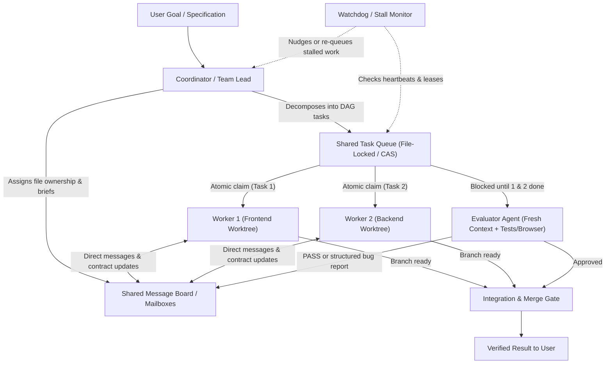

> **Module 5: Multi-Agent & Orchestration** | Prerequisites: Chapters 26–28 | Reading Time: ~22 min
>
> [← 28. Inter-Agent Messaging & Reactive Wakeups](./28-inter-agent-messaging-and-reactive-wakeups.md) | [Table of Contents](../README.md) | [30. Planning Mode & Task Tracking →](./30-planning-mode-and-task-tracking.md)

# 29. Multi-Agent Swarms & Shared Coordination

In Chapters 26–28, you learned the three building blocks of multi-agent systems: how to spawn an isolated subagent (Chapter 26), how to give parallel writers separate Git worktrees so they do not overwrite each other's files (Chapter 27), and how to pass messages asynchronously with reactive wakeups (Chapter 28).

Now comes the hardest question in multi-agent harness engineering: **when you put 3, 5, or 10 agents on the same project, how do you organize them so they actually multiply your output instead of multiplying your chaos?**

---

## 1. The Simple Idea: A Restaurant Kitchen Brigade

Imagine trying to serve dinner to 100 guests.

If you put **one chef** in the kitchen, they have perfect awareness of every plate—nothing conflicts, and every sauce matches every protein—but they can only cook so fast before orders pile up and guests wait two hours.

Now imagine you throw **six chefs** into the same kitchen with no rules and yell, *"Make dinner!"* What happens?
- Two chefs both try to cook the same steak.
- One chef turns the oven to 450°F for pizza while another puts in a soufflé that needs 325°F.
- Nobody knows who is supposed to plate the appetizers, so four chefs stand around asking each other what to do.
- Half the dishes come out cold while the other half never get started.

Real restaurants solved this over a century ago with the **brigade system** (a structured team coordination model):
1. **Clear stations (Ownership Boundaries):** One person owns the grill, one owns sauces, one owns pastry. Nobody reaches across someone else's cutting board.
2. **A shared ticket rail (Task Queue):** Every order is pinned to a visible rail. When a chef pulls a ticket, nobody else cooks that exact ticket.
3. **An expeditor (Coordinator) and a tasting pass (Evaluator):** One person calls out timing and checks every plate before it leaves the kitchen.

A **multi-agent swarm** works on the exact same principle. "Swarm" is a catchy word, but in production harness engineering it does **not** mean a free-for-all mob of autonomous bots. It means a **coordinated group of independent agent sessions** linked by explicit roles, ownership boundaries, shared task state, and structured communication.

Without shared coordination, adding more agents does not make your harness smarter—it makes it **faster at creating merge conflicts, contradictory architectures, and giant API bills**.

---

## 2. Why This Matters in a Real Agent Harness

When a single coding agent tackles a massive task—say, auditing 40 microservices, migrating a full-stack app across frontend and backend, or building an entire application over several hours—three limits eventually bite:

1. **Wall-clock latency:** A single agent works serially, one tool call or small parallel batch at a time. Investigating five independent subsystems sequentially takes 5× as long as investigating them concurrently.
2. **Context pollution and degradation:** Every file read, failed test log, and blind alley piles into one context window. Even with compaction (Chapter 10), trying to hold frontend CSS, database schemas, auth middleware, and end-to-end Playwright logs in one thread degrades reasoning quality.
3. **The self-evaluation trap:** When the same agent writes code and grades its own work, it suffers from **sunk-cost bias**—remembering how hard it tried, it frequently convinces itself that a broken layout or half-tested endpoint is "good enough."

Well-designed multi-agent coordination directly attacks all three problems—splitting breadth-first work across parallel workers, isolating noisy exploration, and putting a skeptical, fresh-context evaluator between the builder and the user.

At the same time, **coordination has a steep tax**. Every extra agent duplicates system prompts, reads overlapping files, and spends tokens communicating. Real harness engineering is knowing *both* how to build rock-solid swarm coordination *and* when to leave the swarm in the toolbox and use a single agent instead.

---

## 3. The Big Picture

Here is how a production multi-agent harness coordinates a team of workers around shared state, isolated workspaces, and a watchdog monitor:



Notice the separation of concerns:
- The **Shared Task Queue** is the single source of truth for *what work exists, who owns it, and what depends on what*.
- The **Message Board / Mailboxes** handle *asynchronous coordination* (clarifications, interface updates, bug reports).
- Each writer works inside its own **Ownership Boundary** and **isolated worktree**.
- The **Monitor** ensures no stalled worker silently freezes the whole team.

---

## 4. Deep Dive: Subtopic by Subtopic

### 4.1 Swarm Topologies

A **topology** is simply the "org chart" of your agents—who talks to whom, and in what order work flows. Almost every real-world multi-agent coding harness uses one (or a hybrid) of four core topologies:

#### 1. Coordinator–Worker (Hub-and-Spoke)
One **Lead / Coordinator** agent breaks the goal into independent subtasks, dispatches them to parallel **Worker** agents, waits for results, and synthesizes the final answer.

```text
                [ Coordinator ]
               /       |       \
              v        v        v
        [Worker A] [Worker B] [Worker C]
```
- **Best for:** Breadth-first research, scanning multiple directories, parallel test debugging, or sharded refactoring across independent modules.
- **Weakness:** The coordinator becomes a bottleneck if workers need frequent back-and-forth with each other.

#### 2. Pipeline / Assembly Line
Work flows through sequential specialist stages, where each stage starts with a fresh context seeded only by the previous stage's structured artifact.

```text
[Researcher] --> (spec.md) --> [Architect] --> (plan.md) --> [Builder] --> (diff) --> [Verifier]
```
- **Best for:** Predictable, multi-phase software workflows where separating exploration from design from coding prevents context clutter.
- **Weakness:** Strictly sequential—errors discovered at stage 4 require looping back to stage 2 or 3.

#### 3. Shared Message Board (Peer-to-Peer / Blackboard)
Agents share a persistent **blackboard** (or message channel + peer mailboxes) and a shared task list. Workers can talk directly to each other—for example, a backend worker posting `"Changed POST /orders response field from total to total_cents"` so the frontend worker adjusts immediately without routing through a central bottleneck.

```text
        +------ [ Shared Board & Task Queue ] ------+
        |                     |                     |
   [Frontend] <--------> [Backend] <----------> [QA/Docs]
```
- **Best for:** Cross-layer features, competing-hypothesis debugging (e.g., three investigators testing different root causes and challenging each other's evidence).
- **Weakness:** Highest risk of chatter, message storms, and duplicated effort if ownership rules are fuzzy.

#### 4. Peer Review / Generator–Evaluator (Adversarial Loop)
Inspired by Generative Adversarial Networks (GANs), one agent (**Generator**) builds the solution while a separate, completely fresh-context agent (**Evaluator**) grades it against strict acceptance criteria using real tools (test suites, type-checkers, or a live browser).

```text
[Planner] --> (acceptance_contract.json)
                     |
                     v
               [Generator] --(code + handoff)--> [Evaluator]
                    ^                                 |
                    +----(FAIL: concrete bug list)----+
                                                      |
                                                (PASS)--> [Done]
```
- **Best for:** Long-running app builds, UI/UX quality verification, security reviews, and any task where "looks right to the author" is not good enough.
- **Weakness:** Extra latency and token cost per review cycle; requires a well-calibrated rubric so the evaluator is neither too lenient nor endlessly nitpicking.

#### Topology Trade-Off Matrix

| Topology | Parallelism | Coordination Overhead | Best Use Case | Primary Failure Mode |
| :--- | :--- | :--- | :--- | :--- |
| **Coordinator–Worker** | High | Low–Medium | Breadth-first research, independent file shards | Coordinator context overload during synthesis |
| **Pipeline / Assembly Line** | Low | Low | Clean staged delivery (spec → code → test) | Late discovery of upstream design mistakes |
| **Shared Message Board** | High | High | Cross-layer features, collaborative debugging | Message chatter, overlapping edits, diffusion of responsibility |
| **Generator–Evaluator** | Low–Medium | Medium | High-assurance coding, UI verification, long runs | Endless nitpick loops if exit criteria are vague |

---

### 4.2 Ownership Boundaries (File & Module Sharding)

If two workers edit `src/api/users.ts` at the same time—even in separate Git worktrees—you have not eliminated conflict; you have merely **postponed it to merge time**. Resolving semantic merge conflicts between two agents who made incompatible assumptions is often harder than having one agent write both changes cleanly.

Production swarms prevent collisions through **explicit ownership boundaries** (often called **sharding**, borrowed from databases where data is partitioned into non-overlapping slices):

1. **Define interface contracts *before* fan-out:** Before Worker A builds the React checkout form and Worker B builds the Express checkout endpoint, the coordinator (or a quick design step) locks down the shared contract—for example, `src/types/checkout.ts` or an OpenAPI spec. Neither worker modifies the contract unilaterally; contract changes go through the coordinator or require an explicit peer handshake.
2. **Assign disjoint file globs:** Every worker's brief specifies the exact directories or files it owns:
   - `worker-ui`: owns `web/src/checkout/**` and `web/tests/checkout/**`
   - `worker-api`: owns `server/src/checkout/**` and `server/tests/checkout/**`
   - Shared files (`package.json`, `schema.prisma`, `src/types/**`): owned **exclusively** by the coordinator or a dedicated integration step.
3. **Enforce boundaries in the harness, not just the prompt:** Telling an LLM *"please only edit files in `web/`"* works ~90% of the time—until a worker gets frustrated by a backend error and "helpfully" edits `server/routes.ts` anyway. A real harness enforces write scopes deterministically in its `edit_file` / `write_file` tool router (and filesystem sandbox):

```python
from fnmatch import fnmatch
from pathlib import PurePosixPath

class OwnershipGuard:
    """Deterministic write-scope enforcer for a swarm worker."""

    def __init__(self, worker_id: str, allowed_write_globs: list[str]) -> None:
        self.worker_id = worker_id
        self.allowed_write_globs = allowed_write_globs

    def check_write(self, relative_path: str) -> tuple[bool, str]:
        # Normalize path to prevent "../" traversal out of the owned subtree
        normalized = PurePosixPath(relative_path).as_posix().lstrip("./")
        if ".." in PurePosixPath(normalized).parts:
            return False, f"Path traversal blocked for '{relative_path}'."

        for pattern in self.allowed_write_globs:
            if fnmatch(normalized, pattern):
                return True, "ok"

        return (
            False,
            f"Ownership violation: worker '{self.worker_id}' cannot modify '{normalized}'. "
            f"Allowed write globs: {self.allowed_write_globs}. "
            f"If a shared contract needs updating, message the coordinator instead.",
        )
```

Notice the error message: it doesn't just crash—it tells the worker *why* the edit was rejected and *what to do instead* (message the coordinator). Good harness boundaries double as steering signals.

---

### 4.3 Shared State, Task Queues & Claim/Lock Semantics

In a swarm, you cannot rely on chat messages alone to remember what is done and what is left. Chat histories grow noisy, get compacted, and live in separate windows. Instead, swarms keep a **shared, structured Task Queue** (often stored on disk as JSON/JSONL or in SQLite) that every agent reads and updates through dedicated tools.

A production task queue needs three properties:

#### 1. Dependency-Aware Tasks (a DAG)
A **DAG (Directed Acyclic Graph)** is simply a set of tasks with "must finish before" arrows (`blocked_by`) and no circular loops (A cannot wait on B while B waits on A).
- Task `T1`: Define shared TypeScript types (`blocked_by: []`)
- Task `T2`: Implement API handler (`blocked_by: ["T1"]`)
- Task `T3`: Implement UI form (`blocked_by: ["T1"]`)
- Task `T4`: Run E2E Playwright integration suite (`blocked_by: ["T2", "T3"]`)

Workers are only allowed to claim tasks whose status is `pending` **and** whose `blocked_by` list contains only `completed` tasks. As soon as `T1` completes, both `T2` and `T3` automatically become claimable in parallel.

#### 2. Atomic Claim Semantics (No Double-Booking)
Suppose Worker A and Worker B both call `list_tasks()`, see that `T2` is `pending`, and both try to start working on `T2` at the exact same millisecond. That is a classic **TOCTOU (Time-of-Check to Time-of-Use) race condition**.

To prevent double-booking, claiming a task must be **atomic**—using either an OS file lock (`fcntl.flock` / `lockfile`), an SQLite `BEGIN IMMEDIATE` transaction, or **Compare-And-Swap (CAS)** optimistic versioning (`UPDATE tasks SET status='in_progress', owner=? WHERE id=? AND status='pending' AND version=?`). Only one worker succeeds; the loser receives `"Task T2 already claimed by worker-api"` and picks the next unblocked task.

#### 3. Leases (Time-Bounded Locks)
What happens if Worker A claims `T2`, then crashes, hits a rate limit, or gets killed by an out-of-memory error? If the lock lasts forever, `T2` stays stuck in `in_progress` permanently and blocks `T4` forever.

The fix is a **lease** (a lock with an expiration timestamp, `lease_expires_at`). While Worker A is actively taking turns, the harness automatically renews its lease (a **heartbeat**). If Worker A dies and stops renewing, the lease expires after, say, 3 minutes, and the coordinator or monitor safely reclaims `T2` and returns it to `pending` (with an incremented `attempt` counter).

Here is what a clean shared task record looks like on disk:

```json
{
  "id": "task-02",
  "title": "Implement POST /api/checkout endpoint",
  "status": "in_progress",
  "owner": "worker-backend",
  "owned_globs": ["server/src/checkout/**", "server/tests/checkout/**"],
  "blocked_by": ["task-01"],
  "lease_expires_at": "2026-11-25T19:45:00Z",
  "attempt": 1,
  "max_attempts": 3,
  "acceptance_criteria": [
    "Validates cart schema and rejects negative quantities with HTTP 400",
    "pytest server/tests/checkout/ passes with 0 failures"
  ],
  "handoff_artifact": ".swarm/handoffs/task-02.md"
}
```

Notice the `handoff_artifact` field: instead of dumping 2,000 words of notes into the JSON queue, the worker writes a concise markdown summary (files changed, test commands run, edge cases discovered) to disk and puts the pointer in the task record.

---

### 4.4 Stall Detection, Monitoring & Graceful Shutdown

Distributed systems fail quietly. In a multi-agent swarm, there are four common "stuck" states you must distinguish:

| State | What Is Actually Happening | Correct Harness Action |
| :--- | :--- | :--- |
| **Legitimately Waiting** | Worker finished its task, went to sleep on the board, costing zero tokens. | Do nothing—this is healthy! |
| **Busy on Slow Tool** | Worker is running `cargo build` or a 2-minute E2E test suite. | Keep renewing lease while child process is alive; do not interrupt prematurely. |
| **Wedged / Thrashing** | Worker has made 10 consecutive tool calls without passing tests, or is looping on the same file edit. | Monitor detects lack of progress, sends a corrective nudge or escalates to Coordinator to reassign/re-scope. |
| **Deadlock / Mutual Wait** | Worker A posted a question to Worker B; Worker B is asleep waiting for Worker A's branch. | Stall monitor notices *all* agents are idle while `pending` or `in_progress` tasks remain, and wakes the one member who can unstick the queue. |

#### The Dedicated Monitor Pattern
Instead of having the Coordinator burn tokens every 30 seconds asking *"Are you done yet?"* (the polling anti-pattern from Chapter 28), modern swarms run a lightweight **watchdog timer** (in deterministic harness code, or a cheap, low-frequency monitor agent woken by a timer):
1. Check if any `in_progress` task has an expired lease or zero new tool events for `N` minutes.
2. Check if the *entire* swarm is `waiting` while uncompleted tasks still exist (global stall).
3. If stalled, inspect the last 5 board messages and task statuses, then wake **only** the single agent (usually the Coordinator or the blocking worker) with a concrete summary of what is stuck.

#### Graceful Shutdown (Land the Work Before Killing the Worker!)
Remember from Chapter 27 that each editing worker lives in an **ephemeral worktree or branch**. Killing a worker process and deleting its workspace *before* landing its commits is a classic data-loss bug.

Graceful shutdown follows a strict 4-step protocol:
1. **Drain:** Stop assigning new tasks; send a `shutdown_requested` message to active workers.
2. **Checkpoint / Commit:** Each worker finishes its current atomic edit (or rolls back a half-finished edit), runs a quick sanity check, commits to its branch, and posts a final handoff note.
3. **Land / Merge:** The coordinator merges (or cherry-picks / opens PRs for) each completed branch into the main integration branch and runs the final test suite.
4. **Teardown:** Only *after* the branch is safely landed (or explicitly discarded on failure) does the harness terminate the worker sessions and delete the temporary worktrees.

---

### 4.5 Economics & Diminishing Returns: When Swarms Beat Single Agents (and When They Don't)

This is the single most important strategic lesson in Module 5.

In mid-2025, two landmark engineering write-ups framed the entire industry debate on multi-agent systems:

1. **Anthropic's Multi-Agent Research System** showed that an Orchestrator–Worker setup (Claude Opus as lead, parallel Claude Sonnet workers) outperformed a single Opus agent by **90.2%** on complex, breadth-first research benchmarks—*at the cost of roughly **15× more tokens** than standard chat* (compared to ~4× for a single-agent loop).
2. **Cognition's *"Don't Build Multi-Agents"*** (by Walden Yan, makers of Devin) pushed back hard on parallel-writer coding swarms, identifying two structural failure modes:
   - **Context fragmentation ("Game of Telephone"):** Every time context is summarized across agent boundaries, subtle assumptions are dropped.
   - **Implicit conflicting decisions:** Writing code involves hundreds of tiny implicit decisions (naming conventions, error handling style, helper abstractions, state shape). When two parallel agents write tightly coupled code simultaneously, their implicit decisions clash violently at integration time.

Later follow-ups from both camps converged on a nuanced, practical engineering rule—often called the **Single-Writer / Parallel-Reader Principle**:

- **Parallel readers almost always win:** Breadth-first exploration, searching a huge monorepo, investigating 4 competing bug hypotheses, running specialized read-only code reviews (security, performance, correctness), or evaluating a live build in a fresh context. Here, context isolation is a *feature*, not a bug.
- **Parallel writers only win when the task is naturally shardable:** Independent microservices, separate frontend/backend behind a pre-agreed API contract, migrating 30 isolated test files, or building self-contained plugins.
- **A single well-engineered agent wins when the task is tightly coupled:** Refactoring a core data model that touches 12 interconnected files, chasing down one subtle race condition across layers, or iterating quickly on a small feature.

There is also **Amdahl's Law for Agents**: if 30% of your task is inherently sequential (planning, defining shared types, final integration, fixing cross-module test failures), then even with infinite parallel workers, your maximum possible speedup is less than 3.3×—while your token cost climbs linearly (or super-linearly) with every worker you add!

#### Decision Matrix: Single Agent vs. Subagents vs. Full Swarm

| Task Shape | Best Architecture | Why |
| :--- | :--- | :--- |
| Fix a localized bug or refactor a tightly coupled module | **Single Agent** (with good context engineering) | Full shared context eliminates implicit-decision conflicts; lowest token cost. |
| Broad codebase search + localized implementation | **Single Writer + Read-Only Subagents** | Parallel subagents compress search noise; one writer keeps all code decisions coherent. |
| Long-running app build needing high UI/functional polish | **Planner → Generator ↔ Evaluator** | Isolated evaluator eliminates self-evaluation bias without parallel-writer merge wars. |
| Large, cleanly decomposable multi-module feature or audit | **Full Swarm (Coordinator + Sharded Workers + Shared Queue)** | True wall-clock parallelism across disjoint file ownership boundaries. |

> **Rule of thumb:** Earn your complexity. Start with a single agent. Add read-only subagents when search noise bloats your context. Add an isolated evaluator when self-grading fails. Reach for a full multi-writer swarm *only* when you can draw clean, non-overlapping file ownership boundaries and the time savings clearly justify a 3×–15× token multiplier.

---

## 5. How Real Harnesses Do It

- **Claude Code Agent Teams (2026):** Moves beyond hierarchical parent-only subagents by introducing a **Team Lead** (optionally in *Delegate Mode*, focused purely on coordination), independent **Teammates** running in separate context windows, a **file-locked Shared Task List** with dependency blocking (`pending` → `in_progress` → `completed`), and direct peer-to-peer **Mailboxes** stored as local JSON files (`~/.claude/teams/{team-name}/inboxes/{agent-name}.json`). Users can inspect or steer individual teammates live in-process or across `tmux` / iTerm2 split panes.
- **Anthropic's Planner–Generator–Evaluator Harness (Long-Running Apps):** Separates a multi-hour build into three isolated subprocess roles inspired by GANs. Before coding starts, the Generator and Evaluator negotiate a **default-FAIL acceptance contract** (every criterion starts `false` and can only flip to `true` with objective proof from tests or Playwright browser inspection). All handoffs happen through structured markdown artifacts on disk so agents cannot "hallucinate" progress.
- **Anthropic's Orchestrator–Worker Research Harness:** Uses **model tiering** (frontier model as Orchestrator for strategy and synthesis; faster mid-tier models as parallel search Workers) plus explicit **effort-scaling rules** in the lead prompt (e.g., 1 agent for simple lookups, 2–4 for comparisons, 10+ only for massive breadth-first queries) to prevent over-spawning.
- **Cognition (Devin) Context-Engineered Execution:** Keeps file mutations strictly single-threaded with continuous action traces and intelligent compaction, delegating only read-heavy intelligence gathering and clean-context reviews to parallel helper agents.
- **Shared-Board Swarms (e.g., Antigravity Swarm / Blackboard Architectures):** Combine a public message board where worker briefs and updates are visible to everyone, per-worker `workspace: "share"` (Git worktree) isolation for parallel authors, `inherit` workspaces for read-only verifiers, and a timer-driven monitor role that detects global stalls and wakes the exact member who can unblock progress.

---

## 6. Common Pitfalls & Failure Modes

1. **Unsharded Parallel Writers ("Merge Hell"):**
   - *Symptom:* Three workers all edit `app.py` and `utils.py` concurrently; integration spends more tokens fixing conflicts than writing the feature.
   - *Fix:* Lock shared interfaces upfront, assign disjoint file globs enforced in the harness tool layer, and restrict shared files to the coordinator.
2. **Self-Evaluation Bias (No Adversarial Separation):**
   - *Symptom:* A builder agent writes a UI and declares *"Looks great and works smoothly!"* despite broken buttons and failing edge cases.
   - *Fix:* Run a separate Evaluator agent in a **fresh context** with zero access to the builder's trial-and-error transcript, armed with real execution tools (tests, browser, linter) and a default-FAIL checklist.
3. **Runaway Spawning on Trivial Tasks:**
   - *Symptom:* User asks to rename a button; coordinator spawns 5 workers (Architect, Frontend, Backend, QA, Docs) and burns \$4 in tokens.
   - *Fix:* Put explicit effort-scaling rules in the coordinator prompt and enforce hard caps (`max_workers`, `max_total_tokens`) in deterministic harness code.
4. **Lost Work on Premature Kill:**
   - *Symptom:* Coordinator declares victory or times out a worker and immediately deletes its worktree—wiping out 15 minutes of uncommitted changes.
   - *Fix:* Enforce a strict **drain → commit → merge → teardown** shutdown sequence; refuse to delete a dirty worktree unless explicitly forced.
5. **Silent Deadlocks in Dependency Graphs:**
   - *Symptom:* Task A is `blocked_by` Task B, Task B is `blocked_by` Task A (cycle), or a worker crashes while holding a lock with no lease expiry.
   - *Fix:* Validate the DAG for cycles on every `add_task` call (topological sort / cycle check), and enforce time-bounded leases with automatic watchdog reclamation.
6. **Chatter Storms on Shared Message Boards:**
   - *Symptom:* Four peer agents spend 30 turns politely replying *"Thanks, got it!"* and *"Sounds good!"* to each other, burning budget on acknowledgments.
   - *Fix:* Instruct peers to message **only** when sharing actionable state changes, contract questions, or blockers—and never send pure acknowledgment replies.

---

## 7. Build It Yourself: Mini-Lab

Let's build a compact, production-style **Swarm Coordinator Core** in Python (~100 lines) with zero third-party dependencies. It implements:
1. A **file-locked, dependency-aware Task Queue** (`fcntl.flock`) so two workers can never claim the same task.
2. **Cycle detection** so bad dependencies cannot deadlock the swarm.
3. **Time-bounded leases & a Watchdog Stall Detector** that reclaims abandoned work and spots global stalls.

```python
"""
mini_swarm_coordinator.py — File-locked DAG task queue, atomic claims,
lease expiration, and stall detection for multi-agent swarms.
"""
from __future__ import annotations

import fcntl
import json
import time
from dataclasses import asdict, dataclass, field
from pathlib import Path
from typing import Optional


@dataclass
class Task:
    id: str
    title: str
    owned_globs: list[str]
    blocked_by: list[str] = field(default_factory=list)
    status: str = "pending"          # pending | in_progress | completed | failed
    owner: Optional[str] = None
    lease_expires_at: float = 0.0
    attempt: int = 0
    max_attempts: int = 3
    handoff_note: str = ""


class SwarmTaskQueue:
    """Disk-backed, file-locked shared task queue for parallel agent processes."""

    def __init__(self, state_path: Path, lease_seconds: float = 180.0) -> None:
        self.state_path = state_path
        self.lock_path = state_path.with_suffix(".lock")
        self.lease_seconds = lease_seconds
        self.state_path.parent.mkdir(parents=True, exist_ok=True)
        if not self.state_path.exists():
            self.state_path.write_text("{}", encoding="utf-8")

    def _with_lock(self, fn):
        """Run `fn(tasks_dict)` inside an exclusive OS file lock and save atomically."""
        with self.lock_path.open("a+", encoding="utf-8") as lock_file:
            fcntl.flock(lock_file.fileno(), fcntl.LOCK_EX)
            try:
                raw = json.loads(self.state_path.read_text(encoding="utf-8"))
                tasks = {tid: Task(**data) for tid, data in raw.items()}
                result = fn(tasks)
                # Write to temp file and rename for crash-safe atomic persistence
                tmp = self.state_path.with_suffix(".tmp")
                tmp.write_text(
                    json.dumps({k: asdict(v) for k, v in tasks.items()}, indent=2),
                    encoding="utf-8",
                )
                tmp.replace(self.state_path)
                return result
            finally:
                fcntl.flock(lock_file.fileno(), fcntl.LOCK_UN)

    def add_task(self, task: Task) -> None:
        def _op(tasks: dict[str, Task]) -> None:
            tasks[task.id] = task
            if self._has_cycle(tasks):
                del tasks[task.id]
                raise ValueError(f"Dependency cycle detected when adding '{task.id}'.")
        self._with_lock(_op)

    def claim_next(self, worker_id: str) -> Optional[Task]:
        """Atomically claim the first unblocked pending task for `worker_id`."""
        now = time.time()

        def _op(tasks: dict[str, Task]) -> Optional[Task]:
            for task in tasks.values():
                if task.status != "pending":
                    continue
                deps_done = all(
                    dep in tasks and tasks[dep].status == "completed"
                    for dep in task.blocked_by
                )
                if deps_done:
                    task.status = "in_progress"
                    task.owner = worker_id
                    task.attempt += 1
                    task.lease_expires_at = now + self.lease_seconds
                    return task
            return None

        return self._with_lock(_op)

    def renew_lease(self, task_id: str, worker_id: str) -> bool:
        """Heartbeat called by the worker's harness during active tool execution."""
        now = time.time()

        def _op(tasks: dict[str, Task]) -> bool:
            t = tasks.get(task_id)
            if t and t.status == "in_progress" and t.owner == worker_id:
                t.lease_expires_at = now + self.lease_seconds
                return True
            return False

        return self._with_lock(_op)

    def complete_task(self, task_id: str, worker_id: str, handoff_note: str) -> None:
        def _op(tasks: dict[str, Task]) -> None:
            t = tasks[task_id]
            if t.owner != worker_id:
                raise PermissionError(f"{worker_id} does not own {task_id} (owner: {t.owner})")
            t.status = "completed"
            t.lease_expires_at = 0.0
            t.handoff_note = handoff_note
        self._with_lock(_op)

    def watchdog_sweep(self) -> dict[str, list[str]]:
        """Reclaim expired leases and report failed or globally stalled tasks."""
        now = time.time()

        def _op(tasks: dict[str, Task]) -> dict[str, list[str]]:
            requeued, failed = [], []
            for t in tasks.values():
                if t.status == "in_progress" and t.lease_expires_at < now:
                    if t.attempt >= t.max_attempts:
                        t.status = "failed"
                        t.owner = None
                        failed.append(t.id)
                    else:
                        t.status = "pending"
                        t.owner = None
                        requeued.append(t.id)
            # Detect global deadlock: unfinished tasks exist, but none are active or claimable
            active = [t.id for t in tasks.values() if t.status == "in_progress"]
            claimable = [
                t.id for t in tasks.values()
                if t.status == "pending"
                and all(tasks[d].status == "completed" for d in t.blocked_by if d in tasks)
            ]
            remaining = [t.id for t in tasks.values() if t.status in ("pending", "in_progress")]
            stalled = remaining if (remaining and not active and not claimable) else []
            return {"requeued": requeued, "failed": failed, "stalled": stalled}

        return self._with_lock(_op)

    @staticmethod
    def _has_cycle(tasks: dict[str, Task]) -> bool:
        visiting, visited = set(), set()

        def dfs(tid: str) -> bool:
            if tid in visiting:
                return True
            if tid in visited or tid not in tasks:
                return False
            visiting.add(tid)
            for dep in tasks[tid].blocked_by:
                if dfs(dep):
                    return True
            visiting.remove(tid)
            visited.add(tid)
            return False

        return any(dfs(tid) for tid in tasks)


if __name__ == "__main__":
    queue = SwarmTaskQueue(Path("/tmp/demo_swarm/tasks.json"), lease_seconds=0.1)
    queue.add_task(Task("t1", "Define API contract", ["shared/types.ts"]))
    queue.add_task(Task("t2", "Build API route", ["server/**"], blocked_by=["t1"]))
    queue.add_task(Task("t3", "Build UI form", ["web/**"], blocked_by=["t1"]))

    t = queue.claim_next("coord")
    assert t and t.id == "t1"
    queue.complete_task("t1", "coord", "Exported CheckoutPayload in shared/types.ts")

    # Now both workers can claim non-overlapping tasks concurrently!
    w1_task = queue.claim_next("worker-backend")
    w2_task = queue.claim_next("worker-frontend")
    print("Claimed:", w1_task.id if w1_task else None, w2_task.id if w2_task else None)

    # Simulate worker crash -> lease expires -> watchdog reclaims automatically
    time.sleep(0.15)
    print("Watchdog sweep:", queue.watchdog_sweep())
```

Look how little code it takes to eliminate the three nastiest swarm bugs (double-claiming, cyclic deadlocks, and crashed-worker lock leaks) deterministically—without asking an LLM to "remember" who owns what.

---

## 8. Key Takeaways & Quick Self-Check

- **Choose the simplest topology that fits:** Coordinator–Worker for breadth-first fan-out, Pipeline for clean staged handoffs, Shared Board for cross-layer collaboration, and Generator–Evaluator to defeat self-evaluation bias.
- **Shard writes strictly:** Lock shared contracts *before* parallel workers start, assign disjoint file globs, and enforce write boundaries in harness code—not just prompt prose.
- **Keep shared state outside chat:** Use a dependency-aware (DAG), atomically locked task queue with time-bounded leases and disk-backed handoff artifacts.
- **Detect stalls and shut down gracefully:** Distinguish zero-cost idle workers from wedged or deadlocked ones, and always drain, commit, and merge worktrees before tearing down workers.
- **Respect swarm economics:** Multi-agent swarms can deliver huge wins on breadth-first or cleanly shardable work, but carry a 3×–15× token multiplier and severe context-fragmentation risks on tightly coupled edits. When in doubt, prefer **single writer + parallel read-only helpers**.

### Quick Self-Check

1. **Why does Cognition's *"Don't Build Multi-Agents"* critique warn specifically against parallel *writer* agents on tightly coupled code, even if each worker has its own Git worktree?**
   <details><summary>Show Answer</summary>
   Git worktrees prevent *filesystem* collisions, not *architectural* collisions. Writing code involves dozens of implicit decisions (naming, error handling, helper abstractions, state assumptions). Two parallel writers in isolated contexts make incompatible implicit decisions—creating a "game of telephone" and painful semantic conflicts when their branches are merged. Parallel *readers* (researchers, reviewers) do not suffer from this because a single writer still owns all coherent code mutations.
   </details>

2. **Why should an Evaluator agent in a Generator–Evaluator loop run in a completely fresh context window rather than continuing the Generator's conversation?**
   <details><summary>Show Answer</summary>
   Continuing the Generator's conversation causes **sunk-cost / self-evaluation bias**: seeing all the effort and reasoning that went into the patch makes the model rationalize flaws and gloss over bugs. A fresh-context Evaluator sees only the acceptance contract, the final code/running app, and real tool outputs (tests, Playwright), producing far more objective bug reports.
   </details>

3. **In a shared task queue, why do you need *both* atomic claims (`flock` / CAS) *and* time-bounded leases?**
   <details><summary>Show Answer</summary>
   Atomic claims prevent two live workers from grabbing the same task at the exact same moment (TOCTOU race condition). Time-bounded leases solve the opposite failure: if a worker claims a task and then crashes or hangs, the lease expires so a watchdog can safely return the task to `pending` instead of leaving downstream dependent tasks blocked forever.
   </details>

4. **A user asks your coding harness to rename a single internal helper function across 3 tightly coupled files in one package. Should you spin up a 4-agent swarm?**
   <details><summary>Show Answer</summary>
   No. A single agent with `ripgrep`/LSP and a test runner will finish faster, cheaper, and with zero coordination risk. Spinning up a swarm here violates effort-scaling rules: the setup, duplicate system prompts, and merge overhead would cost several times more tokens and latency than just doing the edit in one linear thread.
   </details>

---

[← 28. Inter-Agent Messaging & Reactive Wakeups](./28-inter-agent-messaging-and-reactive-wakeups.md) | [Table of Contents](../README.md) | [30. Planning Mode & Task Tracking →](./30-planning-mode-and-task-tracking.md)
