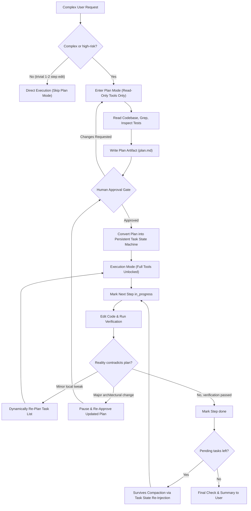
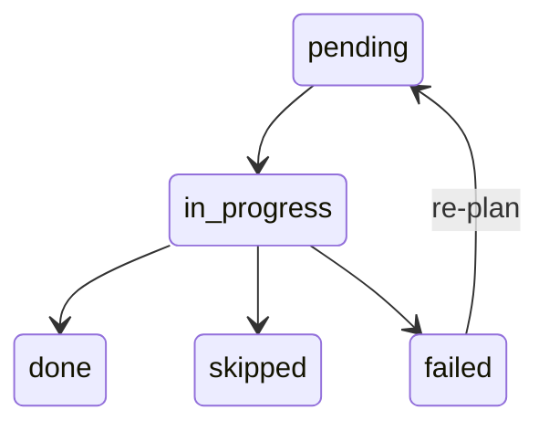

> **Module 5: Multi-Agent & Orchestration** | Prerequisites: Chapters 10 & 26 | Reading Time: ~20 min
>
> [← 29. Multi-Agent Swarms & Shared Coordination](./29-multi-agent-swarms-and-shared-coordination.md) | [Table of Contents](../README.md) | [31. Programmatic Agent Workflows →](./31-programmatic-agent-workflows.md)

# 30. Planning Mode & Task Tracking

Have you ever watched an AI coding agent receive a tricky request, *"migrate our session cookies to JWTs with refresh token rotation"*, and immediately start editing files on turn 2, before it has even read your auth middleware, your database migrations, or your test suite?

Ten minutes later, 14 files are half-rewritten, tests are screaming, the agent has forgotten half your constraints, and you hit `git reset --hard` in frustration.

This chapter is about the two deceptively simple harness mechanisms that prevent that exact disaster: **Planning Mode** (separating *"think & design"* from *"edit & execute"*) and **Live Task Tracking** (giving the agent a durable, structured checklist that keeps it locked onto the goal across 50+ turns and context compactions).

---

## 1. The Simple Idea: Measure Twice, Cut Once—With a Clipboard

Think about how a skilled carpenter remodels a kitchen:

1. **Blueprint first (Planning Mode):** Before anyone picks up a sledgehammer or turns on a circular saw, the carpenter walks the room with a tape measure, checks where the plumbing and electrical lines actually run, sketches a plan on paper, and reviews it with the homeowner. Changing a wall on paper costs 30 seconds and an eraser. Moving a wall *after* you framed it costs \$5,000 and three days.
2. **Clipboard on the wall (Task Tracking):** Once the homeowner says *"Approved, go ahead,"* the carpenter pins a numbered checklist to the wall:
   - `[x]` Shut off water & remove old cabinets
   - `[→]` Reroute sink drain pipe *(in progress)*
   - `[ ]` Install new base cabinets
   - `[ ]` Wire under-cabinet lighting
   - `[ ]` Pressure-test plumbing & inspect

If the carpenter goes to lunch, or a second shift takes over (just like **context compaction** in Chapter 10!), nobody wonders *"Wait: did we already pressure-test the pipes, or did we only buy the fittings?"* The clipboard on the wall is the single source of truth.

Without Planning Mode, an agent swings the sledgehammer on turn 1. Without Task Tracking, an agent loses track of step 4 of a 7-step job halfway through and proudly declares victory with half the kitchen missing.

---

## 2. Why This Matters in a Real Agent Harness

You might wonder: *"Why can't I just type 'please plan carefully first' into my prompt?"*

Two deeply practical reasons explain why top harnesses build **Planning Mode** and **Task Tracking** as first-class harness features rather than polite prompt suggestions:

1. **Autoregressive momentum (Sunk-Cost Bias in LLMs):** An LLM generates tokens left-to-right conditioned on everything already in its context. The moment an agent writes a flawed 100-line file, that file sits right there in its history acting as a giant anchor. Instead of admitting *"Wait, my architecture is wrong, let me revert,"* models overwhelmingly try to patch around their first mistake: digging a deeper hole with every turn. Locking the agent into a read-only exploration phase prevents premature commitment.
2. **Long-horizon drift & "Context Anxiety":** Over a 40-turn session, early requirements get buried under thousands of lines of compiler logs and diffs, and eventually summarized by compaction (Chapter 10). As models approach context limits, researchers have even observed **"context anxiety"**: agents rushing to wrap up early and quietly skipping remaining steps. A live, structured task state machine keeps the remaining work crisp, visible, and mechanically verifiable, for both the model and the human watching the UI.

---

## 3. The Big Picture

Here is the end-to-end lifecycle connecting a read-only Planning Phase, a human approval gate, Execution Mode, persistent Task Tracking, and dynamic re-planning:



---

## 4. Deep Dive: Subtopic by Subtopic

### 4.1 Why Separating "Think & Plan" from "Edit & Execute" Works

Separating planning from execution changes the economics of mistakes.

| Dimension | Jump Straight to Editing | Separate Plan Phase → Execute Phase |
| :--- | :--- | :--- |
| **Cost of a wrong assumption** | High: must revert edits across multiple files and re-reason | Near-zero: delete two bullets in `plan.md` |
| **Human review effort** | Reviewing a 900-line diff across 11 files | Reviewing a 40-line architectural summary |
| **Exploration thoroughness** | Shallow: model stops reading as soon as it finds *one* plausible file | Thorough: read-only mode encourages checking callers, tests, and edge cases first |
| **Context cleanliness** | Mixed exploration + broken diffs + reverted attempts | Clean handoff: implementation can even start in a fresh/compacted context seeded with the approved plan |

There is also a subtle **model-routing win** (Chapter 39): you can run the short, high-leverage Planning Phase on a slower, deeper reasoning model (frontier tier) and execute the well-specified steps on a faster, cheaper model; getting frontier architecture at mid-tier execution cost.

---

### 4.2 Read-Only Planning Phases, Plan Artifacts & Human Approval Gates

#### 1. Enforce Read-Only at the Harness Layer
Never rely on a system prompt sentence like *"You are in Plan Mode, please don't modify any files."* Under tool-use pressure, LLMs occasionally forget mode rules and call `edit_file` or run `bash` with `sed -i` anyway.

In a real harness, **Plan Mode is a hard tool-policy state**:
- **Allowed tools:** `read_file`, `glob`, `ripgrep`, `lsp_references`, `list_files`, read-only subagents (`research`), and a dedicated `write_plan_artifact` tool scoped **only** to the harness's plan directory (e.g., `.agent/plans/` or the artifact directory).
- **Blocked or restricted tools:** `edit_file`, `write_file` (on workspace paths), mutating MCP tools, and shell commands (either completely disabled, or strictly restricted to a read-only allowlist like `git status`, `git log`, `git diff`, never allowing redirects `>` or mutating flags).

#### 2. What Makes a Great Implementation Plan Artifact?
A vague plan like *"1. Update auth. 2. Fix tests."* is useless: it hides every real decision. A good plan artifact is **concrete enough to catch disagreements before a single line of code is written**, yet **short enough for a human to read in 60 seconds**:

```markdown
# Implementation Plan: Migrate Session Auth to Short-Lived JWT + Refresh Rotation

## Goal & Scope
Replace Redis-backed opaque session cookies with 15-minute JWT access tokens
and rotating HttpOnly refresh tokens stored in Postgres.

## Proposed Changes
1. **Database (`migrations/014_refresh_tokens.sql`)**
   - Add `refresh_tokens(id, user_id, token_hash, expires_at, revoked_at)` table.
2. **Auth Service (`src/auth/tokens.ts`, `src/auth/middleware.ts`)**
   - Issue HS256/RS256 access token + opaque rotated refresh token on login.
   - Reuse detection: if a revoked refresh token is presented, revoke the entire token family.
3. **API Routes (`src/routes/auth.ts`)**
   - Update `POST /login`, add `POST /refresh`, update `POST /logout`.
4. **Tests (`tests/auth_refresh.test.ts`)**
   - Cover happy path, expired access token, rotation, and reuse-attack revocation.

## Open Decisions / Trade-offs
- **Key algorithm:** Planning RS256 using `AUTH_PRIVATE_KEY` env var (safer for microservice verification) rather than HS256. Confirm if symmetric HS256 is preferred.

## Verification Plan
- `npm run db:migrate:test`
- `npm test -- tests/auth_refresh.test.ts`
- `npm run typecheck`
```

Notice the **Open Decisions** and **Verification Plan** sections: they turn the plan from a monologue into a crisp design review.

#### 3. The Human Approval Gate
Once the plan artifact is written, the agent calls an explicit transition tool, such as `exit_plan_mode` or `request_plan_approval`, which **pauses the loop** and surfaces the plan to the user with three clear actions:
- **Approve & Execute:** Harness switches the session state machine from `planning` → `executing` (unlocking write tools) and seeds the task list.
- **Revise with Feedback:** User comments *"Use HS256 for now, and keep backward compatibility with legacy session cookies for 1 release."* Harness stays in `planning`, updates the artifact, and re-submits.
- **Reject / Cancel:** Zero workspace files were touched; clean exit with zero cleanup!

---

### 4.3 Live Task Checklists & Todo State Machines Across Compaction

Once execution starts, a long task needs a **live checklist** (often implemented via tools like `update_steps`, `TodoWrite`, or `TaskCreate`/`TaskUpdate`).

#### Why Naive In-Chat Checklists Break
If the agent simply prints a markdown bullet list in message #4 of the conversation:
1. By message #35, that list is 40,000 tokens back in the middle of the context window: prime **"lost in the middle"** territory (Chapter 09).
2. When context compaction triggers at turn #40 (Chapter 10), the summarizer may compress or drop unchecked sub-steps.
3. The UI cannot render a clean live progress bar or dashboard because the checklist is trapped inside unstructured prose.

#### The Solution: A Structured, Externalized Task State Machine
Modern harnesses store the checklist in **structured state outside the message array** (in memory synced to disk, e.g., `~/.claude/tasks/{list_id}.jsonl` or a session state JSON file), expose narrow tools to mutate it, and **re-inject the current checklist into fresh context** after every compaction (or near the end of the prompt: a technique famously highlighted by Manus as "reciting `todo.md`" to keep goals in the model's hottest attention window).

Here is the standard finite state machine for a single task item:



#### Key State-Machine Invariants
Good harnesses enforce a few gentle rules on task transitions:
- **Explicit active focus:** Mark the current step(s) `in_progress` *before* running the tools for that step (usually 1 step at a time for serial work, or multiple only when running parallel subagents).
- **Verified completion:** Never mark a step `done` if its verification command failed or was skipped; mark it `failed` or leave it `in_progress` until fixed.
- **Dependency awareness (for complex projects):** Each task can carry `blocked_by: ["task-1"]` so the model immediately sees which step is legally next.
- **Survives compaction & session restarts:** Because tasks live on disk, clearing the conversation or compacting history loses zero progress; the harness automatically injects:

```xml
<active_task_list source="disk" persistent="true">
  [done]        1. Add refresh_tokens database migration
  [in_progress] 2. Implement JWT + refresh rotation in src/auth/tokens.ts
  [pending]     3. Wire POST /refresh and POST /logout routes (blocked_by: 2)
  [pending]     4. Write unit & reuse-attack tests and run full suite (blocked_by: 3)
</active_task_list>
```

That compact 6-line block costs ~60 tokens, stays immune to compaction amnesia, and acts like a compass on every single turn.

---

### 4.4 Dynamic Re-Planning When Reality Contradicts the Plan

No plan survives first contact with a messy real-world codebase.

Suppose during Step 2 of the JWT migration, the agent opens `src/ws/socket_server.ts` and discovers that the WebSocket server also validates legacy session cookies directly against Redis: something nobody spotted during initial exploration.

What should happen? A brittle agent either:
- **Ignores reality** and blindly finishes the outdated plan (breaking WebSockets in production), OR
- **Silently goes rogue**, rewriting half the WebSocket stack without updating the plan or telling the user.

A well-engineered harness supports **tiered dynamic re-planning**:

| Magnitude of Discovery | Example | Right Harness Behavior |
| :--- | :--- | :--- |
| **Tactical (Local)** | A helper function needs an extra parameter, or one more unit test file needs updating. | **Self-adjust in place:** Update the live task list (split a step or insert a new step in order), briefly tell the user what changed, and keep going. |
| **Strategic (Scope / Architecture Change)** | Needs a new database migration, breaks WebSockets, requires adding a paid third-party library, or contradicts a user constraint. | **Pause & Re-Plan:** Mark the blocked step, update the plan artifact explaining what was discovered, and hit the approval gate again before making the unapproved architectural leap. |

Notice one subtle rule for task lists: **when you insert or split a step during re-planning, put it where it actually happens in execution order, never just tack it onto the bottom.** A chronological checklist keeps the model's next-action reasoning crystal clear.

---

### 4.5 Anti-Patterns: Over-Planning Trivial Tasks & Stale Checklists

Planning and task tracking are power tools, not mandatory bureaucracy. Misusing them makes an agent feel sluggish and robotic.

#### Anti-Pattern 1: Over-Planning Trivial Tasks
- **What it looks like:** The user asks *"Fix the typo on line 42 of `README.md`"* or *"What port does the dev server listen on?"*: and the agent enters Plan Mode, writes a 50-line `plan.md`, creates a 5-step checklist (`1. Read README`, `2. Locate typo`, `3. Edit README`, `4. Verify diff`, `5. Report to user`), and asks for approval.
- **Why it hurts:** Wastes 3–5 extra LLM turns, multiplies latency, and triggers **approval fatigue** (when humans see pointless plans, they stop reading *important* plans and just mash "Approve").
- **The Rule:** Skip Plan Mode and checklists for 1–2 step requests, pure Q&A, and open-ended exploration where you don't know the steps yet. Reserve checklists for committed multi-step plans (typically 3–8 meaningful steps) and Plan Mode for multi-file, ambiguous, or risky changes.

#### Anti-Pattern 2: Stale & Performative Checklists
- **What it looks like:**
  - The agent finishes the task, writes *"All done!"*, yet leaves steps 3 and 4 stuck in `in_progress` or `pending` in the UI.
  - Or worse: the agent marks all 6 steps `done` in one batch *before* running the test suite, tests fail, and the checklist now lies about reality.
  - Or the agent creates 25 micro-steps (`Import os`, `Define class`, `Add docstring`...) and spends half its tool calls updating checkboxes instead of writing code.
- **The Fix:**
  - Group small edits into meaningful milestones (3–8 steps, not 25).
  - Update the checklist **in parallel** with the first tool call of the next step so checklist updates add zero extra turn latency.
  - Add a harness `Stop` check (Chapter 32): if the model tries to end the turn (`end_turn`) while tasks remain `in_progress` or `pending`, gently nudge it to either finish the remaining work or explicitly mark skipped/blocked items before closing out.

---

## 5. How Real Harnesses Do It

- **Claude Code: Plan Mode + Persistent Task Tools (2025–2026):**
  - Users toggle **Plan Mode** via `Shift+Tab`, locking Claude into read-only codebase analysis so it can propose an architectural blueprint before mutating disk.
  - For execution tracking, Claude Code evolved from its original ephemeral **`TodoWrite`** tool (which lived inside prompt history and could vanish across `/compact` or new sessions) to structured, disk-backed **Task Tools** (`TaskCreate`, `TaskUpdate`, `TaskList`, `TaskGet`) persisted under `~/.claude/tasks/`. Tasks support dependency graphs (`blockedBy`), a live terminal overlay (`Ctrl+T`), and cross-session continuity via `CLAUDE_CODE_TASK_LIST_ID`.
- **Anthropic's Long-Running App Harness (Planner → Generator → Evaluator):**
  - Treats the plan as a **file-based contract** on disk. The Planner expands a short prompt into a structured specification and milestone list; each coding sprint begins by reading the spec and previous handoff file, and every acceptance item starts as `false` (default-FAIL) until objectively verified.
- **Antigravity & Modern IDE Harnesses (Plan Artifacts + Live Step Checklists):**
  - Combine markdown **Implementation Plan artifacts** with interactive `RequestFeedback` approval UI (giving the user a one-click "Proceed" button or inline comments) and a separate structured **live checklist tool** (`update_steps`, capped at 3–12 high-level steps, updated in parallel with the first tool call of each step) plus a finer-grained live focus indicator (`update_focus`).
- **Manus AI (`todo.md` Attention Recitation):**
  - Publicly documented a surprisingly effective trick: having the agent maintain and periodically rewrite a `todo.md` file during 50-step trajectories pushes the remaining goals to the **very end** of the context window, counteracting "lost in the middle" drift without complex custom plumbing.

---

## 6. Common Pitfalls & Failure Modes

1. **Prompt-Only Plan Mode (Leaky Read-Only Enforcement):**
   - *Mistake:* Relying on `"Please do not edit files yet"` in the system prompt.
   - *Fix:* Enforce a hard tool allowlist in the harness router while `mode == "plan"`; reject write tools and mutating shell commands deterministically.
2. **Compaction Amnesia:**
   - *Mistake:* Storing the task list only inside chat messages, so `/compact` summarizes away unchecked steps.
   - *Fix:* Store tasks in structured state outside the message list (ideally on disk) and inject the rendered task block into the post-compaction context automatically.
3. **Analysis Paralysis (Infinite Planning Loops):**
   - *Mistake:* The agent reads 60 files in Plan Mode, writes a 10-page design doc for a medium feature, and burns half its context window before writing one line of code.
   - *Fix:* Give Plan Mode a focused read budget (or delegate broad exploration to a read-only researcher subagent, Chapter 26) and enforce concise plan templates.
4. **Checklist Updates Burning Extra Turns:**
   - *Mistake:* Turn 10 calls *only* `update_steps`; Turn 11 calls `edit_file`; Turn 12 calls *only* `update_steps`; doubling turn count and latency.
   - *Fix:* Instruct and allow the model to batch `update_steps` in parallel with the first real tool call of the new step (Chapter 04).
5. **Silently Abandoning Pending Steps on `end_turn`:**
   - *Mistake:* Model hits a minor snag on step 4, writes a polite summary covering steps 1–3, and stops while step 4 is still `pending`.
   - *Fix:* Add a deterministic completion check: warn the model if it tries to terminate with unfinished `pending`/`in_progress` steps, requiring explicit completion or an honest `blocked`/`skipped` reason.

---

## 7. Build It Yourself: Mini-Lab

Below is a clean, runnable Python implementation of a **Two-Mode Harness Controller** combining:
1. A hard **Read-Only Plan Mode** tool gate (blocking workspace writes until approved).
2. A **Plan Artifact Approval Gate** transitioning `PLANNING → EXECUTING`.
3. A **Disk-Backed Persistent Task State Machine** with dependency checking, dynamic re-planning, and a compaction-safe prompt re-injection block.

```python
"""
mini_plan_and_tasks.py — Read-only Plan Mode gate + persistent Task State Machine
that survives context compaction.
"""
from __future__ import annotations

import json
from dataclasses import asdict, dataclass, field
from enum import Enum
from pathlib import Path
from typing import Optional


class HarnessMode(str, Enum):
    PLANNING = "planning"
    AWAITING_APPROVAL = "awaiting_approval"
    EXECUTING = "executing"


class TaskStatus(str, Enum):
    PENDING = "pending"
    IN_PROGRESS = "in_progress"
    DONE = "done"
    BLOCKED = "blocked"
    SKIPPED = "skipped"
    FAILED = "failed"


READ_ONLY_TOOLS = {"read_file", "ripgrep", "glob", "write_plan_artifact", "submit_plan"}
WRITE_TOOLS = {"edit_file", "write_file", "run_shell", "update_task"}


@dataclass
class TaskItem:
    id: str
    title: str
    status: TaskStatus = TaskStatus.PENDING
    blocked_by: list[str] = field(default_factory=list)
    note: str = ""


class PlanAndTaskController:
    """Enforces read-only planning and maintains compaction-proof task state."""

    def __init__(self, state_dir: Path) -> None:
        self.state_dir = state_dir
        self.state_dir.mkdir(parents=True, exist_ok=True)
        self.plan_path = self.state_dir / "implementation_plan.md"
        self.tasks_path = self.state_dir / "tasks.json"
        self.mode = HarnessMode.PLANNING
        self.tasks: list[TaskItem] = self._load_tasks()

    # --- 1. Deterministic Tool Gating ---
    def authorize_tool(self, tool_name: str) -> tuple[bool, str]:
        if self.mode == HarnessMode.PLANNING:
            if tool_name in READ_ONLY_TOOLS:
                return True, "ok"
            return (
                False,
                f"Tool '{tool_name}' is blocked in PLAN MODE. "
                f"Finish your plan artifact and call 'submit_plan' first.",
            )
        if self.mode == HarnessMode.AWAITING_APPROVAL:
            return False, "Paused at human approval gate; waiting for plan approval."
        return True, "ok"

    # --- 2. Plan Artifact & Approval Gate ---
    def write_plan_artifact(self, markdown_plan: str) -> Path:
        self.plan_path.write_text(markdown_plan, encoding="utf-8")
        return self.plan_path

    def submit_plan(self) -> None:
        if not self.plan_path.exists():
            raise RuntimeError("Cannot submit plan before writing implementation_plan.md.")
        self.mode = HarnessMode.AWAITING_APPROVAL

    def approve_plan(self, initial_steps: list[tuple[str, str, list[str]]]) -> None:
        """Human approves plan -> unlock execution and seed persistent task list."""
        self.tasks = [
            TaskItem(id=tid, title=title, blocked_by=deps)
            for tid, title, deps in initial_steps
        ]
        self._save_tasks()
        self.mode = HarnessMode.EXECUTING

    def request_plan_revision(self) -> None:
        """Human requests changes -> stay read-only in planning mode."""
        self.mode = HarnessMode.PLANNING

    # --- 3. Task State Machine & Dynamic Re-Planning ---
    def update_task(self, task_id: str, new_status: TaskStatus, note: str = "") -> TaskItem:
        task_map = {t.id: t for t in self.tasks}
        if task_id not in task_map:
            raise KeyError(f"Unknown task '{task_id}'")
        task = task_map[task_id]

        # Guard: cannot start a task if its prerequisites aren't done
        if new_status == TaskStatus.IN_PROGRESS:
            unmet = [
                d for d in task.blocked_by
                if d in task_map and task_map[d].status != TaskStatus.DONE
            ]
            if unmet:
                raise ValueError(f"Task '{task_id}' is still blocked by: {unmet}")

        task.status = new_status
        if note:
            task.note = note
        self._save_tasks()
        return task

    def insert_replan_step(self, after_task_id: str, new_task: TaskItem) -> None:
        """Insert a newly discovered step right where it belongs chronologically."""
        for idx, t in enumerate(self.tasks):
            if t.id == after_task_id:
                self.tasks.insert(idx + 1, new_task)
                self._save_tasks()
                return
        raise KeyError(f"Anchor task '{after_task_id}' not found.")

    def check_completion_guard(self) -> Optional[str]:
        """Called before allowing end_turn; prevents silent abandonment."""
        unfinished = [
            t.id for t in self.tasks
            if t.status in (TaskStatus.PENDING, TaskStatus.IN_PROGRESS)
        ]
        if unfinished:
            return (
                f"Warning: Cannot conclude yet. Unfinished tasks remain: {unfinished}. "
                f"Complete them or explicitly mark them 'blocked'/'skipped' with a reason."
            )
        return None

    # --- 4. Compaction-Safe Re-Injection Block ---
    def render_for_prompt(self) -> str:
        """Re-injected into the LLM context after every compaction or session resume."""
        lines = [f"<task_state mode=\"{self.mode.value}\">"]
        for t in self.tasks:
            deps = f" (blocked_by: {','.join(t.blocked_by)})" if t.blocked_by else ""
            note = f" — {t.note}" if t.note else ""
            lines.append(f"  [{t.status.value:11}] {t.id}: {t.title}{deps}{note}")
        lines.append("</task_state>")
        return "\n".join(lines)

    def _save_tasks(self) -> None:
        payload = [{**asdict(t), "status": t.status.value} for t in self.tasks]
        self.tasks_path.write_text(json.dumps(payload, indent=2), encoding="utf-8")

    def _load_tasks(self) -> list[TaskItem]:
        if not self.tasks_path.exists():
            return []
        raw = json.loads(self.tasks_path.read_text(encoding="utf-8"))
        return [TaskItem(**{**item, "status": TaskStatus(item["status"])}) for item in raw]


if __name__ == "__main__":
    ctrl = PlanAndTaskController(Path("/tmp/demo_plan_session"))

    # 1. Agent tries to edit prematurely in Plan Mode -> deterministically blocked!
    print("Edit during plan:", ctrl.authorize_tool("edit_file"))

    # 2. Agent writes plan & pauses for approval
    ctrl.write_plan_artifact("# Plan: Add JWT Refresh Rotation\n1. Schema\n2. Service\n3. Tests\n")
    ctrl.submit_plan()

    # 3. Human approves -> tasks persisted to disk
    ctrl.approve_plan([
        ("t1", "Add refresh_tokens migration", []),
        ("t2", "Implement token rotation service", ["t1"]),
        ("t3", "Add unit & reuse-attack tests", ["t2"]),
    ])

    ctrl.update_task("t1", TaskStatus.IN_PROGRESS)
    ctrl.update_task("t1", TaskStatus.DONE, note="Migration 014 applied cleanly")

    # 4. Dynamic re-plan: agent discovers WebSocket auth needs an adapter
    ctrl.insert_replan_step("t2", TaskItem("t2b", "Update WebSocket cookie handshake", blocked_by=["t2"]))
    ctrl.update_task("t2", TaskStatus.IN_PROGRESS)

    # 5. Simulate context compaction: reload controller from disk and render state!
    reloaded = PlanAndTaskController(Path("/tmp/demo_plan_session"))
    reloaded.mode = HarnessMode.EXECUTING
    print("\nRe-injected after compaction:\n" + reloaded.render_for_prompt())
    print("\nCompletion guard:", reloaded.check_completion_guard())
```

Run this script and notice how clean the guarantees are: the agent **cannot** edit files before plan approval, **cannot** skip a blocked prerequisite, **can** dynamically insert a newly discovered step in order, and **never loses its place** even if the entire conversation history is compacted or restarted.

---

## 8. Key Takeaways & Quick Self-Check

- **Separate thinking from cutting:** Read-only Planning Mode defeats autoregressive sunk-cost bias, lowers the cost of fixing wrong assumptions, and gives humans a 1-page design to review instead of a 1,000-line surprise diff.
- **Enforce Plan Mode in harness code:** Gate write tools and mutating shell commands deterministically, never rely on polite prompt instructions alone.
- **Externalize your task checklist:** Keep task state in a structured state machine outside chat history (ideally on disk) and re-inject it automatically after compaction so long-horizon runs stay focused.
- **Re-plan gracefully when reality pushes back:** Handle local tactical tweaks by updating the task list in chronological order; pause for re-approval when discoveries alter architecture or scope.
- **Avoid planning theater:** Skip Plan Mode and checklists on trivial 1–2 step tasks, batch checklist updates alongside real tool calls, and guard against ending a turn with silently abandoned steps.

### Quick Self-Check

1. **Why is enforcing Plan Mode with a deterministic tool allowlist so much more reliable than telling the model *"Do not edit any files until I approve"* in the system prompt?**
   <details><summary>Show Answer</summary>
   System prompts are soft probabilistic guidance, after 10 tool calls of reading code, models frequently slip into helpfulness mode and call `edit_file` or a mutating shell command anyway. Enforcing a read-only allowlist in the harness's tool dispatcher makes accidental premature edits mechanically impossible and immediately steers the model back to finishing its plan.
   </details>

2. **Why did harnesses like Claude Code evolve from ephemeral in-prompt checklists (`TodoWrite`) to disk-backed persistent task stores (`TaskCreate`/`TaskUpdate`)?**
   <details><summary>Show Answer</summary>
   Ephemeral checklists trapped inside chat history get pushed into the "lost in the middle" region over long runs, can be summarized away during context compaction, and vanish if the user clears or restarts a session. Disk-backed task stores survive compaction, support explicit `blocked_by` dependencies, power live UI dashboards, and even allow multi-session or multi-agent resumption.
   </details>

3. **Midway through executing an approved plan, the agent discovers that a third-party library it planned to use is deprecated and switching alternatives requires changing the database schema. Should it silently adapt or pause?**
   <details><summary>Show Answer</summary>
   Pause and re-approve! That is a **strategic** change (altering architecture and persistent schema), not a minor tactical tweak. The agent should mark the current task `blocked`, update the implementation plan artifact with the discovery and proposed alternative, and route back through the human approval gate before mutating the schema.
   </details>

4. **What is "approval fatigue," and how does over-planning cause it?**
   <details><summary>Show Answer</summary>
   Approval fatigue happens when a harness interrupts the user with formal plans and approval gates for trivial 1–2 step tasks (like fixing a typo or renaming a local variable). Humans get annoyed and start clicking "Approve" without reading, which defeats the entire safety and alignment purpose of Plan Mode when a genuinely high-risk architectural change arrives later.
   </details>

---

[← 29. Multi-Agent Swarms & Shared Coordination](./29-multi-agent-swarms-and-shared-coordination.md) | [Table of Contents](../README.md) | [31. Programmatic Agent Workflows →](./31-programmatic-agent-workflows.md)
