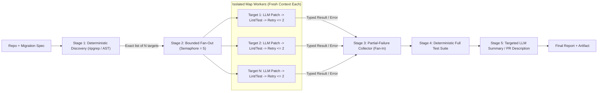

> **Module 5: Multi-Agent & Orchestration** | Prerequisites: Chapters 04, 26–30 | Reading Time: ~22 min
>
> [← 30. Planning Mode & Task Tracking](./30-planning-mode-and-task-tracking.md) | [Table of Contents](../README.md) | [32. Lifecycle Hooks & Interceptors →](../06-extensibility-and-interfaces/32-lifecycle-hooks-and-interceptors.md)

# 31. Programmatic Agent Workflows

So far in Module 5, we have mostly let an **LLM decide what happens next**—spawning subagents, claiming tasks from a shared board, or stepping through a checklist. That open-ended autonomy is magical when you do not know the path ahead.

Now flip the picture around. Suppose you need to:
- Migrate **60 React class components** to functional hooks and verify every single one compiles and passes tests.
- Run **4 specialized code-review lenses** (security, performance, error handling, API compatibility) across every pull request and combine the findings into one deduplicated report.
- Triage **25 failing nightly tests**, diagnose each root cause in isolation, propose minimal patches, and output a structured JSON summary for your CI dashboard.

If you hand 60 files to a single free-form agent loop and say *"Please migrate all 60 one by one,"* it will forget file #34, lose patience around file #41, run out of context around file #48, and produce slightly different output formats for every file.

In cases like these, the answer is **not** a smarter prompt or a bigger swarm—it is **Programmatic Agent Workflows**: using ordinary, rock-solid **deterministic code** (Python, TypeScript, or a workflow engine) to drive the loops, branching, parallelism, and retries, while calling **targeted LLM agents** only for the judgment steps in between.

---

## 1. The Simple Idea: A Modern Factory Assembly Line

Think about how a modern car factory works.

Does the factory hire one genius mechanic and say, *"Walk around this warehouse, find 60 car frames, figure out what order to paint and wire them, and try not to forget any bolts"*? Of course not!

Instead, the factory uses a **deterministic conveyor belt** (programmatic code) paired with **skilled specialists** (LLM agents) stationed at exact points along the line:
- The conveyor belt guarantees that **every single car** passes through Station 1 (Scan), Station 2 (Design/Fit), Station 3 (Build), Station 4 (Automated Laser Inspection), and Station 5 (Final Assembly)—in the exact right order, with zero skipped units.
- Deterministic machines handle deterministic work (laser measurements, torque wrenches, stamping metal).
- Specialists step in only where **judgment and nuance** are required (custom wiring edge cases, diagnosing an unusual vibration, writing a clear inspection report).

**Programmatic agent workflows** bring that exact discipline to AI harness engineering: **code owns the skeleton (control flow, concurrency, schemas, retries); LLMs own the judgment (reasoning, synthesis, code generation).**

---

## 2. Why This Matters in a Real Agent Harness

Every time you let an LLM make a control-flow decision that ordinary code could have made, you trade a **100% deterministic `for` loop** for a **95% reliable probabilistic guess**.

Compound that across 30 steps: $0.95^{30} \approx 0.21$. A 95%-per-step probabilistic loop has less than a 1-in-4 chance of completing all 30 steps cleanly without skipping, duplicating, or drifting!

Moving the orchestration skeleton into programmatic code delivers five massive production wins:
1. **Zero skipped items:** A Python `for` loop or parallel `map` over 60 files literally cannot forget file #34.
2. **Dramatically lower token cost:** You never carry 59 previous files' diffs in the context window while migrating file #60. Each unit runs in a tiny, crisp context.
3. **Bounded concurrency & rate-limit safety:** An explicit semaphore (`max_concurrency=5`) keeps throughput high without slamming into API `429 Too Many Requests` walls.
4. **Machine-checkable contracts:** Every stage returns validated structured JSON (e.g., a Pydantic model or TypeScript Zod schema), so downstream stages never choke on chatty markdown prose.
5. **Debuggability & resumability:** You can log inputs/outputs at every stage boundary, unit-test the orchestration logic with mock agents, and resume from stage 3 if stage 4 hits a transient outage.

---

## 3. The Big Picture

Here is a canonical **Staged Fan-Out / Fan-In Programmatic Workflow**—combining deterministic discovery, bounded parallel agent workers, deterministic verification, and structured aggregation:



Look closely at where the LLM actually runs: **only** inside the narrow patch-generation loop of each worker and the final human-readable summary. Discovery, sharding, concurrency limiting, schema validation, linting, testing, and partial-failure accounting are all 100% deterministic code.

---

## 4. Deep Dive: Subtopic by Subtopic

### 4.1 Probabilistic LLM Control Flow vs. Deterministic Code Orchestration

In its widely cited engineering guide *"Building Effective Agents"*, Anthropic drew a crisp line between two architectural families:
- **Workflows:** Systems where LLMs and tools are orchestrated through **predefined code paths**. You write the `if/else`, loops, and parallelism; the LLM fills in the semantic reasoning inside individual nodes.
- **Agents:** Systems where the **LLM dynamically directs its own control flow and tool usage** in an open-ended loop based on intermediate observations.

In real harnesses, this is not an all-or-nothing choice—it is a **spectrum** where you pick the lowest level of autonomy that solves the job reliably:

| Level | Control Flow Owned By | Example | Reliability & Cost Predictability | Best When... |
| :--- | :--- | :--- | :--- | :--- |
| **1. Pure Script** | 100% Code | `prettier --write`, codemod via AST | Highest / Cheapest | Rules are completely mechanical (no LLM needed at all!). |
| **2. Programmatic Workflow** | Code drives stages; LLM runs single calls | Classify PR → 3 parallel review lenses → aggregate | Very High / Predictable | Steps are known in advance, inputs/outputs are structured. |
| **3. Hybrid Workflow + Agent Nodes** | Code drives macro pipeline; mini-agents handle fuzzy nodes | Code fans out over 20 failing tests; each node runs a 5-turn debugging agent | High / Bounded | Macro structure is known, but each item needs local trial-and-error. |
| **4. Open-Ended Autonomous Agent** | LLM drives the entire loop | *"Figure out why checkout feels slow in prod and fix it"* | Variable / Hard to cap | Path is genuinely unpredictable and requires creative exploration. |

> **Golden Rule of Harness Orchestration:** Never ask an LLM to play traffic cop when a 10-line Python script can direct traffic deterministically. Put mini-agents *inside* deterministic workflow nodes so you get bounded creativity without losing structural reliability.

---

### 4.2 Fan-Out / Fan-In Patterns (Map-Reduce Over Code)

**Fan-out / fan-in** (also called **Map-Reduce**, borrowed from distributed data processing) is the single highest-leverage pattern in programmatic agent workflows:
1. **Split (Deterministic):** Produce an explicit list of independent work items.
2. **Map / Fan-Out (Parallel Agents):** Run a focused agent (or mini-loop) on each item in its own clean context window, returning a strictly typed result.
3. **Reduce / Fan-In (Deterministic + Optional LLM Synthesis):** Collect all structured results, deduplicate or rank them, separate successes from failures, and produce one coherent output.

Three real-world coding-harness shapes where Fan-Out / Fan-In dominates:

1. **Same prompt, many targets (Data Parallelism):**
   - Migrating 40 legacy API handlers from v1 SDK to v2 SDK.
   - Generating missing unit tests for 25 modules.
   - Diagnosing 15 independent CI test failures overnight.
2. **Same target, many lenses (Perspective Parallelism / Sectioning):**
   - Reviewing one pull request through 4 isolated specialist prompts simultaneously:
     - *Security reviewer* (injection, authz, secrets)
     - *Correctness reviewer* (edge cases, race conditions, null handling)
     - *Performance reviewer* (N+1 queries, allocations, blocking I/O)
     - *API/Docs reviewer* (breaking changes, migration notes)
   - Why this beats one giant *"Review this PR for everything"* prompt: each lens stays razor-focused with zero attention dilution, and the reducer merges overlapping comments and drops low-confidence noise.
3. **Best-of-N / Voting (Consensus):**
   - Running 3 independent agents (or 3 different models) on a high-stakes bug fix, running the test suite against each candidate patch, and picking the cleanest passing diff.

---

### 4.3 Staged Pipelines (`Research → Design → Implement → Verify → Aggregate`)

Unlike an unbounded chat loop where 40 turns of mixed exploration, half-baked ideas, and compiler errors accumulate in one giant prompt, a **Staged Pipeline** breaks a complex job into clean phases separated by **typed handoff objects** (and fresh contexts):

```text
Stage 1: Research      -> outputs: ResearchBrief (relevant_files, symbols, constraints)
Stage 2: Design        -> inputs: ResearchBrief
                          outputs: ChangePlan (file_edits[], risk_notes, test_plan)
Stage 3: Implement     -> inputs: ChangePlan
                          outputs: PatchResult (modified_files[], diff_summary)
Stage 4: Verify        -> inputs: PatchResult (deterministic pytest + mypy + ruff)
                          outputs: VerifyReport (passed: bool, errors[])
                          [if not passed and attempts < 3 -> loop back to Stage 3 with errors]
Stage 5: Aggregate     -> inputs: ChangePlan + PatchResult + VerifyReport
                          outputs: FinalPRSummary
```

Notice two critical design details:
- **Context hygiene by construction:** Stage 3 (Implement) never has to read the 18 dead-end files that Stage 1 (Research) rejected. It receives only the distilled `ChangePlan`.
- **Bounded self-correction loops:** Stage 3 ↔ Stage 4 is an **Evaluator–Optimizer loop** wrapped in deterministic code (`for attempt in range(1, max_attempts + 1):`). If the compiler or test suite passes on attempt 1, you finish immediately. If it fails, you feed the exact error trace back into Stage 3—and if it still fails after 3 tries, the loop terminates cleanly instead of burning \$20 in an infinite doom loop.

---

### 4.4 Combining Deterministic Scripts & Tools with Targeted LLM Calls

Beginners often make an agent use expensive LLM reasoning for jobs that a 5-millisecond CLI tool does with 100% accuracy. Experienced harness engineers use the **Deterministic Sandwich Pattern**:

```text
[Deterministic Pre-Work]  -->  [Tiny, High-Leverage LLM Call]  -->  [Deterministic Post-Work]
  (ripgrep, AST, git diff,        (semantic judgment, patch           (formatter, type-checker,
   pytest collection)              synthesis, explanation)             unit tests, schema check)
```

Let's compare token cost and accuracy on a real task—**"Find all deprecated `fetchUser()` calls across a 500-file repo and migrate them to `getUserProfile()`"**:

| Step | Naive All-LLM Approach | Deterministic Sandwich Approach |
| :--- | :--- | :--- |
| **Find call sites** | Agent browses directories & greps across 12 turns (~60k tokens, might miss files) | `ripgrep --json "fetchUser\("` finds 100% of exact file/line hits in 40ms (**0 LLM tokens**) |
| **Extract local context** | Agent calls `read_file` on whole files (~120k tokens) | Python + Tree-sitter extracts only the enclosing function + imports for each hit (**~15k tokens total**) |
| **Rewrite semantic call sites** | Single long loop gets tired and inconsistent | Parallel tiny LLM calls transform each function with strict JSON patch output |
| **Format & verify** | Ask LLM *"please check formatting and types"* | Run `ruff format`, `mypy`, and `pytest` deterministically (**0 LLM tokens**; feed real errors back only on failure) |

The Deterministic Sandwich often cuts token spend by **80–95%** while simultaneously raising accuracy above what any standalone LLM prompt achieves.

---

### 4.5 Concurrency Limits, Structured Return Contracts & Partial-Failure Handling

Moving from a toy Python script to a production workflow engine requires getting three systems-engineering details right:

#### 1. Concurrency Limits & Rate-Limit Budgeting
Launching `asyncio.gather(*[run_agent(f) for f in 100_files])` with no limit will instantly trigger provider `429 Rate Limit Exceeded` errors, blow out local CPU/RAM if every worker runs `pytest`, and spike tail latency.

Always wrap fan-out calls with:
- A **concurrency semaphore** (`asyncio.Semaphore(max_workers)`—typically 4–10 for LLM calls, or 2–4 if each worker runs heavy builds/tests).
- A **per-item timeout** (`asyncio.wait_for(..., timeout=120)`) so one hung worker never freezes the whole fan-in barrier.
- **Staggered backoff with jitter** inside the LLM client (Chapter 05 & 39).

#### 2. Structured Return Contracts
Never let a worker in a programmatic workflow return unstructured English like *"I think there might be a small SQL issue on line 40, also looks mostly okay!"*—your downstream Python code cannot reliably branch on vibes.

Enforce a **typed return contract** using Structured Outputs (`strict: true`, Chapter 03) validated by Pydantic or Zod:

```json
{
  "target_file": "src/api/orders.py",
  "status": "migrated",
  "breaking_change": false,
  "findings": [
    {
      "line": 42,
      "severity": "high",
      "category": "sql_injection",
      "summary": "Raw f-string interpolated into cursor.execute()",
      "suggested_fix": "Use parameterized query with %s placeholder"
    }
  ],
  "confidence": 0.94
}
```

If a model's output fails schema validation, the workflow node automatically runs a targeted validation-repair retry (up to 1–2 attempts) before marking the item failed.

#### 3. Partial-Failure Handling (Never Throw Away 29 Wins for 1 Failure!)
In Python, calling `await asyncio.gather(*tasks)` with default settings is a trap: if worker #17 raises an exception, `gather` aborts and throws away the completed results of the other 29 workers!

Production fan-in pipelines treat every worker output as a **Result envelope** (`ok: true, value: T` OR `ok: false, error: str, retryable: bool`):
- Collect **all** outcomes (`return_exceptions=True` or try/except inside every worker wrapper).
- Persist each completed item to a checkpoint file (e.g., `results.jsonl`) as soon as it finishes so a rerun skips already-succeeded items (**idempotency**).
- Apply an explicit **failure policy**:
  - *Best-effort / threshold policy* (e.g., for PR reviews or batch migrations): succeed if `failed_count / total <= 0.1`, clearly listing the failed items for human follow-up or targeted retry.
  - *Strict all-or-nothing policy* (e.g., database release gate): abort deployment if *any* critical check fails, while still outputting the full diagnostic table of what passed and what failed.

---

## 5. How Real Harnesses Do It

- **Anthropic's *"Building Effective Agents"* Patterns:** Codified the five foundational programmatic workflow topologies used across modern harnesses: **Prompt Chaining**, **Routing**, **Parallelization (Sectioning & Voting)**, **Orchestrator–Workers**, and **Evaluator–Optimizer**.
- **LangGraph (Cyclic State Graphs):** Models workflows as typed state machines where nodes are Python/TypeScript functions (deterministic or LLM-powered) and edges route conditionally—making cyclic loops like `implement → test → fix → test` clean, inspectable, and checkpointable at every node boundary.
- **Temporal (Durable Execution for Long-Running Workflows):** Used when agent workflows must survive server crashes, container restarts, or multi-day human approvals. Temporal records every completed LLM call and tool result as a durable event history; if the worker process dies at step 47 of 60, Temporal replays steps 1–46 from history (zero duplicate LLM spend!) and resumes cleanly at step 47.
- **PydanticAI (Type-Safe Code-First Workflows):** Combines standard Python control flow (`async/await`, `for`, `if`) with strict Pydantic output validation, dependency injection, and native integration with durable engines like Temporal—letting engineers write workflows that look like normal, testable Python rather than custom DSLs.
- **Harness-Native Workflow Runners (e.g., Antigravity's `run_workflow`):** Expose lightweight Python orchestration primitives (`agent`, `parallel`, `pipeline`, `phase`, `call_tool`) directly inside the coding agent harness itself—so an agent can write and execute a 40-line Python script on the fly to fan out over 50 files, validate structured results, and aggregate them without bloating its own conversation context.

---

## 6. Common Pitfalls & Failure Modes

1. **Unbounded Fan-Out (The 429 Thundering Herd):**
   - *Symptom:* Spawning 80 parallel workers at once causes every request to hit rate limits, retry simultaneously, and take *longer* than running 5 workers sequentially.
   - *Fix:* Always bound concurrency with a semaphore tuned to your API tier and local CPU cores.
2. **All-or-Nothing `gather()` Losing Completed Work:**
   - *Symptom:* Worker #49 times out after 10 minutes, crashing the whole script and discarding 48 finished, paid-for LLM results.
   - *Fix:* Catch exceptions per worker, wrap outputs in a `WorkerResult` envelope, and stream each completed result to a checkpoint JSONL file as it finishes.
3. **Free-Text Handoffs Between Pipeline Stages:**
   - *Symptom:* Stage 1 returns conversational markdown; Stage 2 uses a fragile regex to parse it and silently drops half the findings when the model adds a polite header.
   - *Fix:* Enforce JSON Schema / Pydantic structured return contracts at every stage boundary.
4. **Over-Engineering Open-Ended Tasks into Rigid Pipelines:**
   - *Symptom:* Building a 7-stage hardcoded workflow for debugging a mysterious production outage, where the real root cause doesn't fit any predefined branch.
   - *Fix:* Match the architecture to the problem—use programmatic workflows when the macro structure is known, and embed open-ended mini-agents (or use a single interactive agent) when the exploration path is genuinely unknown.
5. **Unbounded Retry Loops Inside Verify Stages:**
   - *Symptom:* `while not tests_pass:` loops 40 times on an impossible environment error (e.g., missing system binary), burning the entire token budget.
   - *Fix:* Enforce a small `max_attempts` cap (typically 2–3), distinguish infrastructure errors from code errors, and abort early if the exact same error repeats twice in a row.

---

## 7. Build It Yourself: Mini-Lab

Let's build a complete, runnable Python `asyncio` **Programmatic Staged Fan-Out / Fan-In Workflow** (~130 lines, standard library only). It demonstrates every core principle from this chapter:
- **Deterministic discovery** (pre-filtering files before any LLM call)
- **Bounded concurrency** (`asyncio.Semaphore`) and per-item **timeouts**
- **Structured return contracts** (`dataclass` schema validation)
- **Deterministic verification sandwich** with bounded retries (`max_attempts = 2`)
- **Partial-failure collection** & crash-resumable **JSONL checkpointing**

```python
"""
mini_workflow_engine.py — Programmatic Staged Fan-Out / Fan-In Agent Workflow
with concurrency limits, structured contracts, deterministic verification,
and partial-failure checkpointing.
"""
from __future__ import annotations

import asyncio
import json
from dataclasses import asdict, dataclass
from pathlib import Path
from typing import Callable, Optional


# --- 1. Structured Return Contracts ---
@dataclass(frozen=True)
class PatchProposal:
    file_path: str
    new_content: str
    summary: str


@dataclass(frozen=True)
class WorkerOutcome:
    file_path: str
    ok: bool
    attempts: int
    summary: str = ""
    error: Optional[str] = None


# --- 2. Deterministic Discovery & Verification (Zero LLM Tokens!) ---
def discover_targets(files: dict[str, str], needle: str) -> list[str]:
    """Deterministic pre-filter: only touch files that actually match."""
    return sorted(path for path, body in files.items() if needle in body)


def deterministic_verify(proposal: PatchProposal) -> tuple[bool, str]:
    """Simulate a compiler / linter / unit-test gate."""
    if "deprecated_call(" in proposal.new_content:
        return False, "LintError: deprecated_call() still present in file."
    if "SYNTAX_BUG" in proposal.new_content:
        return False, "SyntaxError: invalid token 'SYNTAX_BUG'."
    return True, "ok"


# --- 3. Simulated Targeted LLM Node (Replace with real SDK + strict JSON schema) ---
async def mock_llm_migrate(
    file_path: str, content: str, prior_error: Optional[str]
) -> PatchProposal:
    await asyncio.sleep(0.05)  # simulate API latency

    if file_path == "src/flaky_timeout.py":
        await asyncio.sleep(5.0)  # will trigger per-item timeout

    if file_path == "src/unfixable.py":
        raise RuntimeError("Upstream 503 provider outage")

    # Simulate a realistic retry: attempt 1 introduces a syntax bug; attempt 2 fixes it
    if file_path == "src/needs_retry.py" and prior_error is None:
        return PatchProposal(file_path, "SYNTAX_BUG", "First attempt (broken)")

    migrated = content.replace("deprecated_call(", "modern_call(")
    return PatchProposal(
        file_path=file_path,
        new_content=migrated,
        summary="Replaced deprecated_call with modern_call",
    )


# --- 4. Staged Worker Pipeline (Implement <-> Verify Sandwich) ---
async def process_one_target(
    file_path: str,
    original_content: str,
    sem: asyncio.Semaphore,
    max_attempts: int = 2,
    timeout_s: float = 0.5,
) -> WorkerOutcome:
    async with sem:
        prior_error: Optional[str] = None
        for attempt in range(1, max_attempts + 1):
            try:
                proposal = await asyncio.wait_for(
                    mock_llm_migrate(file_path, original_content, prior_error),
                    timeout=timeout_s,
                )
            except asyncio.TimeoutError:
                return WorkerOutcome(file_path, False, attempt, error=f"Timed out after {timeout_s}s")
            except Exception as exc:
                return WorkerOutcome(file_path, False, attempt, error=f"{type(exc).__name__}: {exc}")

            passed, verify_msg = deterministic_verify(proposal)
            if passed:
                return WorkerOutcome(file_path, True, attempt, summary=proposal.summary)
            prior_error = verify_msg

        return WorkerOutcome(
            file_path, False, max_attempts, error=f"Verification failed: {prior_error}"
        )


# --- 5. Fan-Out / Fan-In Orchestrator with Checkpoint Resume ---
async def run_migration_workflow(
    repo_files: dict[str, str],
    checkpoint_path: Path,
    max_concurrency: int = 3,
) -> dict[str, object]:
    # Load already-completed items for crash-safe idempotent resume
    completed: dict[str, WorkerOutcome] = {}
    if checkpoint_path.exists():
        for line in checkpoint_path.read_text(encoding="utf-8").splitlines():
            data = json.loads(line)
            if data.get("ok"):
                completed[data["file_path"]] = WorkerOutcome(**data)

    # Stage 1: Deterministic Discovery
    targets = discover_targets(repo_files, needle="deprecated_call(")
    remaining = [f for f in targets if f not in completed]

    # Stage 2: Bounded Parallel Fan-Out
    sem = asyncio.Semaphore(max_concurrency)
    tasks = [process_one_target(f, repo_files[f], sem) for f in remaining]

    # Stage 3: Streaming Fan-In & Incremental Checkpointing
    fresh_outcomes: list[WorkerOutcome] = []
    checkpoint_path.parent.mkdir(parents=True, exist_ok=True)
    with checkpoint_path.open("a", encoding="utf-8") as ckpt:
        for coro in asyncio.as_completed(tasks):
            outcome = await coro
            fresh_outcomes.append(outcome)
            ckpt.write(json.dumps(asdict(outcome)) + "\n")
            ckpt.flush()

    all_outcomes = list(completed.values()) + fresh_outcomes
    succeeded = [o for o in all_outcomes if o.ok]
    failed = [o for o in all_outcomes if not o.ok]

    # Stage 4: Structured Aggregation Report
    return {
        "total_discovered": len(targets),
        "skipped_from_checkpoint": len(completed),
        "succeeded": [asdict(o) for o in succeeded],
        "failed": [asdict(o) for o in failed],
    }


async def main() -> None:
    fake_repo = {
        "src/clean.py": "def ok(): return modern_call(1)",       # skipped by discovery
        "src/orders.py": "def buy(): return deprecated_call(1)",
        "src/billing.py": "def bill(): return deprecated_call(2)",
        "src/needs_retry.py": "def x(): return deprecated_call(3)",
        "src/flaky_timeout.py": "def y(): return deprecated_call(4)",
        "src/unfixable.py": "def z(): return deprecated_call(5)",
    }
    ckpt = Path("/tmp/demo_workflow/checkpoint.jsonl")
    if ckpt.exists():
        ckpt.unlink()

    report = await run_migration_workflow(fake_repo, ckpt, max_concurrency=3)
    print(json.dumps(report, indent=2))


if __name__ == "__main__":
    asyncio.run(main())
```

Look at what happens when you run this workflow:
- `src/clean.py` never touches an LLM (zero wasted tokens).
- `src/needs_retry.py` fails deterministic verification on attempt 1, feeds the exact `SyntaxError` back into attempt 2, and succeeds automatically.
- `src/flaky_timeout.py` times out cleanly and `src/unfixable.py` catches its 503 error—**without** losing the 3 succeeded files, which are already safely checkpointed to disk!

---

## 8. Key Takeaways & Quick Self-Check

- **Code for control flow, LLMs for judgment:** Whenever the macro sequence of steps is known upfront, write deterministic code for loops, branching, parallelism, and retries instead of asking an LLM to juggle 50 items in one chat window.
- **Use Fan-Out / Fan-In for breadth and consistency:** Split targets deterministically, map each item through a focused isolated agent, and reduce structured outputs—preventing context bloat and skipped items.
- **Build Deterministic Sandwiches:** Pre-filter inputs with fast CLI/AST tools and post-verify outputs with real compilers, linters, and test runners inside bounded retry loops.
- **Engineer for partial failure:** Always bound concurrency with semaphores, enforce per-item timeouts, validate structured return contracts, wrap results in `ok/error` envelopes, and checkpoint completed items so crashes never waste finished work.
- **Know when to stay autonomous:** Use programmatic workflows when the shape of the work is predictable; keep open-ended autonomous agent loops (or hybrid workflows with mini-agent nodes) for genuinely exploratory debugging and design.

### Quick Self-Check

1. **In Anthropic's *"Building Effective Agents"* taxonomy, what is the core difference between a *Workflow* and an *Agent*?**
   <details><summary>Show Answer</summary>
   In a **Workflow**, predefined code controls the sequence of LLM calls, branches, loops, and tool invocations—the LLM only fills in semantic steps. In an **Agent**, the LLM itself dynamically decides which tools to call and what steps to take next based on observations from its environment.
   </details>

2. **Why is running 4 focused parallel review lenses (security, performance, correctness, API compatibility) over a PR often better than one comprehensive prompt asking an agent to "review everything"?**
   <details><summary>Show Answer</summary>
   A single "review everything" prompt splits the model's attention across competing concerns, leading to shallow or missed findings. Four parallel lenses run in isolated contexts with sharp, non-overlapping rubrics and structured return schemas—making each lens deeper while a deterministic fan-in reducer merges and deduplicates the results.
   </details>

3. **What goes wrong if you run `await asyncio.gather(*[worker(f) for f in 50_files])` without a semaphore and without `return_exceptions=True` (or per-worker error envelopes)?**
   <details><summary>Show Answer</summary>
   Two bugs happen at once: (1) Without a semaphore, firing 50 simultaneous LLM/test calls triggers API `429` rate-limit cascades and local CPU exhaustion. (2) Without per-worker exception handling, a single transient error on file #42 aborts `gather()` and throws away all 41 successfully completed results.
   </details>

4. **Why do production teams sometimes pair a type-safe agent library like PydanticAI with a durable execution engine like Temporal?**
   <details><summary>Show Answer</summary>
   They solve complementary layers: PydanticAI enforces strict runtime schema validation and clean Python ergonomics for each individual LLM call or mini-agent, while Temporal guarantees infrastructure durability—replaying event history after a server crash or a multi-day human approval pause without re-running already-paid LLM calls or repeating side effects.
   </details>

---

[← 30. Planning Mode & Task Tracking](./30-planning-mode-and-task-tracking.md) | [Table of Contents](../README.md) | [32. Lifecycle Hooks & Interceptors →](../06-extensibility-and-interfaces/32-lifecycle-hooks-and-interceptors.md)
