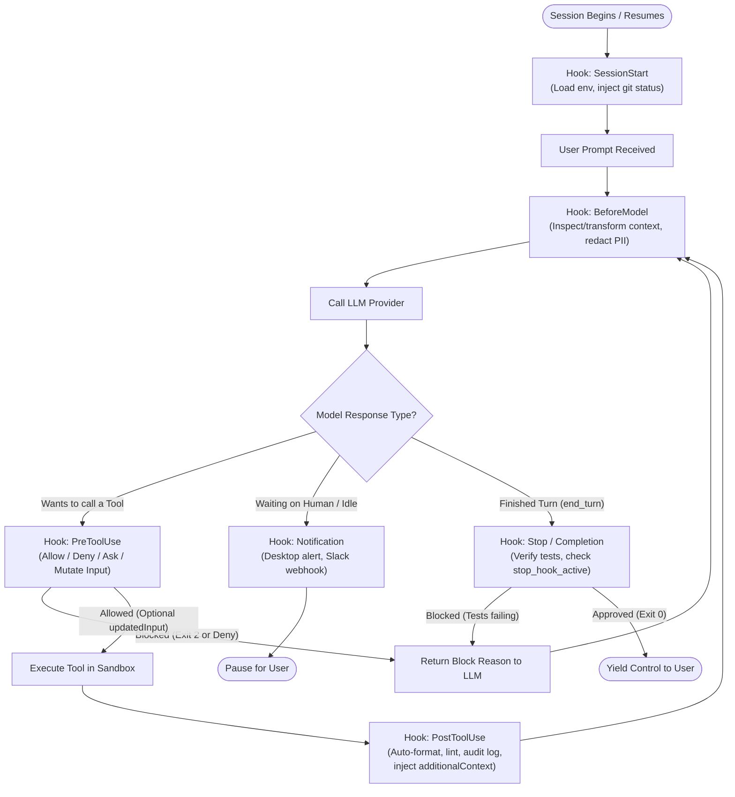

> **Module 6: Extensibility & Interfaces** | Prerequisites: Chapters 01, 06 & 23 | Reading Time: ~18 min
>
> [← 31. Programmatic Agent Workflows](../05-multi-agent-and-orchestration/31-programmatic-agent-workflows.md) | [Table of Contents](../README.md) | [33. Plugin & Configuration Discovery →](./33-plugin-and-configuration-discovery.md)

# 32. Lifecycle Hooks & Interceptors

In Chapter 07, we saw how you can guide an AI agent with instructions in a system prompt or a repo file like `AGENTS.md` or `CLAUDE.md`—for example, *"Always run Prettier after editing TypeScript files, and never edit `.env`."*

If you have ever used a coding agent for more than an hour, you already know what happens next: after twenty turns of intense debugging, the model gets tunnel vision, forgets your polite reminder, leaves ugly unformatted code behind, or tries to touch a file you explicitly warned it to leave alone.

**Lifecycle hooks** solve that problem once and for all. Instead of *asking* a probabilistic language model to remember a rule, you attach **deterministic code** directly to specific moments inside the harness loop—before a tool runs, right after an edit finishes, or right when the agent thinks it is done.

---

## 1. The Simple Idea (Zero-Jargon Intuition)

Think of a modern **factory assembly line** (or **airport security**):

- **Prompt instructions** are like posters taped to the factory wall: *"Please wear safety goggles. Please inspect every bolt before shipping."* Posters help a lot—conscientious workers read them—but when someone is tired or rushing, a poster cannot physically stop a mistake.
- **Lifecycle hooks** are like **automated gates and scanners built directly into the conveyor belt**.
  - Before a package enters the shipping bay, a laser scanner *always* checks its weight (`PreToolUse`). If something is forbidden, the gate physically locks and flashes an exact error message telling the worker what to fix.
  - Right after a part gets painted, an automated dryer *always* runs for three seconds (`PostToolUse`)—the worker doesn't even have to remember to press a button.
  - When a worker says *"I'm done with this batch!"*, a quality-control station automatically runs a quick checklist before letting the batch leave the floor (`Stop`).

### What Breaks Without Hooks?

Without lifecycle hooks, every team hits the same three walls:

1. **Probabilistic compliance fails on strict rules:** Even a 99% compliant model breaks a hard rule once every 100 tool calls. In a busy engineering org, that means broken formatting, leaked secrets, or unapproved commands every single day.
2. **Wasted turns on mechanical chores:** Relying on the LLM to remember *"oh, I edited a file, now let me call the shell tool to run the formatter and linter"* burns extra API round-trips, latency, and tokens on something a 50-millisecond script can do automatically.
3. **Forking the harness just to customize it:** Without extension points, teams who want custom audit logging, company-specific security policies, or Slack notifications when an agent finishes a long task would have to fork and maintain their own custom build of the agent harness.

---

## 2. Why This Matters in a Real Agent Harness

Lifecycle hooks embody the first golden rule of harness engineering from Chapter 00: **deterministic code for deterministic jobs; LLMs for judgment.**

| Impact Area | Without Hooks | With Lifecycle Hooks |
| :--- | :--- | :--- |
| **Reliability** | Rules in `AGENTS.md` fade during long sessions ("instruction drift"). | Guaranteed 100% execution at the exact lifecycle event, every single time. |
| **Feedback Speed** | Agent finishes 10 edits, runs tests, discovers 40 lint errors, spends 3 extra turns fixing them. | A `PostToolUse` hook auto-formats and feeds single-file lint errors back immediately after each edit. |
| **Security & Governance** | Relies on static built-in rules or manual human approval on every command. | `PreToolUse` hooks enforce org-specific rules (block edits to `migrations/`, rewrite unsafe flags, log to an audit SIEM). |
| **Token Cost** | Extra prompt text + extra model turns spent running mechanical checks. | Zero extra prompt bloat; scripts run locally for free and only inject output when something actually needs attention. |
| **Developer Ergonomics** | You keep tabbing back to the terminal to check if the agent is waiting on you. | `Notification` and `Stop` hooks ping your desktop, play a chime, or post to Slack when human input is needed. |

---

## 3. The Big Picture

Every turn inside an agent harness follows a predictable rhythm (Chapters 01 and 06). Lifecycle hooks wrap around those exact transitions like middleware in a web framework (such as Express, FastAPI, or gRPC interceptors):



Notice the crucial architectural property in that diagram: **hooks can steer the loop without crashing it.** When a `PreToolUse` or `Stop` hook blocks an action, the harness does not abort the session—it hands the hook's message right back to the LLM as structured feedback so the model can self-correct on its very next turn.

---

## 4. Deep Dive: Subtopic by Subtopic

### 4.1 What Hooks Are (Deterministic Code vs. Prompts)

A **lifecycle hook** (also called an **interceptor**) is a user-configured handler—typically a shell command, local script, in-process function, or HTTP webhook—registered to run automatically whenever the harness emits a specific lifecycle event.

Unlike an **MCP tool** (Chapter 19), which the *LLM chooses* to call when it feels like it, a **hook** is invoked *by the harness itself* whether the model wants it or not.

| Dimension | System Prompt / Skill | Built-in or MCP Tool | Lifecycle Hook |
| :--- | :--- | :--- | :--- |
| **Who triggers it?** | Always in context; LLM decides whether to follow | LLM chooses to invoke it | **Harness** invokes it automatically |
| **Execution guarantee** | Probabilistic (may be forgotten) | Probabilistic (model might skip it) | **Deterministic** (always runs on match) |
| **Primary superpower** | Nuanced reasoning & coding conventions | Giving the agent new capabilities | Enforcing invariants, automating chores, auditing |
| **Example** | *"Prefer small pure functions"* | `run_sql_query` | *"Block any `Bash` command containing `rm -rf /`"* |

---

### 4.2 Standard Lifecycle Hook Points

While exact names vary slightly across harnesses (Claude Code uses `PreToolUse`/`PostToolUse`; Gemini CLI uses `BeforeTool`/`AfterTool`; OpenCode uses `tool.execute.before`/`tool.execute.after`), almost every production coding harness converges on six core lifecycle events:

| Event Name | When It Fires | Can Block? | Can Mutate? | Common Real-World Uses |
| :--- | :--- | :--- | :--- | :--- |
| **`SessionStart`** | When a session starts, resumes, clears, or finishes compaction | Rarely | Inject initial context / env vars | Print current git branch & open TODOs into context; load project `.env` vars; initialize audit session ID. |
| **`BeforeModel`** | Right before the harness sends the message array to the LLM API | Yes | Yes (messages / model / tools) | Redact accidental secrets/PII before egress; dynamically inject live diagnostics; route simple prompts to a faster model. |
| **`PreToolUse`** | After the model requests a tool call, *before* the tool executes | **Yes** | **Yes** (`updatedInput`) | Security gates (block editing lockfiles or `.env`); auto-approve safe read commands; rewrite `npm` to `pnpm` or add `--dry-run`. |
| **`PostToolUse`** | Immediately after a tool finishes executing | Soft block / steer | Inject `additionalContext` (or filter output) | Run `prettier`/`ruff` on edited files; run targeted type-check and feed errors back to the model; log tool usage. |
| **`Stop` / `Completion`** | When the LLM stops calling tools (`end_turn`) and tries to hand control back | **Yes** (forces another turn) | Inject continuation feedback | Verification gates: *"Don't finish yet—`pytest` still has 2 failing tests!"*; check that all checklist items are done. |
| **`Notification`** | When the harness emits an alert (permission prompt waiting, idle timeout, completion) | No (observe-only) | No | Trigger macOS/Linux desktop notifications (`osascript`/`notify-send`), play a sound, or send a Slack/Discord ping. |

> **Bonus events in newer harnesses:** Some harnesses also expose **`AfterModel`** (inspect or filter raw LLM responses before tool parsing), **`PermissionRequest`** (programmatically answer approval dialogs), **`UserPromptSubmit`** (validate or enrich a user's prompt right after they press Enter), **`PreCompact`** (save critical state before context compaction), and **`SessionEnd`** (clean up temporary resources and flush telemetry).

#### Event Matchers (Filtering Noise)

You almost never want a formatter running after a read-only `grep` search. Harnesses let you attach a **matcher** to each hook rule so the hook only spawns when needed:

- **Tool-name matchers** (for `PreToolUse` / `PostToolUse`): exact string (`"Bash"`), pipe-separated regex (`"Edit|Write|MultiEdit"`), MCP prefix (`"mcp__github__.*"`), or wildcard (`"*"`).
- **Subtype matchers** (for `SessionStart` or `Notification`): e.g., `"startup|resume|compact"` or `"permission_prompt|idle_prompt"`.

Filtering inside the harness *before* spawning a subprocess is huge for latency: a matcher check takes microseconds in memory, whereas spawning a Python interpreter on every single tool call costs 40–100 ms each time.

---

### 4.3 Hook Actions & The JSON Control Contract

When a hook runs, it needs a clean, unambiguous way to read what happened and tell the harness what to do next. Modern CLI harnesses standardize on a **JSON `stdin` → Exit Code + JSON `stdout` / `stderr`** contract.

#### 1. What the Harness Sends to the Hook (`stdin`)

Right before running a `Bash` command, the harness pipes a structured JSON object into the hook's standard input (`stdin`):

```json
{
  "session_id": "sess_01J9X4K8M2",
  "transcript_path": "/Users/dev/.harness/sessions/sess_01J9X4K8M2.jsonl",
  "cwd": "/Users/dev/projects/payments-api",
  "hook_event_name": "PreToolUse",
  "tool_name": "Bash",
  "tool_use_id": "toolu_01ABC987",
  "tool_input": {
    "command": "rm -rf ./build && npm run deploy -- --prod"
  }
}
```

#### 2. The Four Things a Hook Can Do

A hook communicates its decision through two channels: **process exit codes** (for quick, dead-simple shell scripts) and **structured JSON on `stdout`** (for fine-grained control).

##### Action A: Observe / Log (Exit Code `0`, Empty `stdout`)
The hook records an audit entry or triggers a side effect (like a desktop notification) and exits `0`.
> **Subtle gotcha:** In `PreToolUse`, exiting `0` with no JSON does **not** mean *"auto-approve and bypass the user's permission prompt."* It means *"this hook has no objection—continue to the normal permission policy."*

##### Action B: Block / Deny (Exit Code `2` OR Structured JSON)
The simplest way to block a dangerous tool call in a 5-line shell script is to **print a clear explanation to `stderr` and exit with status code `2`**:

```bash
#!/usr/bin/env bash
# Simple PreToolUse hook that blocks edits to .env files
payload=$(cat)
file_path=$(echo "$payload" | jq -r '.tool_input.file_path // ""')

if [[ "$file_path" == *.env* ]]; then
  echo "Blocked: Do not edit .env files directly. Update .env.example instead." >&2
  exit 2
fi
exit 0
```

Why exit code `2` instead of `1`? Because **bugs in hook scripts happen all the time!** If a script crashes with a Python syntax error or missing binary, the OS returns exit code `1` (or `127`). Reserving exit code `2` specifically for *"intentional policy block"* lets the harness distinguish between:
- **Exit `2`:** Intentional block → stop the tool call and send `stderr` directly to the LLM as actionable feedback.
- **Exit `1` (or other non-zero):** Unexpected script crash → log a warning to the user (or fail closed for high-security hooks) without confusing the LLM with a Python traceback.

For richer control, a hook exits `0` and prints structured JSON to `stdout`:

```json
{
  "hookSpecificOutput": {
    "hookEventName": "PreToolUse",
    "permissionDecision": "deny",
    "permissionDecisionReason": "Direct production deploys are blocked from local agent sessions. Open a PR instead."
  }
}
```

Typical `permissionDecision` values are:
- `"allow"` — explicitly auto-approve this call (skip the interactive user prompt, unless overridden by a higher-precedence deny rule).
- `"deny"` — block execution and feed `permissionDecisionReason` back to the model.
- `"ask"` — force an interactive human confirmation dialog even if the command would otherwise be auto-approved.
- `"defer"` — pause/defer the decision in headless or external approval workflows.

##### Action C: Mutate Inputs (`updatedInput`)
Sometimes you don't want to *reject* the model's tool call—you want to *fix it silently* before it runs. For example:
- Rewriting `npm test` into `pnpm test` in a pnpm monorepo.
- Injecting `--no-pager` or `--non-interactive` flags so commands don't hang.
- Redacting a secret token or clamping a dangerous parameter before execution.

A `PreToolUse` hook returns `updatedInput` inside `hookSpecificOutput`:

```json
{
  "hookSpecificOutput": {
    "hookEventName": "PreToolUse",
    "permissionDecision": "allow",
    "updatedInput": {
      "command": "pnpm test --reporter=dot"
    }
  }
}
```

**Important safety detail:** A well-built harness **re-validates `updatedInput` against the tool's JSON Schema** (stripping unknown fields and rejecting type mismatches) and **re-checks sandbox/permission policies** *after* mutation so a buggy or compromised hook cannot sneak an unapproved parameter past the validator.

##### Action D: Inject Feedback (`additionalContext`) & Auto-Formatting
In `PostToolUse`, the tool has already finished—you can't un-write a file—but you can **automatically clean it up and whisper immediate feedback into the model's ear**.

Suppose the agent just edited `src/billing.py`. Your `PostToolUse` hook runs `ruff format` and `ruff check`:
1. If formatting succeeds and there are zero lint errors, exit `0` silently—the model doesn't waste a single token hearing about it.
2. If `ruff check` finds an unused import or undefined variable, return JSON with `additionalContext` (or exit `2` with `stderr` feedback):

```json
{
  "hookSpecificOutput": {
    "hookEventName": "PostToolUse",
    "additionalContext": "Auto-formatted src/billing.py with ruff. Remaining lint errors to fix:\nsrc/billing.py:42:12: F821 Undefined name `tax_rate`"
  }
}
```

The harness appends that note directly to the tool result. On the very next turn, the model fixes line 42 automatically—before the human ever sees a broken file!

---

### 4.4 Execution Models Compared

Harnesses execute hooks in four main ways, each with clear engineering trade-offs:

| Execution Model | How It Works | Latency | Language Support | Isolation & Risk | Best Use Cases |
| :--- | :--- | :--- | :--- | :--- | :--- |
| **Shell Command (`command`)** | Harness spawns a subprocess, writes JSON to `stdin`, reads `stdout`/`stderr` & exit code. | Medium (20–150 ms per spawn) | Any language (Bash, Python, Go, Node, Rust) | Process-isolated from harness crash, **but runs with host user privileges**. | Formatters (`prettier`, `ruff`), linters, custom git checks, team scripts. |
| **In-Process Plugin (JS/TS/Python API)** | Harness imports a module into its own runtime and calls an `async` callback directly. | Ultra-low (< 1 ms) | Same language as the harness | Shares memory with harness; an uncaught bug or slow sync loop freezes the harness. | High-frequency hooks (`BeforeModel`, streaming chunk filters, custom UI telemetry). |
| **HTTP Webhook (`http`)** | Harness sends an HTTP `POST` with the JSON event payload to a local or remote server and parses the JSON response. | Network-bound (5–500 ms) | Any server stack | Keeps proprietary policy logic & secrets off the developer laptop; fails if offline. | Centralized enterprise compliance, SIEM audit logs, Slack/PagerDuty alerts, remote policy engines. |
| **LLM-Backed (`prompt` / `agent`)** | Harness sends the event + a short rubric to a fast model (or read-only subagent) that returns a JSON allow/deny verdict. | High (0.5–5+ sec) | Plain English prompt | Costs tokens & adds latency; non-deterministic (use as a second layer, never your only security boundary). | Semantic checks regex can't do: *"Did the agent actually answer all parts of the user's request before stopping?"* |

> **Rule of thumb:** Start with fast **shell command hooks** for 90% of workflows. Reach for **HTTP webhooks** when an enterprise security team needs centralized policy control without distributing scripts to every laptop. Reserve **LLM-backed hooks** for high-value, low-frequency checkpoints like `Stop`—never put an LLM call on every single `Read` tool!

---

### 4.5 Security, Timeouts, Ordering & Preventing Hook Loops

Hooks look deceptively simple until they hit production. Four sharp edges catch almost every first-time harness author:

#### 1. Hooks Run Outside the Agent's Sandbox!
Think carefully about privilege boundaries (Chapter 21): when the LLM runs a `Bash` command, the harness traps it inside a sandbox (Seatbelt, Bubblewrap, or a container). **Hooks, however, usually run directly on the host machine with the user's full privileges** so they can reach desktop notifications, corporate webhooks, and local formatters.

That creates two massive security requirements:
- **Never auto-execute hooks from an untrusted repo** without explicit user approval (we cover this thoroughly in Chapter 33).
- **Snapshot hook configurations at session startup.** Imagine a prompt-injected agent trying to escape its sandbox by editing `.claude/settings.json` to add a malicious `PostToolUse` hook that steals `~/.ssh/id_rsa`. If the harness reloads hooks live on every turn, the agent just achieved instant sandbox escape! By **snapshotting hooks once when the session starts** (and requiring explicit human confirmation to reload), mid-session file edits cannot hijack the hook runner.

#### 2. Timeouts & Fail-Open vs. Fail-Closed
What happens if a webhook server hangs, or a developer writes a `PostToolUse` hook that accidentally runs the entire 12-minute integration test suite?
- **Per-hook timeouts:** Every hook MUST have a strict timeout (e.g., 10–30 seconds default, configurable per hook) and kill the entire **process group (`PGID`)** on timeout so background child processes don't become orphaned zombies (Chapter 17).
- **Explicit failure policy:** Not all hooks should fail the same way when they crash (exit `1`) or time out:
  - **Convenience hooks** (formatter, desktop notification, telemetry) should **fail open**: log a non-blocking warning and let the agent keep working.
  - **Security/compliance hooks** (secret scanner, production-deploy blocker) must support **fail closed** (`on_error: "deny"`): if the policy server is unreachable or the validator crashes, block the action rather than silently waving it through.

#### 3. Multiple Hooks: Parallelism & Conflict Resolution
What if three different `PreToolUse` hooks match the same `Bash` call—one from your personal config, one from the repo, and one from enterprise IT?
- **Read-only / observe hooks** (`PostToolUse` loggers, `Notification`) can safely run **in parallel** to keep latency flat.
- **Mutating hooks** (`updatedInput`) must run in a **deterministic sequential order** (so Hook B sees Hook A's transformed input, or the harness detects conflicting rewrites).
- **Combining decisions uses "Most Restrictive Wins":**

```text
Priority:   deny  >  ask  >  allow  >  no opinion (exit 0)
```

If your personal hook says `"allow"` for `git push`, but your company's enterprise hook says `"deny"` for `git push --force`, **`deny` always wins.**

#### 4. Preventing Infinite Hook Loops
This is the #1 bug people hit the first week they write a `Stop` or `PostToolUse` hook!

**Trap 1: The Eternal `Stop` Loop**
Suppose you write a `Stop` hook that runs `pytest` and exits `2` whenever tests fail, forcing the agent to keep trying. What if a test is flaky, or depends on a database that isn't running? The agent tries to fix it, stops, the hook blocks it, the agent tries again, stops, the hook blocks it—burning \$20 of API tokens in an infinite loop!

**The fix (two layers):**
1. **Re-entrancy flag (`stop_hook_active`):** The harness sets `"stop_hook_active": true` in the `Stop` hook's JSON payload whenever the current turn was *already* triggered by a previous `Stop` hook block. Your hook script checks this flag (or tracks a retry counter) so it can bail out cleanly instead of looping forever.
2. **Harness-enforced continuation cap:** Even if a user writes a buggy hook that ignores `stop_hook_active`, the harness enforces a hard cap (e.g., max 3 consecutive `Stop`-hook continuations per user turn) before forcing a yield to the human.

**Trap 2: The `PostToolUse` File-Mutation Feedback Loop**
Suppose a `PostToolUse` hook formats `app.ts`, and you also have a file-watcher hook that triggers another tool call when `app.ts` changes. Always ensure **hooks never recursively trigger other hooks** (set an environment variable like `HARNESS_HOOK_DEPTH=1` and refuse to re-enter the hook engine from inside a hook process). Also, if a `PostToolUse` hook modifies a file on disk, tell the model (or refresh its file-hash cache) so its next `edit_file` call doesn't fail with a *"file modified since last read"* error!

---

## 5. How Real Harnesses Do It

Real-world coding harnesses in 2025–2026 share the same core concepts while optimizing for their own ecosystems:

- **Claude Code:** Uses a rich declarative hook system configured in `settings.json` (and plugin `hooks/hooks.json`) supporting `SessionStart`, `PreToolUse`, `PostToolUse`, `Stop`, `Notification`, `PermissionRequest`, and more. Supports multiple handler types—`command` (JSON `stdin`/`stdout` + exit code `2` blocking), `http` webhooks, `prompt`, and `agent` hooks—along with `hookSpecificOutput` (`permissionDecision`, `updatedInput`, `additionalContext`) and `stop_hook_active` for safe completion gates. Crucially, Claude Code **snapshots hooks at session startup** so live edits during a session cannot silently hijack execution.
- **Gemini CLI:** Ships a deeply granular event-driven hook architecture with JSON-over-`stdin` contracts and flexible matchers covering `SessionStart`/`SessionEnd`, `BeforeAgent`/`AfterAgent`, **`BeforeModel`/`AfterModel`**, `BeforeToolSelection`, and **`BeforeTool`/`AfterTool`**. Exposing `BeforeModel` and `AfterModel` makes it straightforward to build dynamic context injection, model routing, or real-time PII redaction right at the LLM boundary.
- **OpenCode:** Takes an **in-process JavaScript/TypeScript plugin** approach. Plugins register typed lifecycle callbacks like `tool.execute.before`, `tool.execute.after`, and `experimental.chat.messages.transform`, giving ultra-low latency and direct programmatic access to messages and tool calls (including MCP tools) without spawning a shell subprocess on every event.
- **OpenAI Codex CLI:** Discovers hooks via `.codex/hooks.json` and plugin bundles (`.codex-plugin/plugin.json`), paired with an explicit `/hooks` trust review workflow and enterprise lockdown knobs such as `allow_managed_hooks_only = true` so organizations can prevent arbitrary user or repo scripts from running.

---

## 6. Common Pitfalls & Failure Modes

1. **Printing debug logs to `stdout` instead of `stderr`:**
   - *What breaks:* Your Python hook runs `print("Checking bash command...")` before printing JSON. Now `stdout` is no longer valid JSON, so the harness fails to parse your `permissionDecision` or `updatedInput`!
   - *Fix:* Send **all** logs, diagnostics, and block messages to `stderr` (`sys.stderr`), and reserve `stdout` strictly for the single final JSON response object.

2. **Running heavy commands on every `PostToolUse`:**
   - *What breaks:* Running a full `tsc --noEmit` or `pytest` suite (15 seconds) after every single file edit turns a snappy 10-edit refactor into a painful 2.5-minute crawl—and runs the check on half-finished intermediate edits!
   - *Fix:* Keep `PostToolUse` hooks fast and file-scoped (< 1–2 seconds, e.g., format/lint only the edited file). Put whole-repo builds and test suites in a `Stop` hook instead, so they run once after the agent finishes a full batch of edits.

3. **Assuming exit code `0` auto-approves a `PreToolUse` call:**
   - *What breaks:* Engineers write a custom validator expecting exit `0` to skip the user's permission prompt, then wonder why the terminal still asks for approval.
   - *Fix:* Exit `0` only means *"no objection."* To explicitly auto-approve, return `"permissionDecision": "allow"` in structured JSON (and remember enterprise deny rules still override it).

4. **Using brittle regex to parse shell commands in `PreToolUse`:**
   - *What breaks:* Blocking `"rm -rf"` with a regex misses `rm -r -f`, `rm --recursive --force`, `sh -c "cm0gLXJmIC4=" | base64 -d`, or a subshell `$(...)`.
   - *Fix:* Use hooks for clean guardrails and ergonomic policy enforcement, but always pair them with **OS-level sandboxing** (Chapters 21–22) and AST-aware command parsing (Chapter 23) as your true security floor.

5. **Forgetting to handle silent file edits from formatters:**
   - *What breaks:* Your `PostToolUse` hook runs `prettier --write`, changing single quotes to double quotes. On the next turn, the agent tries a search-and-replace edit using the old single-quoted snippet it thinks it wrote, and the patch fails!
   - *Fix:* When a `PostToolUse` hook modifies the edited file on disk, emit a short `additionalContext` note (or updated snippet) letting the model know the file was auto-formatted.

---

## 7. Build It Yourself: Mini-Lab

Let's build a compact, production-minded **Python Hook Engine** (~140 lines) that implements every key pattern from this chapter:
- Regex tool matching
- JSON `stdin` / `stdout` subprocess execution with strict timeout & process-group cleanup
- Exit code `2` blocking with `stderr` feedback
- Structured `updatedInput`, `additionalContext`, and `"most restrictive wins"` decision merging
- Fail-open vs. fail-closed error handling and `stop_hook_active` loop protection

```python
"""
Mini-Lab: Deterministic Lifecycle Hook Engine for an AI Agent Harness.
Demonstrates matcher filtering, JSON stdin/stdout IPC, exit-code-2 blocking,
input mutation, timeout cleanup, fail-closed policies, and Stop-loop safety.
"""

from __future__ import annotations

import json
import os
import re
import signal
import subprocess
from dataclasses import dataclass, field
from typing import Any, Literal

Decision = Literal["none", "allow", "ask", "deny"]
DECISION_RANK = {"none": 0, "allow": 1, "ask": 2, "deny": 3}


@dataclass(frozen=True)
class HookRule:
    event: str                        # e.g. "PreToolUse", "PostToolUse", "Stop"
    command: list[str]                # argv list, e.g. ["python3", "hooks/guard.py"]
    matcher: str = "*"                # regex matched against tool_name or subtype
    timeout_sec: float = 10.0
    fail_closed: bool = False         # True for security gates; False for linters


@dataclass
class HookOutcome:
    decision: Decision = "none"
    reason: str = ""
    updated_input: dict[str, Any] | None = None
    additional_context: list[str] = field(default_factory=list)
    warnings: list[str] = field(default_factory=list)


class HookEngine:
    def __init__(self, rules: list[HookRule], max_stop_continuations: int = 3) -> None:
        # Freeze a snapshot at session startup so mid-session edits cannot hijack hooks
        self._rules: tuple[HookRule, ...] = tuple(rules)
        self._max_stop_continuations = max_stop_continuations
        self._consecutive_stop_blocks = 0

    def _matches(self, pattern: str, target: str) -> bool:
        if pattern in ("*", ""):
            return True
        return re.fullmatch(pattern, target) is not None

    def _run_subprocess(self, rule: HookRule, payload: dict[str, Any]) -> tuple[int, str, str]:
        """Run a single command hook in its own process group with a hard timeout."""
        env = os.environ.copy()
        # Prevent recursive hook execution if a hook invokes a CLI subcommand
        env["HARNESS_HOOK_DEPTH"] = str(int(env.get("HARNESS_HOOK_DEPTH", "0")) + 1)

        proc = subprocess.Popen(
            rule.command,
            stdin=subprocess.PIPE,
            stdout=subprocess.PIPE,
            stderr=subprocess.PIPE,
            text=True,
            env=env,
            start_new_session=True,  # Creates a fresh PGID for clean tree termination
        )
        try:
            stdout, stderr = proc.communicate(
                input=json.dumps(payload), timeout=rule.timeout_sec
            )
            return proc.returncode, stdout.strip(), stderr.strip()
        except subprocess.TimeoutExpired:
            # Kill the entire process group so background child processes don't leak
            os.killpg(os.getpgid(proc.pid), signal.SIGKILL)
            proc.communicate()
            return -1, "", f"Hook timed out after {rule.timeout_sec}s"

    def dispatch(
        self,
        event: str,
        target: str,
        payload: dict[str, Any],
    ) -> HookOutcome:
        """Fire all matching hooks sequentially and merge results safely."""
        if int(os.environ.get("HARNESS_HOOK_DEPTH", "0")) > 0:
            return HookOutcome()  # Anti-recursion guard

        outcome = HookOutcome()
        current_payload = dict(payload, hook_event_name=event)

        # Protect Stop hooks against infinite retry loops
        if event == "Stop":
            if self._consecutive_stop_blocks >= self._max_stop_continuations:
                outcome.warnings.append(
                    f"Stop hook continuation cap ({self._max_stop_continuations}) reached; allowing stop."
                )
                self._consecutive_stop_blocks = 0
                return outcome
            current_payload["stop_hook_active"] = self._consecutive_stop_blocks > 0

        for rule in self._rules:
            if rule.event != event or not self._matches(rule.matcher, target):
                continue

            code, stdout, stderr = self._run_subprocess(rule, current_payload)

            # Exit code 2 = intentional policy block with stderr feedback for the LLM
            if code == 2:
                outcome.decision = "deny"
                outcome.reason = stderr or "Blocked by lifecycle hook (exit code 2)."
                break  # Short-circuit: deny is the strongest possible outcome

            # Any other non-zero exit code = hook crash or timeout
            if code != 0:
                msg = f"Hook {' '.join(rule.command)} failed (code={code}): {stderr}"
                if rule.fail_closed:
                    outcome.decision = "deny"
                    outcome.reason = f"Security hook failed closed: {msg}"
                    break
                outcome.warnings.append(msg)
                continue

            # Exit code 0: parse optional structured JSON from stdout
            if not stdout:
                continue
            try:
                data = json.loads(stdout)
            except json.JSONDecodeError:
                outcome.warnings.append(
                    f"Hook {' '.join(rule.command)} emitted non-JSON stdout; ignoring."
                )
                continue

            specific = data.get("hookSpecificOutput", data)

            # Merge decision using "most restrictive wins" (deny > ask > allow > none)
            hook_decision: Decision = specific.get("permissionDecision", "none")
            if DECISION_RANK.get(hook_decision, 0) > DECISION_RANK[outcome.decision]:
                outcome.decision = hook_decision
                outcome.reason = specific.get("permissionDecisionReason", outcome.reason)

            # Apply input mutation so subsequent hooks and the tool see updated args
            if isinstance(specific.get("updatedInput"), dict):
                outcome.updated_input = specific["updatedInput"]
                current_payload["tool_input"] = specific["updatedInput"]

            # Collect soft-steering feedback
            if ctx := specific.get("additionalContext"):
                outcome.additional_context.append(str(ctx))

            if outcome.decision == "deny":
                break

        if event == "Stop":
            self._consecutive_stop_blocks = (
                self._consecutive_stop_blocks + 1 if outcome.decision == "deny" else 0
            )
        return outcome
```

#### Example Hook Script (`hooks/guard_bash.py`)

Pair that engine with a tiny standalone `PreToolUse` script that blocks force-pushes and transparently upgrades `npm test` to `pnpm test`:

```python
#!/usr/bin/env python3
"""PreToolUse hook: block git push --force and rewrite npm -> pnpm."""
import json
import sys

event = json.load(sys.stdin)
cmd = event.get("tool_input", {}).get("command", "")

if "git push" in cmd and ("--force" in cmd or " -f" in cmd):
    print("Blocked: Force-pushing is disabled. Use --force-with-lease on a feature branch.", file=sys.stderr)
    sys.exit(2)

if cmd.startswith("npm "):
    rewritten = "pnpm " + cmd[len("npm "):]
    json.dump({
        "hookSpecificOutput": {
            "hookEventName": "PreToolUse",
            "permissionDecision": "allow",
            "updatedInput": {"command": rewritten},
            "additionalContext": f"Hook automatically rewrote `{cmd}` to `{rewritten}`."
        }
    }, sys.stdout)
```

Notice how clean the separation of concerns is: the harness knows **nothing** about `pnpm` or your team's git policy, and the hook script knows **nothing** about LLM APIs, streaming, or state machines.

---

## 8. Key Takeaways & Quick Self-Check

- **Hooks turn probabilistic wishes into deterministic guarantees.** Use system prompts for judgment and style; use hooks for rules that must execute 100% of the time.
- **Six core events cover most needs:** `SessionStart`, `BeforeModel`, `PreToolUse`, `PostToolUse`, `Stop`, and `Notification`.
- **Exit code `2` is the universal quick-block signal** (with `stderr` sent back to the LLM to self-correct), while structured JSON on `stdout` enables fine-grained `permissionDecision`, `updatedInput` mutation, and `additionalContext` steering.
- **Treat hooks as privileged host code:** snapshot hook configs at session startup, enforce per-hook timeouts with process-group kills, choose fail-closed for security gates, merge decisions with "most restrictive wins," and always guard `Stop` hooks with `stop_hook_active` + a hard retry cap.

### Quick Self-Check

1. **Why do harnesses like Claude Code use exit code `2` (instead of exit code `1`) to mean "block this tool call"?**
   <details><summary>Show Answer</summary>
   Exit code `1` (and other non-zero codes like `127`) usually indicate an accidental crash in the hook script itself—such as a syntax error, missing dependency, or failed network call. Reserving exit code `2` specifically for an intentional policy block lets the harness cleanly separate intentional guardrails (whose `stderr` should be sent directly to the LLM to self-correct) from broken scripts (which should be logged as warnings or handled according to the hook's fail-open/fail-closed policy).
   </details>

2. **Your `PreToolUse` hook exits with code `0` and prints nothing to `stdout`. Does that automatically skip the user's permission prompt for a risky `Bash` command?**
   <details><summary>Show Answer</summary>
   No! Exit code `0` with empty `stdout` means "this hook has no objection; fall through to the harness's normal permission policy." To explicitly auto-approve a tool call, the hook must output structured JSON specifying `"permissionDecision": "allow"`—and even then, any higher-priority `deny` rule still wins.
   </details>

3. **Why should a harness snapshot hook configurations at session startup instead of hot-reloading `.claude/settings.json` on every turn?**
   <details><summary>Show Answer</summary>
   Because hooks execute outside the agent's sandbox with host user privileges. If the harness automatically reloaded hook files mid-session, a prompt-injected agent could edit the project's settings file to register a malicious `PostToolUse` command and immediately escape its sandbox on the very next tool call.
   </details>

4. **A developer adds a `Stop` hook that runs `npm test` and exits `2` on failure. Two hours later, they discover the agent burned 80 turns in an endless loop on a flaky network test. What two safeguards were missing?**
   <details><summary>Show Answer</summary>
   First, the hook script did not check the `stop_hook_active` flag (which tells the hook that the current turn is already a forced continuation from a previous `Stop` block). Second, the harness itself should enforce a hard continuation cap (for example, at most 3 consecutive `Stop`-hook blocks per user turn) so even a buggy user script cannot trap the agent in an infinite billing loop.
   </details>

---

[← 31. Programmatic Agent Workflows](../05-multi-agent-and-orchestration/31-programmatic-agent-workflows.md) | [Table of Contents](../README.md) | [33. Plugin & Configuration Discovery →](./33-plugin-and-configuration-discovery.md)
