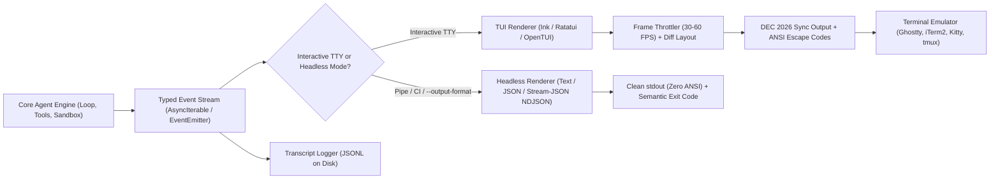

> **Module 6: Extensibility & Interfaces** | Prerequisites: Chapters 02, 06 & 17 | Reading Time: ~20 min
>
> [← 33. Plugin & Configuration Discovery](./33-plugin-and-configuration-discovery.md) | [Table of Contents](../README.md) | [35. Client-Server Protocols (JSON-RPC, ACP, Daemon Architecture) →](./35-client-server-protocols-json-rpc-acp-daemon-architecture.md)

# 34. TUI / CLI Event Rendering

You can build the smartest agent loop in the world (with rock-solid sandboxing, crisp prompt caching, and lightning-fast tool calls) and developers will still abandon it in five minutes if the terminal flickers like a broken neon sign, corrupts their scrollback, hides what the agent is doing, or breaks the moment they pipe output into `jq` in CI.

The terminal is where coding agents live. Yet a terminal is **not** a web browser. It has no built-in DOM, no native CSS layout engine, no pixel buffer, and no guarantee that a human is even looking at it (half the time, your "user" is a GitHub Actions runner). Turning a firehose of live LLM tokens, parallel tool calls, and code diffs into a calm, readable, responsive terminal experience, and cleanly switching to machine-readable output when running headless, is a craft in its own right.

---

## 1. The Simple Idea: A Sports Broadcast vs. a Live Ticker Feed

Imagine you are watching a live football match. On the field, chaotic events happen every second: passes, tackles, referee whistles, clock ticks, and instant replays.

How does a television network show that to you without giving you a headache?

1. **The game itself never draws pixels.** Players play on the field; spotters log structured events (*"14:22; Goal scored by #9"*).
2. **The TV graphics engine** subscribes to those events and turns them into a clean visual scoreboard at the bottom of the screen, animated replays, and tidy stat panels: updating smoothly at 30 frames per second rather than flashing wildly every millisecond.
3. **Meanwhile, a news wire** subscribes to the *exact same event feed* and emits plain structured lines (`{"minute":14,"event":"goal","player":9}`) for newspapers and bots that do not have a screen at all.

An agent harness works the exact same way:

- **The Core Agent Engine** is the game on the field. It emits typed events (`text_delta`, `tool_start`, `tool_end`, `approval_requested`).
- **The TUI (Terminal User Interface) Renderer** is the TV graphics engine. It draws streaming Markdown, syntax-highlighted diffs, collapsible tool panels, and spinners smoothly inside a terminal window.
- **The Headless / CI Renderer** is the news wire. When running in a script or pipeline, it skips all visual chrome and emits clean newline-delimited JSON (NDJSON) with meaningful exit codes.

**What breaks if you skip this separation and just call `print()` / `console.log()` inside your agent loop?**
1. **Flicker and garbage output:** Two parallel tools printing simultaneously interleave their text into unreadable soup.
2. **Broken automation:** Color codes and animated spinners leak into piped stdout, crashing every CI script that tries to parse your output.
3. **Locked-in architecture:** When you later want a full-screen TUI, a web UI, or an IDE plugin, you have to rip apart your core agent loop because rendering code is tangled into every function.

---

## 2. Why This Matters in a Real Agent Harness

Good terminal rendering is not cosmetic polish: it directly shapes **trust, speed, and usability**:

- **Perceived Latency & Trust:** A coding agent may think for 4 seconds, read 6 files, and run a 20-second test suite. If the screen sits frozen, developers assume it hung and hit `Ctrl+C`. Streaming text deltas, live spinners with elapsed timers, and compact tool-status lines reassure the user that real progress is happening.
- **Cognitive Load & Reviewability:** A single agent turn can execute 12 tool calls producing 8,000 lines of raw output. Dumping all 8,000 lines into the terminal buries the one 5-line diff the developer actually needs to approve. Collapsible tool panels and syntax-highlighted diffs let humans review changes in seconds.
- **Terminal Hygiene:** Terminals have sticky global state (raw input mode, hidden cursors, alternate screen buffers). If your harness crashes without restoring that state, the user's shell is left broken, typing shows nothing and Enter stops working, until they manually run `reset`.
- **CI / Script Composability:** Modern teams run coding agents both interactively at their desk *and* headlessly in CI (automated PR reviews, test triage, release notes). One clean event stream powers both modes with zero duplicated business logic.

---

## 3. The Big Picture

Notice how the core agent engine knows **nothing** about ANSI colors, screen widths, or React/Ratatui components. It only pushes structured events onto an event bus; pluggable renderers decide how to present them:



---

## 4. Deep Dive: Subtopic by Subtopic

### 4.1 Designing Great Developer UX in the Terminal

Developers spend hours staring at your agent's terminal output. Four UI building blocks separate a joy-to-use coding agent from a wall of raw text:

1. **Streaming Markdown (Without Broken Half-Tokens):**
   In Chapter 02 you learned how LLMs stream small text chunks (`"```py"`, `"thon\n"`, `"def foo"`). If you pass incomplete Markdown directly to a naive parser on every chunk, an unclosed `**bold` or unclosed ```` ```python ```` code fence causes the entire rest of the screen to flash bold or lose syntax highlighting until the closing marker arrives.
   - *Best practice:* Maintain a **streaming block parser**. Completed blocks (paragraphs, finished code blocks, finished lists) are committed once and never re-parsed. Only the *currently active tail block* is re-rendered on each frame, with auto-closed virtual fences/styles so code stays syntax-highlighted while it streams in.

2. **Syntax-Highlighted Diffs:**
   When an agent proposes or applies a file edit, developers care about *what changed*, not a 400-line file dump. Great diff renderers show:
   - The file path and a compact change summary (`src/auth.ts  +4 -2`).
   - Line numbers in a muted gutter (`42`, `43`).
   - Soft background tints (subtle dark red for `-` removals, subtle dark green for `+` additions) rather than harsh neon foregrounds that ruin readability on light/dark themes.
   - **Word-level / intraline highlights** pinpointing the exact characters modified on a line, plus 2–3 lines of surrounding context.

3. **Collapsible Tool Panels:**
   Instead of dumping 150 lines of `ripgrep` matches or `pytest` logs, show a **compact 1–3 line card** by default:
   ```text
   ✓ Read src/auth.ts (lines 1–120)                                 18ms
   ✓ Bash: pytest tests/test_auth.py (14 passed)                   1.8s
     ↳ Press Ctrl+O to expand full output (84 lines)
   ⠋ Edit src/auth.ts: updating token expiry check...             0.4s
   ```
   While a tool is running, show a rolling tail preview (e.g., the last 3–5 lines of live command output). Once it succeeds, collapse it to a single green summary line; if it *fails*, automatically keep the error tail expanded so the developer sees what broke immediately.

4. **Spinners, Timers, and a Persistent Status Footer:**
   A lightweight Braille spinner (`⠋ ⠙ ⠹ ⠸ ⠼ ⠴ ⠦ ⠧ ⠇ ⠏`) paired with the current state (*"Thinking…"*, *"Running tests…"*, *"Compacting context…"*) and elapsed time (`12.4s`) tells the user the harness is alive. Anchoring a thin bottom status bar showing **model name, context window fill (`68k / 200k`), session cost (`$0.14`), and permission mode** gives constant situational awareness without cluttering the conversation.

---

### 4.2 Terminal Architecture Basics

To build a reliable TUI, you need to understand five low-level terminal mechanics that have existed since the 1970s VT100 hardware terminal, and still power Ghostty, iTerm2, Kitty, Alacritty, and Windows Terminal today.

#### 1. TTY vs. Non-TTY (`isatty`)
A **TTY** (short for *teletypewriter*, now a virtual terminal device like `/dev/ttys004`) connects your program to a live human terminal screen. When someone runs `my-agent | tee log.txt` or runs your agent in GitHub Actions, `stdout` is connected to a **pipe** or **file**, not a TTY.
- Always check `process.stdout.isTTY` (Node/TS) or `sys.stdout.isatty()` (Python) before emitting ANSI cursor movements, spinners, or raw-mode prompts.

#### 2. ANSI Escape Sequences
A terminal does not have a `setColor()` function call. You control colors, cursor position, and clearing by writing special invisible byte sequences starting with the **ESC** character (`\x1b`, ASCII 27) followed by `[`: called a **CSI (Control Sequence Introducer)**:

| Sequence | Name | What It Does |
| :--- | :--- | :--- |
| `\x1b[32m...\x1b[0m` | SGR Color & Reset | Prints text in green, then resets all styles (`\x1b[0m`). |
| `\x1b[38;2;R;G;Bm` | 24-bit TrueColor | Sets exact RGB foreground color (supported by all modern terminals). |
| `\x1b[2K\r` | Erase Line + CR | Wipes the entire current line and returns the cursor to column 0. |
| `\x1b[5A` | Cursor Up | Moves the cursor up 5 rows (used to overwrite an active inline panel). |
| `\x1b[?25l` / `\x1b[?25h` | Hide / Show Cursor | Hides the blinking cursor during redraws; **must** restore on exit! |
| `\x1b[?1049h` / `\x1b[?1049l` | Alternate Screen | Switches to a clean full-screen canvas and restores the original shell on exit. |
| `\x1b[?2004h` / `\x1b[?2004l` | Bracketed Paste | Wraps pasted multi-line text in `\x1b[200~ ... \x1b[201~` so pasting code does not accidentally press "Submit" on every newline! |
| `\x1b[?2026h` / `\x1b[?2026l` | DEC Mode 2026 | **Synchronized Output**: tells the terminal to buffer all writes and paint one atomic frame (zero flicker). |

#### 3. Raw Mode vs. Cooked Mode
By default, terminals run in **cooked (canonical) mode**: the OS buffers everything you type until you press `Enter`, echoes every keystroke onto the screen, and automatically turns `Ctrl+C` into a `SIGINT` process kill.

Interactive TUIs switch `stdin` into **raw mode** (`process.stdin.setRawMode(true)` in Node; `tty.setraw()` in Python) so your harness receives *every single keypress immediately*: arrow keys (`\x1b[A`), `Esc` to cancel a generation mid-stream, `Tab` to toggle modes, `Ctrl+O` to expand a tool panel, or `Ctrl+C` to cancel the current turn *without* killing the whole session.

> **Golden Rule of Terminal Hygiene:** Whenever you enable raw mode, hide the cursor, enable bracketed paste, or enter the alternate screen, register cleanup handlers on `exit`, `SIGINT`, `SIGTERM`, and uncaught exceptions to restore the terminal immediately. Otherwise, a single crash leaves the user's shell completely unusable.

#### 4. Alternate Screen vs. Inline Scrollback vs. Inline Viewport
One of the biggest UX debates in coding-agent engineering is *where* your UI should live:

| Strategy | How It Works | Pros | Cons |
| :--- | :--- | :--- | :--- |
| **Inline Scrollback** *(classic Ink `<Static>`)* | Prints finalized messages normally into the terminal's native scrollback; redraws only the bottom active region (spinner + input box). | Native mouse selection, native `Cmd+F` search, native copy-paste, history stays visible after you quit. | Hard to avoid flicker if the active region grows taller than the terminal height; no pinned headers or split panes. |
| **Alternate Screen Buffer** *(fullscreen TUI like `vim`/`htop`)* | Sends `\x1b[?1049h` to claim the whole viewport; the app owns scrolling, selection, and layout. | Zero scrollback corruption, flat memory usage, rich split panes & modals, rock-solid flicker-free rendering. | Breaks native terminal `Cmd+F` and scrollbars (app must implement its own scrolling & transcript search); screen vanishes on exit. |
| **Hybrid Inline Viewport** *(e.g. Ratatui `Viewport::Inline`)* | Reserves a fixed or dynamically sized bottom region (e.g., 12 rows) for active widgets while pushing completed lines upward into native scrollback via `insert_before`. | Best of both worlds: preserves native scrollback + copy-paste while keeping active diffs/prompts neatly contained. | Subtle edge cases during terminal resizing (`SIGWINCH`) and complex multiplexers like `tmux`. |

#### 5. Handling Resize Signals (`SIGWINCH`)
Whenever a user drags their terminal window wider or splits a `tmux` pane, the operating system sends your process a **`SIGWINCH`** (*Signal Window Change*) signal.
- Your TUI must listen for `SIGWINCH` (or `process.stdout.on('resize', ...)` in Node), query the new `(columns, rows)` dimensions, invalidate all cached line-wrap calculations, and trigger a clean redraw. If you forget this, wrapping a 120-column box inside an 80-column window shreds every border into diagonal staircases.

---

### 4.3 Decoupling the Agent Engine from the UI via Typed Event Streams

The single cleanest architectural decision you can make for your harness interface is **strict separation between event production and event rendering**.

Instead of passing UI callbacks or printing strings inside your agent loop, define a **discriminated union** of typed events: every state change in the harness becomes an immutable data object:

```typescript
// events.ts — The contract between the Agent Engine and ANY renderer
export type AgentEvent =
  | { type: "session_init"; sessionId: string; model: string; cwd: string }
  | { type: "turn_start"; turnId: number }
  | { type: "thinking_delta"; text: string }
  | { type: "text_delta"; text: string }
  | { type: "tool_start"; callId: string; name: string; summary: string }
  | { type: "tool_output"; callId: string; chunk: string; stream: "stdout" | "stderr" }
  | { type: "tool_end"; callId: string; ok: boolean; durationMs: number; diff?: string }
  | { type: "approval_requested"; callId: string; command: string; risk: "low" | "high" }
  | { type: "usage_update"; inputTokens: number; outputTokens: number; costUsd: number }
  | { type: "turn_end"; turnId: number; stopReason: string }
  | { type: "error"; code: string; message: string; fatal: boolean };

// Any UI (TUI, Headless NDJSON, Transcript Logger, WebSocket bridge) implements this:
export interface EventSink {
  onEvent(event: AgentEvent): void;
  flush?(): Promise<void>;
  dispose?(): void;
}
```

Look at what this buys you immediately:
- **Zero coupling:** You can swap Ink for Ratatui, or swap a TUI for a CI JSON writer, without changing a single line of agent loop code.
- **Fan-out for free:** Attach three sinks at once (`TuiRenderer` (for the human), `TranscriptSink` (appending every event to `.jsonl` on disk) Chapter 37), and `TelemetrySink` (recording OpenTelemetry spans; Chapter 38).
- **Deterministic UI testing:** You can record a real session's event stream to a `.jsonl` file and replay it into your TUI at 10x speed to visually test edge cases (long diffs, rapid parallel tools, sudden errors) without spending a penny on LLM API calls!

---

### 4.4 Non-Interactive / Headless / CI Mode

A great CLI agent is a **first-class Unix citizen**. Developers want to run it inside shell pipelines, cron jobs, pre-commit hooks, and GitHub Actions without any interactive prompts hanging the build.

#### 1. Detecting Headless Mode Automatically
Enter non-interactive mode whenever **any** of these is true:
- The user passes a print/headless flag (`-p "Explain this diff"`, `--print`, `exec`).
- `stdout` is not a TTY (`!process.stdout.isTTY`): e.g., redirected to a file or piped to `jq`.
- `CI=true` is set in the environment and no interactive TTY is attached.

#### 2. Output Formats (`text`, `json`, `stream-json`)
Support three clean machine-friendly output modes:

- **`--output-format text` (default when piped):** Prints *only* the final assistant answer to `stdout` with **zero ANSI escape codes** and **zero spinners**, so `git diff | agent -p "Write a commit message" > COMMIT_MSG` works seamlessly.
- **`--output-format json`:** Buffers until the run finishes and prints a single JSON object containing the final answer, session ID, token usage, cost, and duration; ideal for simple scripts (`jq -r .result`).
- **`--output-format stream-json` (NDJSON / JSONL):** Prints **one complete JSON object per line** as events happen in real time. CI dashboards, parent orchestrators, and custom wrappers can parse each line incrementally without waiting for a 5-minute run to finish:

```json
{"type":"session_init","sessionId":"sess_9a2f","model":"claude-sonnet-4-6","cwd":"/repo"}
{"type":"tool_start","callId":"call_1","name":"bash","summary":"pytest tests/test_auth.py"}
{"type":"tool_end","callId":"call_1","ok":true,"durationMs":1420}
{"type":"text_delta","text":"All 14 authentication tests now pass."}
{"type":"turn_end","turnId":1,"stopReason":"end_turn","totalCostUsd":0.042}
```

#### 3. Strict `stdout` vs. `stderr` Discipline & `NO_COLOR`
- **`stdout` is sacred.** In headless mode, *never* write debug logs, update notices (*"New version available!"*), or warning banners to `stdout`. Put all diagnostics and human-readable progress logs on `stderr`.
- Respect the community **`NO_COLOR`** environment variable (if `NO_COLOR` is set and non-empty, strip all ANSI color codes even in a TTY) and `FORCE_COLOR` when explicitly requested.

#### 4. Semantic Exit Codes
Shell scripts and CI pipelines branch on exit codes (`$?`). Do not return `1` for everything: distinguish retryable infrastructure failures from permission blocks and user bugs:

| Exit Code | Meaning | Typical CI Action |
| :--- | :--- | :--- |
| `0` | Success (task completed cleanly) | Continue pipeline |
| `1` | General execution / agent error | Fail build, inspect logs |
| `2` | Invalid CLI arguments or bad config | Fix workflow YAML |
| `3` | Authentication failure (missing/expired API key) | Check CI secrets |
| `4` | Permission denied (tool blocked in non-interactive mode) | Adjust `--allowedTools` policy |
| `5` | Rate limit / quota exceeded | Retry job with backoff |
| `6` | Network / upstream connectivity failure | Retry job |

> **Critical headless rule:** Never hang waiting for an interactive `[y/N]` approval prompt when stdin is closed or non-TTY! If a tool requires approval and is not pre-authorized via an allowlist flag (e.g., `--allowedTools`), fail fast with exit code `4` (or return a structured denial back to the model so it can try an allowed alternative).

---

### 4.5 Rendering Performance: Frame Throttling, Flicker-Free Redraws & Unicode Width Bugs

A streaming LLM can emit 80–150 token chunks per second, while two parallel shell commands emit another 200 log lines per second. If your TUI re-renders the entire screen on every incoming event, your CPU hits 100% and the screen strobes uncontrollably.

#### 1. Frame Throttling (Coalescing)
Human eyes do not need 500 terminal redraws per second. Decouple **state updates** from **screen painting**:
- Incoming events immediately mutate an in-memory UI state object and set `dirty = true` (microseconds, zero I/O).
- A single render timer ticks at **30–60 FPS** (every `16ms` to `33ms`). If `dirty` is `true`, it renders *once*, writes the frame, and resets `dirty = false`.
- Always perform one final synchronous flush on `turn_end` or exit so the last few tokens are never dropped.

#### 2. Flicker-Free Redraws: Differential Updates + DEC Mode 2026
Why do terminals flicker? Because a terminal emulator paints on its own 60Hz–120Hz display refresh cycle. If your app sends:
1. `\x1b[2J` *(erase the entire screen)*
2. *(display refresh happens right here! User sees a blank flash!)*
3. Write 40 new lines of UI.

Two techniques eliminate flicker completely:
- **Never clear the whole screen (`\x1b[2J`) on routine frames.** Maintain a previous frame buffer (an array of rendered lines or a 2D cell grid), diff it against the next frame, and emit escape sequences **only for the lines/cells that actually changed**.
- **Wrap every frame write in DEC Mode 2026 (Synchronized Output):**
  ```text
  \x1b[?2026h   <-- "Terminal: pause painting and buffer everything I send next"
  ...all cursor moves and updated lines for this frame...
  \x1b[?2026l   <-- "Terminal: paint the entire buffered frame atomically right now"
  ```
  Terminals that support DEC 2026 (Ghostty, iTerm2, Kitty, WezTerm, Alacritty, Windows Terminal, modern `tmux` and VS Code integrated terminals) swap the frame atomically with zero tearing; older terminals silently ignore the unknown mode sequence, making it completely safe to emit (or negotiate via `DECRQM`).

#### 3. Wide Unicode, Emoji & ANSI Width Bugs
This is the #1 bug that breaks handmade TUIs. Suppose you want to draw a neat 40-column box around a status line, so you compute padding as `40 - text.length`. **That formula is almost always wrong in a terminal:**

| String | JS `.length` (UTF-16 units) | Actual Terminal Columns | Why `.length` Lies |
| :--- | :---: | :---: | :--- |
| `"\x1b[32mOK\x1b[0m"` | `11` | `2` | ANSI escape codes take **0 visual columns**. |
| `"日本語"` | `3` | `6` | East Asian wide characters (CJK) occupy **2 columns each**. |
| `"✅"` | `1` | `2` | Most emoji occupy **2 columns**. |
| `"👨‍👩‍👧‍👦"` | `11` | `2` | Zero-Width Joiner (ZWJ) sequences combine 7 code points into **one 2-column glyph**. |
| `"e\u0301"` (`é`) | `2` | `1` | Combining accents occupy **0 extra columns** over the base letter. |
| `"\t"` | `1` | `1–8` | Tabs jump to the next tab stop; always expand tabs to spaces before layout. |

If your width calculation is off by even 1 column, a single emoji in a user's git branch name or a CJK comment in a code diff causes a line to wrap unexpectedly, shifting the cursor down an extra row, so your next `\x1b[5A` cursor-up lands on the wrong line and smears ghost artifacts across the terminal!

**The fix:** Always strip ANSI codes first, split text into **grapheme clusters** (`Intl.Segmenter` in JS/TS; `unicode-segmentation` in Rust), and sum terminal column widths using a Unicode East Asian Width table (`string-width` in JS/TS, `unicode-width` in Rust, `wcwidth` in Python).

---

## 5. How Real Harnesses Do It

Modern production coding agents show a fascinating convergence, and real trade-offs, in TUI architecture:

- **Claude Code (Anthropic):** Built in TypeScript using **React + Ink** (React reconciler targeting terminal layout via Yoga flexbox). Historically, Claude Code used an inline scrollback layout (committing finished items with Ink's `<Static>` while redrawing the active bottom area). Rapid streaming in large terminals exposed Ink's classic redraw flicker, leading Anthropic to adopt **DEC Mode 2026 synchronized output** (with `CLAUDE_CODE_FORCE_SYNC_OUTPUT=1`) and introduce a full **alternate-screen renderer** (`/tui fullscreen` or `CLAUDE_CODE_NO_FLICKER=1`) that keeps memory flat and eliminates strobing, paired with `Ctrl+O` for in-app transcript search. For CI and scripts, `claude -p` supports `--output-format json` and `--output-format stream-json` (NDJSON) along with semantic exit codes (`0`, `1`, `3` auth, `4` permission, `5` rate limit, `6` network).
- **Gemini CLI (Google):** Also built on **React + Ink**, carefully optimizing render passes and supporting alternate-screen rendering for smooth multi-line prompts, sticky headers, and diff previews. Its headless mode (`-p` / `--prompt` with `--output-format stream-json`) bypasses the Ink renderer entirely and emits a clean JSONL stream of typed events (`init`, `message`, `tool_use`, `tool_result`, `error`, `result`) directly to `stdout`.
- **OpenAI Codex CLI:** Written in Rust (`codex-tui`) on top of **Ratatui** and **Crossterm**. Rather than taking over the whole screen or fighting virtual-DOM overhead, Codex uses Ratatui's **inline viewport** and differential cell-grid rendering: drawing live spinners, syntax-highlighted diffs, and approval boxes inside a bounded bottom viewport while pushing finalized history cleanly into native terminal scrollback. Crucially, `codex-tui` consumes the exact same structured event model that `codex app-server` exposes over JSON-RPC.
- **OpenCode:** Originally built in Go with Charm's **Bubble Tea** (The Elm Architecture: pure `Model → Update → View` loop), and later evolved to **OpenTUI**: a high-performance native rendering core in Zig with TypeScript/SolidJS bindings and Yoga flexbox layout. OpenCode treats its TUI strictly as a thin client subscribing to a local background server's SSE event stream (which we explore in detail in Chapter 35).

---

## 6. Common Pitfalls & Failure Modes

1. **The "Broken Shell After Crash" Bug:**
   *Symptom:* Your agent throws an unhandled exception, exits, and now the user's terminal refuses to echo typed characters and has no cursor.
   *Fix:* Install a single `restoreTerminal()` guard that writes `\x1b[?25h\x1b[?2004l\x1b[?1049l\x1b[0m`, disables raw mode, and runs inside `finally`, `SIGINT`, `SIGTERM`, and `uncaughtException`.
2. **ANSI Escape Codes Leaking into Pipes:**
   *Symptom:* A user runs `agent -p "summarize" | jq .` and gets `parse error: Invalid numeric literal` because `\x1b[32m` was printed before `{`.
   *Fix:* Gate all ANSI output behind `isTTY && !process.env.NO_COLOR`, and route every diagnostic warning to `stderr`.
3. **Scrollback Ghosting from Height Misestimation:**
   *Symptom:* In an inline renderer, moving the cursor up `N` lines to redraw leaves duplicate ghost lines above the prompt whenever a long line wraps onto two rows.
   *Fix:* Compute rendered height using **actual wrapped visual rows** (`Math.ceil(visualWidth(line) / columns)`), never `lines.length`.
4. **Unbounded Output Buffers Eating RAM:**
   *Symptom:* A user runs a verbose build inside the agent; the TUI keeps 500,000 raw log lines in React/TUI state, causing multi-second keystroke lag.
   *Fix:* Cap live tool panels to a fixed ring buffer (e.g., last 200 lines in UI memory) and write the full output to an artifact file on disk (Chapter 11).
5. **Forgetting Bracketed Paste:**
   *Symptom:* User pastes a 20-line stack trace into the prompt box, and the agent immediately submits 20 separate prompts; one per newline!
   *Fix:* Enable bracketed paste (`\x1b[?2004h`) and treat newlines arriving between `\x1b[200~` and `\x1b[201~` as literal text insertions rather than submit triggers.
6. **Hanging Forever in CI on an Approval Prompt:**
   *Symptom:* A GitHub Actions job times out after 6 hours because the agent printed `Allow bash command? [y/N]` to a non-interactive runner.
   *Fix:* In headless mode, disable interactive approval widgets completely; enforce a deterministic allow/deny policy and exit immediately if a required action is unauthorized.

---

## 7. Build It Yourself: Mini-Lab

Below is a compact, dependency-free TypeScript renderer that demonstrates the core engineering pieces of this chapter in one file:
1. A **typed event stream** decoupled from rendering.
2. Automatic switching between **Headless NDJSON mode** (when piped or `--json`) and **Interactive TUI mode**.
3. **30 FPS frame throttling**, **DEC Mode 2026 synchronized output**, **ANSI-aware width clamping**, and **guaranteed terminal cleanup**.

```typescript
// mini-renderer.ts — Run with: npx tsx mini-renderer.ts   (or pipe: npx tsx mini-renderer.ts | cat)
const ESC = "\x1b";
const SYNC_START = `${ESC}[?2026h`;
const SYNC_END = `${ESC}[?2026l`;
const HIDE_CURSOR = `${ESC}[?25l`;
const SHOW_CURSOR = `${ESC}[?25h`;
const CLEAR_LINE = `${ESC}[2K\r`;
const RESET = `${ESC}[0m`;
const SPINNER = ["⠋", "⠙", "⠹", "⠸", "⠼", "⠴", "⠦", "⠧", "⠇", "⠏"];

// Strip ANSI SGR sequences before measuring display width
const ANSI_REGEX = /\x1b\[[0-9;]*[a-zA-Z]/g;
const segmenter = new Intl.Segmenter("en", { granularity: "grapheme" });

/** Approximate terminal column width (handles ANSI + grapheme clusters + wide emoji/CJK). */
function visualWidth(str: string): number {
  const clean = str.replace(ANSI_REGEX, "");
  let cols = 0;
  for (const { segment } of segmenter.segment(clean)) {
    const cp = segment.codePointAt(0) ?? 0;
    const isWide =
      (cp >= 0x1100 && cp <= 0x115f) || (cp >= 0x2e80 && cp <= 0x9fff) ||
      (cp >= 0xac00 && cp <= 0xd7a3) || (cp >= 0x1f300 && cp <= 0x1faff);
    cols += isWide ? 2 : 1;
  }
  return cols;
}

type AgentEvent =
  | { type: "text_delta"; text: string }
  | { type: "tool_start"; callId: string; summary: string }
  | { type: "tool_end"; callId: string; ok: boolean; durationMs: number }
  | { type: "turn_end"; costUsd: number };

/** 1. Headless NDJSON Sink: zero ANSI, strictly one JSON object per line on stdout. */
class NdjsonRenderer {
  onEvent(event: AgentEvent): void {
    process.stdout.write(JSON.stringify(event) + "\n");
  }
  dispose(): void {}
}

/** 2. Flicker-free Throttled Inline TUI Sink: 30 FPS + DEC 2026 + cleanup guard. */
class InlineTuiRenderer {
  private activeTools = new Map<string, { summary: string; startedAt: number }>();
  private textBuffer = "";
  private dirty = false;
  private frameIdx = 0;
  private prevRenderedRows = 0;
  private timer: NodeJS.Timeout;

  constructor() {
    process.stdout.write(HIDE_CURSOR);
    process.stdout.on("resize", () => { this.dirty = true; });
    this.timer = setInterval(() => this.paint(), 33); // ~30 FPS frame cap
  }

  onEvent(event: AgentEvent): void {
    if (event.type === "text_delta") {
      this.textBuffer += event.text;
    } else if (event.type === "tool_start") {
      this.activeTools.set(event.callId, { summary: event.summary, startedAt: Date.now() });
    } else if (event.type === "tool_end") {
      const tool = this.activeTools.get(event.callId);
      this.activeTools.delete(event.callId);
      // Commit finished tool permanently above the dynamic area
      const icon = event.ok ? `${ESC}[32m✓${RESET}` : `${ESC}[31m✗${RESET}`;
      this.commitStaticLine(`${icon} ${tool?.summary ?? event.callId} (${event.durationMs}ms)`);
    } else if (event.type === "turn_end") {
      this.paint(); // Final flush before printing summary
      this.commitStaticLine(`${ESC}[90m--- Done ($${event.costUsd.toFixed(4)}) ---${RESET}`);
    }
    this.dirty = true;
  }

  private commitStaticLine(line: string): void {
    this.clearDynamicArea();
    process.stdout.write(line + "\n");
    this.prevRenderedRows = 0;
  }

  private clearDynamicArea(): void {
    if (this.prevRenderedRows === 0) return;
    let out = "";
    for (let i = 0; i < this.prevRenderedRows; i++) {
      out += CLEAR_LINE + (i < this.prevRenderedRows - 1 ? `${ESC}[1A` : "");
    }
    process.stdout.write(out);
  }

  private paint(): void {
    if (!this.dirty && this.activeTools.size === 0) return;
    this.dirty = false;
    const cols = Math.max(20, process.stdout.columns || 80);
    const lines: string[] = [];

    if (this.textBuffer) lines.push(this.textBuffer);
    const spin = SPINNER[this.frameIdx++ % SPINNER.length];
    for (const [, tool] of this.activeTools) {
      const sec = ((Date.now() - tool.startedAt) / 1000).toFixed(1);
      lines.push(`${ESC}[36m${spin}${RESET} ${tool.summary} ${ESC}[90m(${sec}s)${RESET}`);
    }

    // Wrap entire redraw in DEC Mode 2026 so the terminal paints atomically
    let frame = SYNC_START;
    if (this.prevRenderedRows > 0) {
      frame += `${ESC}[${this.prevRenderedRows}A`;
    }
    let visualRows = 0;
    for (const line of lines) {
      frame += CLEAR_LINE + line + "\n";
      visualRows += Math.max(1, Math.ceil(visualWidth(line) / cols));
    }
    // Erase leftover rows if dynamic block shrank
    for (let i = visualRows; i < this.prevRenderedRows; i++) {
      frame += CLEAR_LINE + "\n";
    }
    frame += SYNC_END;

    process.stdout.write(frame);
    this.prevRenderedRows = visualRows;
  }

  dispose(): void {
    clearInterval(this.timer);
    this.paint();
    process.stdout.write(SHOW_CURSOR + RESET);
  }
}

// --- Demo driver ---
async function main() {
  const forceJson = process.argv.includes("--json") || !process.stdout.isTTY;
  const renderer = forceJson ? new NdjsonRenderer() : new InlineTuiRenderer();

  const cleanup = () => renderer.dispose();
  process.on("SIGINT", () => { cleanup(); process.exit(130); });

  try {
    renderer.onEvent({ type: "tool_start", callId: "1", summary: "Running pytest tests/auth.py" });
    await new Promise((r) => setTimeout(r, 900));
    renderer.onEvent({ type: "tool_end", callId: "1", ok: true, durationMs: 900 });
    for (const chunk of ["Fixed ", "the ", "token ", "expiry ", "check! ✅"]) {
      renderer.onEvent({ type: "text_delta", text: chunk });
      await new Promise((r) => setTimeout(r, 80));
    }
    renderer.onEvent({ type: "turn_end", costUsd: 0.0125 });
  } finally {
    cleanup();
  }
}

main();
```

Try running it twice: once directly in your terminal (`npx tsx mini-renderer.ts`) to see the live spinner and flicker-free updates, and once piped (`npx tsx mini-renderer.ts | jq .`) to watch it automatically switch to clean NDJSON without touching the event producer!

---

## 8. Key Takeaways & Quick Self-Check

- **Decouple engine from UI:** Emit typed events from the agent loop; let pluggable sinks handle TUI rendering, headless NDJSON, transcripts, and telemetry.
- **Respect terminal state:** Always restore raw mode, cursor visibility, bracketed paste, and the alternate screen in crash/exit handlers.
- **Eliminate flicker at the root:** Throttle redraws to 30–60 FPS, diff frames instead of full-screen clears, and wrap updates in **DEC Mode 2026** (`\x1b[?2026h` ... `\x1b[?2026l`).
- **Never trust `.length` for terminal layout:** Measure display columns after stripping ANSI codes and segmenting grapheme clusters so CJK text and emoji never corrupt wrapping.
- **Make headless mode first-class:** Detect `!isTTY`, emit zero ANSI codes on `stdout`, support NDJSON (`stream-json`), route logs to `stderr`, and return semantic exit codes.

### Quick Self-Check

1. **Why does wrapping a terminal redraw in DEC Mode 2026 (`\x1b[?2026h` ... `\x1b[?2026l`) eliminate screen flickering?**
   <details>
   <summary>Show Answer</summary>
   Without synchronized output, a terminal emulator repaints the screen on its own refresh cycle, which can land halfway between your app erasing old lines and writing new lines, causing visible blank flashes or tearing. DEC Mode 2026 tells the terminal to buffer all incoming ANSI writes until the closing sequence arrives, then paint the entire updated frame atomically in a single refresh.
   </details>

2. **What is the core UX trade-off between rendering a coding agent in the Alternate Screen Buffer versus Inline Scrollback?**
   <details>
   <summary>Show Answer</summary>
   **Inline scrollback** preserves native terminal scrolling, copy-paste, `Cmd+F` search, and visible history after exit, but makes complex layouts and flicker-free large redraws harder. The **alternate screen buffer** gives you a full-canvas flicker-free viewport with flat memory and split panes, but hides native terminal scrollback and requires the app to implement its own scrolling and transcript search.
   </details>

3. **Your TUI draws a 60-column border box using `60 - line.length`, and the box suddenly breaks whenever a file contains a `✅` emoji or colored ANSI text. Why?**
   <details>
   <summary>Show Answer</summary>
   `line.length` counts UTF-16 code units, not visual terminal columns. ANSI escape sequences (like `\x1b[32m`) add to `.length` even though they take **0 columns**, while emojis (`✅`) and CJK characters occupy **2 columns** (and multi-codepoint ZWJ emojis like `👨‍👩‍👧‍👦` have `.length === 11` but only take 2 columns). You must strip ANSI sequences, split into grapheme clusters, and sum terminal display widths.
   </details>

4. **A teammate runs your coding agent in GitHub Actions with `--output-format stream-json`, and their `jq` pipeline crashes on startup. What are the two most likely culprits?**
   <details>
   <summary>Show Answer</summary>
   (1) Non-JSON text (such as a startup banner, update warning, debug `console.log`, or ANSI escape codes) was accidentally written to `stdout` instead of `stderr`. (2) The agent tried to open an interactive TUI or print a human approval prompt instead of detecting headless/non-TTY mode.
   </details>

---

[← 33. Plugin & Configuration Discovery](./33-plugin-and-configuration-discovery.md) | [Table of Contents](../README.md) | [35. Client-Server Protocols (JSON-RPC, ACP, Daemon Architecture) →](./35-client-server-protocols-json-rpc-acp-daemon-architecture.md)
