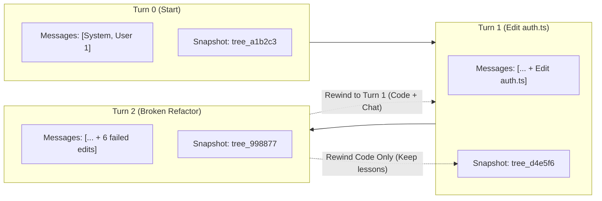
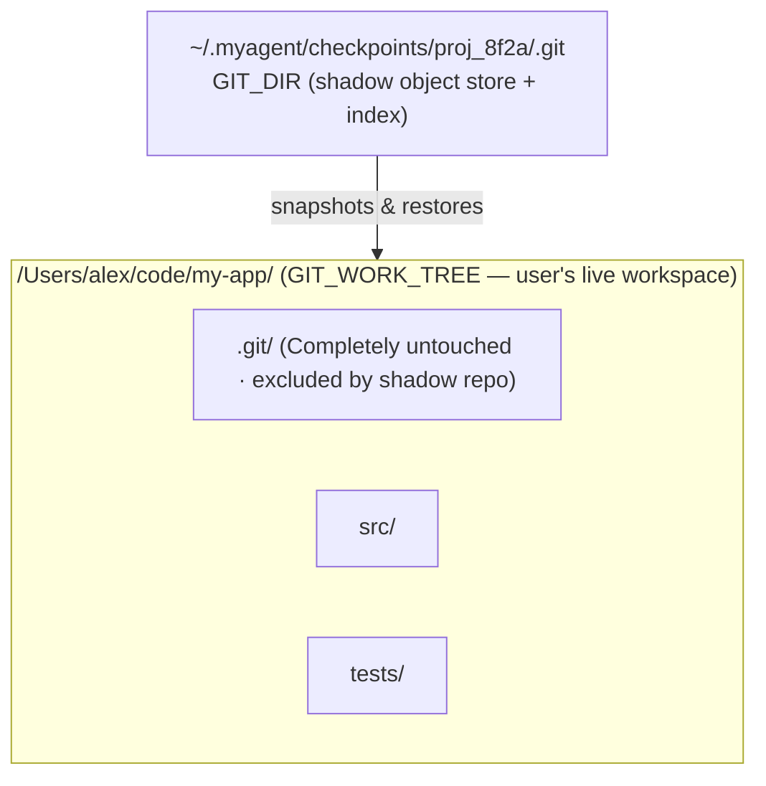
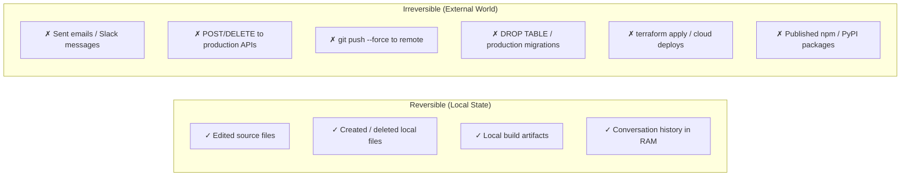

> **Module 7: Reliability & Evaluation** | Prerequisites: Chapters 06 & 14 | Reading Time: ~22 min
>
> [← 35. Client-Server Protocols (JSON-RPC, ACP, Daemon Architecture)](../06-extensibility-and-interfaces/35-client-server-protocols-json-rpc-acp-daemon-architecture.md) | [Table of Contents](../README.md) | [37. Transcript Logging & Deterministic Replay →](./37-transcript-logging-and-deterministic-replay.md)

# 36. Checkpointing, Snapshots & Rollback

When a human developer makes a mistake in a code editor, they tap `Ctrl+Z` (or `Cmd+Z`) and move on. When an autonomous coding agent makes a mistake, it might have edited 14 files, created 3 new ones, deleted a helper module, updated `package.json`, and filled 40,000 tokens of conversation history explaining why its broken approach is "almost working."

If you cannot rewind an agent cleanly, users become terrified to let it run autonomously. They hover over every single edit approval, or they burn ten minutes untangling broken half-refactors with `git checkout`. **Checkpointing** (taking lightweight, automatic save points of both your workspace and the agent's memory) turns scary, irreversible experimentation into a safe, fast time machine.

---

## 1. The Simple Idea (Zero-Jargon Intuition)

Think of playing a difficult video game right before a boss fight. Before you open the boss room door, you hit **Quick Save**.

- If your strategy fails and your character loses all their gear, you do not try to "manually walk backward and put every broken vase back on the table." You hit **Load Save**. The world, your inventory, and your position snap back to the exact moment before you entered the room, while *you* (the player) still remember what went wrong so you can try a smarter tactic next time.

An agent harness checkpoint is that Quick Save button for software engineering.

**What breaks if you don't have it?**
1. **Dirty-tree panic:** If you already had uncommitted work in your repository before asking the agent for help, running `git reset --hard HEAD` wipes out *your* work along with the agent's mess.
2. **Zombie memory:** Even if you manually revert the files on disk, the LLM's conversation history still contains 15 turns of the failed attempt. On the next turn, the model gets confused because its memory says *"I already migrated `auth.py` to OAuth2,"* while the disk says otherwise.
3. **Fear of autonomy:** Without a one-command undo, developers refuse to let agents attempt ambitious multi-file refactors.

---

## 2. Why This Matters in a Real Agent Harness

Checkpointing directly upgrades **trust, speed, and quality**:

- **Safety without Git pollution:** Developers hate when tools spam their real Git commit history with 47 commits named `"WIP agent step 12"`. A proper checkpoint engine stays completely invisible to `git log` and `git status`.
- **Faster iteration via branching attempts:** You can let an agent try Approach A (say, rewriting a parser with regex). If it looks messy, you rewind 2 turns and try Approach B (using a proper state machine) in seconds.
- **Cleaner context windows:** Rewinding conversation history alongside code instantly drops all the dead-end error logs and failed edits from the prompt, preventing **context rot** *(Ch. 09)* and saving tokens on every subsequent turn.
- **Crash and interruption recovery:** Paired with a turn state machine *(Ch. 06)*, checkpoints guarantee that a killed process or power outage never leaves a half-applied patch stranded without a known-good state to fall back to.

---

## 3. The Big Picture

A complete checkpointing system links two timelines together: the **Conversation Timeline** (the message list in memory/transcript) and the **Workspace Timeline** (snapshots of files on disk). Each checkpoint node binds a specific turn ID to a specific filesystem snapshot ID.



Notice the two dotted rewind arrows at the bottom: a great harness lets the user rewind **both code and conversation**, **code only** (keeping the lessons learned in chat), or **conversation only** (trimming a noisy detour while keeping a good file edit).

---

## 4. Deep Dive: Subtopic by Subtopic

### 4.1 Why "Undo" in an Agent Harness Is Harder Than Ctrl+Z

A text editor like VS Code or Vim only has to undo **linear keystrokes inside a single open buffer in RAM**. An agent harness deals with a vastly harder multi-dimensional state space:

| Dimension | Text Editor (`Ctrl+Z`) | Agent Harness (`/rewind`) |
| :--- | :--- | :--- |
| **Scope of changes** | One file buffer at a time. | Dozens of files created, modified, renamed, or deleted in one turn. |
| **Who edits files** | Only the editor process itself. | Built-in edit tools **plus** arbitrary shell commands (`npm install`, `mv`, `sed`, code generators) **plus** the human editing alongside the agent. |
| **Existing user work** | Part of the same edit stack. | The user often has unstaged/untracked changes *before* the agent starts; rollback must restore *to the pre-turn state*, not to `HEAD`. |
| **Dual state** | Only text on disk/RAM. | Both **disk state** and **LLM conversation state** (plus pending tool calls and prompt caches). |
| **External side effects** | None. | HTTP API calls, database migrations, Slack messages, cloud deployments, `git push`. |

There is also a subtle **co-editing race**: suppose at Turn 1 the agent edits `api.py`, then the human manually tweaks `README.md`, and at Turn 2 the agent breaks `api.py`. If the user rolls back Turn 2, a naive full-workspace restore might overwrite the human's manual tweak to `README.md` unless the harness either captures a fresh pre-turn snapshot right before Turn 2 *or* tracks per-file baselines.

---

### 4.2 Shadow Git Repositories, `git write-tree`, and Per-Turn File Backups

Harness engineers use three main mechanisms to snapshot files on disk. Each makes a distinct trade-off between **completeness**, **speed**, and **simplicity**.

#### Strategy A: Per-Turn File Backups (Copy-Before-Write)
Before the harness executes any built-in file mutation tool (`write_file`, `edit_file`, `delete_file`), it hashes and copies the original file into a local backup store (for example, `~/.myagent/file-history/<session-id>/<sha256>`). If the file did not exist yet, it records a tombstone marker (`{"existed": false}`) so rollback knows to delete the newly created file.

- **Pros:** Zero dependency on Git; ultra-fast (only touches the 1–5 files actually edited); handles non-Git folders and massive monorepos effortlessly; never touches files the agent didn't edit.
- **Cons:** **Blind to shell commands.** If the agent runs `bash` with `rm -rf build/ && sed -i 's/foo/bar/g' src/*.py`, the file-tool interceptor never saw those writes, so it cannot roll them back.

#### Strategy B: Shadow Git Repository (`GIT_DIR` + `GIT_WORK_TREE`)
A **Shadow Git repository** is a completely separate `.git` directory stored *outside* the user's project (for example, in `~/.myagent/checkpoints/<project-hash>/.git`).

Git has two built-in environment variables: **`GIT_DIR`** (where Git stores its object database and index) and **`GIT_WORK_TREE`** (which folder of working files Git inspects). By pointing `GIT_DIR` at your hidden shadow repo and `GIT_WORK_TREE` at the user's project directory, Git snapshots the entire workspace, including changes made by shell commands, without ever touching the project's real `.git` folder!



> **Watch out for nested `.git` directories:** When you run `git add -A` inside a shadow repo whose work tree is `/Users/alex/code/my-app`, Git sees the user's real `.git` directory or submodules. Production shadow-Git engines explicitly ignore `.git` (and nested `.git` directories, sometimes temporarily renaming or excluding them via `info/exclude`) and **sanitize inherited environment variables** so a user's pre-existing `GIT_DIR` or `GIT_INDEX_FILE` inside a Dev Container or CI shell never hijacks the shadow command and corrupts the user's real repo!

#### Strategy C: Git Plumbing Snapshots (`git write-tree`)
Instead of creating heavyweight commits with author names, GPG signing hooks, or pre-commit hooks, you can use Git's **plumbing commands** (low-level building blocks):

1. Stage the current working tree into a temporary index file (`GIT_INDEX_FILE=/tmp/shadow.idx`):
   ```bash
   git --git-dir="$SHADOW_DIR" --work-tree="$WORKSPACE" add -A
   ```
2. Freeze that index into an immutable **Tree Object** and get back its 40-character SHA hash:
   ```bash
   TREE_SHA=$(git --git-dir="$SHADOW_DIR" write-tree)
   ```
3. To inspect what changed between two checkpoints, diff the two tree SHAs directly:
   ```bash
   git --git-dir="$SHADOW_DIR" diff --stat "$TREE_A" "$TREE_B"
   ```
4. To roll back later, read the old tree into the index and check it out onto the working tree (and remove files added *after* that snapshot):
   ```bash
   git --git-dir="$SHADOW_DIR" --work-tree="$WORKSPACE" read-tree --reset -u "$TREE_SHA"
   ```

Why is `git write-tree` so loved by harness engineers?
- **Content-addressed deduplication:** Git compresses files with zlib and stores identical files only once by SHA hash. Taking 50 snapshots of a 5,000-file repo where only 2 files changed per turn adds almost zero disk space.
- **No hooks, no config headaches:** Unlike `git commit`, `git write-tree` never fails because `user.name` isn't set, GPG signing prompts for a passphrase, or Husky tries to run ESLint.
- **Instant diffs:** You get battle-tested unified diffs (`git diff <tree1> <tree2>`) for free to show the user a preview before they confirm a rollback.

#### Comparing the Three Snapshot Strategies

| Mechanism | Captures Shell (`bash`) Edits? | Speed on 50k-File Monorepo | Touches User's `.git`? | Complexity |
| :--- | :--- | :--- | :--- | :--- |
| **Per-turn file backup** | No (only built-in file tools) | Instant ($O(\text{edited files})$) | Never | Low |
| **Shadow Git (`commit`)** | Yes (whole working tree) | Medium (scans workspace) | Never (if env sanitized) | Medium |
| **Shadow Git (`write-tree`)** | Yes (whole working tree) | Fast (skips commit/hooks) | Never (if env sanitized) | Medium |
| **Copy-on-Write FS (APFS/Btrfs)** | Yes (even huge binaries) | Instant (OS-level clone) | Never | High (OS-specific) |

> **Practical hybrid pattern:** Many harnesses use **per-turn file backups by default** for instant speed and zero Git assumptions, and optionally enable **shadow Git (`write-tree`)** when the user wants full workspace rollback covering shell commands.

---

### 4.3 Coupling Conversation Rollback with Filesystem Rollback

Rewinding disk without rewinding memory, or vice versa, creates **state split-brain**. Let's look at why both halves must move together (unless the user deliberately chooses a partial rewind).

Suppose a session has 4 turns:
- **Turn 1:** User asks to add rate limiting. Agent reads `server.ts`.
- **Turn 2:** Agent edits `server.ts` to add an in-memory counter (`tree_2`).
- **Turn 3:** User says *"Actually, use Redis instead."* Agent deletes the in-memory counter and adds broken Redis code (`tree_3`).
- **Turn 4:** Agent tries to fix Redis import errors and mangles `package.json` (`tree_4`).

Each checkpoint record in your session store binds the exact coordinates of both worlds:

```json
{
  "checkpoint_id": "chk_002",
  "turn_index": 2,
  "created_at": "2026-04-12T14:22:08Z",
  "transcript_offset": 14,
  "message_uuid": "msg_9a4f2c",
  "fs_snapshot": {
    "backend": "shadow_git_tree",
    "tree_sha": "7b2e19c4d8a10f63b2194c8a71e0f2d9b8c3a410",
    "modified_files": ["src/server.ts"]
  },
  "label": "Added in-memory rate limiter"
}
```

When the user selects `chk_002`, the harness offers **three surgical rewind modes**:

1. **Rewind Code + Conversation (Full Time Travel):**
   - Restore filesystem to `tree_sha` (`chk_002`).
   - Truncate active message array back to `message_uuid` (ensuring no dangling `tool_use` without a `tool_result`: see *Ch. 06*).
   - Append a non-destructive `rewind` event to the append-only transcript *(Ch. 37)* so you never lose audit history: you simply point the active branch head backward!
   - **Bonus:** Because the prefix up to `message_uuid` is identical to what was sent earlier, your **prompt cache** *(Ch. 08)* often gets an immediate cache hit on the very next turn!
2. **Rewind Code Only (Keep Conversation):**
   - Restore filesystem to `tree_sha`, leave the chat history intact, and inject a short synthetic system note into the conversation:
     `"[System notice: The user reverted workspace files to checkpoint chk_002 (Turn 2). Any file edits made in Turns 3–4 are no longer on disk. Re-read files before editing.]"`
   - Why inject that note? Without it, the LLM hallucinates that the Redis edits from Turn 3 are still in `server.ts` and generates broken patches!
3. **Rewind Conversation Only (Keep Code):**
   - Leave disk untouched, roll back the message history (or summarize Turns 3–4 into a compact note), and inject a concise summary of which files changed on disk since `chk_002`. Useful when the agent solved the bug after a messy 20-turn debugging spiral and you want a clean context window before moving to the next feature.

---

### 4.4 What Cannot Be Rolled Back—and How to Guard It

Snapshots only rewind **local files**. They are completely powerless against **irreversible side effects** that crossed outside your local filesystem boundary.

<!-- visual:reversible-boundary -->


If an agent runs `stripe charges create` or `git push origin main` during Turn 3, hitting `/rewind` to Turn 2 **will not un-charge the customer or un-push the commit**.

A production harness handles irreversibility using **four layers of defense**:

1. **Tool Risk Classification (Reversibility Metadata):**
   Tag every tool in your registry with a `side_effect_level`:
   - `read_only` (e.g., `read_file`, `grep`, `git status`): zero side effects, no checkpoint needed.
   - `local_reversible` (e.g., `edit_file`, `write_file`): take an automatic checkpoint before executing.
   - `external_irreversible` (e.g., `send_email`, `deploy_prod`, `git push`, `db_migrate`): **never auto-execute silently.**
2. **Hard Approval Gates Before Irreversible Boundaries:**
   Cross-referencing *Ch. 23 (Permission Models)*, require explicit human approval with a clear blast-radius warning whenever an action leaves the rollback boundary: *"This action (`git push`) cannot be undone by `/rewind`. Proceed? [y/N]"*
3. **Dry-Run & Staging First:**
   Give tools a `dry_run: true` mode (`terraform plan`, `sql EXPLAIN`, `npm publish --dry-run`) and instruct the agent to verify the dry run before requesting approval for the real mutation.
4. **Compensating Actions & Idempotency Keys:**
   When an agent *must* interact with external APIs (such as creating a Jira ticket or cloud resource), record the returned resource ID in the checkpoint metadata and attach an **idempotency key** (a unique request token so retries never duplicate the action). While you cannot "snapshot" Jira, you can offer a **compensating action** (e.g., *"Close/delete ticket PROJ-412?"*) during rollback.

---

### 4.5 Storage Overhead, Garbage Collection & Binary/Untracked Files

If you snapshot a real developer's laptop naively, you will eventually try to `git add -A` inside a project containing a 4 GB `node_modules/` folder, a 2 GB `.venv/`, a 15 GB local SQLite dataset, or a compiled Docker tarball. The first checkpoint will freeze the terminal for 45 seconds and eat 20 GB of SSD space.

Here is how real harnesses keep checkpointing fast and tiny:

1. **Aggressive Ignore Rules (Shadow `.git/info/exclude`):**
   Even if the user forgot to put `build/` in `.gitignore`, your shadow repo should automatically exclude:
   - The real `.git/` directory (and nested `.git` folders)
   - Heavy dependency/build folders: `node_modules/`, `.venv/`, `venv/`, `target/`, `dist/`, `.next/`, `__pycache__/`, `.cache/`
   - Giant media/archive extensions or **any individual file above a size cap** (e.g., `> 10 MB` or `> 25 MB`), logging a warning that oversized binaries were skipped.
2. **Handling Untracked Files Carefully:**
   - What if the user has a `.env` file (which is in `.gitignore`) and the agent edits it? If your shadow repo blindly respects `.gitignore`, it *won't* snapshot `.env`, and worse, during rollback, `git clean` must **never** delete ignored files like `.env`, local secrets, or `node_modules`!
   - Rule of thumb: Track non-ignored untracked source files (like a brand-new `src/helper.ts` the agent created), **skip** ignored directories (`node_modules`, `.env`), and during restore **only delete untracked files that were created *after* the target checkpoint** (compare the file list of `current_tree` vs `target_tree` instead of running blind `git clean -fdx`!).
3. **Garbage Collection (GC) & Retention Caps:**
   Unreferenced `git write-tree` objects are called **dangling objects** because no branch or tag points to them, meaning `git gc` will delete them unless you pin them!
   - Pin each active checkpoint with a lightweight Git ref under a private namespace, e.g., `refs/checkpoints/<session_id>/<turn_idx>`, pointing to a tiny commit object wrapping the tree (or write `git update-ref`).
   - Enforce a **per-session cap** (e.g., keep the last 100 checkpoints) and a **TTL sweep** (e.g., delete checkpoint refs older than 30 days).
   - Periodically run `git gc --auto --prune=now` on the shadow repo in the background to pack loose objects into compressed packfiles and reclaim disk space.

---

## 5. How Real Harnesses Do It

Real-world coding agents have converged on two clear architectural camps:

- **Claude Code (`/rewind` & File Checkpointing):** Uses the **per-turn file backup** approach. Whenever you send a prompt, Claude Code creates a checkpoint and saves pre-edit copies of files modified by its built-in file tools (`Edit`, `Write`, `NotebookEdit`) under `~/.claude/file-history/<session>/`. Pressing `Esc` twice (on an empty input) or typing `/rewind` opens a timeline offering *Restore code and conversation*, *Restore code*, *Restore conversation*, or *Summarize from here*. It retains up to 100 recent checkpoints per session for ~30 days by default. Because it tracks built-in file tools rather than the entire workspace, it is instantaneous even in huge monorepos, with the documented caveat that edits made via raw `Bash` commands (`rm`, `sed`, `mv`) are **not** captured.
- **Cline & Roo Code (Shadow Git Checkpoints):** Use a dedicated **shadow Git repository** stored in VS Code's extension global storage, completely separate from the workspace's `.git` folder. Before each task or modifying step, they snapshot the working directory (excluding heavy build dirs, nested `.git` folders, and large binaries) and sanitize `GIT_DIR` / `GIT_WORK_TREE` environment variables so host or container Git configs cannot interfere. Users can click any message in the chat timeline to view a side-by-side diff or restore workspace + task state.
- **Gemini CLI (`/restore` with Shadow Git):** Uses an opt-in **shadow Git repository** stored under `~/.gemini/history/<project_hash>` paired with JSON conversation checkpoints in `~/.gemini/tmp/<project_hash>/checkpoints`. Right before executing a file-modifying tool (`write_file`, `replace`), it commits a workspace snapshot and saves the exact conversation history and pending tool call. Running `/restore` reverts both the project files and the conversation back to the moment right before that tool ran, re-proposing the tool so you can steer or reject it.
- **Aider (`/undo`):** Takes a Git-native approach, by default, Aider makes real, clean auto-commits with descriptive commit messages directly on the user's active Git branch after each edit, so `/undo` simply reverts the last Aider-authored commit (refusing to undo if the user made manual commits on top). Great for developers who love granular Git history, though less invisible than a shadow repo.

---

## 6. Common Pitfalls & Failure Modes

1. **Corrupting the user's real `.git` via inherited `GIT_DIR`:**
   *What happens:* A developer runs your agent inside a Dev Container or custom shell where `GIT_DIR` or `GIT_INDEX_FILE` is already exported. Your shadow Git helper forgets to clear/override those env vars, and suddenly you've overwritten the user's real staging area.
   *Fix:* Always pass an explicit, sanitized `env` dict to Git subprocesses, unsetting `GIT_DIR`, `GIT_WORK_TREE`, `GIT_INDEX_FILE`, `GIT_COMMON_DIR`, and explicitly setting only your shadow paths.
2. **Running `git clean -fdx` on rollback:**
   *What happens:* Rolling back deletes `.env`, local SQLite dev databases, `.vscode/settings.json`, and `node_modules/`. Users lose hours of setup.
   *Fix:* Never run `git clean -x`. Compute the exact set of files present in `current_snapshot` that did not exist in `target_snapshot` and delete *only* those tracked-by-shadow paths.
3. **Forgetting to save a "pre-rollback" safety checkpoint:**
   *What happens:* User accidentally clicks "Rewind to Turn 1" when they meant Turn 5, wiping out 40 minutes of good work with no way to "redo."
   *Fix:* **Always take a snapshot of the current state right before executing a rollback.** That makes rollback itself reversible ("Undo the Undo").
4. **Dangling `tool_use` blocks after conversation rewind:**
   *What happens:* You truncate the message array mid-turn so the last message is an assistant `tool_use` with no `tool_result`. The next LLM API call immediately throws an HTTP 400 validation error.
   *Fix:* Always align checkpoints to clean turn boundaries (right before a user prompt or right before a tool-call batch completes) and validate message invariants *(Ch. 06)* after every rewind.
5. **Symlink traps on restore:**
   *What happens:* A repo contains a symlink pointing outside the workspace (e.g., `config -> /etc/hosts`). Restoring blindly writes through the symlink.
   *Fix:* Never follow symlinks when snapshotting or restoring; skip symlinks or restore the symlink target path safely after verifying `realpath` stays inside the workspace root *(Ch. 22)*.

---

## 7. Build It Yourself: Mini-Lab

Let's build a clean, working **Shadow Git Tree Checkpoint Manager** in ~95 lines of Python using `git write-tree` and `git read-tree`. It never touches the user's `.git` directory, ignores heavy folders, preserves `.env`, and creates a safety snapshot before rolling back so every undo is itself undoable.

```python
from __future__ import annotations

import hashlib
import os
import subprocess
from dataclasses import dataclass
from pathlib import Path

# Directories/patterns excluded from shadow snapshots to keep checkpoints fast & safe.
DEFAULT_EXCLUDES = [
    ".git/",
    "**/.git/",
    "node_modules/",
    ".venv/",
    "venv/",
    "__pycache__/",
    "dist/",
    "build/",
    "target/",
    ".env",
    ".env.*",
]


@dataclass(frozen=True)
class Checkpoint:
    checkpoint_id: str
    turn_index: int
    tree_sha: str
    message_count: int
    label: str


class ShadowGitCheckpointer:
    """Invisible workspace time-machine backed by a shadow Git repository."""

    def __init__(self, workspace: Path, storage_root: Path) -> None:
        self.workspace = workspace.resolve()
        proj_hash = hashlib.sha256(str(self.workspace).encode()).hexdigest()[:16]
        self.shadow_git_dir = (storage_root / proj_hash / "shadow.git").resolve()
        self.index_file = self.shadow_git_dir / "index"
        self.checkpoints: list[Checkpoint] = []
        self._init_shadow_repo()

    def _git_env(self) -> dict[str, str]:
        """Sanitize Git env vars so host/container settings never hijack our shadow repo."""
        env = {
            k: v for k, v in os.environ.items()
            if not k.startswith("GIT_")
        }
        env["GIT_DIR"] = str(self.shadow_git_dir)
        env["GIT_WORK_TREE"] = str(self.workspace)
        env["GIT_INDEX_FILE"] = str(self.index_file)
        # Prevent interactive prompts or external config/hooks from interfering
        env["GIT_TERMINAL_PROMPT"] = "0"
        return env

    def _run_git(self, *args: str) -> str:
        proc = subprocess.run(
            ["git", *args],
            cwd=str(self.workspace),
            env=self._git_env(),
            capture_output=True,
            text=True,
            check=True,
        )
        return proc.stdout.strip()

    def _init_shadow_repo(self) -> None:
        if not (self.shadow_git_dir / "HEAD").exists():
            self.shadow_git_dir.mkdir(parents=True, exist_ok=True)
            # Initialize a bare repo with GIT_* stripped (`git init --bare` rejects GIT_WORK_TREE)
            clean_env = {k: v for k, v in os.environ.items() if not k.startswith("GIT_")}
            subprocess.run(
                ["git", "init", "--bare", str(self.shadow_git_dir)],
                env=clean_env,
                capture_output=True,
                text=True,
                check=True,
            )
            # Disable hooks & ignore filemode noise across OSes
            self._run_git("config", "core.filemode", "false")
            self._run_git("config", "core.autocrlf", "false")
            exclude_path = self.shadow_git_dir / "info" / "exclude"
            exclude_path.parent.mkdir(parents=True, exist_ok=True)
            exclude_path.write_text("\n".join(DEFAULT_EXCLUDES) + "\n", encoding="utf-8")

    def create_checkpoint(
        self, turn_index: int, message_count: int, label: str
    ) -> Checkpoint:
        """Snapshot the workspace into a deduplicated Git tree object."""
        # Stage all non-excluded files into the shadow index
        self._run_git("add", "-A")
        tree_sha = self._run_git("write-tree")

        # Pin the tree via an anonymous commit ref so `git gc` won't prune it
        commit_sha = self._run_git(
            "commit-tree", tree_sha, "-m", f"turn-{turn_index}: {label}"
        )
        chk_id = f"chk_{len(self.checkpoints):04d}"
        self._run_git("update-ref", f"refs/checkpoints/{chk_id}", commit_sha)

        chk = Checkpoint(
            checkpoint_id=chk_id,
            turn_index=turn_index,
            tree_sha=tree_sha,
            message_count=message_count,
            label=label,
        )
        self.checkpoints.append(chk)
        return chk

    def diff_preview(self, from_tree: str, to_tree: str) -> str:
        """Show a concise summary of files that will change on rollback."""
        return self._run_git("diff", "--stat", from_tree, to_tree)

    def _list_tree_files(self, tree_sha: str) -> set[str]:
        out = self._run_git("ls-tree", "-r", "--name-only", tree_sha)
        return set(out.splitlines()) if out else set()

    def rollback(
        self, target: Checkpoint, messages: list[dict], rewind_chat: bool = True
    ) -> tuple[list[dict], Checkpoint]:
        """Restore workspace (and optionally chat) to `target`, saving a redo snapshot first."""
        # 1. Always snapshot current state first so the user can undo the rollback!
        redo_chk = self.create_checkpoint(
            turn_index=target.turn_index,
            message_count=len(messages),
            label=f"auto-backup-before-rewind-to-{target.checkpoint_id}",
        )

        # 2. Delete ONLY files that exist now (in shadow tree) but didn't exist in target.
        #    This safely leaves ignored files (.env, node_modules) untouched!
        current_files = self._list_tree_files(redo_chk.tree_sha)
        target_files = self._list_tree_files(target.tree_sha)
        for rel_path in sorted(current_files - target_files):
            full_path = (self.workspace / rel_path).resolve()
            if full_path.is_relative_to(self.workspace) and full_path.exists():
                full_path.unlink()

        # 3. Restore all file contents from the target tree snapshot
        self._run_git("read-tree", "--reset", target.tree_sha)
        self._run_git("checkout-index", "-a", "-f")

        # 4. Rewind conversation or inject a sync notice
        if rewind_chat:
            new_messages = messages[: target.message_count]
        else:
            new_messages = list(messages)
            new_messages.append({
                "role": "user",
                "content": (
                    f"[System Notice: Workspace files were reverted to checkpoint "
                    f"{target.checkpoint_id} ({target.label}). Earlier edits after "
                    f"that point are no longer on disk. Re-read files before editing.]"
                ),
            })
        return new_messages, redo_chk
```

**Try running this mentally on a 3-turn bugfix:**
1. Turn 0 calls `create_checkpoint(0, 1, "initial")` → captures clean state even if the user has uncommitted work.
2. Turn 1 edits `app.py` and creates `temp_hack.py`.
3. User runs `rollback(chk_0000, messages, rewind_chat=True)` → `redo_chk` saves Turn 1 first, `temp_hack.py` is surgically deleted (while `.env` and `node_modules/` are never touched), `app.py` is restored from `tree_sha`, and `messages` snaps back cleanly to Turn 0.

---

## 8. Key Takeaways & Quick Self-Check

- **Checkpointing is two-dimensional:** A real agent undo must coordinate both **filesystem state** and **conversation memory**, with options to rewind both or either one safely.
- **Stay invisible to the user's Git:** Use either **per-turn copy-before-write backups** (fastest, zero Git dependency, misses shell edits) or a **shadow Git repo with `git write-tree`** (captures shell edits, deduplicated, zero hook friction).
- **Sanitize environment variables and ignore rules:** Always strip inherited `GIT_*` env vars before invoking shadow Git, exclude `.git/` and giant build/dependency folders, and never run `git clean -fdx` on rollback.
- **Guard irreversible boundaries:** Local snapshots cannot undo API calls, sent emails, or `git push`. Classify tools by reversibility and require human approval before irreversible side effects.
- **Make rollback itself reversible:** Always take an automatic snapshot right before rewinding.

### Quick Self-Check

1. **Why is `git write-tree` often preferred over `git commit` inside a shadow Git checkpoint engine?**
   <details><summary>Show Answer</summary>
   `git write-tree` is a low-level Git plumbing command that writes the staged index directly into a deduplicated Tree object without invoking user Git hooks (like Husky/pre-commit), requiring `user.name`/`user.email` config, or triggering GPG signing prompts. Pairing it with `commit-tree` + `update-ref` pins the snapshot against garbage collection while staying fast and completely hook-free.
   </details>

2. **A user runs `/rewind` in "Restore Code Only" mode (keeping their chat history). What breaks if the harness doesn't append a notice to the conversation?**
   <details><summary>Show Answer</summary>
   You get **state split-brain**: the LLM's conversation history still claims the later file edits exist on disk, even though the harness reverted them. On the next turn, the model will try to patch lines that no longer exist or assume refactored functions are still present. Injecting a concise system notice tells the model that disk was reverted and to re-read files before editing.
   </details>

3. **What is the biggest blind spot of per-turn file backups (copy-before-write in `edit_file`/`write_file`) compared to a shadow Git repository?**
   <details><summary>Show Answer</summary>
   Per-turn file backups only intercept mutations made through the harness's built-in file tools. If the agent runs a shell command (`bash`) that modifies or deletes files (such as `rm`, `mv`, `sed -i`, or a code-generation script) per-turn file backups never saw those writes and cannot roll them back.
   </details>

4. **Why is running `git clean -fdx` dangerous when rolling back a shadow Git checkpoint?**
   <details><summary>Show Answer</summary>
   The `-x` flag tells Git to delete **ignored** untracked files too, which wipes out `.env` secret files, local SQLite databases, IDE settings, and `node_modules/`. Instead, compute the exact set difference between the current shadow tree and the target shadow tree and delete only files created *after* the target checkpoint.
   </details>

---

[← 35. Client-Server Protocols (JSON-RPC, ACP, Daemon Architecture)](../06-extensibility-and-interfaces/35-client-server-protocols-json-rpc-acp-daemon-architecture.md) | [Table of Contents](../README.md) | [37. Transcript Logging & Deterministic Replay →](./37-transcript-logging-and-deterministic-replay.md)
