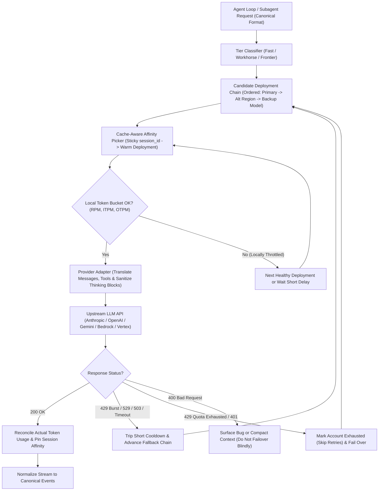

> **Module 7: Reliability & Evaluation** | Prerequisites: Chapters 05, 08 & 38 | Reading Time: ~22 min
>
> [← 38. Telemetry, Tracing & Token/Cost Accounting](./38-telemetry-tracing-and-token-cost-accounting.md) | [Table of Contents](../README.md) | [40. Agent Evaluation Harnesses & Benchmarks →](./40-agent-evaluation-harnesses-and-benchmarks.md)

# 39. Model Routing & Rate-Limit Fallbacks

In Chapter 05, you learned how to retry a single failed API call with exponential backoff. In Chapter 08, you learned how prompt caching cuts input costs by up to 90% and slashes latency when your conversation prefix stays stable.

Now imagine your coding agent grows up. Instead of one user running one session on one API key, you have dozens of developers, parallel subagents firing simultaneously, and long 50-turn debugging sessions. Suddenly, relying on a single hardcoded model endpoint creates three painful problems:
1. **You overpay wildly** by sending tiny housekeeping tasks (summarizing a tool output or generating a session title) to your slowest, most expensive frontier model.
2. **A single regional hiccup (`429` or `529`) freezes every user**, even when another cloud region or backup model is sitting wide open.
3. **Naively switching models mid-session crashes with `400 Bad Request`** or silently destroys your prompt cache, multiplying your bill overnight.

This chapter teaches you how to build a production-grade **model routing and failover layer**: normalizing vendor APIs behind one clean interface, matching tasks to the right model tier, proactively respecting multi-dimensional rate limits, preserving prompt-cache locality, and safely handling cross-model handoffs without breaking thinking blocks or tool calls.

---

## 1. The Simple Idea (Zero-Jargon Intuition)

Imagine running a busy, high-end restaurant kitchen. Three everyday operational decisions keep dinner service smooth:

1. **Standard kitchen bins at the receiving dock (Provider Abstraction):** One supplier delivers tomatoes in wooden crates, another in vacuum bags, and a third in cardboard boxes. Your line cooks shouldn't care who packed them: the receiving dock unpacks every delivery into the exact same labeled stainless-steel bins before it enters the kitchen.
2. **Right cook for the right job (Tiered Routing):** You do **not** pay your Michelin-star head chef \$120/hour to peel potatoes or wipe menus. Prep cooks handle fast, repetitive work; the head chef focuses exclusively on complex sauces and delicate plating.
3. **Backup suppliers without abandoning a hot stove (Fallbacks & Cache Locality):** If Farm A's delivery truck gets stuck in traffic, you switch smoothly to Farm B so dinner service never stops. Crucially, you keep cooking at the *same hot stove* instead of moving your half-cooked stew to a cold kitchen on every single stir, and once you do move to a backup station, you stay there until the dish is done so you don't reheat two ovens!

**Model routing and failover** applies those exact three instincts to LLM APIs:
- **Normalize** every provider's quirks into one canonical internal format.
- **Route** cheap/fast sub-tasks to lightweight models and hard reasoning to frontier models.
- **Fail over** gracefully across regions, accounts, or models when rate limits or outages hit, while protecting your warm prompt caches and stripping vendor-specific state that other models cannot read.

### What breaks if you don't build this layer?
- **Brittle vendor lock-in:** Your core agent loop gets tangled in `if provider == "anthropic": ... elif provider == "openai": ...` conditionals that break whenever a vendor updates its SDK.
- **Runaway latency & spend:** Running a 10-second frontier reasoning call just to summarize a git diff or title a chat thread makes the UI feel sluggish and inflates monthly API bills by 3×–5×.
- **Mid-session failover crashes:** Failing over from Claude to Gemini or GPT on Turn 14 sends opaque cryptographic thinking signatures to a provider that rejects them immediately with HTTP `400`.
- **Silent cache destruction:** Round-robin load balancing across three regions turns a 90% prompt-cache hit rate into a 33% hit rate, quietly tripling input token costs.

---

## 2. Why This Matters in a Real Agent Harness

A modern coding harness does far more than send one prompt to one chat model. Inside a single user task, the harness may make **40–150 LLM calls** across the main loop, background compaction, title generation, subagent researchers, and safety classifiers.

- **Uptime under real cloud conditions:** Frontier LLM endpoints regularly experience burst rate limits (`429 Too Many Requests`), peak-hour capacity saturation (`529 Overloaded` on Anthropic, `503 Service Unavailable` on cloud hosts), and regional brownouts. Multi-region and multi-provider fallback turns a hard outage into a brief, invisible pause.
- **Unit economics (3×–6× cost reduction):** Frontier models are often **5× to 25× more expensive** per token than fast-tier models (e.g., Claude Haiku, Gemini Flash, GPT-mini). Routing lightweight internal harness jobs to fast models preserves frontier quality where it matters while keeping per-task cost sustainable.
- **Parallel subagent survivability:** As we saw in Chapter 26, spawning 5 read-only subagents multiplies your immediate token throughput by 5×. Without a local **token-bucket rate limiter** tracking Input Tokens Per Minute (ITPM), parallel subagents immediately slam into provider `429` walls and trigger cascading retries.

---

## 3. The Big Picture

Every LLM request from your agent loop should pass through a single **Model Gateway / Router** before touching the network. Notice how the router separates *task tiering*, *proactive rate limiting*, *cache-sticky deployment selection*, and *cross-provider translation*:



---

## 4. Deep Dive: Subtopic by Subtopic

### 4.1 Provider Abstraction Layers (Normalizing the Tower of Babel)

No two LLM vendors agree on the wire format for messages, tools, reasoning traces, or errors. Even within a single vendor, APIs evolve (for example, OpenAI's shift from Chat Completions to the stateful **Responses API**, or Anthropic's **Messages API** vs. AWS Bedrock's `Converse` wrapper).

A **provider abstraction layer** (also called a **model adapter**) defines one clean, internal **Canonical Intermediate Representation (IR)** that the rest of your harness speaks exclusively. Thin adapter modules translate between your canonical format and each vendor's wire protocol at the very edge of your system.

Here are the five concrete places where major providers diverge in 2025–2026:

| Dimension | Anthropic Messages API (`/v1/messages`) | OpenAI Responses API (`/v1/responses`) | Google Gemini API (`generateContent`) |
| :--- | :--- | :--- | :--- |
| **System Prompt** | Top-level `system` array (supports `cache_control` blocks). | Top-level `instructions` string or `developer` role item. | Top-level `systemInstruction` content object. |
| **Tool Definition** | `{name, description, input_schema}` (standard JSON Schema). | `{type: "function", name, description, parameters, strict}`. | `functionDeclarations: [{name, description, parameters}]` (OpenAPI 3.0 subset). |
| **Tool Call & Result** | Assistant block `type: "tool_use"` (`id`); User block `type: "tool_result"` (`tool_use_id`). | Output item `type: "function_call"` (`call_id`); Input item `type: "function_call_output"` (`call_id`). | Part `{functionCall: {name, args}}`; User part `{functionResponse: {name, response}}`. |
| **Thinking / Reasoning** | Explicit `type: "thinking"` block + cryptographic `signature` string (`signature_delta` in SSE). | Encapsulated `reasoning` items (summary + opaque encrypted content for stateless replay). | Part with `thought: true` + opaque `thought_signature` attached to content/tool parts. |
| **Prompt Caching** | Explicit `"cache_control": {"type": "ephemeral"}` breakpoints (up to 4). | Automatic prefix caching + optional `prompt_cache_key` routing hint. | Implicit prefix caching on newer models + explicit `cachedContents` resource API. |
| **Overload / Limit Codes** | `429 rate_limit_error`, **`529 overloaded_error`**. | `429 rate_limit_exceeded` vs. `insufficient_quota`, `503`. | `429 RESOURCE_EXHAUSTED`, `503 UNAVAILABLE`. |

#### Designing a Clean Canonical Representation
Instead of storing raw vendor JSON inside your session transcript, store **canonical typed blocks**: while keeping a small, tagged `provider_meta` escape hatch for vendor-specific opaque fields (like thinking signatures):

```typescript
// Canonical internal types shared by the entire harness
export type ContentPart =
  | { type: "text"; text: string }
  | {
      type: "thinking";
      text: string;
      // Opaque cryptographic signature or encrypted payload bound to ONE vendor+model
      signature?: string;
      originProvider?: "anthropic" | "openai" | "gemini";
      originModel?: string;
    }
  | { type: "tool_call"; id: string; name: string; arguments: Record<string, unknown> }
  | { type: "tool_result"; toolCallId: string; name: string; content: string; isError: boolean };

export interface CanonicalMessage {
  role: "user" | "assistant";
  parts: ContentPart[];
}

export interface CanonicalError {
  kind:
    | "rate_limit_burst"   // 429 RPM/ITPM/OTPM — retryable or failover
    | "quota_exhausted"    // 429 out of credits — do NOT retry same account
    | "overloaded"         // 529 / 503 — capacity crunch, failover quickly
    | "context_too_long"   // 400 — trigger compaction, not failover
    | "auth_error"         // 401 / 403 — bad key
    | "invalid_request"    // 400 — harness schema/history bug
    | "transient_network"; // 500 / 502 / 504 / timeout
  retryAfterMs?: number;
  provider: string;
  rawStatus?: number;
  message: string;
}
```

Notice the power of `CanonicalError`: your retry engine and fallback router never have to parse vendor-specific strings like `"overloaded_error"` or `"RESOURCE_EXHAUSTED"`. Every adapter maps raw HTTP statuses and JSON error bodies into one of those seven clean buckets.

---

### 4.2 Tiered Model Routing (Fast/Cheap vs. Frontier Models)

If you use a frontier reasoning model for every single call in your harness, you are burning money and adding seconds of latency to operations that a model 15× cheaper can solve in 300 milliseconds.

**Tiered model routing** assigns each internal call site in your harness to a **capability tier** rather than hardcoding a single global model name:

| Tier | Typical Roles in a Coding Harness | Speed / Cost Profile | Example Model Class |
| :--- | :--- | :--- | :--- |
| **Tier 0: Deterministic Code** | File search (`ripgrep`), syntax checks, token counting, secret redaction, diff application. | Instant / \$0 | Plain code (no LLM!) |
| **Tier 1: Fast & Cheap** | Conversation titles, commit message drafts, tool-output summarization, read-only search subagents, web-page extraction, intent/safety classification. | Very fast (TTFT < 300ms) / 1× baseline cost | Haiku / Flash / GPT-mini |
| **Tier 2: Workhorse Coding** | Day-to-day feature implementation, writing unit tests, refactoring well-scoped modules, multi-turn debugging. | Balanced / ~5×–10× Tier 1 | Sonnet / mid-tier frontier |
| **Tier 3: Frontier Reasoning** | Architectural planning, subtle concurrency/memory bugs, security audits, complex multi-file refactors, high-stakes code review. | Slower (thinking overhead) / ~15×–30× Tier 1 | Opus / Gemini Pro / high-reasoning o-series |

#### Two Ways to Route: Static Role Routing vs. Cascading Escalation
1. **Static Role Routing (Recommended Default):** The harness itself already knows *why* it is making an LLM call! Summarizing an older transcript during compaction (Chapter 10) or naming a session is explicitly tagged `tier="fast"`. Planning a complex refactor (Chapter 30) is tagged `tier="frontier"`. Zero extra latency, 100% predictable, and trivially configurable by the user.
2. **Dynamic Cascading (Cheap-First, Escalate-on-Failure):** For high-volume automated pipelines (like CI code-review bots or bulk test-fixing workflows), you can try a Tier 2 workhorse model first. If deterministic verification (tests/type-check) fails after $N$ attempts, or if the harness detects a doom loop, automatically escalate the task to Tier 3 with a clean summary of what already failed.

> **Important cache nuance:** Never alternate between Tier 1 and Tier 3 *inside the same growing conversation array*. Each model has its own completely separate prompt cache! Keep Tier 1 calls in **isolated side-calls or subagents** (Chapter 26) so the main conversation's warm Tier 2/3 prefix cache remains 100% intact.

---

### 4.3 Handling `429` Rate Limits, Quota Exhaustion, Overload (`529`/`503`), and Regional Outages

One of the most common mistakes in production harnesses is treating every HTTP `429` or `5xx` identically. In reality, you must inspect **both the HTTP status code and the error body/headers** to choose the right recovery action:

| Signal | What Actually Happened | Wrong Reaction | Right Harness Reaction |
| :--- | :--- | :--- | :--- |
| **`429` + `Retry-After: 3`** (Burst Limit) | You briefly exceeded your per-minute RPM, ITPM, or OTPM ceiling. | Immediately abandon a warm 150k-token cache to fail over to a cold provider. | If `Retry-After` is short (e.g., ≤ 5s) and cache is warm, **sleep & retry once**; if longer, fail over to another region/deployment. |
| **`429` + `insufficient_quota` / billing cap** | Your API key ran out of prepaid credits or hit a monthly spend cap. | Sleep 1s, 2s, 4s, 8s, 16s retrying the exact same empty account! | **Fail fast** on this credential, mark deployment disabled, immediately fail over to backup provider/account (or tell the user cleanly). |
| **`529 Overloaded`** (Anthropic) or **`503 Unavailable`** | The vendor's GPU cluster is saturated across all customers right now. | Hammer the overloaded cluster with 10 retries from 8 parallel subagents. | Put that deployment into a **30–60s cooldown** (circuit breaker) and route immediately to a healthy regional host (e.g., Vertex/Bedrock) or fallback model. |
| **`429` from aggregator (`upstream_provider_shared_pool`)** | On gateways like OpenRouter, the *upstream* shared pool is throttled, not your personal key. | Assume your account is banned. | Inspect `error.metadata.limit_source`; route to a different upstream provider hosting the same weights. |
| **TCP Reset / DNS / 504 Regional Outage** | An entire cloud region (e.g., `us-east-1`) is degraded or unreachable. | Retry the dead region on every turn. | Open a **per-region circuit breaker** after 2–3 consecutive failures; shift traffic to secondary region (`us-west-2` or `eu-west-1`) and probe periodically in the background. |

#### Reading Rate-Limit Headers Before You Hit the Wall
Modern LLM APIs return live quota telemetry on *every* successful `200 OK` response:
- **Anthropic:** `anthropic-ratelimit-requests-remaining`, `anthropic-ratelimit-input-tokens-remaining`, `anthropic-ratelimit-output-tokens-remaining`, and their `...-reset` timestamps.
- **OpenAI:** `x-ratelimit-remaining-requests`, `x-ratelimit-remaining-tokens`, `x-ratelimit-reset-tokens`.

A smart router updates its local view of remaining capacity from these headers on every response. If `input-tokens-remaining` drops below your next prompt's estimated size, the router can proactively steer the *next* turn to a secondary deployment **before** ever suffering a failed `429` round-trip!

---

### 4.4 Fallback Chains, Token-Bucket Rate Limiters & Preserving Prompt Cache Locality

Three mechanics work together to make failover fast, calm, and inexpensive:

#### 1. Multi-Dimensional Token-Bucket Rate Limiters (RPM + ITPM + OTPM)
Every LLM deployment enforces **three separate speed limits at the same time**:
- **RPM (Requests Per Minute):** Total HTTP calls allowed per 60 seconds.
- **ITPM (Input Tokens Per Minute):** Total prompt tokens ingested per 60 seconds. *(Note: On Anthropic, cached read tokens often do not count, or count at a reduced rate, against ITPM depending on tier, whereas uncached input tokens count in full!)*
- **OTPM (Output Tokens Per Minute):** Total generated tokens (including thinking tokens!) per 60 seconds.

In coding agents, **ITPM is almost always the first wall you hit**. A single 120,000-token context window sent 4 times in one minute consumes 480,000 ITPM, even though RPM is a tiny 4!

A **Token Bucket** models each limit cleanly: imagine a bucket holding up to $B$ tokens that continuously refills at $r = \text{limit} / 60$ tokens per second. Before sending a request:
1. Estimate input tokens (Chapter 09) and reserve a conservative output budget (e.g., `max_tokens` or rolling p90 output size).
2. Check if all three buckets (`rpm`, `itpm`, `otpm`) have enough tokens available.
3. If yes, deduct the estimate and fire the call; when the response returns with exact `usage` metadata, **reconcile** (refund over-estimated tokens or deduct any shortfall).
4. If no, either wait briefly or immediately try the next deployment in your fallback chain!

For multi-user servers or centralized gateways (like LiteLLM Proxy), these buckets live in **Redis** (e.g., `router:{deployment_id}:itpm:{minute}`) so 20 app servers share one global budget instead of stampeding the provider.

#### 2. Ordered Fallback Chains (Minimize Blast Radius First)
Do **not** jump straight from Claude Opus to a completely different vendor's tiny model at the first hiccup. Order your fallback chain from **smallest behavioral shift** to **largest**:

1. **Hop 0: Same Deployment (Brief Retry):** If `429` has `Retry-After <= 5s`, wait once so you keep your warm KV cache and zero behavioral change.
2. **Hop 1: Same Model Weights, Alternate Host/Region:** e.g., Anthropic Direct $\rightarrow$ Google Vertex AI (`us-east5`) $\rightarrow$ AWS Bedrock (`us-west-2`). Exact same model weights, exact same tool behavior, exact same prompt formatting.
3. **Hop 2: Same Vendor Family, Sibling Model:** e.g., Frontier model $\rightarrow$ Workhorse model from the same family. Keeps tool schemas, prompt style, and safety conventions identical.
4. **Hop 3: Cross-Vendor Frontier Fallback:** e.g., Anthropic $\rightarrow$ OpenAI or Gemini. Last line of defense during a total single-vendor outage; requires full message & thinking-block sanitization (Section 4.5).

#### 3. Preserving Prompt Cache Locality During Routing & Failover
Remember from Chapter 08: prompt caches live physically in the GPU memory (KV cache) of the **specific provider, account, and region** that served Turn 1. AWS Bedrock in `us-east-1` does **not** share a prompt cache with AWS Bedrock in `us-west-2`, and neither shares a cache with Anthropic's direct API.

Two routing rules save you tens of thousands of dollars at scale:
- **Rule 1: Sticky Session Affinity (Never Round-Robin Conversations):** Hash `session_id` (or pin the chosen `deployment_id` in session state) so Turn 1 through Turn 40 of a conversation always hit the **exact same deployment**. On OpenAI, also pass a stable `prompt_cache_key` (e.g., hash of workspace + session ID) so OpenAI's own load balancers route sequential turns to the same warm cache partition.
- **Rule 2 (Sticky Failover (Hysteresis) Don't Flap!):** Suppose Session #42 is pinned to Region A, and on Turn 18 Region A throws `529 Overloaded`. You fail over to Region B and pay a one-time cache-write penalty to warm the 100k-token prefix in Region B. **Update Session #42's sticky pin to Region B!** If you blindly revert to Region A on Turn 19 just because Region A recovered, you throw away Region B's fresh cache and pay a *second* cache-write penalty on Region A (whose 5-minute TTL may already have expired). Only move again if Region B itself fails.

---

### 4.5 Cross-Model Handoff Pitfalls (Thinking Signatures & Tool-Call Conventions)

Failing over on a single stateless prompt ("Summarize this paragraph") is trivial. Failing over on **Turn 17 of a stateful coding agent loop** is notoriously tricky. Three subtle incompatibilities break naive routers:

#### Pitfall A: Incompatible Thinking Blocks & Cryptographic Signatures
Modern reasoning models (Claude with extended thinking, Gemini 2.5/3 thinking models, OpenAI o-series/GPT reasoning models) emit internal reasoning steps alongside cryptographic or opaque **thought signatures**:
- **Anthropic Messages API:** Returns a `thinking` content block with a `signature` string delivered over SSE (`signature_delta`). When replaying that assistant turn to Anthropic during multi-turn tool use, you **must** echo the exact, byte-for-byte untouched `thinking` text and `signature`. Modifying even a trailing newline triggers `400 invalid_request_error`.
- **Google Gemini API:** Attaches an encrypted `thought_signature` directly to response parts (especially parallel `functionCall` parts). Omitting or altering it on replay to Gemini causes validation failures or severe reasoning degradation.
- **OpenAI Responses API:** Emits opaque/encrypted reasoning items bound to OpenAI's server-side validation keys.

**What happens during a cross-model handoff?** A signature signed by Anthropic's private key is complete gibberish to Gemini or OpenAI (and even between incompatible model generations within the same vendor!). Passing it raw causes an instant `400 Bad Request`, turning your "high-availability fallback" into a hard crash!

**The Fix: The "Strip & Re-Anchor" Pattern**
Your provider adapter must check `originProvider` and `originModel` on every historical `thinking` block before serializing a request:
1. **Same provider + same model family (compatible):** Preserve the exact `thinking` block and `signature` verbatim.
2. **Different provider or incompatible model (cross-model handoff):** **Drop** all foreign `thinking` blocks and opaque signatures completely. Keep the visible `text`, `tool_call`, and `tool_result` parts intact so the factual history of files read, edits made, and tests run is preserved. Optionally prepend a brief developer/system note on the handoff turn (*"Continuing an in-progress coding session after a model switch; review prior tool results before acting"*).

#### Pitfall B: Differing Tool-Call IDs & JSON Schema Dialects
- **Tool-Call ID Formats:** Anthropic generates IDs like `toolu_01A2B3...`, OpenAI uses `call_...`, while stricter providers (like Mistral or older OpenAI-compatible gateways) enforce exact lengths or alphanumeric-only IDs. Solution: keep a deterministic bi-directional ID mapping table (`canonical_id <-> provider_id`) inside each adapter when crossing vendors.
- **Strict JSON Schema Quirks:** OpenAI's `strict: true` structured outputs require `"additionalProperties": false` on every object and *every* key listed in `required` (using `["string", "null"]` for optional fields). Gemini's OpenAPI subset historically rejects certain JSON Schema keywords like `$schema` or `additionalProperties`. Solution: let each adapter normalize/compile your canonical tool schema into that vendor's accepted subset at request time.

#### Pitfall C: Prompt & Tool-Convention Drift
Different model families have strong preferences shaped by their post-training:
- One model may excel at search-and-replace patches while another is heavily post-trained on unified `apply_patch` diffs (Chapter 14).
- One model may expect XML-delimited tags while another follows Markdown sections more strictly.

If your cross-vendor fallback swaps models mid-session, ensure your **tool schemas remain self-describing** (Chapter 03) and avoid hardcoding vendor-specific quirks into the shared conversation history.

---

## 5. How Real Harnesses Do It

- **LiteLLM Proxy & Router:** The most widely adopted open-source LLM gateway. LiteLLM normalizes 100+ providers into one OpenAI/Anthropic-compatible API, tracks per-deployment `rpm`, `tpm`, `itpm`, and `otpm` in memory or Redis, puts failing deployments into configurable cooldown windows on `429`/`529`/`503`, supports explicit `fallbacks` and `context_window_fallbacks` (automatically routing oversized prompts to a 1M-token model), translates Anthropic `cache_control` blocks across Bedrock and Vertex AI, and supports **cache-aware session affinity** so multi-turn conversations stay pinned to warm deployments.
- **OpenRouter:** Acts as a managed multi-provider router with built-in provider ordering (`provider.order`), automatic fallback across multiple cloud hosts serving the same weights (e.g., Anthropic Direct, Bedrock, Vertex), sticky prompt-cache routing, and structured `error.metadata.limit_source` telemetry so clients know whether a `429` came from their own key or a shared upstream pool.
- **Vercel AI SDK:** Provides a clean TypeScript provider abstraction (`LanguageModelV2`) and composable middleware (`wrapLanguageModel`) so harnesses like **OpenCode** can swap between Anthropic, OpenAI, Google, Bedrock, and local models without rewriting the agent loop; handling reasoning-part normalization and mid-session model switching inside provider adapters.
- **Claude Code:** Uses **tiered internal routing**: delegating lightweight tasks (like session summarization, command classification, and fast read-only `Explore` subagents) to fast Haiku-class models while keeping the primary editing loop on Sonnet/Opus. It also abstracts the backend transport so enterprise teams can point the exact same harness at the Anthropic API, AWS Bedrock, Google Vertex AI, or Microsoft Foundry.
- **Aider (`architect` / `editor` mode):** Pioneered explicit two-model task tiering for coding harnesses: a strong reasoning model (`architect`) analyzes the codebase and writes a natural-language change plan, while a faster, cheaper model (`editor`) translates that plan into exact file search-and-replace diffs; combining frontier reasoning with fast, inexpensive code editing.

---

## 6. Common Pitfalls & Failure Modes

1. **Naive Round-Robin Load Balancing Destroys Your Cache:** Splitting Turns 1, 2, 3, and 4 across Regions A, B, A, B drops your prompt-cache hit rate near zero, inflating both TTFT latency and input spend by up to 5×–10×. *Fix:* Pin each `session_id` to one deployment using sticky affinity.
2. **Failover Flapping (Double Cache-Write Tax):** Failing over from Region A to Region B on Turn 15, warming Region B's cache, and then immediately bouncing back to Region A on Turn 16 forces you to pay cache-write overhead twice. *Fix:* Update the session's sticky deployment pointer whenever failover succeeds.
3. **Passing Raw Thinking Signatures Across Models:** Forwarding Anthropic `thinking` blocks or Gemini `thought_signature` payloads to a fallback vendor triggers instant `400 Bad Request` loops, making your failover path completely unusable during real outages. *Fix:* Tag every thinking block with `originProvider` + `originModel` and strip foreign blocks during cross-model translation.
4. **Retrying Exhausted Quotas Like Burst Limits:** Treating `429 insufficient_quota` identically to `429 rate_limit_exceeded` wastes 30–60 seconds of exponential backoff on a dead billing key. *Fix:* Classify `quota_exhausted` separately in your adapter and immediately trip a long cooldown to fail over.
5. **Tracking Only RPM While Getting Crushed by ITPM:** Coding agents send massive contexts at low request frequency. A rate limiter that only checks `rpm < 50` will still slam into `429` on Turn 3 when 4 parallel subagents push 400,000 input tokens in 10 seconds. *Fix:* Enforce simultaneous `rpm`, `itpm`, and `otpm` token buckets and reconcile against live provider headers.
6. **Silent Downgrade to a Weak Model on High-Risk Tasks:** Quietly falling back from a frontier model to a tiny fast model mid-database-migration can cause subtle, dangerous code bugs while the user assumes the frontier model is still driving. *Fix:* Restrict automatic fallbacks to **capability-equivalent peers**, log every fallback visibly in the UI/telemetry (Chapter 38), and escalate to the human rather than silently downgrading below your safety floor.

---

## 7. Build It Yourself: Mini-Lab

Below is a clean, self-contained Python blueprint implementing the core pieces of a production router:
1. A multi-dimensional **TokenBucket** tracking RPM and ITPM simultaneously.
2. **Cross-model history sanitization** that preserves exact thinking signatures for same-model calls and cleanly strips foreign thinking blocks on cross-model failover.
3. A **Cache-Sticky Fallback Router** with deployment cooldowns, quota vs. burst classification, and failover hysteresis (no flapping!).

```python
from __future__ import annotations
from dataclasses import dataclass, field
import time
from typing import Any, Callable


@dataclass
class TokenBucket:
    """Continuous-refill rate limiter for one dimension (e.g., RPM or ITPM)."""
    capacity_per_min: float
    tokens: float = field(init=False)
    last_refill: float = field(default_factory=time.monotonic)

    def __post_init__(self) -> None:
        self.tokens = self.capacity_per_min

    def _refill(self) -> None:
        now = time.monotonic()
        elapsed = now - self.last_refill
        rate_per_sec = self.capacity_per_min / 60.0
        self.tokens = min(self.capacity_per_min, self.tokens + elapsed * rate_per_sec)
        self.last_refill = now

    def try_consume(self, amount: float) -> bool:
        self._refill()
        if self.tokens >= amount:
            self.tokens -= amount
            return True
        return False

    def refund(self, amount: float) -> None:
        """Reconcile over-estimated tokens after seeing real API usage metadata."""
        self._refill()
        self.tokens = min(self.capacity_per_min, self.tokens + amount)


@dataclass
class Deployment:
    """One concrete upstream target (provider + region + model)."""
    id: str                      # e.g., "anthropic-direct:claude-sonnet"
    provider: str                # e.g., "anthropic", "vertex", "openai"
    model_family: str            # e.g., "claude-sonnet-4", "gpt-5"
    rpm_bucket: TokenBucket
    itpm_bucket: TokenBucket
    call_fn: Callable[[list[dict[str, Any]]], dict[str, Any]]
    cooldown_until: float = 0.0

    def is_healthy(self) -> bool:
        return time.monotonic() >= self.cooldown_until


class ProviderError(Exception):
    def __init__(self, kind: str, message: str, retry_after_s: float = 0.0) -> None:
        super().__init__(message)
        self.kind = kind  # "rate_limit_burst" | "quota_exhausted" | "overloaded" | "invalid_request"
        self.retry_after_s = retry_after_s


def sanitize_history_for_deployment(
    messages: list[dict[str, Any]], target: Deployment
) -> list[dict[str, Any]]:
    """Preserve exact thinking+signature for compatible models; strip on cross-model handoff."""
    sanitized: list[dict[str, Any]] = []
    stripped_any = False

    for msg in messages:
        new_parts = []
        for part in msg["parts"]:
            if part["type"] == "thinking":
                same_origin = (
                    part.get("origin_provider") == target.provider
                    and part.get("origin_model_family") == target.model_family
                )
                if same_origin:
                    new_parts.append(part)  # Keep untouched (including cryptographic signature)
                else:
                    stripped_any = True     # Drop foreign thinking block to prevent HTTP 400
            else:
                new_parts.append(part)

        # Avoid emitting an empty assistant message if it only contained a thinking block
        if new_parts:
            sanitized.append({"role": msg["role"], "parts": new_parts})

    if stripped_any:
        # Lightweight re-anchoring hint so the incoming model isn't disoriented
        sanitized.append({
            "role": "user",
            "parts": [{
                "type": "text",
                "text": "[System notice: Session handed off across models. Continue from the prior tool results.]",
            }],
        })
    return sanitized


class StickyFallbackRouter:
    """Cache-sticky router with ordered fallbacks, cooldowns, and rate-limit protection."""

    def __init__(self, tier_chains: dict[str, list[Deployment]]) -> None:
        self.tier_chains = tier_chains
        # Maps (session_id, tier) -> deployment_id for prompt-cache locality
        self.session_pins: dict[tuple[str, str], str] = {}

    def _ordered_candidates(self, session_id: str, tier: str) -> list[Deployment]:
        chain = self.tier_chains[tier]
        pinned_id = self.session_pins.get((session_id, tier))
        if not pinned_id:
            return chain
        # Put the warm pinned deployment first to preserve prompt-cache hits
        pinned = [d for d in chain if d.id == pinned_id]
        others = [d for d in chain if d.id != pinned_id]
        return pinned + others

    def complete(
        self,
        session_id: str,
        tier: str,
        messages: list[dict[str, Any]],
        estimated_input_tokens: int,
    ) -> dict[str, Any]:
        last_error: Exception | None = None

        for dep in self._ordered_candidates(session_id, tier):
            if not dep.is_healthy():
                continue

            # Proactive local rate-limit check before hitting the network
            if not dep.rpm_bucket.try_consume(1):
                continue
            if not dep.itpm_bucket.try_consume(estimated_input_tokens):
                dep.rpm_bucket.refund(1)
                continue

            wire_messages = sanitize_history_for_deployment(messages, dep)
            try:
                result = dep.call_fn(wire_messages)
                # Reconcile over-estimated input tokens if actual usage was lower
                actual_in = result.get("usage", {}).get("uncached_input_tokens", estimated_input_tokens)
                if actual_in < estimated_input_tokens:
                    dep.itpm_bucket.refund(estimated_input_tokens - actual_in)

                # Hysteresis: pin session to whichever deployment succeeded so we don't flap!
                self.session_pins[(session_id, tier)] = dep.id
                return result

            except ProviderError as err:
                last_error = err
                if err.kind == "invalid_request":
                    raise  # Harness bug (400) — never mask it by failing over
                elif err.kind == "quota_exhausted":
                    dep.cooldown_until = time.monotonic() + 3600.0  # Disable empty key for 1h
                elif err.kind in ("rate_limit_burst", "overloaded"):
                    cooldown = max(err.retry_after_s, 30.0)
                    dep.cooldown_until = time.monotonic() + cooldown

        raise RuntimeError(f"All deployments exhausted for tier='{tier}': {last_error}")
```

**Try extending this mini-lab:**
- Add an `otpm_bucket` alongside `itpm_bucket` and reconcile actual output tokens from `result["usage"]["output_tokens"]`.
- Add a brief single-attempt sleep (e.g., if `dep.id == pinned_id` and `err.kind == "rate_limit_burst"` and `err.retry_after_s <= 4.0`) before abandoning a warm 150k-token cache!

---

## 8. Key Takeaways & Quick Self-Check

- **Normalize at the edge:** Keep your core agent loop vendor-agnostic using canonical messages, canonical tool schemas, and canonical error classes (`rate_limit_burst`, `quota_exhausted`, `overloaded`, `invalid_request`).
- **Match model tier to cognitive load:** Keep lightweight helper tasks (summarization, titles, read-only search subagents) on fast, cheap models in isolated contexts while reserving frontier models for hard reasoning.
- **Rate-limit all three dimensions:** Coding agents hit **ITPM** (input tokens per minute) far sooner than RPM; track RPM, ITPM, and OTPM locally and read live provider rate-limit headers.
- **Protect prompt-cache locality:** Never round-robin stateful agent turns across regions. Pin each `session_id` to one warm deployment, and update that pin on failover (hysteresis) so you never flap and pay double cache-write penalties.
- **Sanitize thinking blocks on cross-model handoff:** Keep cryptographic thinking signatures untouched when replaying to the *same* model, but **strip** them cleanly whenever crossing provider or model boundaries to avoid instant `400` errors.

### Quick Self-Check

1. **Why does round-robin load balancing across two identical cloud regions (e.g., Bedrock `us-east-1` and `us-west-2`) hurt a coding agent's cost and latency?**
   <details>
   <summary>Show Answer</summary>
   Prompt caches (KV-cache state) are stored locally within each regional inference cluster and are not shared across regions. Alternating turns between `us-east-1` and `us-west-2` causes repeated cache misses and cache writes, eliminating the up-to-90% cached-read discount and dramatically increasing Time-To-First-Token (TTFT). Use sticky session affinity so one session stays on one warm region.
   </details>

2. **Your agent is on Turn 14 using Claude with extended thinking enabled. Anthropic returns `529 Overloaded`, and your router fails over to Gemini. Why does a naive pass-through router immediately crash with HTTP `400`, and how do you fix it?**
   <details>
   <summary>Show Answer</summary>
   Anthropic's `thinking` blocks contain a provider-specific cryptographic `signature` (and schema) that Gemini cannot validate or parse. Failing over across models requires a **"Strip & Re-Anchor"** step in your provider adapter: detect that the historical thinking blocks came from a different provider/model, drop the foreign thinking blocks and signatures, preserve the clean text/tool-call/tool-result history, and pass that clean history to the fallback model.
   </details>

3. **How should your router react differently to a `429` caused by `rate_limit_exceeded` (with `Retry-After: 2`) versus a `429` caused by `insufficient_quota`?**
   <details>
   <summary>Show Answer</summary>
   A `rate_limit_exceeded` error with a 2-second `Retry-After` is a temporary per-minute burst limit: sleeping 2 seconds and retrying on the same warm deployment preserves your prompt cache and succeeds immediately. An `insufficient_quota` error means the account is out of credits or hit a billing cap: retrying it will fail every time, so you must immediately mark that deployment disabled (long cooldown) and fail over to a backup account/provider or alert the user.
   </details>

4. **Why should a coding agent's local rate limiter track ITPM and OTPM in addition to RPM?**
   <details>
   <summary>Show Answer</summary>
   Coding agents have unusually large prompt contexts (50,000–200,000+ input tokens per turn) and often fan out parallel subagents. Even just 4 requests in a minute (far below a typical 50 RPM limit) can consume 600,000+ input tokens and breach the ITPM ceiling. Tracking RPM, ITPM, and OTPM together prevents parallel turns from stampeding the API into cascading `429` errors.
   </details>

---

[← 38. Telemetry, Tracing & Token/Cost Accounting](./38-telemetry-tracing-and-token-cost-accounting.md) | [Table of Contents](../README.md) | [40. Agent Evaluation Harnesses & Benchmarks →](./40-agent-evaluation-harnesses-and-benchmarks.md)
