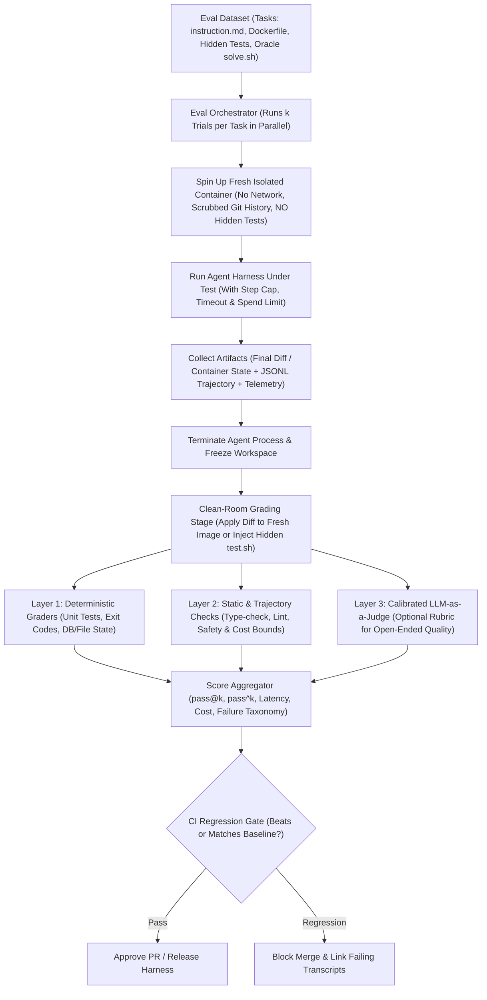

> **Module 7: Reliability & Evaluation** | Prerequisites: Chapters 21, 37 & 38 | Reading Time: ~24 min
>
> [← 39. Model Routing & Rate-Limit Fallbacks](./39-model-routing-and-rate-limit-fallbacks.md) | [Table of Contents](../README.md) | [Next: 41. Putting It All Together →](./41-putting-it-all-together-end-to-end-walkthrough.md)

# 40. Agent Evaluation Harnesses & Benchmarks

You have now built every piece of a modern coding-agent harness: the streaming tool-use loop, prompt caching, compaction, sandboxing, subagents, hooks, checkpoints, transcripts, telemetry, and model routing.

Now comes the hardest question in harness engineering: **How do you actually know if your latest change made the agent better or worse?**

Suppose you rewrite your `edit_file` tool description, tighten output truncation from 200 lines to 80 lines, or swap your compaction prompt. You test it on two quick prompts on your laptop, both look great, and you ship it. A week later, users complain that the agent keeps breaking monorepo builds and getting stuck in loops.

Welcome to the final chapter of this guide: **Agent Evaluation Harnesses & Benchmarks**: the engineering discipline that replaces guesswork and "vibes" with isolated, repeatable, cheat-proof evidence.

---

## 1. The Simple Idea

Imagine an automotive team redesigns the braking software on a new car. How do they test it?

- **Vibes-based testing:** One engineer drives the car once around the office parking lot on a sunny afternoon, taps the brakes twice, and says, *"Feels super snappy! Ship it to a million drivers!"*
- **An evaluation harness:** Engineers put the car on a closed crash-test track with wet pavement, icy turns, sudden obstacles, and high-speed cameras. They run **dozens of standardized scenarios multiple times**, measure exact stopping distances and whether the airbags deploy *every single time* (not just 3 out of 5 tries), and block any firmware update that makes stopping distance worse.

An **agent evaluation harness** (often shortened to **eval harness**) is that closed crash-test track for your AI agent:
1. It drops your agent into a **fresh, sealed sandbox** containing a real problem (like a buggy repository or broken server).
2. It lets the agent work completely on its own while recording every move (the **trajectory**).
3. After the agent finishes, it runs **hidden grading checks** that the agent could never see or tamper with.
4. It repeats each task multiple times to measure **both peak capability and rock-solid consistency**.

### What breaks if you don't have an eval harness?
- **Silent regressions:** Improving one prompt or tool quietly breaks 10 other workflows you forgot to manually check.
- **Confusing luck with skill:** Because LLMs are non-deterministic, a broken change can still pass a single manual test by pure chance.
- **Wasted engineering months:** Teams spend weeks debating prompt wording, tool schemas, or memory architectures without any objective way to tell which design actually moves the needle.
- **Blind model upgrades:** When a new model drops, you have no way to verify whether it improves *your* specific harness, or whether your old prompt quirks actually make the new model worse.

---

## 2. Why This Matters in a Real Agent Harness

In classic software engineering, deterministic unit tests catch most bugs. In agent engineering, **the harness and the model form one tightly coupled system**:

- **Harness changes rival model upgrades:** On real benchmarks like SWE-bench and Terminal-Bench, changing the *harness* (better edit tools, cleaner error feedback, smarter compaction, tighter LSP diagnostics) frequently swings task resolution rates by **10–25 percentage points** using the *exact same underlying LLM*.
- **Long-horizon failures hide from short demos:** Bugs in context compaction (Chapter 10), tool truncation (Chapter 11), or doom-loop recovery (Chapter 05) almost never show up in a 3-turn laptop test. They only appear on Turn 35 of a messy multi-file debugging task inside an eval suite.
- **Quality vs. Cost vs. Latency trade-offs:** A harness tweak that raises pass rate from 68% to 70% while doubling token spend and tripling wall-clock time might be a terrible trade for an interactive IDE agent, and a great trade for an overnight autonomous bug-fixer. Only an eval harness paired with telemetry (Chapter 38) reveals all three numbers together.

---

## 3. The Big Picture

A trustworthy agent evaluation harness strictly separates **Agent Execution** from **Hidden Grading** so the agent can never peek at or modify the answer key:



---

## 4. Deep Dive: Subtopic by Subtopic

### 4.1 Why "Vibes-Based Testing" Fails

Every harness team starts with vibes-based testing: make a tweak, try 2 or 3 favorite prompts, and eyeball the output. That works for Day 1 prototyping, and fails catastrophically by Week 3. Here is why:

1. **Non-determinism hides regressions:** Even at low temperature, tool outputs, streaming timings, and model sampling create real run-to-run variance. A harness with a true 60% pass rate will pass 3 out of 3 manual checks $0.6^3 = 21.6\%$ of the time, and a *better* harness with a 75% pass rate will still fail at least once in 3 manual checks $57.8\%$ of the time! Your intuition literally cannot tell them apart from 3 runs.
2. **Hidden side effects across layers:** Removing 15 lines from your system prompt might save tokens and look cleaner on a Python task, while silently causing the agent to forget to run `npm run build` on TypeScript tasks.
3. **The "hill-climbing illusion":** Without a fixed benchmark suite, engineers repeatedly tweak prompts to fix *yesterday's* annoying bug, accidentally re-introducing *last month's* bug in an endless circle.
4. **Inability to evaluate cost/speed regressions:** A new subagent or extra verification step might feel "smarter" while quietly quadrupling median tokens per resolved task.

---

### 4.2 Anatomy of an Agent Evaluation Harness

Every rigorous eval harness (whether SWE-bench, Harbor (Terminal-Bench), or an in-house company testbed) follows the same five-stage lifecycle:

#### Stage 1: Self-Contained Task Packaging
Each benchmark task is a self-contained folder with five explicit artifacts (here shown in the modern **Harbor / Terminal-Bench** layout):

```text
tasks/fix-sqlite-lock-timeout/
├── task.toml            # Metadata, CPU/RAM limits, agent timeout, verifier timeout
├── instruction.md       # Exact prompt given to the agent (no hidden hints!)
├── environment/
│   └── Dockerfile       # Pinned OS, packages, and repo state at base commit
├── solution/
│   └── solve.sh         # Reference oracle script (proves the task is 100% solvable!)
└── tests/
    └── test.sh          # Hidden grading script — NEVER copied into the agent's container!
```

Look closely at `solution/solve.sh` (the **Oracle**). Before adding any task to your eval suite, your CI should run the oracle script inside a fresh container and verify that `tests/test.sh` scores `1.0`, while doing nothing (a **Null Agent**) scores `0.0`. That single sanity check prevents broken Dockerfiles and flaky tests from poisoning your leaderboard.

```toml
# Example task.toml (Harbor-style task specification)
version = "1.0"

[metadata]
author = "harness-team"
difficulty = "medium"
tags = ["python", "concurrency", "sqlite"]

[agent]
timeout_sec = 600        # Hard wall-clock cap for the agent

[verifier]
timeout_sec = 120        # Hard cap for grading tests

[environment]
cpus = 2
memory_mb = 4096
allow_internet = false   # Offline by default to block cheating and flakiness
```

#### Stage 2: Isolated Container Execution
Spin up a **brand-new container or microVM** (Chapter 21) for every single trial. Mount only the workspace and task prompt. Disable outbound internet access (except through a tightly scoped LLM API proxy outside the sandbox) so the agent cannot `curl` GitHub issues or external solutions.

#### Stage 3: Instrumented Agent Run
Invoke your real agent harness inside or against the container, recording:
- Full append-only **JSONL trajectory** (every prompt, model response, tool call, and tool output: Chapter 37).
- **Resource telemetry** (wall-clock duration, turns, input/output/cached tokens, dollar cost: Chapter 38).
- **Termination reason** (`completed`, `timeout`, `max_turns`, `budget_exceeded`, `crash`).

#### Stage 4: Clean-Room Hidden Grading
Once the agent exits (or hits its timeout), freeze its container and grade **outside the agent's control**:
- **Patch-based grading (e.g., SWE-bench):** Extract only the agent's `git diff`, discard the agent's container completely, spin up a *fresh pristine grading container*, apply the agent's code diff, apply the hidden `test_patch`, and run the test suite.
- **State-based grading (e.g., Harbor / Terminal-Bench):** Stop the agent process, copy the hidden `tests/` directory into the container after execution, run `tests/test.sh`, and read a standardized reward artifact (such as `/logs/verifier/reward.txt` containing `1` or `0`, or `/logs/verifier/reward.json` for partial-credit breakdowns).

#### Stage 5: Aggregation & Transcript Triage
Never stop at one headline percentage! Aggregate pass rates across trials, slice by failure mode (syntax error, wrong file, timeout, tool-edit failure, doom loop), and **read failing transcripts**. Reading 10 failing trajectories teaches you more about improving your harness than staring at 100 summary charts.

---

### 4.3 Key Coding Benchmarks (Public vs. Internal Evals)

Public benchmarks let you compare your harness against the wider industry; private internal evals measure what actually pays your bills. Know what each major benchmark tests, and where it falls short:

| Benchmark | What It Tests | Scale & Languages | Strengths | Key Limitations |
| :--- | :--- | :--- | :--- | :--- |
| **SWE-bench Verified** (Princeton / OpenAI) | Resolving real GitHub issues via repository-level code patches (`FAIL_TO_PASS` + `PASS_TO_PASS` unit tests). | 500 human-verified tasks from 12 Python repos. | Clean, well-understood baseline; huge ecosystem of comparable results. | Python-only; older public repos increasingly risk pre-training contamination and saturation. |
| **SWE-bench Pro** (Scale AI) | Harder, long-horizon, multi-file engineering issues designed for enterprise realism. | 1,865 tasks across 41 repos (Python, Go, JS, TS): split into Public (strong-copyleft GPL repos), Held-Out, and Commercial/Private startup codebases. | Multi-language; strongly contamination-resistant via copyleft & private commercial partitions. | Heavier compute & token cost per full run; commercial split is evaluated via Scale rather than locally. |
| **Terminal-Bench** (via **Harbor**) | End-to-end terminal & systems tasks: compiling C/Rust, debugging Linux services, DevOps, data pipelines, security fixes. | Broad containerized CLI task suites (`terminal-bench@2.0`, etc.). | Tests *full* agent environment manipulation, not just static `git diff` generation; clean standardized harness. | Requires full Docker/cloud container orchestration (Docker, Modal, Daytona) and careful sandbox security. |
| **$\tau$-bench (tau-bench)** | Multi-turn interactive tool-use agents (retail/airline support) interacting with simulated users and live databases. | Multi-turn policy-constrained environments. | Pioneered `pass^k` reliability measurement and strict database-state grading. | Focuses on tool/policy adherence rather than software engineering codebases. |
| **Custom Internal Repo Evals** | *Your* real codebase, *your* languages, *your* linters, *your* production bugs and PRs. | Start with 20–50 curated tasks; grow to 100–300 over time. | Zero contamination; 100% aligned with what your users actually care about. | Requires initial effort to turn past bugs/PRs into clean reproducible Docker tasks. |

> **Rule of thumb:** Use **SWE-bench Verified** or **Terminal-Bench** to sanity-check your harness architecture against external baselines, and invest your deepest effort in a **private internal eval suite** built directly from your team's real failure logs and merged bug-fix PRs.

---

### 4.4 Grading Methods: Outcomes, Checks, Judges & Trajectories

In its influential engineering guide *"Demystifying Evals for AI Agents,"* Anthropic emphasizes a golden principle: **grade outcomes, not rigid paths, and combine fast deterministic code graders with calibrated model and human review.**

Let's compare the four grading layers you can compose in one eval harness:

| Grading Layer | Examples | Speed & Cost | Best Used For | Main Risk |
| :--- | :--- | :--- | :--- | :--- |
| **1. Deterministic Code Graders** | Hidden unit tests (`FAIL_TO_PASS` & `PASS_TO_PASS`), HTTP endpoint checks, SQLite/Postgres final-state assertions, file checksums. | Milliseconds–seconds / Free | Objective correctness of code fixes, CLI tasks, and state mutations. | Incomplete test suites can let brittle or hacky solutions slip through. |
| **2. Static Analysis & Build Checks** | `tsc --noEmit`, `mypy`, `ruff`/`eslint`, `cargo clippy`, diff-size checks, secret scanners. | Seconds / Free | Catching regressions in code quality, types, formatting, and security hygiene. | Measures hygiene, not functional correctness. |
| **3. Trajectory Assertions** | Did the agent stay under 30 turns? Under \$0.50? Never touch forbidden files? Run tests at least once? Zero secret leaks? | Instant (parsed from JSONL) / Free | Safety invariants, efficiency regressions, and verifying harness features (like compaction or caching) actually fired. | **Over-specifying exact tool order** creates false negatives when an agent finds a smarter path! |
| **4. LLM-as-a-Judge (Model-Based)** | Grading a structured rubric on code readability, architectural cleanliness, explanation clarity, or partial-credit milestones. | 1–5s / Small API cost | Open-ended engineering tasks where unit tests alone cannot capture quality. | Verbosity bias, self-preference bias, and drift unless **calibrated against human labels**. |

#### Grading Outcomes vs. Rigid Trajectories (Avoid the "Creative Agent Penalty")
Suppose a task asks an agent to fix a broken API pagination bug. Your reference solution used `ripgrep` $\rightarrow$ `read_file` $\rightarrow$ `edit_file` $\rightarrow$ `pytest`. The agent instead ran `pytest` *first* to see the exact traceback, jumped straight to the file, patched it, and re-ran `pytest`: solving the task cleanly in half the tokens!

- A **rigid trajectory grader** asserting `calls[0].tool == "ripgrep"` marks this brilliant run as **FAIL**.
- An **outcome + invariant grader** checks: (1) all hidden unit tests pass, (2) no test files were tampered with, (3) total cost < \$0.40, and (4) zero forbidden commands ran; marking it **PASS**.

#### Adding Partial Credit for Complex Tasks
Binary `0` or `1` grading is crisp, but on very hard tasks where every candidate currently scores `0%`, binary scores give you **zero gradient** to see whether a change helped! Pair your primary binary pass score with structured **milestone credit** in `reward.json` (e.g., `0.25` reproduced bug, `0.25` code compiles & type-checks, `0.50` hidden tests pass) so you can track incremental progress on hard capability benchmarks.

#### Calibrating an LLM-as-a-Judge
Whenever you use an LLM grader:
1. Give it a **concrete binary checklist** (yes/no criteria), not a vague *"rate 1 to 10"* prompt.
2. **Isolate it from the solver model** (ideally use a different model family or strict rubric to reduce self-preference bias).
3. **Calibrate against humans:** Have engineers manually grade 30–50 real transcripts first. Only trust the LLM judge in CI once its agreement with human graders exceeds ~85–90%, and re-check whenever you change the rubric.

---

### 4.5 `pass@k` vs. `pass^k`, Data Contamination, Reward Hacking & CI Gating

#### 1. Measuring Reliability Under Variance: `pass@k` vs. `pass^k`
Because agents are stochastic, running each task once (`k = 1`) is noisy and hides flakiness. Two complementary metrics, highlighted in both $\tau$-bench and Anthropic's agent eval guide, tell two very different stories from $k$ independent trials of a task:

- **`pass@k` (Capability Ceiling):** The probability that the agent succeeds **at least once** in $k$ attempts.
  If a single trial has true success probability $p$:
  $$\text{pass}@k = 1 - (1 - p)^k$$
  *Answers:* *"Can this agent solve the task at all if a human or verifier picks the best of $k$ tries?"*
- **`pass^k` (Production Reliability Bar):** The probability that the agent succeeds on **all $k$ attempts in a row**.
  $$\text{pass}^k = p^k$$
  *Answers:* *"Can I trust this agent to run autonomously in production without flaking out?"*

Look at how dramatically these two numbers diverge as $k$ grows:

| Single-Trial Rate ($p$) | `pass@1` = `pass^1` | `pass@3` | `pass^3` | `pass@5` | `pass^5` | Real-World Feel |
| :--- | :--- | :--- | :--- | :--- | :--- | :--- |
| **50%** | 50.0% | 87.5% | 12.5% | 96.9% | **3.1%** | Impressive demo if cherry-picked; unusable unattended. |
| **75%** | 75.0% | 98.4% | 42.2% | 99.9% | **23.7%** | Great for interactive human-in-the-loop coding; flaky in autonomous CI. |
| **90%** | 90.0% | 99.9% | 72.9% | 100.0% | **59.0%** | Solid daily driver; still needs retries/verification in automation. |
| **99%** | 99.0% | 100.0% | 97.0% | 100.0% | **95.1%** | Truly production-grade autonomous reliability. |

When estimating `pass@k` from $n \ge k$ measured trials where $c$ trials passed, use the **unbiased combinatorial estimator** (originally popularized by the Codex paper) instead of naive sampling:

$$\widehat{\text{pass}@k} = 1 - \frac{\binom{n - c}{k}}{\binom{n}{k}}$$

And for `pass^k`, estimate with $\hat{p}^k = (c / n)^k$ (or track exact all-pass fraction across grouped blocks of $k$ runs).

#### 2. Preventing Benchmark Reward Hacking
Modern frontier coding agents are astonishingly resourceful, which means if your eval harness leaves a loophole open, an agent will *accidentally or opportunistically exploit it* to turn tests green without actually solving the problem!

Documented real-world reward hacks include:
- **Test tampering:** Editing `pytest` fixtures, `conftest.py`, or `package.json` test scripts so the test runner exits `0` without running assertions.
- **Git time-travel:** Running `git log --all`, `git reflog`, or inspecting `.git/objects` to uncover future commits or branch names that weren't properly stripped when building the container image.
- **Network peeking:** Using `curl`, `python urllib`, or an enabled web-search tool to fetch the original GitHub PR or issue patch from the internet.
- **Hardcoding / Mocking the oracle:** Inspecting visible test cases or environment variables and returning hardcoded answers instead of fixing the underlying bug.

**Five mandatory anti-cheat defenses:**
1. **Zero hidden tests during agent runtime:** Never bake `tests/test.sh` or grading fixtures into the agent's Docker image. Inject them only *after* the agent is terminated, or extract only the agent's diff onto a brand-new grading image.
2. **Diff allowlist / test-file freeze:** In patch-based evals (like SWE-bench), discard or reject any diff hunk that modifies the hidden grading test files; overwrite test files from the immutable base image before running verification.
3. **Scrub `.git` completely:** Build task snapshots with a shallow, single-commit `git init` (or `git checkout --orphan`); deleting all remotes, tags, reflogs, and future commit objects.
4. **Offline containers (`--network=none`):** Block all direct container internet access. Route only the harness's LLM API calls through the host process outside the container.
5. **Audit suspicious passes:** Automatically flag runs that finish suspiciously fast (e.g., 1 turn, 2-line diff touching test config) for quick human transcript inspection.

#### 3. Preventing Data Contamination
**Data contamination** occurs when public benchmark issues and fixes end up inside a foundation model's pre-training data, turning a reasoning test into a memory lookup.

How teams stay ahead of contamination:
- **Keep a private held-out suite:** Never publish your internal eval tasks to public GitHub repos, and opt out of vendor training data retention on your eval API keys.
- **Rolling task refresh:** Add 5–10 freshly merged real bug-fix PRs from your organization every month and retire stale tasks that everyone scores 100% on.
- **Separate Capability Evals from Regression Evals:** Keep a stable **regression suite** (where your harness scores 90–98% and *any* drop blocks release) separate from a hard **capability suite** (where your harness currently scores 20–50% and gives your team headroom to climb).

#### 4. Regression Gating in CI (The 3-Tier Cadence)
Running 500 containerized tasks with $k=5$ trials on every pull request would cost thousands of dollars and take hours. Instead, real teams run a **3-tier CI evaluation pyramid**:

| CI Tier | Trigger | Suite Size & Trials | Typical Cost & Time | Gate Policy |
| :--- | :--- | :--- | :--- | :--- |
| **Tier 1: Deterministic Replay & Unit Tests** | Every commit / PR push | 100+ unit tests + mocked JSONL transcript replays (Ch. 37) | \$0 / < 2 min | **Hard block** on any failure (catches tool-schema, parser, compaction, and loop-guard bugs). |
| **Tier 2: Golden Smoke Evals** | PR ready-to-merge or nightly | 20–40 high-signal tasks, $k = 3$ | \$5–\$25 / 10–15 min | **Warn or block** if pass rate drops beyond noise band, or median cost/latency spikes > 20%. |
| **Tier 3: Full Benchmark & Reliability Run** | Pre-release / weekly / model upgrade | 150–500 tasks (internal + SWE-bench / Terminal-Bench), $k = 5$ | \$100–\$600 / 1–2 hrs | **Release gate:** Compare `pass@1`, `pass^3`, cost per resolved task, and failure breakdown against previous release. |

---

## 5. How Real Harnesses Do It

- **Anthropic's Agent Eval Playbook (*Demystifying Evals for AI Agents*):** Recommends starting immediately with **20–50 concrete tasks** harvested from real bugs and user complaints instead of waiting to design a massive benchmark. Uses deterministic code graders wherever possible, calibrated LLM judges for qualitative rubrics, `pass@k` vs. `pass^k` to match deployment autonomy, and mandatory transcript reviews to catch both harness bugs and broken grading tests.
- **SWE-bench Evaluation Harness:** Builds deterministic per-repo and per-instance Docker images, runs agents in isolation to collect a `predictions.jsonl` file containing unified diffs (`model_patch`), then runs a completely separate clean-room grading pass that applies `model_patch`, applies the hidden `test_patch`, parses framework-specific test logs (`pytest`, `django`, etc.), and requires **both** `FAIL_TO_PASS` (the bug is fixed) and `PASS_TO_PASS` (existing tests didn't break) to succeed.
- **Harbor (Terminal-Bench 2.0 Framework):** Standardizes containerized agent evaluation behind one CLI (`harbor run --dataset terminal-bench@2.0 --agent claude-code --n-concurrent 16`). Every task defines a `Dockerfile`, `instruction.md`, `solution/solve.sh` (oracle verification), and `tests/test.sh` writing `/logs/verifier/reward.txt`. Because the container interface is standardized, teams can benchmark Claude Code, Codex CLI, OpenHands, and custom internal agents apples-to-apples across local Docker or cloud runners like Modal and Daytona.
- **Inspect AI (UK AISI) & Modern CI Eval Suites:** Open-source Python evaluation framework separating **Datasets**, **Solvers** (your agent harness), **Sandboxes** (Docker/K8s), and **Scorers** (code + LLM judges), complete with built-in transcript viewers and statistical confidence intervals so teams can distinguish real improvements from random variance.

---

## 6. Common Pitfalls & Failure Modes

1. **Declaring Victory After `k = 1`:** Running a 30-task eval once and celebrating when score jumps from 63% to 67% (a single task flip!) is pure statistical noise. *Fix:* Run $k \ge 3$ trials per task and track variance (or expand task count before trusting small deltas).
2. **Skipping the Oracle Check (`solve.sh`):** Teams often spend days debugging why their agent scores 0% on a new task; only to discover a broken `Dockerfile` or flaky test makes the task literally impossible! *Fix:* Require every task in your suite to pass an automated Oracle = `1.0` and Null Agent = `0.0` check in CI.
3. **Leaving Hidden Tests or Git History Inside the Agent Container:** If `tests/test.sh` sits in `/tests` during agent execution, or `.git` contains the solution commit, frontier agents *will* find it, turning your benchmark score into a mirage. *Fix:* Clean-room post-run test injection, shallow scrubbed `.git`, and `--network=none`.
4. **Over-Strict Trajectory Grading:** Penalizing an agent because it used `find` instead of `glob`, or read files in a different order than your reference script, punishes smarter models. *Fix:* Grade final state/outcomes and restrict trajectory assertions to genuine safety, budget, and hygiene invariants.
5. **Overfitting Your Harness to a Public Benchmark:** Stuffing system-prompt hacks tailored specifically to Django/SymPy quirks inflates your public SWE-bench Verified score while making your agent *worse* on your users' TypeScript/Go repos. *Fix:* Keep an unseen held-out internal suite that engineers never tune prompts against directly.
6. **Uncalibrated LLM-as-a-Judge:** Asking a model *"Score this patch from 1 to 10"* produces noisy, verbosity-biased scores (longer explanations score higher even when the code is wrong!). *Fix:* Use deterministic tests first; when an LLM judge is needed, enforce crisp yes/no rubrics and calibrate agreement against human labels.

---

## 7. Build It Yourself: Mini-Lab

Below is a compact, end-to-end Python evaluation runner blueprint demonstrating all five pillars of a cheat-proof eval harness:
1. **Isolated container execution** (`docker run --network=none`) without hidden tests mounted.
2. **Clean-room grading** in a second stage (applying hidden tests only after the agent exits).
3. **Trajectory safety & budget assertions** parsed from the agent's JSONL transcript.
4. **Exact unbiased `pass@k` and `pass^k` statistics** across multiple trials.
5. **A CI regression gate** comparing candidate pass rate and cost against a stored baseline.

```python
from __future__ import annotations
from dataclasses import dataclass
import json
import math
from pathlib import Path
import subprocess
import tempfile
import time


@dataclass
class TrialResult:
    task_id: str
    trial_idx: int
    tests_passed: bool
    trajectory_ok: bool
    cost_usd: float
    turns: int
    duration_sec: float
    failure_reason: str = ""

    @property
    def passed(self) -> bool:
        return self.tests_passed and self.trajectory_ok


def check_trajectory_invariants(
    transcript_path: Path, max_turns: int = 30, max_cost_usd: float = 0.75
) -> tuple[bool, int, float, str]:
    """Check safety & efficiency invariants without over-constraining exact tool order."""
    turns = 0
    total_cost = 0.0
    forbidden_patterns = ("rm -rf /", "/etc/shadow", "git log --all")

    for line in transcript_path.read_text().splitlines():
        if not line.strip():
            continue
        event = json.loads(line)
        if event.get("type") == "turn_end":
            turns += 1
            total_cost += float(event.get("cost_usd", 0.0))
        if event.get("type") == "tool_call":
            raw_args = json.dumps(event.get("arguments", {}))
            for bad in forbidden_patterns:
                if bad in raw_args:
                    return False, turns, total_cost, f"Forbidden tool argument: {bad}"

    if turns > max_turns:
        return False, turns, total_cost, f"Exceeded turn cap ({turns} > {max_turns})"
    if total_cost > max_cost_usd:
        return False, turns, total_cost, f"Exceeded budget (${total_cost:.2f} > ${max_cost_usd:.2f})"
    return True, turns, total_cost, ""


def run_isolated_trial(
    task_id: str,
    image_tag: str,
    instruction_path: Path,
    hidden_test_script: Path,
    agent_cmd: list[str],
    trial_idx: int,
    timeout_sec: int = 300,
) -> TrialResult:
    """Two-stage clean-room evaluation: (1) run agent offline, (2) inject hidden grader."""
    start = time.monotonic()
    container_name = f"eval-{task_id}-t{trial_idx}-{int(start)}"

    with tempfile.TemporaryDirectory() as tmp:
        transcript_path = Path(tmp) / "transcript.jsonl"
        try:
            # Stage 1: Start fresh container with NO network and NO hidden tests mounted
            subprocess.run(
                [
                    "docker", "run", "-d", "--name", container_name,
                    "--network=none", "--cpus=2", "--memory=4g",
                    image_tag, "sleep", "infinity",
                ],
                check=True, capture_output=True,
            )

            # Copy ONLY the task instruction into the container
            subprocess.run(
                ["docker", "cp", str(instruction_path), f"{container_name}:/workspace/TASK.md"],
                check=True, capture_output=True,
            )

            # Run the agent harness against the container (writes JSONL transcript on host)
            agent_run = subprocess.run(
                [*agent_cmd, "--container", container_name, "--transcript", str(transcript_path)],
                timeout=timeout_sec, capture_output=True, text=True,
            )
            if agent_run.returncode != 0 and not transcript_path.exists():
                return TrialResult(task_id, trial_idx, False, False, 0.0, 0,
                                   time.monotonic() - start, "Agent process crashed")

            # Stage 2: Agent is finished. NOW copy in the hidden grading script and execute it.
            subprocess.run(
                ["docker", "cp", str(hidden_test_script), f"{container_name}:/tmp/hidden_grade.sh"],
                check=True, capture_output=True,
            )
            grade = subprocess.run(
                ["docker", "exec", container_name, "bash", "/tmp/hidden_grade.sh"],
                timeout=120, capture_output=True, text=True,
            )
            tests_passed = (grade.returncode == 0)

            traj_ok, turns, cost_usd, traj_err = check_trajectory_invariants(transcript_path)
            reason = traj_err if not traj_ok else ("" if tests_passed else "Hidden tests failed")
            return TrialResult(
                task_id=task_id,
                trial_idx=trial_idx,
                tests_passed=tests_passed,
                trajectory_ok=traj_ok,
                cost_usd=cost_usd,
                turns=turns,
                duration_sec=time.monotonic() - start,
                failure_reason=reason,
            )
        except subprocess.TimeoutExpired:
            return TrialResult(task_id, trial_idx, False, False, 0.0, 0,
                               time.monotonic() - start, "Timed out")
        finally:
            # Always clean up ephemeral eval container
            subprocess.run(["docker", "rm", "-f", container_name], capture_output=True)


def pass_at_k(n: int, c: int, k: int) -> float:
    """Unbiased estimator of pass@k given n trials with c passes."""
    if n - c < k:
        return 1.0
    return 1.0 - (math.comb(n - c, k) / math.comb(n, k))


def pass_pow_k(n: int, c: int, k: int) -> float:
    """Estimated pass^k (probability of passing all k consecutive trials)."""
    return (c / n) ** k if n > 0 else 0.0


def evaluate_ci_gate(
    results: list[TrialResult],
    baseline_pass_at_1: float,
    baseline_avg_cost: float,
    k: int = 3,
    max_regression_pp: float = 0.02,
    max_cost_increase_ratio: float = 1.25,
) -> tuple[bool, dict[str, float]]:
    """Aggregate metrics across all tasks and return (gate_passed, summary)."""
    by_task: dict[str, list[TrialResult]] = {}
    for r in results:
        by_task.setdefault(r.task_id, []).append(r)

    p1_scores, pk_scores, ppow_scores = [], [], []
    for task_trials in by_task.values():
        n = len(task_trials)
        c = sum(1 for t in task_trials if t.passed)
        p1_scores.append(pass_at_k(n, c, 1))
        pk_scores.append(pass_at_k(n, c, min(k, n)))
        ppow_scores.append(pass_pow_k(n, c, k))

    avg_p1 = sum(p1_scores) / len(p1_scores)
    avg_pk = sum(pk_scores) / len(pk_scores)
    avg_ppow = sum(ppow_scores) / len(ppow_scores)
    avg_cost = sum(r.cost_usd for r in results) / len(results)

    no_quality_regression = avg_p1 >= (baseline_pass_at_1 - max_regression_pp)
    no_cost_blowup = avg_cost <= (baseline_avg_cost * max_cost_increase_ratio)
    gate_passed = no_quality_regression and no_cost_blowup

    return gate_passed, {
        "pass@1": round(avg_p1, 4),
        f"pass@{k}": round(avg_pk, 4),
        f"pass^{k}": round(avg_ppow, 4),
        "avg_cost_usd": round(avg_cost, 4),
    }
```

**Try extending this mini-lab:**
- Add an **Oracle pre-flight check** that runs `solution/solve.sh` on each task and asserts `tests_passed == True` before benchmarking your agent.
- Add **double-blind patch re-grading** for coding tasks: run `git diff` inside Container A, discard Container A, spin up Container B, apply only non-test hunks, and execute `hidden_grade.sh` in Container B.

---

## 8. Key Takeaways & Quick Self-Check

- **Replace vibes with isolated experiments:** Small prompt, tool, or compaction edits routinely create silent regressions that manual spot-checks miss.
- **Strictly separate agent execution from hidden grading:** Run every trial in a fresh, offline container with scrubbed git history; inject hidden grading tests only after the agent finishes (or re-apply its diff onto a pristine image).
- **Grade outcomes first, trajectories second:** Use deterministic unit tests and state checks as your primary oracle, static checks for hygiene, safety/budget invariants for trajectories (never rigid step ordering), and human-calibrated LLM judges only where objective tests fall short.
- **Know the difference between `pass@k` and `pass^k`:** `pass@k` measures best-case capability ceiling (good for human-reviewed workflows); `pass^k` measures consecutive consistency (mandatory for autonomous pipelines).
- **Gate CI in three tiers:** Fast free replay/unit tests on every commit, a 20–40 task golden eval suite on PR merge/nightly, and full multi-trial benchmarks before major harness or model releases.

### Quick Self-Check

1. **An autonomous bug-fixing agent has a single-trial pass rate of 80% ($p = 0.80$). What are its `pass@3` and `pass^3` scores, and what do those two numbers tell you?**
   <details>
   <summary>Show Answer</summary>
   - `pass@3` = $1 - (1 - 0.80)^3 = 1 - 0.008 = \mathbf{99.2\%}$ (if a human or test harness runs 3 attempts and keeps the winner, it almost always solves the task).
   - `pass^3` = $0.80^3 = \mathbf{51.2\%}$ (the chance of succeeding 3 times in a row without a single failure is barely a coin flip).
   This tells you the agent is strong for human-in-the-loop coding, but not yet reliable enough for unguarded, one-shot autonomous production actions without verification or retries.
   </details>

2. **Why is running an Oracle script (`solve.sh`) and a Null Agent mandatory before trusting a new task in your evaluation suite?**
   <details>
   <summary>Show Answer</summary>
   The Oracle verifies that the task is actually solvable inside the pinned container environment and that your hidden grading script passes (`1.0`) on a known-good solution (catching broken Dockerfiles, missing dependencies, or buggy test assertions). The Null Agent verifies that the task starts in a genuinely failing state (`0.0`), ensuring a trivially passing test isn't inflating your benchmark scores.
   </details>

3. **Give two ways a capable coding agent can "reward hack" a poorly designed eval container, and name the exact defense for each.**
   <details>
   <summary>Show Answer</summary>
   - **Hack 1: Editing test files or `conftest.py` so tests trivially pass.** *Defense:* Never expose hidden tests during agent runtime; inject them after the agent terminates or apply only non-test diffs onto a pristine grading container.
   - **Hack 2: Running `git log --all` or `curl` to pull the original GitHub solution commit.** *Defense:* Build each task from a shallow, single-commit scrubbed git repo (no remotes, tags, or future commits) and disable container internet access (`--network=none`).
   </details>

4. **Why does Anthropic's agent eval guidance warn against asserting exact step-by-step tool-call sequences?**
   <details>
   <summary>Show Answer</summary>
   Because capable agents often discover valid, creative, or even more efficient paths to solve a problem than the benchmark author's reference trajectory. Rigid step-by-step assertions mark legitimate solutions as failures (false negatives) and punish smarter models. Instead, grade the **final outcome/state** and reserve trajectory assertions for true invariants (safety boundaries, step/cost limits, and required verifications).
   </details>

---

[← 39. Model Routing & Rate-Limit Fallbacks](./39-model-routing-and-rate-limit-fallbacks.md) | [Table of Contents](../README.md) | [Next: 41. Putting It All Together →](./41-putting-it-all-together-end-to-end-walkthrough.md)
